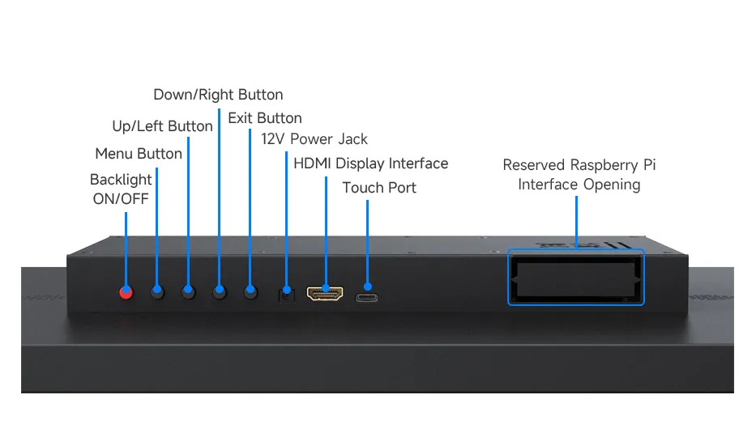
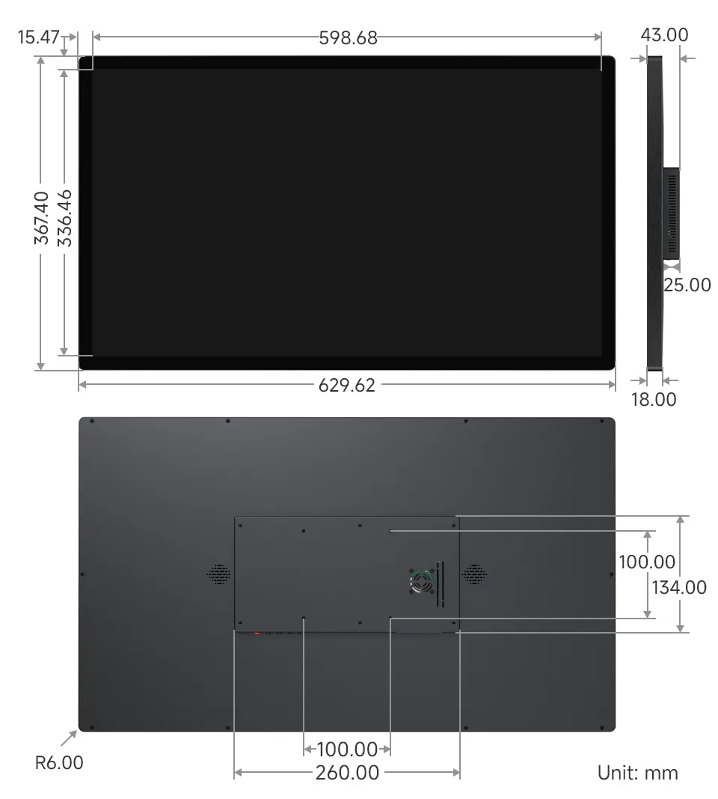

# Waveshare 27-inch FHD Touch Monitor Engineering Guide


[**View Waveshare 27inch Capacitive Touch Monitor 1920x1080 Full HD on OpenELAB**](https://openelab.io/products/waveshare-27inch-capacitive-touch-monitor?variant=45845956198598)

**Model / option:** Default Title · **SKU:** `Waveshare-33975`


## Product overview <a href="#product-and-scope" id="product-and-scope"></a>

The **Waveshare 27inch FHD Monitor, SKU Waveshare-33975**, is a1920×1080 IPS display with capacitive touch. It uses **HDMI for video/audio**, a **separate USB touch connection**, and a **12V power input**. An HDMI picture does not prove touch is connected; the USB touch cable does not power the full monitor.

The current manufacturer option table distinguishes33975 from EU/UK adapter options34082/34083. This guide covers the exact33975 monitor sold by OpenELAB; check the supplied adapter's mains lead/plug before installation. The monitor is a peripheral, so its first result is host video plus correctly mapped input, not an MCU firmware upload. [Exact manufacturer reference](https://docs.waveshare.com/27inch_FHD_Monitor).

## Applications

Use it as a full-size local HMI, Raspberry Pi kiosk, touch workstation or control dashboard. A standardHDMIhost can supply video while aUSBHID-capablehost handles touch independently. The manufacturer documents Windows, Raspberry Pi Linux distributions and Jetson Ubuntu routes, but exact gesture behavior remains an OS/application concern.

For an internalPi installation, plan ventilation, cable strain relief and service access. The body includes a fan/vents; keep them unobstructed. The presence of mounting holes is not permission to use screws of arbitrary length.

## Specifications

| Item                            | Manufacturer value / condition                                                |
| ------------------------------- | ----------------------------------------------------------------------------- |
| Panel                           | 27-inch IPS,1920×1080,60Hz                                                    |
| Viewing angle                   | 178° advertised                                                               |
| Touch                           | 10-point capacitive, bonded glass, up to6H advertised surface hardness        |
| Color / contrast                | 99%sRGB advertised,1500:1 reference contrast                                  |
| Active area                     | Specification table597.88×336.31mm; use the actual mechanical drawing for fit |
| Outer width / height            | 629.62×367.40mm                                                               |
| Depth                           | 18mm panel profile; drawing shows **43mm maximum housing depth**              |
| Input voltage                   | 12V nominal,11.5–12.5V electrical range                                       |
| Supply current                  | At least3A in electrical table; supplied/recommended adapter12V5A             |
| Typical consumption             | 36W reference, not a measured maximum                                         |
| Operating / storage temperature | 0–60°C in manufacturer electrical table                                       |
| Weight                          | 4.92kg reference                                                              |
| Inputs                          | HDMI,USBtouch,12VDC;OSDbuttons                                                |
| Brightness                      | OSD and DDC/CI software control                                               |

Source: [model specification/electrical table](https://docs.waveshare.com/27inch_FHD_Monitor), [power/host instructions](https://docs.waveshare.com/27inch_FHD_Monitor/Instructions-For-Use), and the attributed outline below. The drawing's active-window dimensions differ slightly from the text table; use the drawing and a received-unit measurement for enclosure tolerances. Do not use the18mm panel thickness as the complete installation depth.

## Hardware and connections <a href="#hardware-and-technical-documents" id="hardware-and-technical-documents"></a>

### Separate power, video and touch paths

| Connector  | Connection                                  | Diagnostic boundary                    |
| ---------- | ------------------------------------------- | -------------------------------------- |
| 12Vjack    | Included12V5Aadapter, correct polarity/plug | Backlight/power before host video      |
| HDMI       | Host video output to monitorHDMIinput       | Picture andHDMIaudio                   |
| TouchUSB   | Monitor touch port to hostUSBdata port      | HIDinput enumeration and coordinates   |
| OSDbuttons | Backlight/power,menu,arrows,exit            | Local input/brightness/DDC/CI settings |

The official connector diagram below identifies each port. Use its viewing orientation rather than counting sockets on another Waveshare monitor. Keep12V away from USB and hostGPIO. When power is unstable or the screen flickers, check the adapter/cable and measured voltage; reducing brightness can be a diagnostic, but not a substitute for a suitable supply.

### Mounting and internal Raspberry Pi

The manufacturer reserves internal mounting for **Pi4/5**, with HDMI/power adapter boards. **CM4/CM5 need their own corresponding adapter carrier**, not a bare module pushed into the same cavity. Disconnect mains/DCpower and host power before opening the rear assembly or removing the reserved port cover; prevent metal cuttings from entering electronics.

The outline shows100mm spacing in the mounting pattern and a rear housing deeper than the front panel. Confirm mounting standard, thread and permissible screw engagement from the actual unit/mount hardware before tightening. Support the4.92kgassembly during installation and preserve vent clearance. Use the documented internal power board connection; avoid feeding competing supplies into an installedPi without checking its power design.

No display-panel firmware or pin-levelLCDwiring is needed for normal externalHDMI/USBoperation. The monitor's touchscreen is aUSBdevice, not aPi40-pin sensor.



_Manufacturer figure: Waveshare._ [_Original source_](https://docs.waveshare.com/27inch_FHD_Monitor)_._



_Manufacturer figure: Waveshare._ [_Original source_](https://docs.waveshare.com/27inch_FHD_Monitor)_._

## Software and development resources <a href="#development-software-and-recovery" id="development-software-and-recovery"></a>

| Host                 | Normal starting point                                                                |
| -------------------- | ------------------------------------------------------------------------------------ |
| Windows11/10         | HDMI display plus USBtouch, then TabletPC touchscreen association                    |
| Windows8.1/8/7       | Manufacturer lists support; follow OSdriver/device recognition and touch limitations |
| Raspberry PiOS       | HDMI native1080p60, USBinput, OSscreen/touch mapping                                 |
| Ubuntu/Kali/RetroPie | Manufacturer lists these PiOSpaths; verify actual desktop/gesture support            |
| Jetson Ubuntu        | HDMIorappropriateDP-to-HDMIvideo path plusUSBtouch; check the Jetson carrier output  |

The manufacturer describes driver-free standard display/touch behavior for supported configurations. That does not guarantee every Linux kiosk application exposes ten simultaneous contacts. Begin with the OSinputdevice and a single-pointertest, then use a touch-aware application for multipoint validation.

Software brightness uses **DDC/CI over the HDMI path**. Enable it in the monitorOSDfirst. OnLinuxuse`ddcutil`; onWindows10/11the manufacturer demonstratesTwinkleTray. A dock/splitter/adapter can pass video while blockingDDCcommunication. No customSDKis required for basic display/touch.

## Getting started

### External-host first result

1. Support the monitor on a stable mount, clear the vents and connect the correct 12V 5A adapter. Confirm local OSD/backlight behavior before diagnosing the host.
2. Connect HDMI and select the correct input. In the host's display settings choose **1920 × 1080 at 60Hz**. Confirm that the image fills the active area without unintended overscan.
3. Connect the USB touch data cable. On Windows inspect Device Manager; on Linux inspect the input devices. Changing HDMI timings cannot create a missing USB touch device.
4. On Windows 10/11 open **Control Panel → Hardware and Sound → Tablet PC Settings → Setup**, or search for **Calibrate the screen for pen or touch input**. Tap the Waveshare display when prompted. Press Enter to move the prompt if it appears on another display.
5. Verify touch at the center and near every edge. Rotation must update both the image and its associated input device.

**Expected result:** a stable 1080p60 image, with touches operating this display. An HDMI picture and USB enumeration are separate checkpoints; neither alone proves accurate touch mapping.

### Linux diagnostics and native mode

Collect the actual USB/input devices and connected HDMI outputs:

```bash
lsusb
cat /proc/bus/input/devices
for monitor_status in /sys/class/drm/card*-HDMI-*/status; do
  [ -f "$monitor_status" ] || continue
  printf '%s: ' "$monitor_status"
  cat "$monitor_status"
done
```

Choose 1080p60 in the desktop display settings. The manufacturer's older Pi boot-firmware recipe uses the following lines:

```ini
hdmi_group=2
hdmi_mode=82
hdmi_cvt 1920 1080 60 6 0 0 0
```

Keep this recipe paired with the vendor's specified image/path. It is not a universal replacement for current KMS/Wayland display settings. Back up the boot configuration before editing it.

### Original pointer-grid check

Install Tk support if needed, save the Python program as `monitor_grid.py`, and launch it inside the local graphical session:

```bash
sudo apt install python3-tk
python3 monitor_grid.py
```

```python
import tkinter as tk

root = tk.Tk()
root.title("27-inch FHD touch check")
root.attributes("-fullscreen", True)
canvas = tk.Canvas(root, bg="#121c29", highlightthickness=0)
canvas.pack(fill="both", expand=True)
status = canvas.create_text(100, 100, anchor="nw", fill="white",
                            font=("Sans", 20), text="Tap grid intersections; Esc exits")

def resize(event):
    canvas.delete("grid")
    for column in range(1, 6):
        x = event.width * column // 6
        canvas.create_line(x, 0, x, event.height, fill="#365370", tags="grid")
    for row in range(1, 4):
        y = event.height * row // 4
        canvas.create_line(0, y, event.width, y, fill="#365370", tags="grid")
    canvas.tag_raise(status)

def touch(event):
    width, height = canvas.winfo_width(), canvas.winfo_height()
    canvas.itemconfigure(status, text=f"{width}x{height}: x={event.x}, y={event.y}")
    canvas.delete("last")
    canvas.create_line(event.x-15, event.y, event.x+15, event.y,
                       fill="#ffc857", width=3, tags="last")
    canvas.create_line(event.x, event.y-15, event.x, event.y+15,
                       fill="#ffc857", width=3, tags="last")

canvas.bind("<Configure>", resize)
canvas.bind("<Button-1>", touch)
root.bind("<Escape>", lambda event: root.destroy())
root.mainloop()
```

**Expected result:** the cross appears beneath the finger at grid intersections and coordinates remain consistent across the display. This checks the desktop pointer path. Use a multitouch-aware application to validate simultaneous contacts after mapping works; the program does not measure glass hardness or color gamut.

### DDC/CI brightness

Enable DDC/CI in the monitor OSD. Begin with only this monitor connected so a command cannot change another display. Install the tool, detect the monitor, and read its current brightness:

```bash
sudo apt update
sudo apt install ddcutil
sudo ddcutil detect
sudo ddcutil getvcp 0x10
```

Record the original value, then request a moderate nonzero brightness:

```bash
sudo ddcutil setvcp 0x10 50
```

**Expected result:** luminance and the OSD brightness value change while video and touch remain stable. Restore the recorded value when finished. With multiple monitors, select the actual `ddcutil` display before writing.

On Windows, use Twinkle Tray after enabling DDC/CI. If the software cannot find the monitor, try direct HDMI and the included cable before changing drivers. Normal video can work through an adapter that blocks DDC/CI.

### Optional Raspberry Pi kiosk finish

After video and touch work, configure the kiosk application and check its virtual keyboard, rotation, sleep/wake and power recovery. The Trixie boot-logo procedure in the manufacturer FAQ uses Plymouth and `/usr/share/plymouth/themes/pix/splash.png`. Back up the current asset, confirm this is the active theme, then replace the image with a licensed or original asset. Run `sudo update-initramfs -u` after the theme change. To recover, restore the backed-up asset and regenerate initramfs. This optional cosmetic change is independent of HDMI/USB commissioning.

## Troubleshooting and FAQs <a href="#faqs" id="faqs"></a>

| Symptom                        | Ordered checks                                                                                         |
| ------------------------------ | ------------------------------------------------------------------------------------------------------ |
| No OSD or backlight            | Adapter, polarity, input voltage and local power button                                                |
| OSD works but no picture       | HDMI input, cable, host output and 1080p60 mode; try direct HDMI                                       |
| Picture but no touch           | Separate USB data cable, HID enumeration, then screen association                                      |
| Touch controls another display | Repeat Windows Tablet PC Setup or Linux input/display association                                      |
| Flicker at high brightness     | Included 12V 5A supply, connector and voltage under load; lower brightness temporarily for diagnosis   |
| DDC display not found          | Enable DDC/CI, use a known-good cable, bypass docks/splitters, then capture `ddcutil detect --verbose` |
| Touch wrong after rotation     | Pair display and input rotation, then repeat the grid check                                            |
| Internal Pi does not fit       | Pi 4/5 mounting versus CM4/5 adapter, cable clearance and drawing                                      |
| Mount is too shallow           | Use the drawing's 43mm maximum housing depth, not just the 18mm panel profile                          |
| Heat or fan noise              | Keep the built-in fan and vents clear; do not assume passive cooling                                   |

Manufacturer instructions: [User Guide](https://docs.waveshare.com/27inch_FHD_Monitor/Instructions-For-Use), [FAQ](https://docs.waveshare.com/27inch_FHD_Monitor/FAQ).

## Downloads and technical documents

The port and dimension figures below are original Waveshare diagrams, downloaded and visually reviewed. The dimension figure is particularly useful because it distinguishes panel profile, rear housing and mounting pattern.

| Resource                                                                                                                     | Purpose and exact scope                             |
| ---------------------------------------------------------------------------------------------------------------------------- | --------------------------------------------------- |
| [Officialuserguide](https://docs.waveshare.com/27inch_FHD_Monitor/Instructions-For-Use)                                      | Hostwiring,nativeresolution,DDC/CIandWindowsmapping |
| [Connector diagram](https://docs.waveshare.com/assets/images/Interface-Introduction-1-fc43732b08f276c2ad2c84531df4f7fc.webp) | Originalmanufacturerportdiagram                     |
| [Mechanicaldrawing](https://docs.waveshare.com/assets/images/Size-1478a707364da5da219820bdd6a7de1b.webp)                     | Originaldimensionedoutlineandmountingpattern        |
| [RaspberryPiOSimages](https://www.raspberrypi.com/software/operating-systems/)                                               | OfficialhostOSdownload;notmonitorfirmware           |

## References and validation <a href="#sources-and-validation" id="sources-and-validation"></a>

Reviewed **24 November 2026**: exact SKU 33975, manufacturer specification/electrical tables, host instructions, DDC/CI and FAQ, plus the original connector/outline figures. The pointer-grid program and staged video/touch/brightness checks are original.

**Software installation, video, touch, DDC/CI, Pi mounting, power and colorimetry tests: not run.** Source review supports the procedure; actual multipoint behavior remains dependent on the host OS and application.

* [27inchFHD 27inch\_FHD\_Monitor](https://docs.waveshare.com/27inch_FHD_Monitor) — live24Nov2026.
* [27inchFHD FAQ](https://docs.waveshare.com/27inch_FHD_Monitor/FAQ) — live24Nov2026.
* [27inchFHD Instructions-For-Use](https://docs.waveshare.com/27inch_FHD_Monitor/Instructions-For-Use) — live24Nov2026.

### Retained source links <a href="#official-documentation-and-development-resources" id="official-documentation-and-development-resources"></a>

* [Manufacturer hardware and dimensions](https://www.waveshare.com/product/ai/displays/27inch-fhd-monitor.htm)
