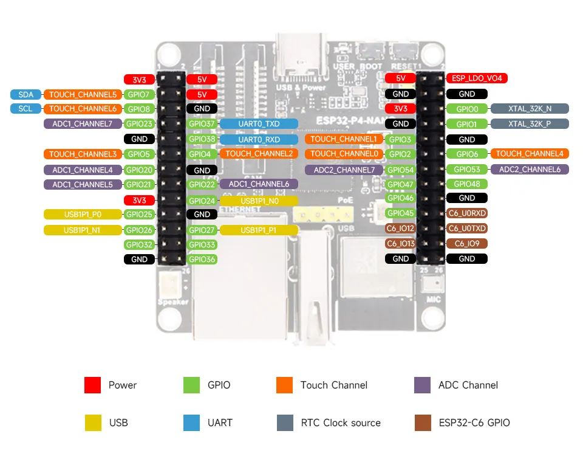

# Waveshare ESP32-P4-NANO Engineering Guide


[**View Waveshare ESP32-P4-NANO High-performance Dev Board Wi-Fi 6 BLE 5 on OpenELAB**](https://openelab.io/products/waveshare-esp32-p4-nano-development-board?variant=45252898783430)

**Model / option:** Kit B · **SKU:** `Waveshare-29028`


## Product overview <a href="#product-and-scope" id="product-and-scope"></a>

The **Waveshare ESP32-P4-NANO Kit B, SKU Waveshare-29028**, is a multimedia MCU board supplied with the **PoE module, 8Ω 2W speaker and mounting hardware**. Kit B does not include the camera of Kit A/C or the display/accessory set of Kit D. The current OpenELAB option selector and [manufacturer SKU table](https://docs.waveshare.com/ESP32-P4-NANO) identify this exact kit.

The board has two processors with different jobs: ESP32-P4 handles application processing, display/camera and wired Ethernet; the ESP32-C6 companion supplies Wi-Fi6/BLE connectivity over SDIO. **ESP32-P4 has no integrated radio.** Its board target is `esp32p4`; flashing a P4 image onto C6 or an S3 example onto P4 is not a compatible shortcut.

This guide begins with USB-UART board/memory verification, then separate Ethernet, wireless, storage, audio and optional display/camera checkpoints.

## Applications

* A networked HMI using a separately selected supported MIPI-DSI panel.
* An Ethernet-connected sensor/control gateway using wired networking before remote Wi-Fi integration.
* Camera preview or a local video server with a supported CSI sensor, image format and frame size.
* An audio/UI development platform with the supplied speaker and board codec/microphone path.

The 1080p hardware video capability does not mean an arbitrary camera, display and simultaneous network stream will run at that rate. Sensor drivers, MIPI timing, buffers and the complete pipeline determine the actual result.

## Specifications

| Parameter               | NANO / purchased Kit B                                                                            |
| ----------------------- | ------------------------------------------------------------------------------------------------- |
| Application MCU         | ESP32-P4, HP dual-core RISC-V up to360MHz in the reviewed board specification; LP core up to40MHz |
| External/package memory | 16MB NOR flash, 32MB stacked PSRAM                                                                |
| Wireless processor      | ESP32-C6-MINI-1, SDIO remote Wi-Fi6/Bluetooth5 path                                               |
| Ethernet                | 100Mbps RJ45, P4 internal MAC with board PHY                                                      |
| Video interfaces        | Two-lane MIPI-DSI and two-lane MIPI-CSI                                                           |
| Media block reference   | ISP up to1920×1080; H.264/JPEG1080p@30fps capability, subject to pipeline configuration           |
| USB-C                   | CH343 USB-UART bridge, power/flashing/logs; not JTAG through this connector                       |
| USB-A                   | USB2.0 high-speed OTG interface                                                                   |
| Main low-voltage supply | 5V USB-C or the documented5V input/header path                                                    |
| PoE accessory in Kit B  | IEEE802.3af, manufacturer reference37–57V input to module, regulated5V/2.5A output                |
| Speaker                 | Supplied8Ω2W, MX1.25 2-pin board connector                                                        |
| RTC backup              | Rechargeable backup battery only on the board's charge-enabled RTC header                         |

Board values: [current NANO guide](https://docs.waveshare.com/ESP32-P4-NANO); PoE module reference: [exact legacy FAQ](https://www.waveshare.com/wiki/ESP32-P4-Nano-StartPage#FAQ). The PoE module's37–57V input is **not** a permitted GPIO/5V-header supply. MCU clock, silicon revision and configured operating frequency are separate facts; record the actual chip revision before choosing build defaults.

## Hardware and connections <a href="#hardware-and-technical-documents" id="hardware-and-technical-documents"></a>

### Power, connectors and reserved signals

With power removed, fit the PoE module only in the orientation shown by the manufacturer and secure its hardware. Begin USB-only to reduce simultaneous power-path ambiguity; test PoE separately using a compliant802.3af source. An ordinary Ethernet switch does not provide PoE, and the board is not a PoE power source for other equipment.

| Peripheral                    | Model-specific assignment/reference                                                      |
| ----------------------------- | ---------------------------------------------------------------------------------------- |
| Expansion I2C                 | SDA GPIO7, SCL GPIO8;3.3V logic, check external pull-ups                                 |
| UART0                         | TX GPIO37 / RX GPIO38 through CH343; avoid occupying this console for another peripheral |
| Ethernet management           | MDC31, MDIO52, PHY reset51 in the platform reference; retain actual PHY configuration    |
| SDMMC                         | CLK43, CMD44, D0=39, D1=40, D2=41, D3=42 in the NANO reference                           |
| I2S audio                     | MCLK13, BCLK12, capture11, WS10, playback9, PA control53                                 |
| DSI / CSI                     | Dedicated two-lane MIPI connectors; not ordinary GPIO/UART headers                       |
| C6 service signals            | C6 UART and C6\_IO9 on dedicated header positions; different processor from P4           |
| USB high-speed / native debug | Dedicated USB pins in the schematic; distinguish from USB-C CH343 bridge                 |

Sources: [downloaded schematic](https://files.waveshare.com/wiki/ESP32-P4-NANO/ESP32-P4-NANO-schematic.pdf), [board pinout](https://docs.waveshare.com/ESP32-P4-NANO#pinout-definition), [platform configuration guide](https://docs.waveshare.com/ESP32-P4-NANO/ESP-IDF). The pinout figure below preserves the board view, power labels and C6 signal distinction. A header-exposed pin can still be reserved by an active peripheral; GPIO53, for example, participates in amplifier control.

The first check needs no external wiring beyond USB-C. For external I2C, use the3.3V reference and common GND, and reserve7/8 for the bus. For the speaker, fit only the compatible8Ω2W unit to the speaker connector and begin at low volume. Do not connect its output to a grounded line-input connector as if it were a single-ended analog signal.

Connect FFC cables only while unpowered. Match pin count, contact side and voltage/power lead to the actual panel/camera. A Raspberry Pi-branded camera cable does not establish software support. Kit B includes neither CSI camera nor DSI display.



_Manufacturer figure: Waveshare._ [_Original source_](https://docs.waveshare.com/ESP32-P4-NANO)_._

## Software and development resources <a href="#development-software-and-recovery" id="development-software-and-recovery"></a>

### ESP-IDF, silicon revision and the C6 companion

The current manufacturer path recommends **ESP-IDF5.5.4** and uses `ESP32-P4-Platform`; its source declares support from release/v5.4 with example-specific constraints. The legacy wiki contains Arduino material, but the current NANO documentation warns of limited Arduino adaptation and recommends ESP-IDF for initial work. [Current setup guide](https://docs.waveshare.com/ESP32-P4-NANO/ESP-IDF).

The reviewed platform source was commit `c943ea11a74024ca46ee57d413a7d271760d2a37`. Its examples are standalone projects; `main/`, `Kconfig.projbuild`, defaults and component manifests form a matched set. Keep generated `sdkconfig` distinct for different chip revisions.

| Read chip revision                  | Repository defaults overlay          |
| ----------------------------------- | ------------------------------------ |
| v3.1 or later matching that profile | `config/esp32p4_rev_v3_1.defaults`   |
| v3.0 matching that profile          | `config/esp32p4_rev_v3_0.defaults`   |
| v0.x/v1.x engineering sample        | `config/esp32p4_rev_pre_v3.defaults` |

Do not use a flashing `--force` option to bypass a revision mismatch. A previously generated `sdkconfig` can override the new defaults; use a fresh build/configuration for the selected revision. [Revision guide](https://github.com/waveshareteam/ESP32-P4-Platform/blob/c943ea11a74024ca46ee57d413a7d271760d2a37/docs/ESP32P4_REVISION_CONFIG.md).

Wi-Fi runs through **ESP-Hosted / ESP-WiFi-Remote** on P4 and compatible companion firmware on C6. Preserve the factory C6 firmware initially. The P4 host component's expected RPC/protocol version and C6 firmware must agree. An external C6 firmware update is a separate service procedure using its UART/boot signal, not part of a normal P4 application upload. [Hosted Wi-Fi guide](https://github.com/waveshareteam/ESP32-P4-Platform/blob/c943ea11a74024ca46ee57d413a7d271760d2a37/docs/P4_C6_HOSTED_WIFI.md).

The repository root uses Apache-2.0; bundled voice, media and third-party components retain their own notices. Treat source build/CI support as separate from physical qualification of your board and accessories.

## Getting started

### First board/memory result

1. Prepare Kit B, a USB-C **data** cable, the detected CH343 port and ESP-IDF5.5.4. Leave PoE, SD, speaker and optional MIPI accessories disconnected for the first check.
2. Read the silicon revision using the manufacturer FAQ's Flash Download Tool **chipInfoDump → Chip Info** at115200, or another supported chip-identification method. The displayed COM number is device-specific. Record the revision; do not change C6 firmware.
3. Clone and pin the reviewed source, open the board check, and build for P4:

```bash
git clone https://github.com/waveshareteam/ESP32-P4-Platform.git
cd ESP32-P4-Platform
git checkout c943ea11a74024ca46ee57d413a7d271760d2a37
cd examples/esp-idf/00_board_check
idf.py set-target esp32p4
idf.py build
idf.py -p PORT flash monitor
```

Replace `PORT` with the actual device. If the chip needs a different revision profile, build a clean configuration using the matching repository overlay. For an engineering sample, from this example directory:

```bash
idf.py -D SDKCONFIG_DEFAULTS="sdkconfig.defaults;../../../config/esp32p4_rev_pre_v3.defaults" set-target esp32p4 build
```

Use the corresponding `rev_v3_0`/`rev_v3_1` file for those profiles. Preserve the original sdkconfig before clearing it; do not silently reuse one generated for another revision. 4. Confirm the board-check target, chip revision, flash size, PSRAM initialization and periodic alive message. Exit the monitor with the IDF monitor exit key before another tool opens the port.

**Expected result:** target `esp32p4`, a readable silicon revision,16MB physical flash and initialized external RAM when enabled by the supplied defaults. Free PSRAM is lower than32MB because the runtime reserves memory. A chip feature list without integrated Wi-Fi is correct for P4 and does not prove the C6 is absent.

### Original bounded PSRAM integrity check

After the board check, replace only its `main/board_check_main.c` with the following original diagnostic and rebuild in the same known-good project. It allocates1KiB, checks a byte pattern, reports available memory and releases it; it does not alter flash, NVS or external GPIO:

```c
#include <stdio.h>
#include <stdint.h>
#include "esp_heap_caps.h"
#include "freertos/FreeRTOS.h"
#include "freertos/task.h"

void app_main(void)
{
    const size_t bytes = 1024;
    uint8_t *buffer = heap_caps_malloc(bytes, MALLOC_CAP_SPIRAM | MALLOC_CAP_8BIT);
    if (buffer == NULL) {
        puts("PSRAM allocation failed: inspect PSRAM defaults and chip profile");
        return;
    }
    for (size_t i = 0; i < bytes; ++i) buffer[i] = (uint8_t)(i ^ 0xA5);
    size_t failures = 0;
    for (size_t i = 0; i < bytes; ++i)
        if (buffer[i] != (uint8_t)(i ^ 0xA5)) ++failures;
    heap_caps_free(buffer);
    printf("Checked %u bytes; mismatches=%u\n", (unsigned)bytes, (unsigned)failures);
    for (unsigned sample = 0; sample < 5; ++sample) {
        printf("sample=%u internal_free=%u psram_free=%u\n", sample,
               (unsigned)heap_caps_get_free_size(MALLOC_CAP_INTERNAL),
               (unsigned)heap_caps_get_free_size(MALLOC_CAP_SPIRAM));
        vTaskDelay(pdMS_TO_TICKS(1000));
    }
}
```

\*\*Expected result:\*\*1024bytes checked with zero mismatches and five memory readings. This small diagnostic is not a complete RAM stress test or a measured throughput claim. Code compilation and hardware execution were not run for this guide.

### Ethernet and PoE, then Wi-Fi

Run `11_ethernetbasic` next. In `idf.py menuconfig`, retain the internal MAC/actual board PHY choice and check MDC31/MDIO52/reset51 against the schematic. Connect a known-good cable to a DHCP network; build before flash. Verify link-up and a DHCP address, then test the application endpoint you intend to use. Link indication alone does not establish DNS or internet access.

After USB operation is stable, power off and fit/verify the Kit B PoE module. Test with a compliant PSE, observing a normal boot and network address. Do not infer that PoE adds an isolated high-current supply for arbitrary external loads.

For `10_wifistation`, set SSID/password and the NANO C6/SDIO transport configuration through menuconfig. Build with the matched hosted components, inspect C6 handshake and DHCP before adding BLE or Ethernet-to-AP bridging. `15_eth2ap` requires both paths; the network bridge is an additional task after each path works independently.

### Storage, audio, display and camera progression

| Step                | Exact example and first useful checkpoint                                                               |
| ------------------- | ------------------------------------------------------------------------------------------------------- |
| I2C                 | `08_i2c_tools`, set SDA7/SCL8; identify responding addresses without writing unknown registers          |
| SD                  | `09_sdmmc`, confirm pins/bus width and FAT card; leave automatic format disabled to preserve data       |
| Audio               | `12_I2SCodec`, select correct BSP and low output volume; play a known sample before echo/capture        |
| Display             | `13_Displaycolorbar`, choose actual panel, supply and touch wiring; prove stable colors first           |
| GUI                 | `14_lvgl_demo_v9`, verify resolution/touch and PSRAM before custom HMI                                  |
| Camera-to-LCD       | `16_video_lcd_display`, supported sensor plus display; verify frame format and smaller first resolution |
| Video server        | `17_simple_video_server`, confirm network and actual stream endpoint from the example                   |
| Advanced UI         | `18_esp_brookesia_phone`, use the exact board/panel profile and dependencies                            |
| Runtime diagnostics | `19_system_monitor`, compare resource use to the known baseline                                         |

The board has no bundled display in Kit B. For a7-DSI-TOUCH-C, use that screen's EK79007/GT911 route; do not leave a JD9365 10.1-inch default selected. Old wiki advice to edit a global MIPI escape-clock macro is release-specific; first use the current matching BSP/IDF and panel configuration, and record any required patch rather than making an unexplained global SDK change.

## Troubleshooting and FAQs <a href="#faqs" id="faqs"></a>

| Symptom                               | Check and supported recovery                                                                                                 |
| ------------------------------------- | ---------------------------------------------------------------------------------------------------------------------------- |
| Revision mismatch                     | Read actual chip revision and rebuild with matching overlay; never bypass with force                                         |
| USB-C debugger cannot set breakpoints | This port is CH343 UART, not JTAG; use the documented native USB/JTAG pins for that separate task                            |
| No flash/serial port                  | Data cable, CH343 driver, exclusive port access; hold BOOT during reset to enter P4 ROM loader                               |
| Wi-Fi library/include or RPC error    | Correct P4 remote-Wi-Fi components and compatible C6 firmware/SDIO configuration; P4 has no native radio                     |
| Ethernet no link/address              | Cable/PSE, actual PHY/address/reset, MAC config, then DHCP; PoE power and Ethernet link are separate checkpoints             |
| DSI screen dark                       | Correct panel model, power lead, FFC contact side, MIPI timing and matching BSP; do not borrow another panel's init commands |
| SD mount failure                      | Pins/bus width, FAT card, driver power configuration; do not enable formatting as the first recovery                         |
| Audio silent                          | Exact codec, I2C/audio pins, amplifier enable and speaker connector; low-volume known sample before microphone echo          |
| Camera higher resolution fails        | Supported sensor/driver, MIPI lanes, format and ISP path; lower resolution before increasing buffer demand                   |
| PoE accessory does not boot board     | Kit B module fitted/oriented, compliant PSE and power contacts; an ordinary data-only port supplies no power                 |

The official [FAQ](https://docs.waveshare.com/ESP32-P4-NANO/FAQ) supplies chip-information screenshots, C6 service details and current framework limitations. Treat optional PlatformIO/MicroPython paths as separate support scopes; neither is required for the ESP-IDF first result.

## Downloads and technical documents

The schematic and pinout were reviewed for NANO-specific power, UART/USB distinction and peripheral reservations. Mechanical archives and processor manuals remain direct official resources. Downloaded example source is evidence of the implementation, not evidence that its firmware has run on this unit.

| Resource                                                                                                                                                   | Purpose and exact scope                         |
| ---------------------------------------------------------------------------------------------------------------------------------------------------------- | ----------------------------------------------- |
| [NANO schematic](https://files.waveshare.com/wiki/ESP32-P4-NANO/ESP32-P4-NANO-schematic.pdf)                                                               | Downloaded exact-board PDF                      |
| [Mechanical files](https://files.waveshare.com/wiki/ESP32-P4-NANO/ESP32-P4-Nano.zip)                                                                       | Manufacturer-listed board mechanical archive    |
| [Platform examples](https://github.com/waveshareteam/ESP32-P4-Platform)                                                                                    | Current official peripheral/GUI/camera projects |
| [Chip datasheet](https://documentation.espressif.com/esp32-p4_datasheet_en.pdf)                                                                            | Espressif silicon reference                     |
| [Silicon revision guide](https://github.com/waveshareteam/ESP32-P4-Platform/blob/c943ea11a74024ca46ee57d413a7d271760d2a37/docs/ESP32P4_REVISION_CONFIG.md) | Build profiles and mismatch recovery            |

## References and validation <a href="#sources-and-validation" id="sources-and-validation"></a>

Reviewed **24 November 2026**: NANO Kit B/SKU29028, current manufacturer documentation, downloaded schematic/pinout and platform source commit `c943ea11a74024ca46ee57d413a7d271760d2a37`. The memory pattern diagnostic and staged commissioning procedure are original.

**Compilation, flashing, RAM test execution, C6 service, PoE, network, audio, SD, display and camera hardware tests: not run.** Expected results are commissioning criteria; upstream support declarations are not local measurements.

* [NANO exact board and Kit B reference](https://docs.waveshare.com/ESP32-P4-NANO) — current docs plus23Nov legacy snapshot reviewed24Nov.
* [Official ESP-IDF model-specific guide and source](https://docs.waveshare.com/ESP32-P4-NANO/ESP-IDF) — commit c943ea11a74024ca46ee57d413a7d271760d2a37.
* [P4 silicon revision profiles](https://github.com/waveshareteam/ESP32-P4-Platform/blob/c943ea11a74024ca46ee57d413a7d271760d2a37/docs/ESP32P4_REVISION_CONFIG.md) — commit c943ea11a74024ca46ee57d413a7d271760d2a37.
* [P4/C6 hosted networking and recovery boundary](https://github.com/waveshareteam/ESP32-P4-Platform/blob/c943ea11a74024ca46ee57d413a7d271760d2a37/docs/P4_C6_HOSTED_WIFI.md) — commit c943ea11a74024ca46ee57d413a7d271760d2a37.
* [NANO schematic](https://files.waveshare.com/wiki/ESP32-P4-NANO/ESP32-P4-NANO-schematic.pdf) — downloaded24Nov2026.

### Retained source links <a href="#official-documentation-and-development-resources" id="official-documentation-and-development-resources"></a>

* [Kit contents and accessories](https://www.waveshare.com/product/esp32-p4-nano.htm)

### Related retained references

* [Official NANO start page and resources](https://www.waveshare.com/wiki/ESP32-P4-Nano-StartPage)
