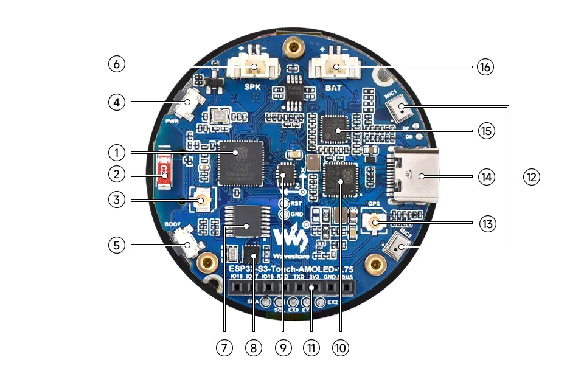

# Waveshare ESP32-S3 Touch AMOLED 1.75 Engineering Guide


[**View Waveshare ESP32-S3 1.75inch GPS AMOLED Round Touch Display on OpenELAB**](https://openelab.io/products/waveshare-esp32-s3-amoled-touch-display?variant=46950525829318)

**Model / option:** Without Case With GPS · **SKU:** `Waveshare-31264`

[**View Waveshare ESP32-S3 1.75inch AMOLED Round Touch Display with Case without GPS on OpenELAB**](https://openelab.io/products/waveshare-esp32-s3-1-75inch-amoled-round-touch-display-with-case?variant=45978080411846)

**Model / option:** Default Title · **SKU:** `Waveshare-31262`

[**View Waveshare ESP32-S3 1.75inch GPS AMOLED Round Touch Display on OpenELAB**](https://openelab.io/products/waveshare-esp32-s3-amoled-touch-display?variant=46950525894854)

**Model / option:** Without Case Without GPS · **SKU:** `Waveshare-31261`


## Product overview <a href="#product-and-scope" id="product-and-scope"></a>

The **Waveshare ESP32-S3-Touch-AMOLED-1.75** is a round, 466 × 466 QSPI AMOLED development board with touch, motion sensing, power management, RTC, microSD and audio. It runs MCU firmware; it is not a standalone Linux watch or an HDMI monitor. This existing guide covers the three assigned hardware options without treating GNSS as a feature of every board.

| Exact SKU         | Manufacturer option | Material difference                                                  |
| ----------------- | ------------------- | -------------------------------------------------------------------- |
| `Waveshare-31261` | Standard board      | Core display/touch/audio board, no LC76G GNSS                        |
| `Waveshare-31262` | `-B`, case option   | Standard board with enclosure; no LC76G GNSS                         |
| `Waveshare-31264` | `-G`, GNSS option   | Adds LC76G and GNSS antenna; reserves associated bus/reset resources |

The opening links resolve the actual store options, including the separate current case-without-GPS listing for 31262. A shared historical storefront title mentioning GPS does not turn 31261/31262 into GNSS boards. [Official variant and hardware reference](https://github.com/waveshareteam/ESP32-S3-Touch-AMOLED-1.75/blob/54816190c194c3a9cf612f85063899c89b18a776/HARDWARE_REFERENCE.md).

The maintained board reference specifies **CST9217** touch and **GPIO42 audio MCLK**. Older wiki prose mentions FT3168 and an old Arduino header also contains an MCLK16 alias. Those generic/legacy descriptions do not override the current schematic and maintained BSP.

## Applications

* A round touch dashboard with local controls and battery-state indication.
* An IMU-driven interface or motion logger using QMI8658 and the RTC.
* A portable audio/voice prototype with the ES7210 microphone ADC and ES8311 playback path.
* An outdoor location display on the **31264 -G** option, with antenna placement and fix validity checked separately.
* A microSD-based media interface using formats and directory layouts accepted by the chosen firmware.

An AMOLED is self-emissive: use panel brightness commands, not a generic LCD backlight PWM pin. Budget battery life from the actual display/radio/audio workload rather than the display type alone.

## Specifications

| Parameter             | Exact family value / scope                                                    |
| --------------------- | ----------------------------------------------------------------------------- |
| MCU                   | ESP32-S3R8, dual-core Xtensa LX7 up to 240MHz                                 |
| Memory                | 16MB external flash, 8MB PSRAM                                                |
| Wireless              | Native 2.4GHz 802.11b/g/n, Bluetooth5LE                                       |
| Display               | 1.75-inch CO5300 QSPI AMOLED, 466 × 466, 16.7M advertised colors              |
| Touch                 | CST9217 I2C, two-point support in maintained board documentation              |
| Main supply / battery | USB-C 5V; single-cell 3.7V battery connector, AXP2101 power management        |
| RTC / motion          | PCF85063 / QMI8658 six-axis IMU                                               |
| Playback / capture    | ES8311 codec + amplifier / ES7210 with two microphones and playback reference |
| Storage               | MicroSD/TF; maintained BSP uses 1-bit SDMMC                                   |
| Expansion             | 8-pin 2.54mm header, 3.3V GPIO/UART; not 5V-tolerant logic                    |
| GNSS                  | LC76G only on -G; I2C command/read addresses 0x50/0x54 in its example         |

Sources: [current manufacturer overview](https://docs.waveshare.com/ESP32-S3-Touch-AMOLED-1.75), [schematic-checked hardware reference](https://github.com/waveshareteam/ESP32-S3-Touch-AMOLED-1.75/blob/54816190c194c3a9cf612f85063899c89b18a776/HARDWARE_REFERENCE.md). Flash/RAM sizes are not interchangeable: choose a 16MB flash layout and the board's PSRAM configuration before building a GUI.

## Hardware and connections <a href="#hardware-and-technical-documents" id="hardware-and-technical-documents"></a>

### Display, touch, audio and SD buses

| Resource           | ESP32-S3 assignment                        | Reservation                                          |
| ------------------ | ------------------------------------------ | ---------------------------------------------------- |
| QSPI display       | D0/D1/D2/D3 = GPIO4/5/6/7; CLK38; CS12     | Entire bus reserved while panel runs                 |
| Display sync/reset | TE13, reset39                              | Separate from touch reset                            |
| Touch              | Shared SDA15/SCL14, INT11, reset40         | CST9217, not a shared display-reset line             |
| I2S                | MCLK42, BCLK9, WS45, playback8, capture10  | Let BSP coordinate playback/capture clocks           |
| Amplifier          | GPIO46 control circuit                     | BSP-managed; do not assume arbitrary active polarity |
| SDMMC              | CMD1, CLK2, D0=3                           | 1-bit data; GPIO41 is wired D3/CS, not card-detect   |
| USB                | D−19, D+20                                 | Keep reserved for native USB/recovery                |
| Buttons            | BOOT GPIO0; conditioned PWR on expander P4 | BOOT low when pressed; PWR high when pressed         |
| IMU interrupt      | QMI INT2 GPIO21                            | INT1 is routed through the expander                  |

The [hardware reference and schematic](https://github.com/waveshareteam/ESP32-S3-Touch-AMOLED-1.75/blob/54816190c194c3a9cf612f85063899c89b18a776/HARDWARE_REFERENCE.md) identify **GPIO42**, not GPIO16, as the maintained BSP's audio master clock. GPIO16 is an expansion signal. Mixing the two old header aliases can produce a silent codec while the display works.

### Shared I2C addresses and expander

| Seven-bit address | Device                            |
| ----------------- | --------------------------------- |
| 0x18              | ES8311 playback codec             |
| 0x20              | TCA9554 GPIO expander             |
| 0x34              | AXP2101 PMIC                      |
| 0x40              | ES7210 audio ADC                  |
| 0x51              | PCF85063 RTC                      |
| 0x5A              | CST9217 touch                     |
| 0x6B              | QMI8658 IMU                       |
| 0x50 / 0x54       | LC76G command/read paths, -G only |

Use one shared bus owner. ESP audio headers may express codec addresses as eight-bit 0x30/0x80; an API expecting seven-bit addresses needs **0x18/0x40**. The maintained BSP uses 400kHz; the LC76G Arduino test uses 100kHz, so choose a speed accepted by every active device.

TCA9554 P3 carries RTC interrupt, P4 the conditioned PWR state, P5 AXP IRQ, P6 QMI INT1 and P7 GPS reset on -G. P0–P2 are application/test-point signals in the reviewed reference. An interrupt input must not be reconfigured as an output by a generic “all expander outputs” demo.

### Expansion header and power

| Schematic H2 pin | Signal                | Use                                                                       |
| ---------------- | --------------------- | ------------------------------------------------------------------------- |
| 1 / 2 / 3        | VBUS / GND / 3V3      | Power rails; assess current and backfeeding before external power sharing |
| 4 / 5            | GPIO44 RX / GPIO43 TX | UART0; can share console functions                                        |
| 6 / 7            | GPIO17 / GPIO18       | General I/O on standard/-B; possible GNSS UART routing on -G              |
| 8                | GPIO16                | General 3.3V I/O; not maintained audio MCLK                               |

Start with USB and no external header wiring. Battery and speaker connectors are both small two-pin parts: identify **BAT** versus **SPK**, polarity and required accessory before mating them. The battery path is for a **single-cell 3.7V** protected battery; do not connect a multi-cell pack or assume any plug-compatible battery is wired correctly. On -G, preserve GPIO17/18 and expander P7 until LC76G routing is confirmed. Sources: [manufacturer hardware reference](https://github.com/waveshareteam/ESP32-S3-Touch-AMOLED-1.75/blob/54816190c194c3a9cf612f85063899c89b18a776/HARDWARE_REFERENCE.md), [current board overview](https://docs.waveshare.com/ESP32-S3-Touch-AMOLED-1.75).



_Manufacturer figure: Waveshare._ [_Original source_](https://docs.waveshare.com/ESP32-S3-Touch-AMOLED-1.75)_._

## Software and development resources <a href="#development-software-and-recovery" id="development-software-and-recovery"></a>

### Choose one reproducible firmware path

| Path                        | Observed version/configuration                                          | Use                                                                                     |
| --------------------------- | ----------------------------------------------------------------------- | --------------------------------------------------------------------------------------- |
| Maintained ESP-IDF examples | IDF5.5.5 or6.0.2, `esp32s3`; LVGL9.4 dependency in `02_lvgl_demo_v9`    | New display/touch development                                                           |
| Customer Brookesia source   | IDF5.5.4 in its separate factory project                                | Rebuild the application suite with its model/filesystem partitions                      |
| Arduino examples            | Arduino-ESP32 3.3.10, 16MB flash, `app3M_fat9M_16MB`, bundled libraries | Small peripheral examples with exact board definitions                                  |
| Older wiki Arduino set      | Core3.1.0, LVGL8.4 in that historical set                               | Historical reference; do not mix its LVGL8 configuration with the current LVGL9 project |
| Factory recovery image      | Complete 16MiB image at offset0x0                                       | Restore customer applications; not the same as an application-only binary               |

Versions above are the reviewed upstream configuration, not a claim that OpenELAB compiled them. [Source build guide](https://github.com/waveshareteam/ESP32-S3-Touch-AMOLED-1.75/blob/54816190c194c3a9cf612f85063899c89b18a776/docs/getting-started.md), [firmware delivery guide](https://github.com/waveshareteam/ESP32-S3-Touch-AMOLED-1.75/blob/54816190c194c3a9cf612f85063899c89b18a776/firmware/README.md), [current component manifest](https://github.com/waveshareteam/ESP32-S3-Touch-AMOLED-1.75/blob/54816190c194c3a9cf612f85063899c89b18a776/examples/esp-idf/02_lvgl_demo_v9/main/idf_component.yml).

The repository is Apache-2.0 at its root; bundled libraries and application/media components can have their own notices. Keep those notices when redistributing modified firmware or source. Community projects linked by Waveshare are additional projects, not evidence of support for every hardware option.

## Getting started

### First display and touch result

1. Identify 31261/31262/31264, connect a USB **data** cable and leave expansion/battery changes for later. Note the serial port. Preserve a working factory image/configuration before flashing custom firmware.
2. Install and activate the selected ESP-IDF environment. Clone the exact model repository and record the commit; the source reviewed here was `54816190c194c3a9cf612f85063899c89b18a776`.
3. Build the model-specific GUI example and retain its supplied defaults/partition table:

```bash
git clone https://github.com/waveshareteam/ESP32-S3-Touch-AMOLED-1.75.git
cd ESP32-S3-Touch-AMOLED-1.75
git checkout 54816190c194c3a9cf612f85063899c89b18a776
idf.py -C examples/esp-idf/02_lvgl_demo_v9 -B build/panel-check set-target esp32s3 build
idf.py -C examples/esp-idf/02_lvgl_demo_v9 -B build/panel-check -p PORT flash monitor
```

Replace `PORT` with the board's actual port. Component downloads need network access. **Expected result:** the panel shows the selected LVGL demo without a reset loop; touch interaction changes the UI. Stop before adding audio/GNSS if power, PSRAM or panel initialization fails.

4. For an original, easily observable UI, replace that example's `main/main.c` with the following code, retain its model BSP/dependencies, and rebuild/flash with the same commands. This creates a counter button inside the circular visible area:

```c
#include "lvgl.h"
#include "bsp/esp-bsp.h"

static lv_obj_t *result;
static unsigned press_count;

static void count_press(lv_event_t *event)
{
    if (lv_event_get_code(event) != LV_EVENT_CLICKED) return;
    ++press_count;
    lv_label_set_text_fmt(result, "Touches: %u", press_count);
}

void app_main(void)
{
    if (bsp_display_start() == NULL) return;
    if (!bsp_display_lock(2000)) return;
    lv_obj_t *screen = lv_screen_active();
    result = lv_label_create(screen);
    lv_label_set_text(result, "Touches: 0");
    lv_obj_align(result, LV_ALIGN_CENTER, 0, -70);
    lv_obj_t *button = lv_button_create(screen);
    lv_obj_set_size(button, 180, 70);
    lv_obj_align(button, LV_ALIGN_CENTER, 0, 20);
    lv_obj_add_event_cb(button, count_press, LV_EVENT_CLICKED, NULL);
    lv_obj_t *caption = lv_label_create(button);
    lv_label_set_text(caption, "Tap once");
    lv_obj_center(caption);
    bsp_display_unlock();
}
```

**Expected result:** each completed tap increments the label once. Repeated or absent events direct attention to touch transport/mapping before application logic. This original code was reviewed against the maintained LVGL9/BSP APIs; it was not compiled or run for this guide.

### Isolating touch, sensors and audio

The repository's `examples/arduino/10_Touch_CST9217` reports raw coordinates without starting the display/LVGL. Use it when a GUI draws correctly but taps fail. Its documented compile configuration is:

```bash
arduino-cli core install esp32:esp32@3.3.10
arduino-cli compile --fqbn "esp32:esp32:esp32s3:FlashSize=16M,PartitionScheme=app3M_fat9M_16MB" --libraries examples/arduino/libraries examples/arduino/10_Touch_CST9217
```

Upload through the matching IDE/CLI port configuration, reset and read the serial output. Two valid coordinates prove the raw touch path; they do not prove the application's rotation is correct.

Next run one sensor example at a time: AXP2101 for battery/rail telemetry, PCF85063 for setting and rereading time, QMI8658 for a stationary baseline then a slow orientation change, and SD for a small read/write check. Do not write arbitrary PMIC rail values as a generic troubleshooting step.

For audio, begin with low-volume playback, then a short microphone capture. The maintained BSP's ES7210 profile uses four receive slots containing two microphones, playback reference and an unconnected channel; slot order is not microphone-number order. Use the BSP masks and keep shared clocks coordinated. Recording waveform activity does not alone demonstrate acoustic echo cancellation.

### GNSS only on 31264

Use `examples/arduino/09_LC76G_I2C` on **-G** with its own 100kHz shared-bus configuration. Verify antenna fit, LC76G response and valid fix fields under open sky. The standard/-B boards cannot acquire GNSS by installing that sketch. Coordinate command/write address0x50, read address0x54 and expander-controlled reset; do not claim GPIO17/18 are free if UART routing is fitted.

### Factory recovery and media

The reviewed firmware delivery guide distinguishes the newer **20260824** complete image from the historical **20260805** image. Choose the exact file and its matching published SHA-256 from that guide. A complete factory image is written at **0x0**; split application/model/filesystem binaries retain their own build offsets. Never combine files from different packages, and do not erase the entire flash by default.

For the factory SD-media package, use FAT/FAT32, place `music`, `photos`, `video` and the `Waveshare` directory at the root and follow the [media guide](https://github.com/waveshareteam/ESP32-S3-Touch-AMOLED-1.75/blob/54816190c194c3a9cf612f85063899c89b18a776/firmware/MEDIA_GUIDE.md) for actual codec/dimension constraints. Start with one small synthetic asset, then expand. Use the firmware's **Settings → Storage → Safe eject** before removing a mounted card. AI chat/recording files may contain actual user content; inspect them before sharing a card.

## Troubleshooting and FAQs <a href="#faqs" id="faqs"></a>

| Symptom                             | Checks and supported recovery                                                                                                          |
| ----------------------------------- | -------------------------------------------------------------------------------------------------------------------------------------- |
| USB missing or reset loop           | Data cable, stable supply, actual port, manual BOOT/recovery; preserve the correct16MB package                                         |
| Blank AMOLED                        | Exact CO5300 model BSP, panel-power initialization, PSRAM/defaults and correct display reset39; a backlight-PWM sketch is inapplicable |
| Draws but no touch                  | CST9217 address0x5A, reset40/INT11 and raw-touch example; do not select FT3168 from generic wiki prose                                 |
| Silent audio                        | Confirm ES8311/ES7210, MCLK42, shared clocks, codec/power-amplifier initialization and speaker connection at low volume                |
| I2C address absent                  | One bus owner, SDA15/SCL14, seven-bit addressing, device power/reset and -G-specific100kHz requirement                                 |
| SD mount failure                    | FAT/FAT32, card seating, CMD1/CLK2/D0=3, correct storage mode; GPIO41 is not card detect                                               |
| GNSS never responds                 | Verify -G hardware exists, antenna and addresses0x50/0x54; resolve fitted UART routing before borrowing GPIO17/18                      |
| Buttons appear inverted             | BOOT is active-low GPIO0; conditioned PWR is active-high expander P4                                                                   |
| Factory apps missing after flashing | Correct full image, partition/model/filesystem pairing and SD root layout; application-only update may not restore assets              |
| Rotation offsets                    | Keep display and touch transforms in the same BSP configuration and retest edges plus center                                           |

For complex Brookesia/voice work, consult the release-specific [troubleshooting](https://github.com/waveshareteam/ESP32-S3-Touch-AMOLED-1.75/blob/54816190c194c3a9cf612f85063899c89b18a776/docs/troubleshooting.md) and hardware acceptance checklist. Upstream CI results or upstream hardware reports do not constitute tests performed for this OpenELAB guide.

## Downloads and technical documents

Use the direct source/download links below for the exact board. The included manufacturer board view shows the GNSS footprint and connector area; only the -G option populates the GNSS capability. Schematic and dimensions are the mechanical/electrical authority; do not generate enclosure dimensions from the photograph.

| Resource                                                                                                                                                                             | Purpose and exact scope                               |
| ------------------------------------------------------------------------------------------------------------------------------------------------------------------------------------ | ----------------------------------------------------- |
| [Repository schematic](https://github.com/waveshareteam/ESP32-S3-Touch-AMOLED-1.75/blob/54816190c194c3a9cf612f85063899c89b18a776/Schematic/ESP32-S3-Touch-AMOLED-1.75-schematic.pdf) | Exact board schematic, downloaded clone and inspected |
| [Schematic direct PDF](https://files.waveshare.com/wiki/ESP32-S3-Touch-AMOLED-1.75/ESP32-S3-Touch-AMOLED-1.75.pdf)                                                                   | Manufacturer PDF download                             |
| [Standard3D](https://files.waveshare.com/wiki/ESP32-S3-Touch-AMOLED-1.75/ESP32-S3-Touch-AMOLED-1.75-3D.zip)                                                                          | Board mechanical model, listed                        |
| [Case3D](https://files.waveshare.com/wiki/ESP32-S3-Touch-AMOLED-1.75/ESP32-S3-Touch-AMOLED-1.75-B-3D.zip)                                                                            | -B enclosure mechanical model, listed                 |
| [Firmware releases](https://github.com/waveshareteam/ESP32-S3-Touch-AMOLED-1.75/releases)                                                                                            | Matched example archives and manifests                |
| [Factory recovery guide](https://github.com/waveshareteam/ESP32-S3-Touch-AMOLED-1.75/blob/54816190c194c3a9cf612f85063899c89b18a776/firmware/README.md)                               | Observed exact image names/checksums/offsets          |
| [Touch diagnostic](https://github.com/waveshareteam/ESP32-S3-Touch-AMOLED-1.75/blob/54816190c194c3a9cf612f85063899c89b18a776/examples/arduino/10_Touch_CST9217/README.md)            | Raw coordinates without display/LVGL                  |
| [Media guide](https://github.com/waveshareteam/ESP32-S3-Touch-AMOLED-1.75/blob/54816190c194c3a9cf612f85063899c89b18a776/firmware/MEDIA_GUIDE.md)                                     | Image/audio/video formats and safe eject              |

## References and validation <a href="#sources-and-validation" id="sources-and-validation"></a>

Reviewed **24 November 2026** at official repository commit `54816190c194c3a9cf612f85063899c89b18a776`, together with the current manufacturer model page, local schematic and exact store mappings. The guide resolves the touch-controller, audio-clock, SD-mode and GNSS-option ambiguities and adds an original LVGL touch counter.

**Compilation, flashing, display/touch operation, audio, battery charging, SD, radio and GNSS tests: not run.** Manufacturer firmware/CI/hardware reports are attributed upstream evidence, not OpenELAB test results.

* [Exact SKU variants, pins and power](https://github.com/waveshareteam/ESP32-S3-Touch-AMOLED-1.75/blob/54816190c194c3a9cf612f85063899c89b18a776/HARDWARE_REFERENCE.md) — commit 54816190c194c3a9cf612f85063899c89b18a776.
* [Maintained toolchain and first-run procedures](https://github.com/waveshareteam/ESP32-S3-Touch-AMOLED-1.75/blob/54816190c194c3a9cf612f85063899c89b18a776/docs/getting-started.md) — commit 54816190c194c3a9cf612f85063899c89b18a776.
* [Factory recovery and delivery](https://github.com/waveshareteam/ESP32-S3-Touch-AMOLED-1.75/blob/54816190c194c3a9cf612f85063899c89b18a776/firmware/README.md) — commit 54816190c194c3a9cf612f85063899c89b18a776.
* [Actual LVGL9 BSP startup interface](https://github.com/waveshareteam/ESP32-S3-Touch-AMOLED-1.75/blob/54816190c194c3a9cf612f85063899c89b18a776/examples/esp-idf/02_lvgl_demo_v9/main/main.c) — commit 54816190c194c3a9cf612f85063899c89b18a776.
* [Media formats and SD lifecycle](https://github.com/waveshareteam/ESP32-S3-Touch-AMOLED-1.75/blob/54816190c194c3a9cf612f85063899c89b18a776/firmware/MEDIA_GUIDE.md) — commit 54816190c194c3a9cf612f85063899c89b18a776.
* [Manufacturer complete wiki topic coverage](https://docs.waveshare.com/ESP32-S3-Touch-AMOLED-1.75) — 23Nov snapshot; current docs overview also reviewed24Nov.

### Retained source links <a href="#official-documentation-and-development-resources" id="official-documentation-and-development-resources"></a>

* [Official hardware map and exact SKU distinctions](https://github.com/waveshareteam/ESP32-S3-Touch-AMOLED-1.75/blob/main/HARDWARE_REFERENCE.md)
* [Manufacturer tutorial](https://www.waveshare.com/wiki/ESP32-S3-Touch-AMOLED-1.75)
* [Overview](https://www.waveshare.com/wiki/ESP32-S3-Touch-AMOLED-1.75)

### Related retained references

* [Examples, firmware and factory recovery](https://github.com/waveshareteam/ESP32-S3-Touch-AMOLED-1.75)
