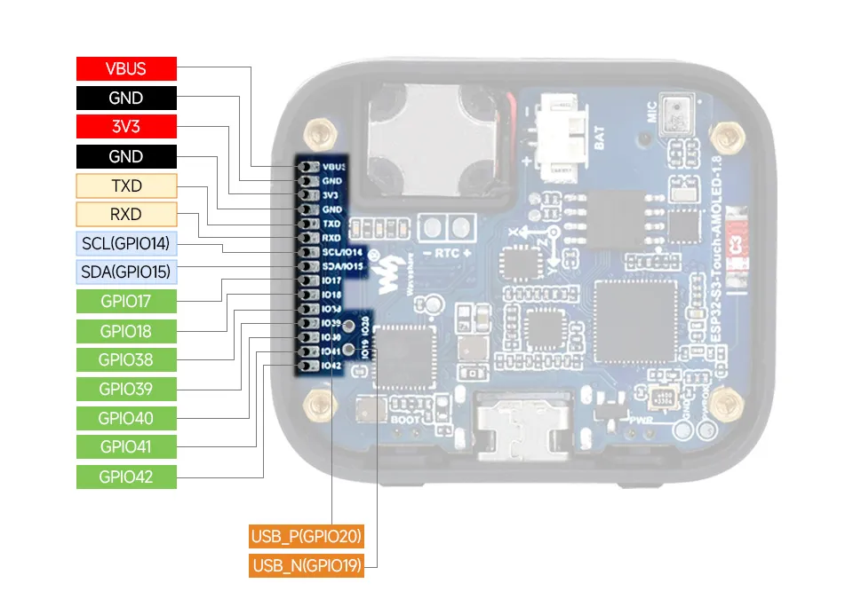
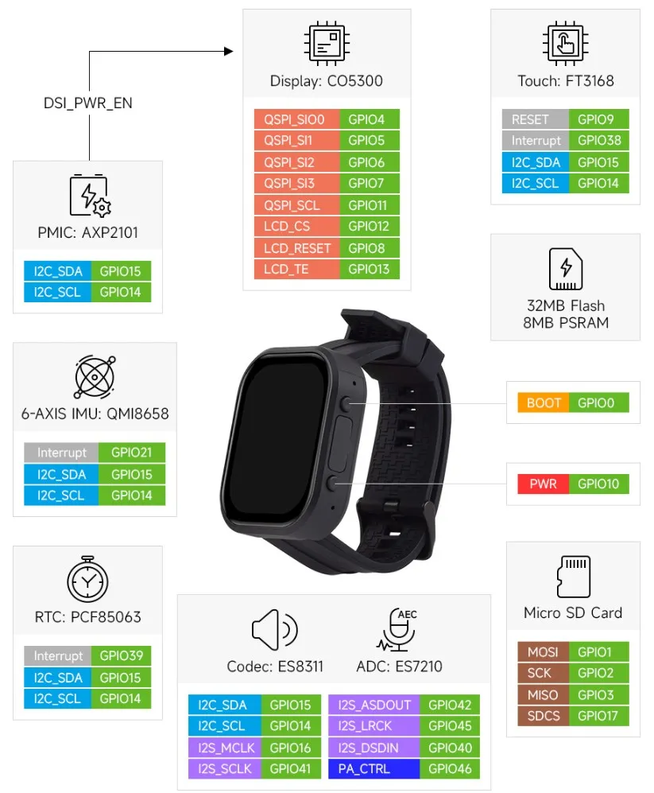

# Waveshare ESP32-S3 AMOLED 1.8 and 2.06 Engineering Guide


[**View Waveshare ESP32-S3-Touch-AMOLED-1.8 Dev Board on OpenELAB**](https://openelab.io/products/waveshare-esp32-s3-amoled-1-8?variant=46922032971974)

**Model / option:** include · **SKU:** `Waveshare-29957`

[**View Waveshare ESP32-S3 2.06inch AMOLED Touch Watch QSPI with Battery on OpenELAB**](https://openelab.io/products/waveshare-esp32-s3-amoled-watch?variant=45043410010310)

**Model / option:** Default Title · **SKU:** `Waveshare-31957`


## Product overview <a href="#product-and-scope" id="product-and-scope"></a>

This guide keeps the established family URL while treating the two purchased boards as distinct firmware targets: **ESP32-S3-Touch-AMOLED-1.8, Waveshare-29957**, and **ESP32-S3-Touch-AMOLED-2.06, Waveshare-31957**. Both integrate a touch AMOLED, AXP2101 power management, RTC, IMU, microSD and audio, but their resolution, flash capacity, touch wiring and audio buses differ.

| Exact SKU / option | Display and power package                                                  | Firmware identity                                   |
| ------------------ | -------------------------------------------------------------------------- | --------------------------------------------------- |
| `Waveshare-29957`  | 1.8-inch368×448, standard option with3.7V battery                          | Exact1.8 repository plus Original/V2 panel revision |
| `Waveshare-31957`  | 2.06-inch410×502 watch-format option with battery/case/strap configuration | Exact2.06 repository and CO5300/FT3168 board        |

The `-EN` no-battery SKUs listed in the manufacturer documentation are separate options, not additional assigned products. The store callout links select the actual assigned variants.

The manufacturer changed the **1.8-inch** panel/touch pair from **SH8601/FT3168 (Original)** to **CO5300/CST820 (V2)** from30May2026. Read the rear product label; a purchase date alone is insufficient. Generic paragraphs that still say FT3168 do not override this explicit revision note. [1.8 revision reference](https://docs.waveshare.com/ESP32-S3-Touch-AMOLED-1.8), [2.06 reference](https://docs.waveshare.com/ESP32-S3-Touch-AMOLED-2.06).

## Applications

* Battery-powered touch interfaces with a clock, status screen and simple navigation.
* IMU-based motion/orientation experiments using a stationary baseline before interpreting gestures.
* Portable sensor logging with RTC timestamps and a microSD card.
* Audio playback/voice capture prototypes, with the2.06 dual-microphone/ES7210 chain treated separately from the1.8 ES8311 microphone path.

These are development boards in wearable/portable forms, not established waterproof watches or certified health instruments. Choose GUI layout and touch targets for the actual panel dimensions rather than scaling a bitmap and assuming input alignment.

## Specifications

| Parameter                | 1.8-inch29957                           | 2.06-inch31957                                                  |
| ------------------------ | --------------------------------------- | --------------------------------------------------------------- |
| MCU                      | ESP32-S3R8, dual-core up to240MHz       | ESP32-S3R8, dual-core up to240MHz                               |
| Flash / PSRAM            | 16MB /8MB                               | 32MB physical flash /8MBPSRAM                                   |
| Native panel             | 368×448                                 | 410×502                                                         |
| Controller               | OriginalSH8601;V2CO5300                 | CO5300                                                          |
| Touch                    | OriginalFT3168;V2CST820                 | FT3168                                                          |
| Transport                | QSPI video;I2C touch                    | QSPI video;I2C touch                                            |
| Radio                    | 2.4GHzWi-Fi/b/g/n, BLE5                 | 2.4GHzWi-Fi/b/g/n, BLE5                                         |
| PMIC / battery interface | AXP2101, single-cell3.7V MX1.25         | AXP2101, single-cell3.7V MX1.25                                 |
| RTC / motion             | PCF85063 /QMI8658                       | PCF85063 /QMI8658                                               |
| Audio                    | ES8311, onboard microphone/speaker path | ES8311 playback plus ES7210 dual-microphone ADC                 |
| Storage                  | MicroSD, model driver/expander handling | MicroSD, GPIO17 wired CS/D3; model driver decides SPI/SDMMC use |
| USB logic/pads           | NativeUSB19/20, UART43/44,3.3Vsignals   | NativeUSB19/20, UART43/44,3.3Vsignals                           |

Source tables and revision conditions: [1.8 overview](https://docs.waveshare.com/ESP32-S3-Touch-AMOLED-1.8), [2.06 peripheral reference](https://docs.waveshare.com/ESP32-S3-Touch-AMOLED-2.06), and model-specific schematics below. Physical32MBflash on2.06 does not require every example to occupy32MB: the reviewed GUI example defaults intentionally use a16MB layout. Preserve the selected example's partition/default set; do not mix it with a factory whole-image layout.

## Hardware and connections <a href="#hardware-and-technical-documents" id="hardware-and-technical-documents"></a>

### Power and connector limits

Begin with USB-C5V and the supplied configuration. The battery sockets are for **one3.7V lithium cell**; check polarity against the actual board marking, not connector color. Remove USB and battery power before opening an enclosure or soldering pads. Do not apply5V to a3.3V GPIO, the RTC backup pad or a battery input. Do not alter AXP2101 rail/charge settings based on another board's demo.

The2.06 case has short display/interconnect cables. Support the board and cable during disassembly, release the enclosure gradually and avoid pulling the screen half away from the electronics. Keep the strap/case apart from firmware selection: installing a case does not change a panel controller.

### Bus map that changes between models

| Function               | 1.8 board                                                     | 2.06 board                     |
| ---------------------- | ------------------------------------------------------------- | ------------------------------ |
| QSPI data0–3           | GPIO4/5/6/7                                                   | GPIO4/5/6/7                    |
| QSPI clock /CS         | GPIO11/12                                                     | GPIO11/12                      |
| Panel reset /TE        | Use exact Original/V2 BSP and expander handling               | GPIO8/reset, GPIO13/TE         |
| SharedI2C              | SDA15/SCL14                                                   | SDA15/SCL14                    |
| Touch interrupt/reset  | Original touchINT21; revision-specific reset via exact driver | INT38/reset9                   |
| Audio MCLK/BCLK/WS     | 16/9/45                                                       | 16/41/45                       |
| Audio playback/capture | 8/10                                                          | 40/42                          |
| PA control             | GPIO46, model driver lifecycle                                | GPIO46, model driver lifecycle |
| SD CMD/CLK/D0          | 1/2/3; original SPI CS via expanderEXIO7                      | 1/2/3; CS/D3 wired17           |
| RTC interrupt          | Use exact1.8 board definition                                 | GPIO39                         |
| IMU interrupt          | Check model BSP/shared wiring                                 | GPIO21                         |
| PWR/BOOT               | PMIC path /GPIO0                                              | Conditioned PWR GPIO10 /BOOT0  |

The 1.8 extension drawing shows GPIO17/18/38/39/40/41/42 pads plusUART/I2C/USB, but a pad's availability depends on active board resources and revision. Do not treat every exposed pad as a free output. The2.06 diagram below gives its own audio/touch/RTC map. [1.8 source pin definitions](https://github.com/waveshareteam/ESP32-S3-Touch-AMOLED-1.8/blob/01fd3200370a4417b257e8a4c185a04ef931342a/examples/arduino/libraries/Mylibrary/pin_config.h), [2.06 peripheral table](https://docs.waveshare.com/ESP32-S3-Touch-AMOLED-2.06).

Initialize the onboard I2C controller once and share it among PMIC, RTC, IMU, codec and touch drivers. Do not install a second independent bus driver over GPIO14/15. Device address discovery alone is not proof of correct rail sequencing, panel reset or audio routing.



_Manufacturer figure: Waveshare._ [_Original source_](https://docs.waveshare.com/ESP32-S3-Touch-AMOLED-1.8)_._



_Manufacturer figure: Waveshare._ [_Original source_](https://docs.waveshare.com/ESP32-S3-Touch-AMOLED-2.06)_._

## Software and development resources <a href="#development-software-and-recovery" id="development-software-and-recovery"></a>

### Select one complete software lane

| Model/revision            | Source path and version boundary                                                         |
| ------------------------- | ---------------------------------------------------------------------------------------- |
| 1.8 OriginalSH8601/FT3168 | `examples/arduino` with its bundled libraries; original factory wrapper uses BSP1.1.4    |
| 1.8 V2CO5300/CST820       | `examples/arduino-v2` or managed-BSP ESP-IDF examples; V2 factory wrapper uses BSP2.0.3  |
| 2.06CO5300/FT3168         | Its own `examples/arduino/examples` or `examples/esp-idf`;32MBphysicalflash and2.06 pins |

The1.8 repository's current ESP-IDF examples are checked upstream with **5.5.5/6.0.2**. Its managed-BSP guide declares `waveshare/esp32_s3_touch_amoled_1_8`2.0.3 for the new BSP path; do not impose it on an Original board simply because both are1.8inch. Factory source wrappers explicitly pin Original1.1.4 and V2 2.0.3. [1.8 development guide](https://github.com/waveshareteam/ESP32-S3-Touch-AMOLED-1.8/blob/01fd3200370a4417b257e8a4c185a04ef931342a/docs/GETTING_STARTED.md), [factory source profiles](https://github.com/waveshareteam/ESP32-S3-Touch-AMOLED-1.8/blob/01fd3200370a4417b257e8a4c185a04ef931342a/firmware/brookesia/README.md).

The2.06 repository documents ESP-IDF **5.5.5/6.0.2** and Arduino-ESP32 **3.3.11**. The older wiki library tables are historical configuration lanes:1.8 used LVGL8.4/GFX1.4.9, while2.06 uses a newer LVGL9 lane. Do not combine LVGL8UI code, LVGL9API calls, or a global latest GFX library with a demo requiring its bundled copy. [2.06 source environment](https://github.com/waveshareteam/ESP32-S3-Touch-AMOLED-2.06/blob/3de8684cc3b27a8b6aa920157ecf399287528181/README.md).

Arduino board selection is `ESP32S3 Dev Module` with the exact flash/PSRAM, partition and USB settings of the chosen example. NativeUSB`Serial` requires its console setup; some manufacturer sketches use an explicit `HWCDC USBSerial` object instead. ESP-IDF target is **esp32s3** for both, but that shared chip target does not make the board firmware interchangeable.

Both root repositories use Apache-2.0; preserve notices for bundled libraries and generated/user media separately.

## Getting started

### Confirm the model/revision before flashing

1. Record SKU,1.8 Original/V2 label or2.06 model, current firmware and USB port. Preserve settings/media. Leave external GPIO disconnected and start from a USB data cable.
2. Clone the exact repository and pin the source used for this guide:

```bash
git clone https://github.com/waveshareteam/ESP32-S3-Touch-AMOLED-1.8.git
git -C ESP32-S3-Touch-AMOLED-1.8 checkout 01fd3200370a4417b257e8a4c185a04ef931342a
git clone https://github.com/waveshareteam/ESP32-S3-Touch-AMOLED-2.06.git
git -C ESP32-S3-Touch-AMOLED-2.06 checkout 3de8684cc3b27a8b6aa920157ecf399287528181
```

3. For1.8, first use the serial-only board check with ESP-IDF5.5.5:

```bash
cd ESP32-S3-Touch-AMOLED-1.8/examples/esp-idf/00_board_check
idf.py set-target esp32s3
idf.py build
idf.py -p PORT flash monitor
```

The board check prints capabilities and pin information; it does not require an SD card. For a **V2** board, proceed to `examples/esp-idf/00_bsp_quickstart` using the same build/flash sequence. The UI includes brightness and SD controls; leave SD testing until a suitable backed-up FAT card is installed. For an **Original** board, open `examples/arduino/examples/01_HelloWorld` with that set's bundled libraries and SH8601 driver. Its touch/drawing example is the matching Original set, not `arduino-v2`. 4. For2.06, activate ESP-IDF5.5.5 and build its own GUI project:

```bash
cd ESP32-S3-Touch-AMOLED-2.06/examples/esp-idf/02_lvgl_demo_v9
idf.py set-target esp32s3
idf.py build
idf.py -p PORT flash monitor
```

Use the actual serial port in place of `PORT`. Preserve the example's16MBflash layout unless intentionally redesigning partitions. The physical device has32MB, but a valid application may use a smaller address range. 5. Verify a stable image, correct orientation and touch at center and near each edge. Record the observed coordinate behavior and selected BSP/library set.

**Expected result:** the1.8 image uses368×448 with its actual touch controller;2.06 uses410×502 andFT3168. A successful upload or illuminated panel alone is not a display-and-touch acceptance result.

### Original deterministic display pattern

After the matching Arduino `01_HelloWorld` starts, retain its exact model/revision initialization and the global `gfx` object. Replace the changing random-text `loop()` with this original pattern. It fits itself to the selected panel, draws four gray bands, a centered cross and a model-resolution label; no font/image asset is required:

```cpp
void loop() {
  static bool drawn = false;
  if (drawn) { delay(50); return; }
  drawn = true;
  const int width = gfx->width(), height = gfx->height();
  const uint16_t shades[4] = {0x0000, 0x4208, 0x8410, 0xFFFF};
  for (int band = 0; band < 4; ++band) {
    int left = band * width / 4;
    int right = (band + 1) * width / 4;
    gfx->fillRect(left, 0, right-left, height, shades[band]);
  }
  gfx->drawFastVLine(width/2, 0, height, 0xF800);
  gfx->drawFastHLine(0, height/2, width, 0xF800);
  gfx->setTextSize(2);
  gfx->setTextColor(0x07E0, 0x0000);
  gfx->setCursor(12, height/2 + 20);
  gfx->printf("%d x %d", width, height);
}
```

**Expected result:** four stable bands, a central red cross and the correct dimensions. The1.8 Original andV2 use different driver constructors even though this drawing function is shared; the2.06 must retain its own pin/PMIC setup. The pattern tests visible geometry and updates, not colorimetric accuracy or maximum panel bit depth.

### Touch and sensor progression

Use the matching touch/drawing demo to mark the cross center and points near all edges. When rotating, configure both display and touch transforms together; a diagonal mirroring error is not repaired by changing the application button coordinates alone.

Then verify one peripheral at a time. On1.8 the current standalone projects include `90_axp2101_pmu`, `91_pcf85063_rtc` and `92_qmi8658_imu`. On2.06 the example catalog includes AXP2101, IMU-driven UI, spectrum analysis and SD video. Capture battery voltage/charging state without changing charging limits; set/read RTC time; compare stationary IMU samples before slow movement. An IMU sample in arbitrary units must not be presented as a calibrated measurement.

For SD use the model's BSP mount routine and a FAT-formatted test card. Check a small file round trip and unmount before removal; do not guess a chip-select from the other model. For2.06, the board's SPI-labelled drawing and its example's SDMMC implementation describe the same routed card signals in different modes, not two independent sockets.

### Audio and media

Start with a low-volume known test sound. The1.8 ES8311 path uses different I2S pins from2.06; the2.06 also captures throughES7210. Confirm codec initialization, correct amplifier state and a short capture/playback before adding echo-processing or voice-network software.

Factory media applications require supported file encodings and directory layouts. Use the2.06 factory user guide's own media sections and its firmware's card structure; renaming an arbitraryMP4toAVI does not convert the codec/container. Run a small known compatible file before copying a large library.

### Firmware recovery

Use the exact model **and1.8 panel revision**. The1.8 delivery contains separate Original/V2 whole images and newer dated images; choose the file identified by the matching delivery manifest/guide. The2.06 checked-in factory image is `ESP32-S3-Touch-AMOLED-2.06_FactoryOnly_20261016.bin`. Its actual delivered binary is16MiB despite32MBphysicalflash, so retain the official command/layout.

Complete merged factory images are written at **0x0**. Example packages with split binaries have their own offsets and must stay together. Back up files/settings before an erase; do not mix a1.8 bootloader/partition table with a2.06 application or the Original/V2 factory resources. If USB recovery fails, use the exact model's BOOT/PWR/reset procedure and a stable data cable before changing drivers or erasing again.

## Troubleshooting and FAQs <a href="#faqs" id="faqs"></a>

| Symptom                                | Model-specific checks                                                                                                      |
| -------------------------------------- | -------------------------------------------------------------------------------------------------------------------------- |
| 1.8 display blank after upload         | Read rear revision label;SH8601/FT3168 needs Original sources,CO5300/CST820 needsV2; check PMIC/panel initialization       |
| 1.8 touch driver name saysCST816       | A compatible driver/API family name can persist; the currentV2 fitted controller isCST820, per explicit revision reference |
| 2.06 image truncated or assets missing | Exact410×502model, matching partition/defaults and resource package;32MBphysicalflash does not mean every binary is32MiB   |
| GUI draws but taps fail                | Correct touch controller, sharedI2C, reset/interrupt and rotation;1.8INT21 is not2.06INT38                                 |
| Audio silent                           | Check model audio bus:1.8BCLK9/playback8 versus2.06BCLK41/playback40; codec/amplifier/speaker and low volume               |
| Card mount fails                       | Correct model'sSPI/SDMMC handling, FAT card, safe insertion and no competing GPIO use                                      |
| Battery telemetry implausible          | Proper single-cell battery/polarity and exact AXP2101 initialization; do not fix it by guessing a charge-voltage register  |
| Repeated USB reset or missing log      | Data cable, selected console/HWCDC route, port exclusivity and ROM-download recovery                                       |
| Touch off after rotation               | Undo the change and set paired panel/touch transforms, then redo edge tests                                                |

Use the [1.8 troubleshooting guide](https://github.com/waveshareteam/ESP32-S3-Touch-AMOLED-1.8/blob/01fd3200370a4417b257e8a4c185a04ef931342a/docs/GETTING_STARTED.md) and [2.06 manufacturer FAQ](https://docs.waveshare.com/ESP32-S3-Touch-AMOLED-2.06/FAQ) for release-specific recovery. The manufacturer's own tests/CI are separate from the not-run status below.

## Downloads and technical documents

The official figures below preserve each model's pad orientation and peripheral routing. The1.8 expansion figure is not a2.06 pinout. Use the exact schematic and mechanical drawing for the received revision before soldering pads or designing an enclosure.

| Resource                                                                                                                                           | Purpose and exact scope                                          |
| -------------------------------------------------------------------------------------------------------------------------------------------------- | ---------------------------------------------------------------- |
| [1.8 schematic](https://files.waveshare.com/wiki/ESP32-S3-Touch-AMOLED-1.8/ESP32-S3-Touch-AMOLED-1.8.pdf)                                          | Downloaded original-model PDF;V2 uses current revision resources |
| [1.8 mechanical](https://files.waveshare.com/wiki/ESP32-S3-Touch-AMOLED-1.8/ESP32-S3-Touch-AMOLED-1.8-3D.zip)                                      | Manufacturer-listed3Darchive                                     |
| [1.8 firmware guide](https://github.com/waveshareteam/ESP32-S3-Touch-AMOLED-1.8/blob/01fd3200370a4417b257e8a4c185a04ef931342a/docs/FIRMWARE.md)    | Original/V2images,profiles,media and offsets                     |
| [2.06 schematic](https://files.waveshare.com/wiki/ESP32-S3-Touch-AMOLED-2.06/ESP32-S3-Touch-AMOLED-2.06.pdf)                                       | Downloaded exact-model electrical PDF                            |
| [2.06 dimensions](https://files.waveshare.com/wiki/ESP32-S3-Touch-AMOLED-2.06/Esp32-s3-touch-amoled-2_06_dimensions.pdf)                           | Downloaded dimensioned outline                                   |
| [2.06 factory guide](https://github.com/waveshareteam/ESP32-S3-Touch-AMOLED-2.06/blob/3de8684cc3b27a8b6aa920157ecf399287528181/firmware/README.md) | Exact image and whole-image flash procedure                      |
| [2.06 factory use](https://docs.waveshare.com/ESP32-S3-Touch-AMOLED-2.06/Instructions-For-Use)                                                     | Application/media/user workflow                                  |

## References and validation <a href="#sources-and-validation" id="sources-and-validation"></a>

Reviewed **24 November2026**, including current1.8revision notes, both manufacturer topic sets, downloaded schematics and repository commits **1.8:`01fd3200370a4417b257e8a4c185a04ef931342a`**, **2.06:`3de8684cc3b27a8b6aa920157ecf399287528181`**. The guide separates panel revisions, firmware/BSP lanes, memory layouts and audio/SD pins, and adds an original deterministic display pattern.

**Compilation, uploads, factory restore, display/touch, battery charging, audio,SD and radio tests: not run.** Upstream hardware/CI reports remain attributed upstream evidence.

* [1.8 complete manufacturer topic set and current revision note](https://docs.waveshare.com/ESP32-S3-Touch-AMOLED-1.8) — current docs reviewed24Nov;legacy23Novsnapshot.
* [2.06 complete manufacturer topic set](https://docs.waveshare.com/ESP32-S3-Touch-AMOLED-2.06) — current docs reviewed24Nov;legacy23Novsnapshot.
* [1.8 Original/V2 driver families](https://github.com/waveshareteam/ESP32-S3-Touch-AMOLED-1.8/blob/01fd3200370a4417b257e8a4c185a04ef931342a/README.md) — commit 01fd3200370a4417b257e8a4c185a04ef931342a.
* [1.8 maintained first result and SDK versions](https://github.com/waveshareteam/ESP32-S3-Touch-AMOLED-1.8/blob/01fd3200370a4417b257e8a4c185a04ef931342a/docs/GETTING_STARTED.md) — commit 01fd3200370a4417b257e8a4c185a04ef931342a.
* [2.06 sources, examples and SDK versions](https://github.com/waveshareteam/ESP32-S3-Touch-AMOLED-2.06/blob/3de8684cc3b27a8b6aa920157ecf399287528181/README.md) — commit 3de8684cc3b27a8b6aa920157ecf399287528181.
* [2.06 intentional16MBexamplelayout](https://github.com/waveshareteam/ESP32-S3-Touch-AMOLED-2.06/blob/3de8684cc3b27a8b6aa920157ecf399287528181/examples/esp-idf/02_lvgl_demo_v9/sdkconfig.defaults) — commit 3de8684cc3b27a8b6aa920157ecf399287528181.

### Retained source links <a href="#official-documentation-and-development-resources" id="official-documentation-and-development-resources"></a>

* [1.8-inch hardware and demo](https://www.waveshare.com/wiki/ESP32-S3-Touch-AMOLED-1.8)
* [2.06-inch hardware and demo](https://www.waveshare.com/wiki/ESP32-S3-Touch-AMOLED-2.06)
* [Overview](https://www.waveshare.com/wiki/ESP32-S3-Touch-AMOLED-1.8)
* [Introduction](https://www.waveshare.com/wiki/ESP32-S3-Touch-AMOLED-2.06)
* [Read official source: esp32-aichats](https://github.com/waveshareteam/ESP32-AIChats)

### Related retained references

* [2.06-inch official BSP/software](https://github.com/waveshareteam/ESP32-S3-Touch-AMOLED-2.06)
* [Read official source: esp32-s3-touch-amoled-1.8](https://github.com/waveshareteam/ESP32-S3-Touch-AMOLED-1.8)
