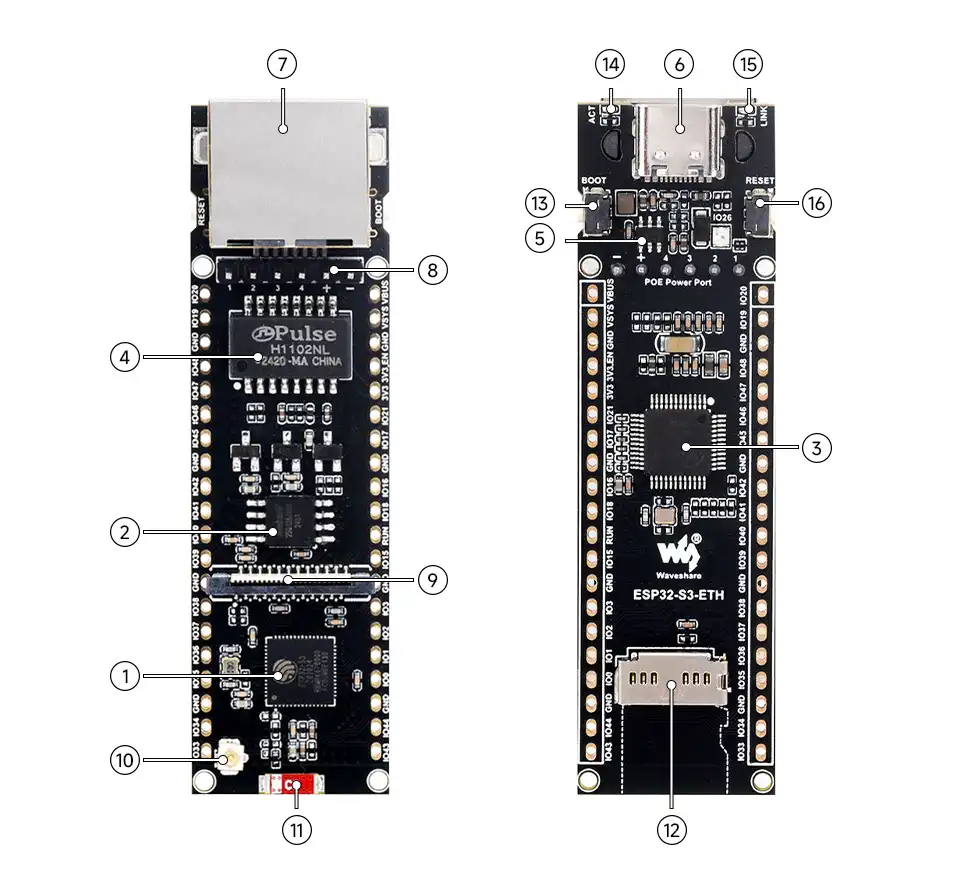
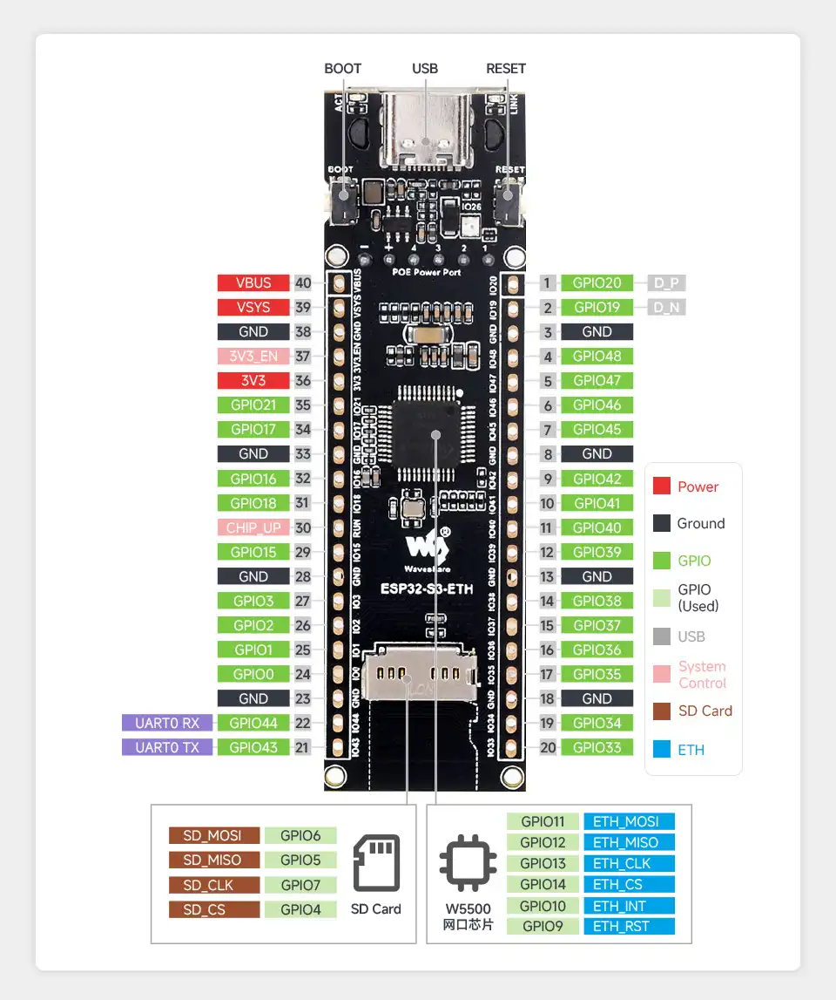
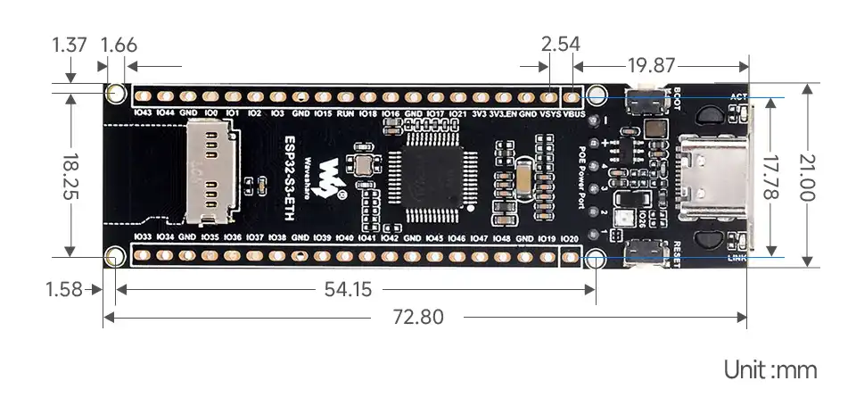

# Waveshare ESP32-S3-ETH Engineering Guide


[**View Waveshare ESP32-S3-ETH on OpenELAB**](https://openelab.io/products/esp32-s3-eth-dev-board)

**Model:** ESP32-S3-ETH base board · **OpenELAB SKU:** `Waveshare-28972` · Camera and PoE modules depend on the purchased option. Confirm the selected store variant.


## Product overview

ESP32-S3-ETH combines ESP32-S3 wireless development with a W5500 wired Ethernet interface, microSD and a camera connector. This guide takes a base board from USB programming to a wired DHCP result, then explains every task in the manufacturer's Arduino/ESP-IDF example package. Optional camera and PoE workflows are explicitly marked.

### Identify the kit before choosing an example

| Manufacturer code             | Name                      | Additional hardware                                                                                                |
| ----------------------------- | ------------------------- | ------------------------------------------------------------------------------------------------------------------ |
| **28972**                     | ESP32-S3-ETH              | Base board covered here                                                                                            |
| 28770                         | ESP32-S3-ETH-CAM-KIT      | Camera kit                                                                                                         |
| 28771                         | ESP32-S3-POE-ETH          | PoE module included                                                                                                |
| 28772                         | ESP32-S3-POE-ETH-CAM-KIT  | PoE and camera kit                                                                                                 |
| 34882 / 34883 / 34884 / 34885 | Respective **-M** options | Separate manufacturer variants; verify their exact hardware documents before reusing this base-board configuration |

Kit identities: [Waveshare product overview](https://docs.waveshare.com/ESP32-S3-ETH). A reserved PoE header is not an installed PoE supply. The connector arrangement resembles Raspberry Pi Pico, but compatibility is limited to appropriate expansions; it does not imply identical pins, power or firmware.

## Applications

Use wired networking for a sensor gateway, a local service or a network-connected data logger. Add storage after confirming a network result, then add a camera if required. That order makes a supply or camera fault distinguishable from a DHCP failure. Keep a known-working project for each subsystem before combining them.

For a deployment, define the network identity, address policy, credential provisioning and recovery interface early. The supplied demonstrations are learning baselines. Their default passwords, sample MAC addresses and open HTTP controls need project-specific treatment before use on a shared network.

## Specifications

| Item                | Base-board specification                                                                |
| ------------------- | --------------------------------------------------------------------------------------- |
| Controller          | ESP32-S3R8, dual-core Xtensa LX7, up to 240 MHz                                         |
| Memory              | 512 KB SRAM, 384 KB ROM; 8 MB PSRAM and 16 MB flash                                     |
| Wireless            | 2.4 GHz Wi-Fi; Bluetooth 5 LE                                                           |
| Wired networking    | W5500 on SPI; RJ45 10/100 Mbps auto-negotiation                                         |
| Expansion           | microSD / TF, camera connector, PoE header, Pico-style headers                          |
| Programming / power | USB Type-C                                                                              |
| Optional PoE        | Compatible IEEE 802.3af module required                                                 |
| Drawing dimensions  | 72.80 × 21.00 mm overall drawing envelope; see drawing for connector and hole locations |

Controller/interface values: [manufacturer overview](https://docs.waveshare.com/ESP32-S3-ETH). Mechanical values: [official dimension drawing](https://docs.waveshare.com/assets/images/ESP32-S3-ETH-details-size-e17a2432fc60e98e2ed27afcdbea08cc.webp). Ethernet line rate is not measured application throughput; camera processing, SPI, buffers and network traffic affect delivered performance.

## Hardware and connections



_Waveshare_ [_original resource map_](https://docs.waveshare.com/assets/images/ESP32-S3-ETH-details-intro-c5516c099cc2d4ee3d27bc69abd80fb7.webp)_. Its numbered features identify: 1 ESP32-S3R8; 2 W25Q128 flash; 3 W5500; 4 H1102NLT transformer; 5 JW5060 regulator; 6 USB-C; 7 RJ45; 8 PoE header; 9 camera connector; 10 IPEX connector; 11 ceramic antenna; 12 TF slot; 13 BOOT; 14 ACT; 15 LINK; 16 RESET._ [_Source descriptions_](https://docs.waveshare.com/ESP32-S3-ETH)_._

### Pins and peripheral ownership



_Waveshare_ [_original pinout_](https://docs.waveshare.com/assets/images/ESP32-S3-ETH-details-15-b9d2e97a5122db37da6be5bac19e29b4.webp)_. Read the connector orientation from the illustration. Header pad numbers, ESP32 GPIO numbers and peripheral signals are different identifiers._

| Function                    | ESP32-S3 GPIOs                                         | Integration rule                                                                                                 |
| --------------------------- | ------------------------------------------------------ | ---------------------------------------------------------------------------------------------------------------- |
| W5500 SPI                   | MOSI11, MISO12, SCLK13, CS14                           | Preserve the board's SPI assignments                                                                             |
| W5500 control               | RESET9, INT10                                          | Reset and interrupt are not generic expansion pins while Ethernet is used                                        |
| microSD SPI                 | MOSI6, MISO5, SCLK7, CS4                               | Separate from the W5500 pin set                                                                                  |
| Addressable RGB LED         | 21                                                     | Use an addressable-LED driver, not ordinary HIGH/LOW blinking                                                    |
| USB                         | D−19, D+20                                             | Avoid repurposing while native USB is needed                                                                     |
| Camera clocks/control       | ENABLE8, XCLK3, PCLK39, VSYNC1, HREF2, SDA48, SCL47    | Retain the camera project's exact configuration                                                                  |
| Camera data                 | D0=41, D1=45, D2=46, D3=42, D4=40, D5=38, D6=15, D7=18 | These are camera bit positions, not header pad numbers                                                           |
| Reserved internal functions | GPIO33–37                                              | Not general expansion GPIOs                                                                                      |
| Boot strapping              | GPIO0, GPIO3, GPIO45, GPIO46                           | External circuits must preserve the required reset/boot levels; GPIO46 is not an ESP32-S3 input-only restriction |

Assignments were checked against the [board schematic](https://files.waveshare.com/wiki/ESP32-S3-ETH/ESP32-S3-ETH-Schematic.pdf) and the [official example archive](https://files.waveshare.com/wiki/ESP32-S3-ETH/ESP32-S3-ETH-Demo.zip), including its SD, W5500 and camera source files. The reserved GPIO restriction is also stated in the [board FAQ](https://docs.waveshare.com/ESP32-S3-ETH/FAQ).

Boot-strapping and chip-level GPIO restrictions: [Espressif's ESP32-S3 GPIO reference](https://docs.espressif.com/projects/esp-idf/en/release-v5.5/esp32s3/api-reference/peripherals/gpio.html). Do not transfer ESP32-S2 or original ESP32 input-only pin rules to ESP32-S3.

Use **3.3 V logic** at the ESP32 pins; USB/PoE power is not permission to apply 5 V signals. Begin with USB power and an ordinary Ethernet connection. Before combining power inputs or fitting a PoE module, check the exact assembly and its power circuit. Disconnect power before inserting/removing the camera ribbon, and use its marked orientation rather than a guessed contact side.

The Wi-Fi web-control demonstration drives GPIO18; the camera uses that pin as D7. Do not combine these examples unchanged. Likewise, the GPIO sweep drives many header signals and can conflict with attached peripherals. Treat shared-pin ownership as a project configuration, not a last-minute debugging detail.



_Waveshare_ [_dimensioned drawing_](https://docs.waveshare.com/assets/images/ESP32-S3-ETH-details-size-e17a2432fc60e98e2ed27afcdbea08cc.webp)_, units mm. Use the actual board and drawing for mounting clearances; the Ethernet connector extends beyond the header span._

### Antenna selection

The ceramic antenna is the default path. The [FAQ](https://docs.waveshare.com/ESP32-S3-ETH/FAQ) describes switching the 0 Ω RF-selection resistor from its vertical to horizontal position to use the IPEX Gen 1 connector. Attaching an external antenna alone does not switch the RF path. This is board rework: confirm the pictured revision and have suitable soldering equipment before altering it. Re-test the radio after the change.

## Software and development resources

### Reproducible package selection

Download and extract the [ESP32-S3-ETH demo archive](https://files.waveshare.com/wiki/ESP32-S3-ETH/ESP32-S3-ETH-Demo.zip). The reviewed archive contains Arduino examples/libraries, factory binaries, native ESP-IDF projects and shared components. Keep the whole directory tree. Save the download date and archive hash with a working project; a vendor's ZIP URL can later serve different contents.

The reviewed download was **6,007,441 bytes**. Paths below are taken from that archive, not inferred from the web page. In particular, its native Ethernet DHCP project is **`ESP-IDF/example/10_ETH_DHCP`**. The online ESP-IDF catalogue uses some different numbering. Locate by task **and** folder contents before opening a project.

| Route                   | Documented baseline / dependency boundary                                                                                                                                        |
| ----------------------- | -------------------------------------------------------------------------------------------------------------------------------------------------------------------------------- |
| Arduino                 | ESP32 board support ≥2.0.12 in the manufacturer instructions; bundled Adafruit\_NeoPixel, ESP32-BLE-Keyboard, Ethernet, Ethernet\_Generic and ETHClass2 serve different examples |
| Arduino Ethernet camera | Manufacturer's ETHClass2 path is for ESP32 Arduino **2.x**; do not assume later major versions are API-compatible                                                                |
| ESP-IDF                 | Manufacturer instructions reviewed here name **5.5.4**; use target `esp32s3`                                                                                                     |
| ESP-IDF Ethernet        | Sibling `eth_w5500_common` component, referenced through `EXTRA_COMPONENT_DIRS`                                                                                                  |
| ESP-IDF camera          | Preserve `cam_web_common`; reviewed camera manifest requests `espressif/esp32-camera` with `^2.1.4`                                                                              |

Baselines: [Arduino environment](https://docs.waveshare.com/ESP32-S3-ETH/Development-Environment-Setup-Arduino), [ESP-IDF environment](https://docs.waveshare.com/ESP32-S3-ETH/Development-Environment-Setup-ESP-IDF). Component details: corresponding CMake files and manifests inside the [archive](https://files.waveshare.com/wiki/ESP32-S3-ETH/ESP32-S3-ETH-Demo.zip). Keep the library selected by each example; installing several similarly named Ethernet libraries can make the IDE choose an unintended header.

## Getting started

### 1. Establish USB and the Arduino environment

1. Prepare the base board, a USB-C **data** cable, a computer, Arduino IDE, a wired network with DHCP and an Ethernet cable.
2. Leave external header wiring disconnected; connect USB and RJ45. Optional camera/storage/PoE hardware is not required for the first result.
3. Install the environment and settings below, upload the DHCP sketch, and retain its serial output as the first checkpoint.

Install the Espressif ESP32 board package through Arduino Boards Manager. Open the extracted `Arduino/examples/10_ETH_DHCP/ETH_DHCP/main/main.ino`, keeping the supporting files alongside it. Install/use the package's intended Ethernet library. The manufacturer's [Arduino settings](https://docs.waveshare.com/ESP32-S3-ETH/Development-Environment-Setup-Arduino) are:

| Tools option     | Setting                             |
| ---------------- | ----------------------------------- |
| Board            | ESP32S3 Dev Module                  |
| USB CDC On Boot  | Enabled                             |
| CPU frequency    | 240 MHz                             |
| Flash size       | 16 MB                               |
| Partition scheme | Huge APP: 3 MB No OTA / 1 MB SPIFFS |
| PSRAM            | OPI PSRAM                           |
| Upload mode      | UART0 / Hardware CDC                |
| USB mode         | Hardware CDC and JTAG               |
| Upload speed     | 921600                              |

Select the board's actual port, compile and upload. If the port does not respond, hold BOOT, press/release RESET, then release BOOT and reselect the port. Open Serial Monitor at **115200 baud**. A power LED or an RJ45 link alone does not establish successful firmware execution.

### Arduino: obtain a wired DHCP address

Connect RJ45 to a known DHCP network. The supplied `10_ETH_DHCP` sketch initializes the board's SPI pins, selects CS14 and calls `Ethernet.begin(mac)`. Its success path prints the wired IP. Its failure path stops; it also waits for USB Serial in setup, so leaving Serial Monitor closed can make an unattended test appear stalled.

The following **original diagnostic sketch** keeps the verified pin map, adds an explicit reset, bounds the wait for USB Serial and renews DHCP leases. It uses the bundled Arduino Ethernet API, not ETHClass2.

```cpp
#include <Arduino.h>
#include <SPI.h>
#include <Ethernet.h>

// Example locally administered MAC. Allocate a unique one per board on the LAN.
byte nodeMac[] = {0x02, 0x45, 0x4C, 0x41, 0x42, 0x01};
constexpr int ETH_CS = 14, ETH_RST = 9;

void setup() {
  Serial.begin(115200);
  unsigned long waitStart = millis();
  while (!Serial && millis() - waitStart < 3000) delay(10);
  pinMode(ETH_RST, OUTPUT);
  digitalWrite(ETH_RST, LOW);
  delay(10);
  digitalWrite(ETH_RST, HIGH);
  delay(200);
  SPI.begin(13, 12, 11, ETH_CS);  // SCLK, MISO, MOSI, CS
  Ethernet.init(ETH_CS);
  if (Ethernet.begin(nodeMac) == 0) {
    Serial.println("DHCP_FAIL: check physical link, VLAN and DHCP service");
    while (true) delay(1000);
  }
  Serial.print("WIRED_IP=");
  Serial.println(Ethernet.localIP());
}

void loop() {
  int leaseResult = Ethernet.maintain();
  if (leaseResult == 1 || leaseResult == 3) Serial.println("DHCP_RENEW_FAIL");
  delay(1000);
}
```

The pin/API baseline comes from archive `10_ETH_DHCP`; explicit reset is demonstrated in `12_ETH_MAC_DHCP_StaticIP`, and `maintain()` is provided by the bundled Ethernet library. [Source archive](https://files.waveshare.com/wiki/ESP32-S3-ETH/ESP32-S3-ETH-Demo.zip). This new sketch has not been compiled or run on hardware.

**Expected checkpoint:** a nonzero `WIRED_IP` in your LAN's address range. Save the actual output and, if accessible, the router's lease entry. The address printed by a separate Wi-Fi sketch does not validate Ethernet. If DHCP fails, confirm cable/link and network policy before changing firmware. Allocate a unique MAC for each deployed board; the manufacturer's demonstration MAC is shared example data.

### Continue from a working link

Keep the successful DHCP sketch and its network log. Choose one next subsystem from the complete task map below; verify that result independently before integrating it into a combined service.

### 3. All Arduino example tasks: configuration and expected result

All paths below are relative to **`Arduino/examples/`** in the [reviewed official archive](https://files.waveshare.com/wiki/ESP32-S3-ETH/ESP32-S3-ETH-Demo.zip). Open the `.ino` and its supporting folder, not just a similarly named library example. The table and task notes provide the on-page procedure; the source archive supplies the full implementations.

| Task / archive path                                            | What to configure or do                                                                           | Expected checkpoint                                                                                        |
| -------------------------------------------------------------- | ------------------------------------------------------------------------------------------------- | ---------------------------------------------------------------------------------------------------------- |
| `01_IO_Test/IO_Test/IO_Test.ino`                               | Remove external peripherals; run the output sweep only on an isolated board                       | Test GPIOs alternate at roughly 300 ms steps; verify selected signals with a suitable meter/logic analyzer |
| `02_RGB_LED/RGB_LED/RGB_LED.ino`                               | Use the bundled NeoPixel dependency and GPIO21                                                    | Onboard addressable LED changes colors                                                                     |
| `03_SD_Card/SD_Card/SD_Card.ino`                               | Insert a backed-up, compatible FAT32 card; retain SPI4/5/6/7 assignments                          | Card initializes; `/waveshare.txt` is written and read back through Serial                                 |
| `04_BLE_Keyboard/BLE_Keyboard/BLE_Keyboard.ino`                | Use ESP32-BLE-Keyboard; pair only with a controlled test computer and a disposable text field     | Host recognizes the BLE HID device and receives the demonstration keystrokes                               |
| `05_WiFi_AP/WiFi_AP/WiFi_AP.ino`                               | AP demonstration defaults to SSID `ESP32-S3-ETH`, password `88888888`; change them for deployment | Another device can join the AP; Serial reports its AP details                                              |
| `06_WiFi_STA/WiFi_STA/WiFi_STA.ino`                            | Replace SSID/password; join 2.4 GHz Wi-Fi; use the printed HTTP address                           | `/H` and `/L` control GPIO18; inspect the resulting output level on an otherwise unused pin                |
| `07_WIFI_DHCP/WIFI_DHCP/main/main.ino`                         | Set local Wi-Fi credentials                                                                       | Router-assigned **wireless** IP is printed                                                                 |
| `08_WIFI_StaticIP/WIFI_StaticIP/main/main.ino`                 | Replace sample static IP, gateway, DNS and mask to match your LAN                                 | Printed static Wi-Fi IP is reachable from the same subnet                                                  |
| `09_WIFI_Web_CAM/WIFI_Web_CAM/WIFI_Web_CAM.ino`                | Optional compatible camera; preserve local `camera_pins.h`, PSRAM and Wi-Fi settings              | Browser opens camera controls / image stream at the reported address                                       |
| `10_ETH_DHCP/ETH_DHCP/main/main.ino`                           | Wired DHCP and unique MAC; see complete workflow above                                            | Wired address printed                                                                                      |
| `11_ETH_StaticIP/ETH_StaticIP/main/main.ino`                   | Edit all network parameters and MAC; ensure no address conflict                                   | Wired static address printed and reachable                                                                 |
| `12_ETH_MAC_DHCP_StaticIP/ETH_MAC_DHCP_StaticIP/main/main.ino` | Review MAC/reset and DHCP fallback policy before running                                          | DHCP succeeds, or code explicitly falls back to its configured static network                              |
| `13_ETH_Web_CAM/ETH_Web_CAM/ETH_Web_CAM.ino`                   | Optional camera; use matching Arduino 2.x / ETHClass2 path; connect wired network                 | Ethernet event log, wired IP and browser camera result                                                     |

#### GPIO, RGB, SD and BLE details

The GPIO sweep's list is `21,17,16,18,15,3,2,1,0,44,43,38,39,40,41,42,45,47,48`. Several overlap camera or boot/serial functions. Never run this sweep with an attached actuator, unknown expansion or camera and assume it is a harmless identification test. The RGB test is a separate one-pixel serial protocol on GPIO21.

The SD demonstration creates/opens a file, writes content and reads it back; verify both operations rather than stopping at a successful mount message. Back up before changing a filesystem. The manufacturer suggests FAT32 for the example and notes that larger cards often arrive formatted differently. For an SDIO experiment, the board FAQ allows **one-line SD mode only**, with matching menuconfig/pins; the SPI demonstration is not proof of a four-bit SDIO connection. [SD/GPIO source files](https://files.waveshare.com/wiki/ESP32-S3-ETH/ESP32-S3-ETH-Demo.zip), [SDIO FAQ](https://docs.waveshare.com/ESP32-S3-ETH/FAQ).

The BLE example behaves as an input device. Pair it with a controlled test host so its automated input goes into a disposable editor, then unpair it when finished. A successful Bluetooth scan without actual HID input does not complete that test.

#### Static addressing and DHCP fallback

The archive's Wi-Fi static sample uses `192.168.196.100`, gateway/DNS `192.168.196.1`, mask `255.255.255.0`. The Ethernet static sample uses `192.168.9.200`, gateway/DNS `192.168.9.1`, the same mask. The Ethernet MAC/DHCP fallback sample uses `192.168.1.177`, gateway/DNS `192.168.1.1` after DHCP fails. These are **example networks**, not addresses automatically valid at your site. [Actual sketch constants](https://files.waveshare.com/wiki/ESP32-S3-ETH/ESP32-S3-ETH-Demo.zip).

Choose a reserved/free address in the correct subnet and document the gateway and DNS separately. A host on another subnet may not reach a fallback address even though Ethernet link is up. In a production service, make fallback visible in logs and define how an operator discovers the board. Do not silently assign the same fallback address and MAC to several boards.

#### Camera workflow and configuration

Power off before connecting the camera. Confirm camera model, ribbon orientation and that its pins are not allocated to another task. Enable OPI PSRAM, then use either the Wi-Fi or Ethernet camera example with its accompanying source files. The Wi-Fi archive labels its local camera selection `CAMERA_MODEL_ESP_EYE`, but its **local pin file is customized for this board**; replacing it with a stock ESP-EYE definition can break the wiring.

The reviewed sources configure GPIO8 as camera enable, a 10 MHz XCLK, JPEG capture and PSRAM-aware frame buffering; they allocate a larger frame size and start the sensor at a smaller size for responsiveness. Keep the source's configuration together. After its reported IP appears, open the browser interface on the same network, request a still image, then start/stop streaming. Adjust supported frame size, JPEG quality and image controls one at a time and note buffer/latency behavior. [Wi-Fi/Ethernet camera source files](https://files.waveshare.com/wiki/ESP32-S3-ETH/ESP32-S3-ETH-Demo.zip).

Continuous capture heats the camera. If temperature becomes excessive, stop, disconnect power and let it cool; for long-running use, stop capture or use an appropriate idle/sleep arrangement when no frame is required. [Manufacturer thermal advice](https://docs.waveshare.com/ESP32-S3-ETH/FAQ). Treat the example HTTP server as a local development service; add access control and a deliberate network exposure policy before deployment.

### ESP-IDF: preserve shared components

Use the documented ESP-IDF environment, open its activated terminal and extract the **entire** archive. In the reviewed package, the Ethernet DHCP project is:

```
ESP32-S3-ETH-Demo/
  ESP-IDF/example/
    10_ETH_DHCP/
    eth_w5500_common/
    cam_web_common/
```

From `ESP-IDF/example/10_ETH_DHCP`, run:

```sh
idf.py --version
idf.py set-target esp32s3
idf.py build
```

Then select the actual device port and run `idf.py -p <your-port> flash monitor` after replacing `<your-port>` with the observed port. Exit the monitor with its documented key sequence. **Expected result:** a successful build, W5500 link/network events and the assigned wired IP. Capture the real output; none of these commands was executed on hardware for this guide.

The project's top-level CMake file sets `EXTRA_COMPONENT_DIRS` to `../eth_w5500_common`. Copying only `10_ETH_DHCP` breaks that dependency. Camera projects also use `cam_web_common`; preserve both the relative layout and managed-component files. Verify the target and SDK before treating an unresolved header/component as a board fault. [CMake and manifests in official ZIP](https://files.waveshare.com/wiki/ESP32-S3-ETH/ESP32-S3-ETH-Demo.zip).

#### Native example map from the actual archive

| ESP-IDF folder under `example/` | Procedure / validation                                                                                  |
| ------------------------------- | ------------------------------------------------------------------------------------------------------- |
| `01_IO_Test`                    | Isolate expansion wiring, build/flash and verify the GPIO sweep                                         |
| `02_RGB_LED`                    | Build/flash; check addressable RGB behavior                                                             |
| `03_SD_Card`                    | Back up and insert the compatible card; check create/read output                                        |
| `05_WiFi_AP`                    | Configure AP identity, build/flash and join from a test device                                          |
| `06_WiFi_STA`                   | Configure station credentials; check connection and GPIO18 web control                                  |
| `07_WIFI_DHCP`                  | Set station credentials; check DHCP event/address                                                       |
| `08_WIFI_StaticIP`              | Edit static network settings to match the test LAN                                                      |
| `09_WIFI_Web_CAM`               | Fit optional camera; configure Wi-Fi camera settings through menuconfig; check still capture and stream |
| `10_ETH_DHCP`                   | Use the complete first-result procedure above                                                           |
| `11_ETH_StaticIP`               | Configure the native Ethernet static parameters and test from the same subnet                           |
| `12_ETH_MAC_DHCP_StaticIP`      | Verify MAC, DHCP wait/fallback policy and final address                                                 |
| `13_ETH_Web_CAM`                | Preserve both shared components; fit camera; inspect wired IP and browser result                        |

This map follows archive directory names. There is **no separate native `04_BLE_Keyboard` project** in the reviewed package. The web guide's different example numbering is not an additional set of native projects. [Archive](https://files.waveshare.com/wiki/ESP32-S3-ETH/ESP32-S3-ETH-Demo.zip), [ESP-IDF explanation](https://docs.waveshare.com/ESP32-S3-ETH/Development-Environment-Setup-ESP-IDF).

### 5. Factory firmware, flashing and erase recovery

The archive includes `Arduino/bin/Factory_Testing.bin` and `Arduino/bin/ETH_Web_CAM.bin`. The second requires the appropriate camera hardware. Back up required application/configuration data before replacing firmware.

In Espressif's [Flash Download Tool](https://dl.espressif.com/public/flash_download_tool.zip), select **ESP32-S3**, **USB**, the observed COM port and the manufacturer's documented **1152000 BAUD**. Select the intended binary, enter address **0x00**, enable that row, start, wait for completion, then RESET. If sync stalls, enter download mode with BOOT held → press/release RESET → release BOOT, reselect the port and retry. A tool/driver that cannot use that rate needs a supported configuration; do not confuse this tool setting with Serial Monitor's 115200 baud. [Official binary flashing procedure](https://docs.waveshare.com/ESP32-S3-ETH/Firmware-Flashing).

An **ERASE** action removes the whole flash contents and configuration. The manufacturer describes connecting in the same tool without selecting a binary, then using ERASE once connected. Erase is not required merely because DHCP fails; first isolate network and build issues. Keep a verified replacement image available before erasing.

## Troubleshooting and FAQs

| Symptom                                          | Check in order                                                                                                     |
| ------------------------------------------------ | ------------------------------------------------------------------------------------------------------------------ |
| Power but no programming port                    | Data cable → direct USB port → no external wiring → BOOT/RESET sequence → reselect enumerated port                 |
| DHCP sketch appears silent                       | 115200 Serial Monitor → USB CDC setting → sketch's blocking `while (!Serial)` → correct Ethernet library           |
| Link LED but no IP                               | Known cable/switch → DHCP availability / VLAN → unique MAC → W5500 pin map → correct project                       |
| Static IP printed but unreachable                | Client/board subnet and mask → duplicate address → gateway policy → fallback address log                           |
| Camera compile breaks after upgrade              | Restore matching Arduino 2.x / ETHClass2 package or choose native IDF route; record the actual compiler error      |
| Missing `eth_w5500_common` / camera header       | Restore the extracted sibling directories and CMake relationships; check target `esp32s3`                          |
| SD mount succeeds but no useful data             | Check write/read errors and actual `/waveshare.txt`; verify filesystem and supply before reformatting              |
| Camera corrupt / unstable after integrating code | Check shared GPIO ownership, particularly GPIO18; restore the standalone camera project and correct local pin file |
| Camera excessively hot                           | Stop capture, remove power, cool; inspect wiring/supply and idle policy before restarting                          |
| External antenna has no benefit                  | Verify exact revision's RF resistor selection; the IPEX connector is not selected by software alone                |

Board-specific recovery, antenna, reserved-pin and thermal restrictions are from the [Waveshare FAQ](https://docs.waveshare.com/ESP32-S3-ETH/FAQ). The remaining diagnostic order is OpenELAB engineering guidance derived from the reviewed example behavior. For support, provide the model/revision, package/SDK versions, supply, wiring, exact example path and a minimal serial log through [Waveshare technical support](https://docs.waveshare.com/ESP32-S3-ETH/Technical-Support).

## Downloads and technical documents

| Resource                                                                                                                                                                                            | Contents / purpose                                                                                             |
| --------------------------------------------------------------------------------------------------------------------------------------------------------------------------------------------------- | -------------------------------------------------------------------------------------------------------------- |
| [Official demo archive](https://files.waveshare.com/wiki/ESP32-S3-ETH/ESP32-S3-ETH-Demo.zip)                                                                                                        | All reviewed Arduino/native projects, libraries and factory binaries                                           |
| [ESP32-S3-ETH schematic](https://files.waveshare.com/wiki/ESP32-S3-ETH/ESP32-S3-ETH-Schematic.pdf)                                                                                                  | Electrical connections; reviewed drawing dated 2024-12-21                                                      |
| [ESP32-S3 data sheet](https://documentation.espressif.com/esp32-s3_datasheet_en.pdf) / [technical reference manual](https://documentation.espressif.com/esp32-s3_technical_reference_manual_en.pdf) | Chip electrical ratings and peripheral registers; use board sources for physical routing                       |
| [W5500 data sheet v1.1.0](https://files.waveshare.com/wiki/common/W5500_ds_v110e.pdf)                                                                                                               | Ethernet controller protocol/electrical reference                                                              |
| [Arduino IDE](https://www.arduino.cc/en/software/) / [SSCOM 5.13.1](https://files.waveshare.com/wiki/common/Sscom5.13.1.zip)                                                                        | Officially linked development / serial tools; choose a tool appropriate to the host OS                         |
| [Espressif Arduino documentation](https://docs.espressif.com/projects/arduino-esp32/en/latest/index.html)                                                                                           | Core-level APIs; match the board's intended core generation                                                    |
| [Resources index](https://docs.waveshare.com/ESP32-S3-ETH/Resources-And-Documents)                                                                                                                  | Manufacturer pinout, ESP32-S3 data sheet/reference manual, W5500 data sheet, Arduino download and serial tools |
| [Arduino workflow](https://docs.waveshare.com/ESP32-S3-ETH/Development-Environment-Setup-Arduino)                                                                                                   | Tool settings, example explanations and screenshots                                                            |
| [ESP-IDF workflow](https://docs.waveshare.com/ESP32-S3-ETH/Development-Environment-Setup-ESP-IDF)                                                                                                   | Native environment and configuration explanations; cross-check numbering with the ZIP                          |
| [Firmware flashing / erasing](https://docs.waveshare.com/ESP32-S3-ETH/Firmware-Flashing)                                                                                                            | Factory image procedure and destructive erase implications                                                     |
| [FAQ](https://docs.waveshare.com/ESP32-S3-ETH/FAQ) / [support](https://docs.waveshare.com/ESP32-S3-ETH/Technical-Support)                                                                           | Board restrictions and manufacturer assistance                                                                 |

## References and validation

Reviewed **23 November 2026**: the product/resource/development/flashing/FAQ pages, the downloaded schematic, the actual example archive, project paths, key source constants and component manifests. Figures above are Waveshare's original diagrams, with links and attribution. The guide adds a complete wired first-result sketch, correct archive paths, configuration checkpoints, pin-conflict warnings and network diagnostics.

**Software build, upload, throughput, camera and power tests: not run.** These instructions distinguish manufacturer specifications and source-reviewed behavior from measurements. Record the purchased kit/revision, archive hash, tool/library releases and actual observations when validating a system. Optional camera/PoE procedures do not establish that those components are present in base SKU `Waveshare-28972`.
