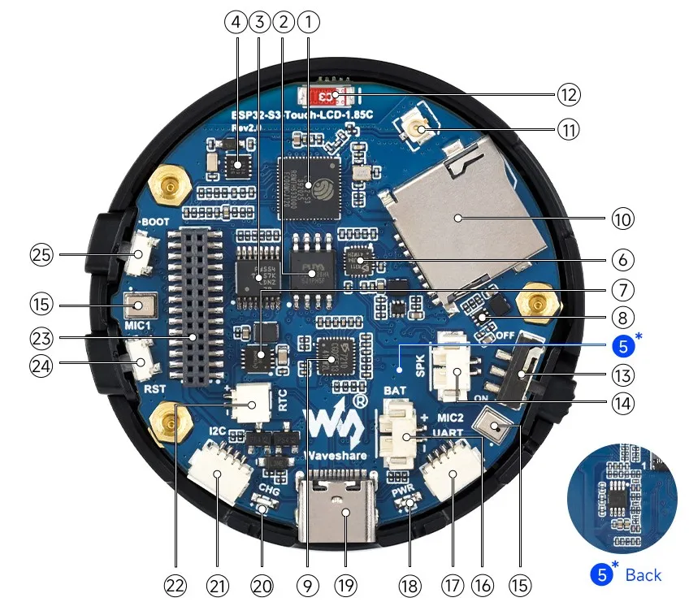

# Waveshare ESP32-S3 Touch LCD 1.85C BOX Engineering Guide


[**View Waveshare ESP32-S3-Touch-LCD-1.85C-BOX Smart Speaker Display with Battery on OpenELAB**](https://openelab.io/products/waveshare-esp32-s3-1-85-round-lcd?variant=45050505134278)

**Model / option:** Default Title · **SKU:** `Waveshare-30684`


## Product overview <a href="#product-and-scope" id="product-and-scope"></a>

The **Waveshare ESP32-S3-Touch-LCD-1.85C-BOX, SKU Waveshare-30684**, combines a360×360 round touch LCD with a speaker enclosure and3.7V battery. It is the BOX option, distinct from the bare30683 board and30685 BOX-EN no-battery option. The board includes MCU, display/touch, RTC, storage and audio interfaces for a local HMI or voice-interface prototype.

The manufacturer switched shipments from **V1 toV2 from30January2026**. Identify the actual unit by **Rev2.0** on the PCB/factory UI or the case'sV2QC sticker. The **audio chips and pins changed**; do not choose firmware from the physical screen size alone. [Revision and option reference](https://docs.waveshare.com/ESP32-S3-Touch-LCD-1.85C).

The first-run route below uses the exact V1/V2 factory package and an original serial/I2C diagnostic. The checked repository's source tree and its V2 factory binary are distinguished so that a binary's presence is not mistaken for a complete matching V2 source project.

## Applications

* A compact round HMI showing local status, time and touch controls.
* A speaker/microphone device for audio playback and voice-command experiments.
* A battery-backed desktop panel with logs/media on microSD.
* A local Wi-Fi client with bounded HTTP requests after display/power stability is established.

The speaker box provides mechanical packaging and sound output; it is not an environmental sealing or waterproofing claim. Do not pry the bonded LCD/glass assembly to change hardware. A camera is not an officially supported expansion path in the reviewed FAQ.

## Specifications

| Parameter           | BOX30684 reference                                                 |
| ------------------- | ------------------------------------------------------------------ |
| MCU / radio         | ESP32-S3R8, dual-core up to240MHz;2.4GHzWi-Fi andBLE5              |
| Memory              | 16MBflash /8MBPSRAM                                                |
| Display             | 1.85-inch round LCD,360×360, ST77916 in source driver              |
| Touch               | CST816-family I2C controller, one-point source driver              |
| Power               | USB-C5V, single-cell3.7V battery onMX1.25                          |
| Speaker             | BOX documented4Ω5W speaker; use the board connector/amplifier path |
| RTC / expander      | PCF85063 /TCA9554                                                  |
| Storage             | MicroSD/TF, model-specificSDMMC/driver configuration               |
| External interfaces | I2C,UART,USB pads and reserved1.27mm header                        |
| V1 audio            | PCM5101APWR playback,NS8002amplifier,digitalMEMSmicrophone         |
| V2 audio            | ES8311codec,NS4150Bamplifier,ES7210ADC,analogdual microphones      |

Source: [exact model and revision table](https://docs.waveshare.com/ESP32-S3-Touch-LCD-1.85C), source/schematics listed below. The speaker's advertised rating is not the continuous power drawn by the whole system. The board regulator's3.3V/2A component capability is not a documented external-header power budget.

## Hardware and connections <a href="#hardware-and-technical-documents" id="hardware-and-technical-documents"></a>

### Revision-specific audio wiring

| Signal    | V1                                  | V2                               |
| --------- | ----------------------------------- | -------------------------------- |
| GPIO2     | MIC\_WS                             | I2S\_MCLK                        |
| GPIO10/11 | Not used for V1 audio-codec control | SCL/SDA for V2 codec/ADC control |
| GPIO15    | MIC\_SCK                            | PA\_CTRL                         |
| GPIO38    | I2S\_LRCK                           | I2S\_LRCK                        |
| GPIO39    | MIC\_SD                             | MIC\_SD                          |
| GPIO47    | I2S\_DIN playback path              | I2S\_DIN playback path           |
| GPIO48    | I2S\_BCK                            | I2S\_BCK                         |

This audio-difference table does not make GPIO10/11 general-purpose free pins: the board's I2C driver/header uses **SCL10/SDA11** for other onboard devices. Follow the schematic and actual firmware branch. [Revision reference](https://docs.waveshare.com/ESP32-S3-Touch-LCD-1.85C), [actual I2C source](https://github.com/waveshareteam/ESP32-S3-Touch-LCD-1.85C/blob/27314d3f9f169bc42864fd93433636ec404ab097/Arduino/examples/01_lvgl_example/I2C_Driver.h).

### Display, touch and expansion

| Function               | Reviewed board/source assignment                                       |
| ---------------------- | ---------------------------------------------------------------------- |
| LCD QSPI               | Clock40;data0/1/2/3=46/45/42/41;CS21;TE18                              |
| LCD reset /touch reset | Expander-controlled; source labelsLCD EXIO2,touch EXIO1                |
| Backlight              | GPIO5 in reviewed display driver; use its backlight API/range          |
| Touch                  | I2C0x15, interruptGPIO4; model-specific expander reset                 |
| Onboard I2C            | SDA11,SCL10;0x20expander,0x51RTC,0x15touch in the common FAQ           |
| UART header            | TX43/RX44,3V3/GND;3.3Vlogic                                            |
| USB                    | D−19/D+20; pads also expose5V/GND                                      |
| Battery measurement    | GPIO8 in the supplied ADC example; divider factor must match schematic |

These assignments come from the [exact source driver](https://github.com/waveshareteam/ESP32-S3-Touch-LCD-1.85C/blob/27314d3f9f169bc42864fd93433636ec404ab097/Arduino/examples/01_lvgl_example/Display_ST77916.h), touch header and revision schematics. The V2 photo below helps locate the codec/ADC, speaker, battery, USB and RTC headers. Its callout numbers are component labels, not connector pin numbers.

The I2C expansion header is already connected to onboard devices; add only compatible I2C peripherals with no address conflict. Do not remap SCL/SDA to unrelated GPIO duties. UART TX must cross to external RX and share the documented signal ground. Reusing nativeUSB19/20 as GPIO can remove the normal USB upload path and require manual BOOT recovery.

Power off before moving connectors. Battery and speaker sockets are not interchangeable even if both use two pins. Retain battery polarity/protection and the shipped speaker. The RTC header is charge-enabled: use only the specified rechargeable backup-battery type. A main battery charging LED can be indeterminate when no main battery is attached; that is not a current measurement.



_Manufacturer figure: Waveshare._ [_Original source_](https://docs.waveshare.com/ESP32-S3-Touch-LCD-1.85C)_._

## Software and development resources <a href="#development-software-and-recovery" id="development-software-and-recovery"></a>

### Firmware and toolchain lanes

| Hardware / task           | Supported reviewed route                                          |
| ------------------------- | ----------------------------------------------------------------- |
| V1 factory recovery       | `ESP32-S3-Touch-LCD-1.85C_FactoryOnly_20250227.bin`,V1only        |
| V2 factory recovery       | `ESP32-S3-Touch-LCD-1.85C_FactoryOnly_20261022.bin`,V2only        |
| V1 Arduino documentation  | Core3.0.2–3.1.1; historicalLVGL8.3.10 and audioI2S2.0.0 lane      |
| V2 Arduino documentation  | Core3.2.0,LVGL9.3.0,audioI2S2.0.0,ES7210/ES8311matching libraries |
| ESP-IDF documentation     | 5.5.1or later with the exact revision project/defaults            |
| Original diagnostic below | Wire/Serial only; no display/audio library or external load       |

The current checked repository contains `Arduino/examples/01_lvgl_example` and `ESP-IDF/ESP32-S3-Touch-LCD-1.85C-Test`; its bundled LVGL header reports9.3.0. The current docs additionally name a V2-specific test project. **That separately named V2 source project was not present in the reviewed clone.** Use the verified V2 factory binary for V2 first-run, and obtain the matching V2 project before making a full V2 audio/application source build. Do not relabel the older audio source merely because a newer binary sits beside it. [Repository](https://github.com/waveshareteam/ESP32-S3-Touch-LCD-1.85C/blob/27314d3f9f169bc42864fd93433636ec404ab097/README.md), [firmware compatibility/checksums](https://github.com/waveshareteam/ESP32-S3-Touch-LCD-1.85C/blob/27314d3f9f169bc42864fd93433636ec404ab097/firmware/README.md), [Arduino lanes](https://docs.waveshare.com/ESP32-S3-Touch-LCD-1.85C/Arduino).

For speech recognition, the documented partition is **ESP SR16M:3MBAPP/7MBSPIFFS/2.9MBMODEL**. A no-speech application uses the documented16M application/FATFS layout or its exact supplied partition table. A speech model is a separate data asset; an application upload alone does not populate the model partition.

Retain library versions and `lv_conf.h` together. LVGL8and9initialization/event code differ. Root/source license and third-party notices should be checked separately; never remove bundled library licenses when redistributing.

## Getting started

### Factory first result

1. Record30684 and actualV1/V2 identification. Save media/settings. Prepare USB data cable and the selected computer port; leave expansion wiring disconnected.
2. If the factory application already boots, use it first. Confirm a360×360image, touch alignment and the version identifier. Test SD-related features only with a known backed-up FAT card; the FAQ confirms other functions can run without one.
3. If restoration is needed, use the **matching** image from the pinned firmware directory. Install esptool and verify the selected file's checksum before any write:

```bash
python -m pip install esptool
```

For **V2only**, the firmware guide publishes SHA-256 `441d34526d7f10798a3fa07e102628fde5ff8a636389d067dbdbd0dd440adeed`. For **V1only**, it publishes `13a8329e7479a5b6aa1eec4d6f0ea4b144e019a15f65eb164bbc8f1e948f5075`. Compare using your OS's SHA-256 tool; do not substitute another file with a similar name. 4. The guide prescribes an erase before factory restoration, which removes existing flash data. After backup and selecting the exact file, the **V2** sequence is:

```bash
python -m esptool --chip esp32s3 --port PORT erase-flash
python -m esptool --chip esp32s3 --port PORT write-flash 0x0 ESP32-S3-Touch-LCD-1.85C_FactoryOnly_20261022.bin
```

Use the V1file only onV1; do not execute both variants. A complete merged image uses0x0; application-only binaries need their own offsets. Keep stable power during the write. 5. Reset and verify the intended factory UI. Check touch near center/edges, vary brightness, inspect flash/battery/RTC information and make one low-volume playback test. OnV2, separately observe the microphone response before enabling any voice-network feature.

**Expected result:** a stable model/revision-correct factory screen and corresponding touch response. A flash success message does not prove the LCD, battery charger, microphone or speaker works.

### Original I2C diagnostic

This standalone sketch reads only I2C acknowledgements on the board'sSDA11/SCL10bus. It does not initialize display/audio or alter expander registers. Use a new Arduino sketch, correct ESP32S3board, model memory settings, USB CDC console and115200Serial Monitor:

```cpp
#include <Arduino.h>
#include <Wire.h>

void setup() {
  Serial.begin(115200);
  delay(1500);
  Wire.begin(11, 10, 100000);
  Serial.println("1.85C bus: SDA11 SCL10; no register writes");
}

void loop() {
  unsigned found = 0;
  for (uint8_t address = 8; address < 120; ++address) {
    Wire.beginTransmission(address);
    if (Wire.endTransmission() == 0) {
      Serial.printf("ACK 0x%02X\n", address);
      ++found;
    }
  }
  Serial.printf("Scan complete: %u responding addresses\n", found);
  delay(5000);
}
```

**Expected result:** responding common onboard devices can include0x20expander,0x51RTC and0x15touch. A sleeping/reset touch or an unpowered codec can be absent until the model's proper initialization; do not interpret this sketch as a full board acceptance or write arbitrary power/expander values to make an address appear.

### Source development, battery and media checkpoints

For the reviewed graphical example, preserve all companionI2C/expander/ST77916/touch/LVGLfiles. The initializer calls `I2C_Init()`, `TCA9554PWR_Init()`, backlight/LCDinitialization and `Lvgl_Init()` before creating widgets under the LVGL lock. Replace only the demo widget creation after choosing a source/library lane that actually matches the received revision. ForV2audio, use the distinctV2codec/ADCsource when obtained rather than thePCM5101V1implementation.

For an original RTC experiment, set a known time in `02_RTC_PCF85063`, read it back, then verify retention using the documented rechargeableRTCbackup path. Log timezone/UTCconvention in the application; a clock that increments is not proof it has been set correctly.

The supplied battery ADC example readsGPIO8 and multiplies calibrated millivolts by3for its divider. Keep that factor tied to the actual schematic, not another ESP32board. Compare against a meter before using it for battery percentage or a shutdown decision; voltage alone is not a universal state-of-charge curve.

Storage progression: use`04_SDMMC_Test`to mount/read/write a small file, then play one supported test file with the matching audio example. Unmount/finish writing before removal. Preserve filenames/format expected by a factory player; an extension alone does not establish a supported codec.

Wi-Fi/HTTP comes after local bring-up: configure the intended credentials/test endpoint in`07_WiFi_http_Client`, capture response status and handle loss/timeouts. For offline speech, select the correct language model and partition and start with its documented wake word, then one command. The V2dual-microphone/echo-reference circuit does not by itself prove an echo-cancellation algorithm is active.

## Troubleshooting and FAQs <a href="#faqs" id="faqs"></a>

| Symptom                                | Ordered checks and recovery                                                                                                        |
| -------------------------------------- | ---------------------------------------------------------------------------------------------------------------------------------- |
| Audio fails after recovery             | Match the V1/V2 image first, then codec/ADC, pins and speaker; the two factory images are incompatible                             |
| Blank display or missing touch         | Check ST77916, 360 × 360 configuration, expander resets, I2C 10/11, touch INT4, library major version and backlight initialization |
| USB port blinks/disappears             | Hold BOOT, tap/release RESET, then release BOOT; select the re-enumerated port and matched image                                   |
| Arduino Serial silent                  | Enable USB CDC for native USB or use the exact sketch's HWCDC console; use 115200 and the correct port                             |
| SD error during the all-functions test | Use a known FAT card or omit SD features; formatting erases data, so back up first                                                 |
| Speech never wakes                     | Check the V1/V2 audio chain, language/model assets, speech partition and available internal RAM                                    |
| Mic responds but playback is silent    | Check input/output paths separately, codec/amplifier setup, supplied speaker and volume; a waveform does not establish output      |
| Battery LED odd without a battery      | Charge indication can be indeterminate without a main cell; verify battery presence and polarity                                   |
| RTC resets at power loss               | Check the rechargeable backup battery and clock initialization; main USB power alone is not a retention test                       |
| Need camera expansion                  | The reviewed FAQ does not support camera expansion; select a documented camera platform                                            |

The manufacturer warns that combinedWi-Fi/BLE/audio resource use is constrained in its example configuration. Establish each function separately and measure the real memory/latency budget before combining them. [FAQ](https://docs.waveshare.com/ESP32-S3-Touch-LCD-1.85C/FAQ).

## Downloads and technical documents

The V1 and V2 schematics were downloaded and inspected. The manufacturer V2 component figure below identifies connectors and chips. It must not be used as a V1 audio wiring diagram.

| Resource                                                                                                                                            | Purpose and exact scope                               |
| --------------------------------------------------------------------------------------------------------------------------------------------------- | ----------------------------------------------------- |
| [V1schematic](https://files.waveshare.com/wiki/ESP32-S3-Touch-LCD-1.85C/ESP32-S3-Touch-LCD-1.85C-Schematic.pdf)                                     | DownloadedV1electricalreference                       |
| [V2schematic](https://files.waveshare.com/wiki/ESP32-S3-Touch-LCD-1.85C/ESP32-S3-Touch-LCD-1.85C_V2.pdf)                                            | DownloadedV2electricalreference                       |
| [Dimensions](https://files.waveshare.com/wiki/ESP32-S3-Touch-LCD-1.85C/ESP32-S3-Touch-LCD-1_85C-dimension.pdf)                                      | ExactmanufacturermechanicalPDF,listed                 |
| [Firmwaredeliveryguide](https://github.com/waveshareteam/ESP32-S3-Touch-LCD-1.85C/blob/27314d3f9f169bc42864fd93433636ec404ab097/firmware/README.md) | ExactV1/V2filenames,checksums,offsets                 |
| [Source repository](https://github.com/waveshareteam/ESP32-S3-Touch-LCD-1.85C)                                                                      | Reviewedsourceproject;V2customsourceboundaryexplained |

## References and validation <a href="#sources-and-validation" id="sources-and-validation"></a>

Reviewed **24 November 2026**: exact BOX 30684 option, current revision tables, both schematics, Arduino/ESP-IDF/FAQ resources and repository commit `27314d3f9f169bc42864fd93433636ec404ab097`. The I2C diagnostic and staged acceptance checks are original.

**Compilation, flashing, display/touch, audio, charging, RTC retention, SD, radio and speech hardware tests: not run.** V2 factory commissioning uses the exact maintainer binary; a complete V2 custom audio source build requires the matching project identified above.

* [1.85C exact BOX/revision/power/connector guide](https://docs.waveshare.com/ESP32-S3-Touch-LCD-1.85C) — live24Nov2026.
* [V1/V2 Arduino version lanes and examples](https://docs.waveshare.com/ESP32-S3-Touch-LCD-1.85C/Arduino) — live24Nov2026.
* [Exact V1/V2factorycompatibility,checksumsandcommands](https://github.com/waveshareteam/ESP32-S3-Touch-LCD-1.85C/blob/27314d3f9f169bc42864fd93433636ec404ab097/firmware/README.md) — commit 27314d3f9f169bc42864fd93433636ec404ab097.
* [V2schematic](https://files.waveshare.com/wiki/ESP32-S3-Touch-LCD-1.85C/ESP32-S3-Touch-LCD-1.85C_V2.pdf) — downloaded24Nov2026.
* [ActualI2Cdriverpinconfiguration](https://github.com/waveshareteam/ESP32-S3-Touch-LCD-1.85C/blob/27314d3f9f169bc42864fd93433636ec404ab097/Arduino/examples/01_lvgl_example/I2C_Driver.h) — commit 27314d3f9f169bc42864fd93433636ec404ab097.

### Retained source links <a href="#official-documentation-and-development-resources" id="official-documentation-and-development-resources"></a>

* [Legacy model resource index](https://www.waveshare.com/wiki/ESP32-S3-Touch-LCD-1.85C)
* [Read schematics, downloads and model examples](https://docs.waveshare.com/ESP32-S3-Touch-LCD-1.85C/Resources-And-Documents)
