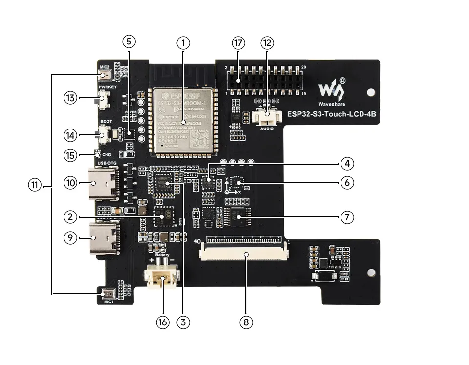
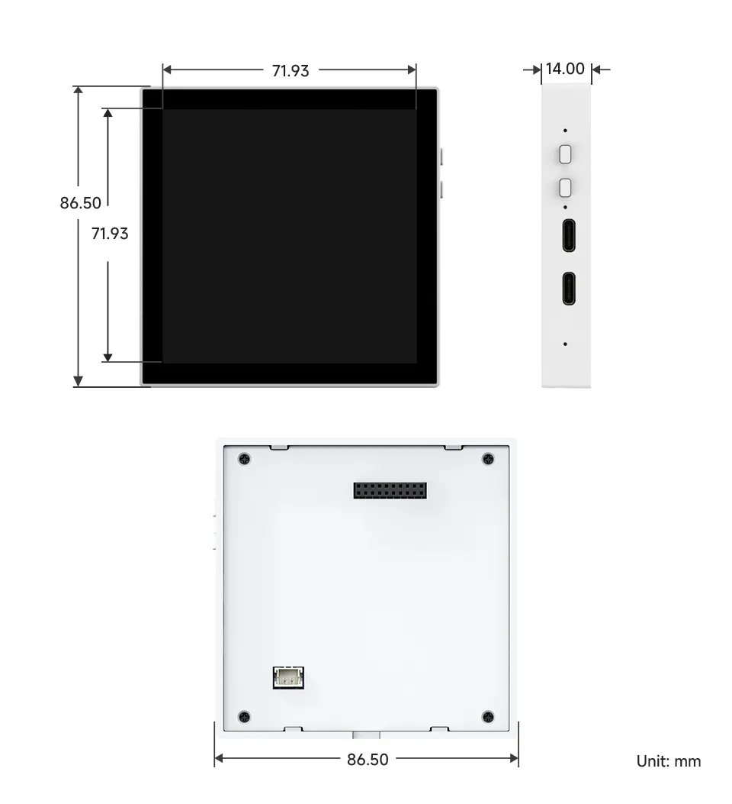

# Waveshare ESP32-S3 Touch LCD 4 and 4B Engineering Guide


[**View Waveshare ESP32-S3-Touch-LCD-4B Smart 86 Box Touch Display Dev Board on OpenELAB**](https://openelab.io/products/waveshare-esp32-s3-smart-86-box?variant=45041797562566)

**Model / option:** Default Title · **SKU:** `Waveshare-32052`

[**View Waveshare ESP32-S3 4inch Display Development Board 480x480 on OpenELAB**](https://openelab.io/products/waveshare-esp32-s3-4inch-display-development-board?variant=46059346067654)

**Model / option:** With Touch Function · **SKU:** `Waveshare-28154`


## Product overview <a href="#product-and-scope" id="product-and-scope"></a>

This family guide covers two distinct purchased4-inch480×480touch boards: **ESP32-S3-Touch-LCD-4, Waveshare-28154**, and **ESP32-S3-Touch-LCD-4B, Waveshare-32052**. Both use an ESP32-S3 and RGB LCD, but their power/control hardware, audio, fieldbus interfaces and pin maps differ.

| Exact SKU         | Board                 | Main integration distinction                                                         |
| ----------------- | --------------------- | ------------------------------------------------------------------------------------ |
| `Waveshare-28154` | ESP32-S3-Touch-LCD-4  | Touch variant with RS485/CAN and external DC terminal; identify hardware revision    |
| `Waveshare-32052` | ESP32-S3-Touch-LCD-4B | 86-box-style touch/audio platform with AXP2101,ES8311/ES7210 and dual USB interfaces |

The non-touch **ESP32-S3-LCD-4** option is a different SKU and does not gain GT911 input by loading touch firmware. It remains a selection reference here, not an extra assigned product.

For28154, older wiki passages describe **TCA9554/SW6106** revisions; the current official repository's **V4.0** reference instead uses **CH32V003 at0x24** for backlight, reset, power and battery sensing. Read the physical revision before using a register map. The4B'sTCA9554map is not a substitute forV4.0'shelper protocol. [LCD-4 hardware reference](https://github.com/waveshareteam/ESP32-S3-Touch-LCD-4/blob/390aaba10e80f1ef08506cb8d7db5e41cea09273/hardware/HARDWARE_REFERENCE.md), [LCD-4B overview](https://docs.waveshare.com/ESP32-S3-Touch-LCD-4B).

## Applications

* A touch HMI with native 480 × 480 widgets and separate display/input checks.
* An RS485 or CAN interface on the 28154, after validating the physical bus with a known peer.
* A voice/audio panel on the 32052 4B, after power, playback and capture work independently.
* RTC, logging and local Wi-Fi applications using the selected board's actual storage and power controls.

The wall-box shape does not establish a mains-input rating. The 4B does not inherit the LCD-4's external DC terminal or fieldbus interfaces.

## Specifications

| Parameter       | 28154 LCD-4                                                | 32052 LCD-4B                                         |
| --------------- | ---------------------------------------------------------- | ---------------------------------------------------- |
| MCU / memory    | ESP32-S3 N16R8, up to 240MHz, 16MB flash / 8MB octal PSRAM | ESP32-S3 N16R8, up to 240MHz, 16MB flash / 8MB PSRAM |
| Display         | ST7701 RGB, 480 × 480                                      | ST7701 RGB, 480 × 480 in the actual source           |
| Touch           | GT911, five-point vendor specification                     | GT911 reference/driver                               |
| Wireless        | 2.4GHz Wi-Fi and BLE5                                      | 2.4GHz Wi-Fi and BLE5                                |
| Main supply     | USB5V, revision-specific DC terminal, 3.7V battery         | USB5V, 3.7V PH2.0 battery via AXP2101                |
| External DC     | Legacy product7–36V; V4 schematic5–36V marking             | No transfer of that VIN rating established           |
| Helper          | V4 CH32V003 at0x24; earlier TCA9554                        | TCA9554 at0x20                                       |
| Fieldbus        | SP3485 RS485, TJA1051 TWAI/CAN                             | Not part of this 4B scope                            |
| Audio           | Buzzer path                                                | ES8311 playback, ES7210 capture, 8Ω2W speaker header |
| Other resources | PCF85063 RTC, microSD, helper-controlled battery functions | PCF85063 RTC, QMI8658 IMU, AXP2101 PMIC              |

Sources: [LCD-4 hardware reference](https://github.com/waveshareteam/ESP32-S3-Touch-LCD-4/blob/390aaba10e80f1ef08506cb8d7db5e41cea09273/hardware/HARDWARE_REFERENCE.md), [legacy manual](https://www.waveshare.com/wiki/ESP32-S3-Touch-LCD-4), [4B overview](https://docs.waveshare.com/ESP32-S3-Touch-LCD-4B) and downloaded 4B source. A generic library-table mention of CO5300 does not make 4B a QSPI AMOLED: its actual example constructs `Arduino_ESP32RGBPanel` with ST7701 initialization.

## Hardware and connections <a href="#hardware-and-technical-documents" id="hardware-and-technical-documents"></a>

### Supply and revision before wiring

Begin with a stable 5V USB data/power connection and leave field terminals disconnected. On LCD-4, the legacy7–36V product range and V4 schematic5–36V marking describe the VIN terminal. Confirm the received revision and marking before external DC operation. Do not apply that voltage to 4B, USB or a GPIO header.

Both battery paths are for the documented single 3.7V cell. Check polarity and the actual power circuit before replacing a cell. Do not pry the bonded LCD/glass stack. A PWR button can participate in power latching; treating it as an ordinary free input can cause shutdown.

### Model-specific pin reservations

| Function                      | LCD-4 V4.0                              | LCD-4B source archive                                  |
| ----------------------------- | --------------------------------------- | ------------------------------------------------------ |
| I2C SDA / SCL                 | 15 /7                                   | 47 /48                                                 |
| Helper                        | CH32V003,0x24                           | TCA9554,0x20                                           |
| RTC                           | PCF85063,0x51; interrupt via CH32 EXIO7 | Shared I2C; retain 4B interrupt configuration          |
| RGB DE / VSYNC / HSYNC / PCLK | 40 /39 /38 /41                          | 17 /3 /46 /9                                           |
| RGB red bits                  | 46 /3 /8 /18 /17                        | 10 /11 /12 /13 /14                                     |
| RGB green bits                | 14 /13 /12 /11 /10 /9                   | 21 /8 /18 /45 /38 /39                                  |
| RGB blue bits                 | 5 /45 /48 /47 /21                       | 40 /41 /42 /2 /1                                       |
| Panel serial control          | CS42,SCK2,MOSI1                         | XCA9554 software-SPI control                           |
| TWAI/CAN TX / RX              | 6 /0                                    | Not transferred from LCD-4                             |
| RS485 TX / RX                 | 44 /43                                  | Not transferred from LCD-4                             |
| SDMMC CLK / CMD / D0          | 2 /1 /4                                 | Use the actual 4B resource scope; no borrowed card map |
| Audio MCLK / BCLK / WS        | Buzzer/helper path                      | 5 /16 /7                                               |
| Audio capture / playback      | Not a 4B codec path                     | 15 /6                                                  |

Sources: [actual LCD-4 constructor](https://github.com/waveshareteam/ESP32-S3-Touch-LCD-4/blob/390aaba10e80f1ef08506cb8d7db5e41cea09273/examples/arduino/01_HelloWorld/01_HelloWorld.ino), [V4 hardware reference](https://github.com/waveshareteam/ESP32-S3-Touch-LCD-4/blob/390aaba10e80f1ef08506cb8d7db5e41cea09273/hardware/HARDWARE_REFERENCE.md), downloaded 4B `01_HelloWorld` and pin definitions. RGB lists follow the reviewed `Arduino_ESP32RGBPanel` parameter groups: `r0..r4`, then `g0..g5`, then `b0..b4`. The 4B sketch's inline red/blue comments are inconsistent with that library signature; the constructor arguments and 4B schematic confirm red GPIO10–14 and blue GPIO40/41/42/2/1. These are reserved display signals.

For V4, CH32 EXIO1 releases touch reset, EXIO3 releases LCD reset, EXIO5 maintains system power, EXIO6 controls the buzzer and EXIO7 reads the RTC interrupt. Backlight is CH32 PWM with range0–255. Do not configure all helper signals as outputs or replace its PWM API with an ESP32 LEDC pin. [CH32 guide](https://github.com/waveshareteam/ESP32-S3-Touch-LCD-4/blob/390aaba10e80f1ef08506cb8d7db5e41cea09273/examples/esp-idf/ioexpander/README.md).

The 4B demo starts I2C on47/48 and sequences expander-controlled reset/backlight before RGB startup. Its native USB and USB-to-UART sockets have different console paths; select the intended one. The 4B schematic and figure below identify its PMIC, audio, display and USB hardware.

### RS485 and CAN on 28154

Connect the labeled differential terminals, not ESP32 TX/RX directly to a field bus. Match reference-ground requirements, baud/bit rate and endpoint termination. Enable the switchable120Ω termination only where the topology requires it. CAN needs a compatible active peer for acknowledgement; a single transmitter can accumulate errors.

Keep the bus disconnected during GUI bring-up. Earlier LCD-4 revisions have documented CAN-component and SW6106 power/I2C problems. Those repair procedures are not routine modifications for V4 or 4B. Identify the fault and use the exact schematic/qualified repair path rather than copying a trace-cutting instruction from another revision.



_Manufacturer figure: Waveshare._ [_Original source_](https://docs.waveshare.com/ESP32-S3-Touch-LCD-4B)_._



_Manufacturer figure: Waveshare._ [_Original source_](https://docs.waveshare.com/ESP32-S3-Touch-LCD-4B)_._

## Software and development resources <a href="#development-software-and-recovery" id="development-software-and-recovery"></a>

| Board         | Reviewed software lane                                                                            |
| ------------- | ------------------------------------------------------------------------------------------------- |
| LCD-4 V4.0    | Pinned official repository, ESP-IDF5.5.5/6.0.2; Arduino-ESP32 3.3.11 and bundled libraries        |
| Earlier LCD-4 | Matching legacy demo/schematic; older Arduino3.0.7 / DisplayPanel / IO-expander stack is separate |
| LCD-4B        | Downloaded `Arduino-v3.2.0` or `ESP-IDF-v5.4.2` archive folders, exact 4B BSP/libraries           |

The V4 BSP is `waveshare/esp32_s3_touch_lcd_4`, with CH32 support. The 4B IDF example declares `waveshare/esp32_s3_touch_lcd_4b` and LVGL9.2.0; its Arduino folder supplies its own drivers. A shared `esp32s3` silicon target does not make board firmware interchangeable.

The V4 Arduino CLI example uses hardware USB CDC, 16MB flash, OPI PSRAM and the16MB application partition. Keep those settings with its source. For 4B, retain archive settings and the selected USB interface. Do not combine LVGL8 generated UI with LVGL9 drivers. [Current LCD-4 source/toolchain reference](https://github.com/waveshareteam/ESP32-S3-Touch-LCD-4/blob/390aaba10e80f1ef08506cb8d7db5e41cea09273/README.md).

The LCD-4 root repository is Apache-2.0. The 4B archive includes vendor and third-party libraries with their own notices; preserve them when redistributing source or firmware.

## Getting started

### LCD-4 V4.0 first result

1. Identify V4.0 and touch SKU28154. Connect USB only, record the port and leave external terminals/battery changes for later.
2. Activate ESP-IDF5.5.5, clone and pin the exact source, then build its helper diagnostic:

```bash
git clone https://github.com/waveshareteam/ESP32-S3-Touch-LCD-4.git
cd ESP32-S3-Touch-LCD-4
git checkout 390aaba10e80f1ef08506cb8d7db5e41cea09273
cd examples/esp-idf/ioexpander
idf.py set-target esp32s3
idf.py build
idf.py -p PORT flash monitor
```

3. Confirm CH32 initialization, system/reset states and visible brightness changes. This diagnostic does not draw a complete RGB image; backlight changes with dark pixels are an expected separate checkpoint.
4. Build `examples/esp-idf/07_lvgl_demo_v9` with the same target/port sequence. Retain its I2C recovery before BSP startup because a quick reset can leave a slave in a partial transaction.
5. Confirm stable480×480 graphics and touch, then proceed to one peripheral at a time.

**Expected result:** CH32 responds at0x24, brightness changes in the helper test and the matching GUI responds to touch. This does not qualify a fieldbus or battery circuit.

### LCD-4B first result

1. Extract the exact4B archive and install Arduino-ESP32 3.2.0 with its bundled libraries.
2. Open `Arduino-v3.2.0/examples/01_HelloWorld` with all companion files, select ESP32S3 Dev Module,16MB flash/8MB PSRAM and the intended USB port/console route.
3. Upload and reset. Confirm a stable RGB image before adding touch or audio. Preserve `Wire.begin(47,48)`, the expander sequence and the ST7701 RGB constructor.
4. For LVGL, activate ESP-IDF5.4.2 and open `ESP-IDF-v5.4.2/02_lvgl_demo_v9`; run `idf.py set-target esp32s3`, `idf.py build` and `idf.py -p PORT flash monitor` from that directory.

**Expected result:** the 4B widgets appear and GT911 touch operates them. A library-table description mentioning an AMOLED driver must not override the actual RGB source.

### Original touch-acceptance UI

Keep the exact board's initialization. In V4's LVGL9 project, preserve `board_i2c_recover()` and `bsp_display_start()`; in4B retain its own BSP startup. Insert this original function/callback before `app_main()`, and replace only the demo call (`lv_demo_benchmark()` or `lv_demo_widgets()`) with `make_touch_check()` while the existing LVGL lock is held:

```c
static lv_obj_t *touch_result;
static unsigned touches;

static void record_touch(lv_event_t *event)
{
    if (lv_event_get_code(event) == LV_EVENT_CLICKED)
        lv_label_set_text_fmt(touch_result, "Touches: %u", ++touches);
}

static void make_touch_check(void)
{
    lv_obj_t *screen = lv_screen_active();
    touch_result = lv_label_create(screen);
    lv_label_set_text(touch_result, "Touches: 0");
    lv_obj_align(touch_result, LV_ALIGN_CENTER, 0, -80);
    lv_obj_t *button = lv_button_create(screen);
    lv_obj_set_size(button, 220, 90);
    lv_obj_center(button);
    lv_obj_add_event_cb(button, record_touch, LV_EVENT_CLICKED, NULL);
    lv_obj_t *caption = lv_label_create(button);
    lv_label_set_text(caption, "Tap and release");
    lv_obj_center(caption);
}
```

Rebuild/flash the same known-good project. **Expected result:** each deliberate tap and release increments once. This is common LVGL9 UI code, not shared hardware initialization. It does not establish input on the unpopulated non-touch SKU.

### RTC, storage, fieldbus and audio progression

For28154, use the exact RTC example to set/read time and test its interrupt. Next mount a backed-up FAT card and verify a small file round trip through the V4 SDMMC driver. Earlier SPI/expander chip-select definitions do not replace V4 card wiring. Format tests erase data and belong after backup.

For RS485, prove one known peer frame and one reply before adding Modbus logic. For CAN, match rate, ID format and termination, then verify a received frame with two nodes. A transmit callback alone does not prove acknowledgement. The legacy FAQ's IDF5.5.2/Arduino3.0.7 receive workaround belongs to its matching old setup; do not mix it into the current V4 matrix without reproducing the issue.

For4B, start with AXP2101 telemetry, then RTC/IMU, low-volume ES8311 playback and ES7210 capture. The gravity-block and spectrum-analyzer demos combine sensor/audio and GUI, so run them after their underlying paths work. Brookesia/AIChats additionally needs its own framework, model/assets and network/service configuration. The dual-microphone/reference circuit does not prove echo processing is active.

### Firmware recovery

Select the exact model and revision. LCD-4's current repository separates immutable factory images from source-built CI archives. Merged factory images use0x0; source-built packages carry their own manifest/flash arguments and split offsets. The4B archive's factory firmware belongs only to4B. Preserve settings/media before an erase and never substitute firmware because its name also contains“4”.

## Troubleshooting and FAQs <a href="#faqs" id="faqs"></a>

| Symptom                        | Ordered checks                                                                                    |
| ------------------------------ | ------------------------------------------------------------------------------------------------- |
| V4 backlight unresponsive      | CH32 at0x24, SDA15/SCL7, helper power/reset/PWM; not TCA0x20 or an LEDC output                    |
| Older LCD-4 touch fails on DC  | Physical SW6106 revision, correct USB baseline and exact power/I2C fault procedure                |
| Light-load battery shutdown    | Actual revision's power manager/helper settings; no blind SW6106 writes on V4/4B                  |
| 4B blank after LCD-4 firmware  | Restore the exact4B image and its I2C47/48 / RGB map                                              |
| GT911 absent                   | Touch-populated model, reset/address selection and bus recovery; not every LCD-4 option has touch |
| Ghosting or offset pixels      | Exact RGB timings/pin order, PSRAM/buffer/cache defaults and selected IDF release                 |
| No USB console                 | Native CDC versus USB-UART,115200, port ownership and manual BOOT/reset recovery                  |
| CAN not acknowledged           | 28154 bus, compatible peer, bit rate, H/L, endpoint termination and revision-specific hardware    |
| RS485 sends but cannot receive | A/B reference, peer framing, direction control and the matched software lane                      |
| 4B audio silent                | ES8311/ES7210, I2C47/48, I2S5/16/7/15/6, amplifier/speaker and low volume                         |
| Bonded screen damaged          | Avoid prying the stack; use the appropriate repair path                                           |

Sources: [legacy FAQ](https://www.waveshare.com/wiki/ESP32-S3-Touch-LCD-4#FAQ), [V4 helper diagnostic](https://github.com/waveshareteam/ESP32-S3-Touch-LCD-4/blob/390aaba10e80f1ef08506cb8d7db5e41cea09273/examples/esp-idf/ioexpander/README.md), [4B guide](https://docs.waveshare.com/ESP32-S3-Touch-LCD-4B).

## Downloads and technical documents

The V4 LCD-4 and4B schematics were inspected separately. Use the exact board/revision drawing for electrical work. The4B figure below identifies its PMIC, audio, USB and display hardware; it is not an LCD-4 fieldbus diagram.

| Resource                                                                                                    | Purpose and exact scope                            |
| ----------------------------------------------------------------------------------------------------------- | -------------------------------------------------- |
| [LCD-4V4schematic](https://files.waveshare.com/wiki/ESP32-S3-Touch-LCD-4/ESP32-S3-Touch-LCD-4%20V4.0.pdf)   | DownloadedV4electricalreference                    |
| [LCD-4V3schematic](https://files.waveshare.com/wiki/ESP32-S3-Touch-LCD-4/ESP32-S3-Touch-LCD-4_V3.0.pdf)     | Revision-specificlegacyreference                   |
| [LCD-4source](https://github.com/waveshareteam/ESP32-S3-Touch-LCD-4)                                        | CurrentofficialV4source,hardwareandfirmware        |
| [LCD-4Bschematic](https://files.waveshare.com/wiki/ESP32-S3-Touch-LCD-4B/ESP32-S3-Touch-LCD-4B.pdf)         | Downloaded4Belectricalreference                    |
| [LCD-4Bdemoarchive](https://files.waveshare.com/wiki/ESP32-S3-Touch-LCD-4B/ESP32-S3-Touch-LCD-4B-Demos.zip) | DownloadedactualArduino/IDFprojectsanddependencies |
| [LCD-4BGT911datasheet](https://files.waveshare.com/wiki/common/GT911_EN_Datasheet.pdf)                      | Manufacturer-listedtouchcontrollerreference        |

## References and validation <a href="#sources-and-validation" id="sources-and-validation"></a>

Reviewed **24 November2026**: exact28154/32052 options, LCD-4 source commit`390aaba10e80f1ef08506cb8d7db5e41cea09273`, V4 schematic/helper guide, earlier revision FAQs, and the downloaded4B Arduino3.2.0 / IDF5.4.2 archive and schematic. The touch counter is original and preserves each board's startup.

**Compilation, uploads, display/touch, power, battery, SD, RTC, fieldbus, audio and IMU hardware tests: not run.** Source review and upstream build declarations are distinct from hardware qualification.

* [LCD-4V4hardware/power/pinreference](https://github.com/waveshareteam/ESP32-S3-Touch-LCD-4/blob/390aaba10e80f1ef08506cb8d7db5e41cea09273/hardware/HARDWARE_REFERENCE.md) — commit 390aaba10e80f1ef08506cb8d7db5e41cea09273.
* [V4CH32I2C/control/first-run](https://github.com/waveshareteam/ESP32-S3-Touch-LCD-4/blob/390aaba10e80f1ef08506cb8d7db5e41cea09273/examples/esp-idf/ioexpander/README.md) — commit 390aaba10e80f1ef08506cb8d7db5e41cea09273.
* [CurrentLCD-4toolchainsandworkflow](https://github.com/waveshareteam/ESP32-S3-Touch-LCD-4/blob/390aaba10e80f1ef08506cb8d7db5e41cea09273/README.md) — commit 390aaba10e80f1ef08506cb8d7db5e41cea09273.
* [LCD-4legacyrevisionmanualandtopics](https://www.waveshare.com/wiki/ESP32-S3-Touch-LCD-4) — 23Novsnapshotreviewed24Nov2026.
* [4BactualArduino/IDFsourcearchive](https://files.waveshare.com/wiki/ESP32-S3-Touch-LCD-4B/ESP32-S3-Touch-LCD-4B-Demos.zip) — downloaded24Nov2026,Arduino3.2.0/IDF5.4.2.
* [4Bschematic](https://files.waveshare.com/wiki/ESP32-S3-Touch-LCD-4B/ESP32-S3-Touch-LCD-4B.pdf) — downloaded24Nov2026.
* [4Bcompleteofficialtopicsandhardwaredescription](https://docs.waveshare.com/ESP32-S3-Touch-LCD-4B) — currentdocs/23Novlegacyreviewed24Nov2026.

### Retained source links <a href="#official-documentation-and-development-resources" id="official-documentation-and-development-resources"></a>

* [LCD-4 exact SKU and hardware](https://docs.waveshare.net/ESP32-S3-Touch-LCD-4/)
* [LCD-4B hardware and demo](https://www.waveshare.com/wiki/ESP32-S3-Touch-LCD-4B)
* [Introduction](https://www.waveshare.com/wiki/ESP32-S3-Touch-LCD-4B)
