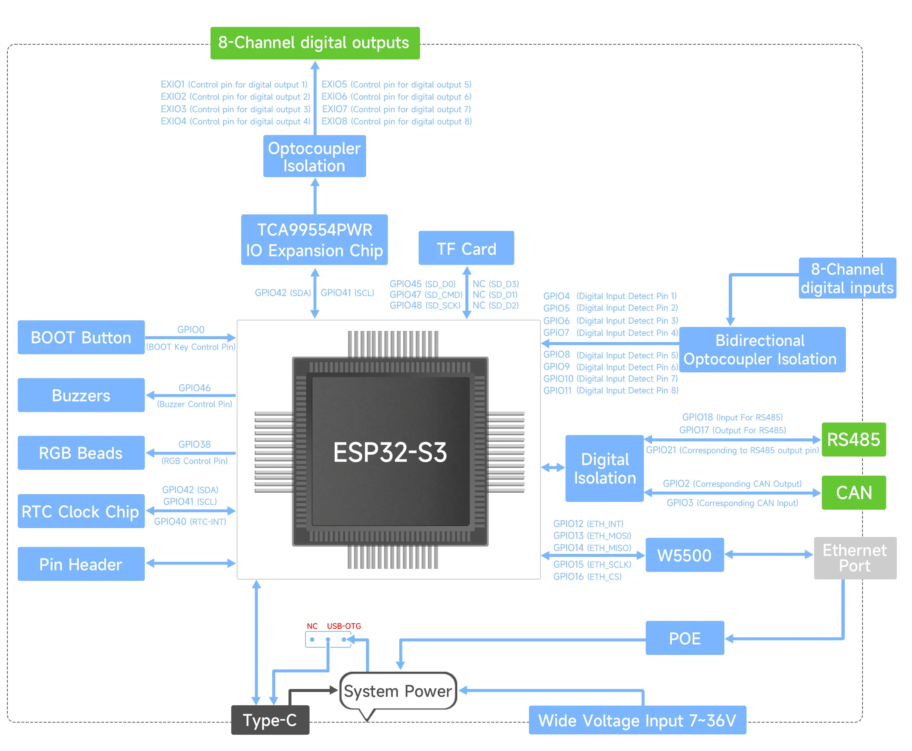
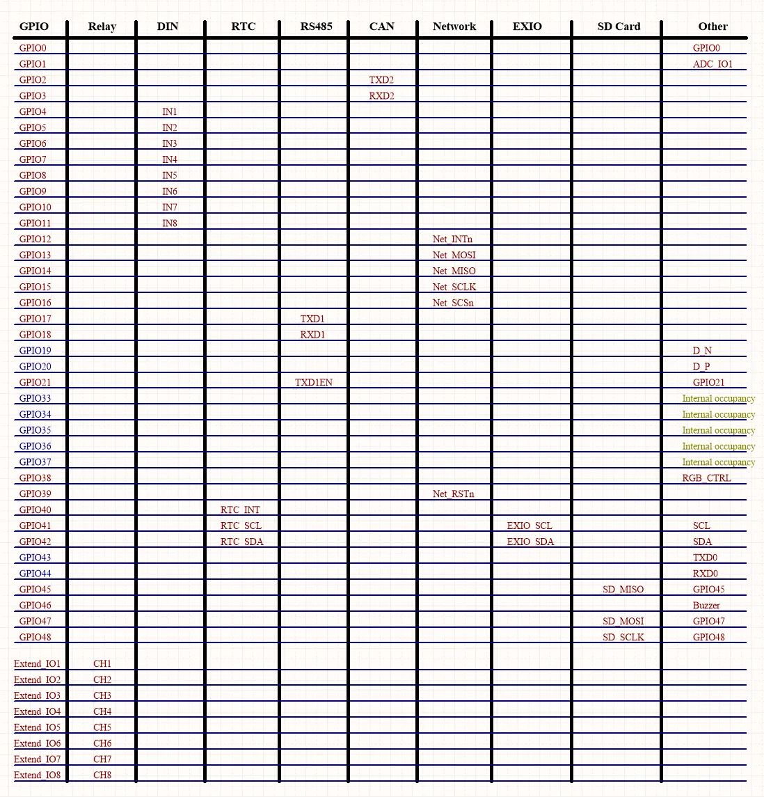

# Waveshare ESP32-S3 PoE 8DI 8DO Controller Engineering Guide


[**View Waveshare Industrial ESP32-S3 PoE Ethernet 8DI 8DO Control Board on OpenELAB**](https://openelab.io/products/waveshare-industrial-esp32-s3-poe-eth-8di-8do-control-board?variant=45951329173702)

**Model / option:** Default Title · **SKU:** `Waveshare-32108`


## Product overview <a href="#product-and-scope" id="product-and-scope"></a>

The **ESP32-S3-POE-ETH-8DI-8DO, Waveshare-32108**, combines eight optically isolated digital inputs with eight **Darlington transistor sink outputs**, Ethernet, Wi-Fi, BLE, RS485 and CAN. The output channels require a suitable external DC load circuit; they do not provide changeover dry contacts and must not be assigned the 8RO board's 10A contact rating.

The first-result procedure deliberately leaves external loads disconnected. It verifies the expander, input sampling and one bounded output command before connecting a field circuit. The product includes the IEEE 802.3af PoE module. Its RJ45 is a powered-device input with Ethernet data, not a PoE output for another device.

Identity and functional limits: [exact manufacturer guide](https://docs.waveshare.com/ESP32-S3-POE-ETH-8DI-8DO).

## Applications

* Networked switch-state logging with isolated field inputs and a local status indicator.
* Low-voltage actuator/interface experiments after load limits and startup behavior are qualified.
* RS485 expansion to compatible industrial sensors or relay modules with a documented protocol.
* Local web or BLE demonstration control on an isolated bench network.

Treat the bundled Wi-Fi/MQTT demos as teaching software. Before unattended service, define output-off startup, a communication-loss policy, input filtering, command authorization and a physical way to remove load power. A working web button is not a validated control-system interlock.

## Specifications

| Parameter                              | Model-specific value                                                                              |
| -------------------------------------- | ------------------------------------------------------------------------------------------------- |
| MCU                                    | ESP32-S3, dual-core LX7 up to 240MHz                                                              |
| Module/memory                          | N16R8 family, 16MB flash / 8MB PSRAM in the documented board configuration                        |
| Wireless                               | 2.4GHz 802.11b/g/n and Bluetooth LE                                                               |
| Ethernet                               | W5500 over SPI, 10/100Mbps                                                                        |
| Controller DC input                    | 7–36V at the dedicated power terminal                                                             |
| USB commissioning supply               | 5V/1A Type-C reference; not a field-load supply budget                                            |
| Inputs                                 | Eight channels, bidirectional optocoupler isolation                                               |
| Output technology                      | Optocoupled Darlington sinking output, eight channels                                             |
| Per-channel advertised sink capability | Up to 500mA; do not infer 4A simultaneous capability or permissible load voltage from this number |
| Field interface                        | Separate output COM/GND and channel terminals; not NC/COM/NO relay contacts                       |
| CAN                                    | Isolated transceiver path, TWAI TX GPIO2 / RX GPIO3                                               |
| PoE                                    | Built-in IEEE 802.3af PD module                                                                   |
| Main footprint                         | 175 × 90mm; allow enclosure/terminal/cable clearance                                              |
| RTC / expander                         | PCF85063 / TCA9554, shared I2C bus                                                                |
| Other interfaces                       | TF card, buzzer, WS2812 indicator, USB programming                                                |

Source: [model electrical/interface reference](https://docs.waveshare.com/ESP32-S3-POE-ETH-8DI-8DO). Supply input voltage, field input voltage and output rating are separate domains. The manufacturer gives no aggregate load/current guarantee in the reviewed overview; do not multiply individual-channel maxima to establish one.

## Hardware and connections <a href="#hardware-and-technical-documents" id="hardware-and-technical-documents"></a>

### Field output and input connections

Use the terminal groups labeled **Digital Outputs** and **Digital Inputs** separately. Both have labeled COM/GND references and eight channels on the pictured enclosure; do not infer a pin order from another device's terminal block. The manufacturer routing diagram below identifies control pins, not a complete rated external-load schematic.

A transistor sink completes a DC load's return path when on; unlike a relay it is not a voltage-free contact. The external load supply, its return, COM/flyback connection and field-ground relationship must follow the exact board/load design. The documented 500mA value alone does not establish output-voltage range, simultaneous-channel thermal capability, inductive-energy rating or a source-output mode. Before connecting a production actuator, obtain those load-specific limits and verify the exact terminal wiring. The no-load commissioning route below remains fully specified without assuming them.

The DI optocouplers support dry-contact and active-switch inputs. Keep the field reference on its labeled input common; do not tie it indiscriminately to the MCU header ground and defeat the intended isolation. NPN/PNP sensors differ in where they source or sink current. Check the specific sensor output and the manufacturer's input diagram before energizing a field input.

### RS485 and CAN

Use the labeled RS485 A+/B− pair and a compatible adapter; GPIO17/18/21 are controller-side signals, not direct differential terminals. For CAN use the CAN-H/CAN-L field pair with the matching bit rate. Terminate the two ends of a bus as required; do not enable a 120Ω terminator on every node. A transceiver and an acknowledged message are required for useful CAN testing; a single isolated transmitter can accumulate errors without a peer.

### MCU-side pin and address map

| Function        | ESP32-S3 signal(s)                                | Allocation note                                                   |
| --------------- | ------------------------------------------------- | ----------------------------------------------------------------- |
| DI1–DI8         | GPIO4–GPIO11 respectively                         | Reserved for optocoupler detection                                |
| Output1–Output8 | TCA9554 EXIO1–EXIO8                               | Firmware channel labels 1–8 correspond to expander bits 0–7       |
| Shared I2C      | SDA42, SCL41                                      | TCA9554 at 7-bit 0x20; RTC shares the bus                         |
| RTC interrupt   | GPIO40                                            | Do not repurpose while scheduled tasks are enabled                |
| W5500           | INT12, MOSI13, MISO14, SCLK15, CS16               | Ethernet is SPI, not the S3's internal Ethernet MAC               |
| RS485           | TX17, RX18                                        | 8DO additionally documents RTS/direction GPIO21                   |
| TF card         | D0=45, CMD=47, CLK=48 in the documented SD wiring | Treat as SDMMC signals; not a generic SPI CS assignment           |
| RGB / buzzer    | GPIO38 / GPIO46                                   | Buzzer needs the appropriate driver; not continuous DC by default |
| BOOT            | GPIO0                                             | Hold low at reset only for download mode                          |
| Native USB      | GPIO19/20                                         | Reserved for USB when that interface is active                    |

The 8RO overview omits W5500 reset from its short table, while the downloaded 8RO demo defines GPIO39; retain the example's exact W5500 configuration. Do not use an 8DO-only pin to fill an unverified 8RO field. Keep the external antenna attached for radio experiments.

Power and USB: start with USB only and no field connections. On the 8DO, leave the **USB-OTG power jumper in its computer-safe/default position**; the manufacturer explicitly prohibits connecting a PC when switched to USB-OTG output power. Add PoE or terminal power only after reviewing the board's power-sharing rules. Never feed 7–36V into USB or an MCU header.



_Manufacturer figure: Waveshare._ [_Original source_](https://docs.waveshare.com/ESP32-S3-POE-ETH-8DI-8DO)_._



_Manufacturer figure: Waveshare._ [_Original source_](https://docs.waveshare.com/ESP32-S3-POE-ETH-8DI-8DO)_._

## Software and development resources <a href="#development-software-and-recovery" id="development-software-and-recovery"></a>

### Toolchain and firmware scope

The manufacturer documents Arduino-ESP32 **3.0.0 or later** for this family and 16MB flash / OPI PSRAM settings for the supplied application. The original Wire-only commissioning sketch below does not need an external library or PSRAM. Choose **ESP32S3 Dev Module**, select the actual flash/PSRAM option, the actual upload port and a console route appropriate to the USB interface. With native USB, enable **USB CDC On Boot** for `Serial` output; a USB-UART bridge follows its own COM port.

| Official example family | What to configure before running                                                                      |
| ----------------------- | ----------------------------------------------------------------------------------------------------- |
| Wi-Fi AP                | Local SSID/password and the displayed device IP; connect the client to that AP                        |
| Wi-Fi STA               | Replace the example's Wi-Fi credentials; inspect DHCP-assigned IP                                     |
| Web interface           | Verify one channel with loads disconnected; local-network availability is not internet access         |
| BLE                     | Use the demo's exact characteristic/payload, not an arbitrary serial profile                          |
| RS485                   | Matching UART settings, parser/CRC, node and command definitions                                      |
| RTC / TF                | Correct battery type, time basis and card format; verify one resource at a time                       |
| MQTT / ALL              | Use a maintained broker and unique credentials/topics; Waveshare Cloud is marked no longer maintained |

Bundled application dependencies include **ArduinoJson6.21.4**, **PubSubClient2.8.0** and **NTPClient3.2.1** in the reviewed guide. Keep the archive's copies/settings together rather than importing similarly named libraries at unrelated major versions. [Official development guide](https://docs.waveshare.com/ESP32-S3-POE-ETH-8DI-8DO/Arduino).

The C++ files named `WS_Relay` in the 8DO archive retain generic naming; the hardware still has transistor outputs. The filenames do not establish dry-contact behavior.

## Getting started

### Unloaded first result

1. Disconnect every output load, field-input source and external bus cable. Identify the exact 8RO/8DO variant and leave the antenna fitted. Use one USB data cable and a stable 5V commissioning supply/host.
2. Install the documented Arduino core. Select ESP32S3 Dev Module, the detected port and the correct serial console setting. Create a **new sketch** for the original code below rather than running the all-functions demo first.
3. Upload, reset if needed and open the Serial Monitor at **115200**. Confirm I2C acknowledgement and an output latch of zero before issuing any pulse.
4. Observe the raw DI bitmap with no field input connected. If later checking a DI, use one correctly wired low-energy input according to the exact field diagram; do not inject voltage into GPIO4–11.
5. With all loads still disconnected, send the digit **1** once. The sketch requests CH1 on for 500ms and then requests all outputs off. On 8RO a relay click/indicator and an isolated continuity check can corroborate switching; on 8DO there is no relay click and no self-generated load voltage to expect.
6. Send **0** to request all outputs off. Remove operating power before reconnecting any terminal plug.

```cpp
#include <Arduino.h>
#include <Wire.h>

constexpr uint8_t EXPANDER = 0x20;
constexpr int SDA_PIN = 42, SCL_PIN = 41;
uint8_t lastInputs = 0;
bool firstSample = true;

bool putRegister(uint8_t reg, uint8_t value) {
  Wire.beginTransmission(EXPANDER);
  Wire.write(reg);
  Wire.write(value);
  return Wire.endTransmission() == 0;
}

bool getRegister(uint8_t reg, uint8_t &value) {
  Wire.beginTransmission(EXPANDER);
  Wire.write(reg);
  if (Wire.endTransmission(false) != 0) return false;
  if (Wire.requestFrom(EXPANDER, uint8_t(1)) != 1) return false;
  value = Wire.read();
  return true;
}

void haltWithFault(const char *message) {
  Serial.println(message);
  while (true) delay(1000);  // Do not continue issuing control commands.
}

void setup() {
  Serial.begin(115200);
  delay(1500);
  Wire.begin(SDA_PIN, SCL_PIN, 100000);
  for (int pin = 4; pin <= 11; ++pin) pinMode(pin, INPUT_PULLUP);
  // Set output latch OFF before changing the expander to output mode.
  if (!putRegister(0x01, 0x00) || !putRegister(0x03, 0x00))
    haltWithFault("Expander not responding: disconnect loads and inspect I2C");
  uint8_t latch = 0;
  if (!getRegister(0x01, latch)) haltWithFault("Latch read failed");
  Serial.printf("Output latch=0x%02X; all loads must be disconnected\n", latch);
  Serial.println("Send digit 1 for one CH1 pulse; 0 requests all OFF");
}

void loop() {
  uint8_t inputs = 0;
  for (int channel = 0; channel < 8; ++channel)
    inputs |= uint8_t(digitalRead(channel + 4) != LOW) << channel;
  if (firstSample || inputs != lastInputs) {
    Serial.printf("Raw DI bitmap=0x%02X (bit0=DI1)\n", inputs);
    lastInputs = inputs;
    firstSample = false;
  }
  if (Serial.available()) {
    int command = Serial.read();
    if (command == '0') {
      if (!putRegister(0x01, 0x00)) haltWithFault("OFF write failed");
    } else if (command == '1') {
      if (!putRegister(0x01, 0x01)) haltWithFault("CH1 write failed");
      delay(500);
      if (!putRegister(0x01, 0x00)) haltWithFault("OFF write failed: remove power");
      Serial.println("CH1 command pulse finished; latch requested OFF");
    }
  }
  delay(10);
}
```

**Expected result:** the expander responds, the requested latch is `0x00`, raw DI samples print on changes and one deliberately requested CH1 pulse ends with an off command. A register read or log message proves the control transaction, not the physical output/load state. Verify the field circuit separately before using it.

This sketch deliberately has no automatic input-to-output linkage. If I2C fails it stops sending commands; it cannot guarantee an already-energized output has physically released. Remove load power on a fault. The initial 0x00 output latch and bit-to-channel mapping were checked against the exact downloaded manufacturer drivers.

### Moving to the official local web demo

Keep the load plugs removed, extract the matching archive and open its AP example with all companion `.h/.cpp` files. Set extension control off when no extension relay is present and disable unrelated RTC/linkage features for the first web check. Build with the guide's library/core settings, then read the IP from the console/BLE path and connect the browser on the same network. Request CH1 only, corroborate its output and request off before moving to another channel.

For STA, configure Wi-Fi credentials in the archive's information header, then use the reported DHCP address. Add Ethernet only with its exact W5500 reset/CS/SPI configuration. If neither Wi-Fi nor Ethernet has an address, an inaccessible web page is not evidence of failed relay hardware.

### Protocol and integration checkpoints

The vendor demo accepts ASCII **`1`–`8`** for channel toggles, **`9`** for all-on and **`0`** for all-off in its documented BLE parser. These bytes are **0x31–0x38**, **0x39** and **0x30**; they are not byte values 1–8. Toggle commands are unsuitable for blind retries because repeating one can undo the previous state.

The 8DO RS485 table contains `06 05 00 01 55 00 A2 ED` for a CH1 toggle, plus all-channel frames. This is the vendor application's command convention; its custom `0x5500` toggle payload must not be described as a universal standard Modbus “coil on” value. Preserve the correct CRC and parser for the chosen firmware. Commands to a separate extension relay form another protocol layer.

Before implementing an MQTT, Home Assistant or fieldbus bridge, record the firmware version, transport, command idempotence, acknowledgement, output-off behavior and how physical input levels map to application active/inactive states. Keep the first local result reproducible while adding one transport at a time.

## Troubleshooting and FAQs <a href="#faqs" id="faqs"></a>

| Symptom                                   | Ordered checks and recovery                                                                                                                               |
| ----------------------------------------- | --------------------------------------------------------------------------------------------------------------------------------------------------------- |
| Cannot upload / USB repeatedly reconnects | Try a data cable, close other serial clients, hold BOOT while tapping RESET, release RESET then BOOT to enter download mode, and retry the matching image |
| No serial output after upload             | Confirm the port and console route; native USB `Serial` needs CDC configuration; press RESET after leaving the ROM loader                                 |
| Expander no ACK                           | Verify SDA42/SCL41 and 0x20, one I2C driver owner and stable controller power; stop without field loads attached                                          |
| Output log changes but load does not      | Check relay versus sink topology, external load supply/reference, exact terminals and the actual contact/transistor state                                 |
| DI appears inverted                       | Read raw GPIO bitmap and check NPN/PNP/dry-contact wiring; set application polarity after measuring the intended state                                    |
| Web page unavailable                      | Confirm AP versus STA, current IP, same network, then Ethernet configuration; do not guess a fixed IP from another demo                                   |
| RS485 intermittent                        | Correct A/B labels, common/reference requirements, baud/frame/address and endpoint termination; one peer at a time                                        |
| CAN does not acknowledge on 8DO           | At least one compatible peer, matching bit rate, correct H/L and two-end termination; do not use the 8RO UART instructions as a CAN test                  |
| RTC/battery issue                         | Use only the manufacturer's rechargeable backup-battery type for the holder; do not substitute a primary cell on a charge-enabled path                    |
| Cloud example cannot connect              | The vendor marks Waveshare Cloud unmaintained; keep a local test and migrate deliberately to a maintained broker                                          |

Firmware restoration should use one matched complete package and its recorded offsets. Do not flash an application-only binary at zero merely because a factory merged image uses zero. Preserve settings or logs before erasing flash.

## Downloads and technical documents

The original manufacturer figures retained below describe routing and interface roles; they are not generated diagrams. Use the exact model's physical diagram, ratings and archive together. MCU datasheets describe silicon limits, while external output/load limits belong to the actual board and driver circuit.

| Resource                                                                                                                 | Purpose and exact scope                                        |
| ------------------------------------------------------------------------------------------------------------------------ | -------------------------------------------------------------- |
| [Exact application archive](https://files.waveshare.com/wiki/ESP32-S3-POE-ETH-8DI-8DO/ESP32-S3-POE-ETH-8DI-8DO-Demo.zip) | Downloaded, extracted and driver source reviewed               |
| [ESP32-S3 module datasheet](https://files.waveshare.com/wiki/common/Esp32-s3-wroom-1_wroom-1u_datasheet_en.pdf)          | Silicon/module memory and logic reference; manufacturer-listed |
| [Exact model guide](https://docs.waveshare.com/ESP32-S3-POE-ETH-8DI-8DO)                                                 | Wiring, controller settings and detailed example procedures    |

## References and validation <a href="#sources-and-validation" id="sources-and-validation"></a>

Reviewed **24 November 2026**: exact SKU/PoE mapping, manufacturer electrical/interface/development pages, and the downloaded ESP32-S3-POE-ETH-8DI-8DO application drivers (expander registers, active-high output latch and DI pin mapping). The one-channel commissioning sketch is original.

**Compiler, upload, input-voltage injection, relay/contact measurements, transistor load operation, Ethernet/RS485/CAN and radio tests: not run.** The requested and expected software states are distinguished from physical validation.

* [ESP32-S3-POE-ETH-8DI-8DO overview and pin map](https://docs.waveshare.com/ESP32-S3-POE-ETH-8DI-8DO) — manufacturer snapshot23Nov2026, reviewed24Nov2026.
* [ESP32-S3-POE-ETH-8DI-8DO exact application source archive](https://files.waveshare.com/wiki/ESP32-S3-POE-ETH-8DI-8DO/ESP32-S3-POE-ETH-8DI-8DO-Demo.zip) — downloaded24Nov2026; actual driver sources reviewed.
* [ESP32-S3-POE-ETH-8DI-8DO Arduino and protocol guide](https://docs.waveshare.com/ESP32-S3-POE-ETH-8DI-8DO/Arduino) — reviewed24Nov2026.
* [ESP32-S3-POE-ETH-8DI-8DO power jumper and use instructions](https://docs.waveshare.com/ESP32-S3-POE-ETH-8DI-8DO/Instructions-For-Use) — reviewed24Nov2026.

### Retained source links <a href="#official-documentation-and-development-resources" id="official-documentation-and-development-resources"></a>

* [Legacy resource index](https://www.waveshare.com/wiki/ESP32-S3-POE-ETH-8DI-8DO)
* [Read schematics, downloads and model examples](https://docs.waveshare.com/ESP32-S3-POE-ETH-8DI-8DO/Resources-And-Documents)
