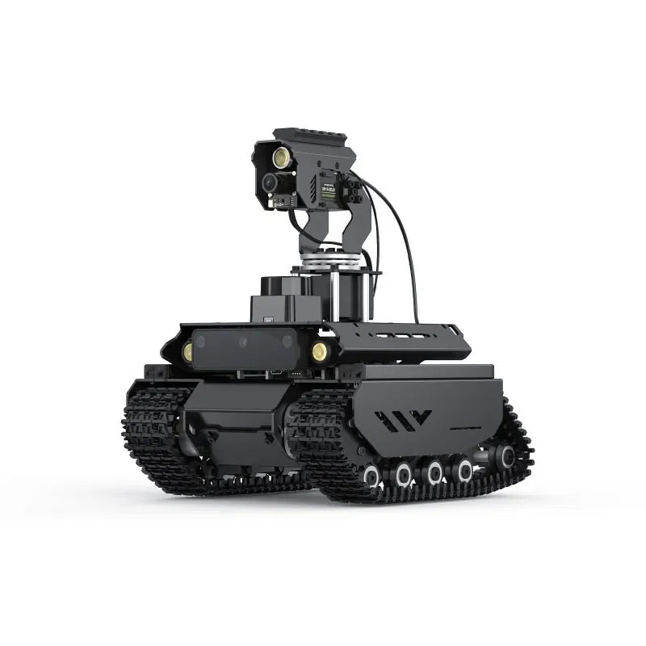

# Waveshare UGV Beast Engineering Guide


[**View Waveshare UGV Beast ROS 2 Open-source AI Robot with Pan-Tilt Module on OpenELAB**](https://openelab.io/products/waveshare-ugv-beast-ros2-robot?variant=45592799772870)

**Model / option:** UGV Beast Pi 5 ROS2 Kit / With Raspberry Pi · **SKU:** `Waveshare-28695`


## Product overview <a href="#product-and-scope" id="product-and-scope"></a>

**Waveshare-28695 is the UGV Beast Pi 5 ROS2 Kit with Raspberry Pi included and pan-tilt.** Its tracked chassis uses an ESP32 for motor control and a Raspberry Pi 5 for perception and ROS 2 applications. The ROS2 bundle adds D500 LiDAR and an OAK-D Lite depth camera; the pan-tilt USB camera is a separate imaging path. [Exact store option](https://openelab.io/products/waveshare-ugv-beast-ros2-robot?variant=45592799772870), [manufacturer ROS2 kit](https://www.waveshare.com/product/ugv-beast-ros2-kit.htm).

The useful commissioning sequence is **power and factory browser → isolated ROS2 ownership → stationary telemetry → supervised movement → mapping → navigation**. A moving URDF model proves neither a physical motor link nor correct sensor calibration.

| Scope                          | What must stay distinct                                                                                 |
| ------------------------------ | ------------------------------------------------------------------------------------------------------- |
| This SKU28695                  | Pi5 ROS2 kit, Pi included, PT module, tracked Beast geometry                                            |
| Pi4B / accessory options       | Different host or host supplied by the customer; not additional covered SKUs here                       |
| AI-only Beast                  | Does not establish the ROS2 sensor bundle or container configuration                                    |
| UGV Rover / RaspRover / Jetson | Different geometry, platform configuration or host image; shared code needs an explicit Beast selection |

The manufacturer documents both a factory Python web application and ROS2-in-Docker. They compete for the serial port and camera. Choose one owner before testing; do not run both control stacks concurrently. [ROS2 preparation](https://www.waveshare.com/wiki/UGV_Beast_PI_ROS2_1._Preparation).

## Applications

Use this platform to study differential-track odometry, sensor integration, SLAM, camera perception and supervised navigation. Develop the sensor pipeline with the chassis stationary before judging motion behavior.

For an inspection experiment, first save synchronized camera, scan and pose data along a short measured route. Compare repeatability at the same start pose; tracks slipping on a turn can distort wheel-derived odometry even when PID speed control works. Treat a map that looks plausible as an intermediate result and inspect alignment against fixed walls.

For education, separate mechanical control, perception and planning into independent sessions. For multi-robot work, give each robot an intentional ROS domain/network configuration and verify which machine receives a stop command. ESP-NOW is a separate lower-controller facility, not automatic ROS2 multi-robot discovery. Do not attach accessories until their mass, power source and cable travel have been checked on the assembled robot.

## Specifications

| Parameter                    | Pi5 PT ROS2 scope                                                |
| ---------------------------- | ---------------------------------------------------------------- |
| Host / host OS               | Raspberry Pi5, 4GB kit specification; Debian Bookworm-based host |
| ROS distribution             | ROS2 Humble LTS inside the supplied container                    |
| Lower controller             | ESP32, closed-loop encoder motor control                         |
| Main drive                   | Two geared drive motors; tracked, independent suspension         |
| Default maximum speed        | 0.35m/s manufacturer specification                               |
| Track width / turning radius | 40mm / in-place rotation, nominal0m                              |
| PT assembly size / mass      | 196.82 ×231.46 ×251.78mm /2411 ±5g manufacturer specification    |
| Chassis height               | 25mm specification; not an obstacle-clearance guarantee          |
| Pan-tilt                     | Two axes, ST3215 bus servos; listed torque30kg·cm                |
| PT camera                    | USB,5MP,160° field of view                                       |
| ROS2 sensors                 | D500360° LiDAR and OAK-D Lite depth camera                       |
| Energy system                | 3S UPS; three18650 cells are not included                        |

[Manufacturer kit specification](https://www.waveshare.com/product/ugv-beast-ros2-kit.htm). Dimensions and mass describe the listed PT configuration, not every payload or battery combination. Servo torque is a component specification, not a payload rating at arbitrary reach.

| Communication / interface | Reviewed behavior                                             |
| ------------------------- | ------------------------------------------------------------- |
| Pi ↔ ESP32                | GPIO UART,115200baud; newline-delimited JSON                  |
| ROS command               | `/cmd_vel`, `geometry_msgs/msg/Twist`; linear.x and angular.z |
| Feedback                  | `/voltage`, `/imu/data_raw`, `/imu/mag`, `/odom/odom_raw`     |
| PT / lighting commands    | `/ugv/joint_states`, `/ugv/led_ctrl`                          |
| D500 UART                 | 230400baud,8N1;5V supply with3.3V-class data output           |

Sources: [ROS driver](https://github.com/waveshareteam/ugv_ws/blob/f0b3ad9c16e7acb6d6145f261116d71bf6338f4a/src/ugv_main/ugv_bringup/ugv_bringup/ugv_driver.py), [feedback publisher](https://github.com/waveshareteam/ugv_ws/blob/f0b3ad9c16e7acb6d6145f261116d71bf6338f4a/src/ugv_main/ugv_bringup/ugv_bringup/ugv_bringup.py), [D500 interface manual](https://www.waveshare.com/wiki/D500_LiDAR_Kit). ROS node names may be namespaced in a modified installation: inspect the actual graph.

## Hardware and connections <a href="#hardware-and-technical-documents" id="hardware-and-technical-documents"></a>

### Power, batteries and mechanical access

The exact **Beast Pi ROS2 manual specifies the supplied12V/5A input for first use**. Use that matched adapter and the marked robot power inlet. This is a robot/UPS input specification; it is not an instruction to connect12V directly to Pi USB/GPIO or to bare cells. [Exact first-use manual](https://www.waveshare.com/wiki/UGV_Beast_PI_ROS2).

Install three matched18650 cells with the power off, following the battery holder's polarity and the manufacturer's assembly video. The manual recommends at least2200mAh and4C discharge capability. It describes a battery-module LED that illuminates for **reversed installation**: check that specific indicator before connecting power; do not interpret every illuminated board LED as a fault. Stop if polarity or the supplied adapter marking is unclear. The robot is not waterproof. [Battery precautions](https://www.waveshare.com/wiki/UGV_Beast_PI_ROS2).

Before opening the cover, shut the host down and isolate external power and battery energy. Keep metal tools away from cell contacts. Inspect track freedom, fasteners, suspension and camera/servo cable slack. Lift the tracks clear for initial motor-direction checks, supporting the chassis rather than a moving suspension member. Keep fingers and cables outside the pan-tilt travel envelope: a bring-up node can center the head.

### Controller connections and reserved signals

The system is normally prewired. Inspect the labeled harness and exact schematic before replacing any connection; a connector with the same number of contacts is not evidence of the same pin order.

| Connection             | Engineering boundary                                                                                      |
| ---------------------- | --------------------------------------------------------------------------------------------------------- |
| Pi GPIO-UART ↔ ESP32   | 3.3V logic-level serial and common reference; never connect RS232/RS485 voltage levels                    |
| ESP32 host UART        | UART0 U0TXD/GPIO1, module pad35 → Pi RX; U0RXD/GPIO3, module pad34 ← Pi TX                                |
| Pi serial device       | Reviewed ROS2 code selects `/dev/ttyAMA0` at115200 on Pi; factory device-tree configuration must match    |
| Driver maintenance USB | USB-UART/firmware path inside the chassis; not a motor-power input                                        |
| Bus servos             | Dedicated TTL bus and servo power; not an ordinary PWM hobby-servo socket                                 |
| OAK-D Lite / PT camera | Distinct USB devices; identify each by USB topology rather than assuming camera index0                    |
| LiDAR                  | Supplied adapter/harness, separate230400baud data path; do not confuse it with115200baud chassis UART     |
| Extended40-pin header  | Preserve occupied UART, power and ground; check each proposed peripheral against the full board schematic |

The [ROS Driver for Robots schematic](https://files.waveshare.com/wiki/RaspRover/ROS_Driver_for_Robots.pdf) is the shared driver-board document linked by the Beast manual. Its UART0 module pads35/34 connect U0TX/U0RX to P\_RX/P\_TX; adjacent GPIO23/22 nets are separate signals. [Espressif module pin definitions, section3.2, page12](https://documentation.espressif.com/esp32-wroom-32e_esp32-wroom-32ue_datasheet_en.pdf) identify UART0 as GPIO1/3. The reviewed [firmware setup](https://github.com/waveshareteam/ugv_base_ros/blob/2e7df97c331ff63e1481afb34feec52014a3632a/ROS_Driver/ROS_Driver.ino) uses `Serial.begin(115200)` without remapping them. These are ESP32 GPIO/module-pad numbers, not Pi header-pin numbers; retain the prewired harness. Its DC/buck stage is not a substitute for the separate3S UPS/battery instructions. The schematic's GPIO18/19 servo-UART nets belong to the ESP32, not Raspberry Pi pin numbering. [Lower-controller configuration](https://github.com/waveshareteam/ugv_base_ros/blob/2e7df97c331ff63e1481afb34feec52014a3632a/ROS_Driver/ugv_config.h).

### Sensor alignment before mapping

Keep the LiDAR's optical window unobstructed. Confirm that a fixed object in front appears in the expected scan sector and that camera mounting is rigid. On a changed payload, update the relevant URDF transform and collision footprint rather than treating the original dimensions as a universal calibration. D500 supply is4.5–5.5V; its TX maximum3.5V and PWM maximum3.6V are logic limits, not alternate power inputs. [D500 connector limits](https://www.waveshare.com/wiki/D500_LiDAR_Kit).



_Manufacturer figure: Waveshare._ [_Original source_](https://openelab.io/products/waveshare-ugv-beast-ros2-robot)_._

## Software and development resources <a href="#development-software-and-recovery" id="development-software-and-recovery"></a>

### Three separate software layers

| Layer        | Target / contents                                                               | Reproducible starting point                                                   |
| ------------ | ------------------------------------------------------------------------------- | ----------------------------------------------------------------------------- |
| Factory host | Pi5 Bookworm-based image, Python web application, JupyterLab, network helper    | Retain delivered card and image version before changing services              |
| ROS2         | Humble container, `ugv_ws`, model-specific environment and sensor configuration | Use the preconfigured Beast Pi ROS2 image and its installed workspace         |
| ESP32        | ROS Driver for Robots, motor/servo/sensor firmware                              | Restore the exact Beast package; preserve stored chassis/module configuration |

The reviewed ROS workspace is pinned to commit`f0b3ad9c16e7acb6d6145f261116d71bf6338f4a`. Its generic README discusses several robots and LiDARs. The actual model selector is **`UGV_MODEL=ugv_beast`**; `LDLIDAR_MODEL` chooses a launch filename. Preserve the working factory LiDAR selection and device path before any update. A LiDAR sold as D500 is not a reason to select the distinct921600baud STL27L profile. [Model launcher](https://github.com/waveshareteam/ugv_ws/blob/f0b3ad9c16e7acb6d6145f261116d71bf6338f4a/src/ugv_main/ugv_description/launch/display.launch.py), [LiDAR launcher](https://github.com/waveshareteam/ugv_ws/blob/f0b3ad9c16e7acb6d6145f261116d71bf6338f4a/src/ugv_else/ldlidar/launch/ldlidar.launch.py), [LD19 profile](https://github.com/waveshareteam/ugv_ws/blob/f0b3ad9c16e7acb6d6145f261116d71bf6338f4a/src/ugv_else/ldlidar/launch/ld19.launch.py).

### Inspect and rebuild a changed package

Use the installed Humble container, not ROS packages installed arbitrarily into the Bookworm host. Before editing, back up the working SD card, record `docker ps -a`, copy the workspace configuration and inspect its Git status where it is a Git checkout. Save the delivered environment and installed LiDAR launch parameters. Do not overwrite the only working factory workspace with an unreviewed branch.

Inside the existing container, rebuild only the package being changed after keeping a copy of its source. For a change to the Python chassis node:

```bash
cd /home/ws/ugv_ws
source /opt/ros/humble/setup.bash
source install/setup.bash
colcon build --packages-select ugv_bringup --symlink-install
source install/setup.bash
ros2 pkg executables ugv_bringup
```

**Expected result:** the build completes and the installed package exposes `ugv_bringup` and `ugv_driver`. A build does not verify motors or guarantee that a fresh container has all the factory dependencies. The full workspace requires its bundled interface, navigation, mapping, vision and bridge packages; use the pinned project's package manifests and build scripts when reproducing that larger environment. [Project build guidance](https://github.com/waveshareteam/ugv_ws/blob/f0b3ad9c16e7acb6d6145f261116d71bf6338f4a/README.md).

### Host Python and lower-controller configuration

The factory app's `base_ctrl.py` provides queued JSON commands, feedback, chassis speed, gimbal, OLED and light helpers. `config.yaml` contains chassis/module selection and app settings. Shared repository defaults are not necessarily Beast: inspect the received configuration before replacing it. For this PT Beast, chassis type is3 and module type2; the lower-controller command is `{"T":900,"main":3,"module":2}`. Send it only when deliberately correcting a verified mismatch, with other controllers stopped and the motion area clear. [Host configuration](https://github.com/waveshareteam/ugv_rpi/blob/3ae9f203f61bfaaf123ee376f78247d007880b0c/config.yaml), [lower-controller model definitions](https://github.com/waveshareteam/ugv_base_ros/blob/2e7df97c331ff63e1481afb34feec52014a3632a/ROS_Driver/json_cmd.h).

The ESP32 repository is GPL-3.0-or-later; retain its license and distribution obligations if modifying/distributing firmware. Its README lists Arduino and libraries but does not pin a complete toolchain release. The factory restore package is the recovery baseline; do not promise a reproducible fresh Arduino build from an unpinned library list. [Firmware source and license](https://github.com/waveshareteam/ugv_base_ros/blob/2e7df97c331ff63e1481afb34feec52014a3632a/README.md).

## Getting started

### 1. Establish the factory browser checkpoint

1. Check the exact Pi5/PT kit, cell polarity, track clearance and matching supplied adapter. Insert the delivered ROS2 card with power off.
2. Power on and wait for host startup. Use the IP actually displayed on the OLED: `E` is Ethernet and `W` is wireless.
3. If it creates the factory AP, join **AccessPopup**, password`1234567890`. The documented AP address is`192.168.50.5`; open `http://192.168.50.5:5000` on the same network.
4. Inspect the camera and feedback without commanding motion. Open JupyterLab at the same host's port8888. Record the card/image identity and the current service configuration before changing it.

**Expected result:** the browser shows current feedback/video and the robot remains stationary. A cached page or a still image is insufficient; confirm a changing status field. Factory network defaults and display meanings: [Beast Pi ROS2 manual](https://www.waveshare.com/wiki/UGV_Beast_PI_ROS2).

For Wi-Fi changes, use the delivered AccessPopup helper from its actual installed directory. Find that path in the factory app/startup configuration; versions use different project directory names. `sudo accesspopup -a` selects AP and `sudo accesspopup` returns to configured station behavior. Switching networks changes the reachable address; reconnect using the OLED. Enable host SSH through `sudo raspi-config` → Interface Options → SSH if required. These host/network operations do not enter the ROS container. [Host network helper](https://github.com/waveshareteam/ugv_rpi/blob/3ae9f203f61bfaaf123ee376f78247d007880b0c/AccessPopup/ReadMe.txt).

### 2. Transfer serial and camera ownership to ROS2

1. In the host terminal run `crontab -l` and inspect the running processes. Save a copy of the crontab before editing it. Identify the exact factory `app.py` startup line; disable that one entry with `crontab -e` while keeping Jupyter's independent startup if wanted.
2. Stop the identified app process gracefully, or reboot with its startup disabled. Do not kill every Python process. Confirm that the former app no longer owns the chassis serial port/camera. The original factory control page ceases to provide active control at this point.
3. On the host, enter `/home/ws/ugv_ws` and run the delivered `./ros2_humble.sh`. Some image revisions offer a menu; the reviewed current script directly starts the `ugv_rpi_ros_humble` container and its SSH service. Observe the script result rather than expecting an invariant menu.
4. Use the factory container's documented SSH port23, user`root`, password`ws`, only on the isolated commissioning network. Host SSH normally uses a separate session/port22. Inspect the actual Docker port mapping if the image was changed. Keep factory-account dependencies intact while commissioning; plan credential changes together with the startup paths they reference.
5. In the container verify the environment and source the installed workspace:

```bash
cd /home/ws/ugv_ws
source /opt/ros/humble/setup.bash
source install/setup.bash
export UGV_MODEL=ugv_beast
printenv UGV_MODEL LDLIDAR_MODEL ROS_DISTRO
ls -l /dev/ttyAMA0 /dev/ttyACM*
ros2 pkg prefix ugv_bringup
```

**Expected result:** ROS distribution`humble`, Beast model selection, the delivered LiDAR selection and the required visible devices. An unset `LDLIDAR_MODEL` is a configuration problem: inspect the backed-up factory environment and the installed `ldlidar/launch` files, rather than guessing a profile from another robot. [Preparation](https://www.waveshare.com/wiki/UGV_Beast_PI_ROS2_1._Preparation), [current host launcher](https://github.com/waveshareteam/ugv_ws/blob/f0b3ad9c16e7acb6d6145f261116d71bf6338f4a/ros2_humble.sh).

### 3. Prove stationary sensor data

1. Keep tracks lifted and the pan-tilt travel clear. Start the factory-matched bring-up from a container terminal:

```bash
ros2 launch ugv_bringup bringup_lidar.launch.py use_rviz:=false
```

2. In another identically sourced container terminal inspect `ros2 topic list -t`, then `ros2 topic info /scan --verbose` and `ros2 topic echo /voltage --once`. Do not start a second bring-up node to obtain another view.
3. Save the following original program as `beast_sensor_check.py` in the container and run `python3 beast_sensor_check.py`. It subscribes only; it never publishes motion or raw UART data.

```python
import math
import time
import rclpy
from rclpy.node import Node
from rclpy.qos import qos_profile_sensor_data
from sensor_msgs.msg import LaserScan
from std_msgs.msg import Float32


class SensorCheck(Node):
    def __init__(self):
        super().__init__("beast_sensor_check")
        self.scans = 0
        self.volts = None
        self.latest = None
        self.last_report = 0.0
        self.scan_sub = self.create_subscription(
            LaserScan, "/scan", self.on_scan, qos_profile_sensor_data)
        self.voltage_sub = self.create_subscription(
            Float32, "/voltage", self.on_voltage, 10)

    def on_voltage(self, message):
        if math.isfinite(message.data):
            self.volts = message.data

    def on_scan(self, message):
        valid = []
        forward = []
        for index, distance in enumerate(message.ranges):
            if not math.isfinite(distance):
                continue
            if not message.range_min <= distance <= message.range_max:
                continue
            valid.append(distance)
            angle = message.angle_min + index * message.angle_increment
            angle = math.atan2(math.sin(angle), math.cos(angle))
            if abs(angle) <= math.radians(15):
                forward.append(distance)
        self.scans += 1
        self.latest = (len(valid), len(message.ranges),
                       min(forward) if forward else None,
                       message.header.frame_id)

    def report(self):
        voltage = "waiting" if self.volts is None else f"{self.volts:.2f} V"
        print(f"scans={self.scans} battery={voltage} scan={self.latest}")


def main():
    rclpy.init()
    node = SensorCheck()
    deadline = time.monotonic() + 12.0
    try:
        while rclpy.ok() and time.monotonic() < deadline:
            rclpy.spin_once(node, timeout_sec=0.2)
            now = time.monotonic()
            if now - node.last_report >= 1.0:
                node.report()
                node.last_report = now
        good = node.scans > 0 and node.volts is not None
    finally:
        node.destroy_node()
        rclpy.shutdown()
    if not good:
        raise SystemExit("Missing scan or voltage: inspect bring-up and topic names")


if __name__ == "__main__":
    main()
```

4. Expect a rising scan count, a finite pack-voltage reading and valid/total sample counts. The tuple's last elements are nearest valid ±15° scan-sector range and the reported frame. `None` means no valid return in that sector. That sector is sensor-frame forward; verify the physical mounting before treating it as chassis forward.
5. Move a broad object by hand at a known distance, outside the robot's moving parts. Confirm the scan changes while the chassis stays still. Invalid/zero samples can result from the configured angular crop; they are not automatically a failed LiDAR.

**Expected result:** fresh sensor messages for12seconds, then clean exit. Exit success confirms message receipt, not calibration, collision avoidance or battery state-of-charge accuracy. Source interface: [bring-up launch](https://github.com/waveshareteam/ugv_ws/blob/f0b3ad9c16e7acb6d6145f261116d71bf6338f4a/src/ugv_main/ugv_bringup/launch/bringup_lidar.launch.py), [feedback types](https://github.com/waveshareteam/ugv_ws/blob/f0b3ad9c16e7acb6d6145f261116d71bf6338f4a/src/ugv_main/ugv_bringup/ugv_bringup/ugv_bringup.py), [LiDAR profile/crop](https://github.com/waveshareteam/ugv_ws/blob/f0b3ad9c16e7acb6d6145f261116d71bf6338f4a/src/ugv_else/ldlidar/launch/ld19.launch.py).

### 4. Check stop and one control source

1. For initial physical commissioning, keep `behavior_ctrl` and its `ugv_chat_ai` action client stopped and disabled from automatic restart. Stop navigation/autonomy and other teleoperation publishers. Check their process/service state and `ros2 topic info /cmd_vel --verbose`; confirm they cannot resume publishing before selecting the sole manual controller. An action result or disappearance of a goal does not prove queued motion stopped.
2. Only after previous motion publishers are disabled and cannot resume, use the still-running chassis driver to send a zero command:

```bash
ros2 topic pub --once /cmd_vel geometry_msgs/msg/Twist '{linear: {x: 0.0}, angular: {z: 0.0}}'
```

3. Check that tracks stay stopped. Start `ros2 run ugv_tools keyboard_ctrl` in an active terminal. Inspect its displayed bindings, then make one brief low-speed test with tracks raised. Verify forward/turn directions and explicit stop before lowering the robot into a clear supervised area. Do not rely on browser focus loss, Ctrl+C or network disconnection as an independently verified motor stop.
4. For ROS gamepad control, connect its receiver to the Pi and use `ros2 launch ugv_tools teleop_twist_joy.launch.py`. The factory **browser** gamepad workflow instead connects the receiver to the controlling PC. These are different paths.

**Expected result:** repeatable direction and stop from one manual control source. Keep physical drive-power isolation immediately available; a one-shot zero cannot hold the robot stopped against a continuing publisher. In the reviewed `ugv_driver.py`, small nonzero pure angular commands are raised to magnitude0.2; an arbitrarily tiny requested turn is not necessarily an arbitrarily tiny actual turn. [Exact command handling](https://github.com/waveshareteam/ugv_ws/blob/f0b3ad9c16e7acb6d6145f261116d71bf6338f4a/src/ugv_main/ugv_bringup/ugv_bringup/ugv_driver.py), [control chapter](https://www.waveshare.com/wiki/UGV_Beast_PI_ROS2_3._UGV_Rover_PI_ROS2_3._Use_Joystick_or_Keyboard_Control).

### 5. Build and save a measured map

1. Stop the standalone bring-up before starting a mapping launch that already includes it. Start one mapping stack in the container, with a graphical session available for RViz:

```bash
ros2 launch ugv_slam gmapping.launch.py use_rviz:=true
```

2. Explore a small measured area under manual control. Compare stable wall edges and revisited corners. If walls move relative to one another, resolve scan timing, transforms and track slip before collecting a larger map.
3. While mapping remains active, save to a new map stem in a second terminal:

```bash
mkdir -p /home/ws/ugv_ws/maps_local
ros2 run nav2_map_server map_saver_cli -f /home/ws/ugv_ws/maps_local/beast_room_a
```

4. Confirm both `.pgm` and `.yaml`, inspect the YAML's image path and resolution, and copy them outside the container with the session record. Stop mapping cleanly afterward. The installed navigation launch defaults to its own `maps/map.yaml`; a differently named map is not automatically selected.

**Expected result:** a persistent map pair matching known geometry. Alternatives: `ugv_slam cartographer.launch.py` adds a Cartographer state file when using the supplied save script; preserve `.pbstream` with its matching map pair. `ugv_slam rtabmap_rgbd.launch.py use_rviz:=true` uses the depth-camera path; back up `~/.ros/rtabmap.db` after clean shutdown before starting a new environment. [2D mapping](https://www.waveshare.com/wiki/UGV_Beast_PI_ROS2_4._2D_mapping_based_on_lidar), [3D mapping](https://www.waveshare.com/wiki/UGV_Beast_PI_ROS2_5._3D_mapping_based_on_depth_camera).

### 6. Navigation and advanced interfaces

1. Select the saved map deliberately. For the default navigation launch, put the approved map pair in its configured map location or edit its reviewed map path in a backed-up source/workspace and rebuild. Do not assume an undeclared `map:=...` argument is forwarded by every launch revision.
2. Stop mapping, start the navigation stack, set the initial pose in RViz against the real chassis pose and verify the laser overlay before sending a nearby unobstructed goal:

```bash
ros2 launch ugv_nav nav.launch.py use_localization:=amcl use_localplan:=teb use_rviz:=true
```

3. With behavior/AI and alternate motion publishers still disabled, verify the Nav2 goal-cancellation path and actual physical stop before testing one waypoint. Nav2 cancellation does not stop an independent behavior-command queue. The reviewed launcher supports AMCL/EMCL with TEB/DWA parameter combinations and a separate Cartographer localization path; changing the localization method also changes required map/state data. [Navigation source](https://github.com/waveshareteam/ugv_ws/blob/f0b3ad9c16e7acb6d6145f261116d71bf6338f4a/src/ugv_main/ugv_nav/launch/nav.launch.py), [navigation chapter](https://www.waveshare.com/wiki/UGV_Beast_PI_ROS2_6._Auto_navigation).

| Advanced workflow                                              | Prerequisite, concrete entry and acceptance checkpoint                                                                                                                                                                                                                                                                                                                                                                                                                                                                                                                                                                    |
| -------------------------------------------------------------- | ------------------------------------------------------------------------------------------------------------------------------------------------------------------------------------------------------------------------------------------------------------------------------------------------------------------------------------------------------------------------------------------------------------------------------------------------------------------------------------------------------------------------------------------------------------------------------------------------------------------------- |
| Simultaneous SLAM/navigation                                   | `ros2 launch ugv_nav slam_nav.launch.py use_rviz:=true`; verify one shared TF/driver stack and save the resulting map. Automatic exploration (`explore_lite`) belongs in an enclosed test area after stop/goal handling works. [Chapter7](https://www.waveshare.com/wiki/UGV_Beast_PI_ROS2_7._Navigation_and_SLAM_mapping)                                                                                                                                                                                                                                                                                                |
| ROS browser console                                            | `ros2 launch ugv_web_app bringup.launch.py host:=ROBOT_IP`; replace `ROBOT_IP` with the actual host address. Open port5100, confirm bridge connection, select `/map` and verify TF before enabling its joystick. A web page alone does not start sensor nodes. [Chapter9](https://www.waveshare.com/wiki/UGV_Beast_PI_ROS2_9._Web_Control_Tool)                                                                                                                                                                                                                                                                           |
| Behavior actions — simulation only for this revision           | `/behavior` reports SUCCESS immediately after enqueueing commands, not after completed movement. No action feedback, implemented cancellation or preemptive stop is provided. Exclude this path from initial physical commissioning until an interruptible stop/cancel path is implemented and verified. Distance commands use metres; spin commands use degrees. [Pinned implementation](https://github.com/waveshareteam/ugv_ws/blob/f0b3ad9c16e7acb6d6145f261116d71bf6338f4a/src/ugv_main/ugv_tools/ugv_tools/behavior_ctrl.py), [Chapter10](https://www.waveshare.com/wiki/UGV_Beast_PI_ROS2_10._Command_interaction) |
| Natural-language interface — simulation only for this revision | Configure the external Ollama endpoint in the backed-up `ugv_chat_ai` app and verify text first. Its action client sends commands to the same behavior queue, so the preceding physical-use restriction also applies. Port5000 conflicts with the factory app. [Action-client source](https://github.com/waveshareteam/ugv_ws/blob/f0b3ad9c16e7acb6d6145f261116d71bf6338f4a/src/ugv_main/ugv_chat_ai/ugv_chat_ai/app.py), [Chapter8](https://www.waveshare.com/wiki/UGV_Beast_PI_ROS2_8._Web-based_natural_language_interaction)                                                                                          |
| Gazebo                                                         | Separate PC/VM/container, matching Beast model/geometry and simulation time. The tutorial's default Rover model is not a verified tracked-Beast simulation; select and inspect the actual model before interpreting results. Keep simulated commands separate from the live robot graph. [Chapter11](https://www.waveshare.com/wiki/UGV_Beast_PI_ROS2_11._Gazebo_Simulation_debugging)                                                                                                                                                                                                                                    |

### Behavior queue limitation and stopping an active publisher

At the pinned revision, `execute_callback()` queues commands and immediately returns SUCCESS. The worker later runs movement loops that keep publishing velocity until their odometry condition is met. It does not implement action feedback, cancellation or preemption; even a `stop` action queues behind the current movement. A one-shot zero can be overwritten by that worker. [Reviewed implementation](https://github.com/waveshareteam/ugv_ws/blob/f0b3ad9c16e7acb6d6145f261116d71bf6338f4a/src/ugv_main/ugv_tools/ugv_tools/behavior_ctrl.py).

Keep behavior actions and the AI client out of initial physical commissioning. Until an interruptible path is implemented and verified, restrict them to a simulation environment isolated from the real robot. If a behavior publisher was previously started, retain physical drive-power isolation, stop and disable that process and its automatic restart, confirm the process has exited and cannot resume, and only then send zero via the remaining chassis driver. Recheck actual standstill and the publisher/process state before restoring drive power. Goal SUCCESS and cancellation are not substitutes for this procedure.

### Factory Python vision, media and extension work

Return to the factory Python stack only after stopping the ROS nodes/container processes that own serial/cameras and restoring the saved app startup. Prove the stationary browser checkpoint again. For each experiment below, change one subsystem and keep an undo copy of `config.yaml` and the original startup entry.

| Manufacturer topic group                                        | Practical development procedure and expected result                                                                                                                                                                                                                         |
| --------------------------------------------------------------- | --------------------------------------------------------------------------------------------------------------------------------------------------------------------------------------------------------------------------------------------------------------------------- |
| Jupyter, chassis, PT/LED/OLED, feedback, JSON and boot commands | Use one existing notebook/session with its existing controller object. Start with reading feedback and an OLED text change; verify the display without movement. Test PT at its present angle before a small deliberate offset. Do not instantiate a competing UART reader. |
| Notebook UI and simple web applications                         | Add one visible status field driven by fresh feedback; reload and verify it changes. Keep display callbacks separate from actuator commands so a UI refresh cannot accidentally repeat movement.                                                                            |
| Audio playback and TTS                                          | Identify the actual audio device, play a short local file at low level, then generate one TTS phrase. Verify playback independently of motion and camera services. Device-number assumptions can change when USB devices are moved.                                         |
| Flask video, notebook preview, time-lapse and photo buttons     | Open the intended camera once, confirm changing frame timestamps, save one image and check its dimensions. Then collect a short timed sequence and compare actual timestamps with the requested interval. Release the camera before switching to OAK/ROS.                   |
| Motion/face/DNN/object/color recognition                        | Use a stationary recorded or live scene, observe detections overlaid on frames and inspect lighting/exposure. Confirm inference output before connecting a detection to tracking or capture. A recognized class is not navigation evidence.                                 |
| Color tracking, line following, MediaPipe gesture/face/pose     | First log the intended control decision without actuation. Test false positives, lost-target behavior and explicit stop. Add pan-tilt tracking separately; enable chassis following only in a supervised bounded area after stop behavior is established.                   |
| Main architecture, YAML, startup, custom CLI and web commands   | Trace a single existing command through frontend, handler and `base_ctrl` queue. Add an original read-only status command before an actuator command. Restart only the edited service and confirm logs; preserve the factory recovery entry.                                |
| Remote access and ESP-NOW                                       | Establish local repeatability first. Remote relays/tunnels change reachability, not physical stop guarantees. For ESP-NOW, inspect the lower-controller mode/address filters and test one deliberate peer with tracks clear before enabling group control.                  |

The [complete official tutorial catalog](https://www.waveshare.com/wiki/UGV_Beast_PI_ROS2) provides the individual Jupyter, vision, media, configuration and remote-access lessons. Source implementation for these extension points: [host controller API](https://github.com/waveshareteam/ugv_rpi/blob/3ae9f203f61bfaaf123ee376f78247d007880b0c/base_ctrl.py), [host application](https://github.com/waveshareteam/ugv_rpi/blob/3ae9f203f61bfaaf123ee376f78247d007880b0c/app.py), [host configuration](https://github.com/waveshareteam/ugv_rpi/blob/3ae9f203f61bfaaf123ee376f78247d007880b0c/config.yaml), ESP-NOW controller. These are development procedures, not claims that every optional model/dependency is installed on every factory image.

## Troubleshooting and FAQs <a href="#faqs" id="faqs"></a>

| Symptom                                 | Ordered checks and recovery                                                                                                                                                                                                                                                                                                                                                                                            |
| --------------------------------------- | ---------------------------------------------------------------------------------------------------------------------------------------------------------------------------------------------------------------------------------------------------------------------------------------------------------------------------------------------------------------------------------------------------------------------- |
| No OLED/host boot                       | Adapter and marked inlet, cell polarity, battery installation, switch and SD seating; stop on reversed-cell indication. Inspect the received power module rather than substituting another robot's adapter.                                                                                                                                                                                                            |
| OLED IP but browser fails               | Same LAN/AP, actual current IP, explicit `http://` and port5000, then active factory app. A changed station address requires a new URL.                                                                                                                                                                                                                                                                                |
| Jupyter works, factory control does not | Independent Jupyter service may be running while `app.py` is disabled for ROS2. Check intended ownership before restoring startup.                                                                                                                                                                                                                                                                                     |
| Container SSH fails                     | Container running, SSH service, actual mapped port23 and credentials; host port22 is a different endpoint. A current helper may start SSH without an interactive shell.                                                                                                                                                                                                                                                |
| Missing `LDLIDAR_MODEL` / wrong URDF    | Restore saved factory environment; confirm `UGV_MODEL=ugv_beast`, installed launch filenames and actual sensor. Do not substitute Rover geometry or a different LiDAR baud rate.                                                                                                                                                                                                                                       |
| No `/scan`                              | LiDAR power/optical window, stable device path, USB permissions/container device access, installed sensor profile and single serial owner; inspect launch errors before changing mapping.                                                                                                                                                                                                                              |
| No voltage/IMU                          | Actual Pi UART device/overlay,115200baud, lower firmware feedback and factory app stopped. Voltage is published from lower feedback, not directly measured by the Python monitor.                                                                                                                                                                                                                                      |
| Uncommanded motion/turn too fast        | Use physical drive-power isolation if stop is uncertain. Stop/disable behavior, AI and other motion-publishing processes plus their restart mechanisms; confirm they cannot resume and inspect `/cmd_vel` publishers before sending zero through the chassis driver. A behavior SUCCESS, action cancellation or queued stop cannot interrupt the current behavior loop. Review the0.2rad/s pure-turn floor separately. |
| LiDAR map twists or walls double        | Timestamp/TF consistency, scan direction/crop, physical sensor orientation, track slip and odometry settings; remap a small measured route.                                                                                                                                                                                                                                                                            |
| Camera busy or wrong image              | Distinguish PT USB camera and OAK; stop the previous owner and inspect USB enumeration. Check camera startup logs before reinstalling vision libraries.                                                                                                                                                                                                                                                                |
| Reboot stalls after shutdown            | The manufacturer notes serial activity can interfere with restart on this platform. After host shutdown, cycle the robot switch and allow a normal boot; do not repeatedly interrupt active SD writes.                                                                                                                                                                                                                 |

### Host image recovery

Keep the original SD as a recovery reference. Download the **Pi ROS2** Beast image from the manufacturer-linked folder; the generic manual names `UGV_Beast_PI ROS2_0225.zip` for non-Jetson systems. Check the offered image's current release/size before writing. Raspberry Pi Imager → actual Pi model → Use custom → extracted image → deliberate SD destination. Preserve the factory `ws` account/path assumptions for the initial recovery, then review credential/startup changes together. Imaging erases the selected destination. Boot and prove the stationary checkpoint before restoring projects. [Image recovery instructions](https://www.waveshare.com/wiki/UGV-Beast).

### ESP32 recovery is separate

Use the exact **UGV Beast ESP32 download package** linked in the Pi ROS2 manual, connect the driver's maintenance USB with the chassis safe, and use its included ESP32 Factory-mode settings and relative firmware paths. Do not invent flash offsets or transplant a Rover/Jetson image. Wait for the tool's completed state, disconnect/reset as instructed and verify firmware feedback, Beast/PT configuration and zero-motion behavior before driving. [Factory restore procedure](https://www.waveshare.com/wiki/UGV_Beast_PI_ROS2).

For a source rebuild, retain the actual Arduino/core/library versions that produced the working firmware; the reviewed repository's dependency list alone does not establish that version set. Back up configuration before changing chassis type. A successful upload is not proof of correct track kinematics or servo limits.

## Downloads and technical documents

Use the original documents for wiring and CAD integration. The driver-board PDF was downloaded and visually inspected; it describes the shared controller, not a complete UPS schematic. The overview figure is the manufacturer's PT ROS2 chassis render hosted on OpenELAB: it shows sensor placement, not Pi model or connector pin order. The STEP/3D archives and factory image folder below are manufacturer-listed downloads; listing them does not claim they were built, flashed or dimensionally tested.

| Resource                                                                                                                  | Purpose and exact scope                                                                 |
| ------------------------------------------------------------------------------------------------------------------------- | --------------------------------------------------------------------------------------- |
| [ROS driver schematic](https://files.waveshare.com/wiki/RaspRover/ROS_Driver_for_Robots.pdf)                              | Downloaded, visually inspected shared driver board; Beast-manual link                   |
| [PT3D archive](https://files.waveshare.com/wiki/UGV-Beast/UGV_Beast_PT_AI_Kit_3D.zip)                                     | Manufacturer-listed PT mechanical reference; check ROS sensor mounts separately         |
| [PTSTEP archive](https://files.waveshare.com/wiki/UGV-Beast/UGV_Beast_PT_AI_Kit_step.zip)                                 | Manufacturer-listed PT CAD; exact installed accessories may differ                      |
| [Beast image folder](https://drive.google.com/drive/folders/1QR55qkIOvuEt5HkX_DsSTe6ac0h7fz2h)                            | Manufacturer-listed PiROS2 image; select non-Jetson release and verify current download |
| [ESP32 factory download package](https://www.waveshare.com/wiki/UGV_Beast_PI_ROS2#Product_Firmware_Update)                | Use exact Beast-linked tool/package; no invented direct binary URL or offsets           |
| [Pinned ROS source archive](https://github.com/waveshareteam/ugv_ws/archive/f0b3ad9c16e7acb6d6145f261116d71bf6338f4a.zip) | Source snapshot reviewed through cloned repository; not a bootable image                |
| [Lower-controller source](https://github.com/waveshareteam/ugv_base_ros/tree/2e7df97c331ff63e1481afb34feec52014a3632a)    | GPL firmware and libraries; preserve Beast/PT configuration                             |
| [Pi host source](https://github.com/waveshareteam/ugv_rpi/tree/3ae9f203f61bfaaf123ee376f78247d007880b0c)                  | Python/Jupyter/web/control source; preserve factory configuration                       |
| [RaspberryPiImager](https://www.raspberrypi.com/software/)                                                                | Official tool for deliberate custom-image recovery                                      |

## References and validation <a href="#sources-and-validation" id="sources-and-validation"></a>

Reviewed **24 November2026**: exact28695 Pi5/PT/with-Pi store option, Pi ROS2 setup and advanced chapters, driver schematic, current source at ROS workspace commit`f0b3ad9c16e7acb6d6145f261116d71bf6338f4a`, host commit`3ae9f203f61bfaaf123ee376f78247d007880b0c` and lower-controller commit`2e7df97c331ff63e1481afb34feec52014a3632a`. The original sensor subscriber and staged checkpoints are separate from vendor example code.

The supported first-run baseline is the delivered Pi ROS2 image and its recorded sensor configuration. The reviewed shared ROS source lists generic LiDAR profiles; a clean-room D500 installation from an arbitrary profile has not been established here. Preserve the working factory selection and prove actual scan data before mapping.

**Syntax checks are separate from execution. Container/package builds, firmware upload, browser/device operation, battery/power measurements, motion, cameras, SLAM, navigation and simulation were not run on hardware.** Expected outputs above are acceptance criteria, not fabricated test results.

* [Exact Beast Pi ROS2 setup/power/network/firmware manual](https://www.waveshare.com/wiki/UGV_Beast_PI_ROS2) — Indexed full body reviewed24Nov2026; direct403.
* [Manufacturer PT ROS2 kit options/specifications](https://www.waveshare.com/product/ugv-beast-ros2-kit.htm) — Indexed full body reviewed24Nov2026.
* [ROS2 ownership and container preparation](https://www.waveshare.com/wiki/UGV_Beast_PI_ROS2_1._Preparation) — Indexed full body reviewed24Nov2026.
* [ROS2 workspace and build package structure](https://github.com/waveshareteam/ugv_ws/blob/f0b3ad9c16e7acb6d6145f261116d71bf6338f4a/README.md) — commit f0b3ad9c16e7acb6d6145f261116d71bf6338f4a.
* [115200UART/cmd\_vel/PT/light handling](https://github.com/waveshareteam/ugv_ws/blob/f0b3ad9c16e7acb6d6145f261116d71bf6338f4a/src/ugv_main/ugv_bringup/ugv_bringup/ugv_driver.py) — commit f0b3ad9c16e7acb6d6145f261116d71bf6338f4a.
* [Feedback topics/scaling and newlineJSON](https://github.com/waveshareteam/ugv_ws/blob/f0b3ad9c16e7acb6d6145f261116d71bf6338f4a/src/ugv_main/ugv_bringup/ugv_bringup/ugv_bringup.py) — commit f0b3ad9c16e7acb6d6145f261116d71bf6338f4a.
* [Installed LiDAR device/rate/crop example, not blind model substitution](https://github.com/waveshareteam/ugv_ws/blob/f0b3ad9c16e7acb6d6145f261116d71bf6338f4a/src/ugv_else/ldlidar/launch/ld19.launch.py) — commit f0b3ad9c16e7acb6d6145f261116d71bf6338f4a.
* [Localization/planner combinations and map path](https://github.com/waveshareteam/ugv_ws/blob/f0b3ad9c16e7acb6d6145f261116d71bf6338f4a/src/ugv_main/ugv_nav/launch/nav.launch.py) — commit f0b3ad9c16e7acb6d6145f261116d71bf6338f4a.
* [Shared controller schematic linked by Beast manual](https://files.waveshare.com/wiki/RaspRover/ROS_Driver_for_Robots.pdf) — Downloaded and visually inspected24Nov2026.
* [D500 logic/supply/UART connector limits](https://www.waveshare.com/wiki/D500_LiDAR_Kit) — Indexed full body reviewed24Nov2026.
* [Beast chassis3/PTmodule2 lower firmware selection](https://github.com/waveshareteam/ugv_base_ros/blob/2e7df97c331ff63e1481afb34feec52014a3632a/ROS_Driver/json_cmd.h) — commit 2e7df97c331ff63e1481afb34feec52014a3632a.
* [Host Python serial/controller/media integration](https://github.com/waveshareteam/ugv_rpi/blob/3ae9f203f61bfaaf123ee376f78247d007880b0c/base_ctrl.py) — commit 3ae9f203f61bfaaf123ee376f78247d007880b0c.
* [Shared host defaults and model/module distinction](https://github.com/waveshareteam/ugv_rpi/blob/3ae9f203f61bfaaf123ee376f78247d007880b0c/config.yaml) — commit 3ae9f203f61bfaaf123ee376f78247d007880b0c.
* [Gmapping/Cartographer map artifacts](https://www.waveshare.com/wiki/UGV_Beast_PI_ROS2_4._2D_mapping_based_on_lidar) — Indexed full body reviewed24Nov2026.
* [RTABMap depth map workflow](https://www.waveshare.com/wiki/UGV_Beast_PI_ROS2_5._3D_mapping_based_on_depth_camera) — Indexed full body reviewed24Nov2026.
* [External Ollama and AI interface](https://www.waveshare.com/wiki/UGV_Beast_PI_ROS2_8._Web-based_natural_language_interaction) — Indexed full body reviewed24Nov2026.
* [Full applicable source-topic coverage and access ledger](https://www.waveshare.com/wiki/UGV_Beast_PI_ROS2) — Original engineering checklist24Nov2026.
* [Exact28695Pi5withPi variant and original manufacturer images](https://openelab.io/products/waveshare-ugv-beast-ros2-robot?variant=45592799772870) — Catalog23Nov plus public page observed24Nov2026.
* [ESP32-WROOM-32UE UART0 GPIO and module-pad definitions](https://documentation.espressif.com/esp32-wroom-32e_esp32-wroom-32ue_datasheet_en.pdf) — Version2.1, section3.2, printed page12; downloaded/read24Nov2026.
* [Behavior queue acceptance, no feedback/cancellation/preemptive stop](https://github.com/waveshareteam/ugv_ws/blob/f0b3ad9c16e7acb6d6145f261116d71bf6338f4a/src/ugv_main/ugv_tools/ugv_tools/behavior_ctrl.py) — commit f0b3ad9c16e7acb6d6145f261116d71bf6338f4a.
* [UART0 Serial.begin115200 without23/22 remap](https://github.com/waveshareteam/ugv_base_ros/blob/2e7df97c331ff63e1481afb34feec52014a3632a/ROS_Driver/ROS_Driver.ino) — commit 2e7df97c331ff63e1481afb34feec52014a3632a.
* [AI action client uses behavior queue and inherits physical-use restriction](https://github.com/waveshareteam/ugv_ws/blob/f0b3ad9c16e7acb6d6145f261116d71bf6338f4a/src/ugv_main/ugv_chat_ai/ugv_chat_ai/app.py) — commit f0b3ad9c16e7acb6d6145f261116d71bf6338f4a.

### Retained source links <a href="#official-documentation-and-development-resources" id="official-documentation-and-development-resources"></a>

* [Manufacturer kit options](https://www.waveshare.com/product/ugv-beast.htm)
