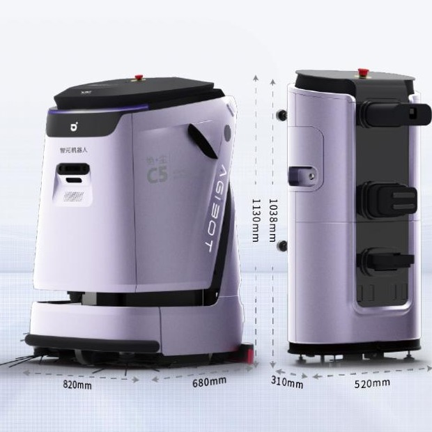
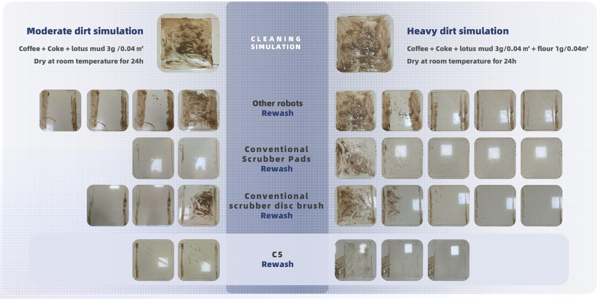
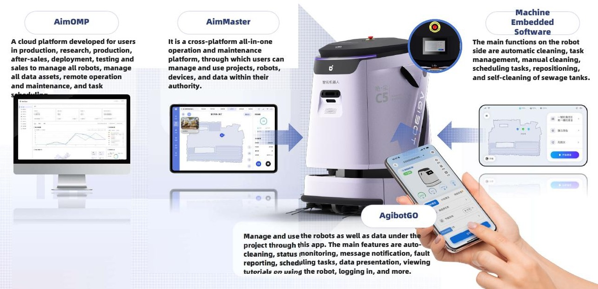
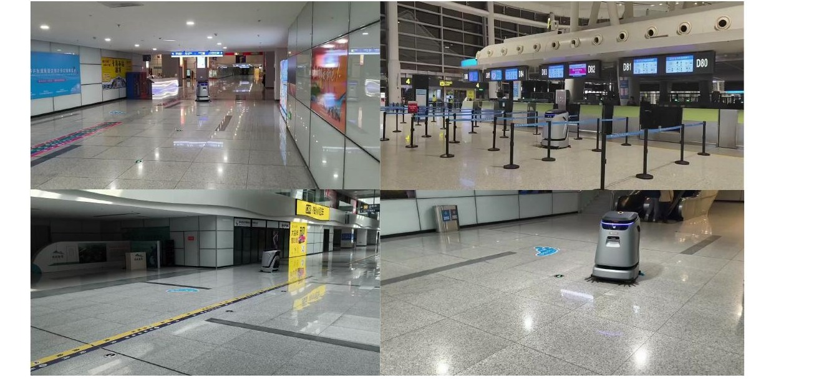

# AgiBot C5 Product Instruction

## AgiBot C5 Commercial Cleaning Robot



### Product Overview

The AgiBot C5 is a commercial cleaning robot that combines scrubbing, sweeping, and dust collection in one platform. It is designed for industrial facilities, transportation hubs, healthcare and education sites, shopping malls, and exhibition halls.

#### Core Cleaning Capabilities

<figure><figcaption></figcaption></figure>

<figure><figcaption></figcaption></figure>

* Maximum stated cleaning efficiency: 1,980 m²/h.
* Scrubbing width: 550 mm.
* Suction squeegee width: 750 mm.
* Dual-brush design for simultaneous debris pickup and heavy-stain cleaning.
* Integrated rubbish collection rate: greater than 95%.
* Ground pressure: approximately 25 kg, stated as approximately 16 kPa.
* Maximum operating noise: below 68 dB(A).
* Self-cleaning wastewater tank cycle: approximately 4 minutes.

### Technical Specifications

| Item                                                | Officially stated value                                       |
| --------------------------------------------------- | ------------------------------------------------------------- |
| Maximum cleaning efficiency                         | 1,980 m²/h                                                    |
| Machine width                                       | 700 mm                                                        |
| Scrubbing width                                     | 550 mm                                                        |
| Suction squeegee width                              | 750 mm                                                        |
| Overall dimensions shown in the source              | 820 × 680 × 1,130 mm                                          |
| Folded / narrow-side dimensions shown in the source | 520 × 310 × 1,038 mm                                          |
| Machine weight                                      | 170 kg                                                        |
| Battery                                             | 80 Ah                                                         |
| Scrubbing endurance                                 | Approximately 3–3.5 h                                         |
| Dust-collection endurance                           | Up to 12 h in the comparison data                             |
| Fast charging time                                  | Approximately 1.5 h                                           |
| Clean-water tank                                    | 45 L                                                          |
| Wastewater tank                                     | 45 L in the highlights section; 42 L in the comparison table  |
| Combined water capacity                             | 90 L as stated in the product highlights                      |
| Additional tank-volume value                        | 8 L; the source does not identify the corresponding subsystem |
| Water-filling rate                                  | 7–10 L/min                                                    |
| Wastewater discharge rate                           | 10–15 L/min                                                   |
| Main brush motor                                    | 400 W × 2 in the comparison table                             |
| Maximum power                                       | 1,800 W                                                       |
| Rated input voltage                                 | 200–240 V                                                     |
| Suction motor design life                           | 10,000 h                                                      |

> **Configuration check:** The official 2025 instruction contains different wastewater-capacity values in separate sections. Confirm the current machine revision and tank capacities before planning refill cycles, consumables, or service work.

### Professional Cleaning System

#### Dual-Brush Cleaning

The newly designed dual-brush structure combines rubbish pickup with heavy-stain cleaning. The official material states a main-brush motor power of 400 W per motor, approximately three times the comparison baseline used in the source, with approximately 25 kg of ground pressure.

#### Water Recovery

* A dual-chamber suction squeegee is designed to improve recovery of water bouncing out of floor seams.
* A secondary residual-water treatment mechanism is designed to collect remaining water after the first pass.
* The stated maximum water flow is 800 mL/min.
* An automatic cleaning-liquid system separates the detergent tank and meters cleaning liquid into the water circuit.

#### Cleaning Test Reference

The official test used coffee, cola, and lotus-root starch at 3 g per 0.04 m², dried for 24 hours at room temperature. The heavy-dirt condition additionally used 1 g of flour per 0.04 m². The source compares repeated passes from other robots and conventional scrubber pads or disc brushes with the C5 result.

### Ease of Use and Automation

* **Wastewater-tank self-cleaning:** high-pres
* .jpg>)sure water cleaning for approximately four minutes per cycle.
* **Flexible initialization:** remote wake-up, one-touch start, and one-touch recall are designed to reduce deployment effort.
* **Direct wastewater discharge:** removal of the sump-pump routine is intended to reduce daily cleaning workload and consumable cost.
* **Filter-free wastewater path:** the design removes the wastewater-filter module and reduces routine maintenance.
* **Map self-update:** task maps can be updated when the operating environment changes.
* **Suction-motor monitoring:** clogging detection and alarms help prevent missed water recovery during operation.
* **Wastewater-tank deodorization:** designed to reduce odor diffusion and air contamination.
* **Lift and access-control linkage:** supports movement between floors and operating zones with reduced manual intervention.
* **Automatic refill and drainage:** the workstation supports automatic charging, water filling, and wastewater discharge.
* **Automatic task creation:** the system recognizes operating boundaries, partitions areas, and creates subtasks.
* **Automatic reports:** mobile and cloud systems can generate operating reports and present cleaning data.

### Perception, Positioning, and Safety

#### Perception and Positioning

* Laser and visual positioning are combined to improve localization reliability.
* Point-cloud and visual-fusion perception are used to identify different obstacle types.
* The official material states a perception field exceeding 300 degrees after the sensor upgrade.
* Virtual-wall recognition and marking are intended to simplify work-area setup.

#### Operational Safety

* An enlarged laser-detection angle and revised frame design are intended to improve obstacle-identification reliability.
* Drop detection, collision detection, and runaway-motion detection provide hazard warnings.
* Real-time fault diagnosis is stated to cover more than 90% of diagnosable conditions.
* A dual-circuit control design is used as functional-safety redundancy.
* Abnormal conditions trigger active alarms.

### Decision Planning and Navigation Technology

The official material describes an automatic-zoning, full-coverage algorithm for cleaning-task deployment in complex environments. It also describes planned joint spatial-temporal trajectory planning based on predicted obstacle trajectories for interaction with moving obstacles such as AGVs and vehicles in basement areas.

> Features described as “under development” or “future plans” in the official source must not be treated as delivered production functions unless confirmed for the installed software version.

### IoT Human-Machine Collaboration System

The management system is intended to connect personnel, robots, tasks, and operating data. It records workforce and robot quantities, locations, timelines, routes, task-completion rates, and delivery-compliance information. Project managers can use these records to refine human-machine task allocation and operating processes.

#### Software Components

| Component                 | Function                                                                                                                                                                                 |
| ------------------------- | ---------------------------------------------------------------------------------------------------------------------------------------------------------------------------------------- |
| AimOMP                    | Cloud platform for production, R\&D, after-sales service, deployment, testing, sales, robot management, data assets, remote operation and maintenance, and task scheduling.              |
| AimMaster                 | Cross-platform operation-and-maintenance platform for managing projects, robots, devices, data, and user authority.                                                                      |
| Machine Embedded Software | Automatic cleaning, task management, manual cleaning, scheduled tasks, repositioning, and wastewater-tank self-cleaning.                                                                 |
| AgibotGO                  | Mobile management of robots and project data, including automatic cleaning, status monitoring, notifications, fault reporting, scheduled tasks, data presentation, tutorials, and login. |

### Applied Scenarios

#### Industrial Facilities

The offic

.jpg>)ial examples include low obstacles and&#x20;

narrow passages, heavy oil contamination, very large facilities with frequently changing maps, non-slip stainless-steel floors, long similar corridors, wide-distance environments, and reflective stainless-steel floors.

#### Transportation Hubs

The C5 is shown operating in large public-transport environments with broad corridors and sustained cleaning routes.

#### Education and Healthcare

The official examples include education and healthcare environments where repeatable cleaning tasks and centralized monitoring are required.

<figure><figcaption></figcaption></figure>

#### Shopping Malls and Exhibition Halls

The official examples include shopping malls commercial facilities and exhibition spaces with mixed pedestrian traffic and large floor areas.

<figure><figcaption></figcaption></figure>

### Reference Comparison from the Official 2025 Instruction

The source compares the C5 with three unnamed commercial machines. The values below are reproduced as a dated reference and should not be interpreted as a current market comparison.

| Item                          | AgiBot C5                                                    | Machine A                       | Machine B                       | Machine C                       |
| ----------------------------- | ------------------------------------------------------------ | ------------------------------- | ------------------------------- | ------------------------------- |
| Cleaning method               | Sweep, scrub, dust collection                                | Sweep, scrub, dust collection   | Sweep, scrub, dust collection   | Scrub, dust collection          |
| Sweeping width                | 800 mm                                                       | 800 mm                          | 800 mm                          | Not provided                    |
| Scrubbing width               | 550 mm                                                       | 410 mm                          | 500 mm                          | 500 mm                          |
| Suction width                 | 750 mm                                                       | 750 mm                          | 706 mm                          | 700 mm                          |
| Clean / wastewater capacity   | 45 L / 42 L                                                  | 30 L / 24 L                     | 42 L / 30 L                     | 50 L / 45 L                     |
| Main brush motor              | 400 W × 2                                                    | 150 W × 2                       | 400 W × 2                       | 200 W × 2                       |
| Cleaning efficiency           | 1,980 m²/h                                                   | 1,440 m²/h                      | 1,800 m²/h                      | 1,800 m²/h                      |
| Operating noise               | 68 dB(A)                                                     | 66 dB(A)                        | 68 dB(A)                        | 68 dB(A)                        |
| Automatic detergent dosing    | Yes                                                          | Yes                             | No                              | No                              |
| Wastewater-tank self-cleaning | Yes                                                          | No                              | No                              | No                              |
| Positioning                   | Laser + vision                                               | Laser                           | Laser                           | Laser                           |
| Workstation                   | Automatic charging, refill, drainage, and tank self-cleaning | Automatic charging and drainage | Automatic charging and drainage | Automatic charging and drainage |

### After-Sales Service

#### Service Objectives

The official service objective is rapid response, standardized handling of service requests, cloud-based equipment-health monitoring, and proactive professional support.

#### Service Commitments

* Service hotline stated in the source: 400-186-0818, available 7 × 24.
* Remote support: response within 30 minutes, with a solution or on-site repair plan stated within 2 hours.
* On-site response target for key accounts: 12 hours, or within 48 hours in remote areas.
* On-site response target for general customers: 24 hours, or within 72 hours in remote areas.
* Free product-use training, product consultation, and remote support are listed as available services.
* Consumables packages, extended warranty, and maintenance services are listed as value-added options.

#### Warranty Exclusions Listed in the Official Instruction

1. Failure or accessory damage caused by not following maintenance instructions or by incorrect use.
2. Failure caused by operation that does not comply with the manual, including operating errors, scratches, or water damage.
3. Use outside the specified operating environment, including garages or outdoor plazas when not approved for the configuration.
4. Unauthorized modification, disassembly, or repair outside the manufacturer or an authorized dealer.
5. Redeployment or transport damage caused by moving the robot to another site.
6. Failure or consequential damage caused by non-original accessories.
7. Damage caused by force majeure, including fire, earthquake, or flood.

During the warranty period, failures attributed to product quality are stated to receive free replacement parts and maintenance from the manufacturer or an authorized dealer, subject to the applicable warranty terms.
