# AgiBot D1 Edu and D1 Ultra Secondary Development Guide

### AGIBOT D1 Edu Quadruped Robot Dog with SDK for Education



### AGIBOT D1 Ultra IP54 Quadruped Robot Dog for Inspection and R\&D



**Applicability:** This guide applies to D1 Edu and D1 Ultra robots running firmware version 0.2.6 or later.

Document Revision Record

| Revision date | Revision                                                         | sdk version   |
| ------------- | ---------------------------------------------------------------- | ------------- |
| 2025-07-16    | • Initial version sdk                                            | v2.0.5        |
| 2025-07-19    | • New senior sdk interface                                       | v2.0.6        |
| 2025-09-15    | • Rehabilitation of “checkcontract” interface abnormality        | v0.2.6-patch1 |
| 2025-11-04    | • New bottom sdk interface — new D1 Ultra-W topsdk Answer. mouth | v2.0.7        |

### 1. Product Introduction

#### 1.1 Product Overview

D1 Ultra / Edu, with 12 degrees of freedom, with a wide range of motion and motion. At the same time, the product has opened up the motion control algorithm to develop SDK and communication protocols, allowing users to develop secondary development as needed.

| Note: This secondary development guide applies to D1 Edu and D1 Ultra and firmware version 0.2.6 and above |
| ---------------------------------------------------------------------------------------------------------- |

#### 1.2 Package Contents

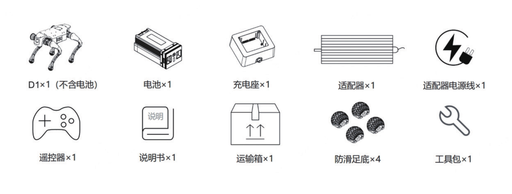

#### 1.3 Product Specifications

| Classification                            | Specifications                                                                                                                                                                  | Annotations                                                                                                                      |
| ----------------------------------------- | ------------------------------------------------------------------------------------------------------------------------------------------------------------------------------- | -------------------------------------------------------------------------------------------------------------------------------- |
| Basic information                         | Material Information                                                                                                                                                            | Aluminium alloy + high-intensity engineering plastics (phenol phenol resin) Edu: Pantonne Warm Gray 5Ultra: Pantone Warm Gray 3U |
| Standing dimensions (long\* width\* high) | 630m&#x6D;_&#x33;60m&#x6D;_&#x34;20mm                                                                                                                                           |                                                                                                                                  |
| Paddy size (long\* wide\* high)           | 675m&#x6D;_&#x34;35m&#x6D;_&#x31;45mm                                                                                                                                           |                                                                                                                                  |
| Whole weight (including batteries)        | 15.5kg                                                                                                                                                                          |                                                                                                                                  |
| Working temperature                       | 0\~40°C                                                                                                                                                                         |                                                                                                                                  |
| Charge duration                           | 1h                                                                                                                                                                              |                                                                                                                                  |
| Time of renewal.                          | 1\~2h                                                                                                                                                                           |                                                                                                                                  |
| Keep going.                               | 6km                                                                                                                                                                             |                                                                                                                                  |
| Performance parameters                    | Base strength                                                                                                                                                                   | 8 Nuclear High Performance CPU                                                                                                   |
| Maximum working power                     | 3500W                                                                                                                                                                           |                                                                                                                                  |
| Maximum speed                             | 3.7m/s                                                                                                                                                                          |                                                                                                                                  |
| Rating Load                               | 5kg                                                                                                                                                                             |                                                                                                                                  |
| Climbing the stairs.                      | 16cm                                                                                                                                                                            |                                                                                                                                  |
| Maximum slope angle                       | Standard 30 degrees, limit 40 degrees                                                                                                                                           |                                                                                                                                  |
| Jump up from the ground.                  | 35cm                                                                                                                                                                            |                                                                                                                                  |
| Entire machine parameters                 | Executor Type                                                                                                                                                                   | High density motion unit                                                                                                         |
| Maximum joint twist                       | 48N.M                                                                                                                                                                           |                                                                                                                                  |
| Joint motion space (airframe)             | -28°\~28°                                                                                                                                                                       |                                                                                                                                  |
| Joint motion space (legs)                 | -170°\~66°                                                                                                                                                                      |                                                                                                                                  |
| Joint motion space (legs)                 | -35°\~156°                                                                                                                                                                      |                                                                                                                                  |
| Sensors                                   | CameraFOV                                                                                                                                                                       | One camera, resolution 1920x1080p, field of view DFOV122°, HFOV111°, VFOV70°                                                     |
| IMU                                       | Number 1                                                                                                                                                                        |                                                                                                                                  |
| Function List                             | Standard Actions                                                                                                                                                                | Stand, fall, climb, lean, turn horizontally; jump forward, jump up, flip back, stand up, say hello                               |
| Real-time image transfer                  | Jump forward, jump backwards, stand on your feet, flip back, say hello, etc.                                                                                                    |                                                                                                                                  |
| Secondary development                     | Edu version support, provide SDK development kits, standardized interfaces, provide robotic models and simulation interfaces, support simulation environments such as Issac Sim |                                                                                                                                  |
| Communications function                   | Support WIFI 5.0, Bluetooth 5.0                                                                                                                                                 |                                                                                                                                  |
| Functional Extension Interface            | Etherne&#x74;_&#x31;, USB interfac&#x65;_&#x32;, power interfac&#x65;_&#x32;, SBUS interfac&#x65;_&#x31;, UART interface\* One.                                                 |                                                                                                                                  |
| Spare parts                               | Adapter                                                                                                                                                                         | Mark                                                                                                                             |
| Charging seat.                            | Mark                                                                                                                                                                            |                                                                                                                                  |
| Remote control                            | Roller remote.                                                                                                                                                                  |                                                                                                                                  |
| Other                                     | Insurance period                                                                                                                                                                | 1 year                                                                                                                           |

| The charge-time long-range data measured at a rate of 1 m/s at a standard ambient temperature of 25° and the parameters of laboratory testing in the absence of a load condition, with actual performance likely to vary depending on the environment, mode of operation, etc. |
| ------------------------------------------------------------------------------------------------------------------------------------------------------------------------------------------------------------------------------------------------------------------------------ |

#### 1.4 Back-Mounted Payload Installation

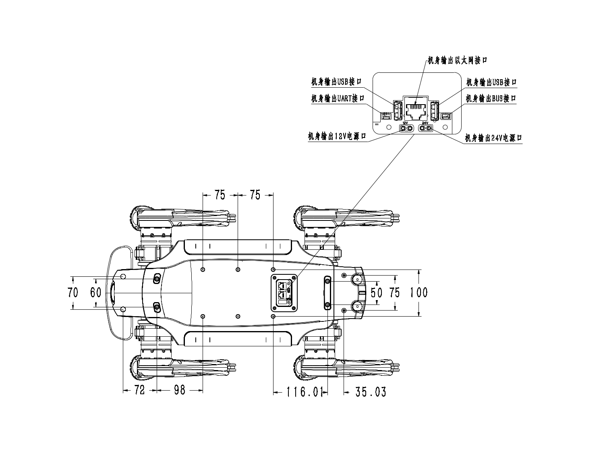

| Note: The back load is equipped with an M4 level and must be fitted with a dustproof plug that removes a screwdriver. |
| --------------------------------------------------------------------------------------------------------------------- |

#### 1.5 Electrical Expansion Interfaces

| Serial number | Interface Name  | Number | Annotations                                                                                                                                                                                                                                       | Remarks |
| ------------- | --------------- | ------ | ------------------------------------------------------------------------------------------------------------------------------------------------------------------------------------------------------------------------------------------------- | ------- |
| 1             | Ethernet        | 1      | RJ45 interface to support 1,000 Mbps transmission rate for high-speed data transmission, support for network connectivity, remote monitoring, data transmission, etc.                                                                             |         |
| 2             | USB interface   | 2      | Type A interface to connect external storage equipment, United StatesB equipment such as cameras, sensors, and provide high-speed data transmission and power supply                                                                              |         |
| 3             | Power interface | 2      | SDC power interface, which provides stable power supply, supports 12V and BAT output, with a total power of no more than 36W for 12V output, and 100 W for BAT output, and meets the power requirements of quadruped robots and loaded equipment. |         |
| 4             | SBUS interface  | 1      | Standard SBUS interface to connect remote controller receivers or other communication devices supporting SBUS protocols to achieve accurate remote command transmission                                                                           |         |
| 5             | UART interface  | 1      | Standard UART interface for connecting embedded systems, communication equipment or other equipment supporting UART protocols to achieve data exchange and control between devices by walk-through communication                                  |         |

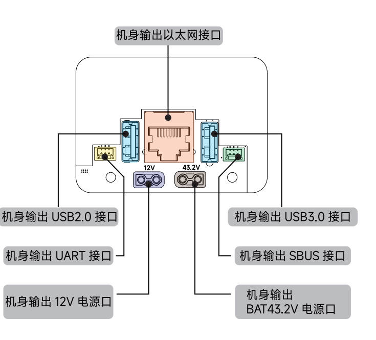

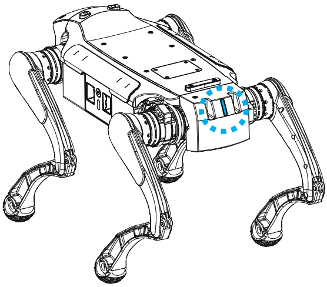

### II. System architecture

#### 2.1 AGIBOT architecture

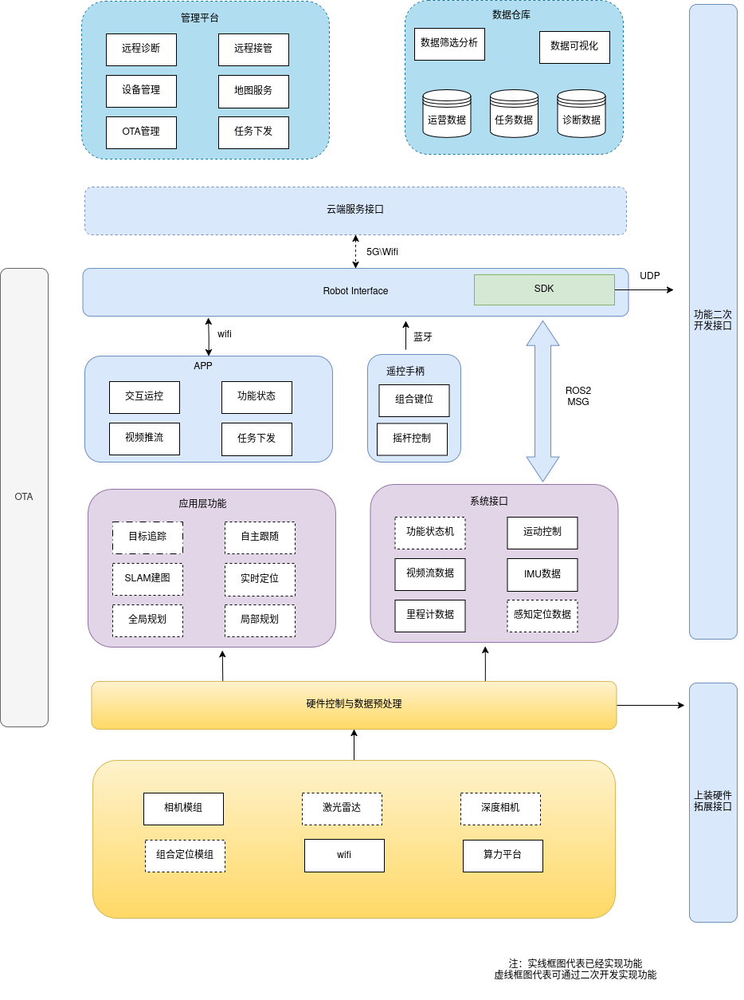

| Note: Fiction diagrams are functional and dotted frames can be developed twice |
| ------------------------------------------------------------------------------ |

#### 2.2 SDK control frames

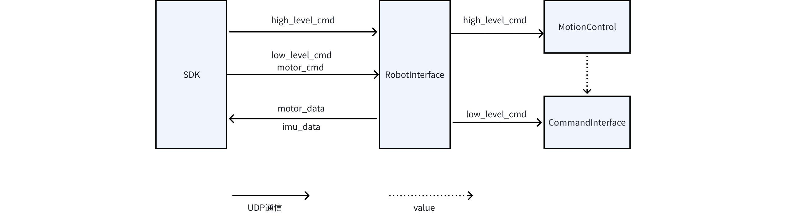

#### 2.3 SDK interface frame

Currently open motion control related SDK interfaces, including upper movement control interfaces, bottom power control interfaces, IMU customary guide data interfaces and electrical status data interfaces

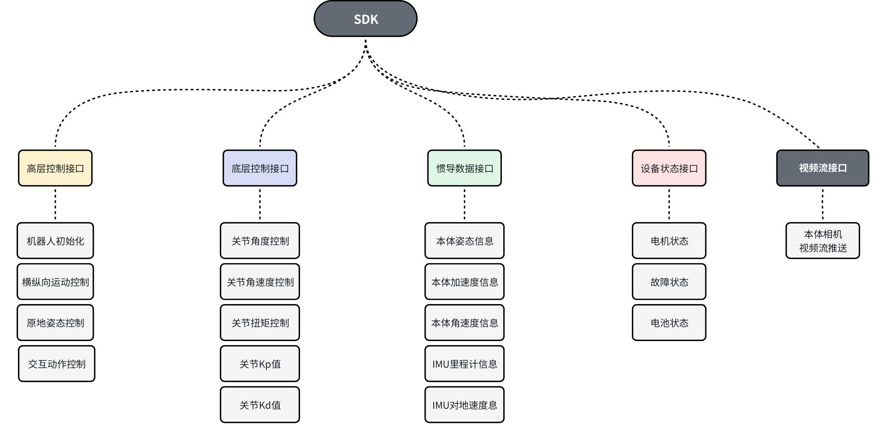

#### 2.4 List of software service interfaces

| Serial number | Interface Name                   | Functions                                                                                                                                                                                                                           | SDK Version |
| ------------- | -------------------------------- | ----------------------------------------------------------------------------------------------------------------------------------------------------------------------------------------------------------------------------------- | ----------- |
| 1             | Upper Movement Control Interface | High-level motor control of robots and dogs, including back-to-back velocity, down, spin, limbs standing, etc.                                                                                                                      | V0.2.6      |
| 2             | Motor Control Service Interface  | Controls the bottom interface of the power plant and sets up its target motion, including location, speed, twists, etc. By setting different parameters, users can control the power to execute specific actions in different modes | V0.2.6      |
| 3             | Device Status Service Interface  | Query and obtain information on the current state of equipment and the use of system resources                                                                                                                                      | V0.2.6      |
| 4             | IMU Service Interface            | Fetch IMU raw data information                                                                                                                                                                                                      | V0.2.6      |
| 5             | Video streaming data interface   | Push camera home stream to client                                                                                                                                                                                                   | V0.2.6      |
| 6             | Control Switch sdk interface     | Provide control switch between remote controller and sdk                                                                                                                                                                            | v2.0.7      |

### III. SDK development guide

#### 3.1 Introduction to SDK

• This document describes the software development toolkit (SDK) for D1 Ultra / Edu, which provides detailed information on its core service interface, including the upper movement control interface, the bottom power control interface, the IMU customary guide data interface and the electrical status data interface.

• Each chapter presents the method of calling different service interfaces, standard format definitions for data input/output and examples of some functional development.

• The definition of interface will vary with the development of the mass product, depending on the latest version of the interface definition document.

• The SDK program has a specific protocol for communication with the dog's own program, so there are differences between different versions of the SDK program and the dog's own program. Select the corresponding version of the SDK program according to the device version. If conditions permit, it is recommended that the internal dog program be updated to the latest version to achieve better compatibility.

• When the SDK interface is controlled, the entire state is designed by a secondary developer and no additional intervention and state jumps are performed by the HMO.

• When running SDK, please ensure that the system is adequately resourced, otherwise there may be cases where the motion control module has failed.

#### 3.2 Environmental dependency

• ubuntu22.04

• Cmake 3.8+

• GCC 11+

• Eigen3

• Boost 1.74

• python3+

#### 3.3 Network connectivity

The device is equipped with a wireless network interface with wireless network information on the right side or abdomen of the device, with the device SID and password information on the label, and the quadruped robot body default IP table as follows:

| Network Interface | IP Address      | DHCP  |
| ----------------- | --------------- | ----- |
| Wireless network  | 192.168.234.1   | Yeah. |
| Wireless Network  | 192.168.168.168 | None  |

Wireless networks, equipped with DHCP services and connected to the Wireless Network, ensure that the operating equipment wireless network is not equipped with a fixed IP and that communications can be established directly with robots through 192.168.234.1.

Wireless networks are not equipped with DHCP services, and re-operated equipment cable networks are required to configure fixed IPs, and IPs are 168 segments to allow communication with robots.

#### 3.4 Equipment login

The equipment provides ssh login, which allows the device to login via ssh when a connection to the device is created by wireless or wired

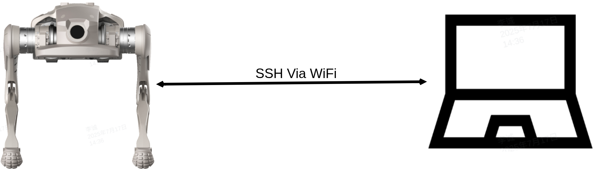

• Wireless connectivity

| #Plain Text sh firefly@192.168.234.1 |
| ------------------------------------ |

• Wireless connection

| Plain Text sh firefly@192.168.168.168 #cipher:firefly |
| ----------------------------------------------------- |

#### 3.5 Firmware version number query

After login, the following command is given to view the current version of the device:

| Bash grep -oP 'motion-control\_\K\[^\_]+' /etc/release/_\[^rootfs]_.yaml |
| ------------------------------------------------------------------------ |

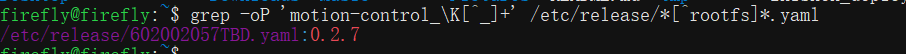

Example: 602002057TBD.yaml: 0.2.7

Firmware version number: 567 bit, i.e. 2.0.5 solid

SDK version number: Output content, i.e. transport version 0.2.7

If the post-execution version number is less than 0.2.6, this means that the equipment version is too low and requires upgrading after sale in contact.

| This document applies to SDK version 0.2.6 and above, and if less, contact post-sale technicians for upgrade |
| ------------------------------------------------------------------------------------------------------------ |

| The following version of the quadruped robot: during sdk control, the remote controller cannot use 0.3.4 or more versions of the quadruped robot: during sdk control, the control of the remote controller and the switch control of sdk can be replaced, and if the control switch is required, contact the post-sale technical support officer for upgrading |
| -------------------------------------------------------------------------------------------------------------------------------------------------------------------------------------------------------------------------------------------------------------------------------------------------------------------------------------------------------------- |

#### 3.6 SDK Access

Way 1: Accessable to support after sale

Go: Get it through the github address below

| Plain Text git clone https://github.com/AgibotTech/agibot\_D1\_Edu-Ultra.git |
| ---------------------------------------------------------------------------- |

#### 3.7 sdk file configuration

**3.7.1 Wireless connection mode**

step1 Modify sdk communications profile

```
Pass.vimCommand to change quadruped robot body/opt/export/config/sdk_config.yamlDocuments:
```

| Plain Text target\_ip: "192.168.234.xx" #local\_iptarget\_port: 43988 |
| --------------------------------------------------------------------- |

```
• target_ip: Quadruped robot control endIPAddress, do not.IPConflict(I can't.192.168.234.1)
```

```
• target_port: Default43988Do not modify
```

Reactivate quadruped robot after modification of the step2 configuration parameter

**3.7.2 Wireless connection mode**

step1 Modify sdk communications profile

```
Pass.vimCommand to change quadruped robot body/opt/export/config/sdk_config.yamlDocuments:
```

| Plain Text target\_ip: "192.168.168.xxx" #local\_iptarget\_port: 43988 |
| ---------------------------------------------------------------------- |

```
• target_ip: Quadruped robot control endIPAddress, do not.IPConflict(I can't.192.168.168.168)
```

```
• target_port: Default43988Do not modify
```

step2 Configure SDK CLIENT IP

If network lines or other non-192.168.234.X-net IP controls are required, modified by vim command

```
/opt/app_launch/start_motion_control.shDocuments:
```

| Bash#!/bin/bashecho "start movement control"# Share memory path SHM FILE="/dev/shm/spline shm"# # Circulation check device exists while true; do if \[-e-$SHM FILE]; then echo " Share memory file $SHM FILE already exists. "Break else echo " shared memory file $SHM FILE does not exist and waits for a second to retry... 'sleep 1 fidone# command cho " shared memory file is ready for subsequent operation. "sudo ifconfig lo multiculturalasundo route add-net 224.0.0 netmask 240.0.0.0 dev loexport LD LIBRARY PATH=/opt/export/mc/binexport ROBOT TYPE=P2export SDK CLIENT IP= "Bob ip"cd /opt/export/mc/bin & taskset-c 7 /mc ctrl rr |
| -------------------------------------------------------------------------------------------------------------------------------------------------------------------------------------------------------------------------------------------------------------------------------------------------------------------------------------------------------------------------------------------------------------------------------------------------------------------------------------------------------------------------------------------------------------------------------------------------------------------------------------------------- |

```
• It's the code on it.27All right, add configuration:export SDK_CLIENT_IP="Robots.ip"And the robot.IPAddress filled in the corresponding parameter
```

```
• If you use a wired network, you will use robots.IPModify to192.168.168.168,If it's otherIPModify to CorrespondIPYeah.
```

step3 Modify webcard name

```
Change the quadruped robot book./etc/systemd/system/robot-launch.serviceDocumentation
```

```
Yes.ServiceAdd a line insideEnvironment="ROBOT_NET_INTERFACES=wlan0"of whichwlan0For the corresponding card name, the use of a cable network can be changed toeth0
```

The complete profile is as follows:

| JSON \[Unit]Description=Run robot-launch at startupAfter=network.target\[Service]ExecStart=robot-launch serviceExpecStop=/usr/local/bin/robot lanch stop.shTimeoutSopSec=5sRestart=alwaysUser=RootEnvironment="ROBOT HOME/firely'Environment=" ROBOT LOG DER=/userdata/log'Environment="RoBOT NET NETINFACES=wlan0"#Wlan0 is used to change to "ethlan0" \[Install]WantBy=user.target0" |
| --------------------------------------------------------------------------------------------------------------------------------------------------------------------------------------------------------------------------------------------------------------------------------------------------------------------------------------------------------------------------------------- |

| This parameter is configured with the probability that the robot dog will not be able to use the remote! The configuration of SDK CLIENT IP and the failure of the corresponding webcard to allocate IP addresses when the network has not been initialized after the device has been installed has led to the failure of the control program to bind IP addresses, thus preventing dogs from using remote controllers. |
| ----------------------------------------------------------------------------------------------------------------------------------------------------------------------------------------------------------------------------------------------------------------------------------------------------------------------------------------------------------------------------------------------------------------------- |

#### 3.8 Modify SDK Demo Configuration

**3.8.1 Configure python IP and port**

```
Yes. {User Directory}/agibot_D1_Edu-Ultra-main/demo/zsl-1/python/examples/, change as required
```

| Python app.initRobot("127.0.0.1", 43988, "127.0.0.1") #local\_ip, local\_port, dog\_ip |
| -------------------------------------------------------------------------------------- |

**3.8.2 Configure C++ IP and port**

```
Yes. {User Directory}/agibot_D1_Edu-Ultra-main/demo/zsl-1/cpp/, change as required
```

| C++ constexpr int CLIENT\_PORT = 43988; // local port std::string CLIENT\_IP = "127.0.0.1"; // local IP address std::string DOG\_IP = "127.0.0.1"; // dog ip |
| ------------------------------------------------------------------------------------------------------------------------------------------------------------ |

| The robot IP and the local port in the configuration parameter need to be consistent with the parameters of the sdk config medium target ip and target port. Make sure the robot IP matches the port number, otherwise communication cannot be created! If the sdk config.yaml's ip is deleted or denoted, the machine's transport service cannot start from now on! When the device program is updated or the control program is updated, the profile will be reset and the configuration will need to be reconfigured! |
| ------------------------------------------------------------------------------------------------------------------------------------------------------------------------------------------------------------------------------------------------------------------------------------------------------------------------------------------------------------------------------------------------------------------------------------------------------------------------------------------------------------------------ |

| If you run the sdk demo program via Wi-Fi connection in the four-foot robotic body, the local ip and dog ip are set at 192.168.234.1. |
| ------------------------------------------------------------------------------------------------------------------------------------- |

#### 3.9 Example: Demo Run Steps

**3.9.1 Compiled demo**

At local PC end, enter to sdk file Medium

| Bash cd demo/zsl-1/cppmkdir buildcd buildcmake..make -j6 |
| -------------------------------------------------------- |

**3.9.2 Operational sdk demo**

• Run Python demo

| Plain Text cd demo/zsl-1/python/examplespython highlevel\_demo.pyorpython lowlevel\_demo.py |
| ------------------------------------------------------------------------------------------- |

• Run C++ demo

| Plain Text cd demo/zsl-1/cpp/build./highlevel\_demoor./lowlevel\_demo |
| --------------------------------------------------------------------- |

**3.9.3 Call sdk**

• Python-based call sdk

| = platform. Machine(). } } } } } } } } } } } /..../../. / /lib/zsl-1/{arch}') sys.path.insert (0, lib path)import mc sdk zsl 1 pyapp = mc sdk zsl 1 py.HighLevel()app.initRobot(") Local computer robots and dogs are on the net. |
| --------------------------------------------------------------------------------------------------------------------------------------------------------------------------------------------------------------------------------- |

Use sdk based on make-up

| CMake cmake minimum required (VERSION 316)project(test)set (CMAKE CXX STANDARD REQUIRD ON)set (CMAKE CXX STANDARD 17)# Definition architecture variable (default unknown)set(ARCH "unknown")# Identification x86 64 structure (return values compatible with different systems) {g/gmole gme gme gme gme gme gme gme gme gme gme gme gme gme gme gme gme ge gme ge ge ge ge ge ge ge ge ge ge ge ge ge ge/gme ge ge ge ge ge ge ge ge gme ge ge g/gme ge gme ge ge gme ge ge gme ge gé/gme ge ge ge ge ge ge ge gé/gme gme ge gé/gme ge gé/gémé) nge-gém {e (g) nge-gre nge e e e |
| --------------------------------------------------------------------------------------------------------------------------------------------------------------------------------------------------------------------------------------------------------------------------------------------------------------------------------------------------------------------------------------------------------------------------------------------------------------------------------------------------------------------------------------------------------------------------------- |

#### 3.10 Two-part control statement

Instructions are issued in the following conditions, which may result in abnormal situations such as machine fall, failure, non-response, etc.

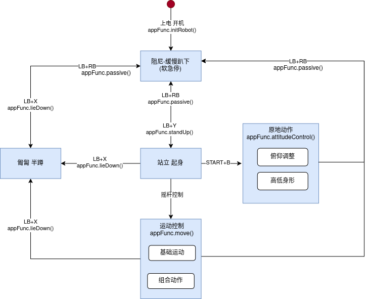

**3.10.1 Description of joint control orders**

Order Order

FR (front right)

• FL (front left)

RR (back right)

• RL (back left)

**3.10.2 Definition of joint orientation**

A, H, K joint coordinates: Front X, Left Y, Upper Z

Coordinates match the right-hand coordinates, forward X, left Y, up Z.

The order of legs is right front left, back right left.

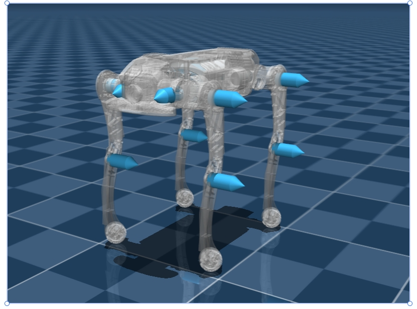

| Note: When using sdk controls, the low-power warning logic is required, the sdk connection is automatically disconnected when quadruped robot power is insufficient, and the corresponding processing logic is required for upper sdk control |
| --------------------------------------------------------------------------------------------------------------------------------------------------------------------------------------------------------------------------------------------- |

### IV. Introduction to API Functions

Detailed interface description, see the corresponding version of the sdk description document:

```
https://github.com/AgibotTech/agibot_D1_Edu-Ultra/blob/main/docs/api_zsl-1.md
```

### V. Debugging guidelines

#### 5.1 Video Streaming Service

The video of the quadruped robot wide-angle camera was pushed to the following URLs by Gstreamer:

| Plain Text rtsp://192.168.234.18554test#wireless connectionrtsp://192.168.168.168:8554test#wireline connection |
| -------------------------------------------------------------------------------------------------------------- |

The default displays real-time images on the side pull side of the remote, previewing and calling via VLC or OpenCV

#### 5.2 Description of indicator lamps

**5.2.1 Description of quadruped robot taillights**

| Lights                          | Lantern                               | Remarks                                                                 |
| ------------------------------- | ------------------------------------- | ----------------------------------------------------------------------- |
| Blue always bright              | Turn on.                              | Normal                                                                  |
| Blue flash                      | It's on.                              |                                                                         |
| White always bright             | Laboratory Mode                       | Special effects are used in this mode                                   |
| The green lights are always on. | Tracking mode starts sdk control mode |                                                                         |
| The yellow lights are on.       | Battery power below 20%               | Battery power is not enough to turn on violent mode and do sdk control. |
| Yellow light flash              | Battery power below 5%                | Battery power is insufficient and requires immediate charge.            |
| Red lights are on.              | The joint's too hot to cool.          |                                                                         |
| Red light flash.                | System anomaly                        | We need to contact the sales back.                                      |

**5.2.2 Battery indicator lamps description**

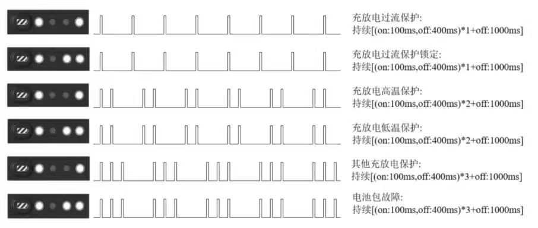

#### 5.3 Abnormal log queries

```
logContents/home/firefly/tmp/log
```

| Note: The quadruped robot has set up a post-opening log clean-up service, and after an anomaly, do not turn it off and get the log first. |
| ----------------------------------------------------------------------------------------------------------------------------------------- |

#### 5.4 Control transition function

For the four D1 Edu, D1 Ultra type quadruped robot to describe the method used to switch control between remote controller and sdk control

| When sdk and remote controllers are not supported, the control is automatically switched to the remote controller end if the power is low |
| ----------------------------------------------------------------------------------------------------------------------------------------- |

**5.4.1 Version Requirements**

Quadruped robot solidware version: V0.2.5 and above

Remote control app version: V2.4.5 and above

**5.4.2 Function Description**

| Controlend               | How to switch       | Description of the lamp                                                                                                                                           |                                                                |
| ------------------------ | ------------------- | ----------------------------------------------------------------------------------------------------------------------------------------------------------------- | -------------------------------------------------------------- |
| Remote control end       | Robo handle remote. | Long press LT+RT+A                                                                                                                                                | Remote control mode: quadruped robot taillights are blue Green |
| Screen remote controller | Long press L2+R2+A  |                                                                                                                                                                   |                                                                |
| SDKend                   | CPP                 | Switch to SDK mode: zsibot exec.SetCmd (CmdCode::CMD SDK CONTROL RIGHT); switch to remote controller mode: zsibot exec.SetCmd (CmdCode:CMD REMOTE CONTROL RIGHT); |                                                                |

**5.4.3 Control Block Diagram**

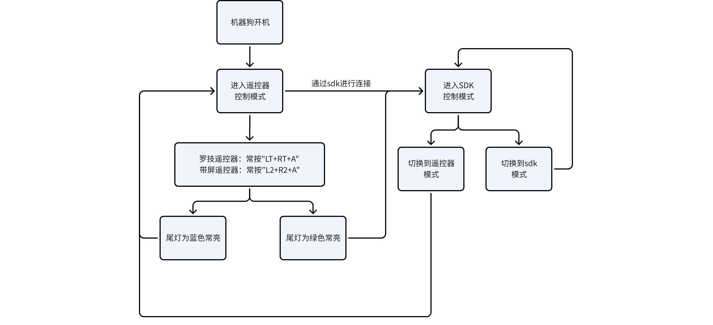

### VI. FAQ

#### 6.1：connect time out

There is a connection timed out after running the SDK program. The hint is:

| Bash client bind successconnect time outerror async receive from |
| ---------------------------------------------------------------- |

#### 1. Please modify the parameters for target ip in the SDK configuration file according to the document.

#### If a non-WiFi direct connection is used to communicate with the device, the SDK CLIENT IP parameters will also need to be modified according to the document. When a non-WiFi direct connection is made, the device has the probability that the control binding SDK will fail. Please modify the parameters for the IP failure following the document cable connection.

#### 6.2: Failed to bind IP for cable connection

```
In ConfigureSDK_CLIENT_IPAfter, if usedwlan0Network or...eth0Networking.SDKAt the time of control, the network was not initialized and the corresponding card was not distributedIPAddress, cause the control program to bind.IPAddress failed.
```

```
In the form ofSDKProgram after running hint:connect time outExecute the order by logging in the device master controlsudo lsof -i -P -n -c mc_ctrl | grep 43997View output content,The control counterpart port was not bound.
```

```
By modifying the device master/etc/systemd/system/robot-launch.serviceFile configuration recoverable, inServiceAdd a line insideEnvironment="ROBOT_NET_INTERFACES=wlan0"of whichwlan0For the corresponding card name, the use of a cable network can be changed toeth0。
```

The complete profile is as follows:

| Bash \[Unit]Description=Run robot-launch at startupAfter=network.target\[Service]ExecStart=robot-launch serverExecStop=/usr/local/bin/robot\_launch\_stop.shTimeoutStopSec=5sRestart=alwaysUser=rootEnvironment="ROBOT\_HOME=/home/firefly"Environment="ROBOT\_LOG\_DIR=/userdata/log"Environment="ROBOT\_NET\_INTERFACES=eth0"\[Install]WantedBy=multi-user.target |
| ------------------------------------------------------------------------------------------------------------------------------------------------------------------------------------------------------------------------------------------------------------------------------------------------------------------------------------------------------------------- |

| Reboot device effective after parameter configuration! |
| ------------------------------------------------------ |

| This parameter is configured with the probability that the quadruped robot program will not start! The configuration of ROBOT NET INTERFACES will test whether the configured card is assigned to IP, and if the card remains without IP, the quadruped robot program cannot be started. |
| ---------------------------------------------------------------------------------------------------------------------------------------------------------------------------------------------------------------------------------------------------------------------------------------- |

#### 6.3: Use wlan0 to connect environment Wi-Fi, which does not automatically connect every time the device is restarted

There is a conflict between AP and Wlan webcards on the device, some versions of which have an automatic connection removal feature, and if you need to turn off the automatic connection removal function, you can execute the following orders:

| Bash Sudo systactl stop networkmanager-cleanup.service //Close network cleanup service |
| -------------------------------------------------------------------------------------- |

#### 6.4: Python import failed

```
Confirm whether the script will lib/<model>/<arch> Add sys.path；Python Version needs to match extension module (cp310 Organisation Python 3.10）。
```

#### 6.5: C++ Link failed?

```
Confirm. lib/<model>/<arch> Exists in.so Documentation; ensuring CMake The correct structure was detected.x86_64 / aarch64）。
```

#### 6.6: Frequency of access to interface support during operation?

Lowlevel 500hz, highlevel 50hz.

#### 6.7: Control interface support frequency in SDK?

Control data can support up to 500 hz, and in general 20 to 50 hz will guarantee the stable operation of the equipment.

#### 6.8: Is the SDK program linearly safe?

SDK program is linearly safe.

#### 6.9: Does SDK have communication tests?

The control program monitors the continued receipt of SDK data and, if data are not received within 3 seconds, the SDK communication is considered to have been interrupted and the equipment automatically switches to the blocker mode.

#### 6.10: How do you avoid the failure of the machine ' s own program when the control program is initiated through service within the machine?

service can be configured as robot-launch, and the robot-launch service starts the machine's own program.

#### 6.11: Can both handle remote and sdk remote switch?

The current version of the SDK priority is above hand handle remote controller and cannot be converted simultaneously.

#### 6.12: Are the IMU data obtained original?

The IMU data obtained are raw.

#### 6.13: Does the acquired IMU data feel wrong?

The IMU data in the device are influenced by the product type and there are errors in accuracy, and if there is a higher requirement for IMU accuracy, a separate high-precision IMU is required for use on the upper body.

#### 6.14: When SDK controls are used and hand-held remote controller devices are used, why does a stand-by instruction be sent to " push-ups " in place?

If the SDK CLIENT IP parameter is configured, the corresponding IP will be bound at the start of the transport, and if the IP does not exist, this will result in this.

#### 6.15: What is the rotation order when the four-digit value is converted to Cape Eurasia?

The order of the angles is ZYX, i.e. rotation of the Z axis, rotation of the Y axis, and rotation of the X axis.

#### 6.16: Is Highlevel and Lowlevel available at the same time?

Highlevel and Lowlevel cannot be used at the same time and, when switching between interfaces, a certain amount of time is reserved for release at the end of the device.

#### 6.17: Why is the SDK unable to control the equipment after the transport control process has been upgraded?

When the control program is upgraded, the configuration of the control will be overridden and the parameters of SDK CONFIG and SDK CLEAR IP will need to be reconfigured.

#### 6.18: Is there a ROS interface?

There is no ROS interface.

#### 6.19: When using SDK the application card does not go down in the initRobot function?

SDK relies on version 1.74.0, which, if used too old, may have compatibility problems due to structural changes.

#### 6.20: Supporting the deployment of control logic in quadruped robot body

It's not recommended to deploy control logic to the quadruped robot body. Power

### Official Resources

[Official AGIBOT development guide](https://www.agibot.com.cn/filepage/324/detail/38.html)

[Official AGIBOT downloads and software packages](https://www.agibot.com.cn/filepage/328.html)
