# AgiBot D1 Max Secondary Development Guide

### AGIBOT D1 Max IP67 Wheeled-Legged Robot for Industry and Logistics



**Applicability:** This guide is specific to D1 Max. Match the SDK and robot firmware versions before connecting or issuing motion commands.

Document Revision Record

| Revision date | Revision                                                                                                                                                                                                                                                                             | Version |
| ------------- | ------------------------------------------------------------------------------------------------------------------------------------------------------------------------------------------------------------------------------------------------------------------------------------ | ------- |
| 2025.9        | • Pilot version of initial projections                                                                                                                                                                                                                                               | V0.0.1  |
| 2025.10       | • Provision of basic robotic control interfaces • Support for robotic status data echo • Support for failure information echo                                                                                                                                                        | v0.0.2  |
| 2025.11       | • Add step mode interface • Add movement mode climber interface • Add mode status access interface                                                                                                                                                                                   | v0.0.3  |
| 2025.12.27    | • Adding interface to access system version number • Adding UDP mode of communication to support • Optimizing error message tips when a connection fails • In-house fit new version of communication protocols                                                                       | v0.0.4  |
| 2026.1.17     | • Add 2.10 to the coordinates of the body — add 4.4 to the sensor coordinates of the body                                                                                                                                                                                            | v0.0.41 |
| 2026.01.15    | • Add a new step attitude interface (Gait(...)) • Add a lean attitude interface (Slim(...)) • Add a new configuration interface after disconnection and automatic renewal • Add some examples of automatic renewal/manual renewal • Add an echo parameter to capture sending results | v0.0.5  |
| 2026.02.08    | • Add a control switch • Add a “4.5 RTK use description” • fix the IMU acc/ gyro counter-problem                                                                                                                                                                                     | v0.0.6  |
| 2026.03.17    | • Add an autonomous refilling function • Modify the user name for nx ssh login • Modify the front-and-back LiDAR IP address and ros topic • Add a “1.6 D1 Max hardware chart”                                                                                                        | v0.0.8  |

### 1. Product Introduction

#### 1.1 Product Overview

D1 Max is a four-leg robot with the advantage of being a four-legged robot with a weight, a load, a stretch, protection and mobility. Quadruped robots are equipped with three power shut-off machines and one wheeled electric generator each leg, with sensory equipment such as optical cameras, LiDAR, ultrasound radar, IMU, RTK modules, and internal high-calculation platforms for motor control, autonomous navigational positioning, environmental detection, etc., provide a rich electrical and communications interface and support multi-product mission load expansion.

.png>)

#### 1.2 Package Contents

.png>)

#### 1.3 Product Specifications

| Classification                                          | Specifications                                                                                                     | Annotations                                                                                                                                 |
| ------------------------------------------------------- | ------------------------------------------------------------------------------------------------------------------ | ------------------------------------------------------------------------------------------------------------------------------------------- |
| Basic information                                       | Material Information                                                                                               | Aluminium alloys + high-intensity engineering plastics                                                                                      |
| Standing (long x wide x high)                           | 930mm×480mm×585mm                                                                                                  |                                                                                                                                             |
| Punctuation (long x high)                               | 930mm×630mm×200mm                                                                                                  |                                                                                                                                             |
| Whole weight (including batteries)                      | 41kg                                                                                                               |                                                                                                                                             |
| Freedom                                                 | 12+4dof                                                                                                            |                                                                                                                                             |
| Working temperature                                     | -20℃\~55℃                                                                                                          |                                                                                                                                             |
| Protection level                                        | IP67                                                                                                               |                                                                                                                                             |
| Battery                                                 | 54v, 9.45 Ah\*2, Double Batteries, Support for Quick Switch, Support for Thermal Plugs                             |                                                                                                                                             |
| Charge duration                                         | <2h                                                                                                                |                                                                                                                                             |
| Time of renewal.                                        | Air 5h, full 3.5h                                                                                                  |                                                                                                                                             |
| Keep going.                                             | Aerial 29km, full 18km                                                                                             |                                                                                                                                             |
| The whole machine.                                      | 157 Tops/Nvidia Orin NX 16GB                                                                                       |                                                                                                                                             |
| Performance parameters                                  | Maximum speed                                                                                                      | 8m/s                                                                                                                                        |
| Rating Load                                             | 25kg                                                                                                               |                                                                                                                                             |
| Climbing the stairs.                                    | 25cm                                                                                                               |                                                                                                                                             |
| Maximum slope angle                                     | 45°                                                                                                                |                                                                                                                                             |
| Jumping above ground height                             | 80cm                                                                                                               |                                                                                                                                             |
| The limit crosses the barrier, the height of the ditch. | 80cm                                                                                                               |                                                                                                                                             |
| Load over height                                        | 50cm                                                                                                               |                                                                                                                                             |
| The narrowest by width                                  | 50cm                                                                                                               |                                                                                                                                             |
| The narrowest cleavage                                  | Support in-situ shifts, back-to-back shifts                                                                        |                                                                                                                                             |
| Walk high                                               | 34cm                                                                                                               |                                                                                                                                             |
| Organ section parameters                                | Maximum joint twist                                                                                                | 150N ·m                                                                                                                                     |
| Joint motion space (airframe)                           | -30°40°                                                                                                            |                                                                                                                                             |
| Joint motion space (legs)                               | -160°\~160°                                                                                                        |                                                                                                                                             |
| Joint motion space (legs)                               | -160°\~160°                                                                                                        |                                                                                                                                             |
| Sensor Unit                                             | Laser radar                                                                                                        | 1 96-line LiDAR each, cover angle 360° \* 90°, cover diameter range 120 m                                                                   |
| CameraFOV                                               | One FPV camera each, 8 million pixels industrial, field of sight: DFOV122°, HFOV111°, VFOV70°                      |                                                                                                                                             |
| Lighting                                                | Photo-lights\*4, FPV cameras each. Exposure distance 3 m                                                           |                                                                                                                                             |
| IMU                                                     | Car Code IMU\*1                                                                                                    |                                                                                                                                             |
| RRTK Module                                             | GNSS RTK\*1                                                                                                        |                                                                                                                                             |
| Ultrasound Sensor                                       | One ultrasound each to support barrier identification up to 5m.                                                    |                                                                                                                                             |
| Function List                                           | Standard Actions                                                                                                   | Postures such as step, slide, crease, movement around and around the line, in-situ rotation, turn etc. to support the shift in knee joints. |
| Real-time image transfer                                | Support                                                                                                            |                                                                                                                                             |
| Secondary development                                   | Support to provide SDK development kits, robotic models to provide 3D numeric models and urdf files for simulation |                                                                                                                                             |
| Communications function                                 | Supporting WIFI 5.0, Bluetooth 5.0                                                                                 |                                                                                                                                             |
| Power interface                                         | 5V, 12V, 24V, 48V, maximum output power 480W                                                                       |                                                                                                                                             |
| Functional Extension Interface                          | Gg&#x57;_&#x32;, USB 3.&#x30;_&#x32;, RS 23&#x32;_&#x31;, RS 48&#x35;_&#x31;, SBU&#x53;_&#x32;, PP&#x53;_&#x31;    |                                                                                                                                             |
| Spare parts                                             | Adapter                                                                                                            | Mark                                                                                                                                        |
| Charging seat.                                          | Mark                                                                                                               |                                                                                                                                             |
| Remote control                                          | Remote control with screen, remote controller distance 700-1,000 m                                                 |                                                                                                                                             |
| Autocharge stakes                                       | Selection                                                                                                          |                                                                                                                                             |

| Note: The above parameters are laboratory test data and actual performance may vary depending on the environment, mode of operation, etc. |
| ----------------------------------------------------------------------------------------------------------------------------------------- |

| Note: The above parameters are laboratory test data and actual performance may vary depending on the environment, mode of operation, etc. |
| ----------------------------------------------------------------------------------------------------------------------------------------- |

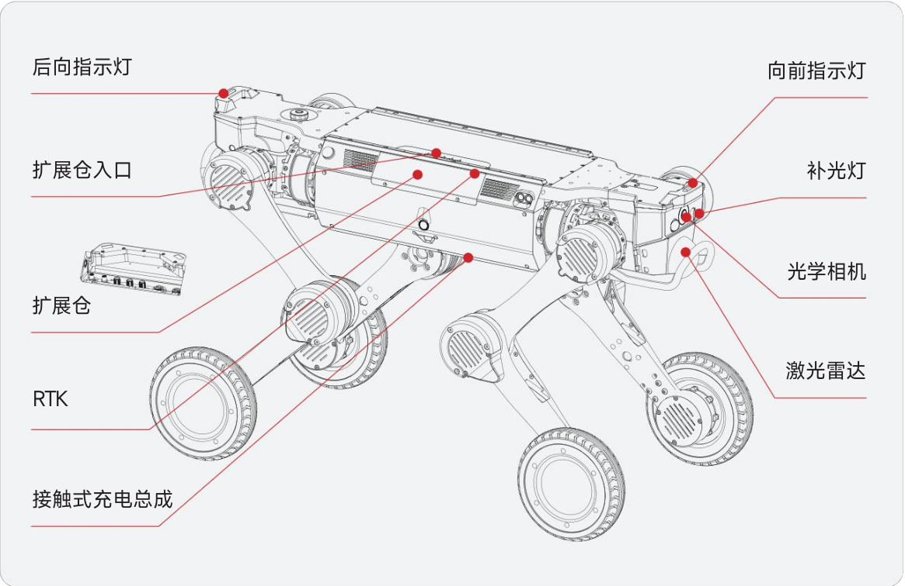

• Artificial parameters

| Parts                  | Parameters  | Value  |
| ---------------------- | ----------- | ------ |
| hip roll               | Max.        | 150N·m |
| Maximum rotation speed | 190RPM      |        |
| Weight                 | 0.93kg      |        |
| joint limit            | -39.9°\~30° |        |
| Hip pitch              | Max.        | 150N·m |
| Maximum rotation speed | 190RPM      |        |
| Weight                 | 0.93kg      |        |
| joint limit            | -140°\~140° |        |
| Kneee pitch            | Max.        | 150N·m |
| Maximum rotation speed | 190RPM      |        |
| Weight                 | 0.93kg      |        |
| joint limit            | -160°\~160° |        |
| Foot (foot)            | Max.        | 33N·m  |
| Maximum rotation speed | 1200RPM     |        |
| Weight                 | 1.275kg     |        |
| Radius                 | 9cm         |        |
| joint limit            | -180°\~180° |        |

#### 1.4 Load loading

**1.4.1 Load installation hole maps**

Quadruped robot back space flattening, load 25-30kg, double-guided back deployment, 14 M4-hole support mounted on two tracks, with the following two-guided dimensions

.png>)

| The robot loads only the basic motion mode, so do not use the high stage mode after loading the load |
| ---------------------------------------------------------------------------------------------------- |

| When loading on the back of a robot, the robot's motor performance may be affected. Please consult the after-sales before loading. |
| ---------------------------------------------------------------------------------------------------------------------------------- |

**1.4.2 Focus limits**

In order to avoid collisions between legs and upper loads during various terrain movements after loading loads on the D1 Max machine, D1 Max ' s upper load space is suggested as follows: 40 cm long, 22 cm wide, 24 cm high, in the middle of the back of the aircraft, as shown in the figure below:

.png>)

#### 1.5 Electrical Expansion Interfaces

.png>)

.png>)

| Serial number | Interface Name                           |
| ------------- | ---------------------------------------- |
| 1             | 48V(10A)                                 |
| 2             | 24V(20A)                                 |
| 3             | 24V(3A)+net                              |
| 4             | 12V(5A)+net                              |
| 5             | Serial (RS232x1, RS485x1, SBUSx2, PPSx1) |
| 6、7           | USB3.0（5V、1A）                            |
| 8             | RTK antenna interface                    |
| 9             | Extension key                            |

| • The total power of all electrical interfaces is within 480 W; • There are navigational plugs equipped with protective covers to ensure that IP67 is in place and non-used jumps are covered; |
| ---------------------------------------------------------------------------------------------------------------------------------------------------------------------------------------------- |

Description of flight plug-in extension interface:

| V3 Machine Device Path | V4 Machine Device Path     |
| ---------------------- | -------------------------- |
| • RS232: /dev/ttyTHS3  | • RS232:/dev/ttyCH9344USB4 |
| • RS485: /dev/ttyTHS1  | • RS485:/dev/ttyCH9344USB5 |
| • SBUS1: /dev/ttyACM2  | • SBUS1:/dev/ttyCH9344USB2 |
| • SBUS2: /dev/ttyACM3  | • SBUS2:/dev/ttyCH9344USB3 |

**1.5.1 Port 48V (10A)**

• Air carrier maps

.png>)

| Name of flight plug | 48V 10A                    |     |
| ------------------- | -------------------------- | --- |
| Liner flight plugin | M12-S4S-GPFM16-135-CS24044 |     |
| Line Definition     | 1                          | GND |
| 2                   | 48V                        |     |
| 3                   | 48V                        |     |
| 4                   | GND                        |     |

• Plug-in beams

.png>)

**1.5.2 Power source 24V (20A)**

• Sea-plugging carrier

.png>)

| Name of flight plug | 24V 20A                    |     |
| ------------------- | -------------------------- | --- |
| Liner flight plugin | M12-S4S-GPFM16-135-CS24044 |     |
| Line Definition     | 1                          | GND |
| 2                   | 24V                        |     |
| 3                   | 24V                        |     |
| 4                   | GND                        |     |

• Plug-in beams

.png>)

**1.5.3 Net (24V)**

• Sea-plugging carrier

.png>)

| Name of flight plug | Net +24V         |     |
| ------------------- | ---------------- | --- |
| Liner flight plugin | M12- P12A-GPFM12 |     |
| Line Definition     | 1                | GND |
| 2                   | 24V              |     |
| 3                   | 24V              |     |
| 4                   | Net A+           |     |
| 5                   | Net A-           |     |
| 6                   | Net B+           |     |
| 7                   | Net B-           |     |
| 8                   | Net C+           |     |
| 9                   | Net C-           |     |
| 10                  | GND              |     |
| 11                  | Net D+           |     |
| 12                  | Net D-           |     |

• Plug-in beams

.png>)

**1.5.4 Net (12V)**

• Sea-plugging carrier

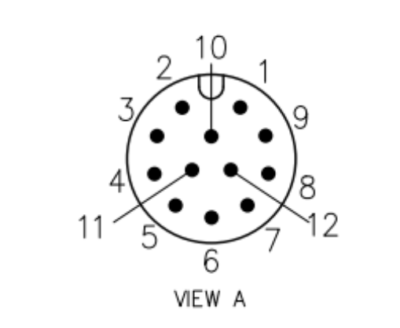

| Name of flight plug | Net +12V         |     |
| ------------------- | ---------------- | --- |
| Liner flight plugin | M12- P12A-GPFM12 |     |
| Line Definition     | 1                | GND |
| 2                   | 12V              |     |
| 3                   | 12V              |     |
| 4                   | Net A+           |     |
| 5                   | Net A-           |     |
| 6                   | Net B+           |     |
| 7                   | Net B-           |     |
| 8                   | Net C+           |     |
| 9                   | Net C-           |     |
| 10                  | GND              |     |
| 11                  | Net D+           |     |
| 12                  | Net D-           |     |

• Plug-in beams

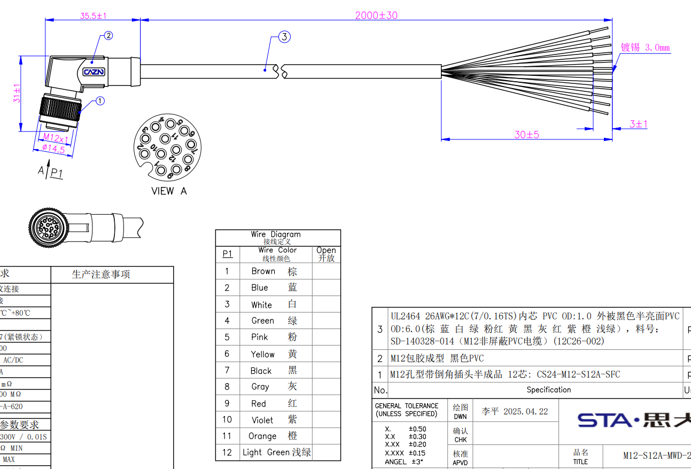

**1.5.5 Serial**

• Sea-plugging carrier

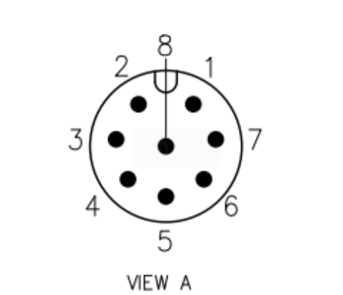

| Flight plugin 3     | Serial (RS232, RS845, SBUS\*2, PPS) |     |
| ------------------- | ----------------------------------- | --- |
| Liner flight plugin | M12- P8A-GPFM12                     |     |
| Line Definition     | 1                                   | PPS |
| 2                   | SBUS1                               |     |
| 3                   | SBUS2                               |     |
| 4                   | RS485A                              |     |
| 5                   | RS485B                              |     |
| 6                   | RS232\_TX                           |     |
| 7                   | RS232\_RX                           |     |
| 8                   | GND                                 |     |

• Plug-in beams

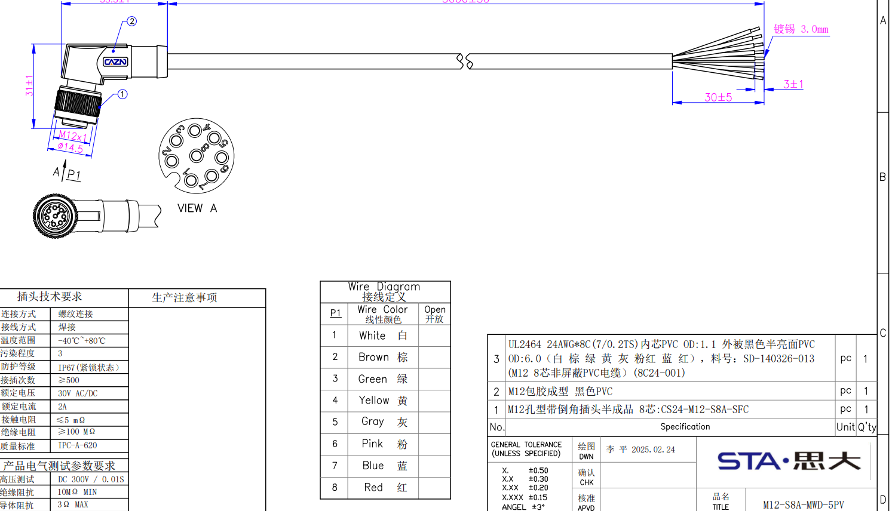

**1.5.6 USB mouth**

• Sea-plugging carrier

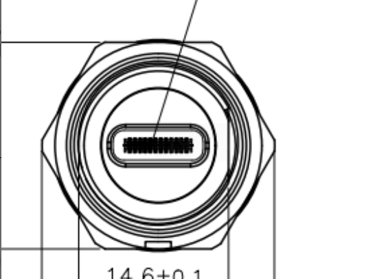

| Name of flight plug | USB3.0+5V Two |
| ------------------- | ------------- |
| Liner flight plugin | E10B- FT3-PPF |
| Line Definition     | None          |

• Plug-in beams

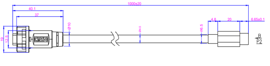

### II. SDK development guide

#### 2.1 Introduction to SDK

• This document describes D1 Max's software development toolkit (SDK) and provides detailed information on its core service interface, including the high-level movement control interface, the IMU customary data interface and the electrical status data interface.

• Each chapter presents the method of calling different service interfaces, standard format definitions for data input/output and examples of some functional development.

• The definition of interface will vary with the development of the mass product, depending on the latest version of the interface definition document.

• The SDK program has a specific protocol for communication with the dog's own program, so there are differences between different versions of the SDK program and the dog's own program. Select the corresponding version of the SDK program according to the device version. If conditions permit, it is recommended that the internal dog program be updated to the latest version to achieve better compatibility.

• When the SDK interface is controlled, the entire state is designed by a secondary developer and no additional intervention and state jumps are performed by the HMO.

• When running SDK, please ensure that the system is adequately resourced, otherwise there may be cases where the motion control module has failed.

#### 2.2 List of sdk software service interfaces

| Serial number | Interface Name                                          | Functions                                                                                                      | SDK Version                                              |
| ------------- | ------------------------------------------------------- | -------------------------------------------------------------------------------------------------------------- | -------------------------------------------------------- |
| 1             | High-level movement control interface                   | High-level motor control of robots and dogs, including back-to-back velocity, down, spin, limbs standing, etc. | V0.0.2                                                   |
| 2             | Video streaming data interface                          | Push camera home stream to client                                                                              | V0.0.2                                                   |
| 3             | Device status service interface                         | Query and obtain information on the current state of equipment and the use of system resources                 | V0.0.3                                                   |
| 4             | Insistence Data Interface                               | Fetch IMU raw data information                                                                                 | V0.0.4                                                   |
| 5             | Ultrasound radar interface                              | Achieving autonomous shielding                                                                                 | v0.0.5                                                   |
| 6             | Remote control and sdk control switch and sdk Interface | Achieving a control switch                                                                                     | v0.0.6                                                   |
| 7             | SDK interface for RTK modules                           | Achieving autonomous positioning                                                                               | v0.0.6                                                   |
| 8             | Auto-charge and sdk interface                           | Achieving autonomous charging                                                                                  | v0.0.8                                                   |
| 9             | slam build diagram navigation and sdk interface         | Achieving autonomous navigation                                                                                | Not online, currently available for LiDAR ROS2 interface |

#### 2.3 Security protection mechanisms

**2.3.1 Hard stoppage**

• Trigger: press the body stop button

• Effects: quadruped robots slowly and red lights on

• Indicator light status

o When pressed: red light

○ After release: green light

• Recovery: self-recovering of systems (if no other malfunctions) after pressing the buttons

**2.3.2 Soft stoppage**

• Trigger method: trigger by remote controller or touch by sdk interface Fire!

• Effect: robots stop immediately and no longer respond to any control instructions

• Recovery: return to normal operation after short-term contact

| From version V0.0.6 sdk to support remote controller and sdk control switch, if the device is to be activated softly during the sdk control phase, it must be activated by click after the sdk has taken control, and then the remote controller is available at any time. The upper red stop button triggers a soft stop, triggers a soft stop, the quadruped robot displays a red light, maintains its current posture and no longer responds to any control instructions. |
| ---------------------------------------------------------------------------------------------------------------------------------------------------------------------------------------------------------------------------------------------------------------------------------------------------------------------------------------------------------------------------------------------------------------------------------------------------------------------------- |

**2.3.3 Internal abnormal protection (automatic trigger)**

The following will trigger internal protection mechanisms, robots will stop automatically and slowly

• Remotely-controlled signal failure (including network blockage) and resumption of reconnection to APP

• Batteries in position but < 10% electricity

• Artificial failure

• Interrupted IMU (inertial measurement unit) communications

#### 2.4 Environmental Dependence

* Operating system: Ubuntu 22.04
* Build tools: CMake 3.8+, GCC 11+
* Reliance library: Boost 1.74+
* Programming language: C++

#### 2.5 Equipment login

Network connections

• Wi-Fi connection login

```
￮ Wi-FiName:XG2WIFI_xxxxxx
```

```
￮ Wi-FiPassword:12345678
```

• Wireless connection

○Use of webwire to connect quadruped robot extension portals and control ports PC

○ Set the control port PC portal IP is 192.168.168.x (not fit 192.168.168.168.168 and 192.168.168.100)

Ssh Login

| Plain Text #Wi-Fi connects ssh robot@192.168.234.1 #RK3588, password: bot # connects ssh robot@192.168.168.168 #rk3588, password: botssh robot@192.168.168.100 #Orin NX, password: 1 |
| ------------------------------------------------------------------------------------------------------------------------------------------------------------------------------------ |

| • The RK3588 calculator is responsible for functions such as movement control and system monitoring, and does not develop applications — Orin NX complimentary is responsible for business functions such as charting, positioning, navigation, etc., where users can develop light quantification applications, back-up management, brushing or OTA upgrades may be updated |
| ---------------------------------------------------------------------------------------------------------------------------------------------------------------------------------------------------------------------------------------------------------------------------------------------------------------------------------------------------------------------------- |

#### 2.6 SDK Access

**2.6.1 Version queries**

Following ssh access to the quadruped robot body and query the corresponding version of the information, the search will be followed by the technical support team to obtain the corresponding SDK installation package and illustrative code after distribution of the search dog firmware version.

| #password: bot cat/opt/release/version.yaml #ssh robot@192.168.168.100 #password: 1cat/opt/release/version.yaml #nx corresponding firmware version |
| -------------------------------------------------------------------------------------------------------------------------------------------------- |

**2.6.2 SDK for firmware version**

way1: Please send a screenshot to your technical support colleagues for the corresponding version of sdk after searching for the version number Package

Go: Get it through the github address below

| Bash git clone https://github.com/AgibotTech/Agibot\_D1\_Max.git |
| ---------------------------------------------------------------- |

#### 2.7 Example: Demo running steps

At local PC end, enter to sdk file Medium

| ..make-j6# running demo example./example data 192.168.168.168.8081#wire connection./example data 192.168.234.1 8081#wireless connection |
| --------------------------------------------------------------------------------------------------------------------------------------- |

| The remote-dkend application must exit before running the sdk control, otherwise the sdk cannot control the action of the device and must read the source file before running the demo file |
| ------------------------------------------------------------------------------------------------------------------------------------------------------------------------------------------- |

#### 2.8 SDK control statement

• The launch of the sdk command requires a logical jump from the state below, otherwise it may result in abnormal circumstances such as a machine falling, failure or failure to respond.

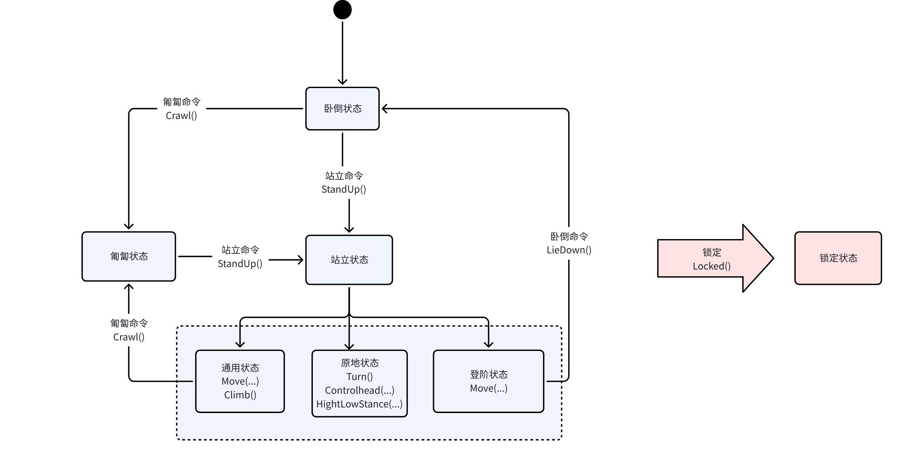

| Note: 1. When a stand-up command is issued, when the stand-up is completed, it will automatically switch to general state or state-of-the-ground 2. |
| --------------------------------------------------------------------------------------------------------------------------------------------------- |

• The process of issuing SDK orders is as follows:

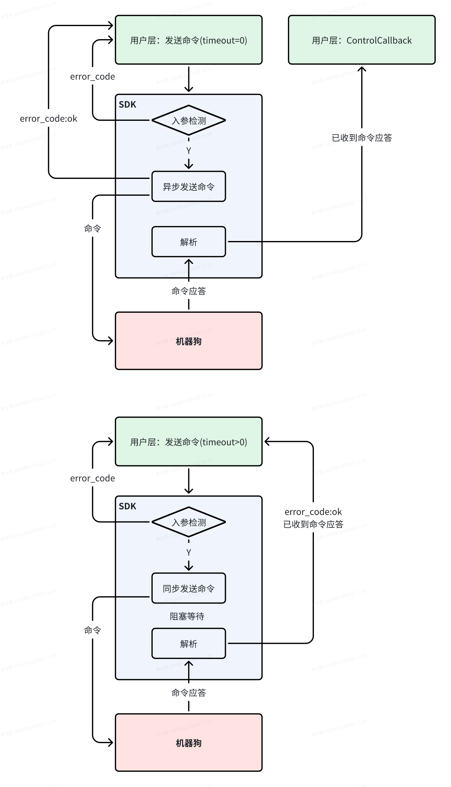

#### 2.9 Customs naming norms

To facilitate identification and debugging, this device follows the following naming rules:

• Acronyms

f = front (former)

b = back

ol = left

o r = right

• Meaning of numbering

o 1 = hip roll

02 = hip pitch

o 3 = kneee pitch

° 4 = foot

• Example naming

fl hip roll: right front leg 1 joint (thirty rolling)

° bl3 knee pitch: 3rd joint of the left rear leg (Knees down)

| Plain Text front leg #Front right leg #right front legback #back legbackback legback right leg # right rear leg #fl1 hip roll #hip pitch #left front 1 fl3 knee pitch #fl4 foot #left front 3 fr1 hip roll #left #fr1 hip roll #left 1 fr1 hip rop pitch #left #fr1 pitch #left 1 fr2 hip pitch pitch #right #3 # fr3 #r2 fr3 foot # right fr4 kne #r3 # fr4 # fr4 rbret #brich1 bref # right #2 #b3 #p3 # right #p3 #p1 #brich #b3 #b3 #p3 #p3 # |
| ------------------------------------------------------------------------------------------------------------------------------------------------------------------------------------------------------------------------------------------------------------------------------------------------------------------------------------------------------------------------------------------------------------------------------------------------- |

#### 2.10 Direction of the body coordinates

When each joint is zero degrees, the coordinates are shown below. Red is x-axis, green is y-axis and blue is z-axis. Please refer to the chart below for the rotation axis and the direction of the joint.

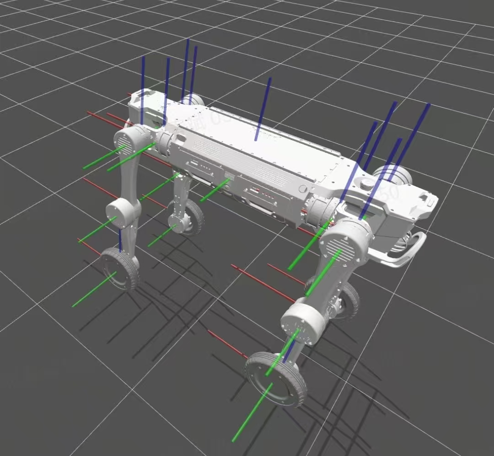

### 3. SDK Function Reference

Detailed interface description, see the corresponding version of the sdk description document:

```
https://github.com/AgibotTech/Agibot_D1_Max/blob/main/docs/sdk_client_api.md
```

### 4. Additional Services

#### 4.1 Video Streaming Service

Videos of the wide-angle cameras are pushed to the following URLs by Gstreamer:

| Plain Text front camera: rrtsp://192.168.234.1.8554/front rear camera: rrtsp://192.168.234.18554/back |
| ----------------------------------------------------------------------------------------------------- |

The default displays real-time images on the side pull side of the remote, previewing and calling via VLC or OpenCV

#### 4.2 LiDAR Data Interface

#### 1. ROS2 interface definition

| topic                                                                         | msg                                                                  | Field Type                                                             | Fields | Field Interpretation    | Initial value \[v] | Value range | Sending cycle |
| ----------------------------------------------------------------------------- | -------------------------------------------------------------------- | ---------------------------------------------------------------------- | ------ | ----------------------- | ------------------ | ----------- | ------------- |
| Former radar spot cloud data: /front lidar post-radar cloud data: /real lidar | sensor msgs::msg::PointClaud2 (Data Services ModelQos:::best effort) | std\_msgs/Header                                                       | header | ROS2 Standard MSG Frame |                    |             | 10hz          |
| uint32                                                                        | height                                                               | Vertical height (lines) of light cloud                                 |        |                         |                    |             |               |
| uint32                                                                        | width                                                                | Horizontal width (columns) of clouds                                   |        |                         |                    |             |               |
| PointField\[]                                                                 | fields                                                               | Field description for each channel in a cloud                          |        |                         |                    |             |               |
| bool                                                                          | is\_bigendian                                                        | Whether it is a large byte order                                       |        |                         |                    |             |               |
| uint32                                                                        | point\_step                                                          | Bytes per Point                                                        |        |                         |                    |             |               |
| uint32                                                                        | row\_step                                                            | Bytes occupied by one line of data                                     |        |                         |                    |             |               |
| uint8\[]                                                                      | data                                                                 | The original binary data of the light cloud is a one-dimensional array |        |                         |                    |             |               |
| bool                                                                          | is\_dense                                                            | Whether it is a dense cloud (i.e. no ineffective point)                |        |                         |                    |             |               |

| Former LiDAR IP: 192,168.1.102 Post LiDAR IP: 192,168.2.102 |
| ----------------------------------------------------------- |

#### 2. Commencement of corresponding drivers

| Plain Text # #nXssh robot@192.168.168.100 # password: #1# View process robot-launch list# |
| ----------------------------------------------------------------------------------------- |

#### 4.3 Ultrasound radar signal interface

| topic                                                                                                 | msg                      | Field Type                                                                      | Fields | Field Interpretation    | Initial value \[v] | Value range | Sending cycle |
| ----------------------------------------------------------------------------------------------------- | ------------------------ | ------------------------------------------------------------------------------- | ------ | ----------------------- | ------------------ | ----------- | ------------- |
| Left ultrasound radar: /uss driver/uss left/range Right ultrasound radar: /uss driver/uss right/range | sensor\_msgs::msg::Range | std\_msgs/Header                                                                | header | ROS2 Standard MSG Frame |                    |             | 10hz          |
| uint8\_t                                                                                              | radiation\_type          | Sensor type. Element count: 0 ultrasound 1 infrared Line                        | 0      | 0-1                     |                    |             |               |
| float                                                                                                 | field\_of\_view          | Sensor field of vision angle (radians), usually the angle of the conical region | 0      | Current fixed to 0      |                    |             |               |
| float                                                                                                 | min\_range               | Sensor can measure minimum distance (m)                                         | 0      | Current fixed to 0      |                    |             |               |
| float                                                                                                 | max\_range               | Maximum distance to be measured by sensors (m)                                  | 0      | Current fixed to 0      |                    |             |               |
| float                                                                                                 | range                    | Current actual measured distance (m)                                            | 0      | 0-4 meters              |                    |             |               |

#### 4.4 Onboard Sensor Coordinates

| Sensor Name                            | Sensor coordinates (relative to BASE original point) (unit mm) | Remarks |       |                                  |
| -------------------------------------- | -------------------------------------------------------------- | ------- | ----- | -------------------------------- |
| x                                      | y                                                              | z       |       |                                  |
| IMU ICM42688 (transport control)       | 0                                                              | 0       | 36.2  |                                  |
| IMU LUA300C (Car Code)                 | 0                                                              | 0       | 56.9  | No solidware currently developed |
| Former LiDAR AIRY                      | 404.3                                                          | 0       | -37.7 | See the specifications.          |
| Front camera IMX415                    | 412.3                                                          | 0       | 37.8  | See the specifications.          |
| Front right light patch                | 420.3                                                          | -30.9   | 28.3  | Exposure range 120°              |
| Front left patch                       | 420.3                                                          | 30.9    | 28.3  | Exposure range 120°              |
| Back LiDAR AIRY                        | -404.3                                                         | 0       | -37.7 | See the specifications.          |
| Back camera IMX415                     | -412.3                                                         | 0       | 37.8  | See the specifications.          |
| Back right light.                      | -420.3                                                         | -30.9   | 28.3  | Exposure range 120°              |
| Back left light.                       | -420.3                                                         | 30.9    | 28.3  | Exposure range 120°              |
| Right-front ultrasound radar RADAR A22 | 179.2                                                          | -100.2  | 50    | See the specifications.          |
| Left-front ultrasound radar RADAR A22  | 179.2                                                          | 100.2   | 50    | See the specifications.          |

Click the image to view the sheet.

#### 4.5 RTK use instructions

**4.5.1 Access to RTK services in six minutes**

Login from registered six-point account and password to official network

Website: https://www.sixths.com/login

• Login to the console

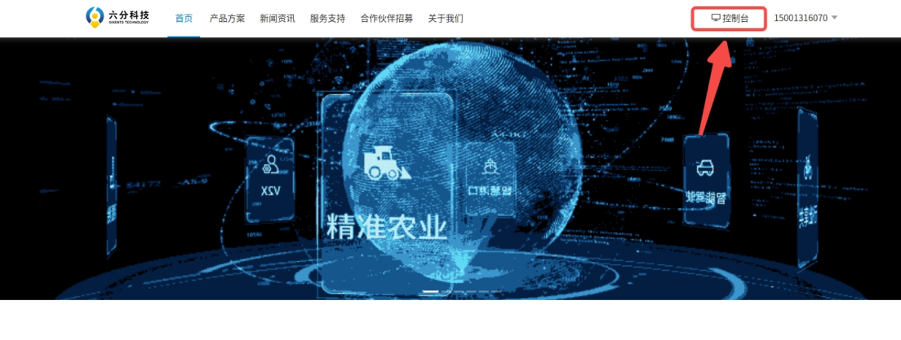

• Access to AK and AS

Prepare AK and AS for use.

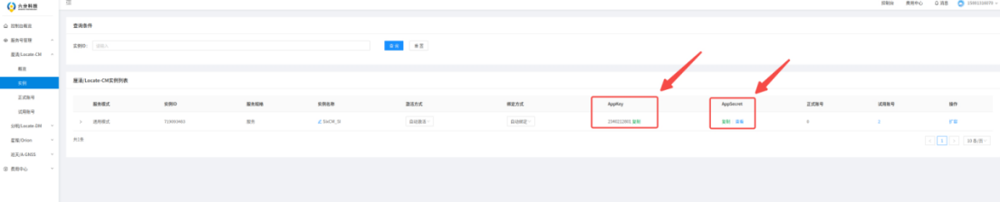

**4.5.2 Configuration**

• Login into NX

The first thing we need to do is connect to the WIFI.

| # Password is bot |
| ----------------- |

• Open profile

```
Profile path:/ota/sixents_config.ini
```

| Bash sudo vim /ota/sixents\_config.ini |
| -------------------------------------- |

| TOML profile description \[sixents sdk]sdk ak = sdk as = sdk dev id = sdk dev type = |
| ------------------------------------------------------------------------------------ |

• sdk ak: Sets the AK for your purchase of service cases

• sdk as: Sets the AS for your purchase of service cases

• sdk dev id: Set your device ID or SN (Customized)

• sdk dev type: Set your device type (customly defined)

Note: sdk dev id and sdk dev type are the only ones bound to the account and then change the other needs to untie the network

**4.5.3 RTK Topic Description**

• Rtk topic name

```
rtkCorresponding phrase:/rtk_pvh
```

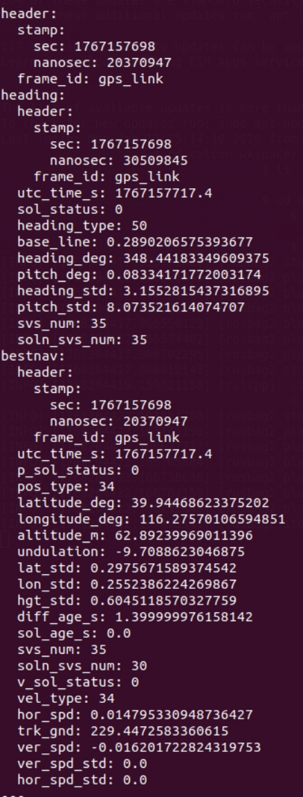

• Description of data

| Category       | Fields                                                                                                                                                        | Annotations      |
| -------------- | ------------------------------------------------------------------------------------------------------------------------------------------------------------- | ---------------- |
| heading        | utc\_time\_s                                                                                                                                                  | Heading UTC Time |
| sol\_status    | Dissolved status • 0: Unsolved — 1: Insufficient observation — 2: Unincumbered — 4: A matrix of concerted differences exceeds maximum value (trace > 1,000 m) |                  |
| heading\_type  | Positioning type. 0: No decomposition. 16: single-point positioning. 17: pseudo-range location. 34: floating-point resolution. 50: integer resolution         |                  |
| base\_line     | Baseline length, square metres (0-3000)                                                                                                                       |                  |
| heading\_deg   | Point angle, unit (0\~360)                                                                                                                                    |                  |
| pitch\_deg     | Altitude, unit (±90)                                                                                                                                          |                  |
| heading\_std   | Standard deviation, unit                                                                                                                                      |                  |
| pitch\_std     | Substrate standard deviation, unit                                                                                                                            |                  |
| sys\_num       | Satellites tracked                                                                                                                                            |                  |
| soln\_svs\_num | Satellites involved in calculation                                                                                                                            |                  |
| bestnav        | utc\_time\_s                                                                                                                                                  | Bestpos UTC time |
| p\_sol\_status | Solved Status                                                                                                                                                 |                  |
| pos\_type      | Position type                                                                                                                                                 |                  |
| latitude\_deg  | Latitude, degrees                                                                                                                                             |                  |
| longitude\_deg | Longitude, unit                                                                                                                                               |                  |
| altitude\_m    | Altitude, millimetres.                                                                                                                                        |                  |
| undulation     | Geodetic differences, differences between geodial and WGS84 reference ellipse, in millimetres                                                                 |                  |
| lat\_std       | Latitude standard deviation, millimetres                                                                                                                      |                  |
| lon\_std       | Longitude standard deviation, millimetres                                                                                                                     |                  |
| hgt\_std       | Altitude standard deviation, millimetres                                                                                                                      |                  |
| diff\_age\_s   | Age difference, in seconds                                                                                                                                    |                  |
| sol\_age\_s    | Age, unit of seconds                                                                                                                                          |                  |
| svs\_num       | Satellites tracked                                                                                                                                            |                  |
| soln\_svs\_num | Satellites involved in calculation                                                                                                                            |                  |
| v\_sol\_status | Solved Status                                                                                                                                                 |                  |
| vel\_type      | Position type                                                                                                                                                 |                  |
| hor\_spd       | Horizontal direction-to-ground speed, in m/s                                                                                                                  |                  |
| trk\_gnd       | Unit, relative to the actual orientation of the north                                                                                                         |                  |
| ver\_spd       | Vertical direction speed, in m/s. Positive value indicates direction up, negative value means direction Down                                                  |                  |
| ver\_spd\_std  | Standard difference for vertical direction speed (unfilled)                                                                                                   |                  |
| hor\_spd\_std  | Standard deviation of horizontal orientation to Earth speed (not completed)                                                                                   |                  |

**4.5.3 Restart rtk services**

• View current services

| TOML robot-launch list |
| ---------------------- |

• Restart services

| TOML robot-launch restart 4 #id 4 services corresponding to driver-gps |
| ---------------------------------------------------------------------- |

• Reactivation of NX

| TOML sudo reboot |
| ---------------- |

#### 4.6 IMU data

There are currently three IMUs (2 radar + 1 independent) in the current system, sending data through topic, standard ROS2 data type Sensor msgs: msg:Imu

```
Former RadarIMU：/front_lidar/imu
```

```
Back RadarIMU：/rear_lidar/imu
```

```
IndependenceIMU：/imu_driver/imu_central
```

| Note: The independent IMU addresses the issue of hardware changes, and if data are not available, contact the after-sale service provider. |
| ------------------------------------------------------------------------------------------------------------------------------------------ |

#### 4.7 Camera data

Camera data from RK3588, topic name:

```
• Front: /front_camera/image_compressed
```

```
• Back: /rear_camera/image_compressed
```

### V. Debugging instructions

#### 5.1 ROS2 Multi-Mechanical Communication Configuration

```
NXThe system has a uniform configuration of environmental variables:/opt/runtime/env.bash, This variable is.bashrcMedium Default Import
```

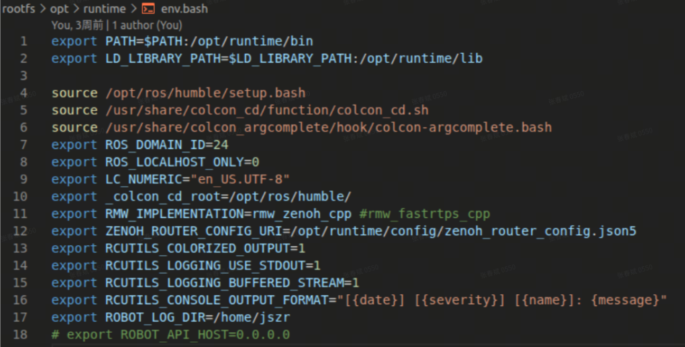

```
Photo from the above.ROS_DOMAIN_ID=24 The quadruped robot is currently in use. ROS 2 Yes. zenoh Intermediate is available externally ROS 2 topic Services that require users to install the environment in their own notebooks.
```

**5.1.1 IP Configuration**

Configure user notebook ip to: 192,168.168.xx (xx cannot be 100 or 168 or 255)

**5.1.2 User laptop environment configuration**

• Ubuntu22.04

• ROS 2 humble

• Zenoh rmw

**5.1.3 Installation of zenoh**

| Plain Text sudo apt-get install ros-humble-rmw-zenoh-cpp |
| -------------------------------------------------------- |

**5.1.4 Modification of profile**

Open the following file with the editor

```
/opt/ros/humble/share/rmw_zenoh_cpp/config/DEFAULT_RMW_ZENOH_ROUTER_CONFIG.json5
```

Found connecet/endpoints field to write and save the IP of the quadruped robot NX:

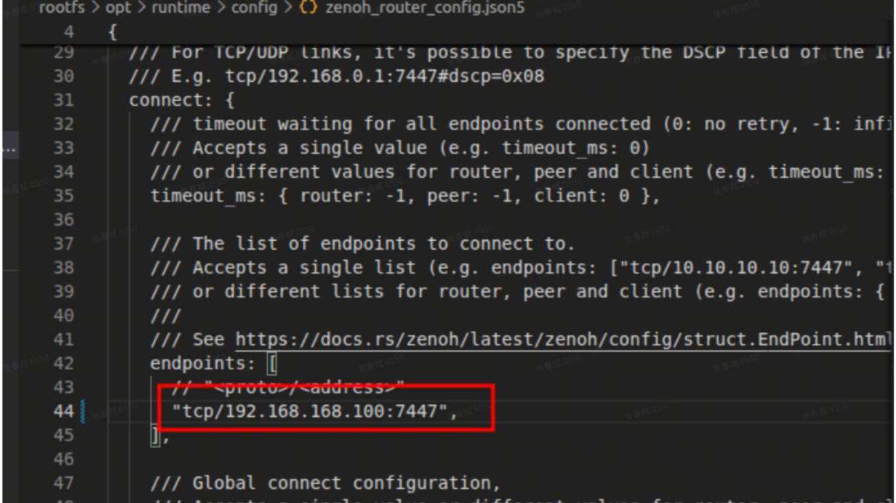

| Plain Text "tcp/192.168.168.100:7447" |
| ------------------------------------- |

New terminal 1 at pc end, setting the intermediate toggle environment variable and Domain ID for ROS2

| Plain Text source /opt/ros/humble/setup.bashexport ROS\_DOMAIN\_ID=24export RMW\_IMPLEMENTATION=rmw\_zenoh\_cppROS 2 run rmw\_zenoh\_cpp rmw\_zenohd |
| ---------------------------------------------------------------------------------------------------------------------------------------------------- |

Reset ROS2 background daemon

| Plain Text ROS 2 daemon stopROS 2 daemon start |
| ---------------------------------------------- |

Use rviz to visualize, package, or start your own ROS 2 program to interact with the driver in the dog if the above environment variable is valid.

### Official Resources

[Official AGIBOT development guide](https://www.agibot.com.cn/filepage/326/detail/40.html)

[Official AGIBOT downloads and software packages](https://www.agibot.com.cn/filepage/331.html)
