# AGIBOT G2 User Manual

### AGIBOT G2 Wheeled Humanoid Robot for Service Robotics



### AgiBot G2 Data Acquisition System



Related operating chapters 13. Teleoperation and 14. Data Collection.

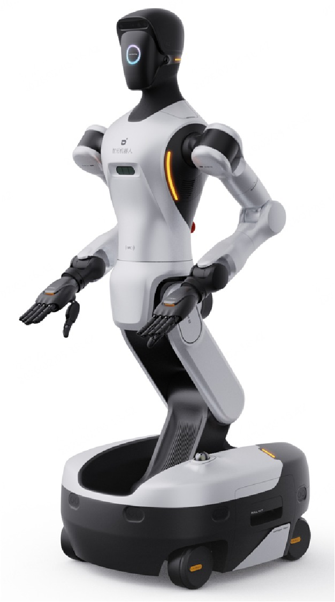

AGIBOT G2 wheeled humanoid robot

### Contents

* [Preface and safety](agibot-g2-user-manual.md#preface)
* [Product overview](agibot-g2-user-manual.md#id-1.-product-overview)
* [Components and interfaces](agibot-g2-user-manual.md#id-2.-components)
* [Wireless terminal](agibot-g2-user-manual.md#id-5.-wireless-terminal)
* [Product specifications](agibot-g2-user-manual.md#id-7.-product-specifications)
* [Basic configuration](agibot-g2-user-manual.md#id-8.-basic-configuration)
* [Intelligent interaction](agibot-g2-user-manual.md#id-9.-intelligent-interaction)
* [Emergency stop](agibot-g2-user-manual.md#id-10.-emergency-stop-e-stop)
* [Remote and joint control](agibot-g2-user-manual.md#id-11.-remote-control)
* [Teleoperation](agibot-g2-user-manual.md#teleoperation)
* [Data collection](agibot-g2-user-manual.md#id-14.-data-collection)
* [Software upgrade](agibot-g2-user-manual.md#id-15.-software-upgrade)

### Key Fault and Safety Index

* [Low battery, charging, emergency-stop, and severe-fault indicators](agibot-g2-user-manual.md#id-9.2-light-indicator)
* [Critical-fault and emergency-stop display expressions](agibot-g2-user-manual.md#id-9.3-expressions)
* [Soft and hard emergency-stop procedures](agibot-g2-user-manual.md#id-10.-emergency-stop-e-stop)
* [Teleoperation network anomalies and disconnection](agibot-g2-user-manual.md#network-requirements)
* [Upgrade power warning](agibot-g2-user-manual.md#id-15.-software-upgrade)

### Update Log

| Date       | Version | Update                                                                                                                                                                                                             |
| ---------- | ------- | ------------------------------------------------------------------------------------------------------------------------------------------------------------------------------------------------------------------ |
| 2025-12-04 | 0.13    | Initial setup.                                                                                                                                                                                                     |
| 2026-01-22 | 0.14    | Wireless Terminal: added usage instructions. Teleoperation: added network requirements.                                                                                                                            |
| 2026-01-23 | 0.15    | Maintenance Bay: added interface descriptions. Remote Control: simplified walking instructions.                                                                                                                    |
| 2026-01-30 | 0.16    | Product List: updated images and removed the end effector. Maintenance Bay: updated component images. Teleoperation: removed edge-side configuration.                                                              |
| 2026-02-10 | 0.18    | Product Overview: added joint range of motion. Wireless Terminal: added the no-hot-plugging warning. Intelligent Interaction: updated to the latest version. Software Upgrade: added the do-not-power-off warning. |
| 2026-02-11 | 0.19    | Data Collection: added offline collection mode. Development Tools: added the mobile app.                                                                                                                           |
| 2026-02-12 | 0.20    | Basic Configuration: added serial-number and device-name management and language switching.                                                                                                                        |
| 2026-02-14 | 0.21    | Safety: added Emergency Stop (E-Stop) instructions.                                                                                                                                                                |
| 2026-02-28 | 0.22    | Maintenance Bay: removed the PoE function; updated port names, images, and tables; added the surge-protector requirement for wall and floor network connections.                                                   |

### Preface

Thank you for purchasing AGIBOT G2 Wheeled Humanoid Robot (hereinafter referred to as the “G2”). the product is a general-purpose wheeled-chassis humanoid robot developed by AGIBOT Innovation (Shanghai) Technology Co., Ltd.

(hereinafter referred to as the “Company”) for industrial, commercial, entertainment, and scientific research applications.

Before operating or maintaining G2, please read this manual carefully and strictly follow all instructions, so as to fully utilize its functions and extend its service life. If you have any comments or suggestions, please feel free to contact us. We will provide you with prompt and dedicated service.

Due to ongoing product improvements, different versions of the Product may vary in specific operations. This manual is provided for end-user reference only. AGIBOT reserves the right to modify this manual and the right of final interpretation of its contents.

### Precautions

#### Important Safety Instructions

Before operating and maintaining this product, please be sure to carefully read all instructions in this manual and strictly comply with the relevant requirements.

Products of different versions may have differences in specific operations, and this manual is for reference only by end users. Our company reserves the right to modify and interpret the content of this manual.

> **Caution:** Please read this manual carefully before using the product. **Warning:** Please read all safety warnings and operating instructions. Failure to follow

these instructions may result in electric shock, fire, or serious personal injury.

#### Usage Environment

1. Ensure that the robot operates within an ambient temperature range of 0°C to 40°C and relative humidity below 80% RH.
2. Use the robot indoors only.

#### Before Using the Product

1. Check that all robot components are in good condition and free from damage or looseness.
2. Check whether the robot’s emergency stop button is functioning properly.
3. Check whether there are any alarm messages displayed on the robot’s wireless terminal.
4. Check whether any unauthorized accessories or devices have been installed on the robot.

#### During Use

1. Please ensure that the robot operates within the rated load range to avoid overloading.
2. Please ensure that the end effector carried by the robot is used correctly to avoid damage.
3. Please ensure that the robot is used on a flat surface. If the robot needs to go up or down a slope, please ensure that the slope ≤ 5%.
4. Non-professional personnel must not disable or turn off the robot’s active safety features.
5. In case of an emergency, immediately press the emergency stop button on the robot to stop its movement.
6. Do not interfere with the robot’s actions while it is operating.
7. Do not touch areas on the robot’s surface where torso parts may be pinched, such as the armpits, inner sides of the elbows, crotch/hip area, and other joint gaps.
8. Do not place your feet near the robot’s wheels to avoid being run over while the robot is walking or rotating.
9. Do not stand between the robot and a nearby wall or fixed object to avoid being squeezed when the robot moves.
10. Do not treat the robot as a toy. When children are present near the robot, pay special attention to safety and keep them at a safe distance.
11. Create individual user accounts for all robot operators and ensure that each operator remembers and securely manages the username and password of their own account.

#### After Use

1. Store the robot in the designated location and avoid leaving it on a slope.
2. When not in use for an extended period, please turn off the robot's power.

#### Product Maintenance

1. Please perform regular maintenance on the robot according to the maintenance recommendations provided by AGIBOT Company to ensure that the robot always operates in optimal condition.
2. If a fault occurs while the robot is operating, stop operation immediately and contact qualified technical personnel for inspection and repair.
3. It is strictly forbidden to perform any maintenance work on the robot torso while the robot is in operation.
4. Before performing any maintenance on the robot torso, press the emergency stop button to ensure that the robot cannot move.
5. Before carrying out any maintenance work involving electrical circuits, power off the robot first, and then proceed with subsequent operations.
6. Update the robot's software version in a timely manner to prevent security risks caused by software vulnerabilities.
7. Do not use accessories or replacement parts other than those specified by the manufacturer.
8. Do not disassemble the product by yourself.
9. Do not modify the original design or configuration of the product without authorization. Any modification must be approved by the manufacturer.
10. Do not attempt to maintain the robot's sensors or control system by yourself.
11. Do not charge the battery beyond the product's specified operating temperature range or in an environment with excessive humidity, to avoid damaging the battery or increasing the risk of fire.
12. Before the device is scrapped, the battery should be removed first, and then safely and compliantly recycled or disposed of.
13. CAUTION: When charging the battery, do not use any charger other than the original UY900 charger supplied with the product.

#### Product Handling

1. Turn off the robot’s power before moving the robot.
2. For long-distance transportation of the robot, use the official flight case or wooden crate provided by the manufacturer. During packing, use wooden boards, foam, packing straps, and other materials to secure the robot properly. Avoid severe jolts or vibrations during transportation to prevent damage to the product.
3. CAUTION: The product and its packaging are heavy and may pose a risk of crushing or pinching. Wear appropriate protective equipment when handling.

#### Product Storage

1. Please store this product indoors.
2. Please store the robot in an environment with a temperature between -30°C and 60°C.
3. Charge the battery to full at least once every 60 days to avoid degradation of battery life.
4. If the Product will be out of service for more than one week, ensure that the battery level is at least 60% before shutting it down, and turn off the robot’s main power supply.

### 1. Product Overview

#### 1.1 Product Introduction

AGIBOT G2 is a general-purpose humanoid robot built to industrial-grade standards, featuring excellent mobility, perception, and interaction capabilities. It is suitable for industrial, commercial, entertainment, and scientific research scenarios.

The robot is equipped with high-performance joint actuators, a variety of sensors, and high-performance domain control units, enabling omnidirectional obstacle avoidance in full scenarios, high-precision force-controlled operations, and real-time multi-person intelligent interaction.

When used together with the data acquisition & teleoperation kit and the charging dock, the robot can be extended to support data collection, beyond-visual-range teleoperation, and autonomous recharging. In addition, the robot provides a rich set of SDKs and secondary-development interfaces, supporting feature expansion and customized development.

#### 1.2 Key Features

* High-precision force-controlled operations The robot is equipped with two industrial-grade robotic arms with 7 degrees of freedom, a rated load of 5 kg, and joint torque sensors. It can perform high-precision force-controlled operations, achieving high-precision force-controlled tasks such as hole searching, insertion, and leveling. This design improves the robot's operation accuracy to the sub-millimeter level, effectively expanding the application scenarios of humanoid robots.
* Highly human-like working motions The robot features a 3-DOF waist and a 2-DOF folding lift design in the legs. It can perfectly imitate human waist and leg movements, enabling highly human-like, coordinated upper- and lower-limb operations. When deployed in industrial or commercial environments, the robot can adapt to workspaces originally designed for humans, with full reach coverage and human-like postures, without the need for additional environmental modification-improving deployment efficiency while greatly

reducing overall deployment costs.

* Omnidirectional mobile chassis The chassis adopts a four-steering-wheel design. In addition to conventional forward, backward, and turning motions, it also supports omnidirectional crab walking. Crab walking effectively reduces the number of turns required during walking and carrying items, avoiding extra time loss due to acceleration and deceleration when turning, and thus improving overall passage efficiency. The chassis supports a maximum speed of 1.5 m/s and a maximum obstacle-crossing height of 3 cm, allowing it to adapt to a wide range of floors in industrial and commercial environments.
* Intelligent voice interaction The robot is equipped with a microphone array combined with 360° visual perception, enabling precise target pickup based on facial recognition and dynamic background- noise cancellation. Together with a facial interaction screen and human-like whole- body motions, it supports multimodal interaction and proactive interaction, making it highly suitable for scenarios such as commercial guidance, reception, and emotional companionship.
* Low-latency teleoperation The robot is specifically optimized for low-latency teleoperation and supports beyond- visual-range, low-latency, full-DOF single-operator control. Operating the robot remotely is like controlling a second body in another location, making remote operation tasks practically feasible. The teleoperation function also supports one operator controlling multiple robots via time-sharing, which is particularly effective for low-frequency, probabilistic, on-demand service scenarios.
* 360° active safety The robot is equipped with 3 fisheye cameras to form a 360° video, paired with dual lidars at the front and rear of the chassis, and 8 ultrasonic radars surrounding the chassis, providing the robot with excellent perception capabilities that cover a 360- degree all-round, full-distance range from far to near. With active safety algorithms, the system ensures the absolute safety of people and objects around the robot, providing robust safety assurance for human-robot collaborative operations.
* High-sensitivity passive safety The two 7-DOF force-controlled arms can detect forces on the surface of the robot arm in real time. With passive safety algorithms, the robot actively adjusts its motion

as soon as the arms come into contact with surrounding obstacles, avoiding potential collision damage, effectively protecting personnel and adding an extra layer of safety to the system.

* 24/7 continuous operation The robot adopts a dual-battery design and supports hot-swappable, quick battery replacement, allowing it to instantly return to a full-power state and continue running.

When used with a charging dock, it can autonomously return to charge at low battery levels, enabling unattended 24/7 continuous operation.

#### 1.3 Application Scenarios

* Factory palletizing
* High-precision assembly
* Exhibition hall guidance
* Intelligent reception
* Security inspection and patrol
* Education and scientific research
* Performance and exhibition
* Entertainment & Culture

### 2. Components

#### Front and Rear Views of the Robot Torso

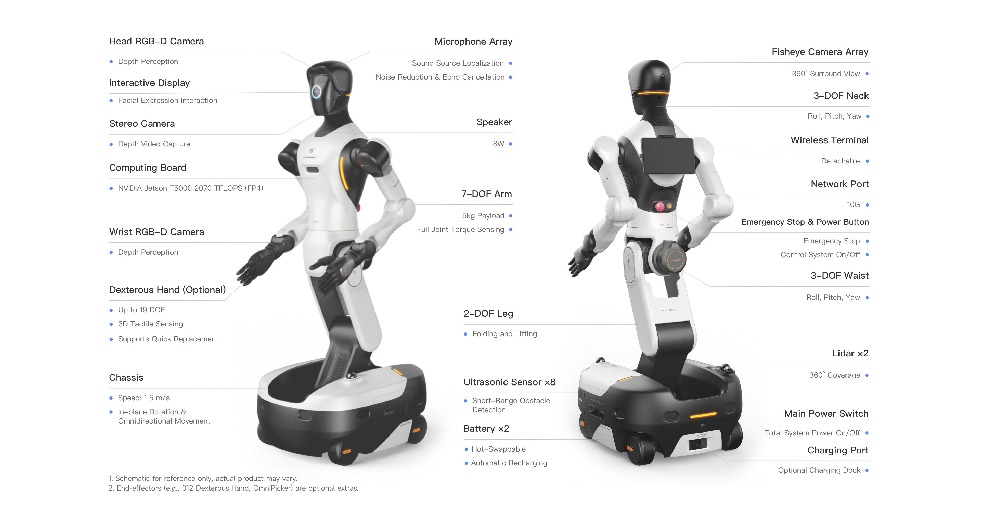

Front and rear component views of AGIBOT G2

| Component                  | Function                                                                                                                              |
| -------------------------- | ------------------------------------------------------------------------------------------------------------------------------------- |
| HMI (Interactive Screen)   | Displays information such as expressions; mainly used for emotional expression and interaction.                                       |
| RGB-D Camera               | Depth-perception sensor for acquiring color and depth information.                                                                    |
| Binocular Camera           | Video sensor for teleoperation video streams.                                                                                         |
| Fisheye Camera Array       | Three fisheye cameras form a 360-degree surround view for navigation, obstacle avoidance, and multi-person dialogue.                  |
| LiDAR                      | Two LiDAR units provide full-direction coverage for navigation and obstacle avoidance.                                                |
| Ultrasonic Radar           | Eight ultrasonic radars surround the chassis for close-range obstacle avoidance.                                                      |
| 3-DOF Neck                 | Movable head with three degrees of freedom; keeps the head posture aligned during beyond-line-of-sight teleoperation.                 |
| 7-DOF Force-Controlled Arm | Humanoid force-controlled arm with a 5 kg rated payload and full-joint torque sensing for high-precision force-controlled operations. |
| 5-DOF Torso                | Humanoid lower limbs supporting 3-DOF waist rotation plus forward/backward and vertical torso adjustment.                             |
| OmniHand (Optional)        | Manipulation end effector with 10 or 12 actuated DOF. Optional two-finger grippers are available for handling target objects.         |
| Chassis                    | Four-steering-wheel chassis supporting forward, reverse, in-place rotation, and crab walking.                                         |
| Emergency Stop Button      | Cuts power to the robot joints and immediately stops all motion.                                                                      |
| Power On/Off Button        | Controls system startup and shutdown.                                                                                                 |
| Power Button               | Controls the robot's powered and de-energized state.                                                                                  |
| Battery                    | Two batteries supporting hot-swappable replacement.                                                                                   |
| Charging Port              | Connects the charger and supports autonomous docking and charging through the charging dock.                                          |

### 3. Maintenance Hatch Interface

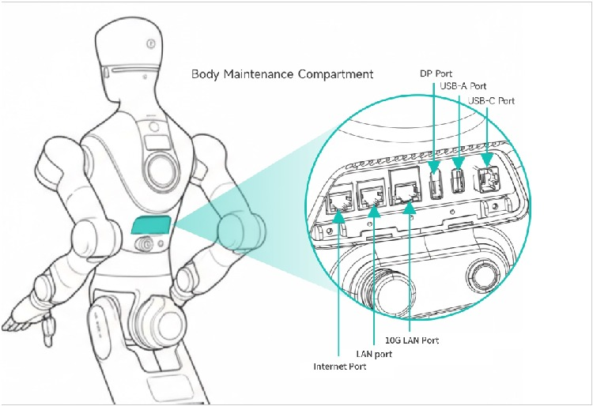

AGIBOT G2 maintenance hatch interface layout

| Interface                  | Function                                                                                                                     |
| -------------------------- | ---------------------------------------------------------------------------------------------------------------------------- |
| Internet Port (1 Gbps WAN) | Establishes an external internet connection for cloud synchronization and remote management.                                 |
| LAN Port (1 Gbps)          | Connects the robot to a local area network for standard internal communication and device interlocking.                      |
| 10G LAN Port (10 Gbps)     | Provides high-throughput local data transmission, including raw sensor data and multi-node synchronization.                  |
| DP Port                    | Connects an external monitor to display the domain-controller system interface.                                              |
| USB-A                      | Connects VR headsets, keyboards, mice, speakers, and perception devices such as LiDAR and RGB-D cameras.                     |
| USB-C                      | Designed for high-bandwidth VR-headset connections and also supports other external devices and high-speed data peripherals. |

> **Attention:** To mitigate the risk of physical destruction to the controller interface, an

Ethernet signal SPD must be integrated into the link when connecting the robot to any building-integrated network outlets (wall/floor). This protects against external lightning induction and voltage transients.

### 4. Arm End

#### Flange

* The arm of G2 is equipped with a standard robotic arm flange at the end. The layout of the mounting holes and spacing is shown below.

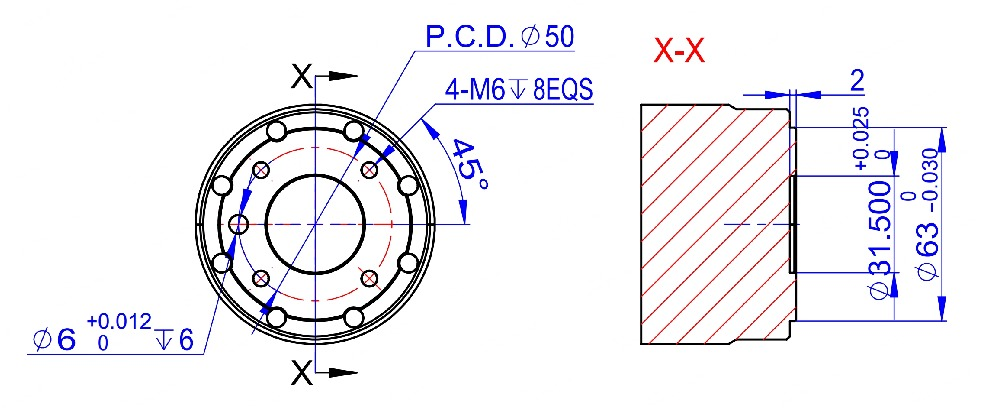

AGIBOT G2 arm-end flange dimensions

#### Communication Connector

* The wrist of the G2 is equipped with a reserved communication connector for end-effector communication. The connector has an M8 diameter.
* The communication connector provides one 24 V power supply line, two RS485 channels, and one CAN-FD channel.
* The connector contains a total of 8 communication pins. The functions of each pin are as follows.

Arm-end communication connector pin layout

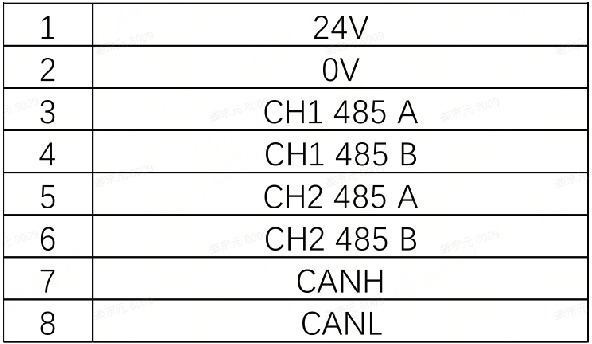

Arm-end communication connector pin assignment

### 5. Wireless Terminal

#### Removal and Installation

* The Wireless Terminal is pre-installed on the back of the robot upon delivery.
* Unlock: Rotate the Wireless Terminal 90 degrees counter-clockwise to release the connection latch.
* Remove: Detach the terminal. It can maintain a wireless connection with the robot within a specific range.

> **Caution:** The current version does not support the installation or removal of

wireless terminals while the device is powered on. Please perform this operation only when the device is shut down and the power supply is completely disconnected.

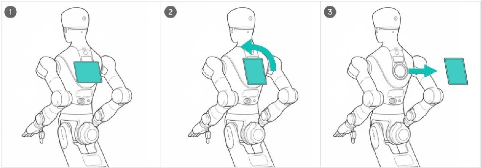

Wireless terminal removal and installation sequence

#### Communication Modes

* Wired Communication: When mounted on the robot body, the Wireless Terminal switches to Wired Communication mode and charges simultaneously. In wired mode, the communication bandwidth is relatively limited. It does not support simultaneous playback of multiple high-definition (HD) video streams, and video frame rates may be lower.
* Wireless Communication: Once detached, the terminal automatically enters Wireless Communication mode, connecting via the robot's built-in Wi-Fi hotspot. In extreme network environments (e.g., exhibitions, data collection factories), you may experience unstable wireless connections or failure to connect.

### 6. In-the-Box

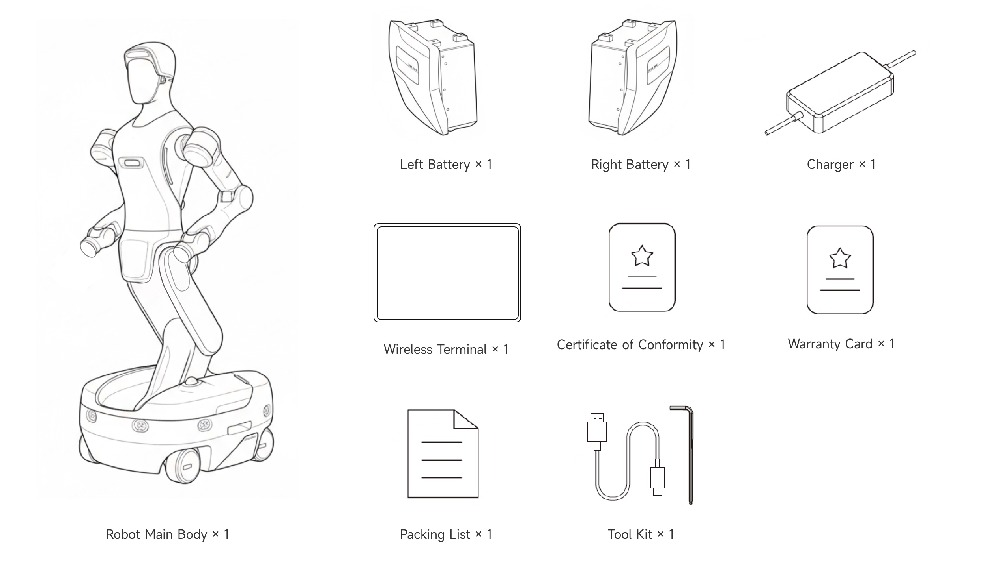

AGIBOT G2 in-the-box contents

### 7. Product Specifications

| Category         | Parameter                                                         | Specification                                                                                 |
| ---------------- | ----------------------------------------------------------------- | --------------------------------------------------------------------------------------------- |
| Basic            | Dimensions                                                        | 1225-1795 mm (H) x 640 mm (W) x 760 mm (L)                                                    |
| Basic            | Weight                                                            | 185 kg                                                                                        |
| Basic            | Total actuated DOF                                                | 26                                                                                            |
| Basic            | Neck DOF                                                          | 3                                                                                             |
| Basic            | DOF per arm                                                       | 7                                                                                             |
| Basic            | Waist and leg DOF                                                 | 5                                                                                             |
| Basic            | Chassis DOF                                                       | 4                                                                                             |
| Perception       | 3D LiDAR                                                          | 2 units                                                                                       |
| Perception       | Binocular camera                                                  | 1 unit                                                                                        |
| Perception       | Fisheye cameras                                                   | 3 units                                                                                       |
| Perception       | Head RGB-D camera                                                 | 1 unit                                                                                        |
| Perception       | Wrist RGB-D cameras                                               | 2 units                                                                                       |
| Range of motion  | Head yaw / roll / pitch                                           | +/-90 degrees / +/-20 degrees / +/-30 degrees                                                 |
| Range of motion  | Waist yaw / roll / pitch                                          | +/-174 degrees / +/-24 degrees / -104 to 58 degrees                                           |
| Range of motion  | Knee / ankle                                                      | 0 to 151 degrees / -61 to 0 degrees                                                           |
| Range of motion  | Arm joints 1-7                                                    | +/-178, +/-120, +/-178, -145 to 60, +/-178, +/-90, +/-60 degrees                              |
| Communications   | Methods                                                           | Wi-Fi, Bluetooth, optional 4G/5G                                                              |
| Interaction      | Microphone array / speaker / facial screen / multicolor indicator | Available                                                                                     |
| Performance      | Rated arm payload                                                 | 5 kg                                                                                          |
| Performance      | Arm joint torque sensors                                          | Available                                                                                     |
| Performance      | Chassis travel speed                                              | 1.5 m/s                                                                                       |
| Performance      | Chassis motion modes                                              | Ackermann steering, crab motion, and in-place rotation                                        |
| Performance      | Minimum passage width for autonomous navigation                   | 850 mm                                                                                        |
| Power and energy | Number of batteries / total capacity                              | 2 / 1652 Wh                                                                                   |
| Power and energy | Runtime                                                           | Approximately 4 hours                                                                         |
| Power and energy | Recharging methods                                                | Direct charging, battery swapping, and autonomous docking/recharging (charging dock required) |
| Power and energy | Charging time                                                     | 2 hours or less                                                                               |
| Power and energy | Input / charger output                                            | 100-240 V / 54.75 V, 15 A                                                                     |
| Compute          | Basic computing board                                             | Huixi R1, 500 TOPS (INT8)                                                                     |
| Compute          | Premium computing board                                           | NVIDIA Jetson T5000, 2070 TFLOPS (FP4)                                                        |
| Other            | Handheld wireless terminal                                        | Available                                                                                     |
| Other            | Smart OTA                                                         | Available                                                                                     |
| Other            | Secondary development                                             | Supported                                                                                     |
| Other            | Remote wake-up                                                    | Supported                                                                                     |
| Other            | Protection rating                                                 | IP42                                                                                          |

### 8. Basic Configuration

#### 8.1 Serial Number

* Physical Label: The robot's serial number can be found on the nameplate located at the rear of the robot.
* Software Check: The serial number can be viewed on the robot's wireless terminal by navigating to Settings > About.

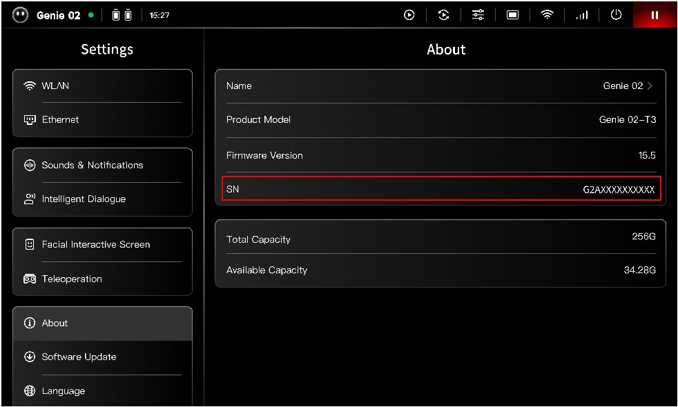

Wireless terminal serial-number location

#### 8.2 Device Name

* Name Display: The robot's name is displayed in the upper-left corner of the wireless terminal screen.
* Name Modification: The robot's name can be manually changed by navigating to Settings > About and tapping on the name entry.

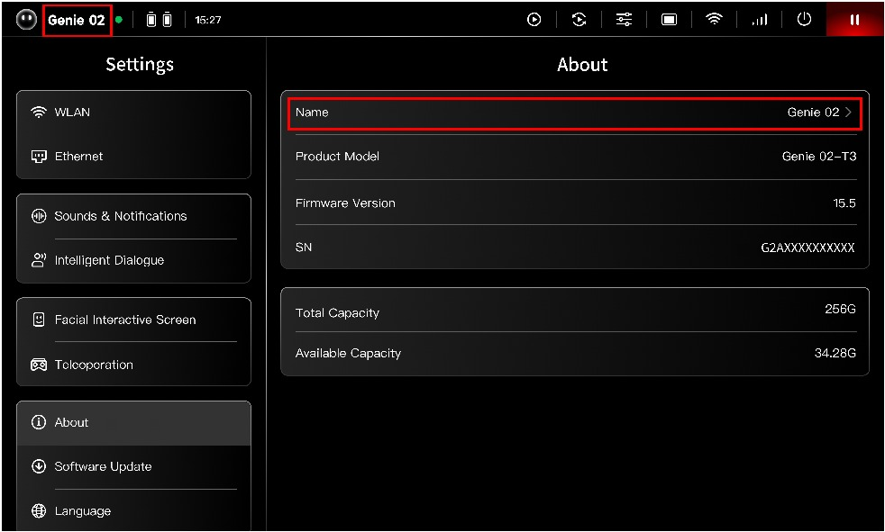

Wireless terminal device-name setting

#### 8.3 Interface Language

* Switching Language: The interface language of the wireless controller can be switched by tapping Settings > Language. Currently, both Chinese and English are supported.

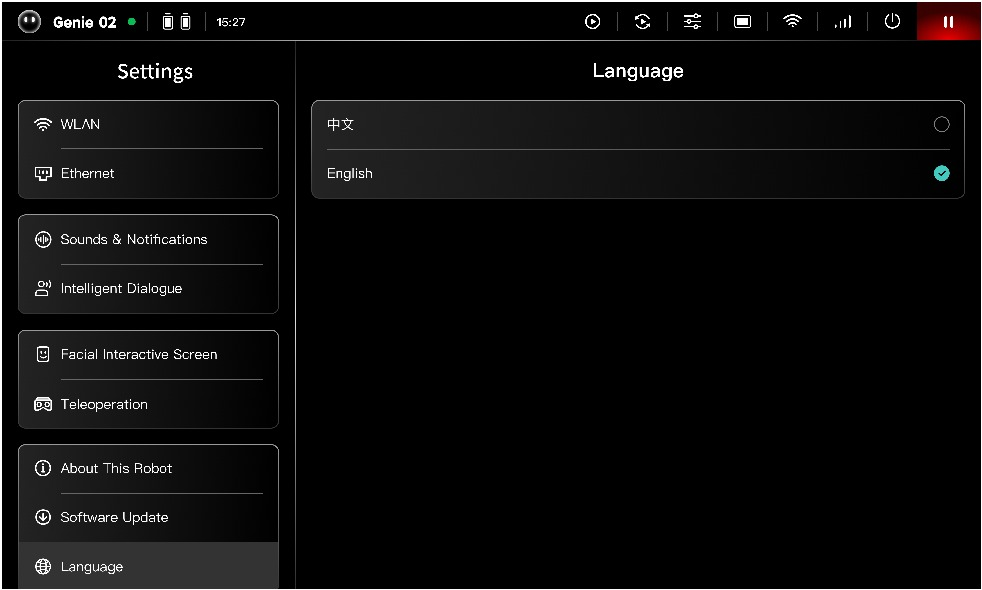

Wireless terminal language setting

### 9. Intelligent Interaction

Welcome to the voice interaction feature of G2. Please refer to the following guide to start a smooth conversation with the robot.

#### 9.1 Voice Conversation

#### Wake Up G2

* Use the default words: Chinese wake phrase: "Hello, Genie" (Mandarin pronunciation: Nǐ hǎo, Jīnglíng)
* English: "Hi Genie"
* When you hear the response sound and see the “listening” expression on the interaction screen, the robot has been successfully awakened.
* The robot's voice-pickup range is 3 meters. For an optimal experience, please initiate conversations within this effective distance.

#### Start a Conversation

After waking up the robot, you can directly give commands, for example:

* General Q\&A: 'introduce yourself', 'can you tell a joke'
* Custom Q\&A Database: 'What items are prohibited during security checks', 'Where is the mother-and-child room' ( custom version only)

#### End the Conversation

* After speaking, no command is needed. Wait quietly for a moment, and the robot will automatically exit the conversation mode.
* You can also actively exit the conversation by using commands such as ‘Goodbye’ or ‘Exit’.

| Status                      | Color               | Effect                      |
| --------------------------- | ------------------- | --------------------------- |
| Power on/off successful     | Theme color (white) | Flowing lights              |
| Low battery (20% remaining) | Orange              | Steady on                   |
| Charging                    | Theme color (white) | Breathing light             |
| Emergency stop              | Red                 | Breathing light             |
| Severe fault                | Red                 | Flashing                    |
| Low-power mode              | Theme color (white) | Steady on at 50% brightness |
| Default state               | Theme color (white) | Steady on                   |

#### 9.2 Light Indicator

The G2 torso has 7 distributed light indicators. You can intuitively understand the robot's current operating status through the lighting color and effect:

#### 9.3 Expressions

The G2 head has a 6.36-inch flexible screen that displays the following official expressions.

| Status                      | Expression                                                                               |
| --------------------------- | ---------------------------------------------------------------------------------------- |
| Power on/off successful     | 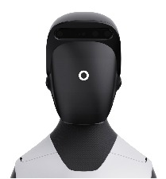 |
| Default status              |                           |
| Low battery (20% remaining) | 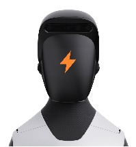                      |
| Start charging              | 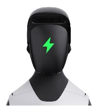                   |
| Charging complete           | 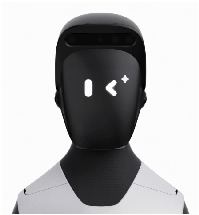                |
| Emergency stop              | 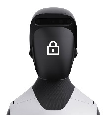                   |
| Critical fault              |                    |
| Listening                   | 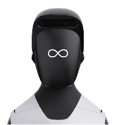                        |
| Thinking                    | 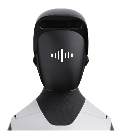                         |
| Speaking                    |                          |

#### 9.4 Exclusive Customized Service

Contact our technical team to customize exclusive wake words, personality traits, knowledge base, and unique voice tones to create your one-of-a-kind intelligent companion.

### 10. Emergency Stop (E-Stop)

In the event of an emergency, the robot can be stopped using two methods: "Soft E- Stop" and "Hard E-Stop."

* Soft E-Stop: Stops the robot via software commands. While it can be triggered remotely and offers a faster recovery time, it is generally less reliable than a Hard E- Stop.
* Hard E-Stop: Stops the robot by physically cutting power to the actuators. This is the most reliable method for immediate safety.

#### 10.1 Soft E-Stop Instructions

1. To Stop: Tap the "Soft E-Stop" button located in the upper-right corner of the wireless terminal.
2. To Resume: Once the situation is safe, tap the button again to release the stop. The robot will then be ready to resume operation.

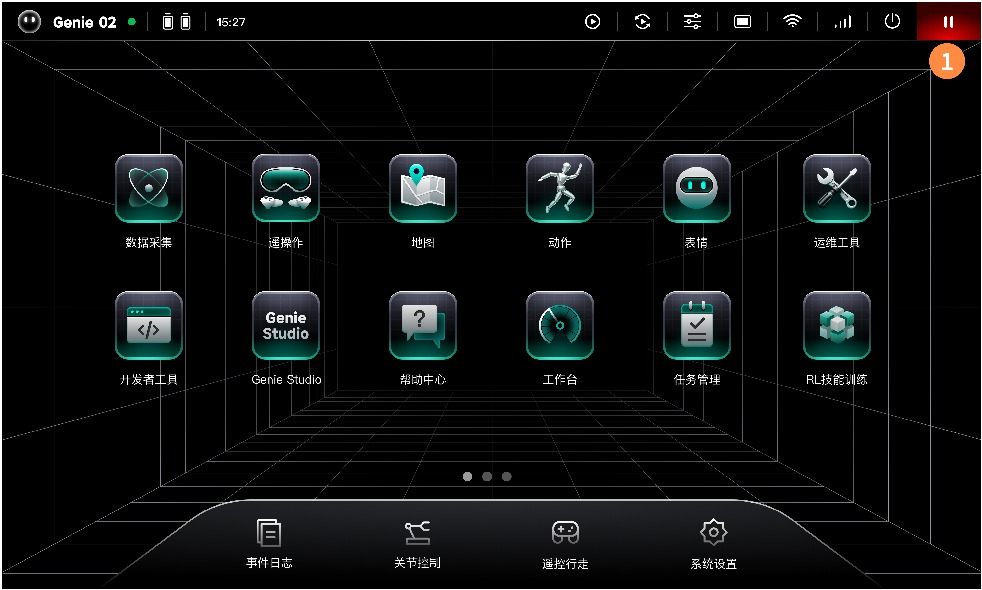

Soft emergency-stop control on the wireless terminal

#### 10.2 Hard E-Stop

1. To Stop: Press the Emergency Stop (E-Stop) button located on the back of the robot next to the power button.
2. To Resume: Once the robot has stopped and the area is safe, rotate the button to release the stop.

> **Caution:** Please be aware that recovering from a Hard E-Stop may take several

minutes to complete.

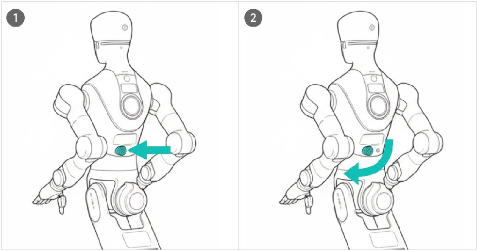

Hard emergency-stop button release sequence

### 11. Remote Control

#### 11.1 Chassis Control

1. When the robot is powered on, tap "Chassis Control" in the Dock bar at the bottom of the robot's wireless terminal to open the "Chassis Control" APP.
2. At the bottom of the "Chassis Control" APP interface, switch movement modes via the buttons. The robot supports two movement modes: Ackermann and Crab Walk.
3. Use the virtual joystick to control the robot's chassis movement.

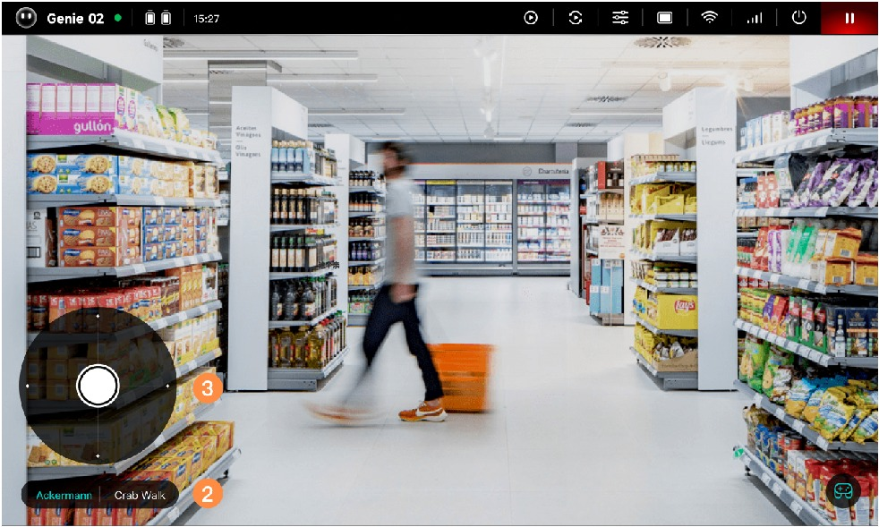

Wireless-terminal chassis-control interface

#### 11.2 Control Button Descriptions

#### Ackermann Mode

* Forward: Move the joystick into the “FWD (Forward)” zone.
* Reverse: Move the joystick into the “REV (Reverse)” zone.
* Steering While Moving: Move the joystick into one of the four “Spin” zones.
* Steering intensity: Move the joystick into "Spin Left and Spin Right" zones.

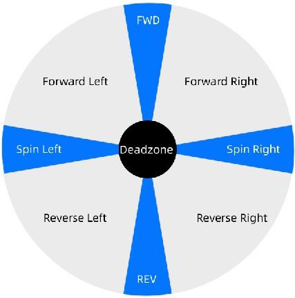

Ackermann-mode joystick zones

#### Omnidirectional Mode

* Forward: Move the joystick to the "FWD (Forward)" zone.
* Reverse: Move the joystick to the "REV (Reverse)" zone.
* Lateral Movement: Move the joystick to four "Diagonal" zones.
* Strafe: Move the joystick to "Strafe Left and Strafe Right" zones.

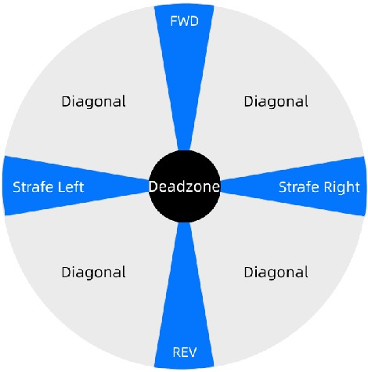

Omnidirectional-mode joystick zones

### 12. Joint Control

#### 12.1 Function Entry & Operation Targets

1. Tap Joint Control on the Dock bar at the bottom of the wireless terminal to open the Joint Control app.
2. Tap the top of the interface to switch the object to be operated.

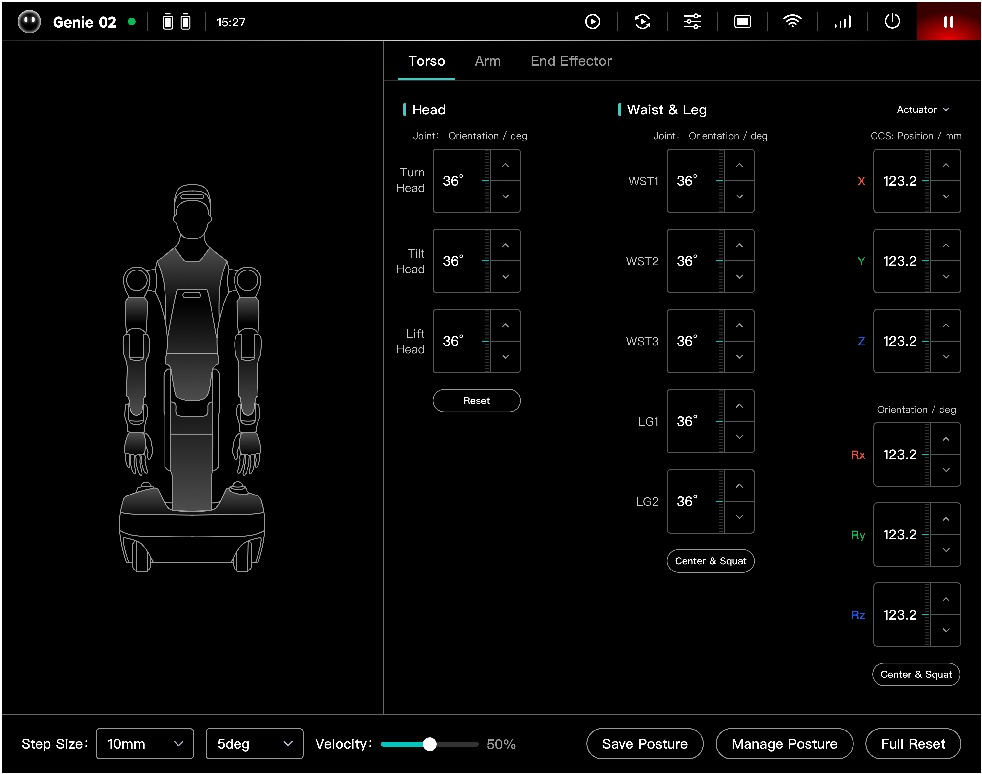

Joint-control operation target and step-size interface

#### 12.2 Step Size & Speed

1. Tap the Step Size setting at the bottom of the interface to adjust the movement step size of the robot during jog control.
2. Drag the slider at the bottom of the interface to adjust the robot's speed in remote control mode.

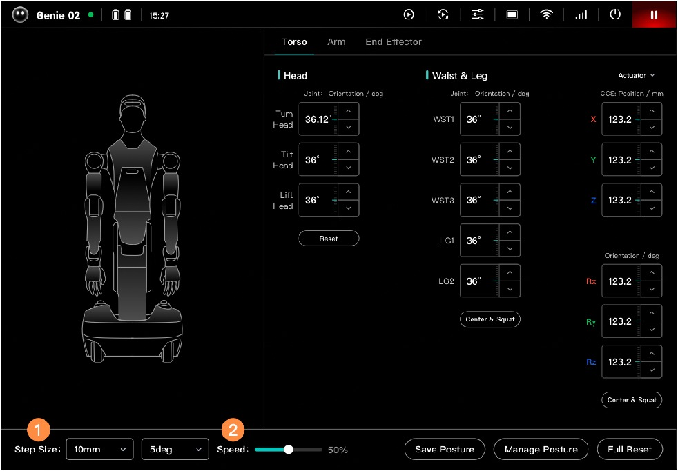

Jog, continuous, head, waist, and leg control interface

#### 12.3 Jog & Continuous Control

1. Jog Control: Tap the control buttons corresponding to each joint of the robot or the end position. The corresponding joint will rotate by one angular step, and the corresponding end will move by one distance step.

#### 12.4 Torso Control

The torso is divided into two parts: Head, and Waist & Leg.

1. The head only supports joint control. Tap the up/down buttons corresponding to the joints to adjust the joint positions.
2. The waist & legs are controlled as a single 5-axis robotic arm. It supports both individual joint control and end (torso) position control of the entire robotic arm.

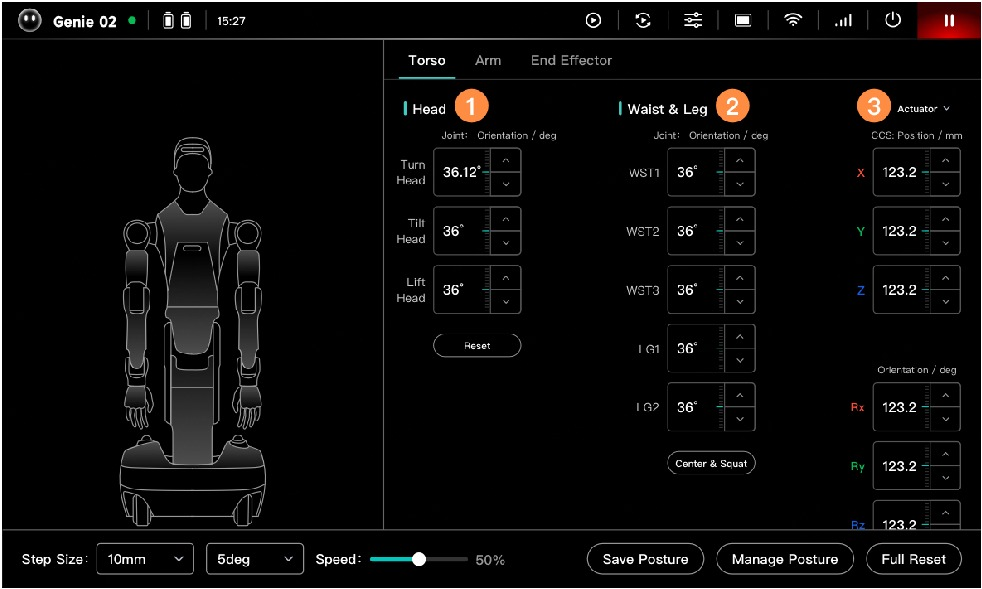

Arm-control interface

#### 12.5 Arm Control

1. Both arms can perform joint control, following the same operation method as the torso.

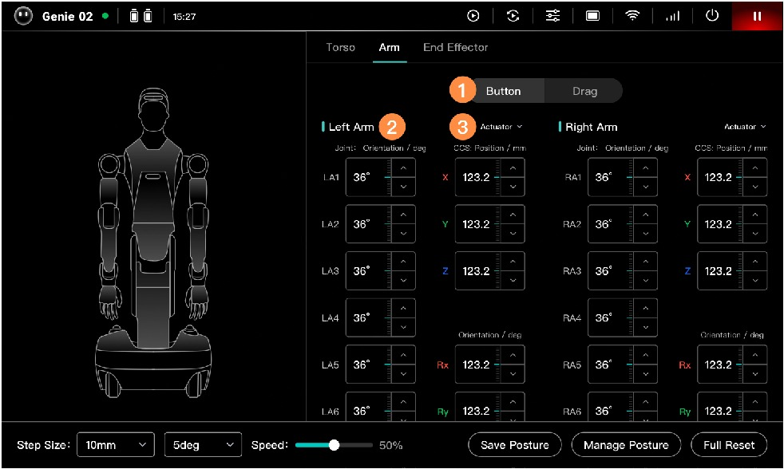

Save-posture control

#### 12.6 Posture Reset

1. Tap the "Save Posture" button to save the current posture to the posture list. It can be used as the target posture for reset later.
2. Tap the "Manage Posture" button to open the posture management interface.
3. Tap to switch the target posture for reset.
4. Users can manage existing postures. System postures cannot be deleted or renamed.
5. Tap the "Full Reset" button, and the robot will reset its overall posture to the selected target posture.

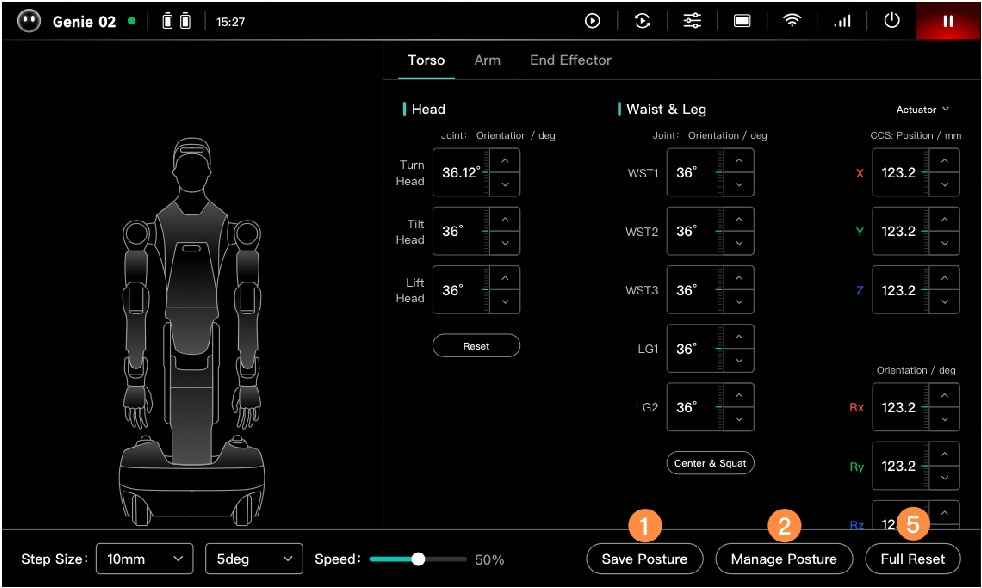

Posture-management interface

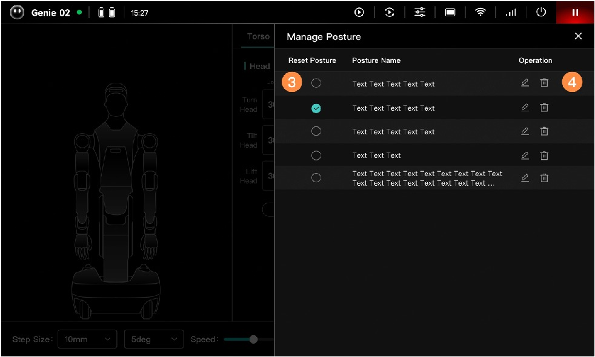

Full-posture-reset interface

### 13. Teleoperation

#### 13.1 Concepts

#### Teleoperation

Teleoperation refers to the process where an operator uses teleoperation device to control a robot from a remote distance and complete a series of robotic tasks.

Teleoperation concept diagram

#### Data Links

During teleoperation, there are two main data links:

* Video Stream: The robot collects captured images, compresses them on the edge side, and transmits them to the teleoperation equipment via the network. The teleoperation equipment parses the video stream and displays it for the operator to view.
* Control Stream: The operator outputs control commands, which are processed by the teleoperation equipment and transmitted to the robot via the network. The robot parses the control commands and executes actions accordingly.

Teleoperation data-link flow

#### Teleoperation Latency

* Line-of-Sight (LOS) Teleoperation: For LOS teleoperation, the user does not need the video stream transmitted back by the robot and directly controls the robot by observing its movements with the naked eye. In this case, there is only one data link (the control stream), and latency is generated only in each link of the control stream.
* Beyond-Line-of-Sight (BLOS) Teleoperation: For BLOS teleoperation, the user first needs to view the video stream captured by the robot, then determines the control commands to issue based on the image information. The control commands are transmitted to the robot through a series of processes and executed by the robot.

For BLOS teleoperation, control latency is generated in both the video stream and control stream links, resulting in higher overall latency compared to LOS teleoperation.

#### 13.2 Teleoperation & Network Connection Methods

Based on whether robot Video Streaming is required and the type of network used, Genie G2 offers multiple teleoperation methods:

1. No Video Streaming - Direct Ethernet Connection: Use a USB cable (functioning as an Ethernet cable) to directly connect the teleoperation equipment to the USB interface of the robot's maintenance compartment.
2. No Video Streaming - LAN : Achieved by connecting both the robot and the teleoperation equipment to the same LAN. The LAN can be implemented via a wireless AP or by connecting both the robot and the teleoperation equipment to the same router using Ethernet cables.
3. With Video Streaming - LAN: Implemented by deploying a server with WebRTC functionality within the LAN. The WebRTC service for on-premises deployment needs to be purchased separately during the product purchase phase. Both the robot and the teleoperation equipment connect to this LAN for communication.
4. With Video Streaming - Public Network: Achieved by connecting both the robot and the teleoperation equipment to the public network.

Teleope Conne Data Connection How to Obtain Credentials ration ction Transmi Credentials Method Method ssion No Direct UDP None Not Required Video Etherne (User Streamin t Datagra g Connec m tion Protocol)

| Mode                 | Connection                 | Transport             | Credentials                    | Where to find them                         |
| -------------------- | -------------------------- | --------------------- | ------------------------------ | ------------------------------------------ |
| No video streaming   | Direct Ethernet connection | UDP                   | None                           | Not required                               |
| No video streaming   | Local area network (LAN)   | UDP                   | Robot IP address               | Robot HMI: System Settings > Teleoperation |
| With video streaming | Local area network (LAN)   | LAN WebRTC            | Server address and room number | Robot HMI: System Settings > Teleoperation |
| With video streaming | Public network             | Public-network WebRTC | Room number                    | Robot HMI: System Settings > Teleoperation |

Among them:

* Data Acquisition Factory: The data acquisition factory mainly conducts line-of- sight data collection, and the two aforementioned no-image-transmission solutions are applicable to this scenario.
* Remote Operation: In the remote operation scenario, the teleoperator is far away from the robot. It is necessary to comprehensively consider factors such as data confidentiality, network deployment difficulty, network stability and network bandwidth to decide whether to adopt the local area network deployment or the public network link.

#### 13.3 Teleoperation Connection

After determining the teleoperation and network connection methods, the teleoperation connection can be completed in the following steps:

#### Before You Connect

1. No Video Streaming - Direct Ethernet Connection a. Open the maintenance compartment on the back of the robot. There is one USB-A port and one USB-C port inside the maintenance compartment.

b. Use a USB-C cable to connect the VR headset to the robot.

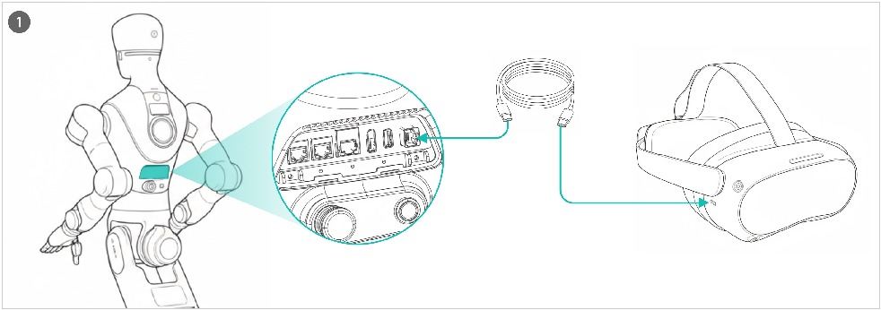

Teleoperation network connection methods

1. No Video Streaming - Local Area Network (LAN) a. Put on the VR headset, power it on, and connect it to the corresponding LAN through the VR headset interface.

b. Power on the robot. Use the robot's wireless terminal to connect the robot to the same LAN.

1. With Video Streaming - Local Area Network : Same as 'No Video Streaming - Local Area Network (LAN)'.
2. With Video Streaming - Public Network a. Put on the VR headset, power it on, and connect it to the public network through the VR headset interface.

b. Power on the robot. Use the robot's wireless terminal to connect the robot to the public network environment.

#### Network Requirements

* Bandwidth Requirements: For video transmission mode, sufficient bandwidth must be guaranteed, whether via Local Area Network (LAN) or Public Network.
* Recommended bandwidth: 20 Mbps per robot.
* Please ensure the total bandwidth meets the requirements for remote operation. Ensure the wireless signal strength at the robot's location is stable and avoid connecting other devices to the same network to prevent network congestion.
* Remote Operation Anomalies: Insufficient bandwidth or low signal strength may lead to the following issues:
* Stuttering: Lag or freezing in video and audio streams.
* Incoherence: Disjointed or jerky robot movements.
* Disconnection: Loss of the remote operation connection.

#### Establishing the Connection

1. Open the 'Genie Link' APP within the VR headset.
2. Go to 'Genie Link' > 'Connection', select the appropriate configuration according to your teleoperation mode and network type, and fill in the corresponding parameters based on the information displayed on the robot’s wireless terminal.
3. Tap the "Connect" button. A "Connection Successful" pop-up notification indicates that the connection is established.

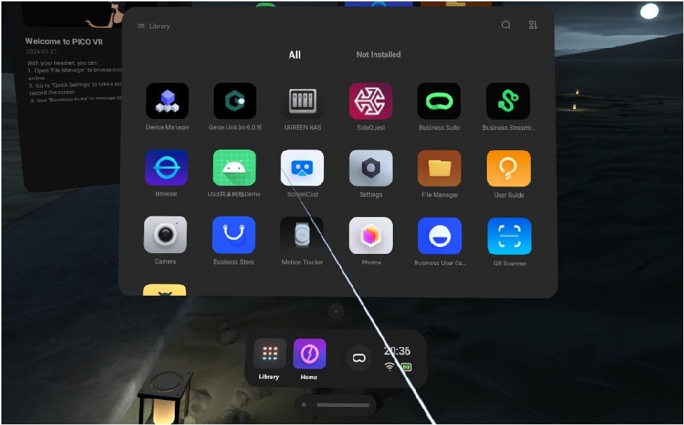

Genie Link connection configuration interface

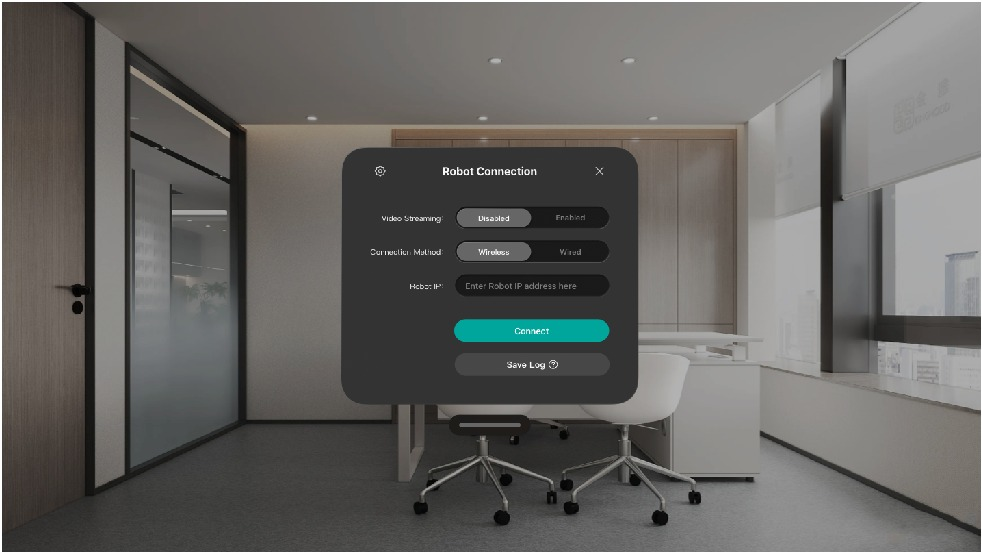

Teleoperation video-stream interface and controller layout

#### 13.4 Teleoperating the Robot

#### No Video Streaming

After a successful connection in No Video Streaming mode, the connection interface will display "Connected". At this point, the headset can be taken off and hung around the neck, and the robot can be teleoperated by observing its movements with the naked eye.

#### With Video Streaming

After a successful connection in With Video Streaming mode, the connection interface will disappear and be replaced by the robot's video stream interface. The teleoperator can observe the robot's surrounding environment through the video stream interface and operate the robot using the VR controller.

#### Button Layout

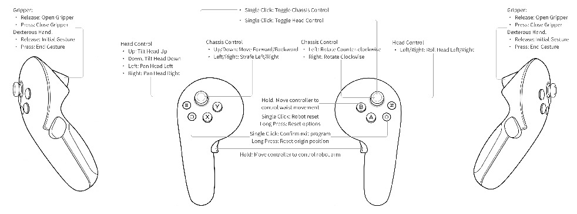

VR controller button layout

### 14. Data Collection

#### 14.1 Online Collection

Online Collection is applicable to scenarios with large data collection volumes, high data quality requirements, and network connectivity. It completes physical robot data collection through the collaboration of the on-edge HMI and the cloud-based Genie Data platform (requires advance purchase). The data collection process is as follows:

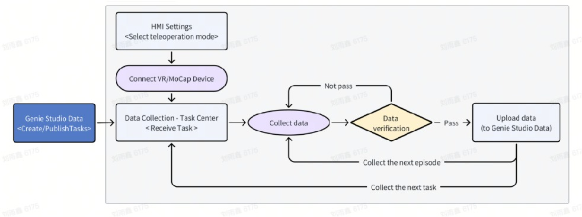

Online data-collection workflow

#### 14.2 Collection Settings

Enter the domain name and tenant information. If you are unclear about the relevant details, please confirm with the on-site delivery personnel.

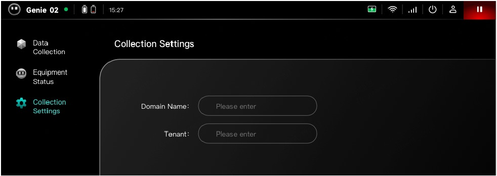

Data-collection tenant settings

#### 14.3 User Login

Log in to the Data Collection module using an account with the data collector role in 'Genie Data'. Other modules can be accessed without login.

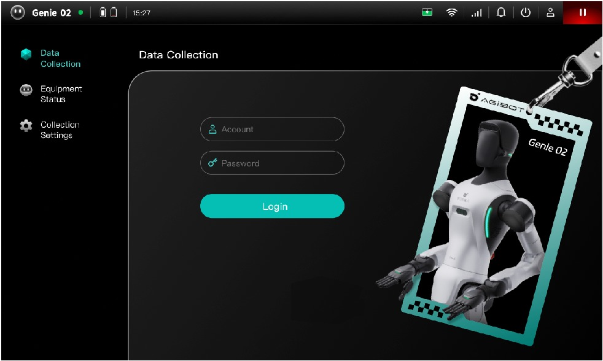

Data-collection login interface

#### 14.4 Claiming Tasks

1. After logging in, enter the Task Center list page. On this page, you can view the task name, task purpose, task requirements, as well as end effector type and collection mode.

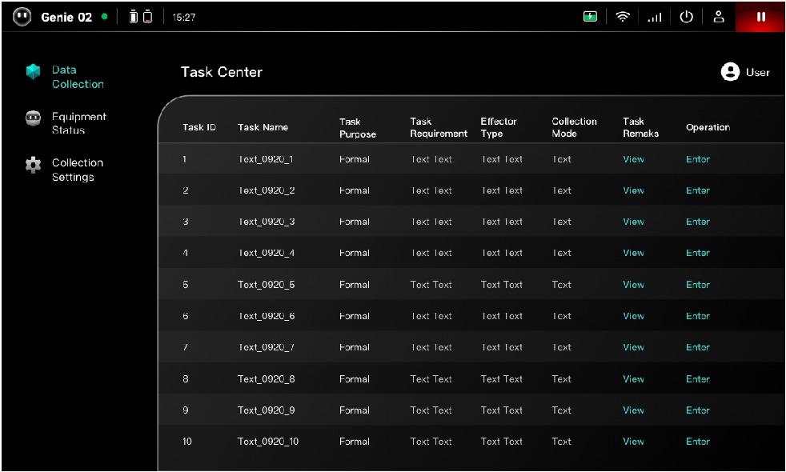

Data-collection task center

1. In the task remarks, click 'View' to check the detailed task description.
2. In the operation column, click 'Enter' to access the action list page, which lists all actions under the task, including the duration requirement and difficulty level of each action. The 'Personal Collection Progress' section specifies the number of repetitions required for the action and the current number of completed repetitions.
3. In the operation column, click 'Claim' to take the task. After claiming, the option in the operation column will change to 'Collect'.

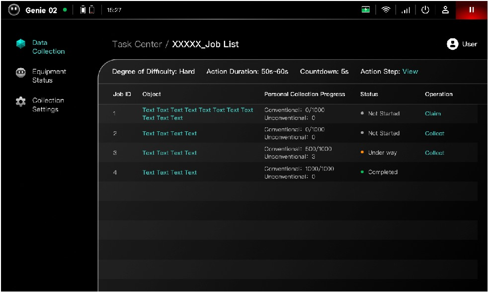

Data-collection action list

#### 14.5 Collecting Data

1. Click "Collect" to enter the data collection start page, which includes the following functions:

a. Camera View: Use the head and wrist cameras to check the placement of items and whether the end effector is in the correct position.

b. Joint Control: Adjust the robot's posture.

c. Reset Posture: Restore the robot to the preset posture.

d. Exit Collection: Return to the action list.

e. Historical Data: View historical data, as well as data upload progress and review results.

f. Start : Begin data collection.

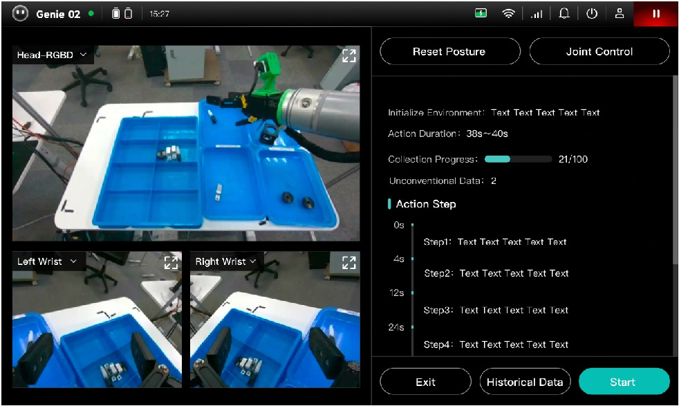

Data-collection start interface

1. Click 'Start Collection' to initiate the countdown. The collector shall teleoperate the robot in accordance with the task requirements and complete the action within the specified time. You can abandon the collection midway by clicking "Abandon Collection" to return to the collection start page.
2. After completing the required action, click 'Complete Collection'.

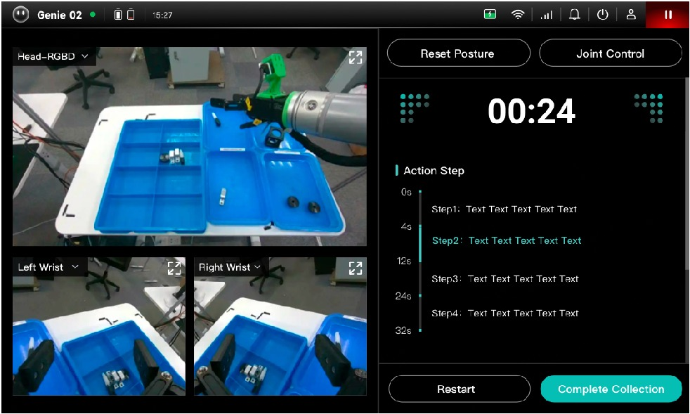

Data verification and submission interface

1. After passing the verification, click "Submit and Continue" to upload the data to Genie Data and start collecting the next piece of data.

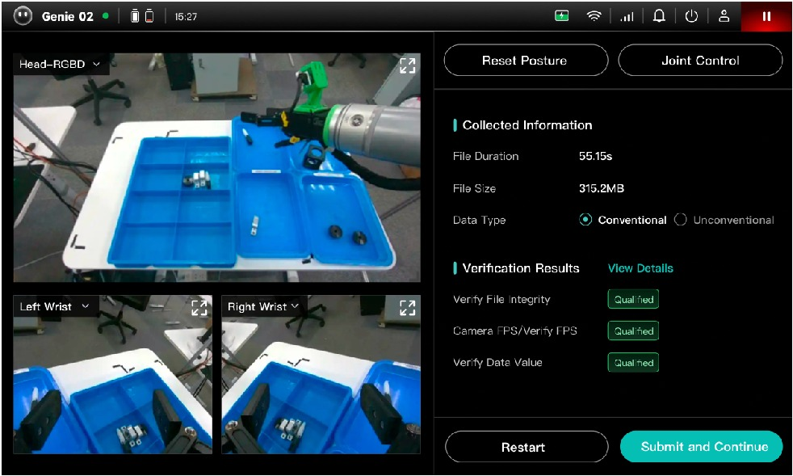

Collection-complete interface

### 15. Software Upgrade

#### 15.1 Upgrade Package Push and Download

1. The robot's upgrade package is distributed to the robot from the robot's Operation and Management Platform.
2. After the robot receives the upgrade instruction, it will automatically start downloading the upgrade package if it is connected to the network.
3. Users can check the download progress by accessing the "System Settings" APP on the wireless terminal.
4. The robot's normal use will not be affected during the upgrade package download, and users do not need to monitor this process.

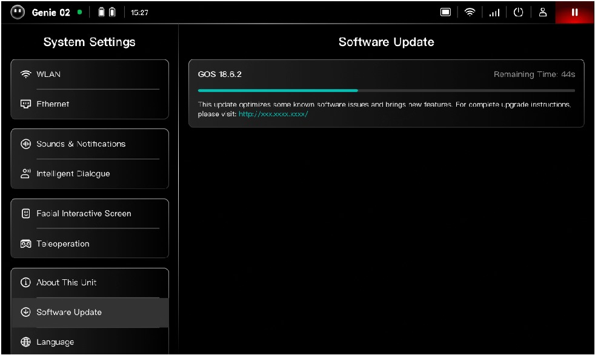

Upgrade-package download progress

#### 15.2 Software Upgrade

1. After the upgrade package is downloaded successfully, an update notification will appear on the icon of the 'System Settings' APP.
2. The upgrade details can be viewed on the 'Software Page' of the 'System Settings' APP.
3. Tap 'Update Now' to start the upgrade process. At this time, users cannot continue to operate or control the robot, and the robot will restart during the upgrade.
4. After the upgrade is completed, users can continue to use G2.

> **Caution:** Keep power on during upgrade. Ensure sufficient battery and connect to

a power source.

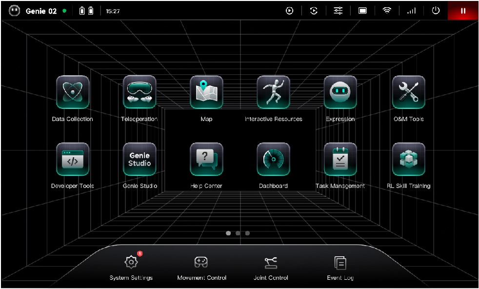

System Settings update notification

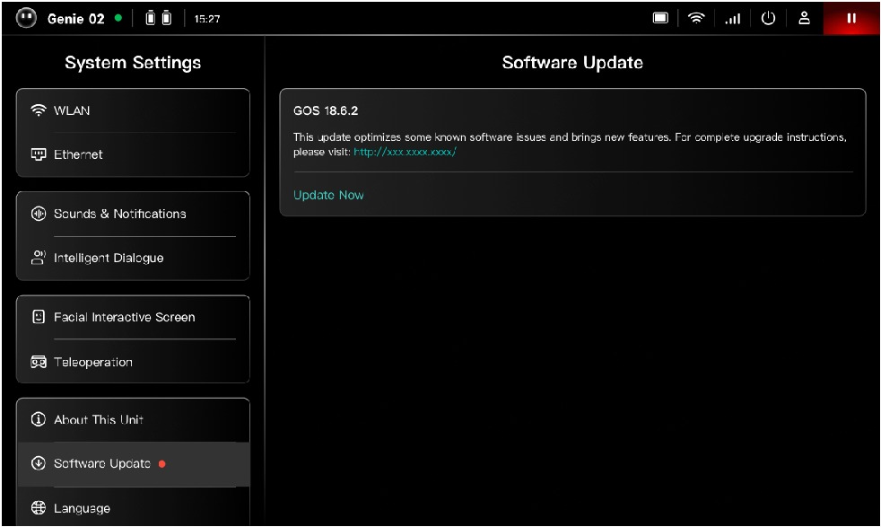

Software-update details

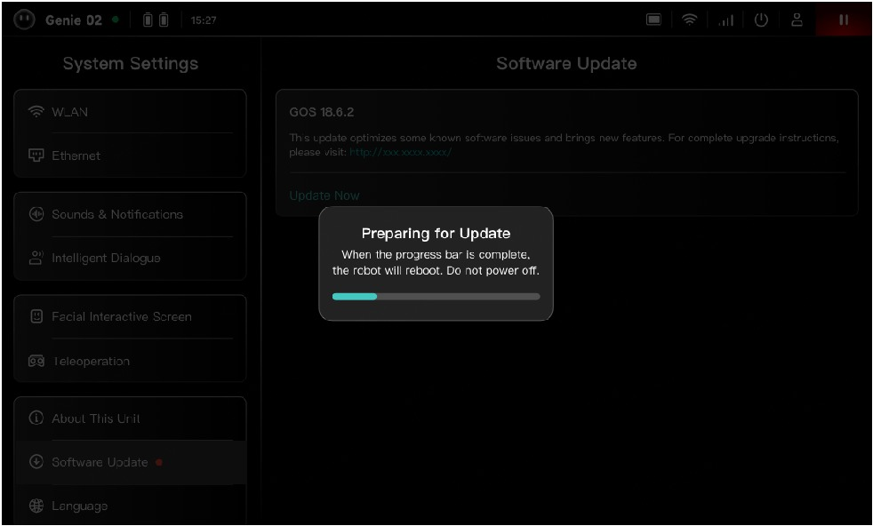

Software upgrade in progress
