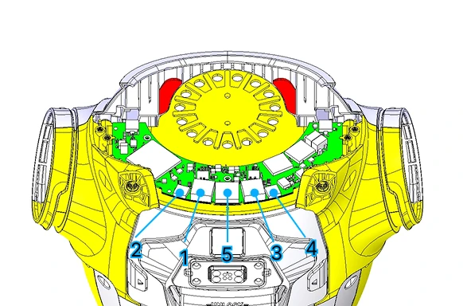

# AgiBot X2 Ultra User Manual

### AGIBOT X2 Ultra Humanoid Robot for Embodied AI



### Contents

* Safety, operating environment, and emergency stop
* Product configuration and specifications
* Battery status and charging
* Startup procedures
* Agibot Go app and remote controller
* Shutdown procedures
* Development interfaces and SDK access

### Key Troubleshooting Index

* Unsafe floor, insufficient clearance, and fall risk
* Low battery and charging problems
* Wi-Fi, AP hotspot, and app connection
* Remote-controller pairing and mode switching
* Safe shutdown and zero-torque handling

### Safety and Operating Environment <a href="#safety-and-operating-environment" id="safety-and-operating-environment"></a>

* Operate only on a hard, level, dry, stable surface. Keep the robot away from slopes, drops, fragile floors, vibration, moisture, and extreme temperatures.
* Reserve a clear safety area around the robot. Keep personnel outside the motion path and maintain at least 0.5 m distance during normal operation; allow at least 1 m for startup, recovery, and demonstration motions.
* Before startup, verify that the battery, cables, plugs, joints, sensors, and support equipment are in normal condition.
* Use the emergency-stop combination only when necessary. Zero-torque mode releases all joints and can cause the robot to collapse; support the robot with a gantry or trained assistants.
* Never dismantle, adjust, or repair the powered robot. Stop operation immediately after a fault, fall, collision, abnormal heat, odor, sound, or battery damage.

### Product Specifications

| Parameter             | AgiBot X2 Ultra                                                                                  |
| --------------------- | ------------------------------------------------------------------------------------------------ |
| Dimensions            | 1310 mm (H) x 460 mm (W) x 210 mm (L)                                                            |
| Weight                | Approx. 39 kg                                                                                    |
| Total DoF             | 30                                                                                               |
| Arm DoF               | 7 per arm                                                                                        |
| Leg DoF               | 6 per leg                                                                                        |
| Arm reach             | 558 mm, excluding end effector                                                                   |
| Payload               | <p>Max. 3 kg in specified postures;<br>&#x3C;=1 kg across full range, excluding end effector</p> |
| Perception            | 3D LiDAR, RGB-D camera, interactive RGB, front dual RGB, rear RGB, head touch sensor             |
| Communication         | Wi-Fi, Bluetooth, 4G/5G module                                                                   |
| Battery               | Approx. 500 Wh                                                                                   |
| Operating time        | Approx. 2 hours at 0.5 m/s                                                                       |
| Charging time         | <=1.5 hours                                                                                      |
| Main compute          | RK3588 x2                                                                                        |
| Development compute   | NVIDIA Orin NX, 157 TOPS                                                                         |
| Secondary development | Supported                                                                                        |

### Battery and Charging <a href="#battery-and-charging" id="battery-and-charging"></a>

| Battery indication | State     | Required action                               |
| ------------------ | --------- | --------------------------------------------- |
| Four LEDs on       | 75-100%   | Normal operation                              |
| Three LEDs on      | 50-75%    | Normal operation                              |
| Two LEDs on        | 25-50%    | Monitor remaining runtime                     |
| One LED on         | 15-25%    | Prepare to charge or replace the battery      |
| LED1 flashing      | Below 15% | Charge immediately and prevent a powered fall |

* Power the robot off before charging. Do not send motion commands while charging.
* Charge either through the robot charging port or after removing the battery, using the approved adapter.
* Keep the charging area dry, ventilated, and away from combustible materials and heat sources.
* After a fall, inspect the battery. Do not reuse a battery with dents, cracks, swelling, leakage, or other visible damage.

### 1.1 Product Overview

#### 1.1.1 X2 Ultra Edition

* The X2 Ultra Edition features **30 degrees of freedom** in total, including **1 degrees of freedom** in the head and **7 degrees of freedom** in each arm, covering the shoulder, upper arm, elbow, and wrist joints. Each leg has **6 degrees of freedom**, including the hip, thigh, knee, and ankle joints. The waist provides **3 degrees of freedom** (yaw, pitch, and roll).
* Building upon the **X2 Pro Explorer Edition**, the X2 Ultra adds **LiDAR, a front-facing stereo RGB camera, an RGB-D camera, and a rear RGB camera**. It comes equipped with a high-performance **Nvidia Orin NX** computing unit and includes a **4G/5G module** as standard. It supports optional **OmniPicker** and **OmniHand** modules, as well as teleoperation accessories and charging station accessories.
* This version provides full secondary development capabilities and supports use with the LinkCraft platform.

### 1.3 On-board Computer

The AgiBot X2 Ultra comes standard with a motion control computing unit, an interaction computing unit, and a developer computing unit, providing stronger computational power and greater flexibility for complex tasks and advanced applications.

***

#### 1.3.1 Standard Computing Units

| Version      | Standard Computing Units per Model                                                                                              |
| ------------ | ------------------------------------------------------------------------------------------------------------------------------- |
| **X2 Ultra** | <p>One Motion Control Computing Unit (PC1) and one Interaction Computing Unit (PC3)<br>One Development Computing Unit (PC2)</p> |

Warning

Taking Motion Control Computing Unit(PC1, 10.0.1.40) as build & run environment for secondary development is strictly prohibited to avoid safety risks

***

#### 1.3.2 Development Computing Unit Specifications

| Parameter          | Development Computing Unit (PC2)                              |
| ------------------ | ------------------------------------------------------------- |
| **Processor**      | Jetson Orin NX                                                |
| **AI Performance** | 157 Tops                                                      |
| **GPU**            | 1024-core NVIDIA Ampere architecture GPU with 32 Tensor Cores |
| **CPU**            | 8-core Arm® Cortex®-A78AE v8.2 64-bit CPU                     |
| **Cache**          | 2MB L2 + 4MB L3                                               |
| **Memory**         | 16GB                                                          |
| **Storage**        | 512GB                                                         |

### 1.4 User Debug Interfaces (Ultra Edition)

| No.   | Interface Type | Interface Name | Description                                                                                       |
| ----- | -------------- | -------------- | ------------------------------------------------------------------------------------------------- |
| **1** | RK3588 USB     | USB Type-A     | Supports USB 3.0 host, 5V/1.5A power output; RK3588 USB Type-A and Type-C share 5Gbps bandwidth   |
| **2** | RK3588 USB     | USB Type-C     | Supports USB 3.0 host, 5V/1.5A power output; RK3588 USB Type-A and Type-C share 5Gbps bandwidth   |
| **3** | Orin NX USB    | USB Type-A     | Supports USB 3.0 host, 5V/1.5A power output; Orin NX USB Type-A and Type-C share 10Gbps bandwidth |
| **4** | Orin NX USB    | USB Type-C     | Supports USB 3.0 host, 5V/1.5A power output; Orin NX USB Type-A and Type-C share 10Gbps bandwidth |
| **5** | SIM Card Slot  | SIM Card Slot  | SIM card slot for 5G module                                                                       |

***

<figure><figcaption><p>AgiBot X2 Ultra User Debug Interface Layout (Numbers 1–5 correspond to the table above)</p></figcaption></figure>

### 1.5 Secondary Development Interfaces (Ultra Edition)

| No.   | Interface Type | Interface Name | Description                                        |
| ----- | -------------- | -------------- | -------------------------------------------------- |
| **1** | RJ45           | 1000 Base-T    | Gigabit Ethernet, accessible to Orin NX and RK3588 |
| **2** | RJ45           | 1000 Base-T    | Gigabit Ethernet, accessible to Orin NX and RK3588 |
| **3** | XT30UPB-F      | 12V Power      | 12V/3A power output                                |
| **4** | XT30UPB-F      | 48V Power      | 48V/5A power output                                |

***

<figure><figcaption><p>AgiBot X2 Ultra Secondary Development Interface Layout Diagram</p></figcaption></figure>

### 1.6 AgiBot X2 Sensor Overview

#### 1.6.1 Sensor Capabilities & FOV Diagram

| Version              | Sensor Suite                                                                                                     | Perception Capabilities                                                                                                                                                                                                                                                                                                                                                                                                                                                                                                                                                                                                                                                                                                                    |
| -------------------- | ---------------------------------------------------------------------------------------------------------------- | ------------------------------------------------------------------------------------------------------------------------------------------------------------------------------------------------------------------------------------------------------------------------------------------------------------------------------------------------------------------------------------------------------------------------------------------------------------------------------------------------------------------------------------------------------------------------------------------------------------------------------------------------------------------------------------------------------------------------------------------ |
| **X2 Ultra Edition** | <p>LiDAR<br>RGB-D Depth Camera<br>Front Stereo RGB Camera<br>Front Interaction RGB Camera<br>Rear RGB Camera</p> | <p><strong>LiDAR:</strong><br>a. Captures high-precision environmental data in real time;<br>b. Rapidly detects and measures surrounding objects;<br>c. Outputs high-resolution point clouds as a core input for environmental perception.<br><br><strong>In addition to the chest-mounted LiDAR,</strong> multiple camera types are included for richer perception, including:<br>a. Depth camera: assists in acquiring 3D spatial information of objects;<br>b. Stereo camera: improves 3D perception and distance estimation accuracy;<br>c. Rear camera: covers the rear field of view to reduce perception blind spots;<br>d. Interaction camera: supports visual recognition and response for human-robot interaction scenarios.</p> |

***

<figure><figcaption><p>../_images/sensor_fov.en.png</p></figcaption></figure>

#### 1.6.2 Sensor Specifications

**LiDAR**

| Manufacturer | Model | Wavelength | Horizontal FOV              | Vertical FOV       |
| ------------ | ----- | ---------- | --------------------------- | ------------------ |
| RoboSense    | E1R   | 940 nm     | 120° (-60.0° to +60.0°) ±1% | 90° (-45° to +45°) |

**RGB-D Camera**

| Manufacturer | Model     | Laser Wavelength | Resolution                                                 | Frame Rate  | Depth FOV                        | Color FOV           |
| ------------ | --------- | ---------------- | ---------------------------------------------------------- | ----------- | -------------------------------- | ------------------- |
| Orbbec       | Gemini335 | 850nm            | <p>Depth: up to 1280 × 800<br>Color: up to 1920 × 1080</p> | Up to 60fps | 90° × 65° ± 3° @ 2m (1280 × 800) | 94° × 68° ± 3° @ 2m |

**Front Stereo RGB Camera**

| Manufacturer | Model     | Resolution          | Frame Rate  | Horizontal FOV | Vertical FOV |
| ------------ | --------- | ------------------- | ----------- | -------------- | ------------ |
| SenYun       | SDS23NNS1 | Up to 2064H × 1552V | Up to 40fps | 156°           | 120°         |

**Front Interaction RGB Camera**

| Manufacturer | Model    | Resolution        | Frame Rate   | Horizontal FOV | Vertical FOV |
| ------------ | -------- | ----------------- | ------------ | -------------- | ------------ |
| SenYun       | SM5M12NJ | Up to 2608 × 1960 | Up to 30 fps | 110°           | 80°          |

**Rear RGB Camera**

| Manufacturer | Model    | Resolution          | Frame Rate  | Horizontal FOV | Vertical FOV |
| ------------ | -------- | ------------------- | ----------- | -------------- | ------------ |
| SenYun       | SM3S23NS | Up to 2064H × 1552V | Up to 30fps | 156°           | 120°         |

**Touch Sensor**

| Manufacturer      | Model       | Sampling Rate | Single click | Double click | Triple click | Short press | Long press | Slide |
| ----------------- | ----------- | ------------- | ------------ | ------------ | ------------ | ----------- | ---------- | ----- |
| Awinic (Shanghai) | AW93208GQNR | Up to 250 kHz | ✓            | ✓            | ✓            | ✓           | ✓          | ✓     |

**Standalone Inertial Sensor (IMU)**

| Installation Location         | Manufacturer | Model           | Type          | Rate                    |
| ----------------------------- | ------------ | --------------- | ------------- | ----------------------- |
| One each at the chest and hip | FORSENSE     | FSS-IMU16460-DM | 6DoF MEMS IMU | Configurable up to 1kHz |

### 1.7 Joint Motion Range Description (Warranted)

<figure><figcaption><p>Joint Naming Diagram</p></figcaption></figure>

#### 1.7.1 Arm Motion Range

| Joint Name          | X2 Ultra Edition   |
| ------------------- | ------------------ |
| J1 (Shoulder pitch) | -116.5° \~ +176.5° |
| J2 (Shoulder roll)  | -3.5° \~ +174.5°   |
| J3 (Shoulder yaw)   | ±146.5°            |
| J4 (Elbow)          | -135° \~ 0°        |
| J5 (Wrist yaw)      | ±146.5°            |
| J6 (Wrist pitch)    | ±33°               |
| J7 (Wrist roll)     | -86.5° \~ +41.5°   |

***

#### 1.7.2 Leg Motion Range

| Joint Name       | X2 Ultra Edition  |
| ---------------- | ----------------- |
| J1 (Hip pitch)   | ±146.5°           |
| J2 (Hip roll)    | -13.5° \~ +166.5° |
| J3 (Hip yaw)     | -196.5° \~ +96.5° |
| J4 (Knee)        | 0° \~ +138°       |
| J5 (Ankle pitch) | -26° \~ +46°      |
| J6 (Ankle roll)  | ±15°              |

***

#### 1.7.3 Head Motion Range

| Joint Name      | X2 Ultra Edition |
| --------------- | ---------------- |
| J1 (Head pitch) | 0°               |
| J2 (Head yaw)   | ±20°             |

***

#### 1.7.4 Waist Motion Range

| Joint Name       | X2 Ultra Edition   |
| ---------------- | ------------------ |
| J1 (Waist yaw)   | -196.5° \~ +126.5° |
| J2 (Waist pitch) | ±18°               |
| J3 (Waist roll)  | ±28°               |

### 1.8 Coordinate System

When all joint angles are at their zero positions, the coordinate systems of each robot component are distributed as shown in the figure below. **Red indicates the X-axis, green indicates the Y-axis, and blue indicates the Z-axis**.

<figure><figcaption><p>Coordinate System Diagram</p></figcaption></figure>

### 2.1 Startup Guide <a href="#id1" id="id1"></a>

#### 2.1.1 Startup While Suspended (Gantry Required) (Recommended for SDK use)

**Step 1: Unbox and Position Properly** Open the package as shown and carefully lift the robot out. Use the support frame to suspend the robot naturally, ensuring that the feet do not touch the ground.

<figure><figcaption><p>Illustration of Step 1</p></figcaption></figure>

***

**Step 2: Install the Battery** If the battery is not installed, slide it from the outside into the battery slot on the robot’s back. When fully inserted, a ‘click’ sound indicates successful installation. Press again to ensure the battery is securely seated.

<figure><figcaption><p>Step 2: Check and Install the Battery</p></figcaption></figure>

***

**Step 3: Power On**

* Before powering on, ensure the battery has more than 2 bars (over 50%).
* Short-press the power button on the battery to wake the device, then long-press for 5 seconds to start up.
* After powering on, the battery’s LED1–4 indicators will light up sequentially within 2 seconds, then stabilize to show battery level.

<figure><figcaption><p>Step 3: Press the Power Button</p></figcaption></figure>

***

**Step 4: Switch to Standing Preparation (Position-Control Standing) Mode**

* **Initialization**: After powering on, wait about 1 minute without operating the robot. When all joints enter zero-torque mode, initialization is complete.
* **Adjust Suspension**: After initialization, lower the suspension rope until both feet fully touch the ground, transitioning into standing-prep mode.
* **Activate Standing-Prep Mode**: Short-press 【L2 + X】 on the controller to enter Standing Preparation (Position-Control Standing) Mode.

<figure><figcaption><p>Step 13</p></figcaption></figure>

***

**Step 5: Complete Body Lowering**

* Use the powered gantry to slowly lower the robot until both feet fully touch the ground and the suspension rope becomes slack with extra margin.
* Ensure the robot remains upright during the process without tilting.

**Step 6: Enter Stable Standing (Force Control Standing) Mode**

Important

Note: Ensure the robot is fully lowered and both feet are fully touching the ground before switching to Stable Standing Mode.

* **Activate Stable Standing Mode**: Short-press 【R2 + X】 on the controller to switch to Standing Preparation (Position-Control Standing) Mode. Refer to the illustration for posture details.
* **Release the Hook**: Once the robot is stably standing, fully release the suspension hook.
* In Stable Standing Mode, the robot maintains balance under slight pushes and supports body motion control.

<figure><figcaption><p>Step 3: Press the Power Button</p></figcaption></figure>

**Step 7: Enter Locomotion Mode**

After entering Stable Standing Mode, the robot supports **“push-to-walk”** behavior:

* Use the left joystick (up/down/left/right) to control walking direction.
* Push the right joystick to control in-place rotation.

***

#### 2.1.2 Startup from Supine Position (No Gantry Required)

**Step 1: Unbox and Position Properly** Open the package as shown and gently lift the robot to avoid collisions. Position the robot as shown to check battery level or install the battery.

<figure><figcaption><p>Illustration of Step 1</p></figcaption></figure>

***

**Step 2: Install the Battery** Slide the battery into the back slot until a ‘click’ confirms installation. Gently pull to ensure it is securely locked.

<figure><figcaption><p>Step 2: Check and Install the Battery</p></figcaption></figure>

***

**Step 3: Power On**

* Before powering on, ensure the battery has more than 2 bars (over 50%).
* Short-press the power button on the battery to wake the device, then long-press for 5 seconds to start up.
* After powering on, the battery’s LED1–4 indicators will light up sequentially within 2 seconds, then stabilize to show battery level.

<figure><figcaption><p>Step 3: Press the Power Button</p></figcaption></figure>

**Step 4: Lay the Robot Flat on Its Back**

* Place the robot in a face-up lying posture with arms and legs extended. The robot is now in zero-torque mode. _Refer to the illustration to correctly position the head, legs, arms, torso, waist, and hips, ensuring the hip orientation matches the robot’s forward direction._
* Ensure a 0.5m radius of clear space around the robot before triggering the stand-up-from-lying motion.

<figure><figcaption><p>Step 4</p></figcaption></figure>

**Step 5: Execute Supine-to-Stand Power-On**

* Short-press 【↑ + △】 on the controller to trigger the supine-to-stand motion. The robot will then enter stable Stable Standing Mode.

<figure><figcaption><p>Step 5: Supine-to-stand motion illustration</p></figcaption></figure>

**Step 6: Enter Locomotion Mode**

After entering Stable Standing Mode, the robot supports **“push-to-walk”** behavior:

* Use the left joystick (up/down/left/right) to control walking direction.
* Push the right joystick to control in-place rotation.

***

Important

1. **Do Not Perform Supine-to-Stand in the Following Cases:** When using the dexterous hand or gripper, standing up from lying is not supported to avoid hardware damage.
2. **Posture Requirements Before Standing Up**: Ensure the robot is face-up and all limbs and critical parts are positioned correctly to avoid damage.
3. **Ground Requirements:** Place the robot on a flat, hard surface with no slope before performing the stand-up motion.
4.

    #### 2.1.3 Startup from Sitting Position (No Gantry Required)

    **Step 1: Unbox and Position Properly** Open the robot’s package as shown and lift it out carefully. Position the robot as shown to check the battery or install it.

    <figure><figcaption><p>Illustration of Step 1</p></figcaption></figure>

    **Step 2: Install the Battery** Slide the battery into the back slot until a ‘click’ confirms installation. Gently pull to ensure it is securely locked.

    <figure><figcaption><p>Step 2: Check and Install the Battery</p></figcaption></figure>

    **Step 3: Power On**

    * Before powering on, ensure the battery has more than 2 bars (over 50%).
    * Short-press the power button on the battery to wake the device, then long-press for 5 seconds to start up.
    * After powering on, the battery’s LED1–4 indicators will light up sequentially within 2 seconds, then stabilize to show battery level.

    <figure><figcaption><p>Step 3: Press the Power Button</p></figcaption></figure>

    **Step 4: Position the Robot in Sitting Posture**

    1. **Posture Adjustment:** Position the robot as shown.
    2. **Key Requirements:**
       * Ensure the **head, legs, arms, chest, waist, and knees** are positioned correctly, especially keeping the knees facing the same direction as the robot’s front.
       * Place the robot on a **chair 35–40 cm** high with a backrest to ensure proper support.
       * The robot is now in zero-torque mode. An operator should hold the rear handle to maintain balance.
    3. **Mode Activation:** Press **【↑ + X】** simultaneously to enter sitting-prep (position-control sitting) mode.
       * During this process, an operator must hold the robot’s rear handle for balance.

    <figure><figcaption><p>Step 4: Robot Positioned in Sitting Posture, Switching to Sitting-Prep Mode</p></figcaption></figure>

    Important

    1. **Sitting Posture Requirements:** Use the controller to adjust the robot into the sitting position-control state. Place the robot on a stable stool 35–40 cm high. Ensure both feet fully touch the ground before triggering the stand-up motion.
    2. **Limb Posture Requirements:** Ensure the head, legs, arms, chest, waist, and hips are positioned correctly and facing forward to avoid damage during mode switching.

    **Step 5: Stand Up**

    * Short-press 【↑ + □】 on the controller to trigger the stand-up-from-sitting motion. The robot will automatically enter Stable Standing Mode afterward.

    Important

    An operator must pull on the rear handle to assist balance during the stand-up-from-sitting motion to prevent falls.

    <figure><figcaption><p>Step 5: Robot Standing Up</p></figcaption></figure>

    **Step 6: Enter Locomotion Mode** After entering Stable Standing Mode, the robot supports **“push-to-walk”** behavior:

    * Use the left joystick (up/down/left/right) to control walking direction.
    * Push the right joystick to control in-place rotation.
    *

        ### 2.2 Robot Mobile App Connection (Agibot Go APP)

        The latest app version must match the robot’s latest firmware version. Please download the correct version.

        #### 2.2.1 Download Links

        **iOS**

        * Search the App Store for _Agibot Go APP_
        * Scan the QR code below to download Agibot Go APP

        <figure><figcaption><p>iOS download QR code</p></figcaption></figure>

        **Android**

        * Search Android app stores for _Agibot Go APP_
        * Scan the QR code below to download Agibot Go APP

        <figure><figcaption><p>Android download QR code</p></figcaption></figure>

        **Operation Steps**

        **Add Robot**

        1.  Open the “Add Robot” page.

            <figure><figcaption><p>Open the add page</p></figcaption></figure>
        2.  Add the robot.

            <figure><figcaption><p>Add Robot</p></figcaption></figure>

        **Connect to the robot via Wi-Fi**

        1.  Tap **Wi-Fi Connection**.

            <figure><figcaption><p>Wi-Fi Connection</p></figcaption></figure>
        2.  Enter the Wi-Fi password.

            <figure><figcaption><p>Enter Wi-Fi password</p></figcaption></figure>

        **Connect to the robot via AP Hotspot**

        1.  Tap **AP Hotspot Connection**.

            <figure><figcaption><p>AP Connection</p></figcaption></figure>
        2.  Select the connection.

            <figure><figcaption><p>Select connection</p></figcaption></figure>

        **Connection Result Notification**

        1.  Connection successful.

            <figure><figcaption><p>Connection successful</p></figcaption></figure>
        2.  Interaction available.

            <figure><figcaption><p>Interaction available</p></figcaption></figure>

        ### 2.3 Remote Controller Connection

        Note

        The remote controller is pre-paired at the factory and does not require re-pairing. Simply press the central PS5-logo button to quickly establish a connection.

        #### 2.3.1 Operation Steps

        **1. Open the “Add Robot” page**

        <figure><figcaption><p>Enter the Bluetooth connection interface</p></figcaption></figure>

        **2. After connecting to the robot, go to Robot Settings → Bluetooth → Select the controller to connect**

        <figure><figcaption><p>Tap Bluetooth settings</p></figcaption></figure>

        **3. Select the controller and tap to connect**

        <figure><figcaption><p>Select the controller and tap to connect</p></figcaption></figure>


        ### 2.4 Shutdown Guide

        #### 2.4.1 Assist the Robot to Lie Down (No Gantry Required)

        Important

        After the robot switches into the Standing Preparation (Position-Control Standing) mode and before it is fully laid on the ground, ensure one or two operators assist in keeping the robot stable and balanced.

        **Step 1: Enter Standing Preparation Mode (Position-Control Standing)**

        * Short-press **\[L2 + X]** on the controller to switch the robot into Standing Preparation (Position-Control Standing) mode.
        * During the operation, manually support the robot from the rear handle to prevent imbalance or falling.

        **Step 2: Lay the Robot Down**

        * Slowly lower the robot from the standing posture in Standing Preparation mode to the ground, ensuring a controlled and steady movement.
        * It is recommended that at least two operators assist to avoid the robot tipping or entering an abnormal posture during the process.

        **Step 3: Enter Zero-Torque Mode**

        * After ensuring the robot is stable and facing forward, switch it to Zero-Torque Mode using the remote controller to ensure safe shutdown.
        * During the state transition, support the robot from the rear handle or secure its back against a chair to maintain balance.

        **Recommended Procedure (Safer):**

        * First switch to Damping Mode: short-press **\[L2 + R2 + Create]** on the controller.
        * Then switch to Zero-Torque Mode: short-press **\[L1 + R1 + Create]** on the controller.

        **Emergency Stop Procedure: If an immediate stop is required, directly switch to Zero-Torque Mode via the controller.**

        <figure><figcaption><p>Step 1: shutdown1</p></figcaption></figure>

        **Step 4: Power Off**

        * Short-press the power button on the back of the battery to wake the device, then long-press for about 5 seconds to shut it down.
        * During shutdown, the **LED1–4 indicators** on the battery will turn off sequentially, indicating the device has powered off.

        <figure><figcaption><p>Step 4: Press the Power Button</p></figcaption></figure>

        **Step 5: Pack the Robot as Illustrated**

        * Open the side door of the packaging case and ensure sufficient space for placing the robot inside.
        * Follow the illustrated steps: place the robot’s legs into the positioning slot first, then fold and place the upper body into the case.
        * Ensure all parts of the robot are securely positioned in the slots, then close and lock the case.

        <figure><figcaption><p>Step 5: Packing</p></figcaption></figure>

        #### 2.4.2 Shutdown from Sitting Posture (No Gantry Required)

        **Step 1: Use the Controller to Make the Robot Sit**

        * Short-press **\[L2 + ←]** on the controller to trigger the robot’s sitting action.
        * Place the robot on a stable platform or stool with a height of **35–40 cm** to ensure proper support.

        <figure><figcaption><p>Step 1: Trigger the Sitting Motion via Controller</p></figcaption></figure>

        **Step 2: Enter Zero-Torque Mode**

        * Ensure the robot is sitting stably and facing forward, then switch to Zero-Torque Mode with the controller for safe shutdown.
        * During the state transition, support the robot from the rear handle or ensure its back rests securely against a chair to prevent falls in Zero-Torque Mode.

        **Recommended Procedure (Safer):**

        * **Switch to Damping Mode first:** short-press **\[L2 + R2 + Create]**.
        * **Then switch to Zero-Torque Mode:** short-press **\[L1 + R1 + Create]**.

        **Emergency Stop:** If immediate stopping is required, directly switch to Zero-Torque Mode via the controller.

        **Step 3: Power Off**

        * Short-press the power button on the back of the battery to wake the device, then long-press for about 5 seconds to shut it down.
        * During shutdown, the **LED1–4 indicators** on the battery will turn off sequentially, indicating the device has powered off.

        <figure><figcaption><p>Step 3: Press the Power Button</p></figcaption></figure>

        **Step 4: Pack the Robot as Shown**

        * Open the side door of the packaging case and ensure sufficient space for placing the robot inside.
        * Follow the illustrated steps: place the robot’s legs into the positioning slot first, then fold and place the upper body into the case.
        * Ensure all parts of the robot are securely positioned in the slots, then close and lock the case.

        <figure><figcaption><p>shutdown_3</p></figcaption></figure>

        Important

        * During the sitting operation, ensure the robot is securely positioned on a 35–40 cm-high stool or platform with proper back support.
        * When switching from sitting posture to Zero-Torque Mode, manually support the robot from the rear handle to maintain balance and prevent falls.

        ### 3 <i class="fa-cloud-arrow-down">:cloud-arrow-down:</i>Get the SDK

        * The **SDK package** now supports self-service download. Click the **floating panel in the bottom-right corner** of the page to get it.
        * And URDF(s) related to this SDK version: [\[X2 URDF\]](https://x2-aimdk.agibot.com/en/latest/_downloads/2ffc9785259556f409e385974a7a0461/X2_URDF-v1.3.0.zip)
        * To update the **SDK package** or get further assistance, you can also **contact after-sales technical support**.

        Caution

        Notes about non-volatile user data:

        * The disks in the robot would be reformated during firmware upgrade/downgrade, please backup you data
        * User data under `$HOME`(/agibot/data/home/agi) would suervive in general
        * Exception 1: DO NOT save data into `$HOME/aimdk*`, which are preserved and maintained by the system
        * Exception 2: All data under `$HOME` would be moved to `$HOME/.old_agi_home.bak` (**specific to v1.0 firmware flashing**)
        * BE CAREFUL of features like factory reset, which would force erase all user data (include `$HOME`)

        ### 4.1 Read the user guide to familiarize yourself with relevant terminology and safety precautions.

        * [AgiBot X2 Ultra User Guide](https://www.agibot.com/filepage/271.html)
        * [OmniPicker User Manual](https://www.agibot.com/filepage/265.html)
        * [OmniHand 2025 User Manual](https://www.agibot.com/filepage/276.html)

        ### 4.2 Complete the basic system configuration

        * **Operating System**: Ubuntu 22.04 LTS
        * **ROS 2 Version**: Humble
        * **Python Version**: Python 3.8 or later
        * **C++ Standard**: C++17

        And SDK example dependencies:

        * **OpenCV**: Image processing
        * **Ruckig**: Trajectory generation
        * **ncurses**: Terminal control
        * **libcurl**: Network communication
        * **cv\_bridge**: ROS–OpenCV image conversion

        Depending on how you use the SDK, the scenarios are as follows:

        * SDK-on-device mode: the development computing unit already includes all prerequisites, so no installation is required. (Recommended for quick start.)
        * PC-side SDK + cross-device networking mode: ensure the host PC meets the above requirements.

        ### 4.3 Network connection

        The AgiBot X2 Ultra supports multiple network access methods to connect to the onboard system:

        **(1) Direct wired connection via the rear Ethernet port** — Connect a network cable between the robot’s [SDK development Ethernet port](https://x2-aimdk.agibot.com/en/latest/about_agibot_X2/SDK_interface.html#img-x2-sdk-interface) and the host PC.

        * Configure the host PC network interface to a static IP **(10.0.1.2, subnet mask 255.255.255.0)**.
        * The development computing unit will then be accessible at **10.0.1.41**, enabling cross-device ROS networking and **SSH login** (credentials require technical support).

        **(2) Wi-Fi connection through the robot’s built-in hotspot**

        * Enable the **AP Hotspot** in the **robot APP**, and check the Wi-Fi SSID and password.
        * After connecting to the hotspot, you can access the development computing unit via the jump host at **192.168.88.88** (SSH credentials require technical support).

        Attention

        Taking Motion Control Computing Unit(PC1, 10.0.1.40) as build & run environment for secondary development is strictly prohibited to avoid safety risks

        Attention

        For PC-side SDK + cross-device networking, use a wired direct connection. **Wi-Fi should only be used for SSH debugging**.

        Important

        It is not recommended to place the robot and development PC on a public or complex network with other devices. Developers must properly manage **network security risks** to prevent communication interference or data leakage.

        ### 4.4 Environment installation and configuration

        Place the SDK into the target environment and extract it.

        ```
        # Set environment variables (this step can be skipped when running directly on the development computing unit)
        source /opt/ros/humble/setup.bash

        # Build the SDK
        # Assume the extracted top-level directory for the X2 AimDK project is named 'aimdk'
        cd ./aimdk/
        colcon build
        ```

        Caution

        Notes about non-volatile user data:

        * The disks in the robot would be reformated during firmware upgrade/downgrade, please backup you data
        * User data under `$HOME`(/agibot/data/home/agi) would suervive in general
        * Exception 1: DO NOT save data into `$HOME/aimdk*`, which are preserved and maintained by the system
        * Exception 2: All data under `$HOME` would be moved to `$HOME/.old_agi_home.bak` (**specific to v1.0 firmware flashing**)
        * BE CAREFUL of features like factory reset, which would force erase all user data (include `$HOME`)

        ### 7 <i class="fa-regular">:regular:</i>FAQ

        **Q: Running the example reports: “Package ‘examples’ not found”**

        * Refer to [Environment installation and configuration](https://x2-aimdk.agibot.com/en/latest/quick_start/prerequisites.html#aimdk-build) and [Run an Example Program](https://x2-aimdk.agibot.com/en/latest/quick_start/run_example.html#aimdk-run) to confirm AimDK has been successfully built and sourced.

        **Q: Example build failed**

        * If `colcon` is not found, ensure ROS is installed correctly and sourced properly.
        * Check build error logs; if libraries are missing, verify dependency installation.
        * Clear build caches and retry.

        **Q: After connecting via Ethernet, the examples show no response?**

        * Try running `ros2 topic list` and `ros2 topic echo topic_name` (replace `topic_name` with the actual topic) to check system status.
        * Preset motions require the robot to be in the Stable Standing Mode.
        * For TTS/audio playback issues, check the following:
          *
            1. Whether the volume is muted, and whether the TTS text or audio format meets interface requirements.
          *
            2. **Verify that the X2 built-in voice interaction system is not disabled.**

        **Q: There is no response when I directly control the motor**

        If you are controlling the HAL layer directly, the MC module must be stopped.

        * Use `aima em stop-app mc` to stop the MC module.
        * Restart your program afterward.

        **Q: When switching to Stand-Ready (Position-Control Standing) mode, the legs don’t respond and the arms move slowly**

        * Low battery may prevent power delivery to the legs; replace with a sufficiently charged battery.

        **Q: Robot service calls have no response**

        * Verify that all service request fields are correctly set.

        **Q: Error when using `cv_bridge` on the robot (`Assertion failed: s >= 0 in function 'setSize'`)**

        * Check the OpenCV version used during compilation:\
          The robot environment includes both Nvidia-supplied OpenCV and Ubuntu repository OpenCV.\
          When using `cv_bridge`, you must link against the Ubuntu-sourced OpenCV.

        **Q: A node launched by systemd service cannot receive ROS topic messages**

        * Check whether you can subscribe to the target topic in an SSH terminal.
        * Ensure the AgiBot DDS config and environment variables are loaded at startup by running `source /agibot/data/home/agi/.aima/env/bashrc`.

        **Q: Why can I only use limited system-level commands?**

        * X2 introduces a filesystem isolation sandbox. User programs run in an isolated agi rootfs environment, separated from the system rootfs.
        * Advantage: users can freely install packages and dependencies (e.g. `pip install`, `apt install`) inside the sandbox without affecting robot system stability.
        * Limitations:
          * Only limited system-level commands are available, such as `sudo apt`, `sudo nmcli`, `sudo nmtui`, `sudo ifconfig`, etc.
          * `docker` is not yet supported; please contact after-sales technical support if needed.

        **Q: How to configure auto-start services on boot?**

        * systemd only supports `systemctl --user` user-level services, system-level `systemctl` is not available.
        * Programs in a service must be launched via `/usr/bin/agirun`, e.g. `ExecStart=/usr/bin/agirun /bin/bash /path/to/your_script.sh`.
