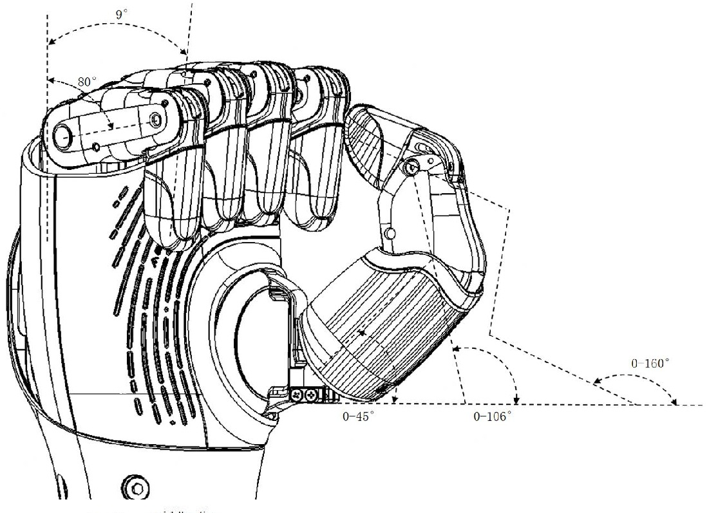

# OmniHand 2025 User Manual

### AgiBot OmniHand 2025 Robotic Hand <a href="#product" id="product"></a>



### Contents <a href="#contents" id="contents"></a>

* Important safety precautions
* Product profile and specifications
* Installation and interfaces
* Communication protocols
* Host software

### Key Troubleshooting Index <a href="#key-troubleshooting-index" id="key-troubleshooting-index"></a>

* Mechanical, hardware, SDK, and host-software issues
* Initialization and power-supply indicator faults
* USB connection and port-detection problems
* Firmware-upgrade failures
* Communication error codes and command reference

### 1. Important Safety Precautions <a href="#id-1-important-safety-precautions" id="id-1-important-safety-precautions"></a>

This section describes the safety requirements that must be met during the installation and operation of the OmniHand. As OmniHand is a semi-finished mechanical product, it is essential to carefully read this manual and fully understand the relevant safety features and potential hazards prior to first use. All relevant personnel must conduct risk assessment before each OmniHand installation and strictly adhere to all instructions in this manual during operation.

#### 1.1 Notes for Use <a href="#id-1-1-notes-for-use" id="id-1-1-notes-for-use"></a>

* Do not operate or store the OmniHand in any high-temperature or high-humidity environment.
* Do not subject the OmniHand to excessive mechanical load or shock.
* Do not apply excessive force on fingertips.
* Do not forcibly pull or twist any finger of the OmniHand.
* Do not bring the OmniHand near an open flame or heat source.
* Do not operate or store the OmniHand in a flammable or explosive environment.
* Do not use the OmniHand in any strong electromagnetic fields, such as near high-voltage power lines or high-power machinery.
* Do not use the OmniHand to grasp any objects that are excessively heavy, overheated, sharp, rough or corrosive.
* Do not expose the OmniHand to any liquid (alcohol, water, beverage, etc.) or dust without proper protection. In case of accidental contact, be sure to power off immediately and contact our after-sales service technicians.
* Do not disassemble the OmniHand without authorization; otherwise, the warranty in the After-Sales Service Commitment will be voided. In case of any malfunction, please contact our after-sales service technicians.
* Do not operate any hazardous machinery with the OmniHand. The company assumes no liability for personal injury or property damage resulting from such actions.

#### 1.2 Risk Assessment <a href="#id-1-2-risk-assessment" id="id-1-2-risk-assessment"></a>

List of Potential Hazards:

* Mechanical hazards: Crush injuries, abrasions, etc., caused by contact with the OmniHand or any sharp object being held.
* Electrical hazards: Electric burns or electric shocks caused by contact with live parts.
* High-temperature hazards: Burns caused by prolonged contact with hot surfaces of the OmniHand.
* Noise hazard: No significant hazard identified.
* Vibration hazard: No significant hazard identified.
* Radiation hazard: No significant hazard identified.
* Material/substance hazard: No significant hazard identified.
* Ergonomic hazard: No significant hazard identified.
* Environmental hazard: No significant hazard identified.

#### 1.3 After-Sales Service Commitment <a href="#id-1-3-after-sales-service-commitment" id="id-1-3-after-sales-service-commitment"></a>

The OmniHand is covered by a 6-month limited warranty. If any defect due to manufacturing or material flaws occurs after the Product is put into use, we will provide necessary spare parts for replacement or repair. The product warranty shall be void if defects result from improper handling, failure to follow the instructions provided in this manual, or unauthorized disassembly of the product. Without prejudice to terms of this warranty, if the Product has exceeded its warranty period, we reserve the right to charge customers for the cost of replacement or repair.

Beyond the warranty period, if the device exhibits any defect, we should not be held liable for any damages or losses incurred, including but not limited to production losses or damage to other production equipment.

Unauthorized disassembly of the product is strictly prohibited. Otherwise, the warranty-related clauses in the Sales Agreement will become invalid. If any malfunction occurs, please contact after-sales service personnel promptly.

Customers may separately purchase extended warranty services or OmniCare+ services.

Please contact the sales or customer service team for details.

#### 1.4 Disclaimer <a href="#id-1-4-disclaimer" id="id-1-4-disclaimer"></a>

We are committed to continuously improving the product reliability and performance, and therefore reserve the right to make product improvements or upgrades without further notice. We strive to ensure the accuracy and reliability of this Manual but shall not be held liable for any errors or omissions it may contain. Defects or malfunctions caused by the following circumstances are not covered within the scope of warranty:

* Failure to install, wire or connect other control devices as required by the user manual;
* Unauthorized disassembly/assembly of the OmniHand;
* Use of the OmniHand beyond the specifications or standards stated in the user manual;
* Damage resulting from improper transportation;
* Damage caused by accidents, impacts, or collisions;
* Damage caused by natural disasters, including but not limited to fire, earthquake, tsunami, lightning strike, strong winds and floods.

We shall not be held liable for any loss, damage, injury or expense caused by customers violating the disclaimers in this Section. Customers should carefully read and agree to this disclaimer before purchasing and using the Product.

#### 1.5 Maintenance and Storage Instructions <a href="#id-1-5-maintenance-and-storage-instructions" id="id-1-5-maintenance-and-storage-instructions"></a>

To ensure the long-term stable operation of the OmniHand, please follow the maintenance and storage requirements below.

* For long-term storage, it is recommended to store the product in a dry environment with suitable temperature, away from direct sunlight, corrosive gases, strong electromagnetic interference, fire sources, and heat sources.
* During long-term storage, disconnect the power cable and communication cable. Avoid keeping the dexterous hand under continuous load, bending, compression, or suspended conditions for extended periods.
* It is recommended to use the original packaging or protective packaging with dust-proof and shock-resistant features for storage.
* Without proper protection, the OmniHand must not come into contact with liquids (such as alcohol, water, beverages), dust, or corrosive substances. Avoid exposure to rain. If accidental contact occurs, immediately disconnect the power supply and inspect the interfaces, joints, and housing condition.
* Do not directly wash, soak, or spray cleaning liquids onto the dexterous hand. Do not use alcohol, strong acids, strong alkalis, corrosive cleaners, volatile solvents, or abrasive materials to clean the dexterous hand. A clean, dry soft cloth may be used to wipe the surface of the rigid housing to remove dust.
* Regular maintenance and inspection should be performed to ensure that components such as motors and power systems operate normally, preventing potential hazards caused by aging or damage.
* If the dexterous hand malfunctions, do not disassemble it yourself or continue forced operation. Record the fault symptoms, occurrence time, operating environment, load conditions, and abnormal warnings, then contact after-sales service personnel promptly. Damage caused by unauthorized repair, disassembly, modification, or use of non-original spare parts may invalidate warranty coverage. Related risks shall be borne by the user.

### 2. Product Profile <a href="#id-2-product-profile" id="id-2-product-profile"></a>

#### 2.1 Overview <a href="#id-2-1-overview" id="id-2-1-overview"></a>

OmniHand is a compact and high-degrees-of-freedom (DoF) robotic dexterous hand featuring a miniaturized and versatile design, optimized for interactive applications.

OmniHand supports a wide range of applications, including gesture interaction, touch interaction and light-duty tasks, accommodating multiple common interactive gestures and covering 300+ tactile sensing points across the palms, hand backs and all five fingers.

The hand features a soft-touch coating and pinch-prevention safety design; lightweight and agile, it is ideal for humanoid robots across a wide range of models.

#### 2.2 Features <a href="#id-2-2-features" id="id-2-2-features"></a>

* Compact and lightweight: 180 mm in total length and just 510 g in weight, making it adaptable to humanoid robots of various models.
* Adaptive interaction: 16 DoF for more human-like gesture interaction, covering all common gestures plus an exclusive back-of-hand touch interaction.
* Safe and user-friendly: Over 300 force-sensing taxels across the hand and a pinch-prevention design for safer interaction.

#### 2.3 Product Basic Information <a href="#id-2-3-product-basic-information" id="id-2-3-product-basic-information"></a>

| Item                 | OmniHand without Tactile                   | OmniHand with Tactile                      |
| -------------------- | ------------------------------------------ | ------------------------------------------ |
| Product model        | OmniHand without Tactile                   | OmniHand with Tactile                      |
| CE-EMC certification | Complies with EN IEC 61000-6-1/6-2/6-3/6-4 | Complies with EN IEC 61000-6-1/6-2/6-3/6-4 |
| RoHS certification   | RoHS compliant                             | RoHS compliant                             |

#### 2.4 Technical Specifications <a href="#id-2-4-technical-specifications" id="id-2-4-technical-specifications"></a>

| Category       | Parameter                                          | OmniHand without Tactile                                             | OmniHand with Tactile                                                |
| -------------- | -------------------------------------------------- | -------------------------------------------------------------------- | -------------------------------------------------------------------- |
| Body           | Weight (excluding wrist end cap and screws)        | ≤ 510 g                                                              | ≤ 520 g                                                              |
| Body           | Dimensions                                         | 180 x 85 x 38.5 mm                                                   | 180 x 85 x 38.5 mm                                                   |
| Body           | Active DoF                                         | <p>10 (thumb 3;<br>index 2;<br>middle 1;<br>ring 2;<br>little 2)</p> | <p>10 (thumb 3;<br>index 2;<br>middle 1;<br>ring 2;<br>little 2)</p> |
| Body           | Total DoF                                          | <p>16 (thumb 4;<br>index 3;<br>middle 3;<br>ring 3;<br>little 3)</p> | <p>16 (thumb 4;<br>index 3;<br>middle 3;<br>ring 3;<br>little 3)</p> |
| Body           | Minimum opening/closing time                       | 0.5 s / 0.5 s                                                        | 0.5 s / 0.5 s                                                        |
| Body           | Fingertip repetitive positioning accuracy          | 0.3 mm                                                               | 0.3 mm                                                               |
| Body           | Five-finger grip force (hybrid force-control mode) | <p>Stable grasping: 2 kg;<br>lifting: 5 kg</p>                       | <p>Stable grasping: 2 kg;<br>lifting: 5 kg</p>                       |
| Electrical     | Operating voltage                                  | 18-27 V                                                              | 18-27 V                                                              |
| Electrical     | Communication                                      | CAN-FD / RS485                                                       | CAN-FD / RS485                                                       |
| Environment    | Operating temperature                              | 0-45°C                                                               | 0-45°C                                                               |
| Software       | Upgrade                                            | OTA upgrade                                                          | OTA upgrade                                                          |
| Tactile sensor | Force sensing type                                 | Not applicable                                                       | <p>Fingertip + palm + hand back;<br>one-dimensional force</p>        |
| Tactile sensor | Array resolution                                   | Not applicable                                                       | 0.1 N                                                                |
| Tactile sensor | Sensing range                                      | Not applicable                                                       | 0-20 N                                                               |
| Tactile sensor | Maximum acceptable force (nondestructive)          | Not applicable                                                       | 200 N                                                                |

#### 2.5 Range of Joint Angle <a href="#id-2-5-range-of-joint-angle" id="id-2-5-range-of-joint-angle"></a>

| Finger        | Joint              | Left Min (°) | Left Max (°) | Right Min (°) | Right Max (°) | Notes                                                                   |
| ------------- | ------------------ | ------------ | ------------ | ------------- | ------------- | ----------------------------------------------------------------------- |
| Thumb         | thumb\_roll\_joint | -2           | 64           | -64           | 2             |                                                                         |
| Thumb         | thumb\_abad\_joint | -94          | 3            | -3            | 94            |                                                                         |
| Thumb         | thumb\_mcp\_joint  | 0            | 48           | -48           | 0             |                                                                         |
| Thumb         | thumb\_pip\_joint  |              |              |               |               | <p>Coupled joint;<br>refer to the coupling relationship in the SDK.</p> |
| Thumb         | thumb\_dip\_joint  |              |              |               |               | <p>Coupled joint;<br>refer to the coupling relationship in the SDK.</p> |
| Index Finger  | index\_abad\_joint | -9           | 0            | 0             | 9             |                                                                         |
| Index Finger  | index\_pip\_joint  | 0            | 85           | 0             | 85            |                                                                         |
| Index Finger  | index\_dip\_joint  |              |              |               |               | <p>Coupled joint;<br>refer to the coupling relationship in the SDK.</p> |
| Middle Finger | middle\_pip\_joint | 0            | 85           | 0             | 85            |                                                                         |
| Middle Finger | middle\_dip\_joint |              |              |               |               | <p>Coupled joint;<br>refer to the coupling relationship in the SDK.</p> |
| Ring Finger   | ring\_abad\_joint  | 0            | 10           | -10           | 0             |                                                                         |
| Ring Finger   | ring\_pip\_joint   |              |              |               |               | <p>Coupled joint;<br>refer to the coupling relationship in the SDK.</p> |
| Ring Finger   | ring\_dip\_joint   | 0            | 85           | 0             | 85            |                                                                         |
| Fifth Finger  | pinky\_abad\_joint | 0            | 11           | -11           | 0             |                                                                         |
| Fifth Finger  | pinky\_pip\_joint  | 0            | 85           | 0             | 85            |                                                                         |
| Fifth Finger  | pinky\_dip\_joint  |              |              |               |               | <p>Coupled joint;<br>refer to the coupling relationship in the SDK.</p> |

Please refer to the chart above.

<figure><figcaption><p>OmniHand joint-angle range illustration</p></figcaption></figure>

<figure><figcaption><p>OmniHand joint names and coordinate system</p></figcaption></figure>

#### 2.6 Product Dimensions <a href="#id-2-6-product-dimensions" id="id-2-6-product-dimensions"></a>

<figure><figcaption><p>OmniHand front-view dimensions</p></figcaption></figure>

<figure><figcaption><p>OmniHand side-view dimensions</p></figcaption></figure>

<figure><figcaption><p>OmniHand rear-view dimensions</p></figcaption></figure>

#### 2.7 Environmental Compliance & Disposal Declaration <a href="#id-2-7-environmental-compliance-disposal-declaration" id="id-2-7-environmental-compliance-disposal-declaration"></a>

This product is classified as Waste Electrical and Electronic Equipment (WEEE). When disposing of this product, please follow the requirements of the WEEE Directive.

The product must not be disposed of together with ordinary household waste. After the product reaches the end of its service life, it should be delivered to a qualified local electronic waste recycling facility for professional classification, recycling, and harmless disposal. Proper disposal helps recover valuable resources and reduces potential impacts on the ecological environment.

This product strictly complies with RoHS environmental protection regulations. The content of hazardous substances in all product components meets the legally defined limits.

### 3. Installation Instructions <a href="#id-3-installation-instructions" id="id-3-installation-instructions"></a>

This Section describes how to install the OmniHand and related information about its electrical and communication interfaces.

#### 3.1 Packing List <a href="#id-3-1-packing-list" id="id-3-1-packing-list"></a>

* OmniHand × 1
* Power + CAN-FD Cable × 1 (power cable connector type: XT30 female)
* RS485 Cable × 1
* USB Type-C Cable × 1
* OmniHand Quick Start Guide × 1
* Product Certificate × 1

#### 3.2 Installation and Removal Guide <a href="#id-3-2-installation-and-removal-guide" id="id-3-2-installation-and-removal-guide"></a>

**3.2.1 Installation Tool List**

| No. | Item                                   | Quantity | Included          |
| --- | -------------------------------------- | -------- | ----------------- |
| 1   | OmniHand                               | 1        | Yes               |
| 2   | Ultra-short head hex socket screw M4×8 | 4        | No                |
| 3   | Wrist rear cover                       | 1        | Yes               |
| 4   | H2 Hex key                             | 1        | No, user supplied |
| 5   | RS485 Communication Cable              | 1        | Yes               |
| 6   | USB Type-C Communication Cable         | 1        | Yes               |
| 7   | Power + CAN-FD Communication Cable     | 1        | Yes               |

**3.2.2 Installation Procedure**

**STEP 1: Remove the four M4×8 screws on the wrist and detach the rear wrist cover.**

**STEP 2:** Connect the communication cable (RS485 or USB Type-C) and power cable. The user must provide a 24 V power supply.

**STEP 3: Install the dexterous hand onto the robot arm flange.**

(Refer to the mechanical interface design shown in the following figure.) Secure the dexterous hand using the M4 screws removed in Step 1 to complete installation.

**3.2.3 Removal Procedure**

**STEP 1:** Remove the four M4 screws on the wrist and detach the dexterous hand from the robotic-arm wrist flange, if applicable.

**STEP 2: Disconnect the communication cable (RS485 or USB Type-C) and power cable.**

**STEP 3: Install the wrist rear cover back onto the wrist and tighten the four M4×8 screws.**

<figure><figcaption><p>Wrist rear-cover and adapter-flange installation</p></figcaption></figure>

<figure><figcaption><p>OmniHand adapter-flange mechanical dimensions</p></figcaption></figure>

**3.2.4 Using Other Robotic Arms**

**Adapter Flange Design**

Refer to mechanical drawings and 3D models to design the adapter flange.

Pay attention to:

* Matching the mating surface profile
* Screw hole positions
* Screw hole depth In general, robotic arms can only provide power supply and may not support communication.

Before integration, check whether the robot arm end flange provides power interfaces, such as 6-pin or 8-pin connectors. During adapter flange design, reserve sufficient space for cable routing.

**Connecting to the Robotic Arm**

Refer to Section 3.2.2: Removing the Wrist Rear Cover.

Connect the power and communication harnesses of the dexterous hand, then connect the dexterous hand to the adapter flange. Finally, connect the adapter flange to the robotic arm.

#### 3.3 Interfaces and Communication <a href="#id-3-3-interfaces-and-communication" id="id-3-3-interfaces-and-communication"></a>

**3.3.1 Electrical and Communication Interface - Pin Definition**

The connector uses:

WAFER-GH1.25-6PLB (Reference Designator: U1). Supports CAN-FD communication.

Pin definitions are as follows:

| CAN-FD Pin | Definition |
| ---------- | ---------- |
| 1          | 24 V       |
| 2          | 24 V       |
| 3          | CAN\_H     |
| 4          | CAN\_L     |
| 5          | GND        |
| 6          | GND        |

GH125-S03CCA-00 used as connector (Tag. No.: XI) with RS485 supported. Specific pin definitions are as follows:

| Pin | Pin Definitions |
| --- | --------------- |
| 1   | RS485\_A        |
| 2   | RS485\_B        |
| 3   | GND             |

The specific pin sequence and corresponding pin definitions for the T version are shown in the figure below (determination criteria: SN code marked in red, where the two-digit number is less than 12 indicates the T version AHB6RUUKX2509200038).

<figure><figcaption><p>T-version electrical and communication interface layout</p></figcaption></figure>

The specific pin sequence and corresponding pin definitions for the P version are shown in the figure below (determination criteria: SN codes marked in red greater than or equal to

### 12 are all P versions, AHB6RUUKX2512120035). <a href="#id-12-are-all-p-versions-ahb6ruukx2512120035" id="id-12-are-all-p-versions-ahb6ruukx2512120035"></a>

<figure><figcaption><p>P-version electrical and communication interface layout</p></figcaption></figure>

**3.3.2 Communication method**

* USB communication for connecting to the host software interface and operating the dexterous hand.
* CAN-FD / RS485 communication for secondary development and customized applications.

Developer documentation:

https://github.com/AgibotTech/agillink\_omnihand\_sdk/tree/main

#### 3.4 Common Troubleshooting <a href="#id-3-4-common-troubleshooting" id="id-3-4-common-troubleshooting"></a>

| Issue                                                     | Solution                                                                                                                                  |
| --------------------------------------------------------- | ----------------------------------------------------------------------------------------------------------------------------------------- |
| Silicone fingertip sleeves or palm silicone pads are worn | Replace the silicone components.                                                                                                          |
| Screws become loose after removal and reinstallation      | <p>Do not reuse removed screws.<br>Replace them with new screws.</p>                                                                      |
| Hardware fault                                            | <p>Do not disassemble or replace hardware components.<br>Contact after-sales service personnel.</p>                                       |
| SDK fault                                                 | See the official SDK troubleshooting guide: https://github.com/AgibotTech/agillink\_omnihand\_sdk/blob/main/doc/zh\_cn/TROUBLESHOOTING.md |
| Host software fault                                       | For firmware-upgrade and host-software problems, see Section 5.                                                                           |

#### 3.5 Operation Precautions <a href="#id-3-5-operation-precautions" id="id-3-5-operation-precautions"></a>

* Component Replacement: Except for the wrist rear cover, users are prohibited from disassembling or replacing components themselves. If any issue occurs, please contact after-sales service personnel.
* Debugging, Operation, and Start/Stop Procedures: The host software can be used for debugging, operation, and start/stop control. For details, refer to Section 5: Host Software User Guide.
* Prohibited Operations: Do not manually force the fingers when the dexterous hand has reached its mechanical limit; Do not manually move the fingers while the dexterous hand is powered on.

### 4. Communication Protocols <a href="#id-4-communication-protocols" id="id-4-communication-protocols"></a>

#### 4.1 CAN-FD Communication <a href="#id-4-1-can-fd-communication" id="id-4-1-can-fd-communication"></a>

CAN-FD communication parameters: arbitration field baud rate 1M (80% sampling point), data field baud rate 5M (75% sampling point). This device supports CAN-FD frame format only. For classic CAN 2.0 frames, the device will:

* not parse the data
* not send any acknowledgment
* not generate error frames The following is the communication frame layout in the CANFD data field:

| ID      | DLC  | D0  | D1 - D63   |
| ------- | ---- | --- | ---------- |
| Node ID | 1-64 | CMD | Data field |

* Node ID: 0\~0x7FF, standard frame. Default ID is 0x09. When the node ID is unknown, you can use paging address 0x7FF to query the node ID. The node will still reply according to its own ID after receiving this ID data.
* CMD: Control command, which will occupy the first byte in the data field and its specific definition is detailed in Chapter 4.3.
* Data segment: Data corresponding to the control command and its specific definition is detailed in Chapter 4.3 Upstream/Downstream Data Definitions; all data is arranged in little-endian format.

Command examples (hex format):

A. Enable command: 0x09 0x02 0x01 0x01 B. Disable command: 0x09 0x02 0x01 0x00 C. Set Motor 1 to position 2000: 0x09 0x04 0x06 0x01 0x00 0x7D D. Set all motors to position 2000:

0x09 0x18 0x08 00 7D 00 7D 00 7D 00 7D 00 7D 00 7D 00 7D 00 7D 00 7D 00 7D 00 7D

#### 4.2 USB/Serial Communication <a href="#id-4-2-usb-serial-communication" id="id-4-2-usb-serial-communication"></a>

Serial communication parameter settings:

* Baud rate: 460800
* Total bytes: 8
* Check bit: None
* Stop bit: 1

When using a USB connection, the driver board will virtualize a serial port; the baud rate can be freely set while other parameters are kept identical.

| Field          | Frame header | ID | Data length | Data segment (CMD+DATA) | crc |
| -------------- | ------------ | -- | ----------- | ----------------------- | --- |
| Byte occupancy | 2            | 2  | 1           | N                       | 2   |

* Frame header: 0xAAEE, little-endian format
* ID: Device Node ID, 0\~0x7FF. Default ID is 0x01. When the node ID is unknown, you can use paging address 0x7FF to query the node ID. The node will still reply according to its own ID after receiving this ID data, little-endian format
* Data length: Byte length of the data segment
* Data segment: the length is 1-64, the first byte is the control command, followed by corresponding data, identical with the data field in CAN-FD, all data is arranged in little-endian format.
* crc: Data verification. The verification range ranges from the frame header through the data segment. For its calculation method, please refer to the crc16 function in the following file. The value 0x5555 is reserved as a debug-specific crc, which can pass the verification directly. Little-endian format.
* crc calculation details:
* Initial value: 0x0000
* Polynomial: 0x1021
* XOR output: 0x0000
* Data reflection: none, uses MSB-first bit order
* Command examples (hex format): a. Enable command: 0xEE 0xAA 0x01 0x00 0x02 0x01 0x01 0x60 0xAA b. Disable command: 0xEE 0xAA 0x01 0x00 0x02 0x01 0x00 0x41 0xBA

c. Set Motor 1 to position 2000: 0xEE 0xAA 0x01 0x00 0x04 0x06 0x01 0x00 0xD7 0x21 0xB9 d. Set all motors to position 2000: 0xEE 0xAA 0x01 0x00 0x15 0x08 0x00 0xD7 0x00 0xD7 0x00 0xD7 0x00 0xD7 0x00 0xD7 0x00 0xD7 0x00 0xD7 0x00 0xD7 0x00 0xD7 0x00 0xD7 0x9B 0x65

```cpp
/*
* @Author: richie.li
* @Date: 2023-08-21 21:46:17
* @LastEditors: richie.li
* @LastEditTime: 2023-12-26 17:07:10
*/

/* Private includes
----------------------------------------------------------*/
#include "crc.h"

/* Private types
-------------------------------------------------------------*/
/* Private macro
-------------------------------------------------------------*/
/* Private constants
---------------------------------------------------------*/
/* Private variables
---------------------------------------------------------*/
static const uint16_t crc16Tab[256] = {
0x0000, 0x1021, 0x2042, 0x3063, 0x4084, 0x50a5, 0x60c6, 0x70e7,
0x8108, 0x9129, 0xa14a, 0xb16b,
0xc18c, 0xd1ad, 0xe1ce, 0xf1ef, 0x1231, 0x0210, 0x3273, 0x2252,
0x52b5, 0x4294, 0x72f7, 0x62d6,
0x9339, 0x8318, 0xb37b, 0xa35a, 0xd3bd, 0xc39c, 0xf3ff, 0xe3de,
0x2462, 0x3443, 0x0420, 0x1401,
0x64e6, 0x74c7, 0x44a4, 0x5485, 0xa56a, 0xb54b, 0x8528, 0x9509,
0xe5ee, 0xf5cf, 0xc5ac, 0xd58d,
0x3653, 0x2672, 0x1611, 0x0630, 0x76d7, 0x66f6, 0x5695, 0x46b4,
0xb75b, 0xa77a, 0x9719, 0x8738,
0xf7df, 0xe7fe, 0xd79d, 0xc7bc, 0x48c4, 0x58e5, 0x6886, 0x78a7,
0x0840, 0x1861, 0x2802, 0x3823,
0xc9cc, 0xd9ed, 0xe98e, 0xf9af, 0x8948, 0x9969, 0xa90a, 0xb92b,
0x5af5, 0x4ad4, 0x7ab7, 0x6a96,
0x1a71, 0x0a50, 0x3a33, 0x2a12, 0xdbfd, 0xcbdc, 0xfbbf, 0xeb9e,
0x9b79, 0x8b58, 0xbb3b, 0xab1a,
0x6ca6, 0x7c87, 0x4ce4, 0x5cc5, 0x2c22, 0x3c03, 0x0c60, 0x1c41,
0xedae, 0xfd8f, 0xcdec, 0xddcd,
0xad2a, 0xbd0b, 0x8d68, 0x9d49, 0x7e97, 0x6eb6, 0x5ed5, 0x4ef4,
0x3e13, 0x2e32, 0x1e51, 0x0e70,
0xff9f, 0xefbe, 0xdfdd, 0xcffc, 0xbf1b, 0xaf3a, 0x9f59, 0x8f78,
0x9188, 0x81a9, 0xb1ca, 0xa1eb,
0xd10c, 0xc12d, 0xf14e, 0xe16f, 0x1080, 0x00a1, 0x30c2, 0x20e3,
0x5004, 0x4025, 0x7046, 0x6067,
0x83b9, 0x9398, 0xa3fb, 0xb3da, 0xc33d, 0xd31c, 0xe37f, 0xf35e,
0x02b1, 0x1290, 0x22f3, 0x32d2,
0x4235, 0x5214, 0x6277, 0x7256, 0xb5ea, 0xa5cb, 0x95a8, 0x8589,
0xf56e, 0xe54f, 0xd52c, 0xc50d,
0x34e2, 0x24c3, 0x14a0, 0x0481, 0x7466, 0x6447, 0x5424, 0x4405,
0xa7db, 0xb7fa, 0x8799, 0x97b8,
0xe75f, 0xf77e, 0xc71d, 0xd73c, 0x26d3, 0x36f2, 0x0691, 0x16b0,
0x6657, 0x7676, 0x4615, 0x5634,
0xd94c, 0xc96d, 0xf90e, 0xe92f, 0x99c8, 0x89e9, 0xb98a, 0xa9ab,
0x5844, 0x4865, 0x7806, 0x6827,
0x18c0, 0x08e1, 0x3882, 0x28a3, 0xcb7d, 0xdb5c, 0xeb3f, 0xfb1e,
0x8bf9, 0x9bd8, 0xabbb, 0xbb9a,
0x4a75, 0x5a54, 0x6a37, 0x7a16, 0x0af1, 0x1ad0, 0x2ab3, 0x3a92,
0xfd2e, 0xed0f, 0xdd6c, 0xcd4d,
0xbdaa, 0xad8b, 0x9de8, 0x8dc9, 0x7c26, 0x6c07, 0x5c64, 0x4c45,
0x3ca2, 0x2c83, 0x1ce0, 0x0cc1,
0xef1f, 0xff3e, 0xcf5d, 0xdf7c, 0xaf9b, 0xbfba, 0x8fd9, 0x9ff8,
0x6e17, 0x7e36, 0x4e55, 0x5e74,
0x2e93, 0x3eb2, 0x0ed1, 0x1ef0};

/* Private function prototypes
-----------------------------------------------*/
/* Private user code
---------------------------------------------------------*/
uint16_t crc16(const uint8_t* buf, uint32_t len) {
uint16_t crc = 0;
while (0 < len--) {
crc = (crc << 8) ^ Crc16Tab[((crc >> 8) ^ *buf++) & 0x00FF];
}
return crc;
}
```

#### 4.3 Communication Protocols <a href="#id-4-3-communication-protocols" id="id-4-3-communication-protocols"></a>

The internal active shafts of the hand are distributed according to their serial numbers, indexed from 1 to 10 (shown in red in the figure below); the tactile sensors are sequentially distributed from the thumb, indexed from 1 to 7 (shown in black in the figure below).

<figure><figcaption><p>OmniHand axis and tactile-sensor index layout</p></figcaption></figure>

| Command | Definition                                         | Downstream Data                                                                                                                                                                                                                                                                                                                                                                                                                       | Upstream Data                                                                                                                                                                                                                                                                                                                                                          | Remarks                             |
| ------- | -------------------------------------------------- | ------------------------------------------------------------------------------------------------------------------------------------------------------------------------------------------------------------------------------------------------------------------------------------------------------------------------------------------------------------------------------------------------------------------------------------- | ---------------------------------------------------------------------------------------------------------------------------------------------------------------------------------------------------------------------------------------------------------------------------------------------------------------------------------------------------------------------- | ----------------------------------- |
| 0x01    | Device enable/disable                              | 1 byte 00: Disable 01: Enable 02: Calibration mode                                                                                                                                                                                                                                                                                                                                                                                    | 1 byte 00: Failure 01: Success                                                                                                                                                                                                                                                                                                                                         |                                     |
| 0x02    | Query current device enable status                 |                                                                                                                                                                                                                                                                                                                                                                                                                                       | 1 byte 00: Disable 01: Enable 02: Calibration mode                                                                                                                                                                                                                                                                                                                     |                                     |
| 0x06    | Set single axis position                           | <p>3 byte d0: Axis index d1-d2: Target position (uint16 type), range of 0 - 4096;<br>the entire angular operating range is divided into 4096 segments, for example, if a finger is moving at alpha = 0.0°~90.0°, target position = 4096 * alpha / 3600, with angle precision up to 0.1°</p>                                                                                                                                           | <p>3 byte d0: Axis index d1-d2: Current position (uint16 type), range of 0 - 4096;<br>the entire angular operating range is divided into 4096 segments, for example, if a finger is moving at alpha = 0.0°~90.0°, target position = 4096 * alpha / 3600, with angle precision up to 0.1°</p>                                                                           |                                     |
| 0x07    | Read single axis position                          | 1 byte, axis index Range: 1-10                                                                                                                                                                                                                                                                                                                                                                                                        | Same as 0x06 command response                                                                                                                                                                                                                                                                                                                                          |                                     |
| 0x08    | Set all axis positions                             | <p>20 byte d0-d19: Target position data for all axes Each axis has two-byte position data of uint16 type, sequentially arranged starting from Axis 1, with the position of each axis ranging 0 - 4096, and the entire angular operating range is divided into 4096 segments.<br>For example, finger movement alpha = 0.0°~90.0°, target position = 4096 * alpha / 3600, with angle precision up to 0.1° d20-d23: 0, reserved DoF;</p> | <p>60 byte d0-d19, current position data for all axes 2-byte position data per axis, uint16 type, arranged sequentially from axis 1, with each axis position range 0 - 4096 d20-d39: Speed feedback for all axes;<br>d40-d49: Torque feedback for all axes;<br>d50-d59: Fault status of all axes;</p>                                                                  |                                     |
| 0x09    | Read position data for all axes                    |                                                                                                                                                                                                                                                                                                                                                                                                                                       | 20 byte d0-d19: Current position data for all axes 2-byte position data per axis, uint16 type, arranged sequentially from axis 1, with each axis position range 0 -4096                                                                                                                                                                                                |                                     |
| 0x0A    | Read current information for all axes              |                                                                                                                                                                                                                                                                                                                                                                                                                                       | <p>20 byte d0-d19: Current data for all axes;<br>Unit: 0.01A;<br>Each axis has 2-byte current data, uint16 type, sequentially arranged from Axis 1.</p>                                                                                                                                                                                                                |                                     |
| 0x0B    | Read speed information for all axes                |                                                                                                                                                                                                                                                                                                                                                                                                                                       | 20 byte d0-d23: Current speed data for all axes Each axis has 2-byte speed data, uint16 type, sequentially arranged from Axis 1.                                                                                                                                                                                                                                       |                                     |
| 0x0C    | Read temperature data for all axes                 |                                                                                                                                                                                                                                                                                                                                                                                                                                       | <p>10 byte d0-d9 : Current temperature data for all axes Each axis has 1 byte of temperature data, int8 type, sequentially arranged from Axis 1;<br>Unit: degree</p>                                                                                                                                                                                                   |                                     |
| 0x0D    | Read error code                                    |                                                                                                                                                                                                                                                                                                                                                                                                                                       | 2 bytes, uint16 type 0x0000: No error 1-10: Motor 1-10 stalling 21-30: Motor 1-10 overtemperature 41-50: Motor 1-10 current abnormal 61-70: Motor 1-10 encoder abnormal 81-90: Motor 1-10 communication error 101: Communication abnormal 102: Motor initialization failed 103: Tactile sensor initialization failed 104: Auto-calibration failed 105: Parameter error |                                     |
| 0x0E    | Clear error                                        |                                                                                                                                                                                                                                                                                                                                                                                                                                       | 1 byte 00: Failure 01: Success                                                                                                                                                                                                                                                                                                                                         |                                     |
| 0x11    | Read data from a single fingertip sensor           | 1 byte, sensor index                                                                                                                                                                                                                                                                                                                                                                                                                  | <p>17 bytes (fingers) / 26 bytes (palm and back of hand) d0 : sensor index d1-d16: finger sensor data, formatted as a 4*4 array, with each point stored as a uint8 value read in a row order.<br>d1-d25: palm/hand back sensor data, formatted as a 5*5 array, with each point stored as a uint8 value read in a row-major order.</p>                                  |                                     |
| 0x12    | Read data from all fingertip sensors-1             |                                                                                                                                                                                                                                                                                                                                                                                                                                       | 48 bytes, in the following order: Thumb 4\*4 + Index finger 4\*4 + Mid-finger 4\*4 With each point stored as a uint8 value and each sensor read in a row-major order;                                                                                                                                                                                                  |                                     |
| 0x13    | Read data from all fingertip sensors-2             |                                                                                                                                                                                                                                                                                                                                                                                                                                       | 32 bytes, in the following order: Ring finger 4\*4 + Fifth finger 4\*4 With each point stored as a uint8 value and each sensor read in a column-major order;                                                                                                                                                                                                           |                                     |
| 0x14    | Read data from all fingertip sensors-3             |                                                                                                                                                                                                                                                                                                                                                                                                                                       | 50 bytes, in the following order: Palm 5\*5 + Back of hand 5\*5 With each point stored as a uint8 value and each sensor read in a row-major order;                                                                                                                                                                                                                     |                                     |
| 0x32    | Set all axes position (force-position hybrid mode) | <p>50 bytes.<br>d0-d19: target position data for all axes (uint16, two bytes per axis, Axis 1 first, range 0-4096).<br>d20-d39: speed data for all axes (int16, two bytes per axis, valid range -4095 to 4096).<br>d40-d49: torque data for all axes (one byte per axis, range 0-255).</p>                                                                                                                                            | <p>60 bytes.<br>d0-d19: current position data for all axes (uint16, two bytes per axis, Axis 1 first, range 0-4096).<br>d20-d39: speed feedback.<br>d40-d49: torque feedback.<br>d50-d59: fault status for all axes.</p>                                                                                                                                               |                                     |
| 0x80    | Control source                                     | 1 byte, control source setting: 0: Robot body control (default) 1: HMI operator control.                                                                                                                                                                                                                                                                                                                                              | Return: Original data                                                                                                                                                                                                                                                                                                                                                  |                                     |
| 0x81    | Control source query                               | 0 byte                                                                                                                                                                                                                                                                                                                                                                                                                                | <p>Return: Control source status 0: Robot body control;<br>1: HMI operator control.</p>                                                                                                                                                                                                                                                                                |                                     |
| 0xC2    | Read product serial number                         |                                                                                                                                                                                                                                                                                                                                                                                                                                       | 19 bytes: d0-d2: 3-digit vendor cipher d3-d8: 6-digit material cipher d9-d14: YYMMDD d15-d18: 4-bit serial number                                                                                                                                                                                                                                                      |                                     |
| 0xCD    | Query device model and software/hardware version   |                                                                                                                                                                                                                                                                                                                                                                                                                                       | 8 byte d0: Device type 2: O10 Dexterous Hand d1-d2: Product status (ASCII Codes, e.g., T1, T2, P1) d3-d5: Software version (d1.d2.d3) d6-d8: Hardware version (d4.d5.d6) d9: DoF                                                                                                                                                                                       | Compatible with OmniPicker commands |

Note: In upstream/downstream data descriptions, "d" represents data, where d0 is the first byte.

The command fields for sending and replying are identical.

#### 4.4 Firmware/Host Software Version <a href="#id-4-4-firmware-host-software-version" id="id-4-4-firmware-host-software-version"></a>

The latest firmware and host computer software versions can be downloaded from the official websites of AGIBOT and AGILINK.

AGIBOT Official Documentation: https://www.agibot.com.cn/DOCS/OS/Omnihand-O10 AGILINK Official Documentation Center:

https://cn.agilink-ai.com/OmniHand/27.html

#### 4.5 Precautions for Control <a href="#id-4-5-precautions-for-control" id="id-4-5-precautions-for-control"></a>

For controlling the OmniHand of the robot body, it is recommended to use a hybrid position/torque control mode. Apply appropriate torque when grasping objects. Frequent grasping operations are not recommended. The recommended interval between grasping actions is ≥ 2 seconds.

#### 4.6 Indicator Light Instructions <a href="#id-4-6-indicator-light-instructions" id="id-4-6-indicator-light-instructions"></a>

* When the indicator light on the back of the hand displays blue, the entire system is undergoing initialization.
* When the blue light changes to green, initialization has been completed.
* If the voltage is too low or too high, the indicator light on the back of the hand will not change from blue to green.
* Please check whether the power supply voltage meets the required specification: 24V ± 10%

### 5. Host Software Instructions <a href="#id-5-host-software-instructions" id="id-5-host-software-instructions"></a>

#### 5.1 Environment and Dependencies <a href="#id-5-1-environment-and-dependencies" id="id-5-1-environment-and-dependencies"></a>

* CPU: Intel Core i5 8th Gen or above, dual-core 1.5GHz+
* Memory: 8GB+
* Display: Support OpenGL 3.3+ (integrated graphics are sufficient)
* OS: Windows 10/11
* Interface: USB 2.0+
* Software Dependency: VC++ 2015 Redistributable / https://aka.ms/vc14/vc\_redist.x64.exe (x64), .Net Framework 4.8

#### 5.2 Download and Install <a href="#id-5-2-download-and-install" id="id-5-2-download-and-install"></a>

The OmniHand host software package can be downloaded from the official website.

The download link is provided in Section 4.4.

After downloading:

* Extract the compressed package.
* Follow the installation prompts to complete installation.
* Double-click OmniHand-ToolBox to launch the host computer software.

#### 5.3 Login Interface <a href="#id-5-3-login-interface" id="id-5-3-login-interface"></a>

<figure><figcaption><p>OmniHand ToolBox login interface</p></figcaption></figure>

After launching the software, the login interface will appear. Click the "Login" button to directly enter the user interface. The default username and password are:

Username: user Password: user The interface language can be adjusted from the upper-right corner.

Currently supported languages:

* Chinese
* English

#### 5.4 Main Interface (host software version 2.6.33) <a href="#id-5-4-main-interface-host-software-version-2-6-33" id="id-5-4-main-interface-host-software-version-2-6-33"></a>

<figure><figcaption><p>OmniHand ToolBox main interface</p></figcaption></figure>

The OmniHand 2025, once powered on, shall be connected to the host computer via a USB cable; once it is properly connected, the host software will automatically search for available port numbers, which will then be displayed in the port number section of the left sidebar.

The baud rate is fixed at 460800 and cannot be modified at this time.

Slide to connect and wait for handshake process to complete. Once the connection is successfully established, the connection status will be "Connected" and you can check the Device panel for basic device information.

In the main interface, users can also view detailed information for each joint. By selecting a specific joint, the system will display its position range, torque, rotational speed, and other related parameters. Real-time data such as current and temperature can also be viewed in the lower section of the interface.

Possible errors and solutions:

* If the status displays “Connected” but the OmniHand cannot be operated, check whether other port options are available in the “Port Number” dropdown list. Select the correct port and reconnect.
* If a connection failure occurs, verify whether the port can be detected in the “Port Number” field at the upper-left corner of the software interface:
* If a port number is shown but the connection status remains “Disconnected,” close the software and try again.
* If no port number is detected, check the following:

1. Ensure that the USB device driver is installed and determine whether the driver requires an update.
2. Confirm that the device is properly powered.
3. Check whether a docking station is being used for the connection; docking stations may cause issues, so removing it is recommended.
4. Inspect the cable connection for poor contact. The USB cable used must support data transmission.

#### 5.5 Console <a href="#id-5-5-console" id="id-5-5-console"></a>

<figure><figcaption><p>OmniHand ToolBox console and joint-control panel</p></figcaption></figure>

In the Control Panel, users can operate and control the OmniHand.

In the Action Panel, items #1 to #10 correspond to the ten joints supported by OmniHand.

Each joint’s definition is displayed above its respective slider. The thumb contains three degrees of freedom; the index finger, ring finger, and fifth finger each have two degrees of freedom (lateral movement and flexion); the middle finger has only one degree of freedom (lateral movement not supported).

To adjust the hand posture, users may control each joint by either dragging the slider or entering a specific value in the corresponding input field. The valid input range is 0 - 4096.

When entering values manually, press Enter to apply the command. The precise joint value will be displayed below the slider.

To adjust all joints simultaneously, enter the target values into each joint’s input field and click "One-click execution”, all joints will then move to their specified target positions.

“Initial Pos” allows all joints to move back to their preset initial position at once.

“Save Action” stores the current values of all degrees of freedom as a customized action.

After clicking “Save” enter a name for the action. Once saved successfully, the action will appear in the action list for future use.

**5.5.1 Custom Action Playback/Loop Panel**

<figure><figcaption><p>Custom-action playback and loop panel</p></figcaption></figure>

In the Action Playback and Loop Panel, users can select actions from the existing action list to form an action sequence. Each sequence can contain up to four actions. After selecting the actions, the interval time between consecutive actions can be entered in the corresponding input fields.

In the “Loop Count” field, enter the number of times the action sequence should be repeated. Click “Start” to begin execution. The system will perform the selected actions in order and record the execution details in the system log. Click “Stop” to terminate the process.

**5.5.2 Action File Export and Import**

<figure><figcaption><p>Custom-action JSON export and import</p></figcaption></figure>

Custom actions in the Action List can be exported as action files, allowing users to reuse them the next time the host software is opened. By clicking “Export JSON File,” all actions in the Action List can be exported at once.

When using the software again, click “Load JSON File” and select the desired local file. All actions contained in the file will be imported into the Action List.

For manual action formatting, add a JSON object separated by commas, with object content enclosed in "{}" curly braces. Inside the curly braces, the "name" field should be filled with the action name; the "pos\_axis\_x" field represents the target joint position (currently only 1-10 is required) as desired by the user.

#### 5.6 Tactile Panel <a href="#id-5-6-tactile-panel" id="id-5-6-tactile-panel"></a>

<figure><figcaption><p>OmniHand tactile-pressure panel</p></figcaption></figure>

Click the "Tactile" button to view the pressure distribution for the five fingertips, palm and the back of hand; For each fingertip, the pressure measurement point is a composite of three individual points, the palm contains nine points, and the back of hand contains five points.

The total pressure for each region is displayed at the bottom. Original pressure data is supported only via CAN-FD connection and not via USB-C connection.

#### 5.7 Upgrade Panel <a href="#id-5-7-upgrade-panel" id="id-5-7-upgrade-panel"></a>

<figure><figcaption><p>OmniHand firmware-upgrade panel</p></figcaption></figure>

In the Upgrade Panel, click the “current version” button to view the current firmware version and other related information of the device.

To perform a firmware upgrade, click “Start Upgrade,” then select the prepared firmware file (\*.bin). OmniHand will begin updating its firmware.

Before starting the upgrade, ensure that the device is properly connected. Once the upgrade begins, please wait patiently for the process to complete. Progress and status messages will be printed in the log. By checking the log, you can confirm whether the upgrade is successful. A successful upgrade will display messages such as “OTA completed normally” and “Reboot is normal.” If “Upgrade Failed” appears, try performing the upgrade again by clicking “Start Upgrade” and repeating the operation. If the upgrade still fails, review the log messages.

If the log indicates a connection failure, you may need to update the MCU firmware using an ST-Link programmer before retrying.

This manual is based on OmniHand, Hardware Version 3.0.0, Firmware Version 1.2.12, and Host Software Version 2.6.33.

For any items not specified in this product manual, please refer to the official website or contact our customer support for further information.
