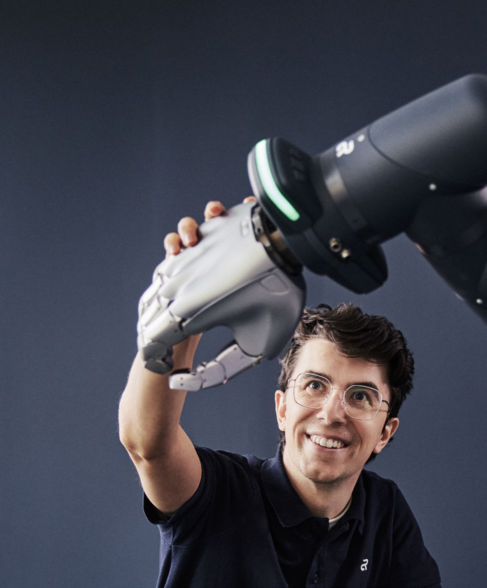

# Agile Hand: dexterous hand specifications and integration


**Model:** Agile Hand · **Scope:** Product flyer 10008-REV.2-250530; exact delivered hand/adapter required

No separate exact OpenELAB product/SKU match was verified. This is a manufacturer-document reference; no substitute store URL or SKU is asserted.

[Manufacturer product information](https://www.agile-robots.com/en/products/agile-hand/)


## Product overview

Agile Hand is a five-finger anthropomorphic hand made from modular finger units with joint torque and position sensing. It is distinct from the two-finger Franka Hand, Robotiq grippers and the 3F15G example in the training slides. An optional tactile-sensor upgrade is a separate configuration.

_Source: AR-AgileHand-Productflyer-SCREEN-en.pdf, PDF p. 1. Illustration for identification; not a mounting template or proof of application safety._

## Applications

Dexterous manipulation and grasp research, industrial handling and control experiments with a validated host/tool combination. The brochure mentions a space-qualified version; this does not establish flight qualification of every supplied hand or adapter.

## Specifications

| Parameter                   | Value and scope                                                        |
| --------------------------- | ---------------------------------------------------------------------- |
| Mass                        | 1.5 kg                                                                 |
| Joints / degrees of freedom | 21 joints / 16 DoF, including opposing-thumb actuation                 |
| Active fingertip force      | 10 N; a force, not a 10 kg payload rating                              |
| Joint velocity              | 360°/s manufacturer figure                                             |
| Control transport / rate    | EtherCAT-based real-time communication / 1 kHz advertised control rate |
| API routes advertised       | C++, Python and ROS support; exact package/version must be obtained    |
| Mechanical adapter          | Quick-changer adapter for ISO 9409-1-50-4-M6 flange                    |

Source: [AR-AgileHand-Productflyer-SCREEN-en.pdf, PDF pp. 2–3](source-library.md); [manufacturer page](https://www.agile-robots.com/en/products/agile-hand/).

## Hardware and connections

Include hand, adapter, cable and workpiece in the host robot's load/center-of-mass/inertia assessment. The flyer does not establish supply voltage/current, a power connector pinout, EtherCAT master setup, cable orientation or the supplied adapter's retention procedure. Keep those electrical/control operations blocked until the exact integration manual and mating hardware are supplied. EtherCAT support does not authorize connecting the hand to a Franka X6 flange port or an ordinary Ethernet power source.

## Software and development resources

The flyer advertises C++/Python/ROS, but no exact publicly accessible manufacturer SDK release, host matrix, EtherCAT configuration or redistribution license was verified. Obtain the delivered package, device/firmware identifiers and examples. The arm's DianaApi and Franka gripper interface are not established substitutes for this hand controller. See [platform selection](development/).

## Getting started

1. Keep the hand de-energized. Inventory the hand/revision, adapter, cable, fingertips, optional tactile hardware and intended host.
2. Check the flange/adapter drawing and hand mass against the host robot's mechanical and load requirements.
3. Obtain the exact power/pinout and EtherCAT/SDK instructions, supported host/firmware and protective stop behavior before connection.
4. Prepare a channel/joint map and a no-load test plan with the entire finger sweep clear; identify the intended stop and power-loss behavior. Do not execute a grasp as an identity test.

**Expected result:** an exact hand/adapter/host inventory and an explicit list of resolved integration documents. Powered enumeration, homing and finger movement remain blocked until the electrical and SDK gaps above are closed.

## Troubleshooting and FAQs

**The arm recognizes its gripper but not this hand:** recognition of another tool profile is not Agile Hand support. Verify the separate EtherCAT device, firmware and host package.

**16 DoF versus 21 joints:** joint count and independent actuation count differ; do not construct a 21-element command vector from the headline alone.

**Can it handle a 10 kg load?** The quoted 10 N is active fingertip force. Use the actual grasp geometry, friction, dynamic loads and manufacturer limits to validate an object.

## Downloads and technical documents

[Supplied Agile Hand flyer](source-library.md) · [Official product page](https://www.agile-robots.com/en/products/agile-hand/) · [Official brochure](https://www.agile-robots.com/media/files/New_website/Products/Agile_Hand/AR-AgileHand-Productflyer-SCREEN-en.pdf) · [Host tool/load integration](development/coordinates-tools.md)

## References and validation

Reviewed 22 November 2026. Documentation/source review only. SDK installation, compilation, robot communication, calibration, simulation, welding and physical safety tests: **not run**. This is a specification/integration reference. The exact power, pinout and SDK package are still required for powered setup.
