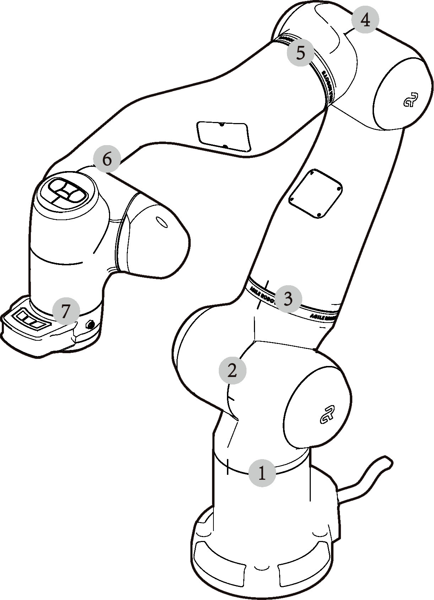

# Diana 3: hardware, controller and first connection


**Model:** Diana 3 · **Scope:** Supplied Diana3 Robot Arm User Manual V1.1.0 EN.pdf

No separate exact OpenELAB product/SKU match was verified. This is a manufacturer-document reference; no substitute store URL or SKU is asserted.


## Product overview

A compact seven-axis torque-sensing arm for industrial manipulation, with a 3 kg payload class. Its redundant kinematics and joint torque sensing distinguish it from the six-axis Thor 3.

_Source: Diana3 Robot Arm User Manual V1.1.0 EN.pdf, PDF p. 19. Illustration for identification; not a mounting template or proof of application safety._

## Applications

Industrial tool/fixture manipulation, assembly, inspection and part transfer within the exact robot's rated load and workspace. The arm manual excludes medical/life-critical use, handling people/animals and operation before risk assessment. A robot with collision detection does not certify a complete collaborative workcell.

## Specifications

| Parameter                                       | Value and scope                                            |
| ----------------------------------------------- | ---------------------------------------------------------- |
| Payload / maximum reach                         | 3 kg / 772 mm                                              |
| Axes / arm mass                                 | 7 / 19 kg                                                  |
| Repeatability                                   | ±0.05 mm, thermal steady state                             |
| Maximum TCP speed                               | 2.3 m/s; capability, not initial operating setting         |
| Protection / environment                        | IP54; 0–50 °C, indoor integration                          |
| Run-mode power, average / instantaneous maximum | 200 / 400 W; arm specification, not controller mains input |
| Controller route                                | CB-FS-3.2T-0.3KW                                           |

Sources: [Diana3 Robot Arm User Manual V1.1.0 EN.pdf, PDF pp. 16–18](source-library.md); [Diana3 EN.pdf, supplied brochure, specification table](source-library.md). The 0.5 N force-control figure is a design relative accuracy, affected by environment, end orientation and load dynamics. The J6 restriction note changes with the fitted end effector; retain the exact manual/configuration rather than copying a generic seven-axis range.

## Hardware and connections

The base uses **four M8 screws and two Ø5 positioning-pin holes**; the end-effector mounting uses **four M6 flange holes; Ø6 locating pin; approximately 13 N·m tool-fastener torque**. These are different joints: the stated tool torque is not a base-bolt torque. Follow the drawing for screw length, engagement, locating orientation and reaction loads. Mount before power, with qualified assistance and a stable vibration-free foundation. The manual calls for a foundation able to resist at least ten times the base-joint maximum torque and five times robot weight; this does not replace the integrator's structural assessment.

The supplied manual specifies an M8 eight-pin female tool connector, software-selected 12/24 V output up to 1.5 A continuous, two DI, two NPN DO and shared analog-input/RS485 functions. Analog and RS485 use is mutually exclusive. Its pin assignments differ from Thor 7/12/20: pin 1 is GND and pin 3 is tool power in this Diana 3 revision. Use the exact connector-view drawing in PDF p. 29; never reuse a Thor cable by appearance.

Sources: [Diana3 Robot Arm User Manual V1.1.0 EN.pdf, PDF pp. 23–25; PDF pp. 26–35](source-library.md). Connect the arm only to its matched [controller](cb-fs-controller.md), with power isolated and grounding, cable retention, stop chain and tool load verified. Do not hot-plug the arm cable or bridge safety inputs to make startup succeed.

## Software and development resources

Use the [Agile Robots development route](development/) for the delivered Industrial V3.3 software. The C/C++ and Python APIs use **7 joint values** for this model and SI units; pendant Lua uses mm, ms and degrees. Obtain the matching manufacturer SDK/native library and license terms; no public manufacturer-controlled Industrial API repository/package was verified. Do not install a similarly named PyPI package or AgileX UGV SDK.

Diana FS FCI support is a separate, version/configuration-bound option; see [Diana FCI adaptation](development/diana-fci.md). It is not inferred from the arm name or the Franka FR3 compatibility matrix.

## Getting started

1. With power isolated, record arm/controller labels and serials, cable, tool, mounting orientation and manuals. Verify the controller variant above and the documented supply before connection.
2. Have the integrator complete mechanical, protective-earth, stop/enabling-device and tool/load acceptance. Keep the work envelope clear and retain the initial settings.
3. Follow [system startup and first connection](development/system-startup.md): use the physical pendant or controller **Ethernet A** for the supplied PC UI route. Factory PC-controller address is `192.168.10.75`; the physical pendant has a different documented network address. Changed delivery settings take precedence.
4. Log in with the assigned account. Inspect the **Startup** information and **About** page for the robot model, joint count, software, controller/SCU/JMU and status. Leave Power On/Start, brake release, jog, Home, Free Drive, task execution and output toggles inactive for this checkpoint.
5. Compare the displayed pose/tool/load and gravity direction with the installation record. Investigate a mismatch before enabling. Save the version/status record, not a copied calibration or packaging pose.

**Expected result:** the correct Diana 3 and CB-FS-3.2T-0.3KW are identified, with 7 joint entries and a recorded UI/software status, without commanded arm motion. A connected UI does not prove the stop chain or a real-time interface has passed acceptance. Sources: [Industrial Teaching Pendant Software User Manual\_V3.3.0\_EN\_20260204.pdf, PDF pp. 11–13, 190–191](source-library.md); [EN\_1\_System\_Startup.pptx, 15 September 2025, slides 3–4, 9, 17](source-library.md).

## Troubleshooting and FAQs

**PC UI cannot connect:** inspect Ethernet A, the delivered address, link indicators, a unique host address on the same subnet and local routing/VPN conflicts. Do not assign the controller's own address to the PC. See [fault isolation](development/troubleshooting.md).

**Unexpected drag or drift:** stop guiding and verify mounting/gravity direction, the selected TCP, tool mass, center of mass and inertia. Calibration and impedance changes are separate qualified procedures.

**Error or speed-limit stop:** preserve the exact error/status and logs, stop the activity, and resolve the cause with the responsible operator. Do not disable collision detection, free-drive limits or safety functions as a connectivity fix.

## Downloads and technical documents

| Resource                                                           | Purpose                                                                    |
| ------------------------------------------------------------------ | -------------------------------------------------------------------------- |
| [Diana3 Robot Arm User Manual V1.1.0 EN.pdf](source-library.md)    | Exact arm manual, mounting/workspace/load diagrams and source page numbers |
| [CB-FS-3.2T-0.3KW controller guide](cb-fs-controller.md)           | Mains, network and safety-interface scope                                  |
| [Industrial C/C++ and Python API](development/industrial-api.md)   | Version, units, joint count and state-only example                         |
| [Coordinates, payload and tools](development/coordinates-tools.md) | TCP/workpiece frames and tooling acceptance                                |

The supplied Diana 3 brochure/manual remain the exact source; no current standalone public global product page was verified.

## References and validation

Reviewed 22 November 2026. Documentation/source review only. SDK installation, compilation, robot communication, calibration, simulation, welding and physical safety tests: **not run**. RS485 polarity/description conflicts, undocumented tool adapters and unmatched SDK packages block their respective wiring/control procedures; the identification workflow above does not require those operations.
