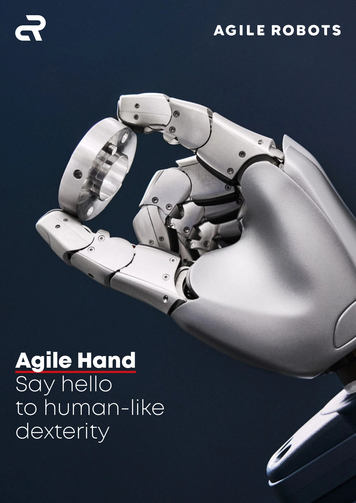
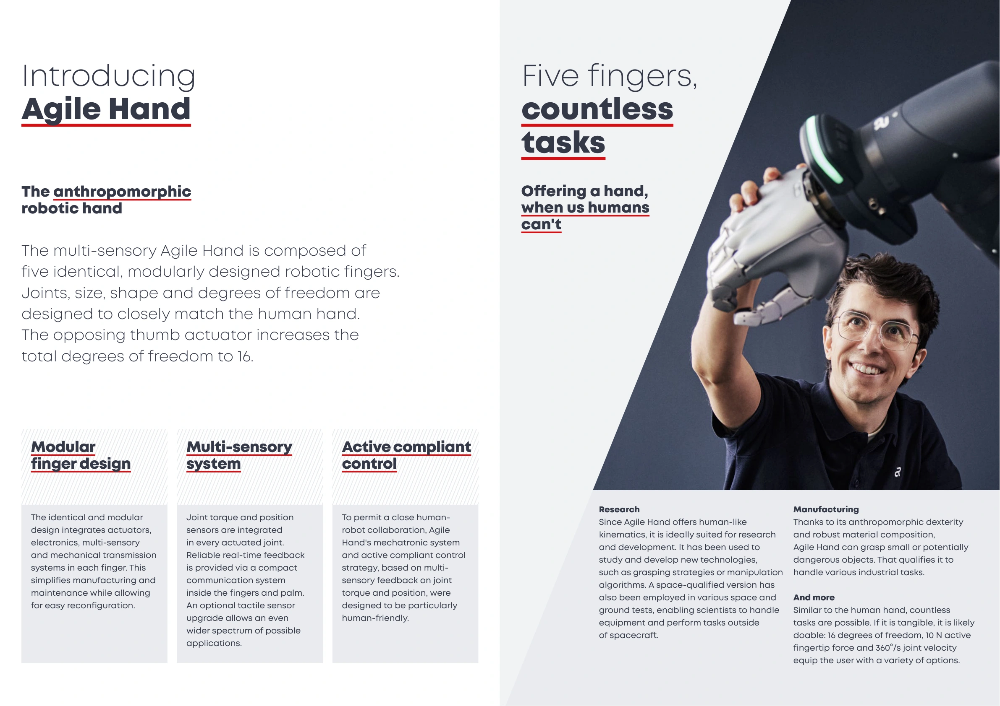
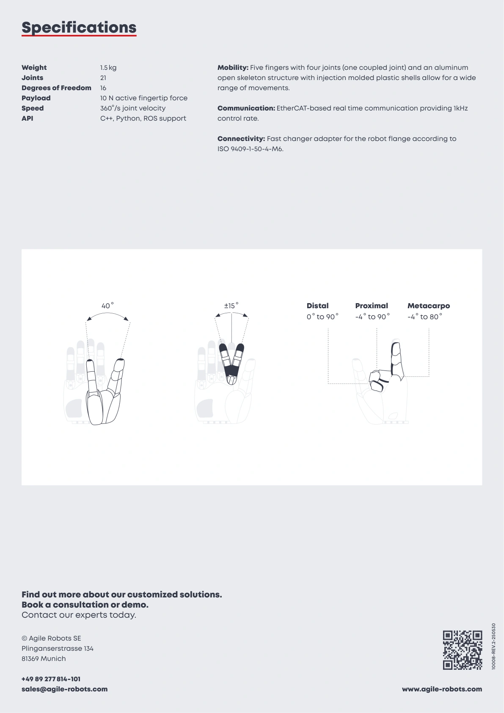

# Agile Hand product flyer — complete reference


**Complete supplied source:** AR-AgileHand-Productflyer-SCREEN-en.pdf · **Coverage:** 3 original PDF pages. [Return to the Agile Robots source library](./).


Every source page is retained in the original order. The **Original page** view preserves complete diagrams, photographs, tables, equations, connector orientation, notices and examples. The **Searchable text** view preserves native PDF text or the slide’s native text, embedded links and substantive speaker notes. Text extraction can retain reading-order/character defects; use the original image for exact layout, table columns and code indentation.


Use only the exact model, hardware/controller and software revision covered by the source. Manufacturer examples involving motion, enabling, safety configuration, I/O, calibration, updates or resets require the complete applicable procedure and qualified personnel. No robot, SDK or process-equipment test was run.


**Attribution:** the manufacturer and contributors identified in the supplied document. Original notices remain visible on every source page. Navigation, revision notes and the linked engineering explanations are OpenELAB editorial additions.

## Document navigation

| Source section / function | Original page                                                       |
| ------------------------- | ------------------------------------------------------------------- |
| Agile Hand / Say hello    | [PDF 1](complete-ar-agilehand-productflyer-screen-en.md#pdf-page-1) |
| Five fingers, / countless | [PDF 2](complete-ar-agilehand-productflyer-screen-en.md#pdf-page-2) |
| Specifications / Weight   | [PDF 3](complete-ar-agilehand-productflyer-screen-en.md#pdf-page-3) |

## PDF page 1

**Source:** AR-AgileHand-Productflyer-SCREEN-en.pdf, original pdf page 1. [Open the corresponding PDF reading-copy page](https://1292444914-files.gitbook.io/~/files/v0/b/gitbook-x-prod.appspot.com/o/spaces%2FtgOfPnscWebs1eh82EKq%2Fuploads%2FE7BhkTkExT6Aj7uRlDEp%2Far-agilehand-productflyer-screen-en-pp-001-003.pdf?alt=media#page=1).







```
Agile Hand
Say hello  
to human-like  
dexterity
```



## PDF page 2

**Source:** AR-AgileHand-Productflyer-SCREEN-en.pdf, original pdf page 2. [Open the corresponding PDF reading-copy page](https://1292444914-files.gitbook.io/~/files/v0/b/gitbook-x-prod.appspot.com/o/spaces%2FtgOfPnscWebs1eh82EKq%2Fuploads%2FE7BhkTkExT6Aj7uRlDEp%2Far-agilehand-productflyer-screen-en-pp-001-003.pdf?alt=media#page=2).







```
Five fingers,
countless 
tasks
Offering a hand,  
when us humans 
can't
Modular
finger design
Multi-sensory 
system
Active compliant 
control
Introducing 
Agile Hand
The anthropomorphic
robotic hand
The multi-sensory Agile Hand is composed of  
five identical, modularly designed robotic fingers. 
Joints, size, shape and degrees of freedom are 
designed to closely match the human hand.  
The opposing thumb actuator increases the  
total degrees of freedom to 16.
Research 
Since Agile Hand offers human-like 
kinematics, it is ideally suited for research 
and development. It has been used to 
study and develop new technologies,  
such as grasping strategies or manipulation 
algorithms. A space-qualified version has 
also been employed in various space and 
ground tests, enabling scientists to handle 
equipment and perform tasks outside  
of spacecraft.
 
The identical and modular 
design integrates actuators, 
electronics, multi-sensory 
and mechanical transmission 
systems in each finger. This 
simplifies manufacturing and 
maintenance while allowing 
for easy reconfiguration.
Joint torque and position 
sensors are integrated 
in every actuated joint. 
Reliable real-time feedback 
is provided via a compact 
communication system 
inside the fingers and palm. 
An optional tactile sensor 
upgrade allows an even 
wider spectrum of possible 
applications.
To permit a close human-
robot collaboration, Agile 
Hand's mechatronic system 
and active compliant control 
strategy, based on multi-
sensory feedback on joint 
torque and position, were 
designed to be particularly 
human-friendly.
Manufacturing
Thanks to its anthropomorphic dexterity 
and robust material composition,  
Agile Hand can grasp small or potentially 
dangerous objects. That qualifies it to 
handle various industrial tasks.
And more
Similar to the human hand, countless 
tasks are possible. If it is tangible, it is likely 
doable: 16 degrees of freedom, 10 N active 
fingertip force and 360°/s joint velocity 
equip the user with a variety of options.
```



## PDF page 3

**Source:** AR-AgileHand-Productflyer-SCREEN-en.pdf, original pdf page 3. [Open the corresponding PDF reading-copy page](https://1292444914-files.gitbook.io/~/files/v0/b/gitbook-x-prod.appspot.com/o/spaces%2FtgOfPnscWebs1eh82EKq%2Fuploads%2FE7BhkTkExT6Aj7uRlDEp%2Far-agilehand-productflyer-screen-en-pp-001-003.pdf?alt=media#page=3).







```
Specifications
Weight	
1.5 kg
Joints	
21
Degrees of Freedom	
16
Payload	
10 N active fingertip force
Speed	
360°/s joint velocity
API	
C++, Python, ROS support
Mobility: Five fingers with four joints (one coupled joint) and an aluminum 
open skeleton structure with injection molded plastic shells allow for a wide 
range of movements. 
Communication: EtherCAT-based real time communication providing 1kHz 
control rate.
Connectivity: Fast changer adapter for the robot flange according to  
ISO 9409-1-50-4-M6.
www.agile-robots.com
40 °
±15 °
Proximal
-4 ° to 90 °
Metacarpo
-4 ° to 80 °
Distal
0 ° to 90 °
10008-REV.2-250530
Find out more about our customized solutions.
Book a consultation or demo. 
Contact our experts today.
© Agile Robots SE
Plinganserstrasse 134
81369 Munich
+ 49 89 277 814 - 101
sales@agile-robots.com
```


