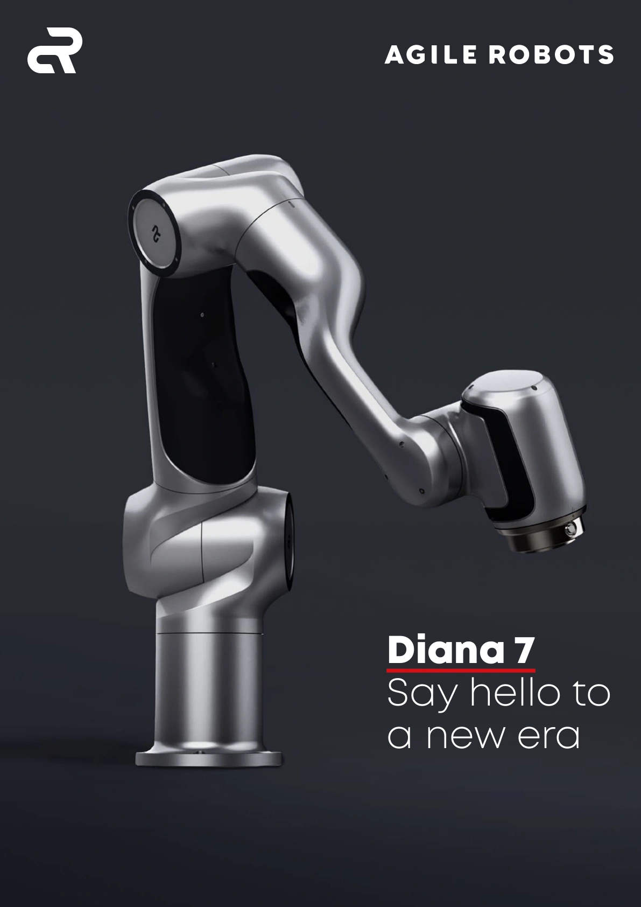
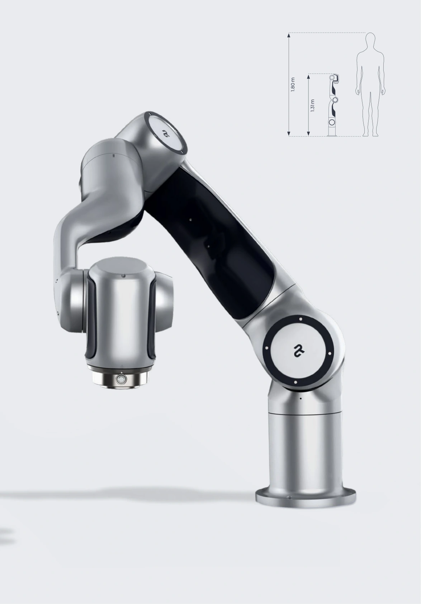
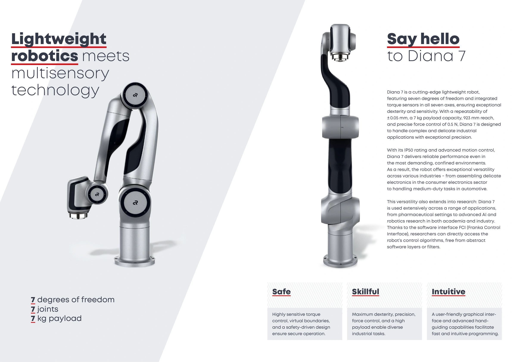
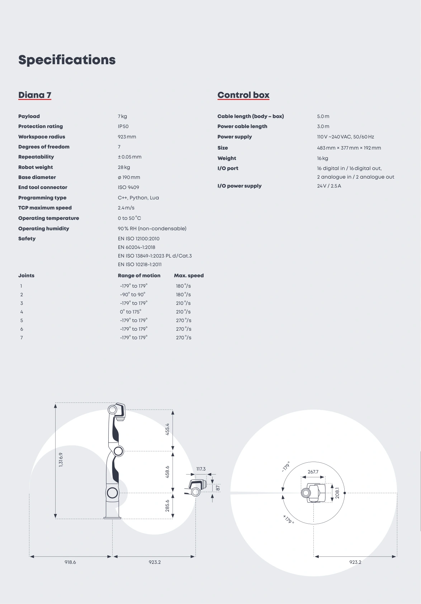
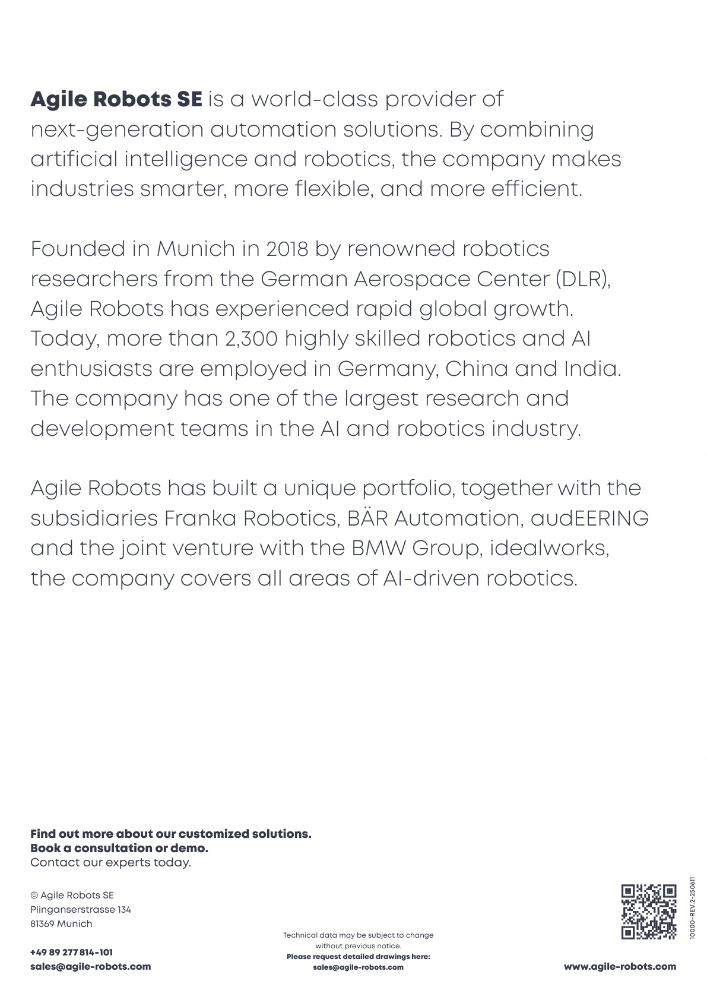

# Diana 7 product flyer — complete reference


**Complete supplied source:** AR-Diana7-Productflyer-SCREEN-en.pdf · **Coverage:** 5 original PDF pages. [Return to the Agile Robots source library](./).


Every source page is retained in the original order. The **Original page** view preserves complete diagrams, photographs, tables, equations, connector orientation, notices and examples. The **Searchable text** view preserves native PDF text or the slide’s native text, embedded links and substantive speaker notes. Text extraction can retain reading-order/character defects; use the original image for exact layout, table columns and code indentation.


Use only the exact model, hardware/controller and software revision covered by the source. Manufacturer examples involving motion, enabling, safety configuration, I/O, calibration, updates or resets require the complete applicable procedure and qualified personnel. No robot, SDK or process-equipment test was run.


**Attribution:** the manufacturer and contributors identified in the supplied document. Original notices remain visible on every source page. Navigation, revision notes and the linked engineering explanations are OpenELAB editorial additions.

## Document navigation

| Source section / function                                                    | Original page                                                    |
| ---------------------------------------------------------------------------- | ---------------------------------------------------------------- |
| Diana 7 / Say hello to                                                       | [PDF 1](complete-ar-diana7-productflyer-screen-en.md#pdf-page-1) |
| 1.31 m / 1.80 m                                                              | [PDF 2](complete-ar-diana7-productflyer-screen-en.md#pdf-page-2) |
| 7 degrees of freedom / 7 joints                                              | [PDF 3](complete-ar-diana7-productflyer-screen-en.md#pdf-page-3) |
| 267.7 / 208.1                                                                | [PDF 4](complete-ar-diana7-productflyer-screen-en.md#pdf-page-4) |
| Find out more about our customized solutions. / Book a consultation or demo. | [PDF 5](complete-ar-diana7-productflyer-screen-en.md#pdf-page-5) |

## PDF page 1

**Source:** AR-Diana7-Productflyer-SCREEN-en.pdf, original pdf page 1. [Open the corresponding PDF reading-copy page](https://1292444914-files.gitbook.io/~/files/v0/b/gitbook-x-prod.appspot.com/o/spaces%2FtgOfPnscWebs1eh82EKq%2Fuploads%2Fbq2inyPRrdECdBfeBK0Y%2Far-diana7-productflyer-screen-en-pp-001-005.pdf?alt=media#page=1).







```
Diana 7
Say hello to 
a new era
```



## PDF page 2

**Source:** AR-Diana7-Productflyer-SCREEN-en.pdf, original pdf page 2. [Open the corresponding PDF reading-copy page](https://1292444914-files.gitbook.io/~/files/v0/b/gitbook-x-prod.appspot.com/o/spaces%2FtgOfPnscWebs1eh82EKq%2Fuploads%2Fbq2inyPRrdECdBfeBK0Y%2Far-diana7-productflyer-screen-en-pp-001-005.pdf?alt=media#page=2).







```
1.31 m
1.80 m
```



## PDF page 3

**Source:** AR-Diana7-Productflyer-SCREEN-en.pdf, original pdf page 3. [Open the corresponding PDF reading-copy page](https://1292444914-files.gitbook.io/~/files/v0/b/gitbook-x-prod.appspot.com/o/spaces%2FtgOfPnscWebs1eh82EKq%2Fuploads%2Fbq2inyPRrdECdBfeBK0Y%2Far-diana7-productflyer-screen-en-pp-001-005.pdf?alt=media#page=3).







```
7 degrees of freedom  
7 joints 
7 kg payload
Intuitive
Skillful
Safe
Lightweight
robotics meets 
multisensory 
technology 
Diana 7 is a cutting-edge lightweight robot,  
featuring seven degrees of freedom and integrated 
torque sensors in all seven axes, ensuring exceptional 
dexterity and sensitivity. With a repeatability of  
± 0.05 mm, a 7 kg payload capacity, 923 mm reach, 
and precise force control of 0.5 N, Diana 7 is designed 
to handle complex and delicate industrial 
applications with exceptional precision.
With its IP50 rating and advanced motion control, 
Diana 7 delivers reliable performance even in  
the most demanding, confined environments.  
As a result, the robot offers exceptional versatility 
across various industries - from assembling delicate 
electronics in the consumer electronics sector  
to handling medium-duty tasks in automotive.
This versatility also extends into research: Diana 7  
is used extensively across a range of applications, 
from pharmaceutical settings to advanced AI and 
robotics research in both academia and industry. 
Thanks to the software interface FCI (Franka Control 
Interface), researchers can directly access the 
robot’s control algorithms, free from abstract 
software layers or filters. 
Say hello
to Diana 7
Highly sensitive torque 
control, virtual boundaries, 
and a safety-driven design 
ensure secure operation.
Maximum dexterity, precision, 
force control, and a high 
payload enable diverse 
industrial tasks.
A user-friendly graphical inter­
face and advanced hand- 
guiding capabilities facilitate  
fast and intuitive programming.
```



## PDF page 4

**Source:** AR-Diana7-Productflyer-SCREEN-en.pdf, original pdf page 4. [Open the corresponding PDF reading-copy page](https://1292444914-files.gitbook.io/~/files/v0/b/gitbook-x-prod.appspot.com/o/spaces%2FtgOfPnscWebs1eh82EKq%2Fuploads%2Fbq2inyPRrdECdBfeBK0Y%2Far-diana7-productflyer-screen-en-pp-001-005.pdf?alt=media#page=4).







```
267.7
208.1
R923.2
179°
179°
350
350
- 179 °
+ 179 °
285.6
1,31 6.9
923.2
923.2
918.6
458.6
267.7
208.1
455.4
87
117.3
Diana 7
Payload
7 kg
Protection rating
IP 50
Workspace radius
923 mm
Degrees of freedom
7
Repeatability
± 0.05 mm
Robot weight
28 kg
Base diameter
∅  190 mm
End tool connector
ISO 9409
Programming type
C++, Python, Lua
TCP maximum speed
2.4 m/s
Operating temperature
0 to 50 °C
Operating humidity
90 % RH (non-condensable)
Safety
EN ISO 12100:2010 
EN 60204-1:2018 
EN ISO 13849-1:2023 PL d/Cat.3
EN ISO 10218-1:2011
Joints
Range of motion
Max. speed
1 
2 
3 
4 
5 
6 
7
-179° to 179° 
-90° to 90° 
-179° to 179° 
0° to 175° 
-179° to 179° 
-179° to 179° 
-179° to 179°
180 °/s 
180 °/s 
210 °/s 
210 °/s 
270 °/s 
270 °/s 
270 °/s
Control box
Cable length (body – box)
5.0 m
Power cable length
3.0 m
Power supply
110 V ~240 VAC, 50/60 Hz 
Size
483 mm × 377 mm × 192 mm
Weight
16 kg
I/O port
16 digital in / 16 digital out,  
2 analogue in / 2 analogue out
I/O power supply
24 V / 2.5 A
Specifications
```



## PDF page 5

**Source:** AR-Diana7-Productflyer-SCREEN-en.pdf, original pdf page 5. [Open the corresponding PDF reading-copy page](https://1292444914-files.gitbook.io/~/files/v0/b/gitbook-x-prod.appspot.com/o/spaces%2FtgOfPnscWebs1eh82EKq%2Fuploads%2Fbq2inyPRrdECdBfeBK0Y%2Far-diana7-productflyer-screen-en-pp-001-005.pdf?alt=media#page=5).







```
Find out more about our customized solutions.
Book a consultation or demo. 
Contact our experts today.
© Agile Robots SE
Plinganserstrasse 134
81369 Munich
+ 49 89 277 814 - 101
sales@agile-robots.com
www.agile-robots.com
10000-REV.2-250611
Agile Robots SE is a world-class provider of  
next-generation automation solutions. By combining 
artificial intelligence and robotics, the company makes 
industries smarter, more flexible, and more efficient. 
Founded in Munich in 2018 by renowned robotics 
researchers from the German Aerospace Center (DLR),  
Agile Robots has experienced rapid global growth.  
Today, more than 2,300 highly skilled robotics and AI 
enthusiasts are employed in Germany, China and India.  
The company has one of the largest research and 
development teams in the AI and robotics industry. 
Agile Robots has built a unique portfolio, together with the 
subsidiaries Franka Robotics, BÄR Automation, audEERING 
and the joint venture with the BMW Group, idealworks,  
the company covers all areas of AI-driven robotics.
Technical data may be subject to change  
without previous notice. 
Please request detailed drawings here:  
sales@agile-robots.com
```


