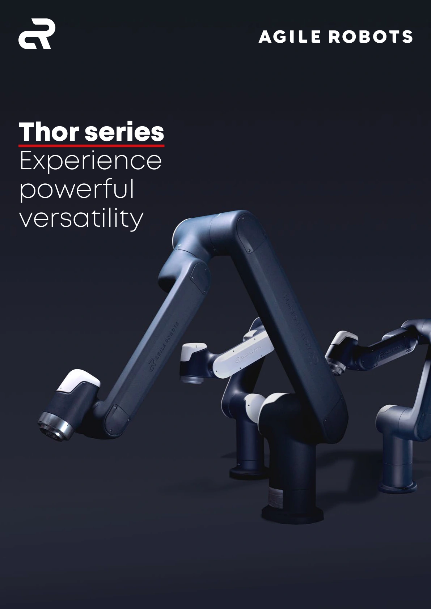
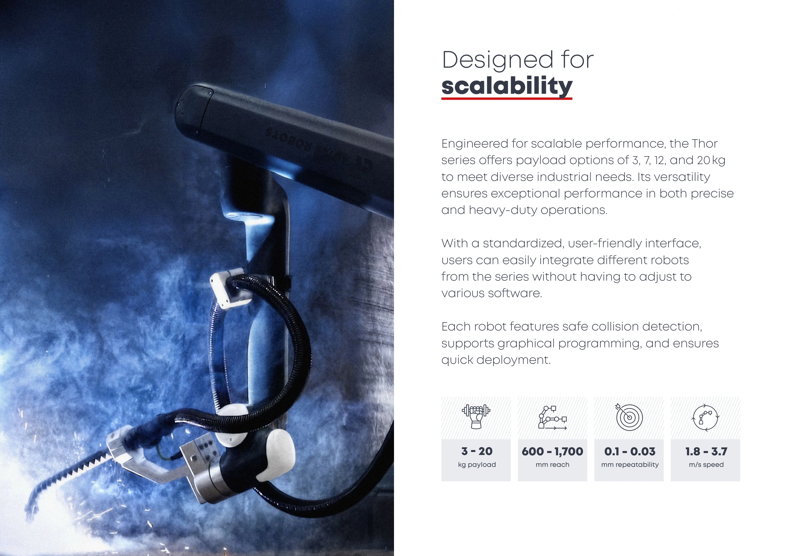
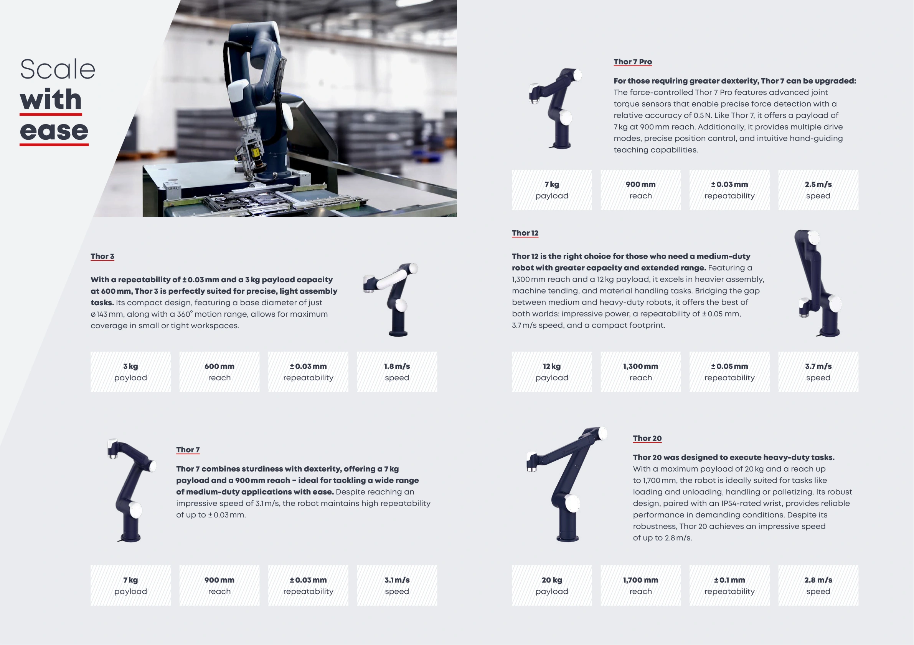
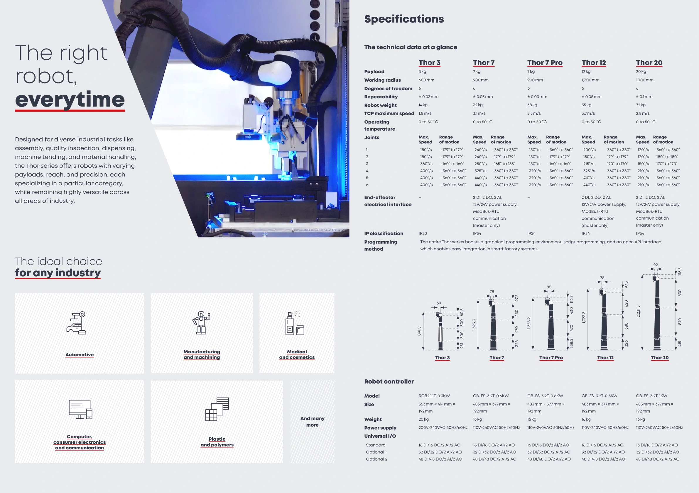
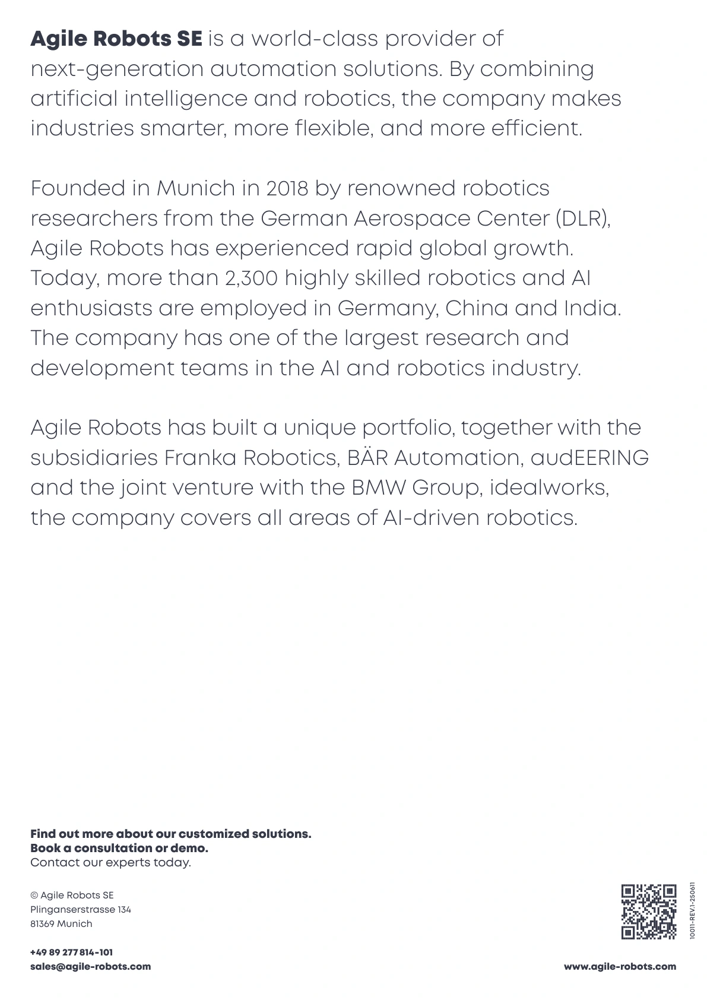

# Thor series product flyer — complete reference


**Complete supplied source:** AR-ThorSeries-Productflyer-SCREEN-en.pdf · **Coverage:** 5 original PDF pages. [Return to the Agile Robots source library](./).


Every source page is retained in the original order. The **Original page** view preserves complete diagrams, photographs, tables, equations, connector orientation, notices and examples. The **Searchable text** view preserves native PDF text or the slide’s native text, embedded links and substantive speaker notes. Text extraction can retain reading-order/character defects; use the original image for exact layout, table columns and code indentation.


The flyer covers multiple Thor variants, including Thor 7 Pro. Preserve each column and its conditions. Ordinary Thor 7 operating instructions do not establish the torque-control, controller, I/O or software contract for Thor 7 Pro.


**Attribution:** the manufacturer and contributors identified in the supplied document. Original notices remain visible on every source page. Navigation, revision notes and the linked engineering explanations are OpenELAB editorial additions.

## Document navigation

| Source section / function                                                                         | Original page                                                        |
| ------------------------------------------------------------------------------------------------- | -------------------------------------------------------------------- |
| Thor series / Experience                                                                          | [PDF 1](complete-ar-thorseries-productflyer-screen-en.md#pdf-page-1) |
| Designed for / scalability                                                                        | [PDF 2](complete-ar-thorseries-productflyer-screen-en.md#pdf-page-2) |
| Thor 3 / With a repeatability of ± 0.03 mm and a 3 kg payload capacity                            | [PDF 3](complete-ar-thorseries-productflyer-screen-en.md#pdf-page-3) |
| The technical data at a glance / Thor 3                                                           | [PDF 4](complete-ar-thorseries-productflyer-screen-en.md#pdf-page-4) |
| Agile Robots SE is a world-class provider of / next-generation automation solutions. By combining | [PDF 5](complete-ar-thorseries-productflyer-screen-en.md#pdf-page-5) |

## PDF page 1

**Source:** AR-ThorSeries-Productflyer-SCREEN-en.pdf, original pdf page 1. [Open the corresponding PDF reading-copy page](https://1292444914-files.gitbook.io/~/files/v0/b/gitbook-x-prod.appspot.com/o/spaces%2FtgOfPnscWebs1eh82EKq%2Fuploads%2F0ml9KCQXM9lT03GsqJdo%2Far-thorseries-productflyer-screen-en-pp-001-005.pdf?alt=media#page=1).







```
Thor series
Experience  
powerful  
versatility
```



## PDF page 2

**Source:** AR-ThorSeries-Productflyer-SCREEN-en.pdf, original pdf page 2. [Open the corresponding PDF reading-copy page](https://1292444914-files.gitbook.io/~/files/v0/b/gitbook-x-prod.appspot.com/o/spaces%2FtgOfPnscWebs1eh82EKq%2Fuploads%2F0ml9KCQXM9lT03GsqJdo%2Far-thorseries-productflyer-screen-en-pp-001-005.pdf?alt=media#page=2).







```
Designed for 
scalability
Engineered for scalable performance, the Thor 
series offers payload options of 3, 7, 12, and 20 kg 
to meet diverse industrial needs. Its versatility 
ensures exceptional performance in both precise 
and heavy-duty operations. 
 
With a standardized, user-friendly interface,  
users can easily integrate different robots  
from the series without having to adjust to  
various software.
Each robot features safe collision detection, 
supports graphical programming, and ensures 
quick deployment.
3 - 20
kg payload
600 - 1,700
mm reach
0.1 - 0.03
mm repeatability
1.8 - 3.7
m/s speed
```



## PDF page 3

**Source:** AR-ThorSeries-Productflyer-SCREEN-en.pdf, original pdf page 3. [Open the corresponding PDF reading-copy page](https://1292444914-files.gitbook.io/~/files/v0/b/gitbook-x-prod.appspot.com/o/spaces%2FtgOfPnscWebs1eh82EKq%2Fuploads%2F0ml9KCQXM9lT03GsqJdo%2Far-thorseries-productflyer-screen-en-pp-001-005.pdf?alt=media#page=3).







```
Thor 3
With a repeatability of ± 0.03 mm and a 3 kg payload capacity 
at 600 mm, Thor 3 is perfectly suited for precise, light assembly 
tasks. Its compact design, featuring a base diameter of just  
∅ 143 mm, along with a 360° motion range, allows for maximum 
coverage in small or tight workspaces.
Thor 7
Thor 7 combines sturdiness with dexterity, offering a 7 kg 
payload and a 900 mm reach - ideal for tackling a wide range 
of medium-duty applications with ease. Despite reaching an 
impressive speed of 3.1 m/s, the robot maintains high repeatability 
of up to ± 0.03 mm.
Scale 
with 
ease
Thor 12
Thor 12 is the right choice for those who need a medium-duty 
robot with greater capacity and extended range. Featuring a 
1,300 mm reach and a 12 kg payload, it excels in heavier assembly, 
machine tending, and material handling tasks. Bridging the gap 
between medium and heavy-duty robots, it offers the best of  
both worlds: impressive power, a repeatability of ± 0.05 mm,  
3.7 m/s speed, and a compact footprint.
Thor 20
Thor 20 was designed to execute heavy-duty tasks.  
With a maximum payload of 20 kg and a reach up  
to 1,700 mm, the robot is ideally suited for tasks like  
loading and unloading, handling or palletizing. Its robust 
design, paired with an IP54-rated wrist, provides reliable  
performance in demanding conditions. Despite its  
robustness, Thor 20 achieves an impressive speed  
of up to 2.8 m/s.
Thor 7 Pro
For those requiring greater dexterity, Thor 7 can be upgraded:  
The force-controlled Thor 7 Pro features advanced joint  
torque sensors that enable precise force detection with a 
relative accuracy of 0.5 N. Like Thor 7, it offers a payload of  
7 kg at 900 mm reach. Additionally, it provides multiple drive 
modes, precise position control, and intuitive hand-guiding 
teaching capabilities.
3 kg 
payload
7 kg 
payload
7 kg 
payload
600 mm 
reach
900 mm 
reach
900 mm 
reach
± 0.03 mm 
repeatability
± 0.03 mm 
repeatability
± 0.03 mm 
repeatability
1.8 m/s 
speed
2.5 m/s  
speed
3.1 m/s 
speed
12 kg 
payload
20 kg 
payload
1,300 mm 
reach
1,700 mm 
reach
± 0.05 mm 
repeatability
± 0.1 mm 
repeatability
3.7 m/s 
speed
2.8 m/s 
speed
```



## PDF page 4

**Source:** AR-ThorSeries-Productflyer-SCREEN-en.pdf, original pdf page 4. [Open the corresponding PDF reading-copy page](https://1292444914-files.gitbook.io/~/files/v0/b/gitbook-x-prod.appspot.com/o/spaces%2FtgOfPnscWebs1eh82EKq%2Fuploads%2F0ml9KCQXM9lT03GsqJdo%2Far-thorseries-productflyer-screen-en-pp-001-005.pdf?alt=media#page=4).







```
The technical data at a glance
Thor 3
Thor 7
Thor 7 Pro
Thor 12
Thor 20
Payload
3 kg
7 kg
7 kg
12 kg 
20 kg
Working radius
600 mm
900 mm
900 mm
1,300 mm
1,700 mm
Degrees of freedom
6
6
6
6
6
Repeatability
± 0.03 mm
± 0.03 mm
± 0.03 mm
± 0.05 mm
± 0.1 mm
Robot weight
14 kg
32 kg
38 kg
35 kg
72 kg
TCP maximum speed 
1.8 m/s
3.1 m/s
2.5 m/s
3.7 m/s
2.8 m/s
Operating 
temperature
0 to 50 °C
0 to 50 °C
0 to 50 °C
0 to 50 °C
0 to 50 °C
Joints
Max. 
Speed
Range  
of motion
Max. 
Speed
Range  
of motion
Max. 
Speed
Range  
of motion
Max. 
Speed
Range  
of motion
Max. 
Speed
Range  
of motion
1 
2 
3 
4 
5 
6
180°/s
180°/s
360°/s
400°/s
400°/s
400°/s
-179° to 179°
-179° to 179°
-160° to 160°
-360° to 360°
-360° to 360°
-360° to 360°
240°/s
240°/s
250°/s
325°/s
440°/s
440°/s
-360° to 360°
-179° to 179°
-165° to 165°
-360° to 360°
-360° to 360°
-360° to 360°
180°/s
180°/s
180°/s
320°/s
320°/s
320°/s
-360° to 360°
-179° to 179°
-160° to 160°
-360° to 360°
-360° to 360°
-360° to 360°
200°/s
150°/s
215°/s
325°/s
410°/s
440°/s
-360° to 360°
-179° to 179°
-170° to 170°
-360° to 360°
-360° to 360°
-360° to 360°
120°/s
120°/s
150°/s
210°/s
210°/s
210°/s
-360° to 360°
-180° to 180°
-170° to 170°
-360° to 360°
-360° to 360°
-360° to 360°
End-effector 
electrical interface
–
2 DI, 2 DO, 2 AI, 
12V/24V power supply, 
ModBus-RTU 
communication 
(master only)
–
2 DI, 2 DO, 2 AI, 
12V/24V power supply, 
ModBus-RTU 
communication 
(master only)
2 DI, 2 DO, 2 AI, 
12V/24V power supply, 
ModBus-RTU 
communication 
(master only)
IP classification
IP20
IP54
IP54
IP54
IP54
Programming 
method
The entire Thor series boasts a graphical programming environment, script programming, and an open API interface,  
which enables easy integration in smart factory systems.
Robot controller
Model
RCB2.1.1T-0.3KW
CB-FS-3.2T-0.6KW
CB-FS-3.2T-0.6KW
CB-FS-3.2T-0.6KW
CB-FS-3.2T-1KW
Size
563 mm × 414 mm ×  
192 mm 
483 mm × 377 mm ×  
192 mm 
483 mm × 377 mm ×  
192 mm 
483 mm × 377 mm ×  
192 mm 
483 mm × 377 mm ×  
192 mm 
Weight
20 kg
16 kg
16 kg
16 kg
16 kg
Power supply
200V-240VAC 50Hz/60Hz
110V-240VAC 50Hz/60Hz
110V-240VAC 50Hz/60Hz
110V-240VAC 50Hz/60Hz
110V-240VAC 50Hz/60Hz
Universal I/O
Standard 
Optional 1  
Optional 2
16 DI/16 DO/2 AI/2 AO 
32 DI/32 DO/2 AI/2 AO 
48 DI/48 DO/2 AI/2 AO
16 DI/16 DO/2 AI/2 AO 
32 DI/32 DO/2 AI/2 AO 
48 DI/48 DO/2 AI/2 AO
16 DI/16 DO/2 AI/2 AO 
32 DI/32 DO/2 AI/2 AO 
48 DI/48 DO/2 AI/2 AO
16 DI/16 DO/2 AI/2 AO 
32 DI/32 DO/2 AI/2 AO 
48 DI/48 DO/2 AI/2 AO
16 DI/16 DO/2 AI/2 AO 
32 DI/32 DO/2 AI/2 AO 
48 DI/48 DO/2 AI/2 AO
Specifications
Thor 3
Thor 7
Thor 7 Pro
Thor 12
Thor 20
Automotive
And many 
more
Computer, 
consumer electronics
and communication
Manufacturing 
and machining
Medical
and cosmetics
Designed for diverse industrial tasks like 
assembly, quality inspection, dispensing, 
machine tending, and material handling, 
the Thor series offers robots with varying 
payloads, reach, and precision, each 
specializing in a particular category,  
while remaining highly versatile across  
all areas of industry.
The right 
robot,
everytime
The ideal choice 
for any industry
891.5
231
2,231.5
1,323.3
326
470
430
97.3
97.3
116.5
1,355.2
338.5
326
430
620
680
470
116.7
1,723.3
69
78
85
78
92
60.5
300
300
830
870
415
Plastic
and polymers
```



## PDF page 5

**Source:** AR-ThorSeries-Productflyer-SCREEN-en.pdf, original pdf page 5. [Open the corresponding PDF reading-copy page](https://1292444914-files.gitbook.io/~/files/v0/b/gitbook-x-prod.appspot.com/o/spaces%2FtgOfPnscWebs1eh82EKq%2Fuploads%2F0ml9KCQXM9lT03GsqJdo%2Far-thorseries-productflyer-screen-en-pp-001-005.pdf?alt=media#page=5).







```
Agile Robots SE is a world-class provider of  
next-generation automation solutions. By combining 
artificial intelligence and robotics, the company makes 
industries smarter, more flexible, and more efficient. 
Founded in Munich in 2018 by renowned robotics 
researchers from the German Aerospace Center (DLR),  
Agile Robots has experienced rapid global growth.  
Today, more than 2,300 highly skilled robotics and AI 
enthusiasts are employed in Germany, China and India.  
The company has one of the largest research and 
development teams in the AI and robotics industry. 
Agile Robots has built a unique portfolio, together with the 
subsidiaries Franka Robotics, BÄR Automation, audEERING 
and the joint venture with the BMW Group, idealworks,  
the company covers all areas of AI-driven robotics.
Find out more about our customized solutions.
Book a consultation or demo. 
Contact our experts today.
© Agile Robots SE
Plinganserstrasse 134
81369 Munich
+ 49 89 277 814 - 101
sales@agile-robots.com
www.agile-robots.com
10011-REV.1-250611
```


