# Arc welding function manual V3.3.0 — complete reference


**Complete supplied source:** Arc Welding Function Manual \_V3.3.0\_EN\_20260204.pdf · **Coverage:** 26 original PDF pages. [Return to the Agile Robots source library](./).


Every source page is retained in the original order. The **Original page** view preserves complete diagrams, photographs, tables, equations, connector orientation, notices and examples. The **Searchable text** view preserves native PDF text or the slide’s native text, embedded links and substantive speaker notes. Text extraction can retain reading-order/character defects; use the original image for exact layout, table columns and code indentation.


Welding I/O can energize process equipment while the arm is stationary. Welder compatibility, process mapping, wire/gas controls, dry-run isolation and cell safeguards are part of the complete source procedure; no welding or motion test was performed.


**Attribution:** the manufacturer and contributors identified in the supplied document. Original notices remain visible on every source page. Navigation, revision notes and the linked engineering explanations are OpenELAB editorial additions.

## Document navigation

| Source section / function               | Original page                                                                    |
| --------------------------------------- | -------------------------------------------------------------------------------- |
| 1. Overview                             | [PDF 3](complete-arc-welding-function-manual-v3-3-0-en-20260204.md#pdf-page-3)   |
| 2. Arc Welding Function Configuration   | [PDF 3](complete-arc-welding-function-manual-v3-3-0-en-20260204.md#pdf-page-3)   |
| 2.1. Welding Process Settings Interface | [PDF 3](complete-arc-welding-function-manual-v3-3-0-en-20260204.md#pdf-page-3)   |
| 2.2. Connecting the Welding Machine     | [PDF 4](complete-arc-welding-function-manual-v3-3-0-en-20260204.md#pdf-page-4)   |
| 2.3. Welding Machine Configuration      | [PDF 6](complete-arc-welding-function-manual-v3-3-0-en-20260204.md#pdf-page-6)   |
| 2.3.1. Welding Machine Selection        | [PDF 6](complete-arc-welding-function-manual-v3-3-0-en-20260204.md#pdf-page-6)   |
| 2.3.2. Welding Machine Settings         | [PDF 6](complete-arc-welding-function-manual-v3-3-0-en-20260204.md#pdf-page-6)   |
| 2.4. Welding Process Settings           | [PDF 8](complete-arc-welding-function-manual-v3-3-0-en-20260204.md#pdf-page-8)   |
| 2.4.1. Welding Parameter Settings       | [PDF 8](complete-arc-welding-function-manual-v3-3-0-en-20260204.md#pdf-page-8)   |
| 2.4.2. Weaving Trajectory Settings      | [PDF 12](complete-arc-welding-function-manual-v3-3-0-en-20260204.md#pdf-page-12) |
| 2.5. Welding Control Settings           | [PDF 16](complete-arc-welding-function-manual-v3-3-0-en-20260204.md#pdf-page-16) |
| 2.5.1. Process Control                  | [PDF 16](complete-arc-welding-function-manual-v3-3-0-en-20260204.md#pdf-page-16) |
| 2.5.2. Manual Control                   | [PDF 20](complete-arc-welding-function-manual-v3-3-0-en-20260204.md#pdf-page-20) |
| 2.5.3. Anti-Stick Settings              | [PDF 22](complete-arc-welding-function-manual-v3-3-0-en-20260204.md#pdf-page-22) |
| 3. Arc Welding Commands                 | [PDF 23](complete-arc-welding-function-manual-v3-3-0-en-20260204.md#pdf-page-23) |

## PDF page 1

**Source:** Arc Welding Function Manual \_V3.3.0\_EN\_20260204.pdf, original pdf page 1. [Open the corresponding PDF reading-copy page](https://1292444914-files.gitbook.io/~/files/v0/b/gitbook-x-prod.appspot.com/o/spaces%2FtgOfPnscWebs1eh82EKq%2Fuploads%2FFckI3jkjvVxdFNvhEyRJ%2Farc-welding-function-manual-v3-3-0-en-20260204-pp-001-010.pdf?alt=media#page=1).



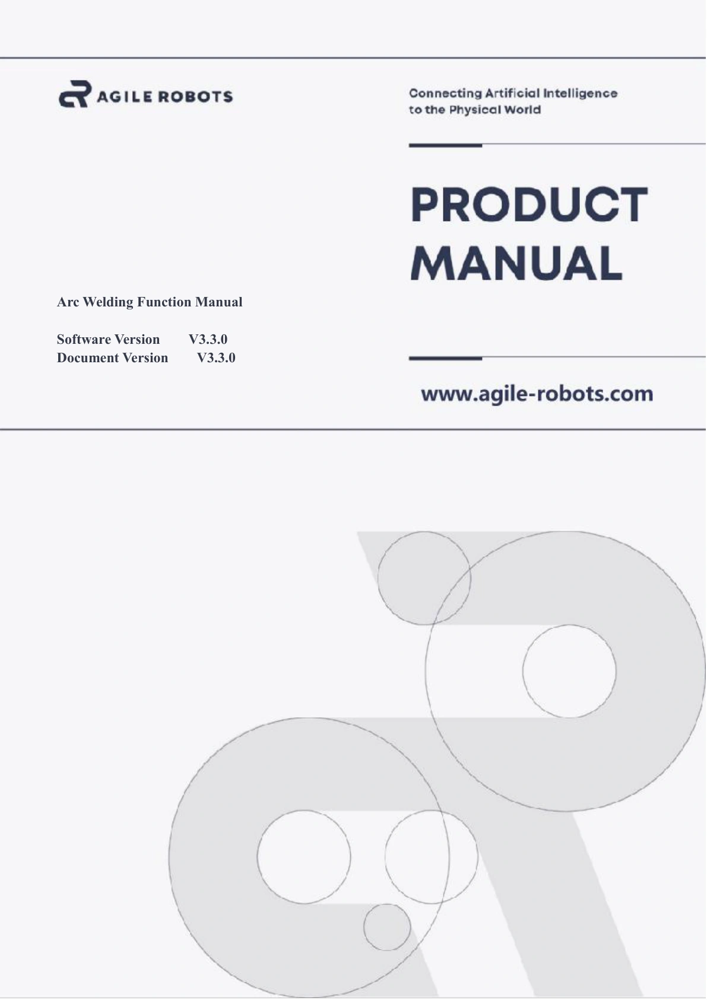



```
北京思灵机器人科技有限责任公司 
1
 
Arc Welding Function Manual 
 
Software Version        V3.3.0 
Document Version        V3.3.0
```



## PDF page 2

**Source:** Arc Welding Function Manual \_V3.3.0\_EN\_20260204.pdf, original pdf page 2. [Open the corresponding PDF reading-copy page](https://1292444914-files.gitbook.io/~/files/v0/b/gitbook-x-prod.appspot.com/o/spaces%2FtgOfPnscWebs1eh82EKq%2Fuploads%2FFckI3jkjvVxdFNvhEyRJ%2Farc-welding-function-manual-v3-3-0-en-20260204-pp-001-010.pdf?alt=media#page=2).



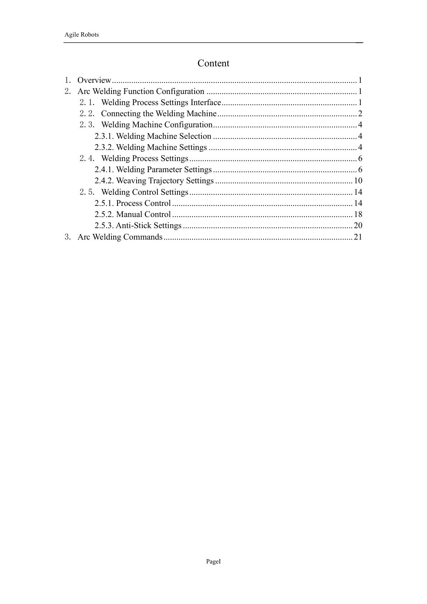



```
Agile Robots 
PageI 
 
Content 
1. Overview .................................................................................................................. 1 
2. Arc Welding Function Configuration ...................................................................... 1 
2.1. Welding Process Settings Interface ............................................................... 1 
2.2. Connecting the Welding Machine ................................................................. 2 
2.3. Welding Machine Configuration ................................................................... 4 
2.3.1. Welding Machine Selection ................................................................... 4 
2.3.2. Welding Machine Settings ..................................................................... 4 
2.4. Welding Process Settings .............................................................................. 6 
2.4.1. Welding Parameter Settings ................................................................... 6 
2.4.2. Weaving Trajectory Settings ................................................................ 10 
2.5. Welding Control Settings ............................................................................ 14 
2.5.1. Process Control .................................................................................... 14 
2.5.2. Manual Control .................................................................................... 18 
2.5.3. Anti-Stick Settings ............................................................................... 20 
3. Arc Welding Commands ........................................................................................ 21
```



**Original document cross-references:** [PDF 3](complete-arc-welding-function-manual-v3-3-0-en-20260204.md#pdf-page-3) · [PDF 4](complete-arc-welding-function-manual-v3-3-0-en-20260204.md#pdf-page-4) · [PDF 6](complete-arc-welding-function-manual-v3-3-0-en-20260204.md#pdf-page-6) · [PDF 8](complete-arc-welding-function-manual-v3-3-0-en-20260204.md#pdf-page-8) · [PDF 12](complete-arc-welding-function-manual-v3-3-0-en-20260204.md#pdf-page-12) · [PDF 16](complete-arc-welding-function-manual-v3-3-0-en-20260204.md#pdf-page-16) · [PDF 20](complete-arc-welding-function-manual-v3-3-0-en-20260204.md#pdf-page-20) · [PDF 22](complete-arc-welding-function-manual-v3-3-0-en-20260204.md#pdf-page-22) · [PDF 23](complete-arc-welding-function-manual-v3-3-0-en-20260204.md#pdf-page-23)

## PDF page 3

**Source:** Arc Welding Function Manual \_V3.3.0\_EN\_20260204.pdf, original pdf page 3. [Open the corresponding PDF reading-copy page](https://1292444914-files.gitbook.io/~/files/v0/b/gitbook-x-prod.appspot.com/o/spaces%2FtgOfPnscWebs1eh82EKq%2Fuploads%2FFckI3jkjvVxdFNvhEyRJ%2Farc-welding-function-manual-v3-3-0-en-20260204-pp-001-010.pdf?alt=media#page=3).



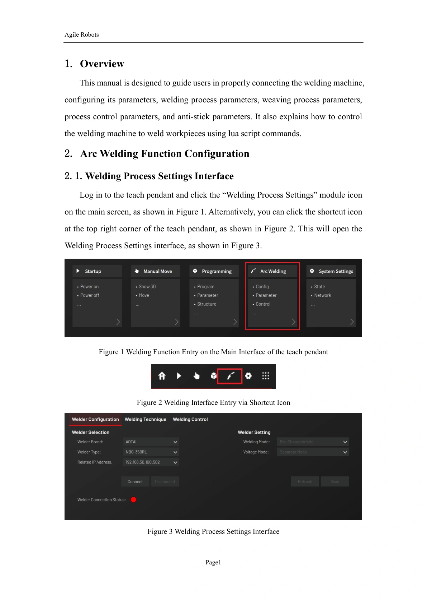



```
Agile Robots 
Page1 
1. Overview 
This manual is designed to guide users in properly connecting the welding machine, 
configuring its parameters, welding process parameters, weaving process parameters, 
process control parameters, and anti-stick parameters. It also explains how to control 
the welding machine to weld workpieces using lua script commands. 
2. Arc Welding Function Configuration 
2.1. Welding Process Settings Interface 
Log in to the teach pendant and click the “Welding Process Settings” module icon 
on the main screen, as shown in Figure 1. Alternatively, you can click the shortcut icon 
at the top right corner of the teach pendant, as shown in Figure 2. This will open the 
Welding Process Settings interface, as shown in Figure 3. 
 
Figure 1 Welding Function Entry on the Main Interface of the teach pendant 
 
Figure 2 Welding Interface Entry via Shortcut Icon 
 
Figure 3 Welding Process Settings Interface
```



## PDF page 4

**Source:** Arc Welding Function Manual \_V3.3.0\_EN\_20260204.pdf, original pdf page 4. [Open the corresponding PDF reading-copy page](https://1292444914-files.gitbook.io/~/files/v0/b/gitbook-x-prod.appspot.com/o/spaces%2FtgOfPnscWebs1eh82EKq%2Fuploads%2FFckI3jkjvVxdFNvhEyRJ%2Farc-welding-function-manual-v3-3-0-en-20260204-pp-001-010.pdf?alt=media#page=4).



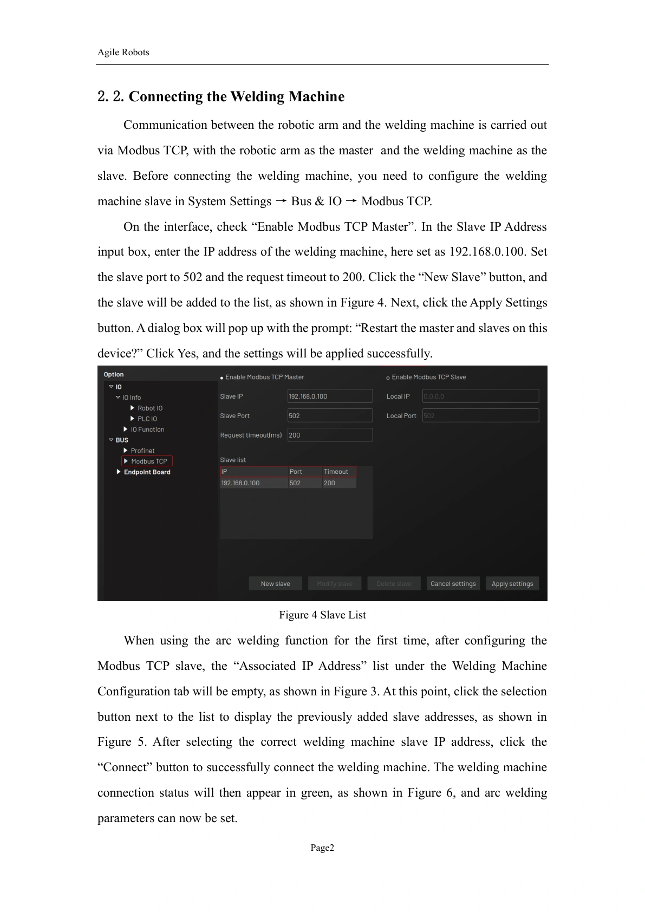



```
Agile Robots 
Page2 
2.2. Connecting the Welding Machine 
Communication between the robotic arm and the welding machine is carried out 
via Modbus TCP, with the robotic arm as the master  and the welding machine as the 
slave. Before connecting the welding machine, you need to configure the welding 
machine slave in System Settings → Bus & IO → Modbus TCP. 
On the interface, check “Enable Modbus TCP Master”. In the Slave IP Address 
input box, enter the IP address of the welding machine, here set as 192.168.0.100. Set 
the slave port to 502 and the request timeout to 200. Click the “New Slave” button, and 
the slave will be added to the list, as shown in Figure 4. Next, click the Apply Settings 
button. A dialog box will pop up with the prompt: “Restart the master and slaves on this 
device?” Click Yes, and the settings will be applied successfully. 
 
Figure 4 Slave List 
When using the arc welding function for the first time, after configuring the 
Modbus TCP slave, the “Associated IP Address” list under the Welding Machine 
Configuration tab will be empty, as shown in Figure 3. At this point, click the selection 
button next to the list to display the previously added slave addresses, as shown in 
Figure 5. After selecting the correct welding machine slave IP address, click the 
“Connect” button to successfully connect the welding machine. The welding machine 
connection status will then appear in green, as shown in Figure 6, and arc welding 
parameters can now be set.
```



## PDF page 5

**Source:** Arc Welding Function Manual \_V3.3.0\_EN\_20260204.pdf, original pdf page 5. [Open the corresponding PDF reading-copy page](https://1292444914-files.gitbook.io/~/files/v0/b/gitbook-x-prod.appspot.com/o/spaces%2FtgOfPnscWebs1eh82EKq%2Fuploads%2FFckI3jkjvVxdFNvhEyRJ%2Farc-welding-function-manual-v3-3-0-en-20260204-pp-001-010.pdf?alt=media#page=5).



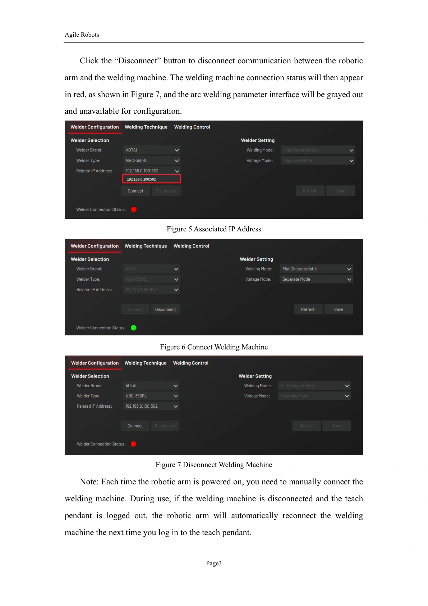



```
Agile Robots 
Page3 
Click the “Disconnect” button to disconnect communication between the robotic 
arm and the welding machine. The welding machine connection status will then appear 
in red, as shown in Figure 7, and the arc welding parameter interface will be grayed out 
and unavailable for configuration. 
 
Figure 5 Associated IP Address 
 
Figure 6 Connect Welding Machine 
 
Figure 7 Disconnect Welding Machine 
Note: Each time the robotic arm is powered on, you need to manually connect the 
welding machine. During use, if the welding machine is disconnected and the teach 
pendant is logged out, the robotic arm will automatically reconnect the welding 
machine the next time you log in to the teach pendant.
```



## PDF page 6

**Source:** Arc Welding Function Manual \_V3.3.0\_EN\_20260204.pdf, original pdf page 6. [Open the corresponding PDF reading-copy page](https://1292444914-files.gitbook.io/~/files/v0/b/gitbook-x-prod.appspot.com/o/spaces%2FtgOfPnscWebs1eh82EKq%2Fuploads%2FFckI3jkjvVxdFNvhEyRJ%2Farc-welding-function-manual-v3-3-0-en-20260204-pp-001-010.pdf?alt=media#page=6).



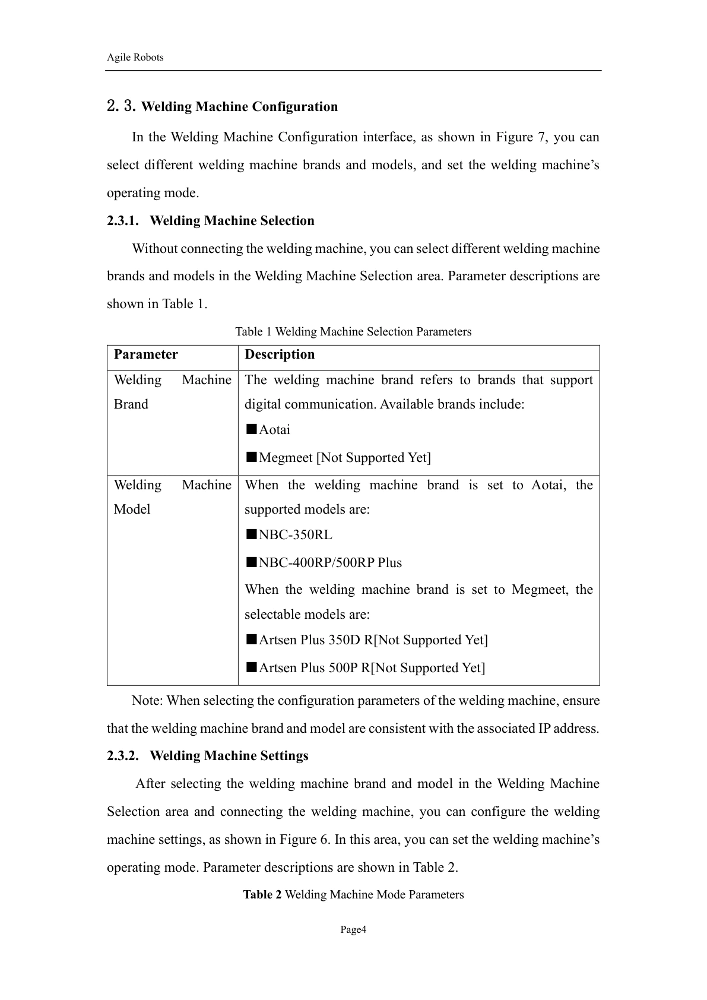



```
Agile Robots 
Page4 
2.3. Welding Machine Configuration 
In the Welding Machine Configuration interface, as shown in Figure 7, you can 
select different welding machine brands and models, and set the welding machine’s 
operating mode. 
2.3.1. Welding Machine Selection 
Without connecting the welding machine, you can select different welding machine 
brands and models in the Welding Machine Selection area. Parameter descriptions are 
shown in Table 1. 
Table 1 Welding Machine Selection Parameters 
Parameter 
Description 
Welding 
Machine 
Brand 
The welding machine brand refers to brands that support 
digital communication. Available brands include: 
■Aotai 
■Megmeet [Not Supported Yet] 
Welding 
Machine 
Model 
When the welding machine brand is set to Aotai, the 
supported models are: 
■NBC-350RL 
■NBC-400RP/500RP Plus 
When the welding machine brand is set to Megmeet, the 
selectable models are: 
■Artsen Plus 350D R[Not Supported Yet] 
■Artsen Plus 500P R[Not Supported Yet] 
Note: When selecting the configuration parameters of the welding machine, ensure 
that the welding machine brand and model are consistent with the associated IP address. 
2.3.2. Welding Machine Settings 
After selecting the welding machine brand and model in the Welding Machine 
Selection area and connecting the welding machine, you can configure the welding 
machine settings, as shown in Figure 6. In this area, you can set the welding machine’s 
operating mode. Parameter descriptions are shown in Table 2. 
Table 2 Welding Machine Mode Parameters
```



## PDF page 7

**Source:** Arc Welding Function Manual \_V3.3.0\_EN\_20260204.pdf, original pdf page 7. [Open the corresponding PDF reading-copy page](https://1292444914-files.gitbook.io/~/files/v0/b/gitbook-x-prod.appspot.com/o/spaces%2FtgOfPnscWebs1eh82EKq%2Fuploads%2FFckI3jkjvVxdFNvhEyRJ%2Farc-welding-function-manual-v3-3-0-en-20260204-pp-001-010.pdf?alt=media#page=7).



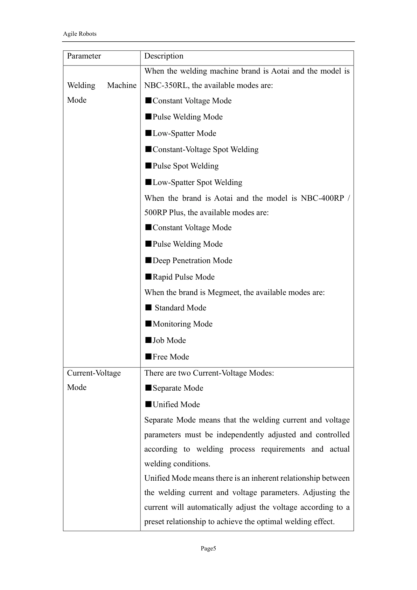



```
Agile Robots 
Page5 
Parameter 
Description 
 
Welding 
Machine 
Mode 
When the welding machine brand is Aotai and the model is 
NBC-350RL, the available modes are: 
■Constant Voltage Mode 
■Pulse Welding Mode 
■Low-Spatter Mode 
■Constant-Voltage Spot Welding 
■Pulse Spot Welding 
■Low-Spatter Spot Welding 
When the brand is Aotai and the model is NBC-400RP / 
500RP Plus, the available modes are: 
■Constant Voltage Mode 
■Pulse Welding Mode 
■Deep Penetration Mode 
■Rapid Pulse Mode 
When the brand is Megmeet, the available modes are: 
■ Standard Mode 
■Monitoring Mode 
■Job Mode 
■Free Mode 
Current-Voltage 
Mode 
There are two Current-Voltage Modes: 
■Separate Mode 
■Unified Mode 
Separate Mode means that the welding current and voltage 
parameters must be independently adjusted and controlled 
according to welding process requirements and actual 
welding conditions. 
Unified Mode means there is an inherent relationship between 
the welding current and voltage parameters. Adjusting the 
current will automatically adjust the voltage according to a 
preset relationship to achieve the optimal welding effect.
```



## PDF page 8

**Source:** Arc Welding Function Manual \_V3.3.0\_EN\_20260204.pdf, original pdf page 8. [Open the corresponding PDF reading-copy page](https://1292444914-files.gitbook.io/~/files/v0/b/gitbook-x-prod.appspot.com/o/spaces%2FtgOfPnscWebs1eh82EKq%2Fuploads%2FFckI3jkjvVxdFNvhEyRJ%2Farc-welding-function-manual-v3-3-0-en-20260204-pp-001-010.pdf?alt=media#page=8).



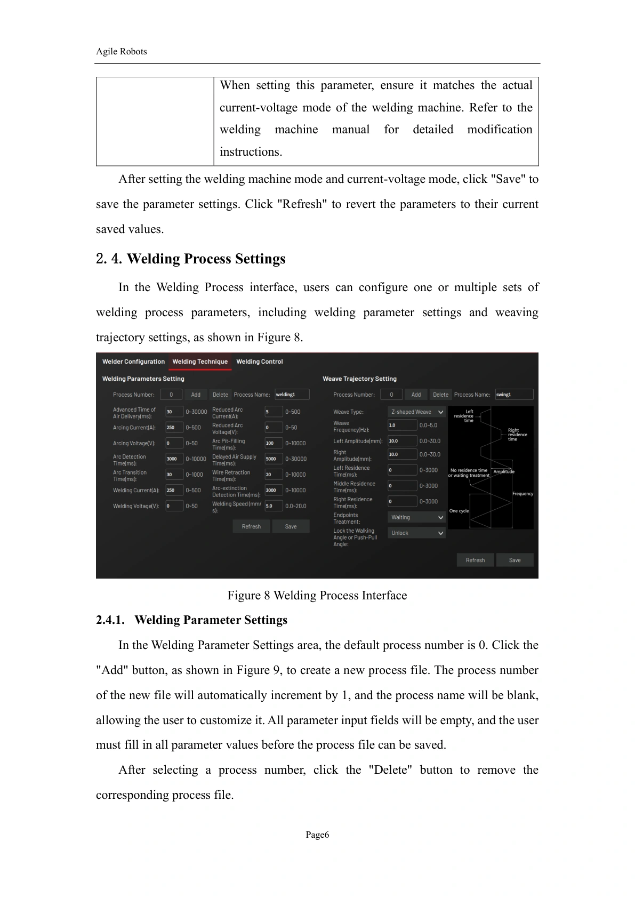



```
Agile Robots 
Page6 
When setting this parameter, ensure it matches the actual 
current-voltage mode of the welding machine. Refer to the 
welding 
machine 
manual 
for 
detailed 
modification 
instructions. 
After setting the welding machine mode and current-voltage mode, click "Save" to 
save the parameter settings. Click "Refresh" to revert the parameters to their current 
saved values. 
2.4. Welding Process Settings 
In the Welding Process interface, users can configure one or multiple sets of 
welding process parameters, including welding parameter settings and weaving 
trajectory settings, as shown in Figure 8. 
 
Figure 8 Welding Process Interface 
2.4.1. Welding Parameter Settings 
In the Welding Parameter Settings area, the default process number is 0. Click the 
"Add" button, as shown in Figure 9, to create a new process file. The process number 
of the new file will automatically increment by 1, and the process name will be blank, 
allowing the user to customize it. All parameter input fields will be empty, and the user 
must fill in all parameter values before the process file can be saved. 
After selecting a process number, click the "Delete" button to remove the 
corresponding process file.
```



## PDF page 9

**Source:** Arc Welding Function Manual \_V3.3.0\_EN\_20260204.pdf, original pdf page 9. [Open the corresponding PDF reading-copy page](https://1292444914-files.gitbook.io/~/files/v0/b/gitbook-x-prod.appspot.com/o/spaces%2FtgOfPnscWebs1eh82EKq%2Fuploads%2FFckI3jkjvVxdFNvhEyRJ%2Farc-welding-function-manual-v3-3-0-en-20260204-pp-001-010.pdf?alt=media#page=9).



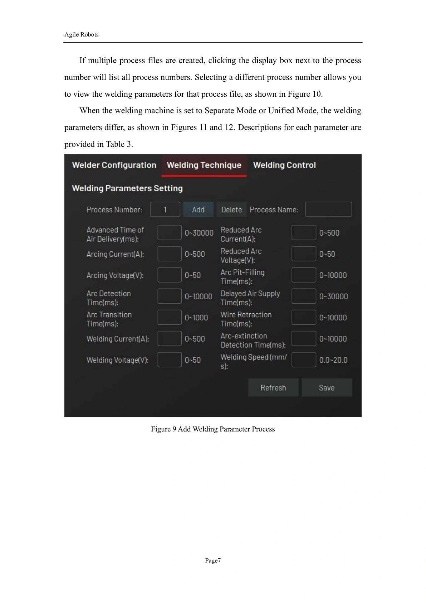



```
Agile Robots 
Page7 
If multiple process files are created, clicking the display box next to the process 
number will list all process numbers. Selecting a different process number allows you 
to view the welding parameters for that process file, as shown in Figure 10. 
When the welding machine is set to Separate Mode or Unified Mode, the welding 
parameters differ, as shown in Figures 11 and 12. Descriptions for each parameter are 
provided in Table 3. 
 
Figure 9 Add Welding Parameter Process
```



## PDF page 10

**Source:** Arc Welding Function Manual \_V3.3.0\_EN\_20260204.pdf, original pdf page 10. [Open the corresponding PDF reading-copy page](https://1292444914-files.gitbook.io/~/files/v0/b/gitbook-x-prod.appspot.com/o/spaces%2FtgOfPnscWebs1eh82EKq%2Fuploads%2FFckI3jkjvVxdFNvhEyRJ%2Farc-welding-function-manual-v3-3-0-en-20260204-pp-001-010.pdf?alt=media#page=10).



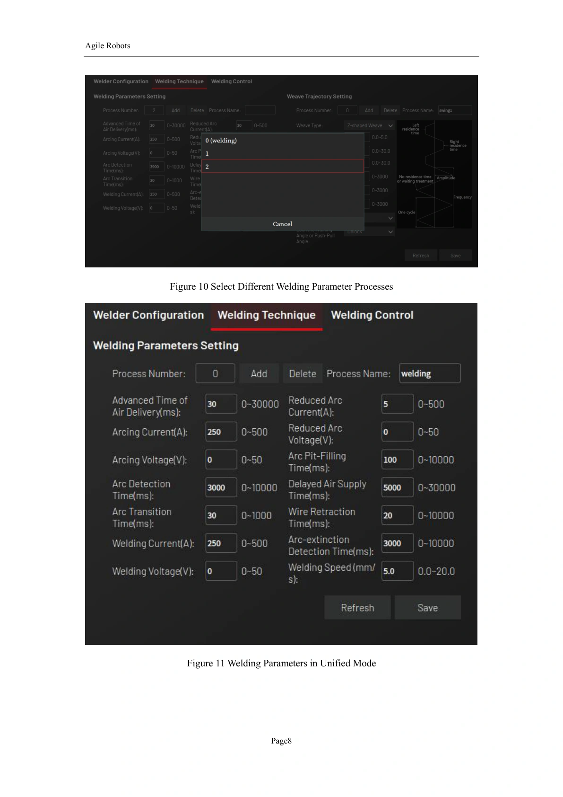



```
Agile Robots 
Page8 
 
Figure 10 Select Different Welding Parameter Processes 
 
Figure 11 Welding Parameters in Unified Mode
```



## PDF page 11

**Source:** Arc Welding Function Manual \_V3.3.0\_EN\_20260204.pdf, original pdf page 11. [Open the corresponding PDF reading-copy page](https://1292444914-files.gitbook.io/~/files/v0/b/gitbook-x-prod.appspot.com/o/spaces%2FtgOfPnscWebs1eh82EKq%2Fuploads%2FzuqqWcmPSHUoxmZiYO9F%2Farc-welding-function-manual-v3-3-0-en-20260204-pp-011-020.pdf?alt=media#page=1).



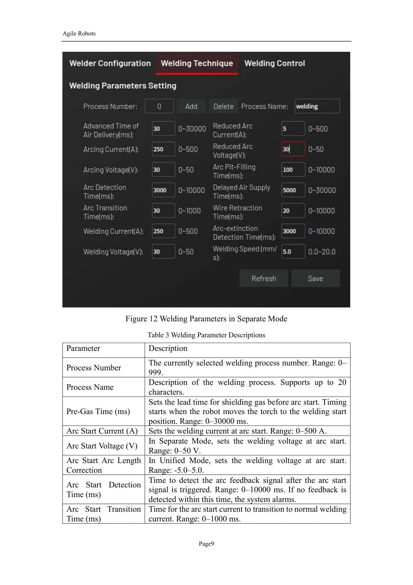



```
Agile Robots 
Page9 
 
Figure 12 Welding Parameters in Separate Mode 
Table 3 Welding Parameter Descriptions 
Parameter 
Description 
Process Number 
The currently selected welding process number. Range: 0–
999. 
Process Name 
Description of the welding process. Supports up to 20 
characters. 
Pre-Gas Time (ms) 
Sets the lead time for shielding gas before arc start. Timing 
starts when the robot moves the torch to the welding start 
position. Range: 0–30000 ms. 
Arc Start Current (A) 
Sets the welding current at arc start. Range: 0–500 A. 
Arc Start Voltage (V) 
In Separate Mode, sets the welding voltage at arc start. 
Range: 0–50 V. 
Arc Start Arc Length 
Correction 
In Unified Mode, sets the welding voltage at arc start. 
Range: -5.0–5.0. 
Arc Start Detection 
Time (ms) 
Time to detect the arc feedback signal after the arc start 
signal is triggered. Range: 0–10000 ms. If no feedback is 
detected within this time, the system alarms. 
Arc Start Transition 
Time (ms) 
Time for the arc start current to transition to normal welding 
current. Range: 0–1000 ms.
```



## PDF page 12

**Source:** Arc Welding Function Manual \_V3.3.0\_EN\_20260204.pdf, original pdf page 12. [Open the corresponding PDF reading-copy page](https://1292444914-files.gitbook.io/~/files/v0/b/gitbook-x-prod.appspot.com/o/spaces%2FtgOfPnscWebs1eh82EKq%2Fuploads%2FzuqqWcmPSHUoxmZiYO9F%2Farc-welding-function-manual-v3-3-0-en-20260204-pp-011-020.pdf?alt=media#page=2).



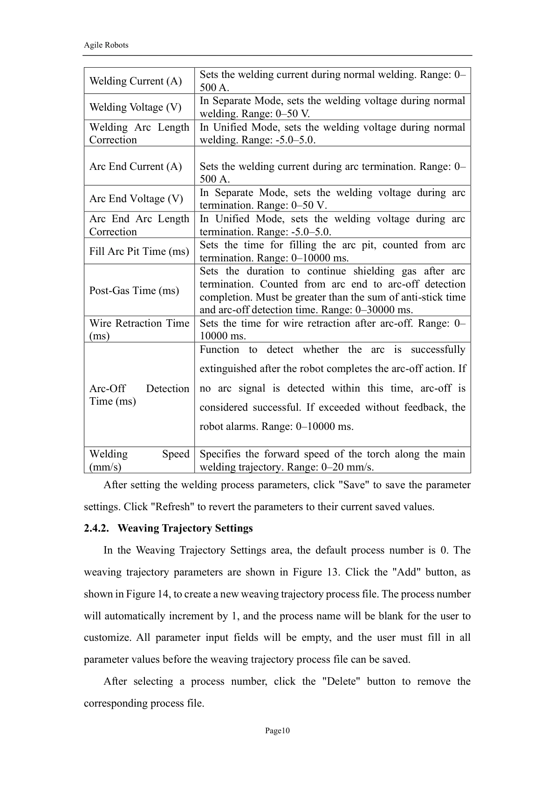



```
Agile Robots 
Page10 
Welding Current (A) 
Sets the welding current during normal welding. Range: 0–
500 A. 
Welding Voltage (V) 
In Separate Mode, sets the welding voltage during normal 
welding. Range: 0–50 V. 
Welding Arc Length 
Correction 
In Unified Mode, sets the welding voltage during normal 
welding. Range: -5.0–5.0. 
Arc End Current (A) 
 
Sets the welding current during arc termination. Range: 0–
500 A. 
Arc End Voltage (V) 
In Separate Mode, sets the welding voltage during arc 
termination. Range: 0–50 V. 
Arc End Arc Length 
Correction 
In Unified Mode, sets the welding voltage during arc 
termination. Range: -5.0–5.0. 
Fill Arc Pit Time (ms) Sets the time for filling the arc pit, counted from arc 
termination. Range: 0–10000 ms. 
Post-Gas Time (ms) 
Sets the duration to continue shielding gas after arc 
termination. Counted from arc end to arc-off detection 
completion. Must be greater than the sum of anti-stick time 
and arc-off detection time. Range: 0–30000 ms. 
Wire Retraction Time 
(ms) 
Sets the time for wire retraction after arc-off. Range: 0–
10000 ms. 
Arc-Off 
Detection 
Time (ms) 
Function to detect whether the arc is successfully 
extinguished after the robot completes the arc-off action. If 
no arc signal is detected within this time, arc-off is 
considered successful. If exceeded without feedback, the 
robot alarms. Range: 0–10000 ms. 
Welding 
Speed 
(mm/s) 
Specifies the forward speed of the torch along the main 
welding trajectory. Range: 0–20 mm/s. 
After setting the welding process parameters, click "Save" to save the parameter 
settings. Click "Refresh" to revert the parameters to their current saved values. 
2.4.2. Weaving Trajectory Settings 
In the Weaving Trajectory Settings area, the default process number is 0. The 
weaving trajectory parameters are shown in Figure 13. Click the "Add" button, as 
shown in Figure 14, to create a new weaving trajectory process file. The process number 
will automatically increment by 1, and the process name will be blank for the user to 
customize. All parameter input fields will be empty, and the user must fill in all 
parameter values before the weaving trajectory process file can be saved. 
After selecting a process number, click the "Delete" button to remove the 
corresponding process file.
```



## PDF page 13

**Source:** Arc Welding Function Manual \_V3.3.0\_EN\_20260204.pdf, original pdf page 13. [Open the corresponding PDF reading-copy page](https://1292444914-files.gitbook.io/~/files/v0/b/gitbook-x-prod.appspot.com/o/spaces%2FtgOfPnscWebs1eh82EKq%2Fuploads%2FzuqqWcmPSHUoxmZiYO9F%2Farc-welding-function-manual-v3-3-0-en-20260204-pp-011-020.pdf?alt=media#page=3).



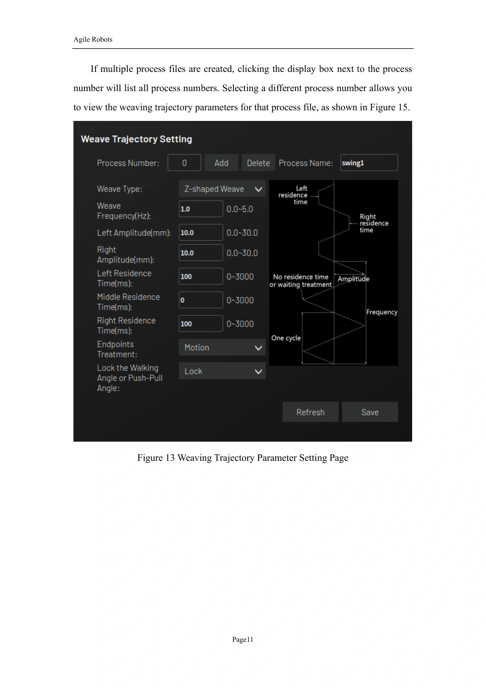



```
Agile Robots 
Page11 
If multiple process files are created, clicking the display box next to the process 
number will list all process numbers. Selecting a different process number allows you 
to view the weaving trajectory parameters for that process file, as shown in Figure 15. 
 
Figure 13 Weaving Trajectory Parameter Setting Page
```



## PDF page 14

**Source:** Arc Welding Function Manual \_V3.3.0\_EN\_20260204.pdf, original pdf page 14. [Open the corresponding PDF reading-copy page](https://1292444914-files.gitbook.io/~/files/v0/b/gitbook-x-prod.appspot.com/o/spaces%2FtgOfPnscWebs1eh82EKq%2Fuploads%2FzuqqWcmPSHUoxmZiYO9F%2Farc-welding-function-manual-v3-3-0-en-20260204-pp-011-020.pdf?alt=media#page=4).



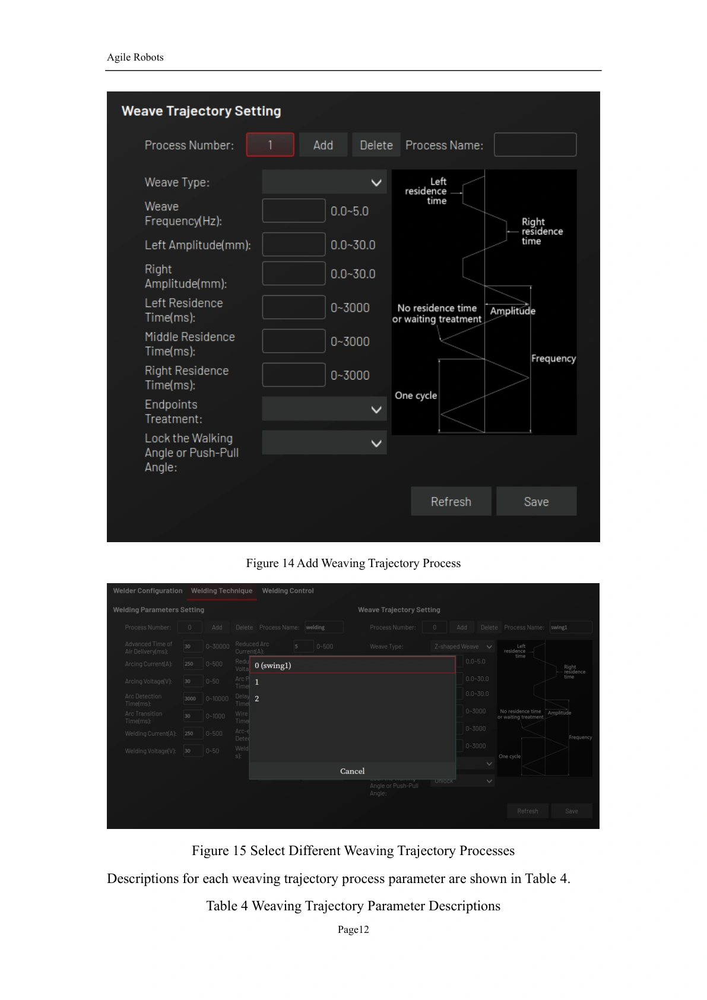



```
Agile Robots 
Page12 
 
Figure 14 Add Weaving Trajectory Process 
 
Figure 15 Select Different Weaving Trajectory Processes 
Descriptions for each weaving trajectory process parameter are shown in Table 4. 
Table 4 Weaving Trajectory Parameter Descriptions
```



## PDF page 15

**Source:** Arc Welding Function Manual \_V3.3.0\_EN\_20260204.pdf, original pdf page 15. [Open the corresponding PDF reading-copy page](https://1292444914-files.gitbook.io/~/files/v0/b/gitbook-x-prod.appspot.com/o/spaces%2FtgOfPnscWebs1eh82EKq%2Fuploads%2FzuqqWcmPSHUoxmZiYO9F%2Farc-welding-function-manual-v3-3-0-en-20260204-pp-011-020.pdf?alt=media#page=5).



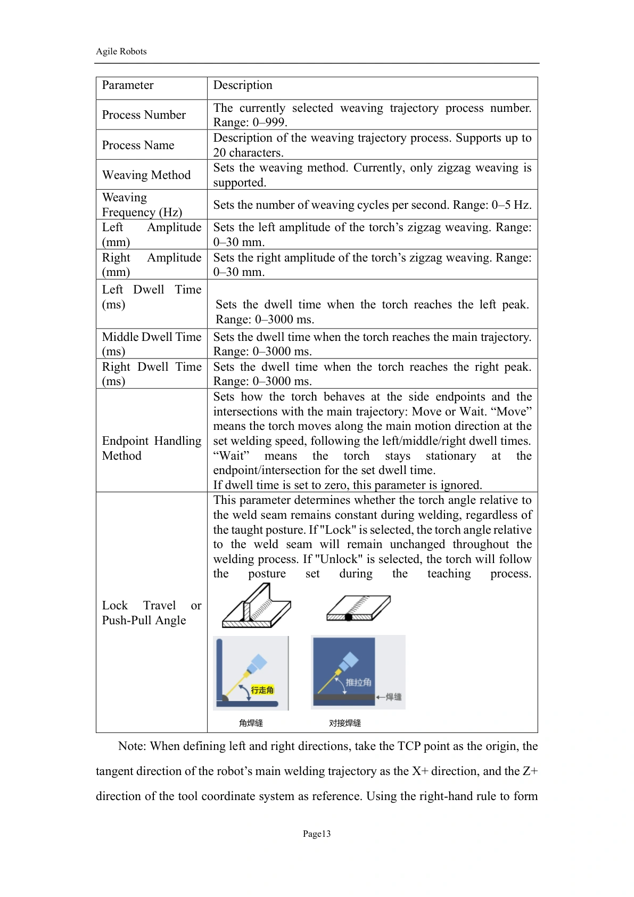



```
Agile Robots 
Page13 
Parameter 
Description 
Process Number 
The currently selected weaving trajectory process number. 
Range: 0–999. 
Process Name 
Description of the weaving trajectory process. Supports up to 
20 characters. 
Weaving Method 
Sets the weaving method. Currently, only zigzag weaving is 
supported. 
Weaving 
Frequency (Hz) 
Sets the number of weaving cycles per second. Range: 0–5 Hz. 
Left 
Amplitude 
(mm) 
Sets the left amplitude of the torch’s zigzag weaving. Range: 
0–30 mm. 
Right 
Amplitude 
(mm) 
Sets the right amplitude of the torch’s zigzag weaving. Range: 
0–30 mm. 
Left Dwell Time 
(ms) 
 
 
Sets the dwell time when the torch reaches the left peak. 
Range: 0–3000 ms. 
Middle Dwell Time 
(ms) 
Sets the dwell time when the torch reaches the main trajectory. 
Range: 0–3000 ms. 
Right Dwell Time 
(ms) 
Sets the dwell time when the torch reaches the right peak. 
Range: 0–3000 ms. 
 
Endpoint Handling 
Method 
Sets how the torch behaves at the side endpoints and the 
intersections with the main trajectory: Move or Wait. “Move” 
means the torch moves along the main motion direction at the 
set welding speed, following the left/middle/right dwell times. 
“Wait” 
means 
the 
torch 
stays 
stationary 
at 
the 
endpoint/intersection for the set dwell time. 
If dwell time is set to zero, this parameter is ignored. 
Lock 
Travel 
or 
Push-Pull Angle 
This parameter determines whether the torch angle relative to 
the weld seam remains constant during welding, regardless of 
the taught posture. If "Lock" is selected, the torch angle relative 
to the weld seam will remain unchanged throughout the 
welding process. If "Unlock" is selected, the torch will follow 
the 
posture 
set 
during 
the 
teaching 
process.
Note: When defining left and right directions, take the TCP point as the origin, the 
tangent direction of the robot’s main welding trajectory as the X+ direction, and the Z+ 
direction of the tool coordinate system as reference. Using the right-hand rule to form 
行走角
角焊缝
对接焊缝
```



## PDF page 16

**Source:** Arc Welding Function Manual \_V3.3.0\_EN\_20260204.pdf, original pdf page 16. [Open the corresponding PDF reading-copy page](https://1292444914-files.gitbook.io/~/files/v0/b/gitbook-x-prod.appspot.com/o/spaces%2FtgOfPnscWebs1eh82EKq%2Fuploads%2FzuqqWcmPSHUoxmZiYO9F%2Farc-welding-function-manual-v3-3-0-en-20260204-pp-011-020.pdf?alt=media#page=6).



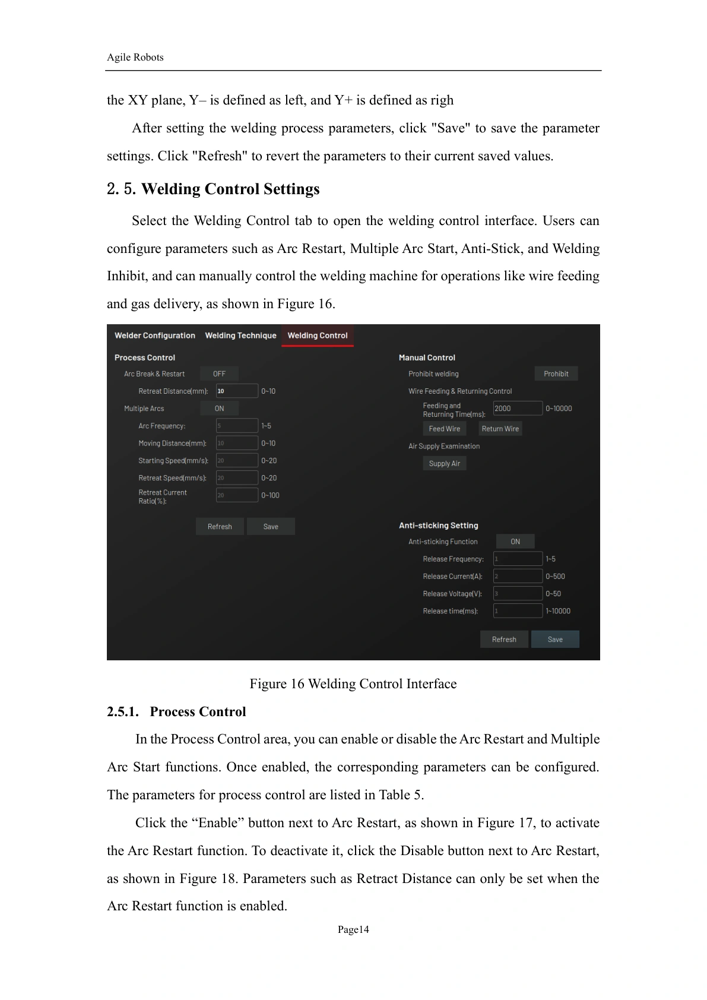



```
Agile Robots 
Page14 
the XY plane, Y– is defined as left, and Y+ is defined as righ 
After setting the welding process parameters, click "Save" to save the parameter 
settings. Click "Refresh" to revert the parameters to their current saved values. 
2.5. Welding Control Settings 
Select the Welding Control tab to open the welding control interface. Users can 
configure parameters such as Arc Restart, Multiple Arc Start, Anti-Stick, and Welding 
Inhibit, and can manually control the welding machine for operations like wire feeding 
and gas delivery, as shown in Figure 16. 
 
Figure 16 Welding Control Interface 
2.5.1. Process Control 
In the Process Control area, you can enable or disable the Arc Restart and Multiple 
Arc Start functions. Once enabled, the corresponding parameters can be configured. 
The parameters for process control are listed in Table 5. 
Click the “Enable” button next to Arc Restart, as shown in Figure 17, to activate 
the Arc Restart function. To deactivate it, click the Disable button next to Arc Restart, 
as shown in Figure 18. Parameters such as Retract Distance can only be set when the 
Arc Restart function is enabled.
```



## PDF page 17

**Source:** Arc Welding Function Manual \_V3.3.0\_EN\_20260204.pdf, original pdf page 17. [Open the corresponding PDF reading-copy page](https://1292444914-files.gitbook.io/~/files/v0/b/gitbook-x-prod.appspot.com/o/spaces%2FtgOfPnscWebs1eh82EKq%2Fuploads%2FzuqqWcmPSHUoxmZiYO9F%2Farc-welding-function-manual-v3-3-0-en-20260204-pp-011-020.pdf?alt=media#page=7).



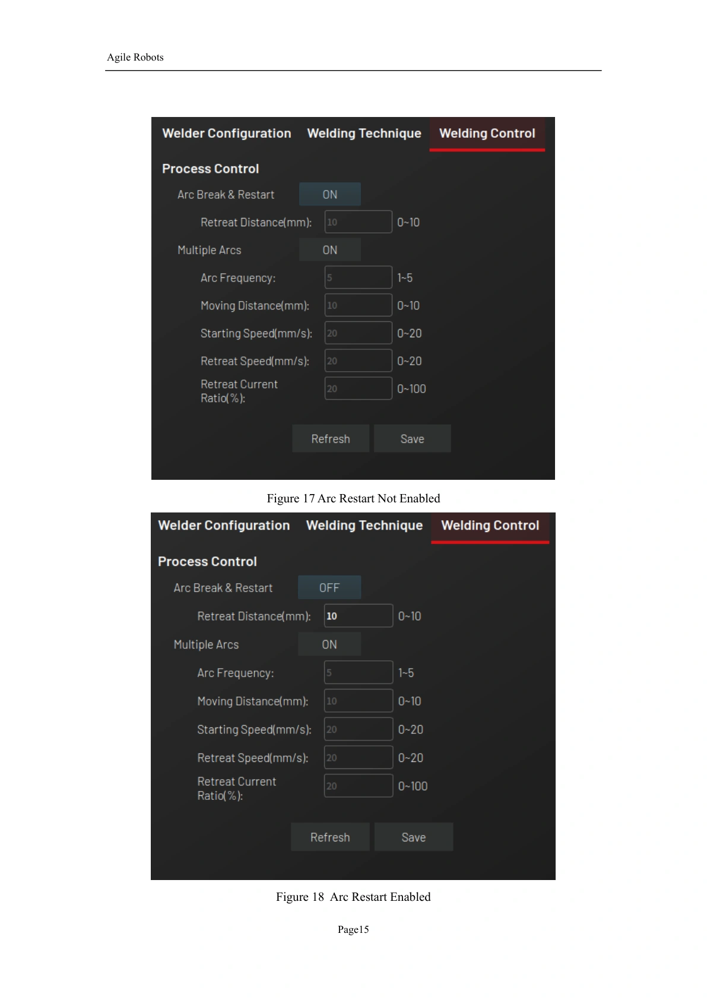



```
Agile Robots 
Page15 
 
 
Figure 17 Arc Restart Not Enabled 
 
Figure 18  Arc Restart Enabled
```



## PDF page 18

**Source:** Arc Welding Function Manual \_V3.3.0\_EN\_20260204.pdf, original pdf page 18. [Open the corresponding PDF reading-copy page](https://1292444914-files.gitbook.io/~/files/v0/b/gitbook-x-prod.appspot.com/o/spaces%2FtgOfPnscWebs1eh82EKq%2Fuploads%2FzuqqWcmPSHUoxmZiYO9F%2Farc-welding-function-manual-v3-3-0-en-20260204-pp-011-020.pdf?alt=media#page=8).



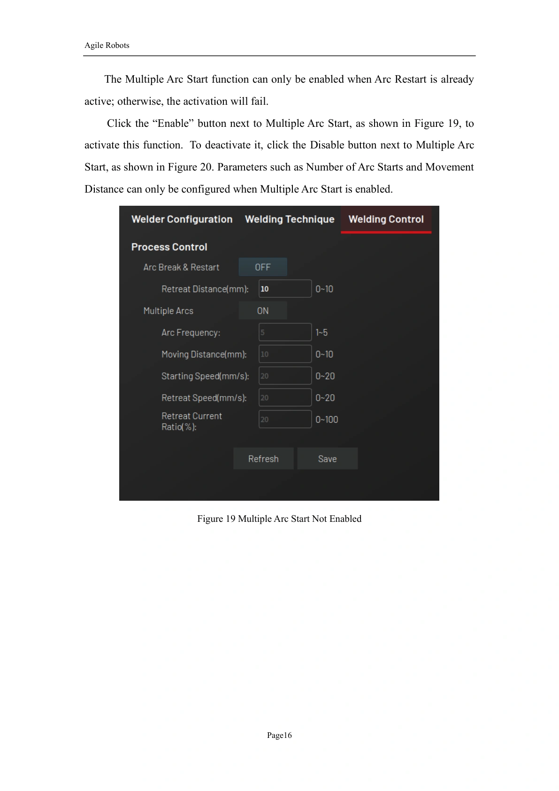



```
Agile Robots 
Page16 
The Multiple Arc Start function can only be enabled when Arc Restart is already 
active; otherwise, the activation will fail. 
Click the “Enable” button next to Multiple Arc Start, as shown in Figure 19, to 
activate this function.  To deactivate it, click the Disable button next to Multiple Arc 
Start, as shown in Figure 20. Parameters such as Number of Arc Starts and Movement 
Distance can only be configured when Multiple Arc Start is enabled. 
 
Figure 19 Multiple Arc Start Not Enabled
```



## PDF page 19

**Source:** Arc Welding Function Manual \_V3.3.0\_EN\_20260204.pdf, original pdf page 19. [Open the corresponding PDF reading-copy page](https://1292444914-files.gitbook.io/~/files/v0/b/gitbook-x-prod.appspot.com/o/spaces%2FtgOfPnscWebs1eh82EKq%2Fuploads%2FzuqqWcmPSHUoxmZiYO9F%2Farc-welding-function-manual-v3-3-0-en-20260204-pp-011-020.pdf?alt=media#page=9).



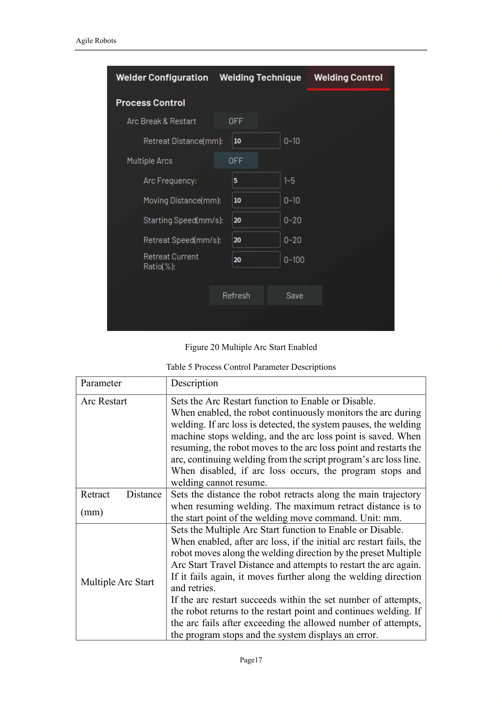



```
Agile Robots 
Page17 
 
Figure 20 Multiple Arc Start Enabled 
Table 5 Process Control Parameter Descriptions 
Parameter 
Description 
Arc Restart 
Sets the Arc Restart function to Enable or Disable. 
When enabled, the robot continuously monitors the arc during 
welding. If arc loss is detected, the system pauses, the welding 
machine stops welding, and the arc loss point is saved. When 
resuming, the robot moves to the arc loss point and restarts the 
arc, continuing welding from the script program’s arc loss line. 
When disabled, if arc loss occurs, the program stops and 
welding cannot resume. 
Retract 
Distance 
(mm) 
Sets the distance the robot retracts along the main trajectory 
when resuming welding. The maximum retract distance is to 
the start point of the welding move command. Unit: mm. 
Multiple Arc Start 
Sets the Multiple Arc Start function to Enable or Disable. 
When enabled, after arc loss, if the initial arc restart fails, the 
robot moves along the welding direction by the preset Multiple 
Arc Start Travel Distance and attempts to restart the arc again. 
If it fails again, it moves further along the welding direction 
and retries. 
If the arc restart succeeds within the set number of attempts, 
the robot returns to the restart point and continues welding. If 
the arc fails after exceeding the allowed number of attempts, 
the program stops and the system displays an error.
```



## PDF page 20

**Source:** Arc Welding Function Manual \_V3.3.0\_EN\_20260204.pdf, original pdf page 20. [Open the corresponding PDF reading-copy page](https://1292444914-files.gitbook.io/~/files/v0/b/gitbook-x-prod.appspot.com/o/spaces%2FtgOfPnscWebs1eh82EKq%2Fuploads%2FzuqqWcmPSHUoxmZiYO9F%2Farc-welding-function-manual-v3-3-0-en-20260204-pp-011-020.pdf?alt=media#page=10).



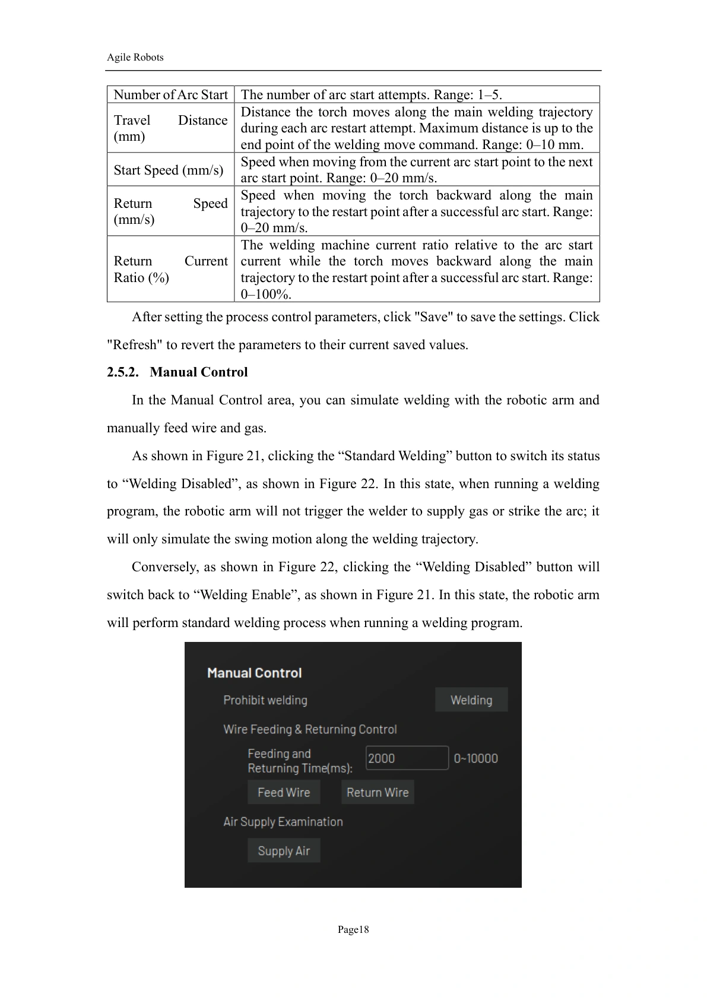



```
Agile Robots 
Page18 
Number of Arc Start The number of arc start attempts. Range: 1–5. 
Travel 
Distance 
(mm) 
Distance the torch moves along the main welding trajectory 
during each arc restart attempt. Maximum distance is up to the 
end point of the welding move command. Range: 0–10 mm. 
Start Speed (mm/s) 
Speed when moving from the current arc start point to the next 
arc start point. Range: 0–20 mm/s. 
Return 
Speed 
(mm/s) 
Speed when moving the torch backward along the main 
trajectory to the restart point after a successful arc start. Range: 
0–20 mm/s. 
Return 
Current 
Ratio (%) 
The welding machine current ratio relative to the arc start 
current while the torch moves backward along the main 
trajectory to the restart point after a successful arc start. Range: 
0–100%. 
After setting the process control parameters, click "Save" to save the settings. Click 
"Refresh" to revert the parameters to their current saved values. 
2.5.2. Manual Control 
In the Manual Control area, you can simulate welding with the robotic arm and 
manually feed wire and gas. 
As shown in Figure 21, clicking the “Standard Welding” button to switch its status 
to “Welding Disabled”, as shown in Figure 22. In this state, when running a welding 
program, the robotic arm will not trigger the welder to supply gas or strike the arc; it 
will only simulate the swing motion along the welding trajectory. 
Conversely, as shown in Figure 22, clicking the “Welding Disabled” button will 
switch back to “Welding Enable”, as shown in Figure 21. In this state, the robotic arm 
will perform standard welding process when running a welding program.
```



## PDF page 21

**Source:** Arc Welding Function Manual \_V3.3.0\_EN\_20260204.pdf, original pdf page 21. [Open the corresponding PDF reading-copy page](https://1292444914-files.gitbook.io/~/files/v0/b/gitbook-x-prod.appspot.com/o/spaces%2FtgOfPnscWebs1eh82EKq%2Fuploads%2FL2OnjqUdRaZTgPZTRuv4%2Farc-welding-function-manual-v3-3-0-en-20260204-pp-021-026.pdf?alt=media#page=1).



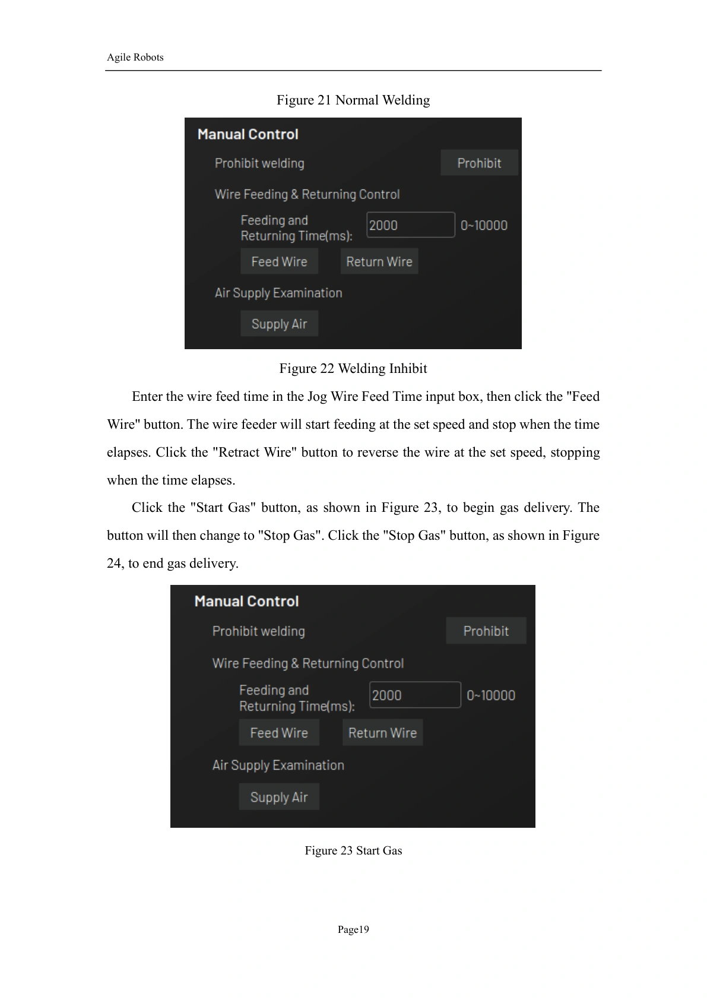



```
Agile Robots 
Page19 
Figure 21 Normal Welding 
 
Figure 22 Welding Inhibit 
Enter the wire feed time in the Jog Wire Feed Time input box, then click the "Feed 
Wire" button. The wire feeder will start feeding at the set speed and stop when the time 
elapses. Click the "Retract Wire" button to reverse the wire at the set speed, stopping 
when the time elapses. 
Click the "Start Gas" button, as shown in Figure 23, to begin gas delivery. The 
button will then change to "Stop Gas". Click the "Stop Gas" button, as shown in Figure 
24, to end gas delivery. 
 
Figure 23 Start Gas
```



## PDF page 22

**Source:** Arc Welding Function Manual \_V3.3.0\_EN\_20260204.pdf, original pdf page 22. [Open the corresponding PDF reading-copy page](https://1292444914-files.gitbook.io/~/files/v0/b/gitbook-x-prod.appspot.com/o/spaces%2FtgOfPnscWebs1eh82EKq%2Fuploads%2FL2OnjqUdRaZTgPZTRuv4%2Farc-welding-function-manual-v3-3-0-en-20260204-pp-021-026.pdf?alt=media#page=2).



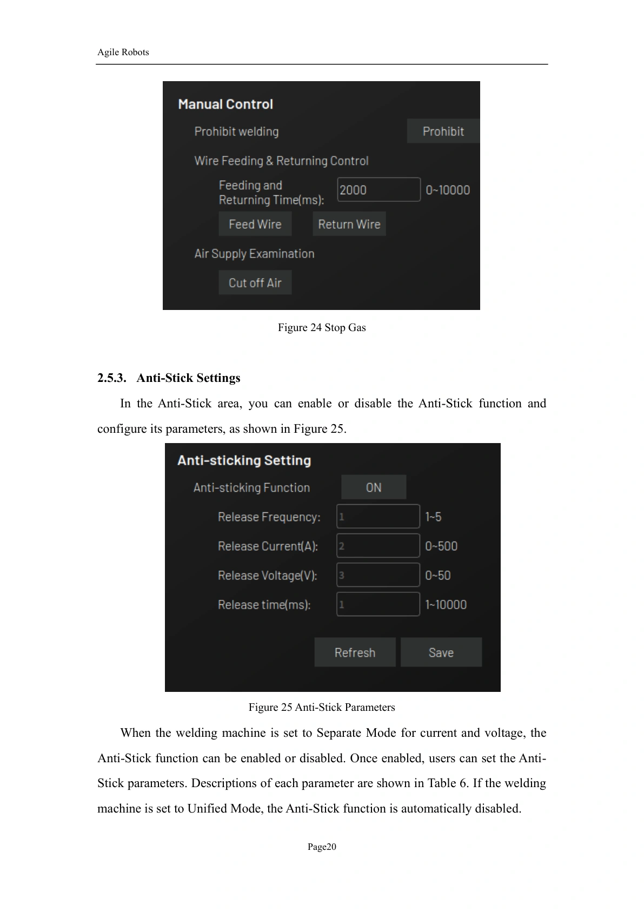



```
Agile Robots 
Page20 
 
Figure 24 Stop Gas 
 
2.5.3. Anti-Stick Settings 
In the Anti-Stick area, you can enable or disable the Anti-Stick function and 
configure its parameters, as shown in Figure 25. 
 
Figure 25 Anti-Stick Parameters 
When the welding machine is set to Separate Mode for current and voltage, the 
Anti-Stick function can be enabled or disabled. Once enabled, users can set the Anti-
Stick parameters. Descriptions of each parameter are shown in Table 6. If the welding 
machine is set to Unified Mode, the Anti-Stick function is automatically disabled.
```



## PDF page 23

**Source:** Arc Welding Function Manual \_V3.3.0\_EN\_20260204.pdf, original pdf page 23. [Open the corresponding PDF reading-copy page](https://1292444914-files.gitbook.io/~/files/v0/b/gitbook-x-prod.appspot.com/o/spaces%2FtgOfPnscWebs1eh82EKq%2Fuploads%2FL2OnjqUdRaZTgPZTRuv4%2Farc-welding-function-manual-v3-3-0-en-20260204-pp-021-026.pdf?alt=media#page=3).



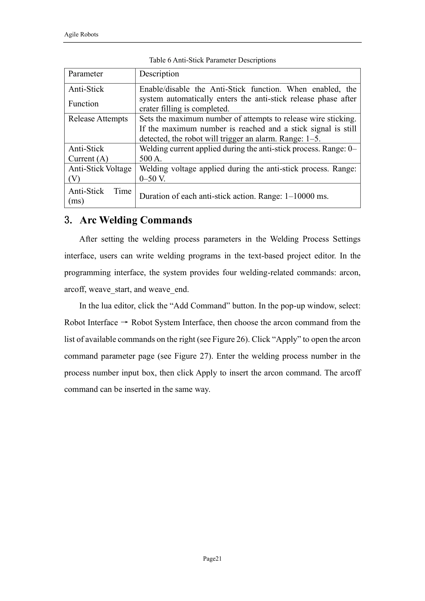



```
Agile Robots 
Page21 
Table 6 Anti-Stick Parameter Descriptions 
Parameter 
Description 
Anti-Stick 
Function 
Enable/disable the Anti-Stick function. When enabled, the 
system automatically enters the anti-stick release phase after 
crater filling is completed. 
Release Attempts 
Sets the maximum number of attempts to release wire sticking. 
If the maximum number is reached and a stick signal is still 
detected, the robot will trigger an alarm. Range: 1–5. 
Anti-Stick 
Current (A) 
Welding current applied during the anti-stick process. Range: 0–
500 A. 
Anti-Stick Voltage 
(V) 
Welding voltage applied during the anti-stick process. Range: 
0–50 V. 
Anti-Stick 
Time 
(ms) 
Duration of each anti-stick action. Range: 1–10000 ms. 
3. Arc Welding Commands 
After setting the welding process parameters in the Welding Process Settings 
interface, users can write welding programs in the text-based project editor. In the 
programming interface, the system provides four welding-related commands: arcon, 
arcoff, weave_start, and weave_end. 
In the lua editor, click the “Add Command” button. In the pop-up window, select: 
Robot Interface → Robot System Interface, then choose the arcon command from the 
list of available commands on the right (see Figure 26). Click “Apply” to open the arcon 
command parameter page (see Figure 27). Enter the welding process number in the 
process number input box, then click Apply to insert the arcon command. The arcoff 
command can be inserted in the same way.
```



## PDF page 24

**Source:** Arc Welding Function Manual \_V3.3.0\_EN\_20260204.pdf, original pdf page 24. [Open the corresponding PDF reading-copy page](https://1292444914-files.gitbook.io/~/files/v0/b/gitbook-x-prod.appspot.com/o/spaces%2FtgOfPnscWebs1eh82EKq%2Fuploads%2FL2OnjqUdRaZTgPZTRuv4%2Farc-welding-function-manual-v3-3-0-en-20260204-pp-021-026.pdf?alt=media#page=4).



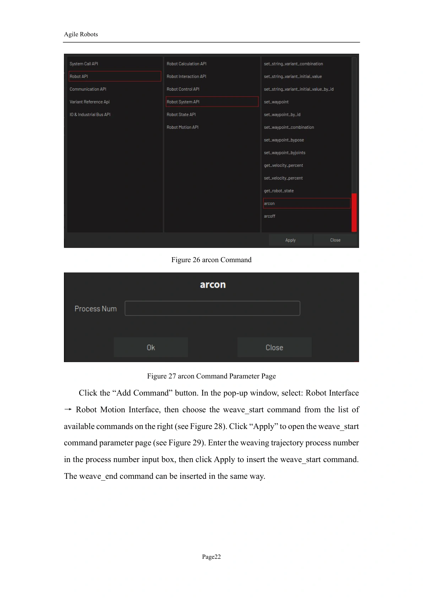



```
Agile Robots 
Page22 
 
Figure 26 arcon Command 
 
Figure 27 arcon Command Parameter Page 
Click the “Add Command” button. In the pop-up window, select: Robot Interface 
→ Robot Motion Interface, then choose the weave_start command from the list of 
available commands on the right (see Figure 28). Click “Apply” to open the weave_start 
command parameter page (see Figure 29). Enter the weaving trajectory process number 
in the process number input box, then click Apply to insert the weave_start command. 
The weave_end command can be inserted in the same way.
```



## PDF page 25

**Source:** Arc Welding Function Manual \_V3.3.0\_EN\_20260204.pdf, original pdf page 25. [Open the corresponding PDF reading-copy page](https://1292444914-files.gitbook.io/~/files/v0/b/gitbook-x-prod.appspot.com/o/spaces%2FtgOfPnscWebs1eh82EKq%2Fuploads%2FL2OnjqUdRaZTgPZTRuv4%2Farc-welding-function-manual-v3-3-0-en-20260204-pp-021-026.pdf?alt=media#page=5).



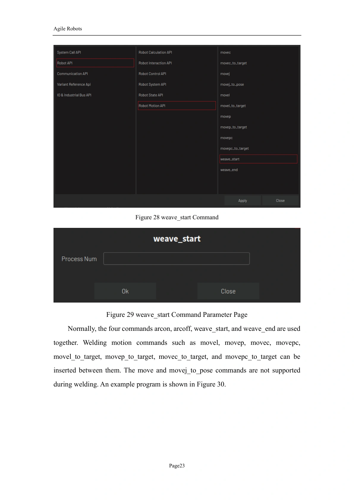



```
Agile Robots 
Page23 
 
Figure 28 weave_start Command 
 
Figure 29 weave_start Command Parameter Page 
Normally, the four commands arcon, arcoff, weave_start, and weave_end are used 
together. Welding motion commands such as movel, movep, movec, movepc, 
movel_to_target, movep_to_target, movec_to_target, and movepc_to_target can be 
inserted between them. The move and movej_to_pose commands are not supported 
during welding. An example program is shown in Figure 30.
```



## PDF page 26

**Source:** Arc Welding Function Manual \_V3.3.0\_EN\_20260204.pdf, original pdf page 26. [Open the corresponding PDF reading-copy page](https://1292444914-files.gitbook.io/~/files/v0/b/gitbook-x-prod.appspot.com/o/spaces%2FtgOfPnscWebs1eh82EKq%2Fuploads%2FL2OnjqUdRaZTgPZTRuv4%2Farc-welding-function-manual-v3-3-0-en-20260204-pp-021-026.pdf?alt=media#page=6).



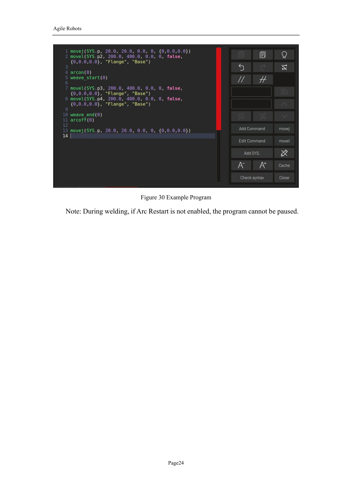



```
Agile Robots 
Page24 
 
Figure 30 Example Program 
Note: During welding, if Arc Restart is not enabled, the program cannot be paused.
```


