# CB-FS-3.2T controller manual V1.0.1 — complete reference


**Complete supplied source:** CB-FS-3.2T Controller User Manual V1.0.1.pdf · **Coverage:** 64 original PDF pages. [Return to the Agile Robots source library](./).


Every source page is retained in the original order. The **Original page** view preserves complete diagrams, photographs, tables, equations, connector orientation, notices and examples. The **Searchable text** view preserves native PDF text or the slide’s native text, embedded links and substantive speaker notes. Text extraction can retain reading-order/character defects; use the original image for exact layout, table columns and code indentation.


CB-FS-3.2T is not the RCB2.1.1T-0.3KW controller. Power-input ranges, arm cables, safety circuits and general I/O must follow the exact delivered controller manual. Ordinary digital I/O does not replace a safety-rated interface.


**Attribution:** the manufacturer and contributors identified in the supplied document. Original notices remain visible on every source page. Navigation, revision notes and the linked engineering explanations are OpenELAB editorial additions.

## Document navigation

| Source section / function             | Original page                                                              |
| ------------------------------------- | -------------------------------------------------------------------------- |
| SAFETY                                | [PDF 5](complete-cb-fs-3-2t-controller-user-manual-v1-0-1.md#pdf-page-5)   |
| SAFETY REGULATION                     | [PDF 5](complete-cb-fs-3-2t-controller-user-manual-v1-0-1.md#pdf-page-5)   |
| SAFETY SIGNS                          | [PDF 7](complete-cb-fs-3-2t-controller-user-manual-v1-0-1.md#pdf-page-7)   |
| PERSONNEL REQUIREMENTS                | [PDF 8](complete-cb-fs-3-2t-controller-user-manual-v1-0-1.md#pdf-page-8)   |
| PRECAUTIONS                           | [PDF 8](complete-cb-fs-3-2t-controller-user-manual-v1-0-1.md#pdf-page-8)   |
| EMERGENCY STOP                        | [PDF 11](complete-cb-fs-3-2t-controller-user-manual-v1-0-1.md#pdf-page-11) |
| SAFETY FUNCTIONS                      | [PDF 12](complete-cb-fs-3-2t-controller-user-manual-v1-0-1.md#pdf-page-12) |
| LIST OF SAFETY FUNCTIONS              | [PDF 12](complete-cb-fs-3-2t-controller-user-manual-v1-0-1.md#pdf-page-12) |
| STOP CATEGORY                         | [PDF 14](complete-cb-fs-3-2t-controller-user-manual-v1-0-1.md#pdf-page-14) |
| THREE-POSITION ENABLING               | [PDF 14](complete-cb-fs-3-2t-controller-user-manual-v1-0-1.md#pdf-page-14) |
| OPERATION MODE                        | [PDF 14](complete-cb-fs-3-2t-controller-user-manual-v1-0-1.md#pdf-page-14) |
| INTENDED USE AND PLACEMENT CONDITIONS | [PDF 16](complete-cb-fs-3-2t-controller-user-manual-v1-0-1.md#pdf-page-16) |
| ROBOT SYSTEM                          | [PDF 18](complete-cb-fs-3-2t-controller-user-manual-v1-0-1.md#pdf-page-18) |
| TECHNICAL SPECIFICATIONS              | [PDF 19](complete-cb-fs-3-2t-controller-user-manual-v1-0-1.md#pdf-page-19) |
| DIMENSION DRAWING                     | [PDF 20](complete-cb-fs-3-2t-controller-user-manual-v1-0-1.md#pdf-page-20) |
| CONTROL BOX ELECTRICAL INTERFACES     | [PDF 22](complete-cb-fs-3-2t-controller-user-manual-v1-0-1.md#pdf-page-22) |
| RS232/485 INTERFACE                   | [PDF 23](complete-cb-fs-3-2t-controller-user-manual-v1-0-1.md#pdf-page-23) |
| USB INTERFACE                         | [PDF 24](complete-cb-fs-3-2t-controller-user-manual-v1-0-1.md#pdf-page-24) |
| EXTERNAL ENCODER INTERFACE            | [PDF 24](complete-cb-fs-3-2t-controller-user-manual-v1-0-1.md#pdf-page-24) |
| TEACH PENDANT INTERFACE               | [PDF 24](complete-cb-fs-3-2t-controller-user-manual-v1-0-1.md#pdf-page-24) |
| INDICATOR                             | [PDF 26](complete-cb-fs-3-2t-controller-user-manual-v1-0-1.md#pdf-page-26) |
| ETHERNET INTERFACE                    | [PDF 26](complete-cb-fs-3-2t-controller-user-manual-v1-0-1.md#pdf-page-26) |
| SAFETY INTERFACE                      | [PDF 27](complete-cb-fs-3-2t-controller-user-manual-v1-0-1.md#pdf-page-27) |
| POWER INTERFACES AND SWITCHES         | [PDF 35](complete-cb-fs-3-2t-controller-user-manual-v1-0-1.md#pdf-page-35) |
| GENERAL I/O INTERFACE                 | [PDF 36](complete-cb-fs-3-2t-controller-user-manual-v1-0-1.md#pdf-page-36) |
| ROBOT ARM INTERFACE                   | [PDF 44](complete-cb-fs-3-2t-controller-user-manual-v1-0-1.md#pdf-page-44) |
| TEACH PENDANT ELECTRICAL INTERFACES   | [PDF 47](complete-cb-fs-3-2t-controller-user-manual-v1-0-1.md#pdf-page-47) |
| UNPACKING AND USE                     | [PDF 49](complete-cb-fs-3-2t-controller-user-manual-v1-0-1.md#pdf-page-49) |
| UNPACKING                             | [PDF 49](complete-cb-fs-3-2t-controller-user-manual-v1-0-1.md#pdf-page-49) |
| QUICK START                           | [PDF 49](complete-cb-fs-3-2t-controller-user-manual-v1-0-1.md#pdf-page-49) |
| TRANSPORT                             | [PDF 51](complete-cb-fs-3-2t-controller-user-manual-v1-0-1.md#pdf-page-51) |
| MAINTENANCE, REPAIR, AND DISPOSAL     | [PDF 52](complete-cb-fs-3-2t-controller-user-manual-v1-0-1.md#pdf-page-52) |
| INSPECTION ITEM                       | [PDF 52](complete-cb-fs-3-2t-controller-user-manual-v1-0-1.md#pdf-page-52) |
| VISUAL INSPECTION                     | [PDF 53](complete-cb-fs-3-2t-controller-user-manual-v1-0-1.md#pdf-page-53) |
| FUNCTION INSPECTION                   | [PDF 53](complete-cb-fs-3-2t-controller-user-manual-v1-0-1.md#pdf-page-53) |
| CLEANING                              | [PDF 54](complete-cb-fs-3-2t-controller-user-manual-v1-0-1.md#pdf-page-54) |
| WASTE DISPOSAL                        | [PDF 55](complete-cb-fs-3-2t-controller-user-manual-v1-0-1.md#pdf-page-55) |
| 11. APPLICABLE STANDARDS              | [PDF 56](complete-cb-fs-3-2t-controller-user-manual-v1-0-1.md#pdf-page-56) |
| DISCLAIMER                            | [PDF 57](complete-cb-fs-3-2t-controller-user-manual-v1-0-1.md#pdf-page-57) |
| APPENDIX                              | [PDF 58](complete-cb-fs-3-2t-controller-user-manual-v1-0-1.md#pdf-page-58) |
| SAFETY FUNCTIONS                      | [PDF 58](complete-cb-fs-3-2t-controller-user-manual-v1-0-1.md#pdf-page-58) |

## PDF page 1

**Source:** CB-FS-3.2T Controller User Manual V1.0.1.pdf, original pdf page 1. [Open the corresponding PDF reading-copy page](https://1292444914-files.gitbook.io/~/files/v0/b/gitbook-x-prod.appspot.com/o/spaces%2FtgOfPnscWebs1eh82EKq%2Fuploads%2FSNiPGVvdGHALTGVBIl9H%2Fcb-fs-3-2t-controller-user-manual-v1-0-1-pp-001-022.pdf?alt=media#page=1).



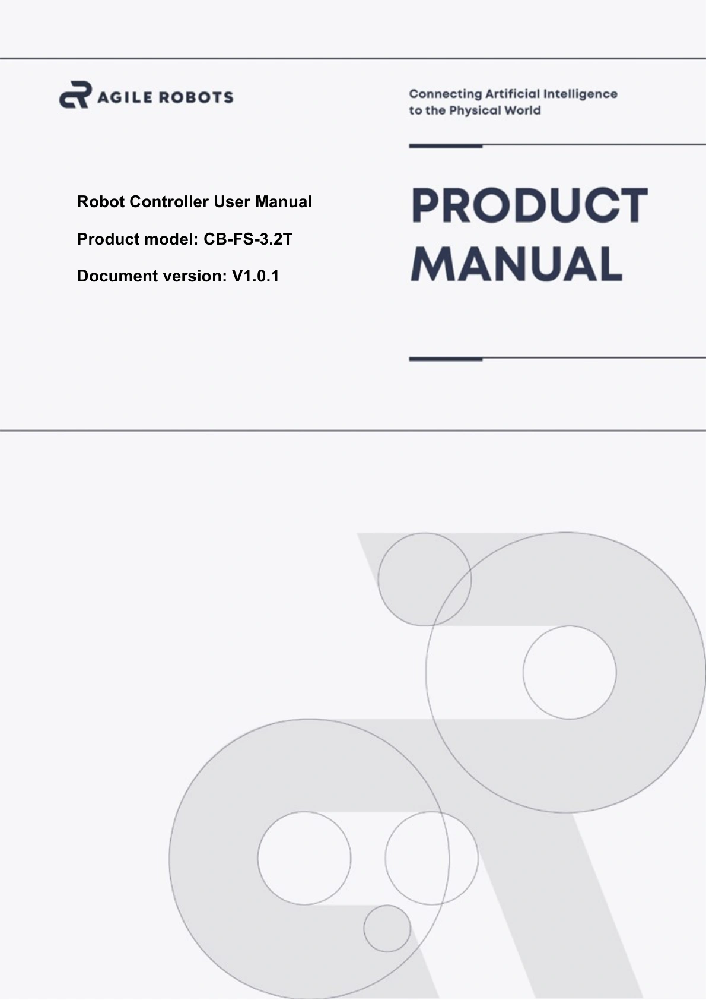



```
i 
Robot Controller User Manual  
Product model: CB-FS-3.2T 
Document version: V1.0.1
```



## PDF page 2

**Source:** CB-FS-3.2T Controller User Manual V1.0.1.pdf, original pdf page 2. [Open the corresponding PDF reading-copy page](https://1292444914-files.gitbook.io/~/files/v0/b/gitbook-x-prod.appspot.com/o/spaces%2FtgOfPnscWebs1eh82EKq%2Fuploads%2FSNiPGVvdGHALTGVBIl9H%2Fcb-fs-3-2t-controller-user-manual-v1-0-1-pp-001-022.pdf?alt=media#page=2).



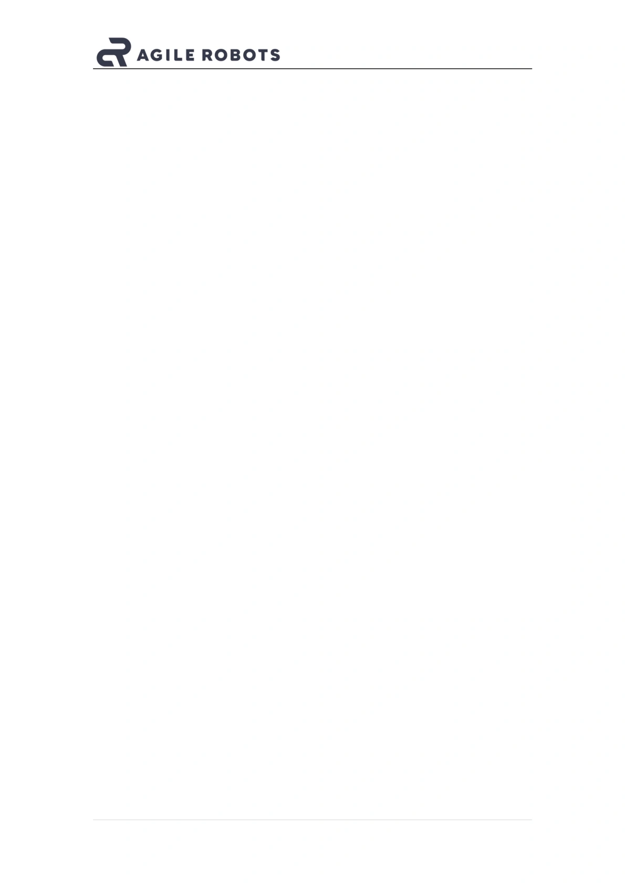



No native selectable text is present on this page. The complete original artwork or screenshot remains in the Original page view.



## PDF page 3

**Source:** CB-FS-3.2T Controller User Manual V1.0.1.pdf, original pdf page 3. [Open the corresponding PDF reading-copy page](https://1292444914-files.gitbook.io/~/files/v0/b/gitbook-x-prod.appspot.com/o/spaces%2FtgOfPnscWebs1eh82EKq%2Fuploads%2FSNiPGVvdGHALTGVBIl9H%2Fcb-fs-3-2t-controller-user-manual-v1-0-1-pp-001-022.pdf?alt=media#page=3).



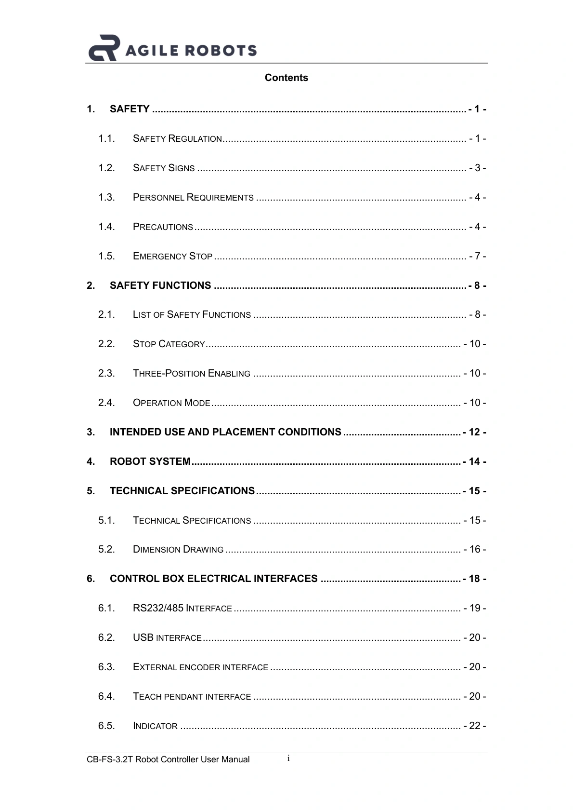



```
CB-FS-3.2T Robot Controller User Manual 
 i 
Contents 
1. 
SAFETY ................................................................................................................ - 1 - 
1.1. 
SAFETY REGULATION ....................................................................................... - 1 - 
1.2. 
SAFETY SIGNS ................................................................................................ - 3 - 
1.3. 
PERSONNEL REQUIREMENTS ........................................................................... - 4 - 
1.4. 
PRECAUTIONS ................................................................................................. - 4 - 
1.5. 
EMERGENCY STOP .......................................................................................... - 7 - 
2. 
SAFETY FUNCTIONS .......................................................................................... - 8 - 
2.1. 
LIST OF SAFETY FUNCTIONS ............................................................................ - 8 - 
2.2. 
STOP CATEGORY ........................................................................................... - 10 - 
2.3. 
THREE-POSITION ENABLING .......................................................................... - 10 - 
2.4. 
OPERATION MODE ......................................................................................... - 10 - 
3. 
INTENDED USE AND PLACEMENT CONDITIONS .......................................... - 12 - 
4. 
ROBOT SYSTEM ................................................................................................ - 14 - 
5. 
TECHNICAL SPECIFICATIONS ......................................................................... - 15 - 
5.1. 
TECHNICAL SPECIFICATIONS .......................................................................... - 15 - 
5.2. 
DIMENSION DRAWING .................................................................................... - 16 - 
6. 
CONTROL BOX ELECTRICAL INTERFACES .................................................. - 18 - 
6.1. 
RS232/485 INTERFACE ................................................................................. - 19 - 
6.2. 
USB INTERFACE ............................................................................................ - 20 - 
6.3. 
EXTERNAL ENCODER INTERFACE .................................................................... - 20 - 
6.4. 
TEACH PENDANT INTERFACE .......................................................................... - 20 - 
6.5. 
INDICATOR .................................................................................................... - 22 -
```



## PDF page 4

**Source:** CB-FS-3.2T Controller User Manual V1.0.1.pdf, original pdf page 4. [Open the corresponding PDF reading-copy page](https://1292444914-files.gitbook.io/~/files/v0/b/gitbook-x-prod.appspot.com/o/spaces%2FtgOfPnscWebs1eh82EKq%2Fuploads%2FSNiPGVvdGHALTGVBIl9H%2Fcb-fs-3-2t-controller-user-manual-v1-0-1-pp-001-022.pdf?alt=media#page=4).



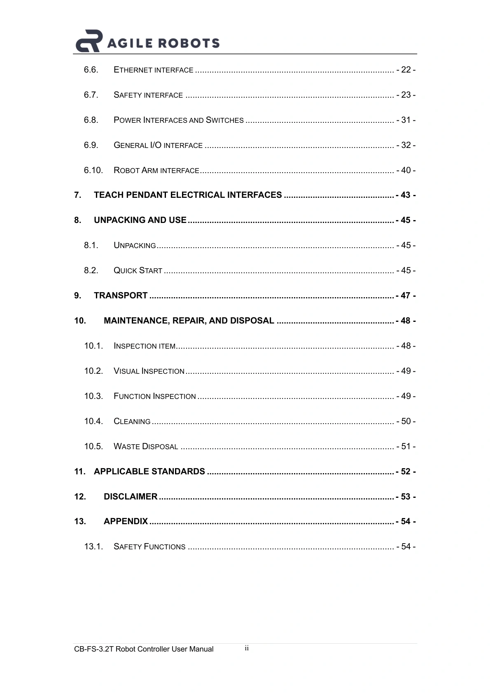



```
CB-FS-3.2T Robot Controller User Manual 
 ii 
6.6. 
ETHERNET INTERFACE ................................................................................... - 22 - 
6.7. 
SAFETY INTERFACE ....................................................................................... - 23 - 
6.8. 
POWER INTERFACES AND SWITCHES .............................................................. - 31 - 
6.9. 
GENERAL I/O INTERFACE ............................................................................... - 32 - 
6.10. 
ROBOT ARM INTERFACE ................................................................................. - 40 - 
7. 
TEACH PENDANT ELECTRICAL INTERFACES .............................................. - 43 - 
8. 
UNPACKING AND USE ...................................................................................... - 45 - 
8.1. 
UNPACKING ................................................................................................... - 45 - 
8.2. 
QUICK START ................................................................................................ - 45 - 
9. 
TRANSPORT ...................................................................................................... - 47 - 
10. 
MAINTENANCE, REPAIR, AND DISPOSAL ................................................. - 48 - 
10.1. 
INSPECTION ITEM ........................................................................................... - 48 - 
10.2. 
VISUAL INSPECTION ....................................................................................... - 49 - 
10.3. 
FUNCTION INSPECTION .................................................................................. - 49 - 
10.4. 
CLEANING ..................................................................................................... - 50 - 
10.5. 
WASTE DISPOSAL ......................................................................................... - 51 - 
11. APPLICABLE STANDARDS .............................................................................. - 52 - 
12. 
DISCLAIMER .................................................................................................. - 53 - 
13. 
APPENDIX ...................................................................................................... - 54 - 
13.1. 
SAFETY FUNCTIONS ...................................................................................... - 54 -
```



## PDF page 5

**Source:** CB-FS-3.2T Controller User Manual V1.0.1.pdf, original pdf page 5. [Open the corresponding PDF reading-copy page](https://1292444914-files.gitbook.io/~/files/v0/b/gitbook-x-prod.appspot.com/o/spaces%2FtgOfPnscWebs1eh82EKq%2Fuploads%2FSNiPGVvdGHALTGVBIl9H%2Fcb-fs-3-2t-controller-user-manual-v1-0-1-pp-001-022.pdf?alt=media#page=5).



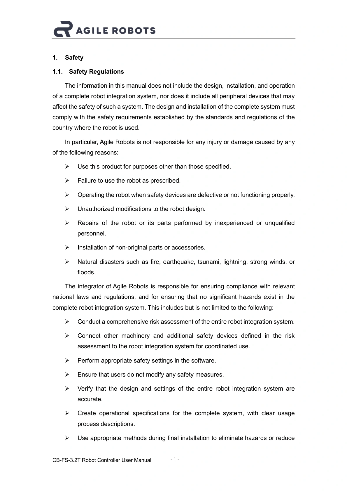



```
CB-FS-3.2T Robot Controller User Manual 
 
- 1 - 
1. 
Safety 
1.1. Safety Regulations 
The information in this manual does not include the design, installation, and operation 
of a complete robot integration system, nor does it include all peripheral devices that may 
affect the safety of such a system. The design and installation of the complete system must 
comply with the safety requirements established by the standards and regulations of the 
country where the robot is used. 
In particular, Agile Robots is not responsible for any injury or damage caused by any 
of the following reasons: 
Ø 
Use this product for purposes other than those specified. 
Ø 
Failure to use the robot as prescribed. 
Ø 
Operating the robot when safety devices are defective or not functioning properly. 
Ø 
Unauthorized modifications to the robot design. 
Ø 
Repairs of the robot or its parts performed by inexperienced or unqualified 
personnel. 
Ø 
Installation of non-original parts or accessories. 
Ø 
Natural disasters such as fire, earthquake, tsunami, lightning, strong winds, or 
floods. 
The integrator of Agile Robots is responsible for ensuring compliance with relevant 
national laws and regulations, and for ensuring that no significant hazards exist in the 
complete robot integration system. This includes but is not limited to the following: 
Ø 
Conduct a comprehensive risk assessment of the entire robot integration system. 
Ø 
Connect other machinery and additional safety devices defined in the risk 
assessment to the robot integration system for coordinated use. 
Ø 
Perform appropriate safety settings in the software. 
Ø 
Ensure that users do not modify any safety measures. 
Ø 
Verify that the design and settings of the entire robot integration system are 
accurate. 
Ø 
Create operational specifications for the complete system, with clear usage 
process descriptions. 
Ø 
Use appropriate methods during final installation to eliminate hazards or reduce
```



## PDF page 6

**Source:** CB-FS-3.2T Controller User Manual V1.0.1.pdf, original pdf page 6. [Open the corresponding PDF reading-copy page](https://1292444914-files.gitbook.io/~/files/v0/b/gitbook-x-prod.appspot.com/o/spaces%2FtgOfPnscWebs1eh82EKq%2Fuploads%2FSNiPGVvdGHALTGVBIl9H%2Fcb-fs-3-2t-controller-user-manual-v1-0-1-pp-001-022.pdf?alt=media#page=6).



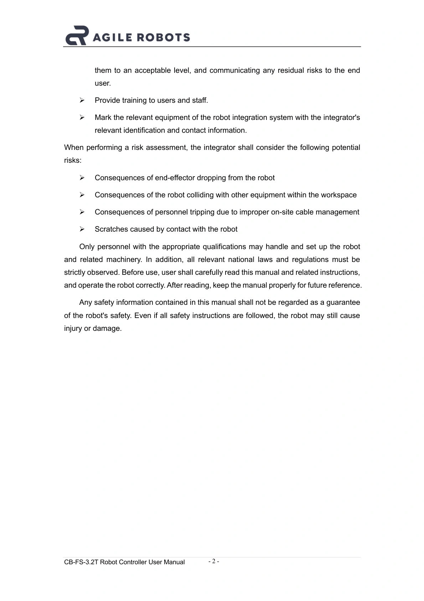



```
CB-FS-3.2T Robot Controller User Manual 
 
- 2 - 
them to an acceptable level, and communicating any residual risks to the end 
user. 
Ø 
Provide training to users and staff. 
Ø 
Mark the relevant equipment of the robot integration system with the integrator's 
relevant identification and contact information. 
When performing a risk assessment, the integrator shall consider the following potential 
risks: 
Ø 
Consequences of end-effector dropping from the robot 
Ø 
Consequences of the robot colliding with other equipment within the workspace 
Ø 
Consequences of personnel tripping due to improper on-site cable management 
Ø 
Scratches caused by contact with the robot 
Only personnel with the appropriate qualifications may handle and set up the robot 
and related machinery. In addition, all relevant national laws and regulations must be 
strictly observed. Before use, user shall carefully read this manual and related instructions, 
and operate the robot correctly. After reading, keep the manual properly for future reference. 
Any safety information contained in this manual shall not be regarded as a guarantee 
of the robot's safety. Even if all safety instructions are followed, the robot may still cause 
injury or damage.
```



## PDF page 7

**Source:** CB-FS-3.2T Controller User Manual V1.0.1.pdf, original pdf page 7. [Open the corresponding PDF reading-copy page](https://1292444914-files.gitbook.io/~/files/v0/b/gitbook-x-prod.appspot.com/o/spaces%2FtgOfPnscWebs1eh82EKq%2Fuploads%2FSNiPGVvdGHALTGVBIl9H%2Fcb-fs-3-2t-controller-user-manual-v1-0-1-pp-001-022.pdf?alt=media#page=7).



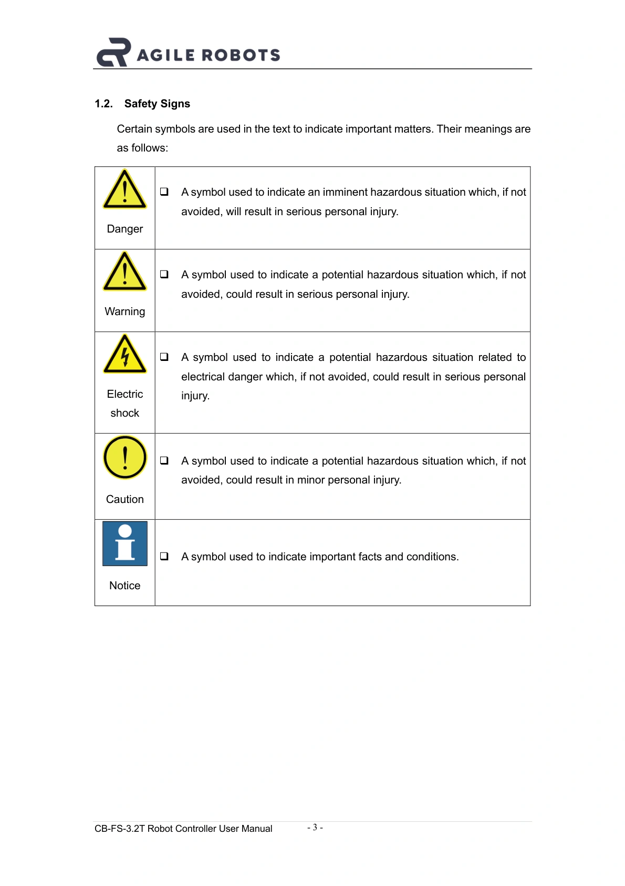



```
CB-FS-3.2T Robot Controller User Manual 
 
- 3 - 
1.2. Safety Signs 
Certain symbols are used in the text to indicate important matters. Their meanings are 
as follows: 
 
Danger 
q 
A symbol used to indicate an imminent hazardous situation which, if not 
avoided, will result in serious personal injury. 
 
Warning 
q 
A symbol used to indicate a potential hazardous situation which, if not 
avoided, could result in serious personal injury. 
 
Electric 
shock 
q 
A symbol used to indicate a potential hazardous situation related to 
electrical danger which, if not avoided, could result in serious personal 
injury. 
 
Caution 
q 
A symbol used to indicate a potential hazardous situation which, if not 
avoided, could result in minor personal injury. 
 
Notice 
q 
A symbol used to indicate important facts and conditions.
```



## PDF page 8

**Source:** CB-FS-3.2T Controller User Manual V1.0.1.pdf, original pdf page 8. [Open the corresponding PDF reading-copy page](https://1292444914-files.gitbook.io/~/files/v0/b/gitbook-x-prod.appspot.com/o/spaces%2FtgOfPnscWebs1eh82EKq%2Fuploads%2FSNiPGVvdGHALTGVBIl9H%2Fcb-fs-3-2t-controller-user-manual-v1-0-1-pp-001-022.pdf?alt=media#page=8).



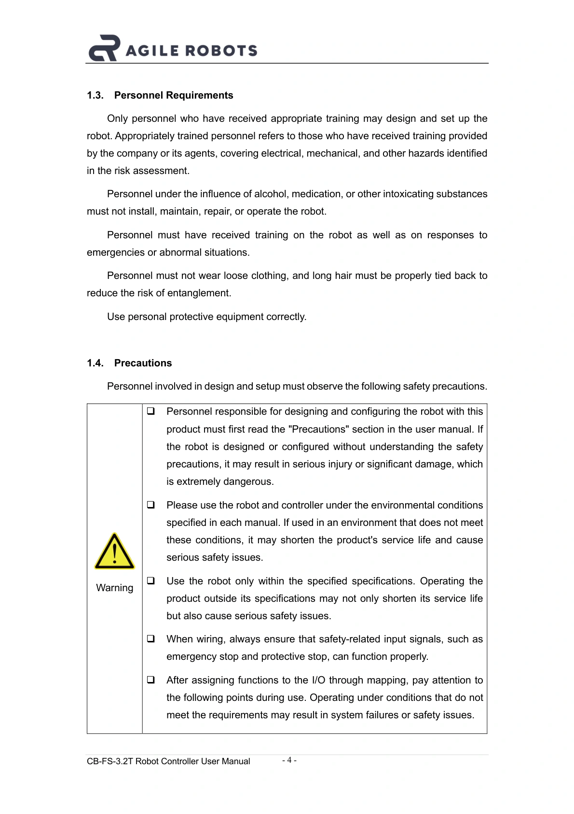



```
CB-FS-3.2T Robot Controller User Manual 
 
- 4 - 
1.3. Personnel Requirements 
Only personnel who have received appropriate training may design and set up the 
robot. Appropriately trained personnel refers to those who have received training provided 
by the company or its agents, covering electrical, mechanical, and other hazards identified 
in the risk assessment. 
Personnel under the influence of alcohol, medication, or other intoxicating substances 
must not install, maintain, repair, or operate the robot. 
Personnel must have received training on the robot as well as on responses to 
emergencies or abnormal situations. 
Personnel must not wear loose clothing, and long hair must be properly tied back to 
reduce the risk of entanglement. 
Use personal protective equipment correctly. 
 
1.4. Precautions 
Personnel involved in design and setup must observe the following safety precautions. 
 
Warning 
q 
Personnel responsible for designing and configuring the robot with this 
product must first read the "Precautions" section in the user manual. If 
the robot is designed or configured without understanding the safety 
precautions, it may result in serious injury or significant damage, which 
is extremely dangerous. 
q 
Please use the robot and controller under the environmental conditions 
specified in each manual. If used in an environment that does not meet 
these conditions, it may shorten the product's service life and cause 
serious safety issues. 
q 
Use the robot only within the specified specifications. Operating the 
product outside its specifications may not only shorten its service life 
but also cause serious safety issues. 
q 
When wiring, always ensure that safety-related input signals, such as 
emergency stop and protective stop, can function properly. 
q 
After assigning functions to the I/O through mapping, pay attention to 
the following points during use. Operating under conditions that do not 
meet the requirements may result in system failures or safety issues.
```



## PDF page 9

**Source:** CB-FS-3.2T Controller User Manual V1.0.1.pdf, original pdf page 9. [Open the corresponding PDF reading-copy page](https://1292444914-files.gitbook.io/~/files/v0/b/gitbook-x-prod.appspot.com/o/spaces%2FtgOfPnscWebs1eh82EKq%2Fuploads%2FSNiPGVvdGHALTGVBIl9H%2Fcb-fs-3-2t-controller-user-manual-v1-0-1-pp-001-022.pdf?alt=media#page=9).



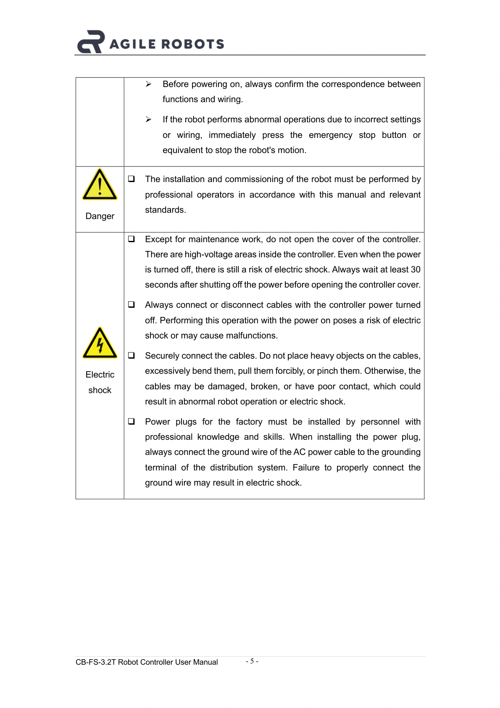



```
CB-FS-3.2T Robot Controller User Manual 
 
- 5 - 
Ø 
Before powering on, always confirm the correspondence between 
functions and wiring. 
Ø 
If the robot performs abnormal operations due to incorrect settings 
or wiring, immediately press the emergency stop button or 
equivalent to stop the robot's motion. 
 
Danger 
q 
The installation and commissioning of the robot must be performed by 
professional operators in accordance with this manual and relevant 
standards. 
 
Electric 
shock 
q 
Except for maintenance work, do not open the cover of the controller. 
There are high-voltage areas inside the controller. Even when the power 
is turned off, there is still a risk of electric shock. Always wait at least 30 
seconds after shutting off the power before opening the controller cover. 
q 
Always connect or disconnect cables with the controller power turned 
off. Performing this operation with the power on poses a risk of electric 
shock or may cause malfunctions. 
q 
Securely connect the cables. Do not place heavy objects on the cables, 
excessively bend them, pull them forcibly, or pinch them. Otherwise, the 
cables may be damaged, broken, or have poor contact, which could 
result in abnormal robot operation or electric shock. 
q 
Power plugs for the factory must be installed by personnel with 
professional knowledge and skills. When installing the power plug, 
always connect the ground wire of the AC power cable to the grounding 
terminal of the distribution system. Failure to properly connect the 
ground wire may result in electric shock.
```



## PDF page 10

**Source:** CB-FS-3.2T Controller User Manual V1.0.1.pdf, original pdf page 10. [Open the corresponding PDF reading-copy page](https://1292444914-files.gitbook.io/~/files/v0/b/gitbook-x-prod.appspot.com/o/spaces%2FtgOfPnscWebs1eh82EKq%2Fuploads%2FSNiPGVvdGHALTGVBIl9H%2Fcb-fs-3-2t-controller-user-manual-v1-0-1-pp-001-022.pdf?alt=media#page=10).



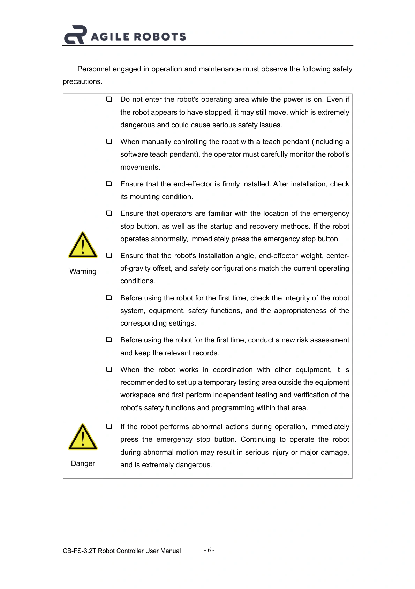



```
CB-FS-3.2T Robot Controller User Manual 
 
- 6 - 
Personnel engaged in operation and maintenance must observe the following safety 
precautions. 
 
Warning 
q 
Do not enter the robot's operating area while the power is on. Even if 
the robot appears to have stopped, it may still move, which is extremely 
dangerous and could cause serious safety issues. 
q 
When manually controlling the robot with a teach pendant (including a 
software teach pendant), the operator must carefully monitor the robot's 
movements. 
q 
Ensure that the end-effector is firmly installed. After installation, check 
its mounting condition. 
q 
Ensure that operators are familiar with the location of the emergency 
stop button, as well as the startup and recovery methods. If the robot 
operates abnormally, immediately press the emergency stop button. 
q 
Ensure that the robot's installation angle, end-effector weight, center-
of-gravity offset, and safety configurations match the current operating 
conditions. 
q 
Before using the robot for the first time, check the integrity of the robot 
system, equipment, safety functions, and the appropriateness of the 
corresponding settings. 
q 
Before using the robot for the first time, conduct a new risk assessment 
and keep the relevant records. 
q 
When the robot works in coordination with other equipment, it is 
recommended to set up a temporary testing area outside the equipment 
workspace and first perform independent testing and verification of the 
robot's safety functions and programming within that area. 
 
Danger 
q 
If the robot performs abnormal actions during operation, immediately 
press the emergency stop button. Continuing to operate the robot 
during abnormal motion may result in serious injury or major damage, 
and is extremely dangerous.
```



## PDF page 11

**Source:** CB-FS-3.2T Controller User Manual V1.0.1.pdf, original pdf page 11. [Open the corresponding PDF reading-copy page](https://1292444914-files.gitbook.io/~/files/v0/b/gitbook-x-prod.appspot.com/o/spaces%2FtgOfPnscWebs1eh82EKq%2Fuploads%2FSNiPGVvdGHALTGVBIl9H%2Fcb-fs-3-2t-controller-user-manual-v1-0-1-pp-001-022.pdf?alt=media#page=11).



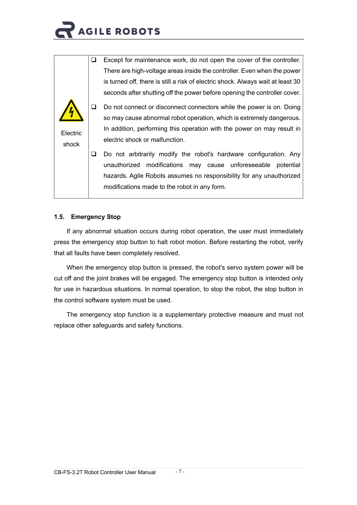



```
CB-FS-3.2T Robot Controller User Manual 
 
- 7 - 
 
Electric 
shock 
q 
Except for maintenance work, do not open the cover of the controller. 
There are high-voltage areas inside the controller. Even when the power 
is turned off, there is still a risk of electric shock. Always wait at least 30 
seconds after shutting off the power before opening the controller cover. 
q 
Do not connect or disconnect connectors while the power is on. Doing 
so may cause abnormal robot operation, which is extremely dangerous. 
In addition, performing this operation with the power on may result in 
electric shock or malfunction. 
q 
Do not arbitrarily modify the robot's hardware configuration. Any 
unauthorized modifications may cause unforeseeable potential 
hazards. Agile Robots assumes no responsibility for any unauthorized 
modifications made to the robot in any form. 
 
1.5. Emergency Stop 
If any abnormal situation occurs during robot operation, the user must immediately 
press the emergency stop button to halt robot motion. Before restarting the robot, verify 
that all faults have been completely resolved. 
When the emergency stop button is pressed, the robot's servo system power will be 
cut off and the joint brakes will be engaged. The emergency stop button is intended only 
for use in hazardous situations. In normal operation, to stop the robot, the stop button in 
the control software system must be used. 
The emergency stop function is a supplementary protective measure and must not 
replace other safeguards and safety functions.
```



## PDF page 12

**Source:** CB-FS-3.2T Controller User Manual V1.0.1.pdf, original pdf page 12. [Open the corresponding PDF reading-copy page](https://1292444914-files.gitbook.io/~/files/v0/b/gitbook-x-prod.appspot.com/o/spaces%2FtgOfPnscWebs1eh82EKq%2Fuploads%2FSNiPGVvdGHALTGVBIl9H%2Fcb-fs-3-2t-controller-user-manual-v1-0-1-pp-001-022.pdf?alt=media#page=12).



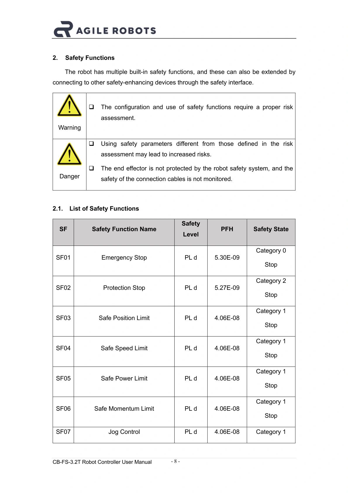



```
CB-FS-3.2T Robot Controller User Manual 
 
- 8 - 
2. 
Safety Functions 
The robot has multiple built-in safety functions, and these can also be extended by 
connecting to other safety-enhancing devices through the safety interface. 
 
Warning 
q 
The configuration and use of safety functions require a proper risk 
assessment. 
 
Danger 
q 
Using safety parameters different from those defined in the risk 
assessment may lead to increased risks. 
q 
The end effector is not protected by the robot safety system, and the 
safety of the connection cables is not monitored. 
 
2.1. List of Safety Functions 
SF 
Safety Function Name 
Safety 
Level 
PFH 
Safety State 
SF01 
Emergency Stop 
PL d 
5.30E-09 
Category 0 
Stop 
SF02 
Protection Stop 
PL d 
5.27E-09 
Category 2 
Stop 
SF03 
Safe Position Limit 
PL d 
4.06E-08 
Category 1 
Stop 
SF04 
Safe Speed Limit 
PL d 
4.06E-08 
Category 1 
Stop 
SF05 
Safe Power Limit 
PL d 
4.06E-08 
Category 1 
Stop 
SF06 
Safe Momentum Limit 
PL d 
4.06E-08 
Category 1 
Stop 
SF07 
Jog Control 
PL d 
4.06E-08 
Category 1
```



## PDF page 13

**Source:** CB-FS-3.2T Controller User Manual V1.0.1.pdf, original pdf page 13. [Open the corresponding PDF reading-copy page](https://1292444914-files.gitbook.io/~/files/v0/b/gitbook-x-prod.appspot.com/o/spaces%2FtgOfPnscWebs1eh82EKq%2Fuploads%2FSNiPGVvdGHALTGVBIl9H%2Fcb-fs-3-2t-controller-user-manual-v1-0-1-pp-001-022.pdf?alt=media#page=13).



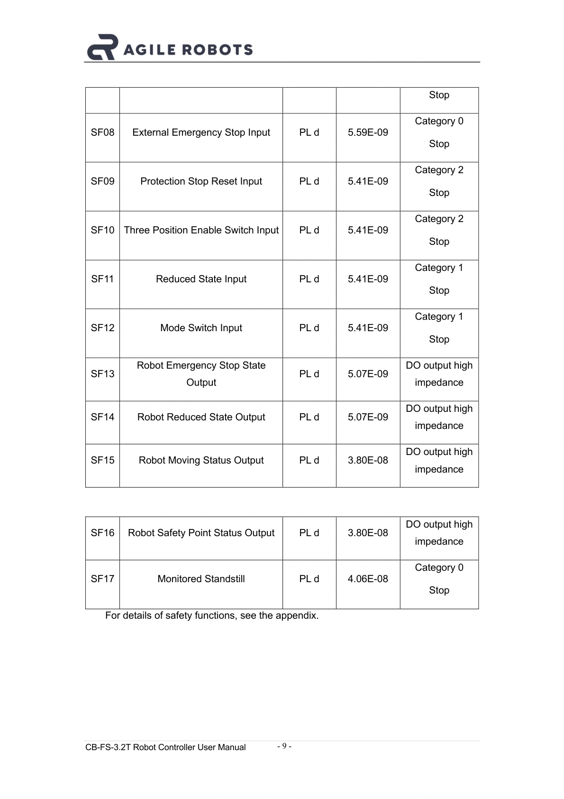



```
CB-FS-3.2T Robot Controller User Manual 
 
- 9 - 
Stop 
SF08 
External Emergency Stop Input 
PL d 
5.59E-09 
Category 0 
Stop 
SF09 
Protection Stop Reset Input 
PL d 
5.41E-09 
Category 2 
Stop 
SF10 Three Position Enable Switch Input 
PL d 
5.41E-09 
Category 2 
Stop 
SF11 
Reduced State Input 
PL d 
5.41E-09 
Category 1 
Stop 
SF12 
Mode Switch Input 
PL d 
5.41E-09 
Category 1 
Stop 
SF13 
Robot Emergency Stop State 
Output  
PL d 
5.07E-09 
DO output high 
impedance 
SF14 
Robot Reduced State Output 
PL d 
5.07E-09 
DO output high 
impedance 
SF15 
Robot Moving Status Output 
PL d 
3.80E-08 
DO output high 
impedance 
 
SF16 
Robot Safety Point Status Output 
PL d 
3.80E-08 
DO output high 
impedance 
SF17 
Monitored Standstill 
PL d 
4.06E-08 
Category 0 
Stop 
For details of safety functions, see the appendix.
```



## PDF page 14

**Source:** CB-FS-3.2T Controller User Manual V1.0.1.pdf, original pdf page 14. [Open the corresponding PDF reading-copy page](https://1292444914-files.gitbook.io/~/files/v0/b/gitbook-x-prod.appspot.com/o/spaces%2FtgOfPnscWebs1eh82EKq%2Fuploads%2FSNiPGVvdGHALTGVBIl9H%2Fcb-fs-3-2t-controller-user-manual-v1-0-1-pp-001-022.pdf?alt=media#page=14).



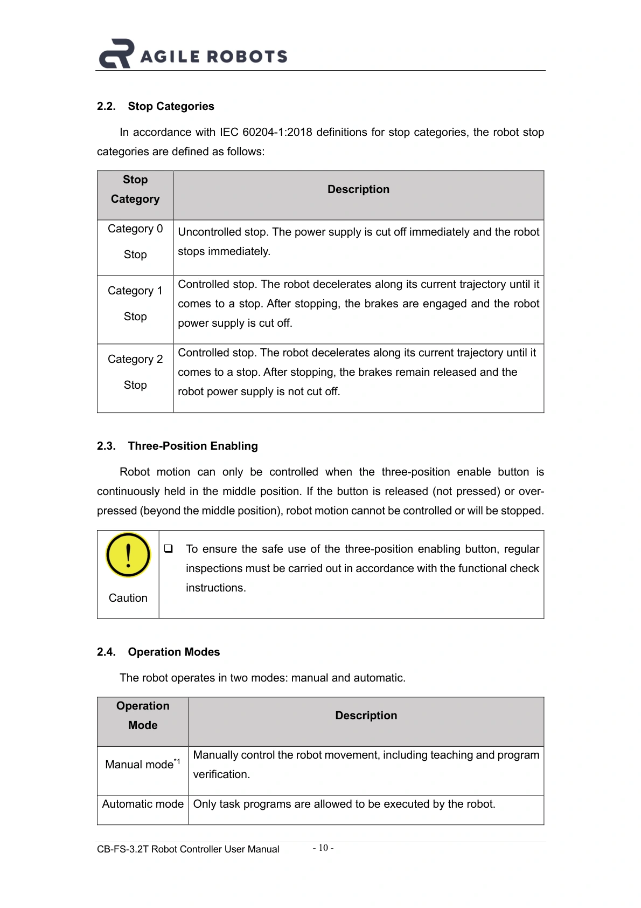



```
CB-FS-3.2T Robot Controller User Manual 
 
- 10 - 
2.2. Stop Categories 
In accordance with IEC 60204-1:2018 definitions for stop categories, the robot stop 
categories are defined as follows: 
Stop 
Category 
Description 
Category 0 
Stop 
Uncontrolled stop. The power supply is cut off immediately and the robot 
stops immediately. 
Category 1 
Stop 
Controlled stop. The robot decelerates along its current trajectory until it 
comes to a stop. After stopping, the brakes are engaged and the robot 
power supply is cut off. 
Category 2 
Stop 
Controlled stop. The robot decelerates along its current trajectory until it 
comes to a stop. After stopping, the brakes remain released and the 
robot power supply is not cut off. 
 
2.3. Three-Position Enabling 
Robot motion can only be controlled when the three-position enable button is 
continuously held in the middle position. If the button is released (not pressed) or over-
pressed (beyond the middle position), robot motion cannot be controlled or will be stopped. 
 
Caution 
q 
To ensure the safe use of the three-position enabling button, regular 
inspections must be carried out in accordance with the functional check 
instructions. 
 
2.4. Operation Modes 
The robot operates in two modes: manual and automatic. 
Operation 
Mode 
Description 
Manual mode*1 
Manually control the robot movement, including teaching and program 
verification. 
Automatic mode Only task programs are allowed to be executed by the robot.
```



## PDF page 15

**Source:** CB-FS-3.2T Controller User Manual V1.0.1.pdf, original pdf page 15. [Open the corresponding PDF reading-copy page](https://1292444914-files.gitbook.io/~/files/v0/b/gitbook-x-prod.appspot.com/o/spaces%2FtgOfPnscWebs1eh82EKq%2Fuploads%2FSNiPGVvdGHALTGVBIl9H%2Fcb-fs-3-2t-controller-user-manual-v1-0-1-pp-001-022.pdf?alt=media#page=15).



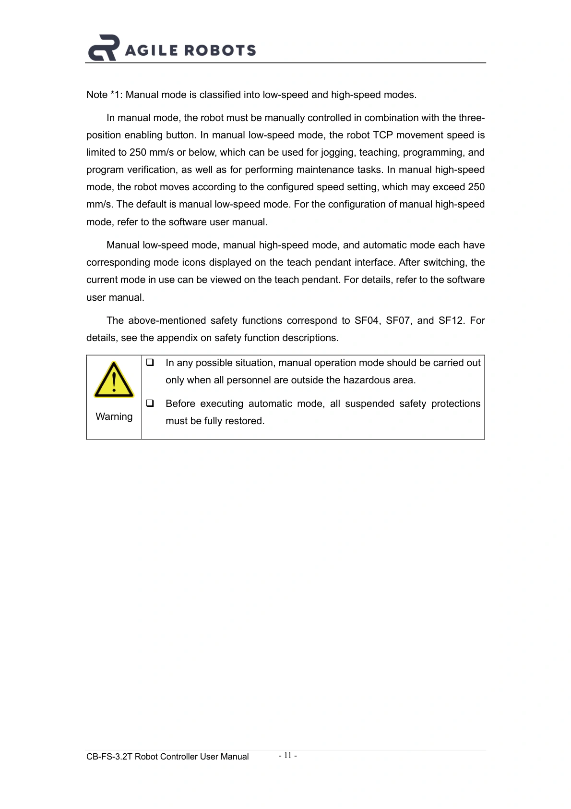



```
CB-FS-3.2T Robot Controller User Manual 
 
- 11 - 
Note *1: Manual mode is classified into low-speed and high-speed modes. 
In manual mode, the robot must be manually controlled in combination with the three-
position enabling button. In manual low-speed mode, the robot TCP movement speed is 
limited to 250 mm/s or below, which can be used for jogging, teaching, programming, and 
program verification, as well as for performing maintenance tasks. In manual high-speed 
mode, the robot moves according to the configured speed setting, which may exceed 250 
mm/s. The default is manual low-speed mode. For the configuration of manual high-speed 
mode, refer to the software user manual. 
Manual low-speed mode, manual high-speed mode, and automatic mode each have 
corresponding mode icons displayed on the teach pendant interface. After switching, the 
current mode in use can be viewed on the teach pendant. For details, refer to the software 
user manual. 
The above-mentioned safety functions correspond to SF04, SF07, and SF12. For 
details, see the appendix on safety function descriptions. 
 
Warning 
q 
In any possible situation, manual operation mode should be carried out 
only when all personnel are outside the hazardous area. 
q 
Before executing automatic mode, all suspended safety protections 
must be fully restored.
```



## PDF page 16

**Source:** CB-FS-3.2T Controller User Manual V1.0.1.pdf, original pdf page 16. [Open the corresponding PDF reading-copy page](https://1292444914-files.gitbook.io/~/files/v0/b/gitbook-x-prod.appspot.com/o/spaces%2FtgOfPnscWebs1eh82EKq%2Fuploads%2FSNiPGVvdGHALTGVBIl9H%2Fcb-fs-3-2t-controller-user-manual-v1-0-1-pp-001-022.pdf?alt=media#page=16).



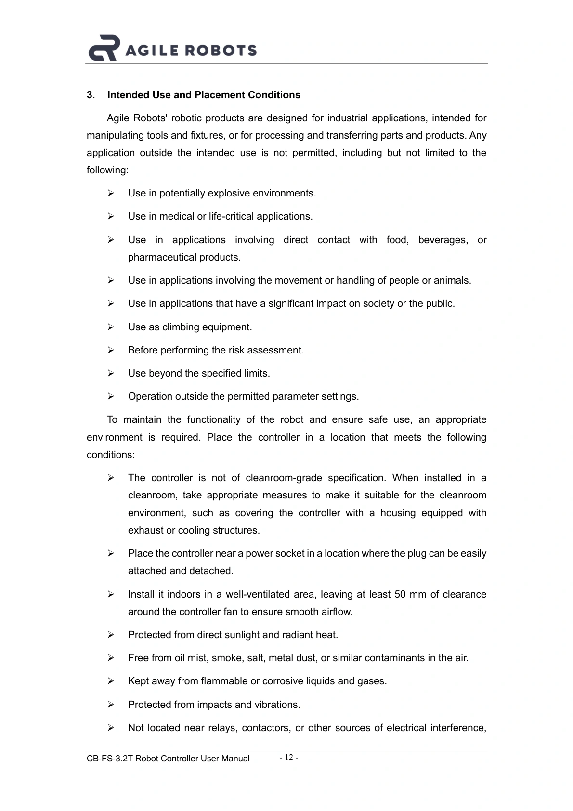



```
CB-FS-3.2T Robot Controller User Manual 
 
- 12 - 
3. 
Intended Use and Placement Conditions 
Agile Robots' robotic products are designed for industrial applications, intended for 
manipulating tools and fixtures, or for processing and transferring parts and products. Any 
application outside the intended use is not permitted, including but not limited to the 
following: 
Ø 
Use in potentially explosive environments. 
Ø 
Use in medical or life-critical applications. 
Ø 
Use in applications involving direct contact with food, beverages, or 
pharmaceutical products. 
Ø 
Use in applications involving the movement or handling of people or animals. 
Ø 
Use in applications that have a significant impact on society or the public. 
Ø 
Use as climbing equipment. 
Ø 
Before performing the risk assessment. 
Ø 
Use beyond the specified limits. 
Ø 
Operation outside the permitted parameter settings. 
To maintain the functionality of the robot and ensure safe use, an appropriate 
environment is required. Place the controller in a location that meets the following 
conditions: 
Ø 
The controller is not of cleanroom-grade specification. When installed in a 
cleanroom, take appropriate measures to make it suitable for the cleanroom 
environment, such as covering the controller with a housing equipped with 
exhaust or cooling structures. 
Ø 
Place the controller near a power socket in a location where the plug can be easily 
attached and detached. 
Ø 
Install it indoors in a well-ventilated area, leaving at least 50 mm of clearance 
around the controller fan to ensure smooth airflow. 
Ø 
Protected from direct sunlight and radiant heat. 
Ø 
Free from oil mist, smoke, salt, metal dust, or similar contaminants in the air. 
Ø 
Kept away from flammable or corrosive liquids and gases. 
Ø 
Protected from impacts and vibrations. 
Ø 
Not located near relays, contactors, or other sources of electrical interference,
```



## PDF page 17

**Source:** CB-FS-3.2T Controller User Manual V1.0.1.pdf, original pdf page 17. [Open the corresponding PDF reading-copy page](https://1292444914-files.gitbook.io/~/files/v0/b/gitbook-x-prod.appspot.com/o/spaces%2FtgOfPnscWebs1eh82EKq%2Fuploads%2FSNiPGVvdGHALTGVBIl9H%2Fcb-fs-3-2t-controller-user-manual-v1-0-1-pp-001-022.pdf?alt=media#page=17).



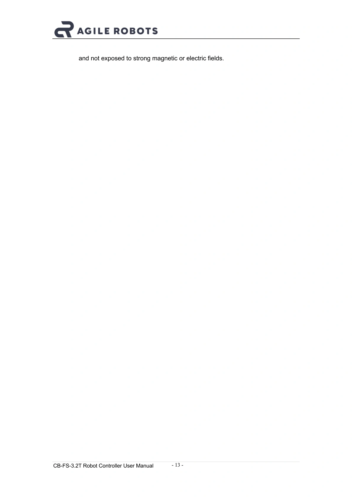



```
CB-FS-3.2T Robot Controller User Manual 
 
- 13 - 
and not exposed to strong magnetic or electric fields.
```



## PDF page 18

**Source:** CB-FS-3.2T Controller User Manual V1.0.1.pdf, original pdf page 18. [Open the corresponding PDF reading-copy page](https://1292444914-files.gitbook.io/~/files/v0/b/gitbook-x-prod.appspot.com/o/spaces%2FtgOfPnscWebs1eh82EKq%2Fuploads%2FSNiPGVvdGHALTGVBIl9H%2Fcb-fs-3-2t-controller-user-manual-v1-0-1-pp-001-022.pdf?alt=media#page=18).



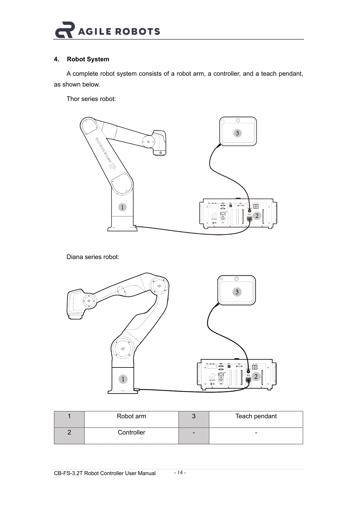



```
CB-FS-3.2T Robot Controller User Manual 
 
- 14 - 
4. 
Robot System 
A complete robot system consists of a robot arm, a controller, and a teach pendant, 
as shown below. 
Thor series robot: 
 
Diana series robot: 
 
1 
Robot arm 
3 
Teach pendant 
2 
Controller 
- 
-
```



## PDF page 19

**Source:** CB-FS-3.2T Controller User Manual V1.0.1.pdf, original pdf page 19. [Open the corresponding PDF reading-copy page](https://1292444914-files.gitbook.io/~/files/v0/b/gitbook-x-prod.appspot.com/o/spaces%2FtgOfPnscWebs1eh82EKq%2Fuploads%2FSNiPGVvdGHALTGVBIl9H%2Fcb-fs-3-2t-controller-user-manual-v1-0-1-pp-001-022.pdf?alt=media#page=19).



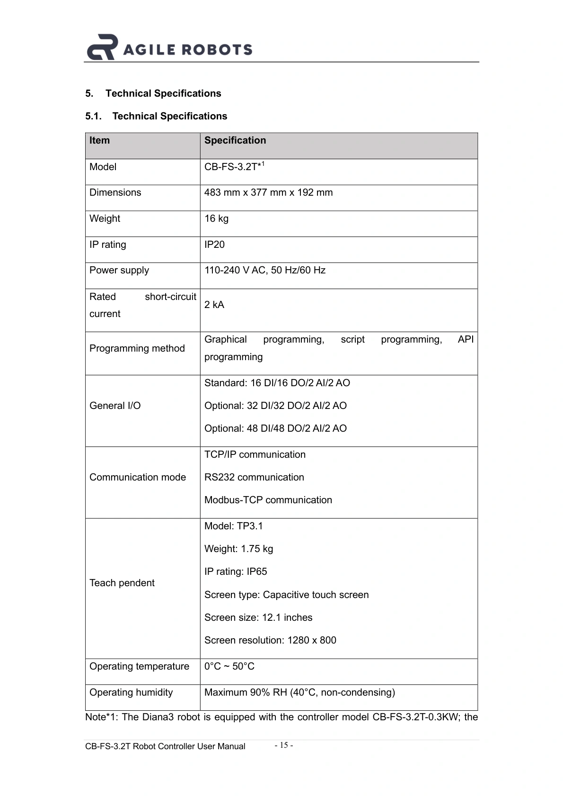



```
CB-FS-3.2T Robot Controller User Manual 
 
- 15 - 
5. 
Technical Specifications 
5.1. Technical Specifications 
Item 
Specification 
Model 
CB-FS-3.2T*1 
Dimensions 
483 mm x 377 mm x 192 mm 
Weight 
16 kg 
IP rating 
IP20 
Power supply 
110-240 V AC, 50 Hz/60 Hz  
Rated 
short-circuit 
current 
2 kA 
Programming method 
Graphical 
programming, 
script 
programming, 
API 
programming 
General I/O 
Standard: 16 DI/16 DO/2 AI/2 AO 
Optional: 32 DI/32 DO/2 AI/2 AO 
Optional: 48 DI/48 DO/2 AI/2 AO 
Communication mode 
TCP/IP communication 
RS232 communication 
Modbus-TCP communication 
Teach pendent 
Model: TP3.1 
Weight: 1.75 kg 
IP rating: IP65 
Screen type: Capacitive touch screen 
Screen size: 12.1 inches 
Screen resolution: 1280 x 800 
Operating temperature 
0°C ~ 50°C 
Operating humidity 
Maximum 90% RH (40°C, non-condensing) 
Note*1: The Diana3 robot is equipped with the controller model CB-FS-3.2T-0.3KW; the
```



## PDF page 20

**Source:** CB-FS-3.2T Controller User Manual V1.0.1.pdf, original pdf page 20. [Open the corresponding PDF reading-copy page](https://1292444914-files.gitbook.io/~/files/v0/b/gitbook-x-prod.appspot.com/o/spaces%2FtgOfPnscWebs1eh82EKq%2Fuploads%2FSNiPGVvdGHALTGVBIl9H%2Fcb-fs-3-2t-controller-user-manual-v1-0-1-pp-001-022.pdf?alt=media#page=20).



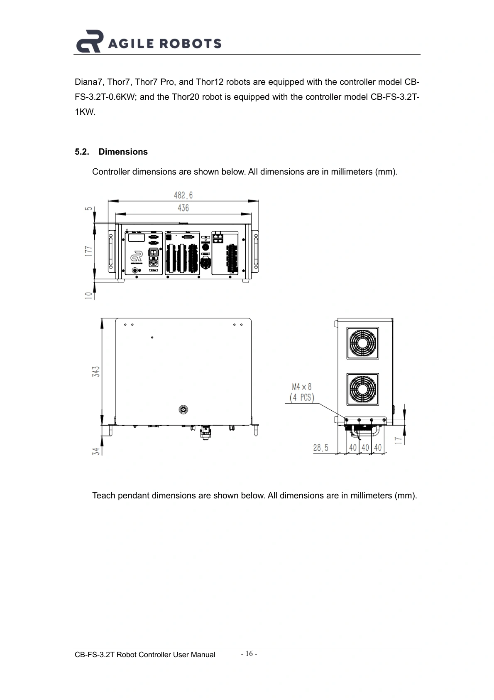



```
CB-FS-3.2T Robot Controller User Manual 
 
- 16 - 
Diana7, Thor7, Thor7 Pro, and Thor12 robots are equipped with the controller model CB-
FS-3.2T-0.6KW; and the Thor20 robot is equipped with the controller model CB-FS-3.2T-
1KW. 
 
5.2. Dimensions 
Controller dimensions are shown below. All dimensions are in millimeters (mm). 
 
 
Teach pendant dimensions are shown below. All dimensions are in millimeters (mm).
```



## PDF page 21

**Source:** CB-FS-3.2T Controller User Manual V1.0.1.pdf, original pdf page 21. [Open the corresponding PDF reading-copy page](https://1292444914-files.gitbook.io/~/files/v0/b/gitbook-x-prod.appspot.com/o/spaces%2FtgOfPnscWebs1eh82EKq%2Fuploads%2FSNiPGVvdGHALTGVBIl9H%2Fcb-fs-3-2t-controller-user-manual-v1-0-1-pp-001-022.pdf?alt=media#page=21).



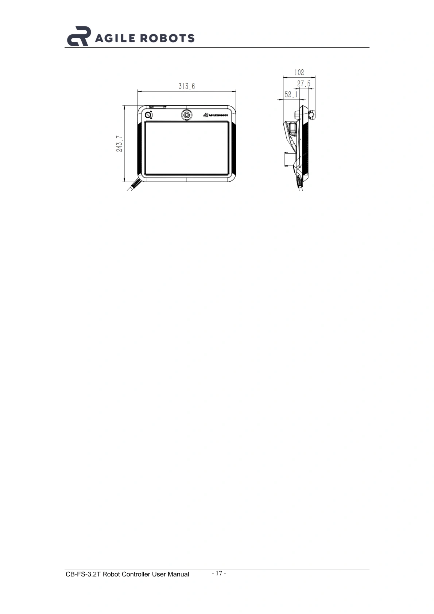



```
CB-FS-3.2T Robot Controller User Manual 
 
- 17 -
```



## PDF page 22

**Source:** CB-FS-3.2T Controller User Manual V1.0.1.pdf, original pdf page 22. [Open the corresponding PDF reading-copy page](https://1292444914-files.gitbook.io/~/files/v0/b/gitbook-x-prod.appspot.com/o/spaces%2FtgOfPnscWebs1eh82EKq%2Fuploads%2FSNiPGVvdGHALTGVBIl9H%2Fcb-fs-3-2t-controller-user-manual-v1-0-1-pp-001-022.pdf?alt=media#page=22).



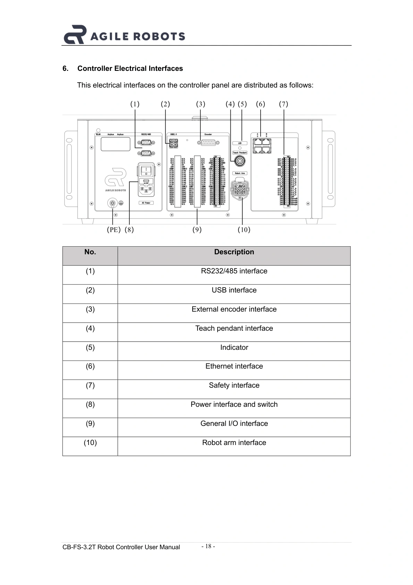



```
CB-FS-3.2T Robot Controller User Manual 
 
- 18 - 
6. 
Controller Electrical Interfaces 
This electrical interfaces on the controller panel are distributed as follows: 
 
No. 
Description 
(1) 
RS232/485 interface 
(2) 
USB interface 
(3) 
External encoder interface 
(4) 
Teach pendant interface 
(5) 
Indicator 
(6) 
Ethernet interface 
(7) 
Safety interface 
(8) 
Power interface and switch 
(9) 
General I/O interface 
(10) 
Robot arm interface
```



## PDF page 23

**Source:** CB-FS-3.2T Controller User Manual V1.0.1.pdf, original pdf page 23. [Open the corresponding PDF reading-copy page](https://1292444914-files.gitbook.io/~/files/v0/b/gitbook-x-prod.appspot.com/o/spaces%2FtgOfPnscWebs1eh82EKq%2Fuploads%2F0CS8mVelgCBdo4qoqkpo%2Fcb-fs-3-2t-controller-user-manual-v1-0-1-pp-023-043.pdf?alt=media#page=1).



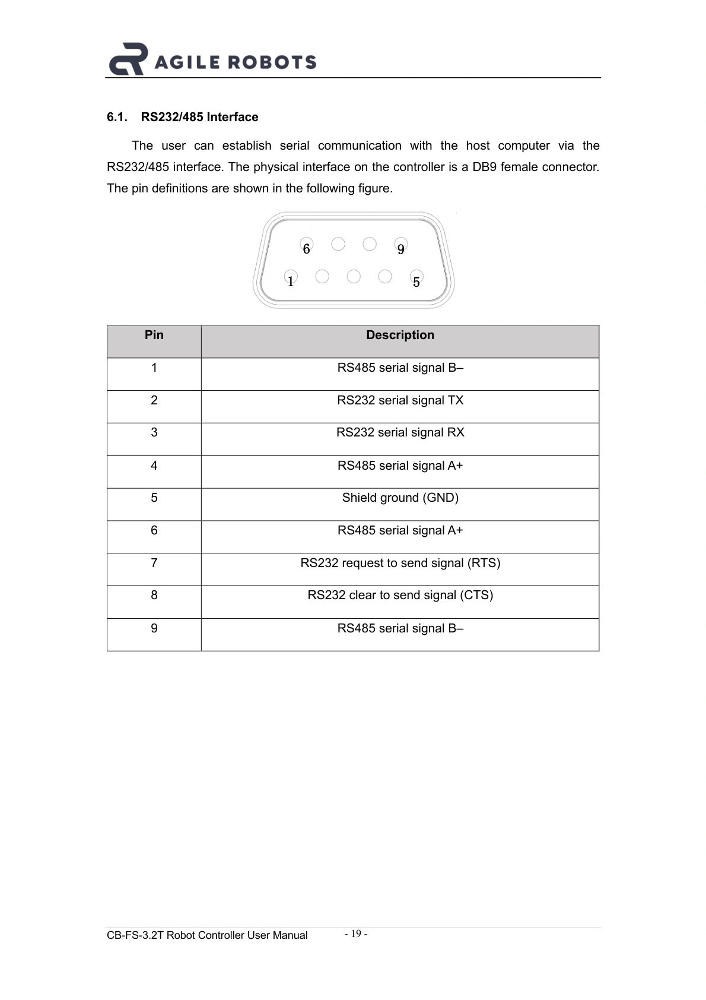



```
CB-FS-3.2T Robot Controller User Manual 
 
- 19 - 
6.1. RS232/485 Interface 
The user can establish serial communication with the host computer via the 
RS232/485 interface. The physical interface on the controller is a DB9 female connector. 
The pin definitions are shown in the following figure. 
 
Pin 
Description 
1 
RS485 serial signal B– 
2 
RS232 serial signal TX 
3 
RS232 serial signal RX 
4 
RS485 serial signal A+ 
5 
Shield ground (GND) 
6 
RS485 serial signal A+ 
7 
RS232 request to send signal (RTS) 
8 
RS232 clear to send signal (CTS) 
9 
RS485 serial signal B– 
 
 
1 
5 
9 
6
```



## PDF page 24

**Source:** CB-FS-3.2T Controller User Manual V1.0.1.pdf, original pdf page 24. [Open the corresponding PDF reading-copy page](https://1292444914-files.gitbook.io/~/files/v0/b/gitbook-x-prod.appspot.com/o/spaces%2FtgOfPnscWebs1eh82EKq%2Fuploads%2F0CS8mVelgCBdo4qoqkpo%2Fcb-fs-3-2t-controller-user-manual-v1-0-1-pp-023-043.pdf?alt=media#page=2).



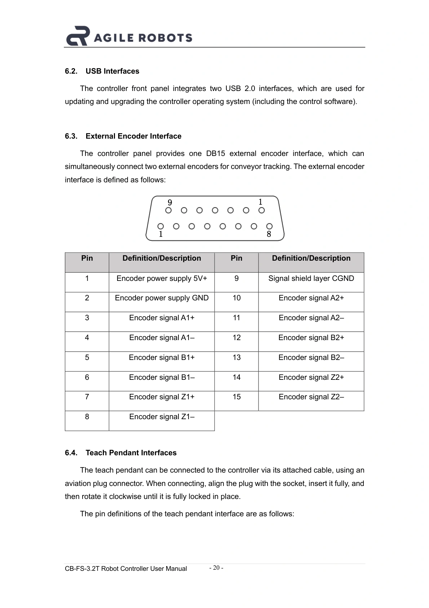



```
CB-FS-3.2T Robot Controller User Manual 
 
- 20 - 
6.2. USB Interfaces 
The controller front panel integrates two USB 2.0 interfaces, which are used for 
updating and upgrading the controller operating system (including the control software). 
 
6.3. External Encoder Interface 
The controller panel provides one DB15 external encoder interface, which can 
simultaneously connect two external encoders for conveyor tracking. The external encoder 
interface is defined as follows: 
 
Pin 
Definition/Description 
Pin 
Definition/Description 
1 
Encoder power supply 5V+ 
9 
Signal shield layer CGND 
2 
Encoder power supply GND 
10 
Encoder signal A2+ 
3 
Encoder signal A1+ 
11 
Encoder signal A2– 
4 
Encoder signal A1– 
12 
Encoder signal B2+ 
5 
Encoder signal B1+ 
13 
Encoder signal B2– 
6 
Encoder signal B1– 
14 
Encoder signal Z2+ 
7 
Encoder signal Z1+ 
15 
Encoder signal Z2– 
8 
Encoder signal Z1– 
 
6.4. Teach Pendant Interfaces 
The teach pendant can be connected to the controller via its attached cable, using an 
aviation plug connector. When connecting, align the plug with the socket, insert it fully, and 
then rotate it clockwise until it is fully locked in place. 
The pin definitions of the teach pendant interface are as follows: 
 
 
1 
8 
1
9
```



## PDF page 25

**Source:** CB-FS-3.2T Controller User Manual V1.0.1.pdf, original pdf page 25. [Open the corresponding PDF reading-copy page](https://1292444914-files.gitbook.io/~/files/v0/b/gitbook-x-prod.appspot.com/o/spaces%2FtgOfPnscWebs1eh82EKq%2Fuploads%2F0CS8mVelgCBdo4qoqkpo%2Fcb-fs-3-2t-controller-user-manual-v1-0-1-pp-023-043.pdf?alt=media#page=3).



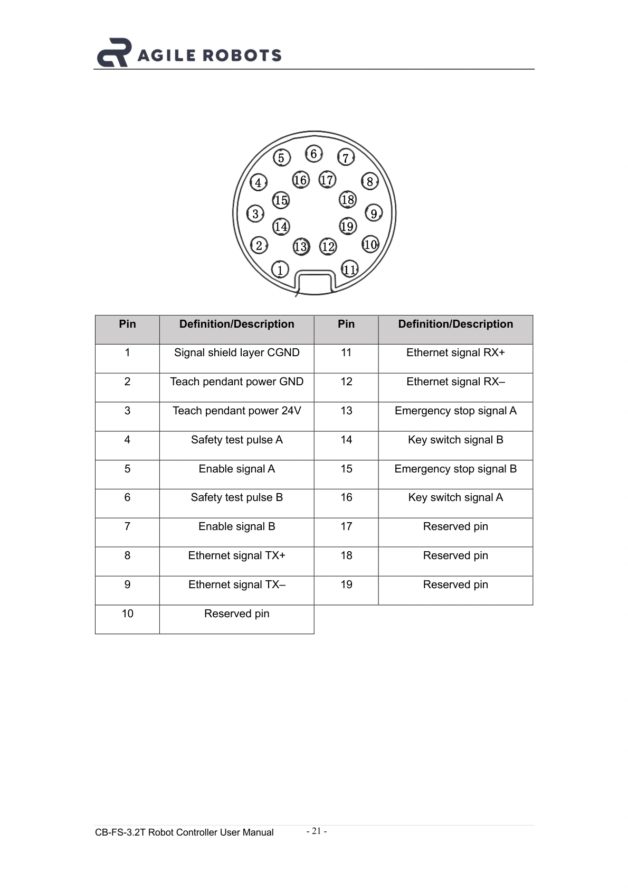



```
CB-FS-3.2T Robot Controller User Manual 
 
- 21 - 
 
 
Pin 
Definition/Description 
Pin 
Definition/Description 
1 
Signal shield layer CGND 
11 
Ethernet signal RX+ 
2 
Teach pendant power GND 
12 
Ethernet signal RX– 
3 
Teach pendant power 24V 
13 
Emergency stop signal A 
4 
Safety test pulse A 
14 
Key switch signal B 
5 
Enable signal A 
15 
Emergency stop signal B 
6 
Safety test pulse B 
16 
Key switch signal A 
7 
Enable signal B 
17 
Reserved pin 
8 
Ethernet signal TX+ 
18 
Reserved pin 
9 
Ethernet signal TX– 
19 
Reserved pin 
10 
Reserved pin 
 
 
 
 
 
 
 
 
1 
2 
3 
4 
5 
6 
7 
8 
9 
10 
11 
12 
13 
14 
15 
16 17 
18 
19
```



## PDF page 26

**Source:** CB-FS-3.2T Controller User Manual V1.0.1.pdf, original pdf page 26. [Open the corresponding PDF reading-copy page](https://1292444914-files.gitbook.io/~/files/v0/b/gitbook-x-prod.appspot.com/o/spaces%2FtgOfPnscWebs1eh82EKq%2Fuploads%2F0CS8mVelgCBdo4qoqkpo%2Fcb-fs-3-2t-controller-user-manual-v1-0-1-pp-023-043.pdf?alt=media#page=4).



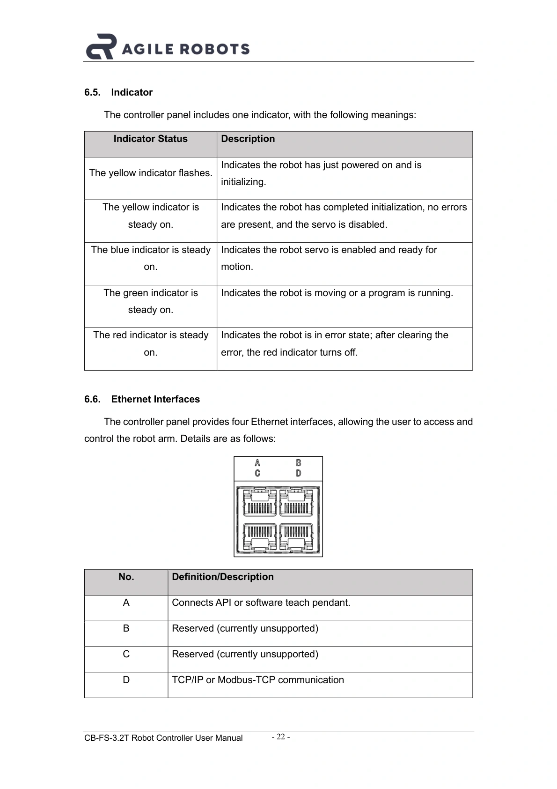



```
CB-FS-3.2T Robot Controller User Manual 
 
- 22 - 
6.5. Indicator 
The controller panel includes one indicator, with the following meanings: 
Indicator Status 
Description 
The yellow indicator flashes. 
Indicates the robot has just powered on and is 
initializing. 
The yellow indicator is 
steady on. 
Indicates the robot has completed initialization, no errors 
are present, and the servo is disabled. 
The blue indicator is steady 
on. 
Indicates the robot servo is enabled and ready for 
motion.  
The green indicator is 
steady on. 
Indicates the robot is moving or a program is running. 
The red indicator is steady 
on. 
Indicates the robot is in error state; after clearing the 
error, the red indicator turns off. 
 
6.6. Ethernet Interfaces 
The controller panel provides four Ethernet interfaces, allowing the user to access and 
control the robot arm. Details are as follows: 
 
No. 
Definition/Description 
A 
Connects API or software teach pendant. 
B 
Reserved (currently unsupported) 
C 
Reserved (currently unsupported) 
D 
TCP/IP or Modbus-TCP communication
```



## PDF page 27

**Source:** CB-FS-3.2T Controller User Manual V1.0.1.pdf, original pdf page 27. [Open the corresponding PDF reading-copy page](https://1292444914-files.gitbook.io/~/files/v0/b/gitbook-x-prod.appspot.com/o/spaces%2FtgOfPnscWebs1eh82EKq%2Fuploads%2F0CS8mVelgCBdo4qoqkpo%2Fcb-fs-3-2t-controller-user-manual-v1-0-1-pp-023-043.pdf?alt=media#page=5).



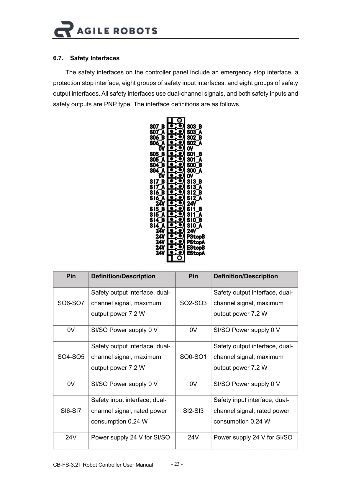



```
CB-FS-3.2T Robot Controller User Manual 
 
- 23 - 
6.7. Safety Interfaces 
The safety interfaces on the controller panel include an emergency stop interface, a 
protection stop interface, eight groups of safety input interfaces, and eight groups of safety 
output interfaces. All safety interfaces use dual-channel signals, and both safety inputs and 
safety outputs are PNP type. The interface definitions are as follows. 
 
Pin 
Definition/Description 
Pin 
Definition/Description 
SO6-SO7 
Safety output interface, dual-
channel signal, maximum 
output power 7.2 W 
SO2-SO3 
Safety output interface, dual-
channel signal, maximum 
output power 7.2 W 
0V 
SI/SO Power supply 0 V 
0V 
SI/SO Power supply 0 V 
SO4-SO5 
Safety output interface, dual-
channel signal, maximum 
output power 7.2 W 
SO0-SO1 
Safety output interface, dual-
channel signal, maximum 
output power 7.2 W 
0V 
SI/SO Power supply 0 V 
0V 
SI/SO Power supply 0 V 
SI6-SI7 
Safety input interface, dual-
channel signal, rated power 
consumption 0.24 W 
SI2-SI3 
Safety input interface, dual-
channel signal, rated power 
consumption 0.24 W 
24V 
Power supply 24 V for SI/SO 
24V 
Power supply 24 V for SI/SO
```



## PDF page 28

**Source:** CB-FS-3.2T Controller User Manual V1.0.1.pdf, original pdf page 28. [Open the corresponding PDF reading-copy page](https://1292444914-files.gitbook.io/~/files/v0/b/gitbook-x-prod.appspot.com/o/spaces%2FtgOfPnscWebs1eh82EKq%2Fuploads%2F0CS8mVelgCBdo4qoqkpo%2Fcb-fs-3-2t-controller-user-manual-v1-0-1-pp-023-043.pdf?alt=media#page=6).



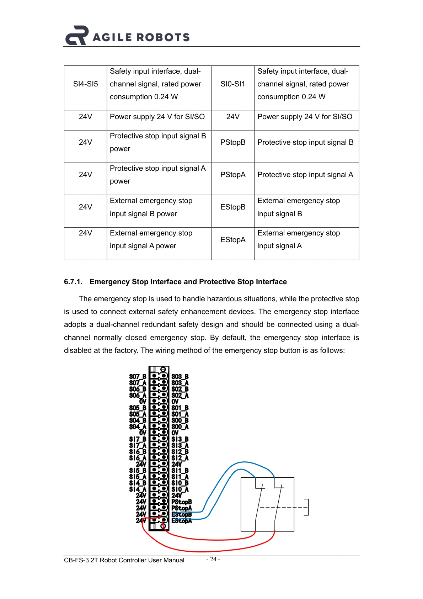



```
CB-FS-3.2T Robot Controller User Manual 
 
- 24 - 
SI4-SI5 
Safety input interface, dual-
channel signal, rated power 
consumption 0.24 W 
SI0-SI1 
Safety input interface, dual-
channel signal, rated power 
consumption 0.24 W 
24V 
Power supply 24 V for SI/SO 
24V 
Power supply 24 V for SI/SO 
24V 
Protective stop input signal B 
power 
PStopB 
Protective stop input signal B 
24V 
Protective stop input signal A 
power 
PStopA 
Protective stop input signal A 
24V 
External emergency stop 
input signal B power 
EStopB 
External emergency stop 
input signal B 
24V 
External emergency stop 
input signal A power 
EStopA 
External emergency stop 
input signal A 
 
6.7.1. Emergency Stop Interface and Protective Stop Interface 
The emergency stop is used to handle hazardous situations, while the protective stop 
is used to connect external safety enhancement devices. The emergency stop interface 
adopts a dual-channel redundant safety design and should be connected using a dual-
channel normally closed emergency stop. By default, the emergency stop interface is 
disabled at the factory. The wiring method of the emergency stop button is as follows:
```



## PDF page 29

**Source:** CB-FS-3.2T Controller User Manual V1.0.1.pdf, original pdf page 29. [Open the corresponding PDF reading-copy page](https://1292444914-files.gitbook.io/~/files/v0/b/gitbook-x-prod.appspot.com/o/spaces%2FtgOfPnscWebs1eh82EKq%2Fuploads%2F0CS8mVelgCBdo4qoqkpo%2Fcb-fs-3-2t-controller-user-manual-v1-0-1-pp-023-043.pdf?alt=media#page=7).



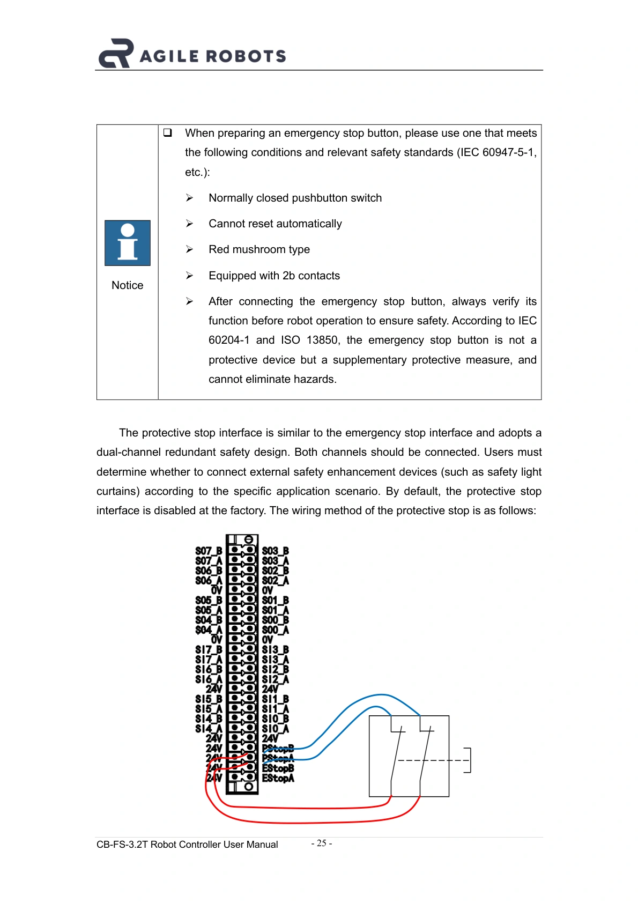



```
CB-FS-3.2T Robot Controller User Manual 
 
- 25 - 
 
 
Notice 
q 
When preparing an emergency stop button, please use one that meets 
the following conditions and relevant safety standards (IEC 60947-5-1, 
etc.): 
Ø 
Normally closed pushbutton switch 
Ø 
Cannot reset automatically 
Ø 
Red mushroom type 
Ø 
Equipped with 2b contacts 
Ø 
After connecting the emergency stop button, always verify its 
function before robot operation to ensure safety. According to IEC 
60204-1 and ISO 13850, the emergency stop button is not a 
protective device but a supplementary protective measure, and 
cannot eliminate hazards. 
 
The protective stop interface is similar to the emergency stop interface and adopts a 
dual-channel redundant safety design. Both channels should be connected. Users must 
determine whether to connect external safety enhancement devices (such as safety light 
curtains) according to the specific application scenario. By default, the protective stop 
interface is disabled at the factory. The wiring method of the protective stop is as follows:
```



## PDF page 30

**Source:** CB-FS-3.2T Controller User Manual V1.0.1.pdf, original pdf page 30. [Open the corresponding PDF reading-copy page](https://1292444914-files.gitbook.io/~/files/v0/b/gitbook-x-prod.appspot.com/o/spaces%2FtgOfPnscWebs1eh82EKq%2Fuploads%2F0CS8mVelgCBdo4qoqkpo%2Fcb-fs-3-2t-controller-user-manual-v1-0-1-pp-023-043.pdf?alt=media#page=8).



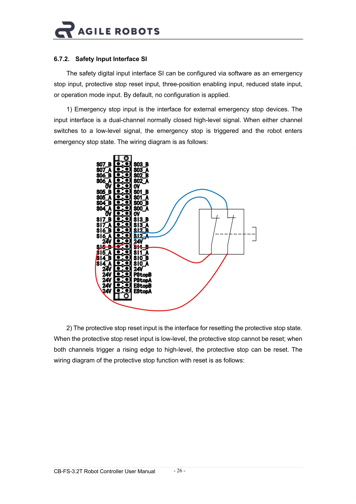



```
CB-FS-3.2T Robot Controller User Manual 
 
- 26 - 
6.7.2. Safety Input Interface SI 
The safety digital input interface SI can be configured via software as an emergency 
stop input, protective stop reset input, three-position enabling input, reduced state input, 
or operation mode input. By default, no configuration is applied. 
1) Emergency stop input is the interface for external emergency stop devices. The 
input interface is a dual-channel normally closed high-level signal. When either channel 
switches to a low-level signal, the emergency stop is triggered and the robot enters 
emergency stop state. The wiring diagram is as follows: 
 
 
2) The protective stop reset input is the interface for resetting the protective stop state. 
When the protective stop reset input is low-level, the protective stop cannot be reset; when 
both channels trigger a rising edge to high-level, the protective stop can be reset. The 
wiring diagram of the protective stop function with reset is as follows:
```



## PDF page 31

**Source:** CB-FS-3.2T Controller User Manual V1.0.1.pdf, original pdf page 31. [Open the corresponding PDF reading-copy page](https://1292444914-files.gitbook.io/~/files/v0/b/gitbook-x-prod.appspot.com/o/spaces%2FtgOfPnscWebs1eh82EKq%2Fuploads%2F0CS8mVelgCBdo4qoqkpo%2Fcb-fs-3-2t-controller-user-manual-v1-0-1-pp-023-043.pdf?alt=media#page=9).



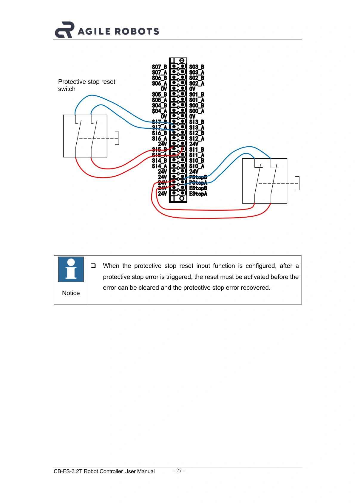



```
CB-FS-3.2T Robot Controller User Manual 
 
- 27 - 
 
 
 
 
 
Notice 
q 
When the protective stop reset input function is configured, after a 
protective stop error is triggered, the reset must be activated before the 
error can be cleared and the protective stop error recovered. 
 
 
 
 
 
 
 
 
 
 
 
Protective stop reset 
switch
```



## PDF page 32

**Source:** CB-FS-3.2T Controller User Manual V1.0.1.pdf, original pdf page 32. [Open the corresponding PDF reading-copy page](https://1292444914-files.gitbook.io/~/files/v0/b/gitbook-x-prod.appspot.com/o/spaces%2FtgOfPnscWebs1eh82EKq%2Fuploads%2F0CS8mVelgCBdo4qoqkpo%2Fcb-fs-3-2t-controller-user-manual-v1-0-1-pp-023-043.pdf?alt=media#page=10).



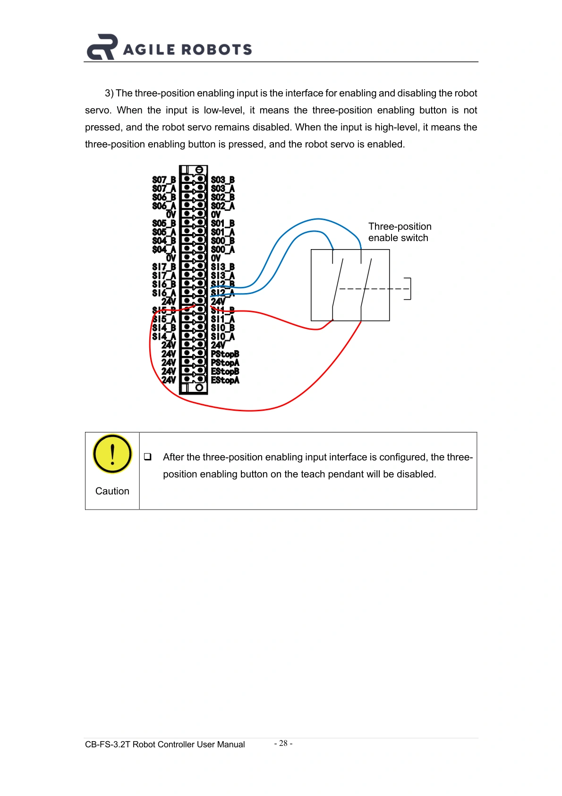



```
CB-FS-3.2T Robot Controller User Manual 
 
- 28 - 
3) The three-position enabling input is the interface for enabling and disabling the robot 
servo. When the input is low-level, it means the three-position enabling button is not 
pressed, and the robot servo remains disabled. When the input is high-level, it means the 
three-position enabling button is pressed, and the robot servo is enabled. 
 
 
 
Caution 
q 
After the three-position enabling input interface is configured, the three-
position enabling button on the teach pendant will be disabled. 
 
 
 
 
 
 
 
 
 
 
Three-position 
enable switch
```



## PDF page 33

**Source:** CB-FS-3.2T Controller User Manual V1.0.1.pdf, original pdf page 33. [Open the corresponding PDF reading-copy page](https://1292444914-files.gitbook.io/~/files/v0/b/gitbook-x-prod.appspot.com/o/spaces%2FtgOfPnscWebs1eh82EKq%2Fuploads%2F0CS8mVelgCBdo4qoqkpo%2Fcb-fs-3-2t-controller-user-manual-v1-0-1-pp-023-043.pdf?alt=media#page=11).



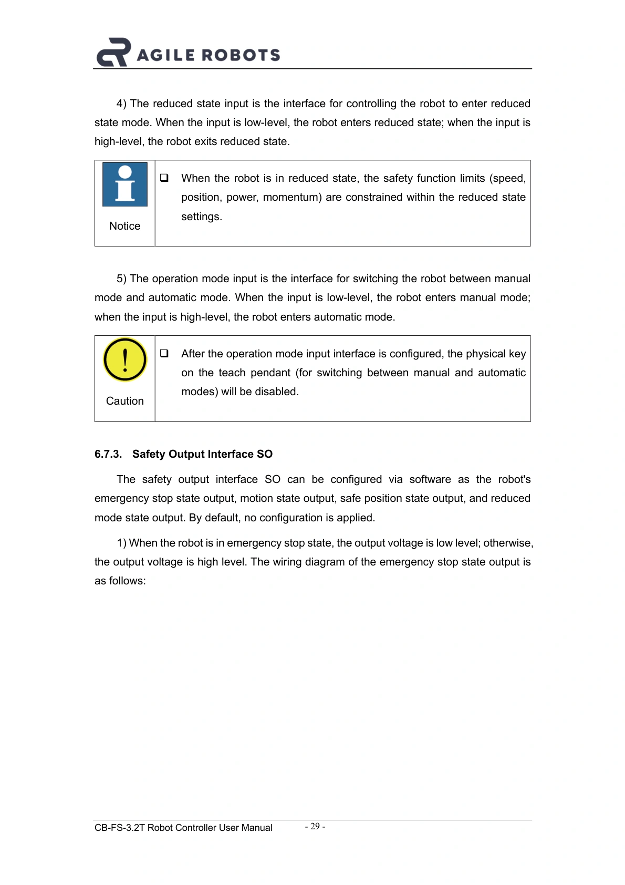



```
CB-FS-3.2T Robot Controller User Manual 
 
- 29 - 
4) The reduced state input is the interface for controlling the robot to enter reduced 
state mode. When the input is low-level, the robot enters reduced state; when the input is 
high-level, the robot exits reduced state. 
 
Notice 
q 
When the robot is in reduced state, the safety function limits (speed, 
position, power, momentum) are constrained within the reduced state 
settings. 
 
5) The operation mode input is the interface for switching the robot between manual 
mode and automatic mode. When the input is low-level, the robot enters manual mode; 
when the input is high-level, the robot enters automatic mode. 
 
Caution 
q 
After the operation mode input interface is configured, the physical key 
on the teach pendant (for switching between manual and automatic 
modes) will be disabled. 
 
6.7.3. Safety Output Interface SO 
The safety output interface SO can be configured via software as the robot's 
emergency stop state output, motion state output, safe position state output, and reduced 
mode state output. By default, no configuration is applied. 
1) When the robot is in emergency stop state, the output voltage is low level; otherwise, 
the output voltage is high level. The wiring diagram of the emergency stop state output is 
as follows:
```



## PDF page 34

**Source:** CB-FS-3.2T Controller User Manual V1.0.1.pdf, original pdf page 34. [Open the corresponding PDF reading-copy page](https://1292444914-files.gitbook.io/~/files/v0/b/gitbook-x-prod.appspot.com/o/spaces%2FtgOfPnscWebs1eh82EKq%2Fuploads%2F0CS8mVelgCBdo4qoqkpo%2Fcb-fs-3-2t-controller-user-manual-v1-0-1-pp-023-043.pdf?alt=media#page=12).



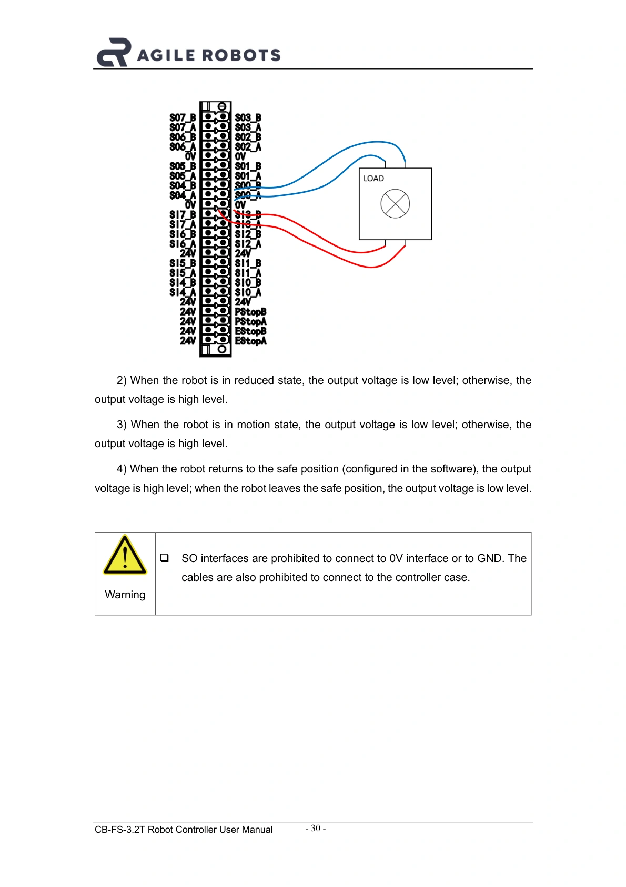



```
CB-FS-3.2T Robot Controller User Manual 
 
- 30 - 
 
2) When the robot is in reduced state, the output voltage is low level; otherwise, the 
output voltage is high level. 
3) When the robot is in motion state, the output voltage is low level; otherwise, the 
output voltage is high level. 
4) When the robot returns to the safe position (configured in the software), the output 
voltage is high level; when the robot leaves the safe position, the output voltage is low level. 
 
 
Warning 
q 
SO interfaces are prohibited to connect to 0V interface or to GND. The 
cables are also prohibited to connect to the controller case.
```



## PDF page 35

**Source:** CB-FS-3.2T Controller User Manual V1.0.1.pdf, original pdf page 35. [Open the corresponding PDF reading-copy page](https://1292444914-files.gitbook.io/~/files/v0/b/gitbook-x-prod.appspot.com/o/spaces%2FtgOfPnscWebs1eh82EKq%2Fuploads%2F0CS8mVelgCBdo4qoqkpo%2Fcb-fs-3-2t-controller-user-manual-v1-0-1-pp-023-043.pdf?alt=media#page=13).



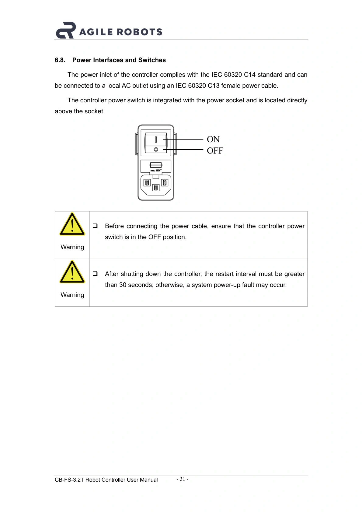



```
CB-FS-3.2T Robot Controller User Manual 
 
- 31 - 
6.8. Power Interfaces and Switches 
The power inlet of the controller complies with the IEC 60320 C14 standard and can 
be connected to a local AC outlet using an IEC 60320 C13 female power cable. 
The controller power switch is integrated with the power socket and is located directly 
above the socket. 
 
 
Warning 
q 
Before connecting the power cable, ensure that the controller power 
switch is in the OFF position. 
 
Warning 
q 
After shutting down the controller, the restart interval must be greater 
than 30 seconds; otherwise, a system power-up fault may occur.
```



## PDF page 36

**Source:** CB-FS-3.2T Controller User Manual V1.0.1.pdf, original pdf page 36. [Open the corresponding PDF reading-copy page](https://1292444914-files.gitbook.io/~/files/v0/b/gitbook-x-prod.appspot.com/o/spaces%2FtgOfPnscWebs1eh82EKq%2Fuploads%2F0CS8mVelgCBdo4qoqkpo%2Fcb-fs-3-2t-controller-user-manual-v1-0-1-pp-023-043.pdf?alt=media#page=14).



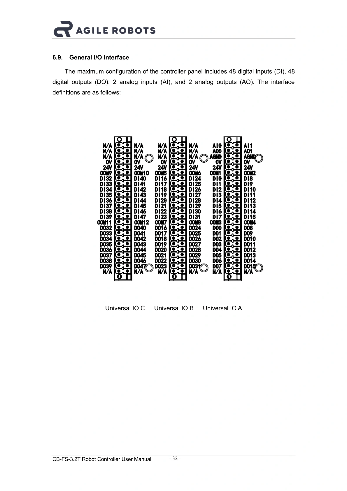



```
CB-FS-3.2T Robot Controller User Manual 
 
- 32 - 
6.9. General I/O Interface 
The maximum configuration of the controller panel includes 48 digital inputs (DI), 48 
digital outputs (DO), 2 analog inputs (AI), and 2 analog outputs (AO). The interface 
definitions are as follows: 
 
 
 
 
Universal IO C   Universal IO B   Universal IO A
```



## PDF page 37

**Source:** CB-FS-3.2T Controller User Manual V1.0.1.pdf, original pdf page 37. [Open the corresponding PDF reading-copy page](https://1292444914-files.gitbook.io/~/files/v0/b/gitbook-x-prod.appspot.com/o/spaces%2FtgOfPnscWebs1eh82EKq%2Fuploads%2F0CS8mVelgCBdo4qoqkpo%2Fcb-fs-3-2t-controller-user-manual-v1-0-1-pp-023-043.pdf?alt=media#page=15).



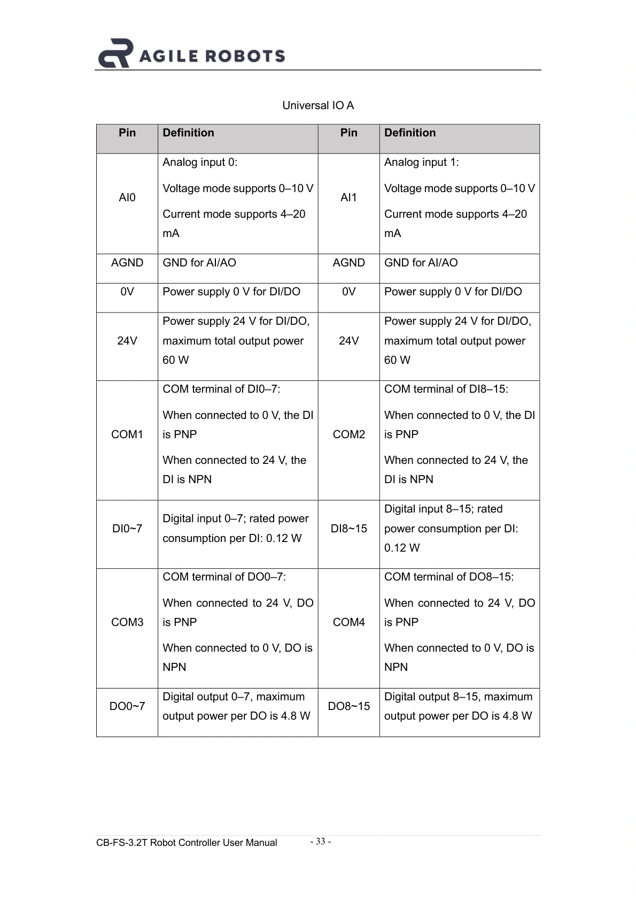



```
CB-FS-3.2T Robot Controller User Manual 
 
- 33 - 
Universal IO A 
Pin 
Definition 
Pin 
Definition 
AI0 
Analog input 0: 
Voltage mode supports 0–10 V 
Current mode supports 4–20 
mA 
AI1 
Analog input 1: 
Voltage mode supports 0–10 V 
Current mode supports 4–20 
mA 
AGND 
GND for AI/AO 
AGND 
GND for AI/AO 
0V 
Power supply 0 V for DI/DO 
0V 
Power supply 0 V for DI/DO 
24V 
Power supply 24 V for DI/DO, 
maximum total output power 
60 W 
24V 
Power supply 24 V for DI/DO, 
maximum total output power 
60 W 
COM1 
COM terminal of DI0–7: 
When connected to 0 V, the DI 
is PNP 
When connected to 24 V, the 
DI is NPN 
COM2 
COM terminal of DI8–15: 
When connected to 0 V, the DI 
is PNP 
When connected to 24 V, the 
DI is NPN 
DI0~7 
Digital input 0–7; rated power 
consumption per DI: 0.12 W 
DI8~15 
Digital input 8–15; rated 
power consumption per DI: 
0.12 W 
COM3 
COM terminal of DO0–7: 
When connected to 24 V, DO 
is PNP 
When connected to 0 V, DO is 
NPN 
COM4 
COM terminal of DO8–15: 
When connected to 24 V, DO 
is PNP 
When connected to 0 V, DO is 
NPN 
DO0~7 
Digital output 0–7, maximum 
output power per DO is 4.8 W 
DO8~15 
Digital output 8–15, maximum 
output power per DO is 4.8 W
```



## PDF page 38

**Source:** CB-FS-3.2T Controller User Manual V1.0.1.pdf, original pdf page 38. [Open the corresponding PDF reading-copy page](https://1292444914-files.gitbook.io/~/files/v0/b/gitbook-x-prod.appspot.com/o/spaces%2FtgOfPnscWebs1eh82EKq%2Fuploads%2F0CS8mVelgCBdo4qoqkpo%2Fcb-fs-3-2t-controller-user-manual-v1-0-1-pp-023-043.pdf?alt=media#page=16).



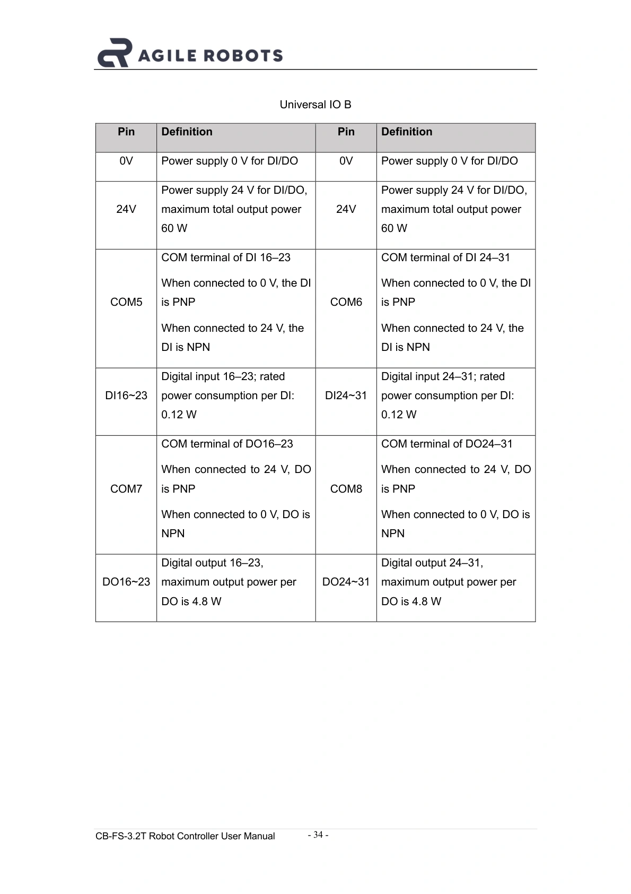



```
CB-FS-3.2T Robot Controller User Manual 
 
- 34 - 
Universal IO B 
Pin 
Definition 
Pin 
Definition 
0V 
Power supply 0 V for DI/DO 
0V 
Power supply 0 V for DI/DO 
24V 
Power supply 24 V for DI/DO, 
maximum total output power 
60 W 
24V 
Power supply 24 V for DI/DO, 
maximum total output power 
60 W 
COM5 
COM terminal of DI 16–23 
When connected to 0 V, the DI 
is PNP 
When connected to 24 V, the 
DI is NPN 
COM6 
COM terminal of DI 24–31 
When connected to 0 V, the DI 
is PNP 
When connected to 24 V, the 
DI is NPN 
DI16~23 
Digital input 16–23; rated 
power consumption per DI: 
0.12 W 
DI24~31 
Digital input 24–31; rated 
power consumption per DI: 
0.12 W 
COM7 
COM terminal of DO16–23 
When connected to 24 V, DO 
is PNP 
When connected to 0 V, DO is 
NPN 
COM8 
COM terminal of DO24–31 
When connected to 24 V, DO 
is PNP 
When connected to 0 V, DO is 
NPN 
DO16~23 
Digital output 16–23, 
maximum output power per 
DO is 4.8 W 
DO24~31 
Digital output 24–31, 
maximum output power per 
DO is 4.8 W
```



## PDF page 39

**Source:** CB-FS-3.2T Controller User Manual V1.0.1.pdf, original pdf page 39. [Open the corresponding PDF reading-copy page](https://1292444914-files.gitbook.io/~/files/v0/b/gitbook-x-prod.appspot.com/o/spaces%2FtgOfPnscWebs1eh82EKq%2Fuploads%2F0CS8mVelgCBdo4qoqkpo%2Fcb-fs-3-2t-controller-user-manual-v1-0-1-pp-023-043.pdf?alt=media#page=17).



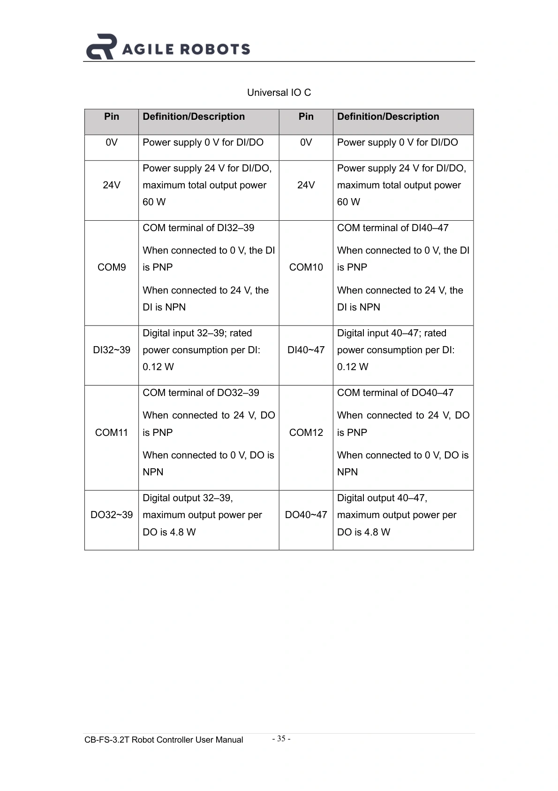



```
CB-FS-3.2T Robot Controller User Manual 
 
- 35 - 
Universal IO C 
Pin 
Definition/Description 
Pin 
Definition/Description 
0V 
Power supply 0 V for DI/DO 
0V 
Power supply 0 V for DI/DO 
24V 
Power supply 24 V for DI/DO, 
maximum total output power 
60 W 
24V 
Power supply 24 V for DI/DO, 
maximum total output power 
60 W 
COM9 
COM terminal of DI32–39 
When connected to 0 V, the DI 
is PNP 
When connected to 24 V, the 
DI is NPN 
COM10 
COM terminal of DI40–47 
When connected to 0 V, the DI 
is PNP 
When connected to 24 V, the 
DI is NPN 
DI32~39 
Digital input 32–39; rated 
power consumption per DI: 
0.12 W 
DI40~47 
Digital input 40–47; rated 
power consumption per DI: 
0.12 W 
COM11 
COM terminal of DO32–39 
When connected to 24 V, DO 
is PNP 
When connected to 0 V, DO is 
NPN 
COM12 
COM terminal of DO40–47 
When connected to 24 V, DO 
is PNP 
When connected to 0 V, DO is 
NPN 
DO32~39 
Digital output 32–39, 
maximum output power per 
DO is 4.8 W 
DO40~47 
Digital output 40–47, 
maximum output power per 
DO is 4.8 W
```



## PDF page 40

**Source:** CB-FS-3.2T Controller User Manual V1.0.1.pdf, original pdf page 40. [Open the corresponding PDF reading-copy page](https://1292444914-files.gitbook.io/~/files/v0/b/gitbook-x-prod.appspot.com/o/spaces%2FtgOfPnscWebs1eh82EKq%2Fuploads%2F0CS8mVelgCBdo4qoqkpo%2Fcb-fs-3-2t-controller-user-manual-v1-0-1-pp-023-043.pdf?alt=media#page=18).



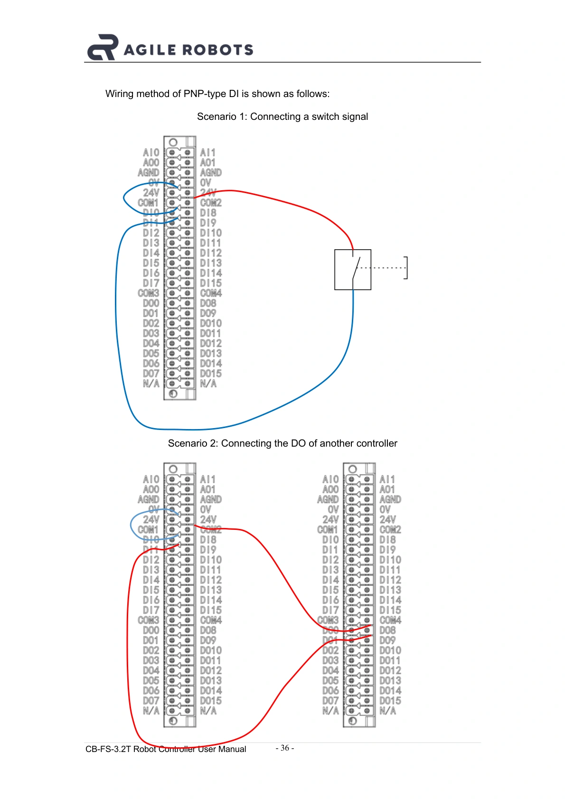



```
CB-FS-3.2T Robot Controller User Manual 
 
- 36 - 
Wiring method of PNP-type DI is shown as follows: 
Scenario 1: Connecting a switch signal 
 
 
Scenario 2: Connecting the DO of another controller
```



## PDF page 41

**Source:** CB-FS-3.2T Controller User Manual V1.0.1.pdf, original pdf page 41. [Open the corresponding PDF reading-copy page](https://1292444914-files.gitbook.io/~/files/v0/b/gitbook-x-prod.appspot.com/o/spaces%2FtgOfPnscWebs1eh82EKq%2Fuploads%2F0CS8mVelgCBdo4qoqkpo%2Fcb-fs-3-2t-controller-user-manual-v1-0-1-pp-023-043.pdf?alt=media#page=19).



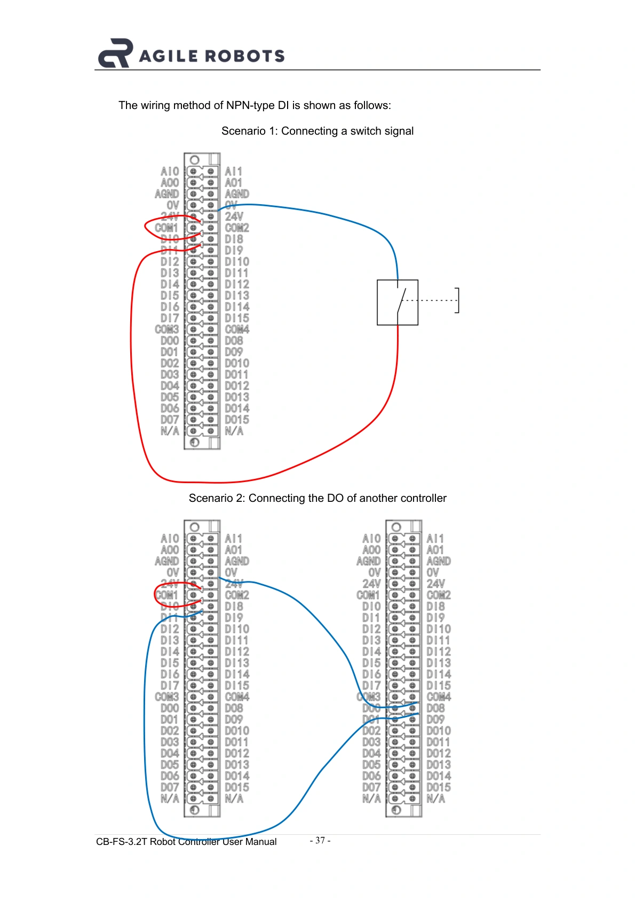



```
CB-FS-3.2T Robot Controller User Manual 
 
- 37 - 
The wiring method of NPN-type DI is shown as follows: 
Scenario 1: Connecting a switch signal 
 
 
Scenario 2: Connecting the DO of another controller
```



## PDF page 42

**Source:** CB-FS-3.2T Controller User Manual V1.0.1.pdf, original pdf page 42. [Open the corresponding PDF reading-copy page](https://1292444914-files.gitbook.io/~/files/v0/b/gitbook-x-prod.appspot.com/o/spaces%2FtgOfPnscWebs1eh82EKq%2Fuploads%2F0CS8mVelgCBdo4qoqkpo%2Fcb-fs-3-2t-controller-user-manual-v1-0-1-pp-023-043.pdf?alt=media#page=20).



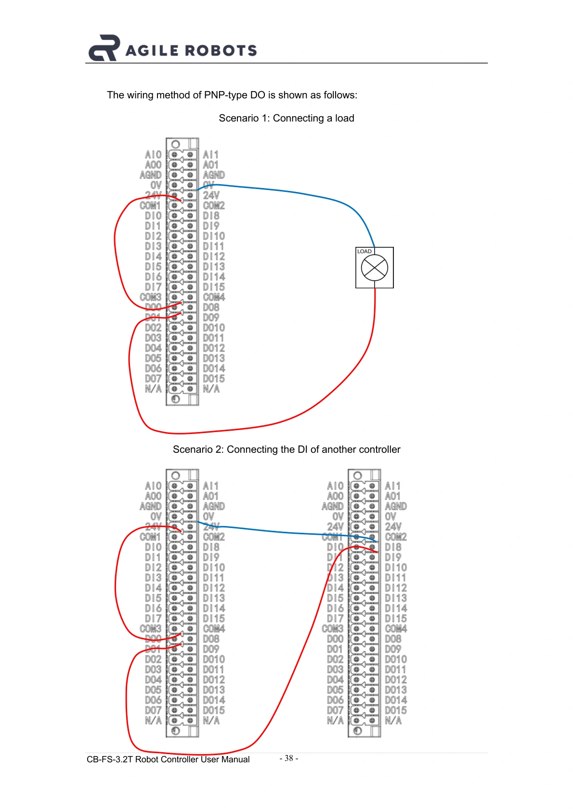



```
CB-FS-3.2T Robot Controller User Manual 
 
- 38 - 
The wiring method of PNP-type DO is shown as follows: 
Scenario 1: Connecting a load 
 
 
Scenario 2: Connecting the DI of another controller
```



## PDF page 43

**Source:** CB-FS-3.2T Controller User Manual V1.0.1.pdf, original pdf page 43. [Open the corresponding PDF reading-copy page](https://1292444914-files.gitbook.io/~/files/v0/b/gitbook-x-prod.appspot.com/o/spaces%2FtgOfPnscWebs1eh82EKq%2Fuploads%2F0CS8mVelgCBdo4qoqkpo%2Fcb-fs-3-2t-controller-user-manual-v1-0-1-pp-023-043.pdf?alt=media#page=21).



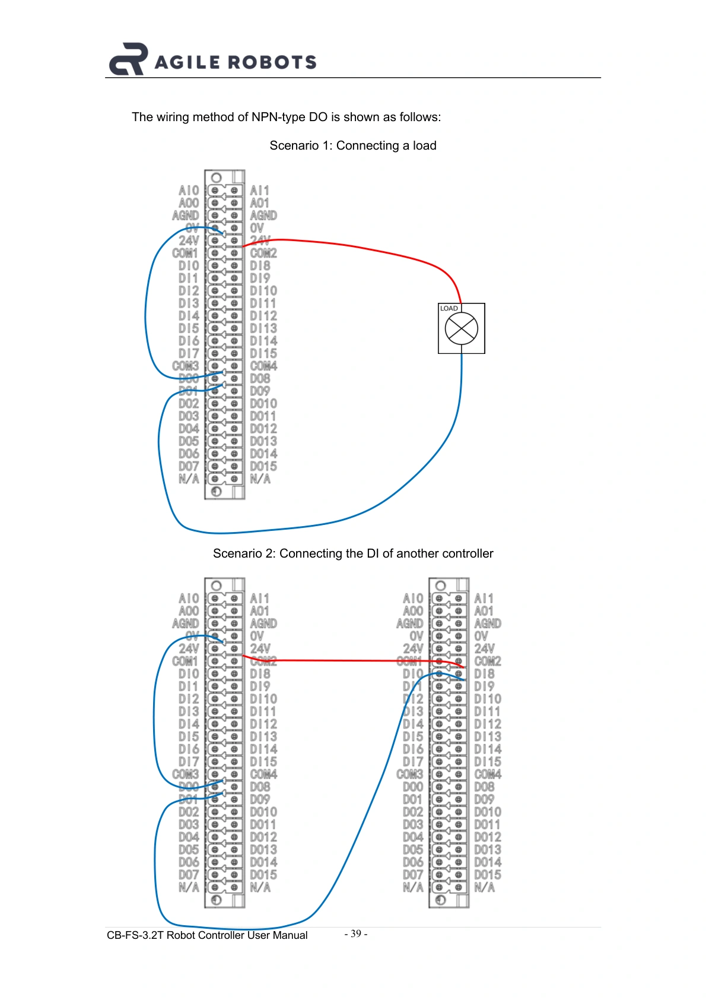



```
CB-FS-3.2T Robot Controller User Manual 
 
- 39 - 
The wiring method of NPN-type DO is shown as follows: 
Scenario 1: Connecting a load 
 
 
Scenario 2: Connecting the DI of another controller
```



## PDF page 44

**Source:** CB-FS-3.2T Controller User Manual V1.0.1.pdf, original pdf page 44. [Open the corresponding PDF reading-copy page](https://1292444914-files.gitbook.io/~/files/v0/b/gitbook-x-prod.appspot.com/o/spaces%2FtgOfPnscWebs1eh82EKq%2Fuploads%2FXsVIjtH6CujbYL5SYU5l%2Fcb-fs-3-2t-controller-user-manual-v1-0-1-pp-044-064.pdf?alt=media#page=1).



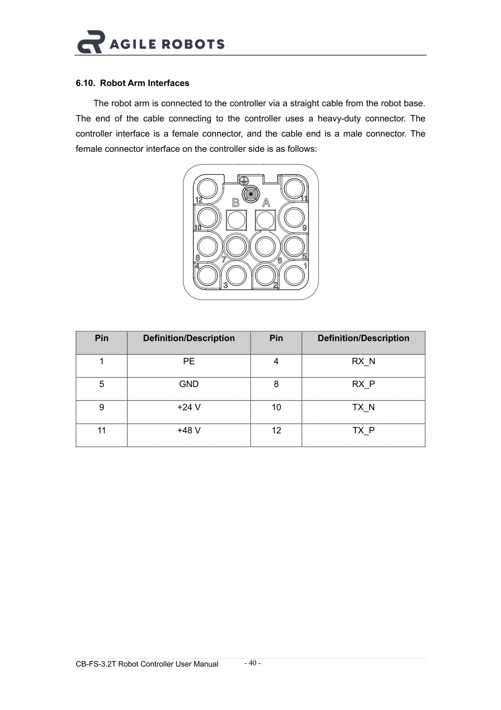



```
CB-FS-3.2T Robot Controller User Manual 
 
- 40 - 
6.10. Robot Arm Interfaces 
The robot arm is connected to the controller via a straight cable from the robot base. 
The end of the cable connecting to the controller uses a heavy-duty connector. The 
controller interface is a female connector, and the cable end is a male connector. The 
female connector interface on the controller side is as follows: 
 
 
Pin 
Definition/Description 
Pin 
Definition/Description 
1 
PE 
4 
RX_N 
5 
GND 
8 
RX_P 
9 
+24 V 
10 
TX_N 
11 
+48 V 
12 
TX_P
```



## PDF page 45

**Source:** CB-FS-3.2T Controller User Manual V1.0.1.pdf, original pdf page 45. [Open the corresponding PDF reading-copy page](https://1292444914-files.gitbook.io/~/files/v0/b/gitbook-x-prod.appspot.com/o/spaces%2FtgOfPnscWebs1eh82EKq%2Fuploads%2FXsVIjtH6CujbYL5SYU5l%2Fcb-fs-3-2t-controller-user-manual-v1-0-1-pp-044-064.pdf?alt=media#page=2).



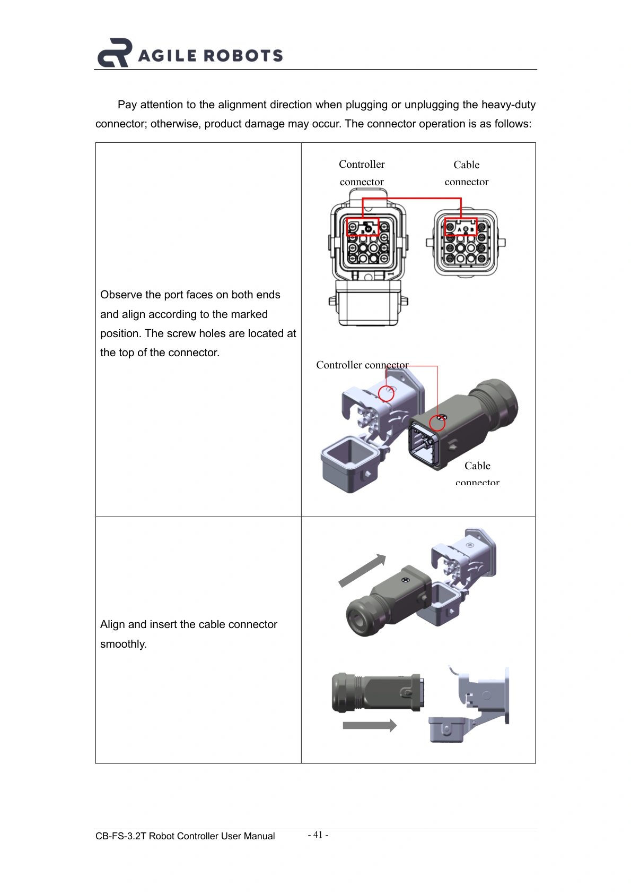



```
CB-FS-3.2T Robot Controller User Manual 
 
- 41 - 
Pay attention to the alignment direction when plugging or unplugging the heavy-duty 
connector; otherwise, product damage may occur. The connector operation is as follows: 
Observe the port faces on both ends 
and align according to the marked 
position. The screw holes are located at 
the top of the connector. 
 
 
 
Align and insert the cable connector 
smoothly. 
 
 
Controller 
connector 
Cable 
connector 
Controller connector 
Cable 
connector
```



## PDF page 46

**Source:** CB-FS-3.2T Controller User Manual V1.0.1.pdf, original pdf page 46. [Open the corresponding PDF reading-copy page](https://1292444914-files.gitbook.io/~/files/v0/b/gitbook-x-prod.appspot.com/o/spaces%2FtgOfPnscWebs1eh82EKq%2Fuploads%2FXsVIjtH6CujbYL5SYU5l%2Fcb-fs-3-2t-controller-user-manual-v1-0-1-pp-044-064.pdf?alt=media#page=3).



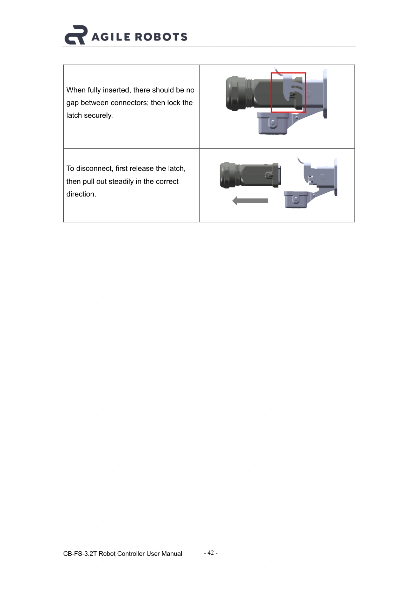



```
CB-FS-3.2T Robot Controller User Manual 
 
- 42 - 
When fully inserted, there should be no 
gap between connectors; then lock the 
latch securely. 
 
To disconnect, first release the latch, 
then pull out steadily in the correct 
direction.
```



## PDF page 47

**Source:** CB-FS-3.2T Controller User Manual V1.0.1.pdf, original pdf page 47. [Open the corresponding PDF reading-copy page](https://1292444914-files.gitbook.io/~/files/v0/b/gitbook-x-prod.appspot.com/o/spaces%2FtgOfPnscWebs1eh82EKq%2Fuploads%2FXsVIjtH6CujbYL5SYU5l%2Fcb-fs-3-2t-controller-user-manual-v1-0-1-pp-044-064.pdf?alt=media#page=4).



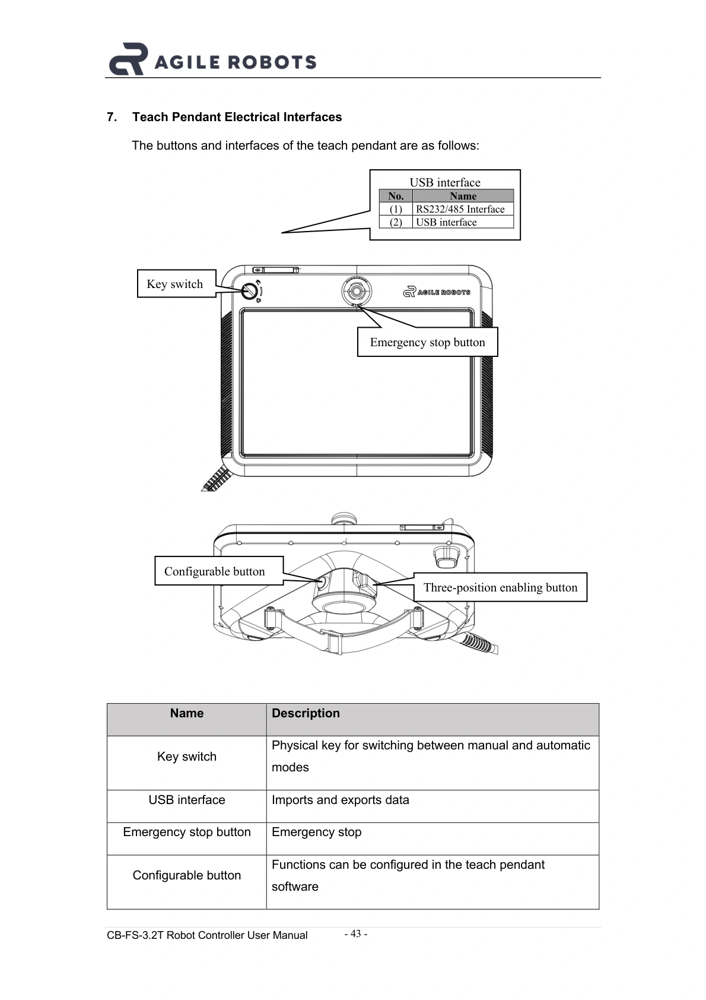



```
CB-FS-3.2T Robot Controller User Manual 
 
- 43 - 
7. 
Teach Pendant Electrical Interfaces 
The buttons and interfaces of the teach pendant are as follows: 
 
 
 
 
 
 
Name 
Description 
Key switch 
Physical key for switching between manual and automatic 
modes 
USB interface 
Imports and exports data 
Emergency stop button 
Emergency stop 
Configurable button 
Functions can be configured in the teach pendant 
software 
Key switch 
Emergency stop button 
USB interface 
No. 
Name 
(1) 
RS232/485 Interface 
(2) 
USB interface 
Three-position enabling button 
Configurable button
```



## PDF page 48

**Source:** CB-FS-3.2T Controller User Manual V1.0.1.pdf, original pdf page 48. [Open the corresponding PDF reading-copy page](https://1292444914-files.gitbook.io/~/files/v0/b/gitbook-x-prod.appspot.com/o/spaces%2FtgOfPnscWebs1eh82EKq%2Fuploads%2FXsVIjtH6CujbYL5SYU5l%2Fcb-fs-3-2t-controller-user-manual-v1-0-1-pp-044-064.pdf?alt=media#page=5).



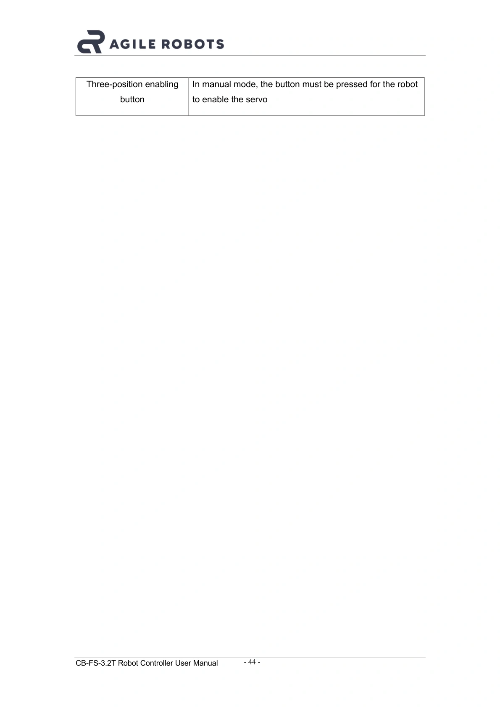



```
CB-FS-3.2T Robot Controller User Manual 
 
- 44 - 
Three-position enabling 
button 
In manual mode, the button must be pressed for the robot 
to enable the servo
```



## PDF page 49

**Source:** CB-FS-3.2T Controller User Manual V1.0.1.pdf, original pdf page 49. [Open the corresponding PDF reading-copy page](https://1292444914-files.gitbook.io/~/files/v0/b/gitbook-x-prod.appspot.com/o/spaces%2FtgOfPnscWebs1eh82EKq%2Fuploads%2FXsVIjtH6CujbYL5SYU5l%2Fcb-fs-3-2t-controller-user-manual-v1-0-1-pp-044-064.pdf?alt=media#page=6).



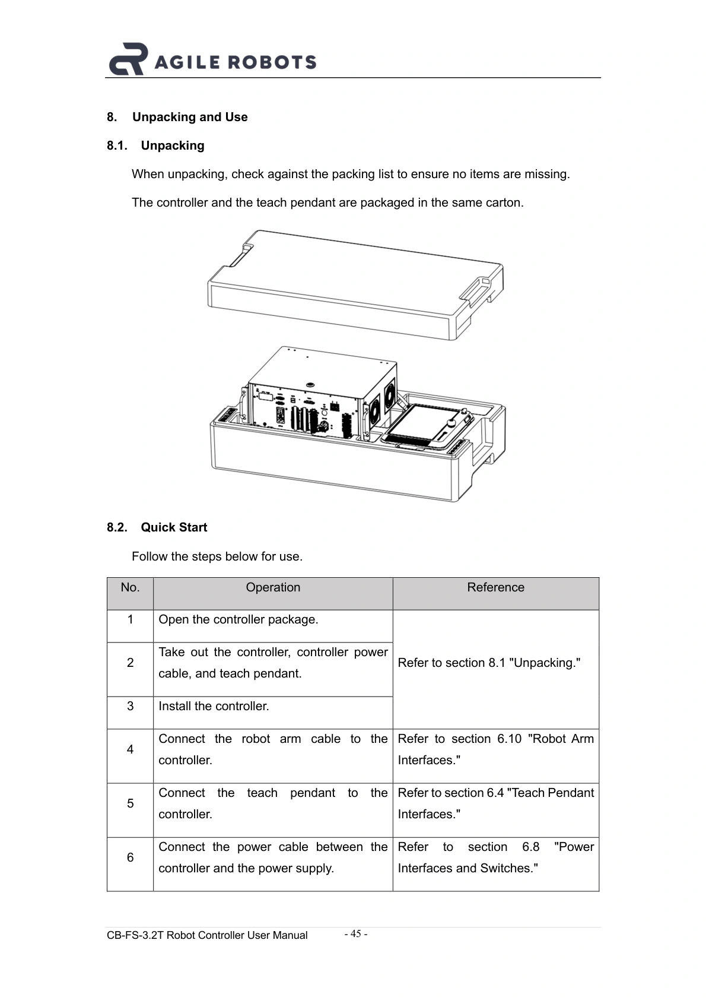



```
CB-FS-3.2T Robot Controller User Manual 
 
- 45 - 
8. 
Unpacking and Use 
8.1. Unpacking 
When unpacking, check against the packing list to ensure no items are missing. 
The controller and the teach pendant are packaged in the same carton. 
 
8.2. Quick Start 
Follow the steps below for use. 
No. 
Operation 
Reference 
1 
Open the controller package. 
Refer to section 8.1 "Unpacking." 
2 
Take out the controller, controller power 
cable, and teach pendant. 
3 
Install the controller. 
4 
Connect the robot arm cable to the 
controller. 
Refer to section 6.10 "Robot Arm 
Interfaces." 
5 
Connect the teach pendant to the 
controller. 
Refer to section 6.4 "Teach Pendant 
Interfaces." 
6 
Connect the power cable between the 
controller and the power supply. 
Refer 
to 
section 
6.8 
"Power 
Interfaces and Switches."
```



## PDF page 50

**Source:** CB-FS-3.2T Controller User Manual V1.0.1.pdf, original pdf page 50. [Open the corresponding PDF reading-copy page](https://1292444914-files.gitbook.io/~/files/v0/b/gitbook-x-prod.appspot.com/o/spaces%2FtgOfPnscWebs1eh82EKq%2Fuploads%2FXsVIjtH6CujbYL5SYU5l%2Fcb-fs-3-2t-controller-user-manual-v1-0-1-pp-044-064.pdf?alt=media#page=7).



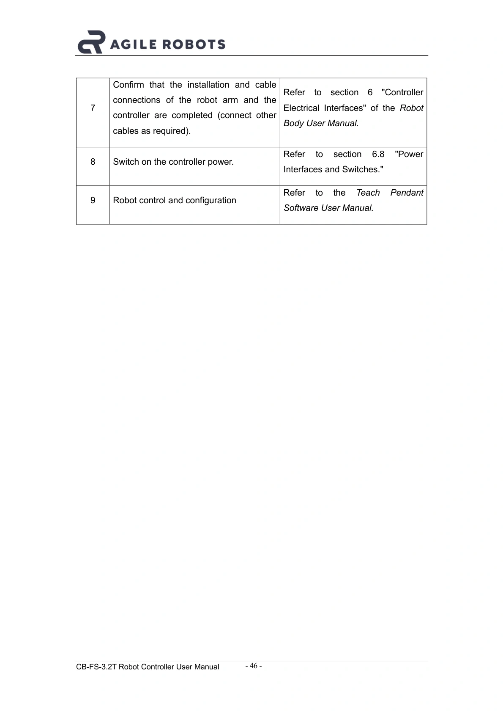



```
CB-FS-3.2T Robot Controller User Manual 
 
- 46 - 
7 
Confirm that the installation and cable 
connections of the robot arm and the 
controller are completed (connect other 
cables as required). 
Refer to section 6 "Controller 
Electrical Interfaces" of the Robot 
Body User Manual. 
8 
Switch on the controller power. 
Refer 
to 
section 
6.8 
"Power 
Interfaces and Switches." 
9 
Robot control and configuration 
Refer 
to 
the 
Teach 
Pendant 
Software User Manual.
```



## PDF page 51

**Source:** CB-FS-3.2T Controller User Manual V1.0.1.pdf, original pdf page 51. [Open the corresponding PDF reading-copy page](https://1292444914-files.gitbook.io/~/files/v0/b/gitbook-x-prod.appspot.com/o/spaces%2FtgOfPnscWebs1eh82EKq%2Fuploads%2FXsVIjtH6CujbYL5SYU5l%2Fcb-fs-3-2t-controller-user-manual-v1-0-1-pp-044-064.pdf?alt=media#page=8).







```
CB-FS-3.2T Robot Controller User Manual 
 
- 47 - 
9. 
Transport 
During transportation, the product should be transported in its original packaging. 
The product packaging should be properly kept for reuse in future transportation.
```



## PDF page 52

**Source:** CB-FS-3.2T Controller User Manual V1.0.1.pdf, original pdf page 52. [Open the corresponding PDF reading-copy page](https://1292444914-files.gitbook.io/~/files/v0/b/gitbook-x-prod.appspot.com/o/spaces%2FtgOfPnscWebs1eh82EKq%2Fuploads%2FXsVIjtH6CujbYL5SYU5l%2Fcb-fs-3-2t-controller-user-manual-v1-0-1-pp-044-064.pdf?alt=media#page=9).







```
CB-FS-3.2T Robot Controller User Manual 
 
- 48 - 
10. Maintenance, Repair, and Disposal 
10.1. Inspection Items 
The following table shows the inspection checklist recommended by Agile Robots to 
be performed at the specified time intervals. If any parts are found to be defective during 
inspection, they must be repaired or replaced. Only authorized distributors or designated 
service centers are permitted to carry out repairs. 
No. 
Inspection Item 
Inspection 
Type 
Monthly 
Inspection 
Semi-
Annual 
Inspection 
Annual 
Inspection 
1 
Check the teach pendant 
cable and connector. 
V 
○ 
 
 
2 
Check 
all 
interface 
terminals of the controller. 
V 
 
○ 
 
3 
Check the filter and fan on 
the controller. 
F 
○ 
 
 
4 
Check the emergency stop 
button 
on 
the 
teach 
pendant. 
F 
○ 
 
 
5 
Check the physical key 
switch 
on 
the 
teach 
pendant. 
F 
○ 
 
 
6 
Check the three-position 
enabling button on the 
teach pendant. 
F 
○ 
 
 
7 
Check the safety interface 
(if connected). 
F 
○ 
 
 
8 
Check 
the 
free-drive 
mode. 
F 
 
○ 
 
9 
Check the main power 
supply of the controller. 
F 
 
 
○ 
V = Visual inspection; F = Functional inspection
```



## PDF page 53

**Source:** CB-FS-3.2T Controller User Manual V1.0.1.pdf, original pdf page 53. [Open the corresponding PDF reading-copy page](https://1292444914-files.gitbook.io/~/files/v0/b/gitbook-x-prod.appspot.com/o/spaces%2FtgOfPnscWebs1eh82EKq%2Fuploads%2FXsVIjtH6CujbYL5SYU5l%2Fcb-fs-3-2t-controller-user-manual-v1-0-1-pp-044-064.pdf?alt=media#page=10).







```
CB-FS-3.2T Robot Controller User Manual 
 
- 49 - 
10.2. Visual Inspection 
1. Disconnect the controller power cable. 
2. Check whether the interface terminals on the controller panel are correctly 
connected and firmly tightened. If any terminals are loose, reconnect and tighten 
them according to the electrical interface instructions. 
10.3. Function Inspection 
l 
Emergency stop button on the teach pendant. 
1. Press the emergency stop button. 
2. Observe whether the robot arm stops, the power is cut off, and the brakes are 
engaged. 
3. Release the emergency stop button, clear the error alarm message on the teach 
pendant, re-power the robot, and manually jog each axis to confirm that functions 
are normal. 
4. If the emergency stop button has any problems, please contact the manufacturer 
for repair or replacement. 
l 
Key switch on the teach pendant 
1. Connect the robot and the controller power, and turn the key to manual mode. 
2. Power on the robot, and confirm that in this mode the three-position enabling 
button must be pressed to control the robot joints for jog movement. 
3. Turn the key to automatic mode, and confirm that in this mode the robot joints 
cannot be jogged, and only program operation is allowed. 
4. If the key switch has any problems, please contact the manufacturer for repair or 
replacement. 
l 
Three-position enabling button on the teach pendant 
1. Connect the robot and controller power, and switch to manual mode. 
2. Press and hold the three-position enabling button in the middle position. At this 
time, the robot brakes are released, and the robot joints can be jogged. 
3. Press the three-position enabling button fully down (beyond the middle position) 
and check whether the robot stops and the brakes are engaged. 
4. Release the three-position enabling button and check whether the robot stops. 
5. If the three-position enabling button has any problems, please contact the
```



## PDF page 54

**Source:** CB-FS-3.2T Controller User Manual V1.0.1.pdf, original pdf page 54. [Open the corresponding PDF reading-copy page](https://1292444914-files.gitbook.io/~/files/v0/b/gitbook-x-prod.appspot.com/o/spaces%2FtgOfPnscWebs1eh82EKq%2Fuploads%2FXsVIjtH6CujbYL5SYU5l%2Fcb-fs-3-2t-controller-user-manual-v1-0-1-pp-044-064.pdf?alt=media#page=11).







```
CB-FS-3.2T Robot Controller User Manual 
 
- 50 - 
manufacturer for repair or replacement. 
l 
Safety interface 
1. Check whether any safety interfaces (including safety input and safety output 
interfaces) are active, and confirm they can be triggered normally. 
2. If there are any problems with the safety interface functions, please contact the 
manufacturer for repair or replacement. 
l 
Free-drive mode 
1. Power on the robot and correctly configure the end-effector's load mass and 
center-of-mass parameters. 
2. Switch the robot to manual mode. 
3. Press and hold the three-position enabling button in the middle position, then 
press and hold the "Free-drive" button on the teach pendant interface to move the 
robot in free-drive mode.  
4. Pull or push the robot to a horizontally extended position and release it. 
5. Release the three-position enabling button or the "Free-drive" button. 
6. Confirm that the robot can remain in place without support. 
7. If there are any problems, please contact the manufacturer. 
l 
Fan and filter 
1. Check whether the filters on both sides of the controller are blocked by dust or 
foreign objects. 
2. Check whether the fan is blocked by foreign objects. 
3. If the fan makes abnormal noise or stops working, inspect and replace it. 
10.4. Cleaning 
l 
Clean the controller and the teach pendant. 
If dust, dirt, or oil is observed on the controller or teach pendant, clean with a dry 
cloth dampened with water or alcohol. Do not use abrasive materials to clean the screen. 
l 
Clean the controller filters. 
The controller has four filters. Remove the filters and clean them with low-pressure 
air. Replace the filters as needed.
```



## PDF page 55

**Source:** CB-FS-3.2T Controller User Manual V1.0.1.pdf, original pdf page 55. [Open the corresponding PDF reading-copy page](https://1292444914-files.gitbook.io/~/files/v0/b/gitbook-x-prod.appspot.com/o/spaces%2FtgOfPnscWebs1eh82EKq%2Fuploads%2FXsVIjtH6CujbYL5SYU5l%2Fcb-fs-3-2t-controller-user-manual-v1-0-1-pp-044-064.pdf?alt=media#page=12).







```
CB-FS-3.2T Robot Controller User Manual 
 
- 51 - 
10.5. Disposal 
At product end-of-life, waste must be disposed of in accordance with applicable 
national laws, regulations, and standards.
```



## PDF page 56

**Source:** CB-FS-3.2T Controller User Manual V1.0.1.pdf, original pdf page 56. [Open the corresponding PDF reading-copy page](https://1292444914-files.gitbook.io/~/files/v0/b/gitbook-x-prod.appspot.com/o/spaces%2FtgOfPnscWebs1eh82EKq%2Fuploads%2FXsVIjtH6CujbYL5SYU5l%2Fcb-fs-3-2t-controller-user-manual-v1-0-1-pp-044-064.pdf?alt=media#page=13).







```
CB-FS-3.2T Robot Controller User Manual 
 
- 52 - 
11. Applicable Standards 
This product is designed in compliance with the following standards: 
Standard 
Description 
EN ISO  
12100:2010 
Safety of machinery - General principles for design - Risk 
assessment and risk reduction 
EN  
60204-1:2018 
Safety of machinery - Electrical equipment of machines - Part 1: 
General requirements 
EN ISO  
10218-1:2011 
Robots and robotic devices - Safety requirements for industrial 
robots - Part 1: Robots 
EN ISO  
13849-1:2023 
Safety of machinery - Safety related parts of control systems - 
Part 1: General principles for design 
EN IEC  
61000-6-2:2019 
Electromagnetic compatibility (EMC) - Part 6-2: Generic standards 
- Immunity standard for industrial environments 
EN IEC  
61000-6-4:2019 
Electromagnetic compatibility (EMC) - Part 6-4: Generic standards 
- Emission standard for industrial environments
```



## PDF page 57

**Source:** CB-FS-3.2T Controller User Manual V1.0.1.pdf, original pdf page 57. [Open the corresponding PDF reading-copy page](https://1292444914-files.gitbook.io/~/files/v0/b/gitbook-x-prod.appspot.com/o/spaces%2FtgOfPnscWebs1eh82EKq%2Fuploads%2FXsVIjtH6CujbYL5SYU5l%2Fcb-fs-3-2t-controller-user-manual-v1-0-1-pp-044-064.pdf?alt=media#page=14).







```
CB-FS-3.2T Robot Controller User Manual 
 
- 53 - 
12. Disclaimer 
Agile Robots is committed to continuous improvement of the reliability and 
performance of its products. We are constantly conducting research and development, as 
well as innovation to ensure our robotic technology remains at the forefront of the industry. 
To this end, we reserve the right to upgrade our products and user manuals at any time to 
reflect the latest technological advancements and improvements. Please note that we may 
not issue individual notifications for every change, but we encourage users to regularly 
contact our sales department (email: sales@agile-robots.com) to obtain the latest 
information. 
We strive to ensure the accuracy and reliability of the content in this user manual, 
providing more detailed guidance on product operation and maintenance. However, given 
the complexity and continuous evolution of technology, we cannot guarantee that this 
manual is entirely free from errors or omissions. If users encounter any problems or 
questions during product use, we recommend contacting our customer service department 
directly for assistance. 
Agile Robots assumes no legal liability for any errors, omissions, or inaccuracies in 
this user manual, whether caused by negligence, misunderstanding, or other reasons. We 
advise users to carefully read the manual before using the product and follow all 
instructions and safety guidelines.  
Our continuous improvement and updates of the user manual demonstrate our 
commitment to customer satisfaction and service quality. We appreciate your 
understanding and support, and we welcome any feedback to help us further improve our 
products and services.
```



## PDF page 58

**Source:** CB-FS-3.2T Controller User Manual V1.0.1.pdf, original pdf page 58. [Open the corresponding PDF reading-copy page](https://1292444914-files.gitbook.io/~/files/v0/b/gitbook-x-prod.appspot.com/o/spaces%2FtgOfPnscWebs1eh82EKq%2Fuploads%2FXsVIjtH6CujbYL5SYU5l%2Fcb-fs-3-2t-controller-user-manual-v1-0-1-pp-044-064.pdf?alt=media#page=15).







```
CB-FS-3.2T Robot Controller User Manual 
 
- 54 - 
13. Appendix 
13.1. Safety Functions 
Emergency Stop 
SF01 Emergency Stop 
When the emergency stop button on the teach 
pendant or the external emergency stop button of the 
controller is pressed, the safety control system forces 
the robot to perform a Category 0 stop. 
SF08 
External 
Emergency 
Stop Input 
External emergency stop safety input SI. During robot 
operation, if the external emergency stop button is 
pressed, the safety control system detects the external 
emergency stop signal and forces the robot to perform 
a Category 1 stop. 
n Emergency stop button on the teach pendant: The teach pendant is equipped with an 
emergency stop button. 
n There are two ways to connect an external emergency stop to the controller: 
1) Connect an external emergency stop button through the E-Stop interface on the 
controller. 
2) Connect an external emergency stop button through the safety input interface (SI) 
on the controller, and configure the SI interface in the software as an emergency stop 
function. 
After releasing the emergency stop button, the error can be cleared and the emergency 
stop state exited. 
Protection Stop 
SF02 Protection Stop 
During robot operation, when a protection stop signal 
is triggered (for example, opening a safety door), the 
safety control system detects the protection stop signal 
and the robot performs a Category 2 stop. 
SF09 
Protection Stop Reset 
Input 
Protection stop reset safety input SI. 
After the safety control system detects a protection
```



## PDF page 59

**Source:** CB-FS-3.2T Controller User Manual V1.0.1.pdf, original pdf page 59. [Open the corresponding PDF reading-copy page](https://1292444914-files.gitbook.io/~/files/v0/b/gitbook-x-prod.appspot.com/o/spaces%2FtgOfPnscWebs1eh82EKq%2Fuploads%2FXsVIjtH6CujbYL5SYU5l%2Fcb-fs-3-2t-controller-user-manual-v1-0-1-pp-044-064.pdf?alt=media#page=16).







```
CB-FS-3.2T Robot Controller User Manual 
 
- 55 - 
stop signal, it forces the robot to perform a Category 2 
stop. In this case, a reset signal must be triggered; 
once the safety control system detects the reset 
signal, the robot can continue to move. If no reset 
signal is detected, the robot cannot resume operation. 
n The Protection Stop function must be connected through the Protection Stop interface 
(PStop) on the controller to an external protection stop device (such as a safety gate). 
n The protection stop reset function must be connected through the safety input 
interface (SI) on the controller to an external reset button or device, and the SI interface 
must be configured in the software as the Protection Stop Reset function. 
There are two kinds of settings to exit the Protection Stop after triggering: 
1) Apply on the Protection Stop function only without the Protection Stop Reset. After 
the Protection Stop signal is cleared, the error can be cleared and the robot use is 
again possible. 
2) Applying both the Protection Stop function and the Protection Stop Reset. After the 
Protection Stop signal is cleared, the protection stop reset signal must be triggered in 
addition before the error can be cleared Afterwards robot use is again possible. 
Note: 
In manual operation mode, when a protection stop signal is triggered, the robot 
operates normally without error alarms. 
Position Monitoring 
SF03 Safe position limit 
Restrict the robot's position within a defined range. If the 
safety control system detects that the position exceeds 
the limit, it will force the robot to perform a Category 1 
stop. 
The types of robot safety position limits are as follows, and they can be enabled 
simultaneously: 
n Joint position limit (axis safety soft limit): The safety control system monitors whether 
the rotation of each robot joint remains within the configured limits. 
n Elbow position limit: The safety control system monitors whether the robot's elbow
```



## PDF page 60

**Source:** CB-FS-3.2T Controller User Manual V1.0.1.pdf, original pdf page 60. [Open the corresponding PDF reading-copy page](https://1292444914-files.gitbook.io/~/files/v0/b/gitbook-x-prod.appspot.com/o/spaces%2FtgOfPnscWebs1eh82EKq%2Fuploads%2FXsVIjtH6CujbYL5SYU5l%2Fcb-fs-3-2t-controller-user-manual-v1-0-1-pp-044-064.pdf?alt=media#page=17).







```
CB-FS-3.2T Robot Controller User Manual 
 
- 56 - 
remains within the defined safety plane range. 
n TCP position limit: The safety control system monitors whether the robot's TCP 
position remains within the defined safety plane range. 
Note: 
1) To ensure that the robot can resume normal operation after exceeding the limits, a 
safety handling mechanism is defined. 
2) Safety handling mechanism: When the robot exceeds a safety position limit, it 
enters safety mode (the robot must be in manual mode). In this state, errors can be 
cleared, and manual control of the robot joints or TCP is allowed to move it back within 
the defined range. 
Speed Monitoring 
SF04 Safe speed limit 
The rotational speed of each robot joint, the elbow 
movement speed, and the TCP movement speed are 
restricted within configured values. If the safety control 
system detects that a speed exceeds the limit, it will 
force the robot to perform a Category 1 stop. 
SF07 Jog control 
In manual mode, the default maximum limit for the 
robot's elbow movement speed and TCP movement 
speed is 250 mm/s. If a smaller safe speed limit is 
configured, monitoring will follow the configured value. 
If the safety control system detects that the TCP or 
elbow movement speed exceeds the limit, it will force 
the robot to perform a Category 1 stop. 
Power and Momentum Limitation 
SF05 Safe power limit 
The robot safety control system monitors the robot's 
power. If the safety control system detects that power 
exceeds the configured limit, it will force the robot to 
perform a Category 1 stop. 
SF06 Safe momentum limit 
The robot safety control system monitors the robot's 
momentum. If the safety control system detects that
```



## PDF page 61

**Source:** CB-FS-3.2T Controller User Manual V1.0.1.pdf, original pdf page 61. [Open the corresponding PDF reading-copy page](https://1292444914-files.gitbook.io/~/files/v0/b/gitbook-x-prod.appspot.com/o/spaces%2FtgOfPnscWebs1eh82EKq%2Fuploads%2FXsVIjtH6CujbYL5SYU5l%2Fcb-fs-3-2t-controller-user-manual-v1-0-1-pp-044-064.pdf?alt=media#page=18).







```
CB-FS-3.2T Robot Controller User Manual 
 
- 57 - 
momentum exceeds the configured limit, it will force the 
robot to perform a Category 1 stop. 
Three-Position Enabling 
In manual mode, when the three-position enabling button is held in the middle position, 
the safety control system detects the three-position enabling signal and enables the 
servo drives, allowing the robot to move. If the safety control system does not detect the 
three-position enabling signal, the servo drives remain disabled and the robot cannot 
move. 
n Three-position enabling button on the teach pendant: the teach pendant is equipped 
with a three-position enabling button. 
n The controller safety input interface (SI) can be connected to an external three-position 
enabling button. The SI interface must then be configured in the software as the three-
position enabling function. This corresponds to safety function item SF10. 
Note: 
When an external three-position enabling button is connected to SI, the three-position 
enabling button on the teach pendant is disabled. 
SF10 
Three Position Enable 
Switch Input 
Three-position enabling safety input SI 
Reduced State 
Definition of reduced state: 
The robot's safety limits are divided into normal state and reduced state. In reduced state, 
the limit values are less than or equal to those of normal state. The safety limits 
supporting reduced state include safe power limit, safe momentum limit, safe speed limit, 
and safe position limit (joint position limit only). 
There are two conditions for triggering the reduced state: 
1) Configure a safety plane in the safety interface and set its attribute to reduced state. 
This restricts TCP position, elbow position, and tool position. If any of these positions 
exceed the reduced state safety plane, the safety control system will monitor them 
according to reduced state limits.
```



## PDF page 62

**Source:** CB-FS-3.2T Controller User Manual V1.0.1.pdf, original pdf page 62. [Open the corresponding PDF reading-copy page](https://1292444914-files.gitbook.io/~/files/v0/b/gitbook-x-prod.appspot.com/o/spaces%2FtgOfPnscWebs1eh82EKq%2Fuploads%2FXsVIjtH6CujbYL5SYU5l%2Fcb-fs-3-2t-controller-user-manual-v1-0-1-pp-044-064.pdf?alt=media#page=19).







```
CB-FS-3.2T Robot Controller User Manual 
 
- 58 - 
2) Use the safety input interface (SI) on the controller to connect an external switch or 
device, and configure the SI interface in the software as the reduced state function. 
This corresponds to safety function item SF11. 
Note: 
Reduced state only changes the range of safety limit values monitored by the safety 
control system. It does not mean that the robot's motion speed is reduced. 
SF11 
Reduced State Input 
Reduced state safety input SI. 
In normal state, when a reduced state signal is 
triggered, the safety control system detects the signal 
and forces the robot into reduced state. If the safety 
control system detects that the robot exceeds the 
reduced state limits, it forces the robot to perform a 
Category 1 stop. 
Operation Modes 
There are two ways to switch between manual mode and automatic mode in operation 
mode: 
n Key rotation on the teach pendant: the teach pendant is equipped with a physical key. 
n Use the safety input interface (SI) on the controller to connect an external switch or 
device, and configure the SI interface in the software as the mode switch function. This 
corresponds to safety function item SF12. 
Note: 
When an external switch or device connected to SI is configured as the mode switch 
function, the key function on the teach pendant will be disabled. 
SF12 Mode Switch Input 
Operation mode safety input SI. 
When the operation mode signal changes, the safety 
control system detects the change and forces the robot 
to enter manual or automatic mode. When switching 
between manual and automatic modes, the robot 
performs a Category 1 stop.
```



## PDF page 63

**Source:** CB-FS-3.2T Controller User Manual V1.0.1.pdf, original pdf page 63. [Open the corresponding PDF reading-copy page](https://1292444914-files.gitbook.io/~/files/v0/b/gitbook-x-prod.appspot.com/o/spaces%2FtgOfPnscWebs1eh82EKq%2Fuploads%2FXsVIjtH6CujbYL5SYU5l%2Fcb-fs-3-2t-controller-user-manual-v1-0-1-pp-044-064.pdf?alt=media#page=20).







```
CB-FS-3.2T Robot Controller User Manual 
 
- 59 - 
Safety Output 
SF13 
Robot Emergency 
Stop State Output 
When the robot is in emergency stop state, the safety 
control system sets SO to low. When the robot is not in 
emergency stop state, the safety control system sets 
SO to high. 
SF14 
Robot Reduced State 
Output  
When the robot enters reduced state upon triggering the 
reduced state signal, the safety control system sets SO 
to low. When the robot is not in reduced state, the safety 
control system sets SO to high. 
SF15 
Robot Moving Status 
Output 
When the robot is moving, the safety control system 
sets SO to low. When the robot is stationary, the safety 
control system sets SO to high. 
SF16 
Robot 
Safety 
Point 
Status Output 
When a safety position is specified (configured in the 
teach pendant software), if the robot leaves the safety 
position, the safety control system sets SO to low. When 
the robot returns to the safety position, the safety 
control system sets SO to high. 
Standstill Monitoring 
SF17 Monitored standstill 
When the robot performs a Category 2 stop, the safety 
control system monitors whether the robot has actually 
stopped. If it detects that the robot is still moving, it 
forces the robot to perform a Category 0 stop. 
Note: The above safety functions can be configured in the safety interface of the teach 
pendant. For detailed operations, refer to the safety function configuration instructions.
```



## PDF page 64

**Source:** CB-FS-3.2T Controller User Manual V1.0.1.pdf, original pdf page 64. [Open the corresponding PDF reading-copy page](https://1292444914-files.gitbook.io/~/files/v0/b/gitbook-x-prod.appspot.com/o/spaces%2FtgOfPnscWebs1eh82EKq%2Fuploads%2FXsVIjtH6CujbYL5SYU5l%2Fcb-fs-3-2t-controller-user-manual-v1-0-1-pp-044-064.pdf?alt=media#page=21).







```
CB-FS-3.2T Robot Controller User Manual 
 
- 60 - 
 
 
 
 
 
 
 
 
 
 
 
 
 
 
 
 
 
Agile Robots SE 
Plinganserstraße 134, 81369 Munich, Germany
```


