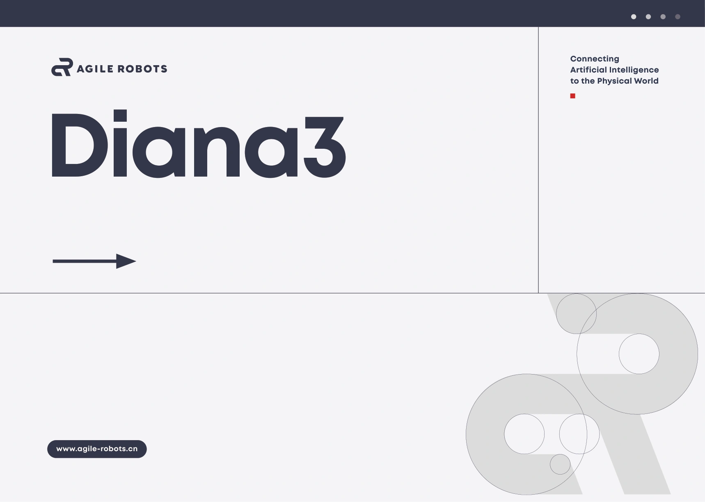
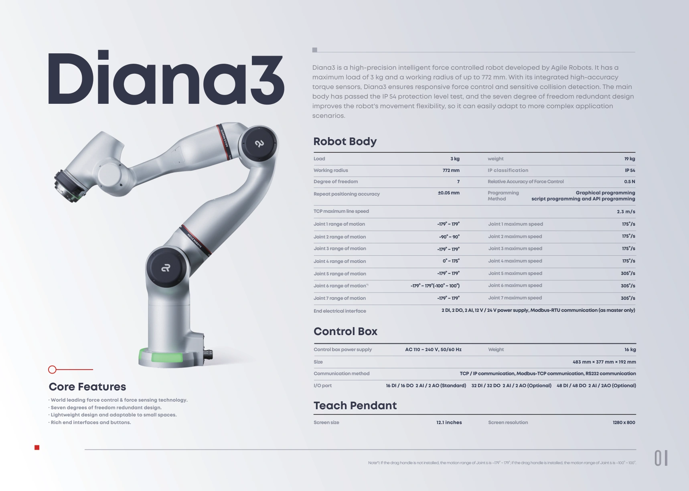
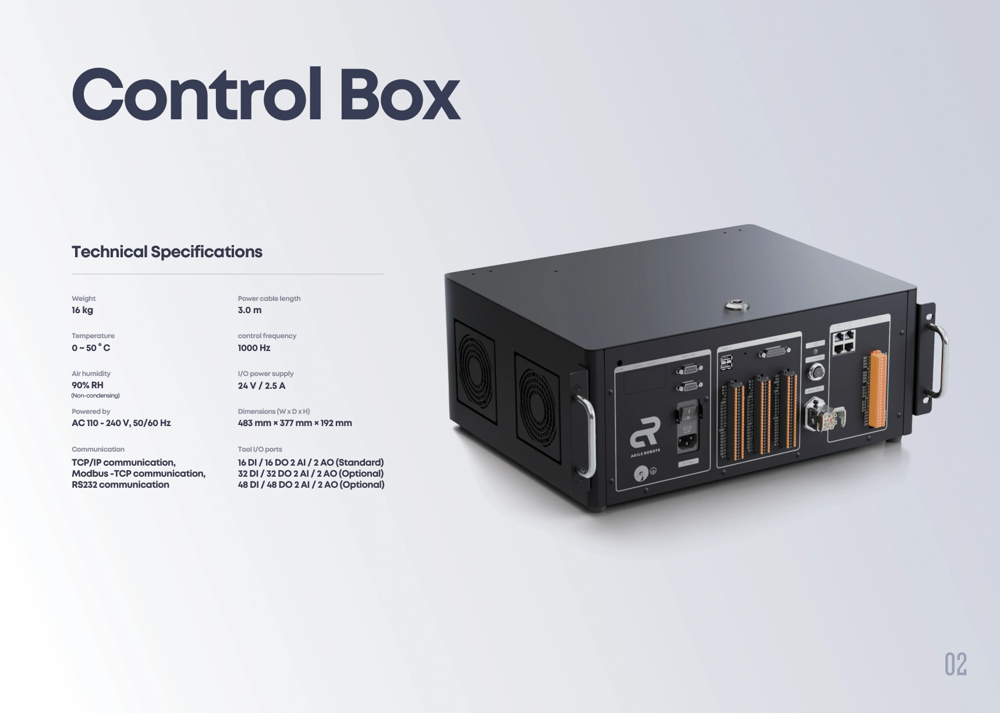
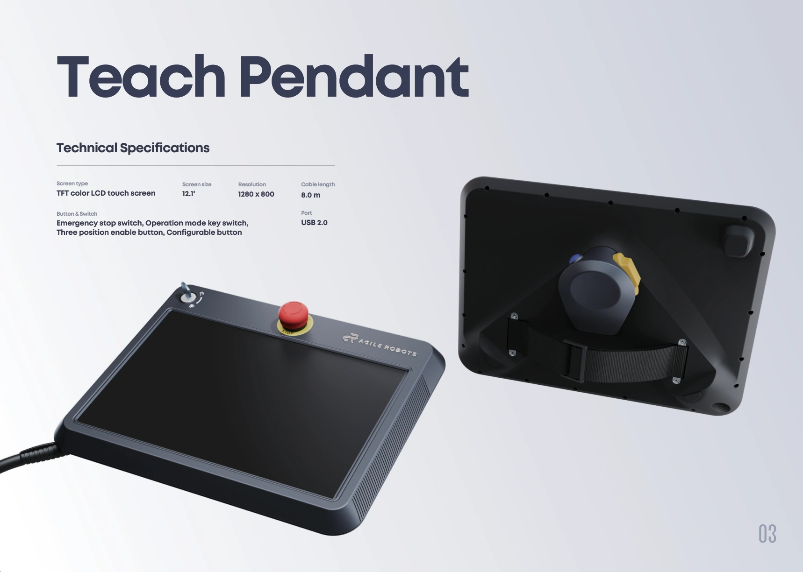

# Diana 3 product flyer — complete reference


**Complete supplied source:** Diana3 EN.pdf · **Coverage:** 4 original PDF pages. [Return to the Agile Robots source library](./).


Every source page is retained in the original order. The **Original page** view preserves complete diagrams, photographs, tables, equations, connector orientation, notices and examples. The **Searchable text** view preserves native PDF text or the slide’s native text, embedded links and substantive speaker notes. Text extraction can retain reading-order/character defects; use the original image for exact layout, table columns and code indentation.


Use only the exact model, hardware/controller and software revision covered by the source. Manufacturer examples involving motion, enabling, safety configuration, I/O, calibration, updates or resets require the complete applicable procedure and qualified personnel. No robot, SDK or process-equipment test was run.


**Attribution:** the manufacturer and contributors identified in the supplied document. Original notices remain visible on every source page. Navigation, revision notes and the linked engineering explanations are OpenELAB editorial additions.

## Document navigation

| Source section / function                                                                                        | Original page                             |
| ---------------------------------------------------------------------------------------------------------------- | ----------------------------------------- |
| Connecting / Artificial Intelligence                                                                             | [PDF 1](complete-diana3-en.md#pdf-page-1) |
| Note\*1: If the drag handle is not installed, the motion range of Joint 6 is –179° \~ 179°; if the drag handle i | [PDF 2](complete-diana3-en.md#pdf-page-2) |
| Control Box / Tool I/O ports                                                                                     | [PDF 3](complete-diana3-en.md#pdf-page-3) |
| Teach Pendant / Technical Specifications                                                                         | [PDF 4](complete-diana3-en.md#pdf-page-4) |

## PDF page 1

**Source:** Diana3 EN.pdf, original pdf page 1. [Open the corresponding PDF reading-copy page](https://1292444914-files.gitbook.io/~/files/v0/b/gitbook-x-prod.appspot.com/o/spaces%2FtgOfPnscWebs1eh82EKq%2Fuploads%2FfHodd2p5EKFtXVE8Kamd%2Fdiana3-en-pp-001-004.pdf?alt=media#page=1).







```
Connecting 
Artificial Intelligence
to the Physical World
www.agile-robots.cn
```



## PDF page 2

**Source:** Diana3 EN.pdf, original pdf page 2. [Open the corresponding PDF reading-copy page](https://1292444914-files.gitbook.io/~/files/v0/b/gitbook-x-prod.appspot.com/o/spaces%2FtgOfPnscWebs1eh82EKq%2Fuploads%2FfHodd2p5EKFtXVE8Kamd%2Fdiana3-en-pp-001-004.pdf?alt=media#page=2).







```
Note*1: If the drag handle is not installed, the motion range of Joint 6 is –179° ~ 179°; if the drag handle is installed, the motion range of Joint 6 is –100° ~ 100°.
Diana3 is a high-precision intelligent force controlled robot developed by Agile Robots. It has a 
maximum load of 3 kg and a working radius of up to 772 mm. With its integrated high-accuracy 
torque sensors, Diana3 ensures responsive force control and sensitive collision detection. The main 
body has passed the IP 54 protection level test, and the seven degree of freedom redundant design 
improves the robot's movement flexibility, so it can easily adapt to more complex application 
scenarios.
Core Features
· World leading force control & force sensing technology.
· Seven degrees of freedom redundant design.
· Lightweight design and adaptable to small spaces.
· Rich end interaces and buttons.
Teach Pendant
Screen size
Screen resolution
12.1 inches
1280 x 800
Robot Body
Load
3 kg
Working radius
Joint 1 range of motion
Joint 1 maximum speed
Joint 4 range of motion
Joint 4 maximum speed
772 mm
Degree of freedom
Joint 2 range of motion
Joint 2 maximum speed
Joint 5 range of motion
Joint 5 maximum speed
End electrical interace
7
Repeat positioning accuracy
Joint 3 range of motion
Joint 3 maximum speed
Joint 6 range of motion*1
Joint 6 maximum speed
±0.05 mm
weight
19 kg
IP classification
IP 54
Relative Accuracy of Force Control
0.5 N
Programming 
Method
Graphical programming
script programming and API programming
TCP maximum line speed
2.3 m/s
175°/s
175°/s
305°/s
-179° ~ 179°
175°/s
175°/s
305°/s
0° ~ 175°
-179° ~ 179°(-100° ~ 100°)
Joint 7 range of motion
Joint 7 maximum speed
305°/s
-179° ~ 179°
2 DI, 2 DO, 2 AI, 12 V / 24 V power supply, Modbus-RTU communication (as master only)
-179° ~ 179°
-90° ~ 90°
-179° ~ 179°
Size
Control box power supply
483 mm × 377 mm × 192 mm
AC 110 ~ 240 V, 50/60 Hz
Weight
16 kg
I/O port
TCP / IP communication, Modbus-TCP communication, RS232 communication
Communication method
16 DI / 16 DO  2 AI / 2 AO (Standard)      32 DI / 32 DO  2 AI / 2 AO (Optional)      48 DI / 48 DO  2 AI / 2AO (Optional)
Control Box
```



## PDF page 3

**Source:** Diana3 EN.pdf, original pdf page 3. [Open the corresponding PDF reading-copy page](https://1292444914-files.gitbook.io/~/files/v0/b/gitbook-x-prod.appspot.com/o/spaces%2FtgOfPnscWebs1eh82EKq%2Fuploads%2FfHodd2p5EKFtXVE8Kamd%2Fdiana3-en-pp-001-004.pdf?alt=media#page=3).







```
Control Box
Tool I/O ports
16 DI / 16 DO 2 AI / 2 AO (Standard)
32 DI / 32 DO 2 AI / 2 AO (Optional)
48 DI / 48 DO 2 AI / 2 AO (Optional)
AC 110 - 240 V, 50/60 Hz
Powered by
16 kg
Weight
0 ~ 50 ° C
Temperature
1000 Hz
control frequency
90% RH
 (Non-condensing)
Air humidity
24 V / 2.5 A
I/O power supply
3.0 m
Power cable length
483 mm × 377 mm × 192 mm
Dimensions (W x D x H)
Communication
TCP/IP communication,
Modbus -TCP communication,
RS232 communication
Technical Specifications
```



## PDF page 4

**Source:** Diana3 EN.pdf, original pdf page 4. [Open the corresponding PDF reading-copy page](https://1292444914-files.gitbook.io/~/files/v0/b/gitbook-x-prod.appspot.com/o/spaces%2FtgOfPnscWebs1eh82EKq%2Fuploads%2FfHodd2p5EKFtXVE8Kamd%2Fdiana3-en-pp-001-004.pdf?alt=media#page=4).







```
Teach Pendant
Technical Specifications
TFT color LCD touch screen
Screen type
Emergency stop switch, Operation mode key switch, 
Three position enable button, Configurable button
Button & Switch
12.1'
Screen size
USB 2.0
Port
8.0 m
Cable length
1280 x 800
Resolution
```


