# Diana 3 arm manual V1.1.0 — complete reference


**Complete supplied source:** Diana3 Robot Arm User Manual V1.1.0 EN.pdf · **Coverage:** 45 original PDF pages. [Return to the Agile Robots source library](./).


Every source page is retained in the original order. The **Original page** view preserves complete diagrams, photographs, tables, equations, connector orientation, notices and examples. The **Searchable text** view preserves native PDF text or the slide’s native text, embedded links and substantive speaker notes. Text extraction can retain reading-order/character defects; use the original image for exact layout, table columns and code indentation.


Use only the exact model, hardware/controller and software revision covered by the source. Manufacturer examples involving motion, enabling, safety configuration, I/O, calibration, updates or resets require the complete applicable procedure and qualified personnel. No robot, SDK or process-equipment test was run.


**Attribution:** the manufacturer and contributors identified in the supplied document. Original notices remain visible on every source page. Navigation, revision notes and the linked engineering explanations are OpenELAB editorial additions.

## Document navigation

| Source section / function                | Original page                                                            |
| ---------------------------------------- | ------------------------------------------------------------------------ |
| SAFETY                                   | [PDF 5](complete-diana3-robot-arm-user-manual-v1-1-0-en.md#pdf-page-5)   |
| SAFETY REGULATIONS                       | [PDF 5](complete-diana3-robot-arm-user-manual-v1-1-0-en.md#pdf-page-5)   |
| SAFETY SIGNS                             | [PDF 7](complete-diana3-robot-arm-user-manual-v1-1-0-en.md#pdf-page-7)   |
| PERSONNEL REQUIREMENTS                   | [PDF 8](complete-diana3-robot-arm-user-manual-v1-1-0-en.md#pdf-page-8)   |
| PRECAUTIONS                              | [PDF 8](complete-diana3-robot-arm-user-manual-v1-1-0-en.md#pdf-page-8)   |
| EMERGENCY STOP                           | [PDF 11](complete-diana3-robot-arm-user-manual-v1-1-0-en.md#pdf-page-11) |
| NON-ELECTRIC DRIVE                       | [PDF 11](complete-diana3-robot-arm-user-manual-v1-1-0-en.md#pdf-page-11) |
| SAFETY FUNCTIONS                         | [PDF 12](complete-diana3-robot-arm-user-manual-v1-1-0-en.md#pdf-page-12) |
| LIST OF SAFETY FUNCTIONS                 | [PDF 12](complete-diana3-robot-arm-user-manual-v1-1-0-en.md#pdf-page-12) |
| STOP CATEGORIES                          | [PDF 13](complete-diana3-robot-arm-user-manual-v1-1-0-en.md#pdf-page-13) |
| STOP DISTANCE AND STOP TIME              | [PDF 14](complete-diana3-robot-arm-user-manual-v1-1-0-en.md#pdf-page-14) |
| INTENDED USE AND PLACEMENT CONDITIONS    | [PDF 15](complete-diana3-robot-arm-user-manual-v1-1-0-en.md#pdf-page-15) |
| ROBOT SYSTEM                             | [PDF 16](complete-diana3-robot-arm-user-manual-v1-1-0-en.md#pdf-page-16) |
| TECHNICAL SPECIFICATIONS                 | [PDF 16](complete-diana3-robot-arm-user-manual-v1-1-0-en.md#pdf-page-16) |
| ROBOT ARM COMPOSITION                    | [PDF 19](complete-diana3-robot-arm-user-manual-v1-1-0-en.md#pdf-page-19) |
| HOME POSITION AND JOINT POSE             | [PDF 20](complete-diana3-robot-arm-user-manual-v1-1-0-en.md#pdf-page-20) |
| ROBOT ARM DIMENSIONS                     | [PDF 21](complete-diana3-robot-arm-user-manual-v1-1-0-en.md#pdf-page-21) |
| ROBOT WORKSPACE                          | [PDF 22](complete-diana3-robot-arm-user-manual-v1-1-0-en.md#pdf-page-22) |
| ROBOT INSTALLATION                       | [PDF 23](complete-diana3-robot-arm-user-manual-v1-1-0-en.md#pdf-page-23) |
| ROBOT ARM MOUNTING AND FIXATION          | [PDF 23](complete-diana3-robot-arm-user-manual-v1-1-0-en.md#pdf-page-23) |
| END-EFFECTOR MOUNTING AND FIXATION       | [PDF 25](complete-diana3-robot-arm-user-manual-v1-1-0-en.md#pdf-page-25) |
| ELECTRICAL INTERFACES AND FLANGE BUTTONS | [PDF 26](complete-diana3-robot-arm-user-manual-v1-1-0-en.md#pdf-page-26) |
| INDICATOR RING AND ARM CABLE             | [PDF 26](complete-diana3-robot-arm-user-manual-v1-1-0-en.md#pdf-page-26) |
| FLANGE BUTTONS AND ELECTRICAL INTERFACES | [PDF 27](complete-diana3-robot-arm-user-manual-v1-1-0-en.md#pdf-page-27) |
| FLANGE ELECTRICAL INTERFACES             | [PDF 29](complete-diana3-robot-arm-user-manual-v1-1-0-en.md#pdf-page-29) |
| UNPACKING AND USE                        | [PDF 35](complete-diana3-robot-arm-user-manual-v1-1-0-en.md#pdf-page-35) |
| UNPACKING                                | [PDF 35](complete-diana3-robot-arm-user-manual-v1-1-0-en.md#pdf-page-35) |
| QUICK START                              | [PDF 35](complete-diana3-robot-arm-user-manual-v1-1-0-en.md#pdf-page-35) |
| TRANSPORT                                | [PDF 36](complete-diana3-robot-arm-user-manual-v1-1-0-en.md#pdf-page-36) |
| MAINTENANCE, REPAIR, AND DISPOSAL        | [PDF 37](complete-diana3-robot-arm-user-manual-v1-1-0-en.md#pdf-page-37) |
| INSPECTION ITEM                          | [PDF 37](complete-diana3-robot-arm-user-manual-v1-1-0-en.md#pdf-page-37) |
| VISUAL INSPECTION                        | [PDF 37](complete-diana3-robot-arm-user-manual-v1-1-0-en.md#pdf-page-37) |
| FUNCTION INSPECTION                      | [PDF 37](complete-diana3-robot-arm-user-manual-v1-1-0-en.md#pdf-page-37) |
| CLEANING                                 | [PDF 38](complete-diana3-robot-arm-user-manual-v1-1-0-en.md#pdf-page-38) |
| DISPOSAL                                 | [PDF 38](complete-diana3-robot-arm-user-manual-v1-1-0-en.md#pdf-page-38) |
| APPLICABLE STANDARDS                     | [PDF 39](complete-diana3-robot-arm-user-manual-v1-1-0-en.md#pdf-page-39) |
| DISCLAIMER                               | [PDF 40](complete-diana3-robot-arm-user-manual-v1-1-0-en.md#pdf-page-40) |
| APPENDIX                                 | [PDF 41](complete-diana3-robot-arm-user-manual-v1-1-0-en.md#pdf-page-41) |
| CERTIFICATES                             | [PDF 41](complete-diana3-robot-arm-user-manual-v1-1-0-en.md#pdf-page-41) |

## PDF page 1

**Source:** Diana3 Robot Arm User Manual V1.1.0 EN.pdf, original pdf page 1. [Open the corresponding PDF reading-copy page](https://1292444914-files.gitbook.io/~/files/v0/b/gitbook-x-prod.appspot.com/o/spaces%2FtgOfPnscWebs1eh82EKq%2Fuploads%2Fghm4BYtmHi2gRdoJLa5C%2Fdiana3-robot-arm-user-manual-v1-1-0-en-pp-001-020.pdf?alt=media#page=1).



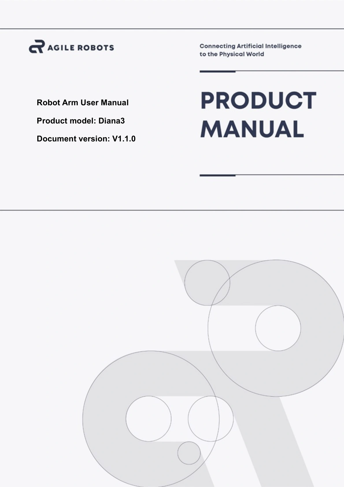



```
i 
Robot Arm User Manual 
Product model: Diana3 
Document version: V1.1.0
```



## PDF page 2

**Source:** Diana3 Robot Arm User Manual V1.1.0 EN.pdf, original pdf page 2. [Open the corresponding PDF reading-copy page](https://1292444914-files.gitbook.io/~/files/v0/b/gitbook-x-prod.appspot.com/o/spaces%2FtgOfPnscWebs1eh82EKq%2Fuploads%2Fghm4BYtmHi2gRdoJLa5C%2Fdiana3-robot-arm-user-manual-v1-1-0-en-pp-001-020.pdf?alt=media#page=2).







No native selectable text is present on this page. The complete original artwork or screenshot remains in the Original page view.



## PDF page 3

**Source:** Diana3 Robot Arm User Manual V1.1.0 EN.pdf, original pdf page 3. [Open the corresponding PDF reading-copy page](https://1292444914-files.gitbook.io/~/files/v0/b/gitbook-x-prod.appspot.com/o/spaces%2FtgOfPnscWebs1eh82EKq%2Fuploads%2Fghm4BYtmHi2gRdoJLa5C%2Fdiana3-robot-arm-user-manual-v1-1-0-en-pp-001-020.pdf?alt=media#page=3).



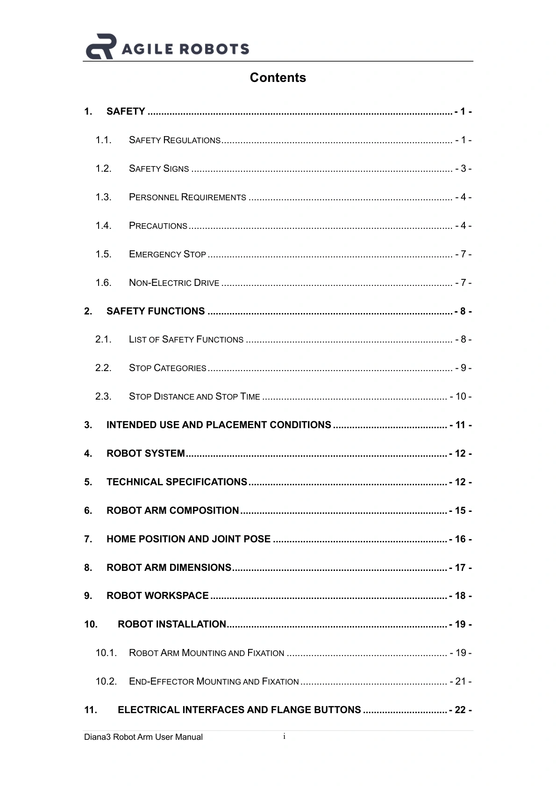



```
Diana3 Robot Arm User Manual  
i 
Contents 
1. 
SAFETY ................................................................................................................ - 1 - 
1.1. 
SAFETY REGULATIONS ..................................................................................... - 1 - 
1.2. 
SAFETY SIGNS ................................................................................................ - 3 - 
1.3. 
PERSONNEL REQUIREMENTS ........................................................................... - 4 - 
1.4. 
PRECAUTIONS ................................................................................................. - 4 - 
1.5. 
EMERGENCY STOP .......................................................................................... - 7 - 
1.6. 
NON-ELECTRIC DRIVE ..................................................................................... - 7 - 
2. 
SAFETY FUNCTIONS .......................................................................................... - 8 - 
2.1. 
LIST OF SAFETY FUNCTIONS ............................................................................ - 8 - 
2.2. 
STOP CATEGORIES .......................................................................................... - 9 - 
2.3. 
STOP DISTANCE AND STOP TIME .................................................................... - 10 - 
3. 
INTENDED USE AND PLACEMENT CONDITIONS .......................................... - 11 - 
4. 
ROBOT SYSTEM ................................................................................................ - 12 - 
5. 
TECHNICAL SPECIFICATIONS ......................................................................... - 12 - 
6. 
ROBOT ARM COMPOSITION ............................................................................ - 15 - 
7. 
HOME POSITION AND JOINT POSE ................................................................ - 16 - 
8. 
ROBOT ARM DIMENSIONS ............................................................................... - 17 - 
9. 
ROBOT WORKSPACE ....................................................................................... - 18 - 
10. 
ROBOT INSTALLATION ................................................................................. - 19 - 
10.1. 
ROBOT ARM MOUNTING AND FIXATION ........................................................... - 19 - 
10.2. 
END-EFFECTOR MOUNTING AND FIXATION ...................................................... - 21 - 
11. 
ELECTRICAL INTERFACES AND FLANGE BUTTONS ............................... - 22 -
```



## PDF page 4

**Source:** Diana3 Robot Arm User Manual V1.1.0 EN.pdf, original pdf page 4. [Open the corresponding PDF reading-copy page](https://1292444914-files.gitbook.io/~/files/v0/b/gitbook-x-prod.appspot.com/o/spaces%2FtgOfPnscWebs1eh82EKq%2Fuploads%2Fghm4BYtmHi2gRdoJLa5C%2Fdiana3-robot-arm-user-manual-v1-1-0-en-pp-001-020.pdf?alt=media#page=4).



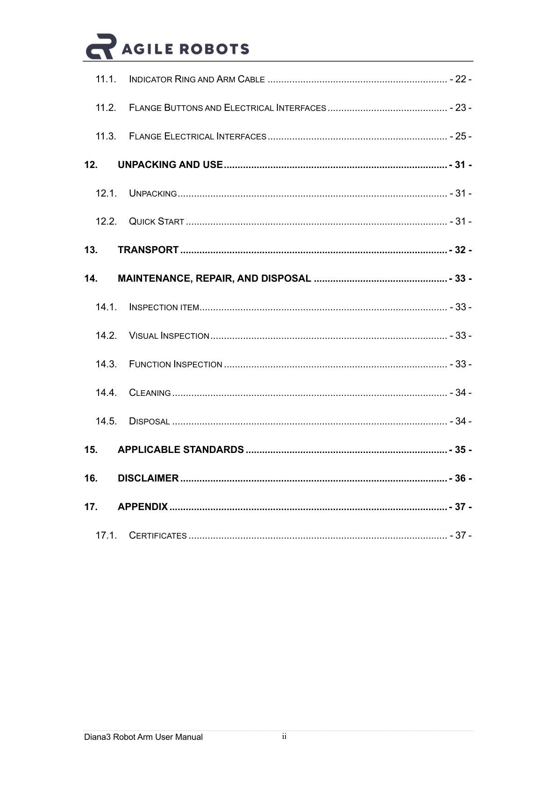



```
Diana3 Robot Arm User Manual  
ii 
11.1. 
INDICATOR RING AND ARM CABLE .................................................................. - 22 - 
11.2. 
FLANGE BUTTONS AND ELECTRICAL INTERFACES ............................................ - 23 - 
11.3. 
FLANGE ELECTRICAL INTERFACES .................................................................. - 25 - 
12. 
UNPACKING AND USE .................................................................................. - 31 - 
12.1. 
UNPACKING ................................................................................................... - 31 - 
12.2. 
QUICK START ................................................................................................ - 31 - 
13. 
TRANSPORT .................................................................................................. - 32 - 
14. 
MAINTENANCE, REPAIR, AND DISPOSAL ................................................. - 33 - 
14.1. 
INSPECTION ITEM ........................................................................................... - 33 - 
14.2. 
VISUAL INSPECTION ....................................................................................... - 33 - 
14.3. 
FUNCTION INSPECTION .................................................................................. - 33 - 
14.4. 
CLEANING ..................................................................................................... - 34 - 
14.5. 
DISPOSAL ..................................................................................................... - 34 - 
15. 
APPLICABLE STANDARDS .......................................................................... - 35 - 
16. 
DISCLAIMER .................................................................................................. - 36 - 
17. 
APPENDIX ...................................................................................................... - 37 - 
17.1. 
CERTIFICATES ............................................................................................... - 37 -
```



## PDF page 5

**Source:** Diana3 Robot Arm User Manual V1.1.0 EN.pdf, original pdf page 5. [Open the corresponding PDF reading-copy page](https://1292444914-files.gitbook.io/~/files/v0/b/gitbook-x-prod.appspot.com/o/spaces%2FtgOfPnscWebs1eh82EKq%2Fuploads%2Fghm4BYtmHi2gRdoJLa5C%2Fdiana3-robot-arm-user-manual-v1-1-0-en-pp-001-020.pdf?alt=media#page=5).



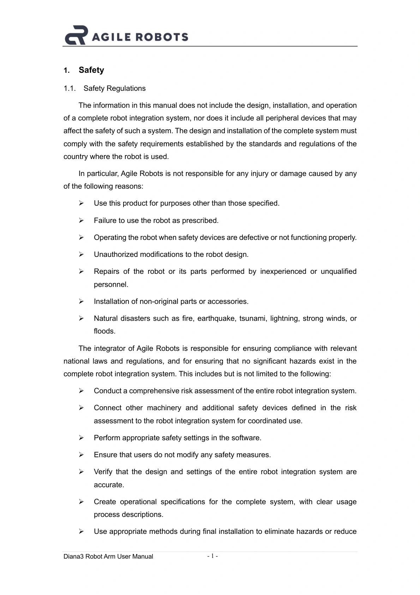



```
Diana3 Robot Arm User Manual  
 
- 1 - 
1. 
Safety 
1.1. Safety Regulations 
The information in this manual does not include the design, installation, and operation 
of a complete robot integration system, nor does it include all peripheral devices that may 
affect the safety of such a system. The design and installation of the complete system must 
comply with the safety requirements established by the standards and regulations of the 
country where the robot is used. 
In particular, Agile Robots is not responsible for any injury or damage caused by any 
of the following reasons: 
Ø 
Use this product for purposes other than those specified. 
Ø 
Failure to use the robot as prescribed. 
Ø 
Operating the robot when safety devices are defective or not functioning properly. 
Ø 
Unauthorized modifications to the robot design. 
Ø 
Repairs of the robot or its parts performed by inexperienced or unqualified 
personnel. 
Ø 
Installation of non-original parts or accessories. 
Ø 
Natural disasters such as fire, earthquake, tsunami, lightning, strong winds, or 
floods. 
The integrator of Agile Robots is responsible for ensuring compliance with relevant 
national laws and regulations, and for ensuring that no significant hazards exist in the 
complete robot integration system. This includes but is not limited to the following: 
Ø 
Conduct a comprehensive risk assessment of the entire robot integration system. 
Ø 
Connect other machinery and additional safety devices defined in the risk 
assessment to the robot integration system for coordinated use. 
Ø 
Perform appropriate safety settings in the software. 
Ø 
Ensure that users do not modify any safety measures. 
Ø 
Verify that the design and settings of the entire robot integration system are 
accurate. 
Ø 
Create operational specifications for the complete system, with clear usage 
process descriptions. 
Ø 
Use appropriate methods during final installation to eliminate hazards or reduce
```



## PDF page 6

**Source:** Diana3 Robot Arm User Manual V1.1.0 EN.pdf, original pdf page 6. [Open the corresponding PDF reading-copy page](https://1292444914-files.gitbook.io/~/files/v0/b/gitbook-x-prod.appspot.com/o/spaces%2FtgOfPnscWebs1eh82EKq%2Fuploads%2Fghm4BYtmHi2gRdoJLa5C%2Fdiana3-robot-arm-user-manual-v1-1-0-en-pp-001-020.pdf?alt=media#page=6).



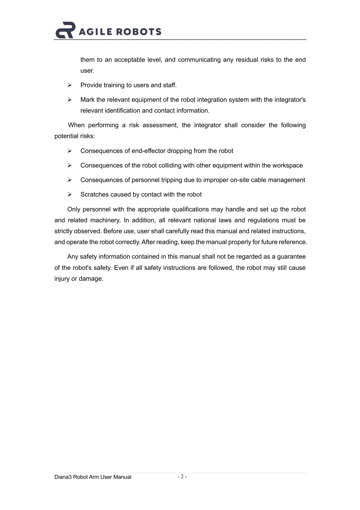



```
Diana3 Robot Arm User Manual  
 
- 2 - 
them to an acceptable level, and communicating any residual risks to the end 
user. 
Ø 
Provide training to users and staff. 
Ø 
Mark the relevant equipment of the robot integration system with the integrator's 
relevant identification and contact information. 
When performing a risk assessment, the integrator shall consider the following 
potential risks: 
Ø 
Consequences of end-effector dropping from the robot 
Ø 
Consequences of the robot colliding with other equipment within the workspace 
Ø 
Consequences of personnel tripping due to improper on-site cable management 
Ø 
Scratches caused by contact with the robot 
Only personnel with the appropriate qualifications may handle and set up the robot 
and related machinery. In addition, all relevant national laws and regulations must be 
strictly observed. Before use, user shall carefully read this manual and related instructions, 
and operate the robot correctly. After reading, keep the manual properly for future reference. 
Any safety information contained in this manual shall not be regarded as a guarantee 
of the robot's safety. Even if all safety instructions are followed, the robot may still cause 
injury or damage.
```



## PDF page 7

**Source:** Diana3 Robot Arm User Manual V1.1.0 EN.pdf, original pdf page 7. [Open the corresponding PDF reading-copy page](https://1292444914-files.gitbook.io/~/files/v0/b/gitbook-x-prod.appspot.com/o/spaces%2FtgOfPnscWebs1eh82EKq%2Fuploads%2Fghm4BYtmHi2gRdoJLa5C%2Fdiana3-robot-arm-user-manual-v1-1-0-en-pp-001-020.pdf?alt=media#page=7).



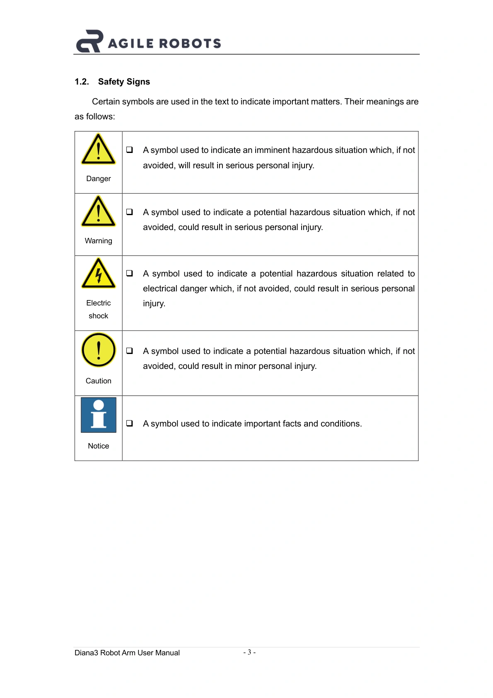



```
Diana3 Robot Arm User Manual  
 
- 3 - 
1.2. Safety Signs 
Certain symbols are used in the text to indicate important matters. Their meanings are 
as follows: 
 
Danger 
q 
A symbol used to indicate an imminent hazardous situation which, if not 
avoided, will result in serious personal injury. 
 
Warning 
q 
A symbol used to indicate a potential hazardous situation which, if not 
avoided, could result in serious personal injury. 
 
Electric 
shock 
q 
A symbol used to indicate a potential hazardous situation related to 
electrical danger which, if not avoided, could result in serious personal 
injury. 
 
Caution 
q 
A symbol used to indicate a potential hazardous situation which, if not 
avoided, could result in minor personal injury. 
 
Notice 
q 
A symbol used to indicate important facts and conditions.
```



## PDF page 8

**Source:** Diana3 Robot Arm User Manual V1.1.0 EN.pdf, original pdf page 8. [Open the corresponding PDF reading-copy page](https://1292444914-files.gitbook.io/~/files/v0/b/gitbook-x-prod.appspot.com/o/spaces%2FtgOfPnscWebs1eh82EKq%2Fuploads%2Fghm4BYtmHi2gRdoJLa5C%2Fdiana3-robot-arm-user-manual-v1-1-0-en-pp-001-020.pdf?alt=media#page=8).



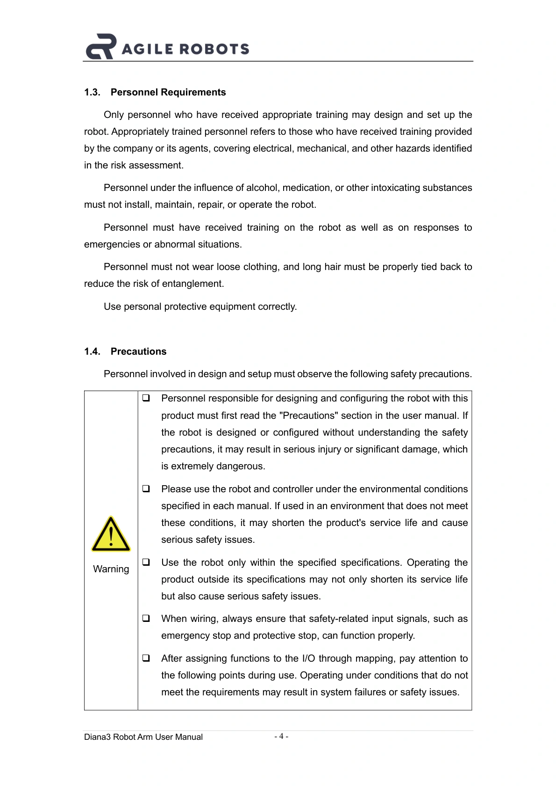



```
Diana3 Robot Arm User Manual  
 
- 4 - 
1.3. Personnel Requirements 
Only personnel who have received appropriate training may design and set up the 
robot. Appropriately trained personnel refers to those who have received training provided 
by the company or its agents, covering electrical, mechanical, and other hazards identified 
in the risk assessment. 
Personnel under the influence of alcohol, medication, or other intoxicating substances 
must not install, maintain, repair, or operate the robot. 
Personnel must have received training on the robot as well as on responses to 
emergencies or abnormal situations. 
Personnel must not wear loose clothing, and long hair must be properly tied back to 
reduce the risk of entanglement. 
Use personal protective equipment correctly. 
 
1.4. Precautions 
Personnel involved in design and setup must observe the following safety precautions. 
 
Warning 
q 
Personnel responsible for designing and configuring the robot with this 
product must first read the "Precautions" section in the user manual. If 
the robot is designed or configured without understanding the safety 
precautions, it may result in serious injury or significant damage, which 
is extremely dangerous. 
q 
Please use the robot and controller under the environmental conditions 
specified in each manual. If used in an environment that does not meet 
these conditions, it may shorten the product's service life and cause 
serious safety issues. 
q 
Use the robot only within the specified specifications. Operating the 
product outside its specifications may not only shorten its service life 
but also cause serious safety issues. 
q 
When wiring, always ensure that safety-related input signals, such as 
emergency stop and protective stop, can function properly. 
q 
After assigning functions to the I/O through mapping, pay attention to 
the following points during use. Operating under conditions that do not 
meet the requirements may result in system failures or safety issues.
```



## PDF page 9

**Source:** Diana3 Robot Arm User Manual V1.1.0 EN.pdf, original pdf page 9. [Open the corresponding PDF reading-copy page](https://1292444914-files.gitbook.io/~/files/v0/b/gitbook-x-prod.appspot.com/o/spaces%2FtgOfPnscWebs1eh82EKq%2Fuploads%2Fghm4BYtmHi2gRdoJLa5C%2Fdiana3-robot-arm-user-manual-v1-1-0-en-pp-001-020.pdf?alt=media#page=9).



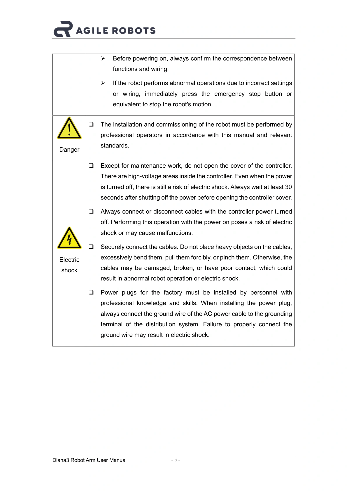



```
Diana3 Robot Arm User Manual  
 
- 5 - 
Ø 
Before powering on, always confirm the correspondence between 
functions and wiring. 
Ø 
If the robot performs abnormal operations due to incorrect settings 
or wiring, immediately press the emergency stop button or 
equivalent to stop the robot's motion. 
 
Danger 
q 
The installation and commissioning of the robot must be performed by 
professional operators in accordance with this manual and relevant 
standards. 
 
Electric 
shock 
q 
Except for maintenance work, do not open the cover of the controller. 
There are high-voltage areas inside the controller. Even when the power 
is turned off, there is still a risk of electric shock. Always wait at least 30 
seconds after shutting off the power before opening the controller cover. 
q 
Always connect or disconnect cables with the controller power turned 
off. Performing this operation with the power on poses a risk of electric 
shock or may cause malfunctions. 
q 
Securely connect the cables. Do not place heavy objects on the cables, 
excessively bend them, pull them forcibly, or pinch them. Otherwise, the 
cables may be damaged, broken, or have poor contact, which could 
result in abnormal robot operation or electric shock. 
q 
Power plugs for the factory must be installed by personnel with 
professional knowledge and skills. When installing the power plug, 
always connect the ground wire of the AC power cable to the grounding 
terminal of the distribution system. Failure to properly connect the 
ground wire may result in electric shock.
```



## PDF page 10

**Source:** Diana3 Robot Arm User Manual V1.1.0 EN.pdf, original pdf page 10. [Open the corresponding PDF reading-copy page](https://1292444914-files.gitbook.io/~/files/v0/b/gitbook-x-prod.appspot.com/o/spaces%2FtgOfPnscWebs1eh82EKq%2Fuploads%2Fghm4BYtmHi2gRdoJLa5C%2Fdiana3-robot-arm-user-manual-v1-1-0-en-pp-001-020.pdf?alt=media#page=10).



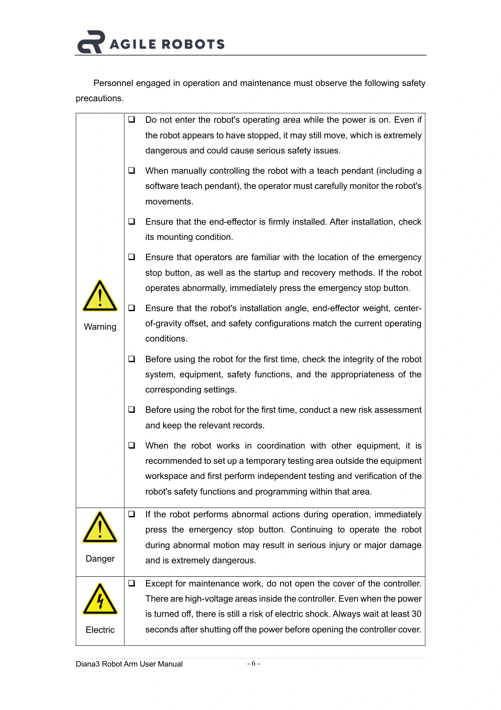



```
Diana3 Robot Arm User Manual  
 
- 6 - 
Personnel engaged in operation and maintenance must observe the following safety 
precautions. 
 
Warning 
q 
Do not enter the robot's operating area while the power is on. Even if 
the robot appears to have stopped, it may still move, which is extremely 
dangerous and could cause serious safety issues. 
q 
When manually controlling the robot with a teach pendant (including a 
software teach pendant), the operator must carefully monitor the robot's 
movements. 
q 
Ensure that the end-effector is firmly installed. After installation, check 
its mounting condition. 
q 
Ensure that operators are familiar with the location of the emergency 
stop button, as well as the startup and recovery methods. If the robot 
operates abnormally, immediately press the emergency stop button. 
q 
Ensure that the robot's installation angle, end-effector weight, center-
of-gravity offset, and safety configurations match the current operating 
conditions. 
q 
Before using the robot for the first time, check the integrity of the robot 
system, equipment, safety functions, and the appropriateness of the 
corresponding settings. 
q 
Before using the robot for the first time, conduct a new risk assessment 
and keep the relevant records. 
q 
When the robot works in coordination with other equipment, it is 
recommended to set up a temporary testing area outside the equipment 
workspace and first perform independent testing and verification of the 
robot's safety functions and programming within that area. 
 
Danger 
q 
If the robot performs abnormal actions during operation, immediately 
press the emergency stop button. Continuing to operate the robot 
during abnormal motion may result in serious injury or major damage 
and is extremely dangerous. 
 
Electric 
q 
Except for maintenance work, do not open the cover of the controller. 
There are high-voltage areas inside the controller. Even when the power 
is turned off, there is still a risk of electric shock. Always wait at least 30 
seconds after shutting off the power before opening the controller cover.
```



## PDF page 11

**Source:** Diana3 Robot Arm User Manual V1.1.0 EN.pdf, original pdf page 11. [Open the corresponding PDF reading-copy page](https://1292444914-files.gitbook.io/~/files/v0/b/gitbook-x-prod.appspot.com/o/spaces%2FtgOfPnscWebs1eh82EKq%2Fuploads%2Fghm4BYtmHi2gRdoJLa5C%2Fdiana3-robot-arm-user-manual-v1-1-0-en-pp-001-020.pdf?alt=media#page=11).



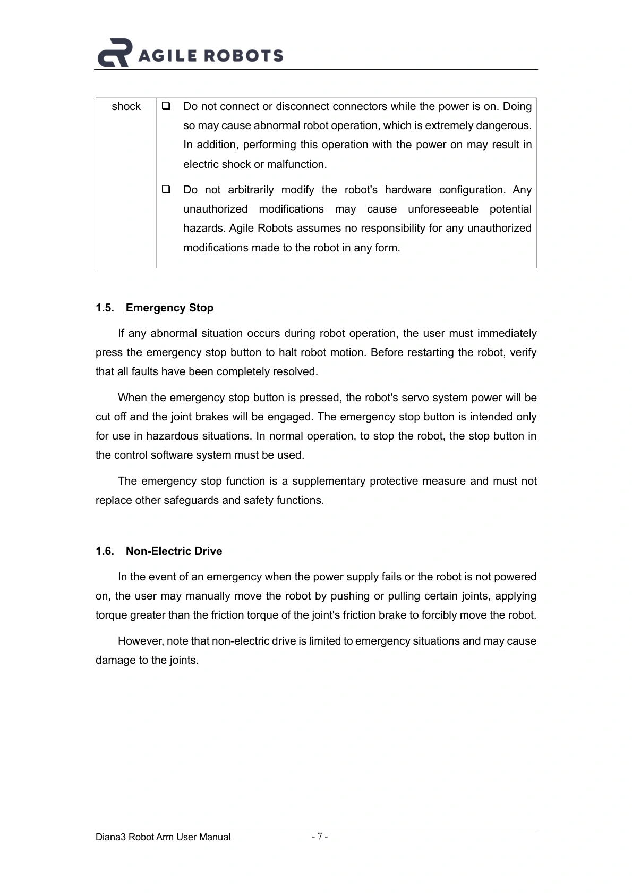



```
Diana3 Robot Arm User Manual  
 
- 7 - 
shock 
q 
Do not connect or disconnect connectors while the power is on. Doing 
so may cause abnormal robot operation, which is extremely dangerous. 
In addition, performing this operation with the power on may result in 
electric shock or malfunction. 
q 
Do not arbitrarily modify the robot's hardware configuration. Any 
unauthorized modifications may cause unforeseeable potential 
hazards. Agile Robots assumes no responsibility for any unauthorized 
modifications made to the robot in any form. 
 
1.5. Emergency Stop 
If any abnormal situation occurs during robot operation, the user must immediately 
press the emergency stop button to halt robot motion. Before restarting the robot, verify 
that all faults have been completely resolved. 
When the emergency stop button is pressed, the robot's servo system power will be 
cut off and the joint brakes will be engaged. The emergency stop button is intended only 
for use in hazardous situations. In normal operation, to stop the robot, the stop button in 
the control software system must be used. 
The emergency stop function is a supplementary protective measure and must not 
replace other safeguards and safety functions. 
 
1.6. Non-Electric Drive 
In the event of an emergency when the power supply fails or the robot is not powered 
on, the user may manually move the robot by pushing or pulling certain joints, applying 
torque greater than the friction torque of the joint's friction brake to forcibly move the robot. 
However, note that non-electric drive is limited to emergency situations and may cause 
damage to the joints.
```



## PDF page 12

**Source:** Diana3 Robot Arm User Manual V1.1.0 EN.pdf, original pdf page 12. [Open the corresponding PDF reading-copy page](https://1292444914-files.gitbook.io/~/files/v0/b/gitbook-x-prod.appspot.com/o/spaces%2FtgOfPnscWebs1eh82EKq%2Fuploads%2Fghm4BYtmHi2gRdoJLa5C%2Fdiana3-robot-arm-user-manual-v1-1-0-en-pp-001-020.pdf?alt=media#page=12).



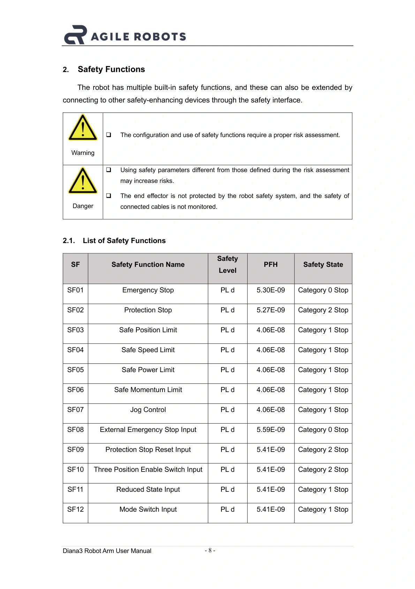



```
Diana3 Robot Arm User Manual  
 
- 8 - 
2. 
Safety Functions 
The robot has multiple built-in safety functions, and these can also be extended by 
connecting to other safety-enhancing devices through the safety interface. 
 
Warning 
q 
The configuration and use of safety functions require a proper risk assessment. 
 
Danger 
q 
Using safety parameters different from those defined during the risk assessment 
may increase risks. 
q 
The end effector is not protected by the robot safety system, and the safety of 
connected cables is not monitored. 
 
2.1. List of Safety Functions 
SF 
Safety Function Name 
Safety 
Level 
PFH 
Safety State 
SF01 
Emergency Stop 
PL d 
5.30E-09 
Category 0 Stop 
SF02 
Protection Stop 
PL d 
5.27E-09 
Category 2 Stop 
SF03 
Safe Position Limit 
PL d 
4.06E-08 
Category 1 Stop 
SF04 
Safe Speed Limit 
PL d 
4.06E-08 
Category 1 Stop 
SF05 
Safe Power Limit 
PL d 
4.06E-08 
Category 1 Stop 
SF06 
Safe Momentum Limit 
PL d 
4.06E-08 
Category 1 Stop 
SF07 
Jog Control 
PL d 
4.06E-08 
Category 1 Stop 
SF08 
External Emergency Stop Input 
PL d 
5.59E-09 
Category 0 Stop 
SF09 
Protection Stop Reset Input 
PL d 
5.41E-09 
Category 2 Stop 
SF10 
Three Position Enable Switch Input 
PL d 
5.41E-09 
Category 2 Stop 
SF11 
Reduced State Input 
PL d 
5.41E-09 
Category 1 Stop 
SF12 
Mode Switch Input 
PL d 
5.41E-09 
Category 1 Stop
```



## PDF page 13

**Source:** Diana3 Robot Arm User Manual V1.1.0 EN.pdf, original pdf page 13. [Open the corresponding PDF reading-copy page](https://1292444914-files.gitbook.io/~/files/v0/b/gitbook-x-prod.appspot.com/o/spaces%2FtgOfPnscWebs1eh82EKq%2Fuploads%2Fghm4BYtmHi2gRdoJLa5C%2Fdiana3-robot-arm-user-manual-v1-1-0-en-pp-001-020.pdf?alt=media#page=13).



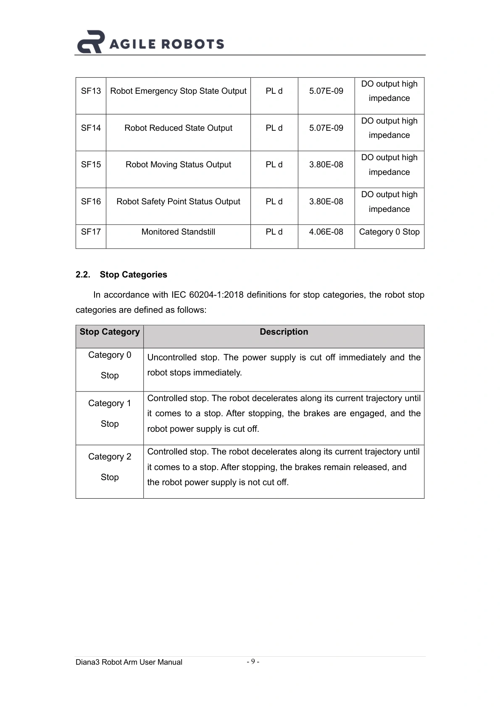



```
Diana3 Robot Arm User Manual  
 
- 9 - 
SF13 
Robot Emergency Stop State Output  
PL d 
5.07E-09 
DO output high 
impedance 
SF14 
Robot Reduced State Output 
PL d 
5.07E-09 
DO output high 
impedance 
SF15 
Robot Moving Status Output 
PL d 
3.80E-08 
DO output high 
impedance 
SF16 
Robot Safety Point Status Output 
PL d 
3.80E-08 
DO output high 
impedance 
SF17 
Monitored Standstill 
PL d 
4.06E-08 
Category 0 Stop 
 
2.2. Stop Categories 
In accordance with IEC 60204-1:2018 definitions for stop categories, the robot stop 
categories are defined as follows: 
Stop Category 
Description 
Category 0 
Stop 
Uncontrolled stop. The power supply is cut off immediately and the 
robot stops immediately. 
Category 1 
Stop 
Controlled stop. The robot decelerates along its current trajectory until 
it comes to a stop. After stopping, the brakes are engaged, and the 
robot power supply is cut off. 
Category 2 
Stop 
Controlled stop. The robot decelerates along its current trajectory until 
it comes to a stop. After stopping, the brakes remain released, and 
the robot power supply is not cut off.
```



## PDF page 14

**Source:** Diana3 Robot Arm User Manual V1.1.0 EN.pdf, original pdf page 14. [Open the corresponding PDF reading-copy page](https://1292444914-files.gitbook.io/~/files/v0/b/gitbook-x-prod.appspot.com/o/spaces%2FtgOfPnscWebs1eh82EKq%2Fuploads%2Fghm4BYtmHi2gRdoJLa5C%2Fdiana3-robot-arm-user-manual-v1-1-0-en-pp-001-020.pdf?alt=media#page=14).



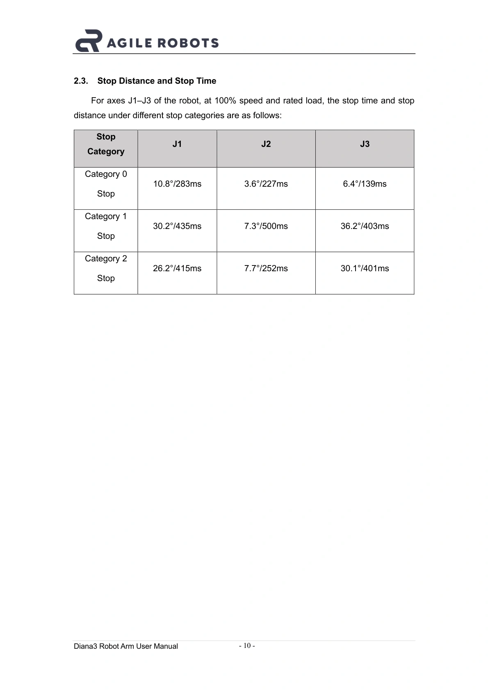



```
Diana3 Robot Arm User Manual  
 
- 10 - 
2.3. Stop Distance and Stop Time 
For axes J1–J3 of the robot, at 100% speed and rated load, the stop time and stop 
distance under different stop categories are as follows: 
Stop 
Category 
J1 
J2 
J3 
Category 0 
Stop 
10.8°/283ms 
3.6°/227ms 
6.4°/139ms 
Category 1 
Stop 
30.2°/435ms 
7.3°/500ms 
36.2°/403ms 
Category 2 
Stop 
26.2°/415ms 
7.7°/252ms 
30.1°/401ms
```



## PDF page 15

**Source:** Diana3 Robot Arm User Manual V1.1.0 EN.pdf, original pdf page 15. [Open the corresponding PDF reading-copy page](https://1292444914-files.gitbook.io/~/files/v0/b/gitbook-x-prod.appspot.com/o/spaces%2FtgOfPnscWebs1eh82EKq%2Fuploads%2Fghm4BYtmHi2gRdoJLa5C%2Fdiana3-robot-arm-user-manual-v1-1-0-en-pp-001-020.pdf?alt=media#page=15).



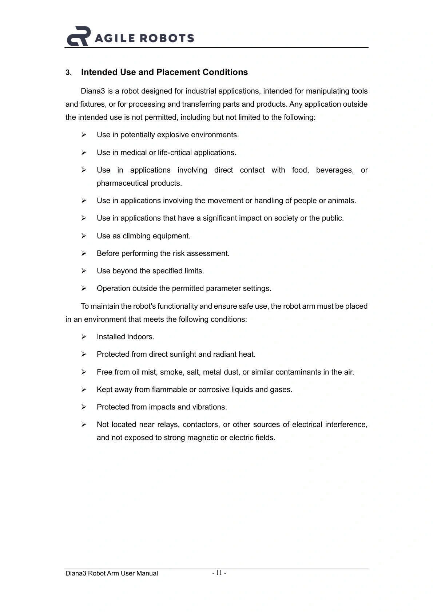



```
Diana3 Robot Arm User Manual  
 
- 11 - 
3. 
Intended Use and Placement Conditions 
Diana3 is a robot designed for industrial applications, intended for manipulating tools 
and fixtures, or for processing and transferring parts and products. Any application outside 
the intended use is not permitted, including but not limited to the following: 
Ø 
Use in potentially explosive environments. 
Ø 
Use in medical or life-critical applications. 
Ø 
Use in applications involving direct contact with food, beverages, or 
pharmaceutical products. 
Ø 
Use in applications involving the movement or handling of people or animals. 
Ø 
Use in applications that have a significant impact on society or the public. 
Ø 
Use as climbing equipment. 
Ø 
Before performing the risk assessment. 
Ø 
Use beyond the specified limits. 
Ø 
Operation outside the permitted parameter settings. 
To maintain the robot's functionality and ensure safe use, the robot arm must be placed 
in an environment that meets the following conditions: 
Ø 
Installed indoors. 
Ø 
Protected from direct sunlight and radiant heat. 
Ø 
Free from oil mist, smoke, salt, metal dust, or similar contaminants in the air. 
Ø 
Kept away from flammable or corrosive liquids and gases. 
Ø 
Protected from impacts and vibrations. 
Ø 
Not located near relays, contactors, or other sources of electrical interference, 
and not exposed to strong magnetic or electric fields.
```



## PDF page 16

**Source:** Diana3 Robot Arm User Manual V1.1.0 EN.pdf, original pdf page 16. [Open the corresponding PDF reading-copy page](https://1292444914-files.gitbook.io/~/files/v0/b/gitbook-x-prod.appspot.com/o/spaces%2FtgOfPnscWebs1eh82EKq%2Fuploads%2Fghm4BYtmHi2gRdoJLa5C%2Fdiana3-robot-arm-user-manual-v1-1-0-en-pp-001-020.pdf?alt=media#page=16).



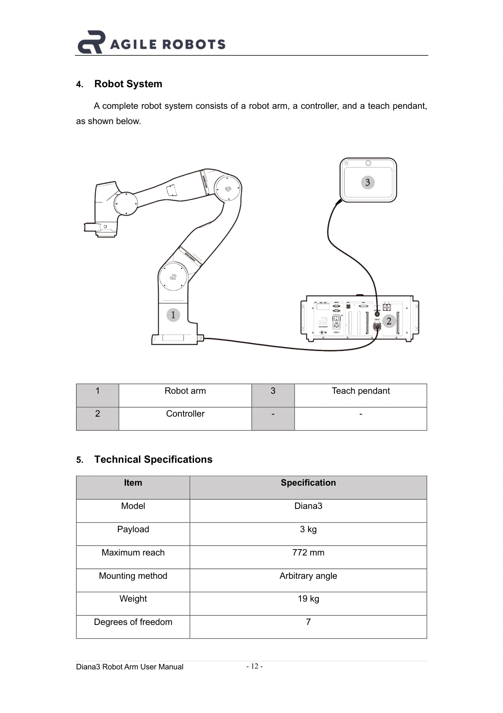



```
Diana3 Robot Arm User Manual  
 
- 12 - 
4. 
Robot System 
A complete robot system consists of a robot arm, a controller, and a teach pendant, 
as shown below. 
 
1 
Robot arm 
3 
Teach pendant 
2 
Controller 
- 
- 
 
5. 
Technical Specifications 
Item 
Specification 
Model 
Diana3 
Payload 
3 kg 
Maximum reach 
772 mm 
Mounting method 
Arbitrary angle 
Weight 
19 kg 
Degrees of freedom 
7
```



## PDF page 17

**Source:** Diana3 Robot Arm User Manual V1.1.0 EN.pdf, original pdf page 17. [Open the corresponding PDF reading-copy page](https://1292444914-files.gitbook.io/~/files/v0/b/gitbook-x-prod.appspot.com/o/spaces%2FtgOfPnscWebs1eh82EKq%2Fuploads%2Fghm4BYtmHi2gRdoJLa5C%2Fdiana3-robot-arm-user-manual-v1-1-0-en-pp-001-020.pdf?alt=media#page=17).



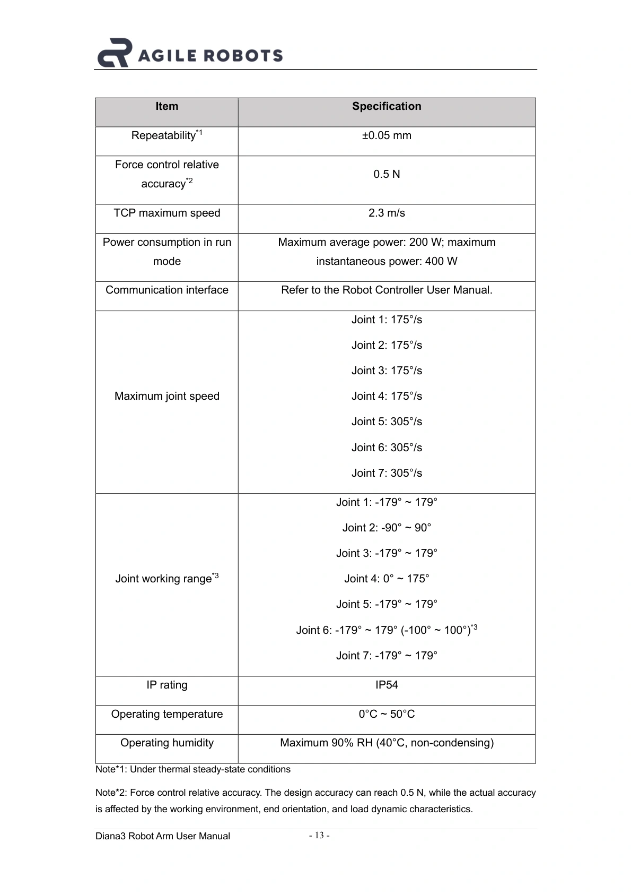



```
Diana3 Robot Arm User Manual  
 
- 13 - 
Item 
Specification 
Repeatability*1 
±0.05 mm 
Force control relative 
accuracy*2 
0.5 N 
TCP maximum speed 
2.3 m/s 
Power consumption in run 
mode 
Maximum average power: 200 W; maximum 
instantaneous power: 400 W 
Communication interface 
Refer to the Robot Controller User Manual. 
Maximum joint speed 
Joint 1: 175°/s 
Joint 2: 175°/s 
Joint 3: 175°/s 
Joint 4: 175°/s 
Joint 5: 305°/s 
Joint 6: 305°/s 
Joint 7: 305°/s 
Joint working range*3 
Joint 1: -179° ~ 179° 
Joint 2: -90° ~ 90° 
Joint 3: -179° ~ 179° 
Joint 4: 0° ~ 175° 
Joint 5: -179° ~ 179° 
Joint 6: -179° ~ 179° (-100° ~ 100°)*3  
Joint 7: -179° ~ 179° 
IP rating 
IP54 
Operating temperature 
0°C ~ 50°C 
Operating humidity 
Maximum 90% RH (40°C, non-condensing) 
Note*1: Under thermal steady-state conditions 
Note*2: Force control relative accuracy. The design accuracy can reach 0.5 N, while the actual accuracy 
is affected by the working environment, end orientation, and load dynamic characteristics.
```



## PDF page 18

**Source:** Diana3 Robot Arm User Manual V1.1.0 EN.pdf, original pdf page 18. [Open the corresponding PDF reading-copy page](https://1292444914-files.gitbook.io/~/files/v0/b/gitbook-x-prod.appspot.com/o/spaces%2FtgOfPnscWebs1eh82EKq%2Fuploads%2Fghm4BYtmHi2gRdoJLa5C%2Fdiana3-robot-arm-user-manual-v1-1-0-en-pp-001-020.pdf?alt=media#page=18).



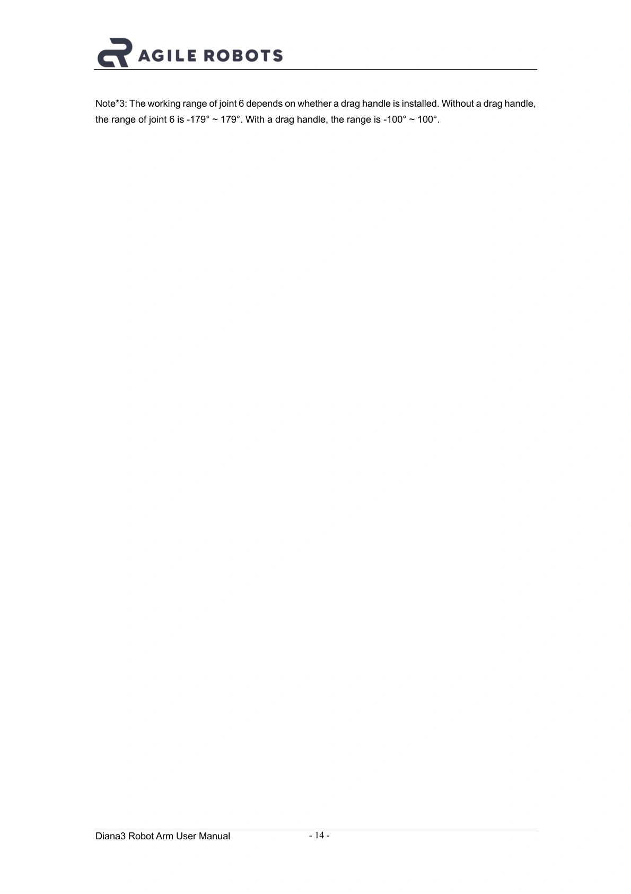



```
Diana3 Robot Arm User Manual  
 
- 14 - 
Note*3: The working range of joint 6 depends on whether a drag handle is installed. Without a drag handle, 
the range of joint 6 is -179° ~ 179°. With a drag handle, the range is -100° ~ 100°.
```



## PDF page 19

**Source:** Diana3 Robot Arm User Manual V1.1.0 EN.pdf, original pdf page 19. [Open the corresponding PDF reading-copy page](https://1292444914-files.gitbook.io/~/files/v0/b/gitbook-x-prod.appspot.com/o/spaces%2FtgOfPnscWebs1eh82EKq%2Fuploads%2Fghm4BYtmHi2gRdoJLa5C%2Fdiana3-robot-arm-user-manual-v1-1-0-en-pp-001-020.pdf?alt=media#page=19).



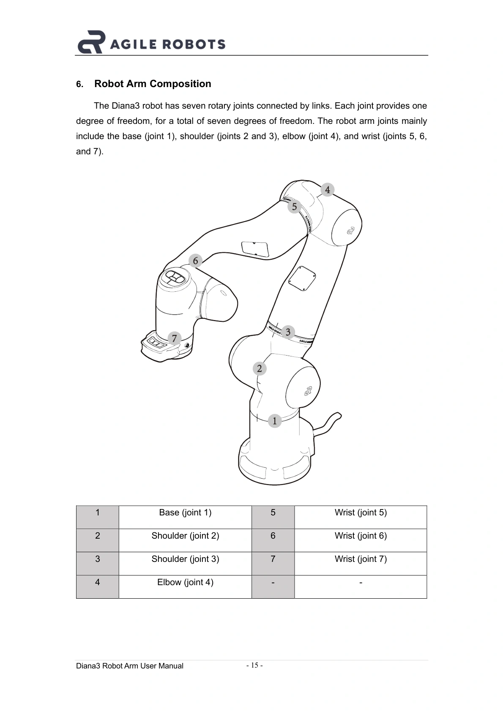



```
Diana3 Robot Arm User Manual  
 
- 15 - 
6. 
Robot Arm Composition 
The Diana3 robot has seven rotary joints connected by links. Each joint provides one 
degree of freedom, for a total of seven degrees of freedom. The robot arm joints mainly 
include the base (joint 1), shoulder (joints 2 and 3), elbow (joint 4), and wrist (joints 5, 6, 
and 7). 
 
1 
Base (joint 1) 
5 
Wrist (joint 5) 
2 
Shoulder (joint 2) 
6 
Wrist (joint 6) 
3 
Shoulder (joint 3) 
7 
Wrist (joint 7) 
4 
Elbow (joint 4) 
- 
-
```



## PDF page 20

**Source:** Diana3 Robot Arm User Manual V1.1.0 EN.pdf, original pdf page 20. [Open the corresponding PDF reading-copy page](https://1292444914-files.gitbook.io/~/files/v0/b/gitbook-x-prod.appspot.com/o/spaces%2FtgOfPnscWebs1eh82EKq%2Fuploads%2Fghm4BYtmHi2gRdoJLa5C%2Fdiana3-robot-arm-user-manual-v1-1-0-en-pp-001-020.pdf?alt=media#page=20).



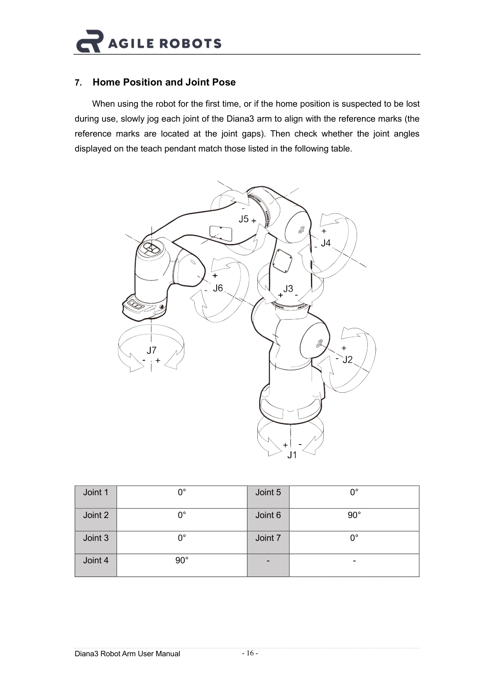



```
Diana3 Robot Arm User Manual  
 
- 16 - 
7. 
Home Position and Joint Pose 
When using the robot for the first time, or if the home position is suspected to be lost 
during use, slowly jog each joint of the Diana3 arm to align with the reference marks (the 
reference marks are located at the joint gaps). Then check whether the joint angles 
displayed on the teach pendant match those listed in the following table. 
 
Joint 1 
0° 
Joint 5 
0° 
Joint 2 
0° 
Joint 6 
90° 
Joint 3 
0° 
Joint 7 
0° 
Joint 4 
90° 
- 
-
```



## PDF page 21

**Source:** Diana3 Robot Arm User Manual V1.1.0 EN.pdf, original pdf page 21. [Open the corresponding PDF reading-copy page](https://1292444914-files.gitbook.io/~/files/v0/b/gitbook-x-prod.appspot.com/o/spaces%2FtgOfPnscWebs1eh82EKq%2Fuploads%2FlqwYgFi48wq05rDWiRSo%2Fdiana3-robot-arm-user-manual-v1-1-0-en-pp-021-025.pdf?alt=media#page=1).



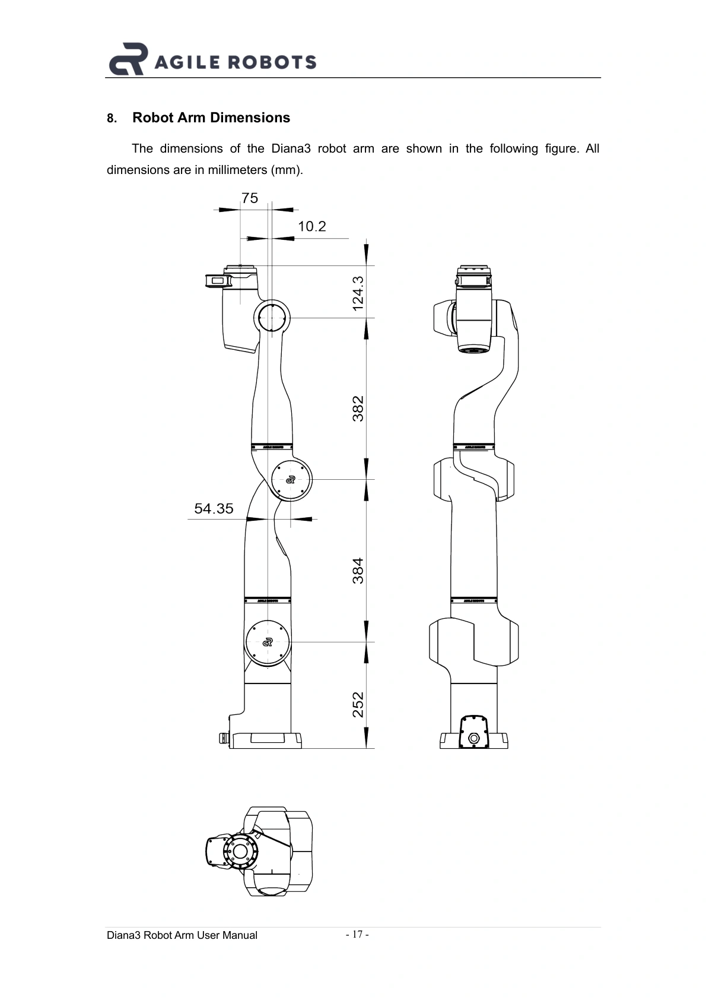



```
Diana3 Robot Arm User Manual  
 
- 17 - 
8. 
Robot Arm Dimensions 
The dimensions of the Diana3 robot arm are shown in the following figure. All 
dimensions are in millimeters (mm).
```



## PDF page 22

**Source:** Diana3 Robot Arm User Manual V1.1.0 EN.pdf, original pdf page 22. [Open the corresponding PDF reading-copy page](https://1292444914-files.gitbook.io/~/files/v0/b/gitbook-x-prod.appspot.com/o/spaces%2FtgOfPnscWebs1eh82EKq%2Fuploads%2FlqwYgFi48wq05rDWiRSo%2Fdiana3-robot-arm-user-manual-v1-1-0-en-pp-021-025.pdf?alt=media#page=2).



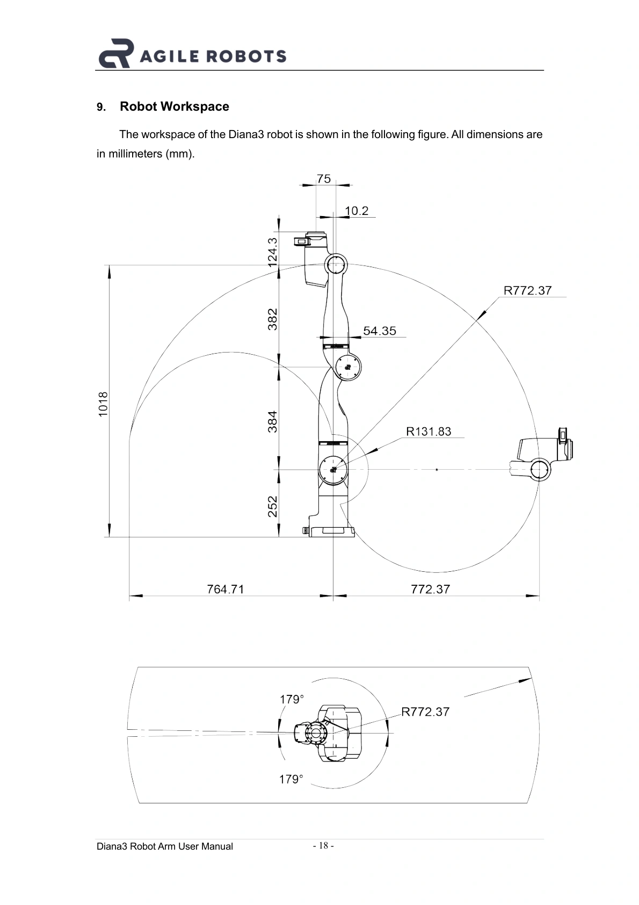



```
Diana3 Robot Arm User Manual  
 
- 18 - 
9. 
Robot Workspace 
The workspace of the Diana3 robot is shown in the following figure. All dimensions are 
in millimeters (mm).
```



## PDF page 23

**Source:** Diana3 Robot Arm User Manual V1.1.0 EN.pdf, original pdf page 23. [Open the corresponding PDF reading-copy page](https://1292444914-files.gitbook.io/~/files/v0/b/gitbook-x-prod.appspot.com/o/spaces%2FtgOfPnscWebs1eh82EKq%2Fuploads%2FlqwYgFi48wq05rDWiRSo%2Fdiana3-robot-arm-user-manual-v1-1-0-en-pp-021-025.pdf?alt=media#page=3).



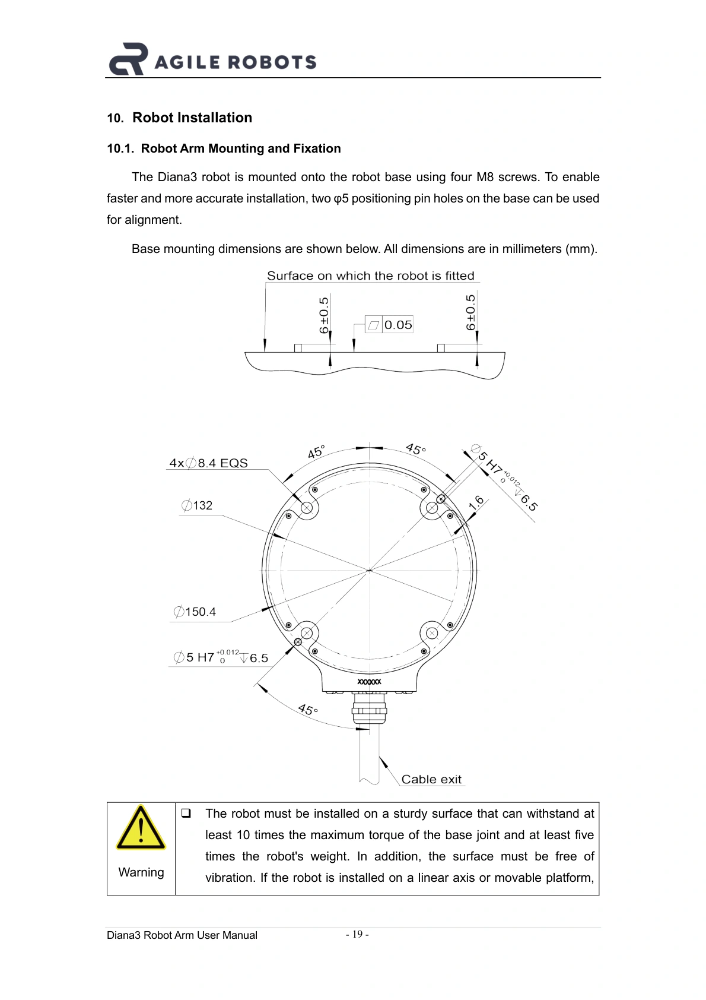



```
Diana3 Robot Arm User Manual  
 
- 19 - 
10. Robot Installation 
10.1. Robot Arm Mounting and Fixation 
The Diana3 robot is mounted onto the robot base using four M8 screws. To enable 
faster and more accurate installation, two φ5 positioning pin holes on the base can be used 
for alignment. 
Base mounting dimensions are shown below. All dimensions are in millimeters (mm). 
 
 
Warning 
q 
The robot must be installed on a sturdy surface that can withstand at 
least 10 times the maximum torque of the base joint and at least five 
times the robot's weight. In addition, the surface must be free of 
vibration. If the robot is installed on a linear axis or movable platform,
```



## PDF page 24

**Source:** Diana3 Robot Arm User Manual V1.1.0 EN.pdf, original pdf page 24. [Open the corresponding PDF reading-copy page](https://1292444914-files.gitbook.io/~/files/v0/b/gitbook-x-prod.appspot.com/o/spaces%2FtgOfPnscWebs1eh82EKq%2Fuploads%2FlqwYgFi48wq05rDWiRSo%2Fdiana3-robot-arm-user-manual-v1-1-0-en-pp-021-025.pdf?alt=media#page=4).



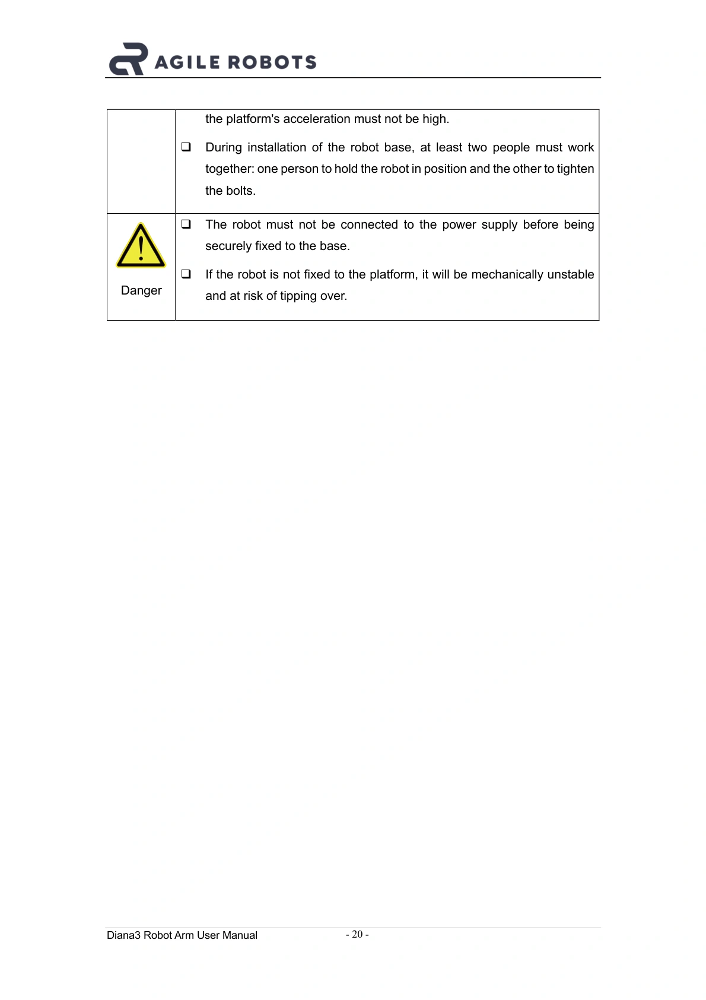



```
Diana3 Robot Arm User Manual  
 
- 20 - 
the platform's acceleration must not be high. 
q 
During installation of the robot base, at least two people must work 
together: one person to hold the robot in position and the other to tighten 
the bolts. 
 
Danger 
q 
The robot must not be connected to the power supply before being 
securely fixed to the base. 
q 
If the robot is not fixed to the platform, it will be mechanically unstable 
and at risk of tipping over.
```



## PDF page 25

**Source:** Diana3 Robot Arm User Manual V1.1.0 EN.pdf, original pdf page 25. [Open the corresponding PDF reading-copy page](https://1292444914-files.gitbook.io/~/files/v0/b/gitbook-x-prod.appspot.com/o/spaces%2FtgOfPnscWebs1eh82EKq%2Fuploads%2FlqwYgFi48wq05rDWiRSo%2Fdiana3-robot-arm-user-manual-v1-1-0-en-pp-021-025.pdf?alt=media#page=5).



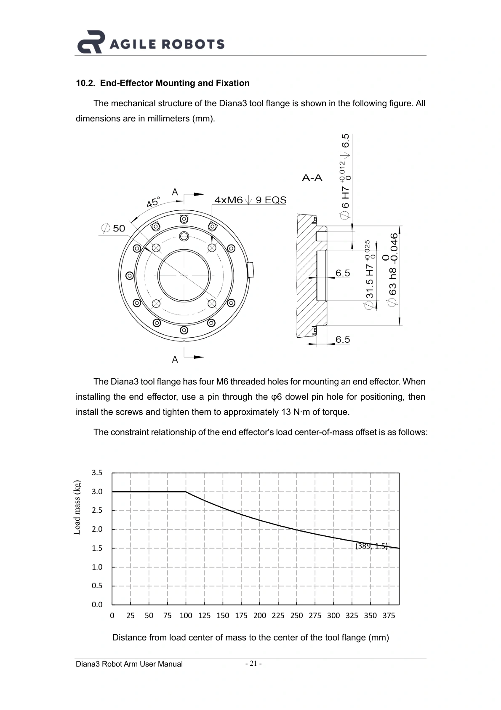



```
Diana3 Robot Arm User Manual  
 
- 21 - 
10.2. End-Effector Mounting and Fixation 
The mechanical structure of the Diana3 tool flange is shown in the following figure. All 
dimensions are in millimeters (mm). 
 
The Diana3 tool flange has four M6 threaded holes for mounting an end effector. When 
installing the end effector, use a pin through the φ6 dowel pin hole for positioning, then 
install the screws and tighten them to approximately 13 N·m of torque. 
The constraint relationship of the end effector's load center-of-mass offset is as follows: 
 
 
Distance from load center of mass to the center of the tool flange (mm) 
0.0
0.5
1.0
1.5
2.0
2.5
3.0
3.5
0
25
50
75
100 125 150 175 200 225 250 275 300 325 350 375
(389, 1.5)
Load mass (kg)
```



## PDF page 26

**Source:** Diana3 Robot Arm User Manual V1.1.0 EN.pdf, original pdf page 26. [Open the corresponding PDF reading-copy page](https://1292444914-files.gitbook.io/~/files/v0/b/gitbook-x-prod.appspot.com/o/spaces%2FtgOfPnscWebs1eh82EKq%2Fuploads%2FfELoSTcp5bZC8Xn5qFUE%2Fdiana3-robot-arm-user-manual-v1-1-0-en-pp-026-040.pdf?alt=media#page=1).



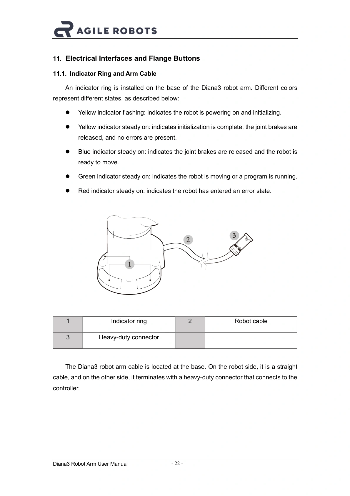



```
Diana3 Robot Arm User Manual  
 
- 22 - 
11. Electrical Interfaces and Flange Buttons 
11.1. Indicator Ring and Arm Cable 
An indicator ring is installed on the base of the Diana3 robot arm. Different colors 
represent different states, as described below: 
l 
Yellow indicator flashing: indicates the robot is powering on and initializing. 
l 
Yellow indicator steady on: indicates initialization is complete, the joint brakes are 
released, and no errors are present. 
l 
Blue indicator steady on: indicates the joint brakes are released and the robot is 
ready to move. 
l 
Green indicator steady on: indicates the robot is moving or a program is running. 
l 
Red indicator steady on: indicates the robot has entered an error state. 
 
 
 
1 
Indicator ring 
2 
Robot cable 
3 
Heavy-duty connector 
 
 
 
The Diana3 robot arm cable is located at the base. On the robot side, it is a straight 
cable, and on the other side, it terminates with a heavy-duty connector that connects to the 
controller.
```



## PDF page 27

**Source:** Diana3 Robot Arm User Manual V1.1.0 EN.pdf, original pdf page 27. [Open the corresponding PDF reading-copy page](https://1292444914-files.gitbook.io/~/files/v0/b/gitbook-x-prod.appspot.com/o/spaces%2FtgOfPnscWebs1eh82EKq%2Fuploads%2FfELoSTcp5bZC8Xn5qFUE%2Fdiana3-robot-arm-user-manual-v1-1-0-en-pp-026-040.pdf?alt=media#page=2).



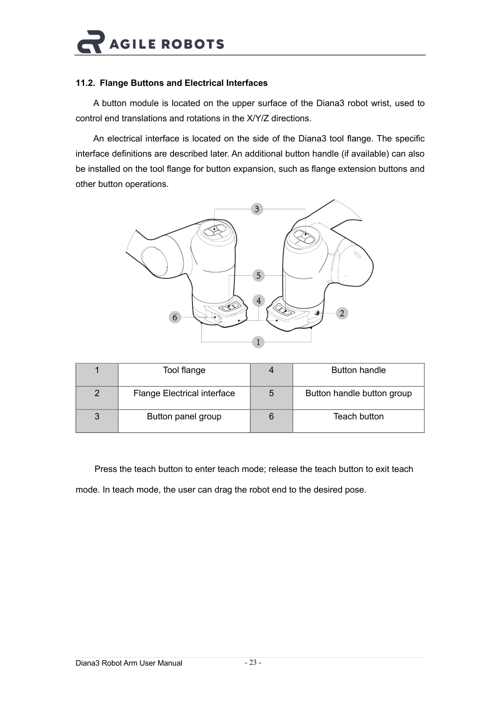



```
Diana3 Robot Arm User Manual  
 
- 23 - 
11.2. Flange Buttons and Electrical Interfaces 
A button module is located on the upper surface of the Diana3 robot wrist, used to 
control end translations and rotations in the X/Y/Z directions. 
An electrical interface is located on the side of the Diana3 tool flange. The specific 
interface definitions are described later. An additional button handle (if available) can also 
be installed on the tool flange for button expansion, such as flange extension buttons and 
other button operations. 
 
1 
Tool flange 
4 
Button handle 
2 
Flange Electrical interface 
5 
Button handle button group 
3 
Button panel group 
6 
Teach button 
 
Press the teach button to enter teach mode; release the teach button to exit teach 
mode. In teach mode, the user can drag the robot end to the desired pose.
```



## PDF page 28

**Source:** Diana3 Robot Arm User Manual V1.1.0 EN.pdf, original pdf page 28. [Open the corresponding PDF reading-copy page](https://1292444914-files.gitbook.io/~/files/v0/b/gitbook-x-prod.appspot.com/o/spaces%2FtgOfPnscWebs1eh82EKq%2Fuploads%2FfELoSTcp5bZC8Xn5qFUE%2Fdiana3-robot-arm-user-manual-v1-1-0-en-pp-026-040.pdf?alt=media#page=3).



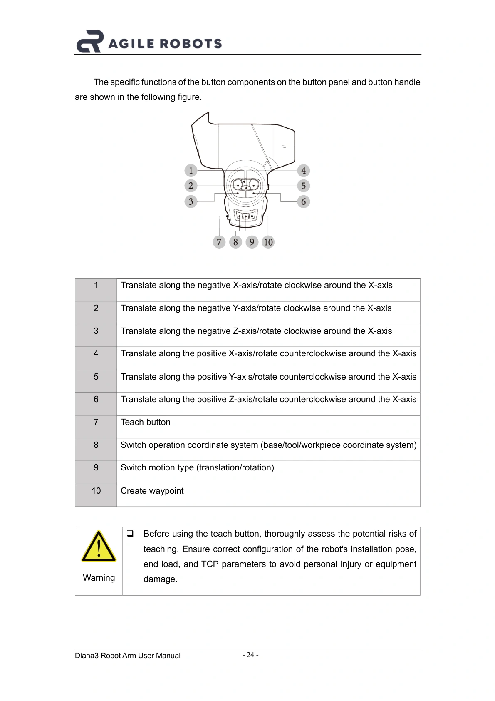



```
Diana3 Robot Arm User Manual  
 
- 24 - 
The specific functions of the button components on the button panel and button handle 
are shown in the following figure. 
 
 
1 
Translate along the negative X-axis/rotate clockwise around the X-axis 
2 
Translate along the negative Y-axis/rotate clockwise around the X-axis 
3 
Translate along the negative Z-axis/rotate clockwise around the X-axis 
4 
Translate along the positive X-axis/rotate counterclockwise around the X-axis 
5 
Translate along the positive Y-axis/rotate counterclockwise around the X-axis 
6 
Translate along the positive Z-axis/rotate counterclockwise around the X-axis 
7 
Teach button 
8 
Switch operation coordinate system (base/tool/workpiece coordinate system) 
9 
Switch motion type (translation/rotation) 
10 
Create waypoint 
 
 
Warning 
q 
Before using the teach button, thoroughly assess the potential risks of 
teaching. Ensure correct configuration of the robot's installation pose, 
end load, and TCP parameters to avoid personal injury or equipment 
damage.
```



## PDF page 29

**Source:** Diana3 Robot Arm User Manual V1.1.0 EN.pdf, original pdf page 29. [Open the corresponding PDF reading-copy page](https://1292444914-files.gitbook.io/~/files/v0/b/gitbook-x-prod.appspot.com/o/spaces%2FtgOfPnscWebs1eh82EKq%2Fuploads%2FfELoSTcp5bZC8Xn5qFUE%2Fdiana3-robot-arm-user-manual-v1-1-0-en-pp-026-040.pdf?alt=media#page=4).



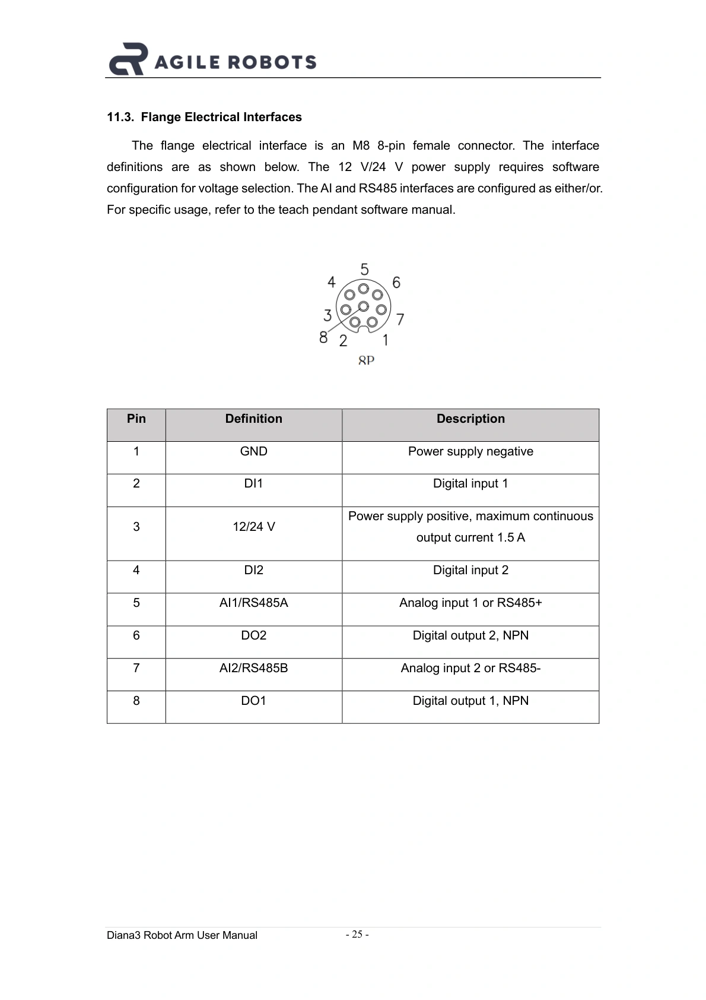



```
Diana3 Robot Arm User Manual  
 
- 25 - 
11.3. Flange Electrical Interfaces 
The flange electrical interface is an M8 8-pin female connector. The interface 
definitions are as shown below. The 12 V/24 V power supply requires software 
configuration for voltage selection. The AI and RS485 interfaces are configured as either/or. 
For specific usage, refer to the teach pendant software manual. 
 
 
  
 
Pin 
Definition 
Description 
1 
GND 
Power supply negative 
2 
DI1 
Digital input 1 
3 
12/24 V 
Power supply positive, maximum continuous 
output current 1.5 A 
4 
DI2 
Digital input 2 
5 
AI1/RS485A 
Analog input 1 or RS485+ 
6 
DO2 
Digital output 2, NPN 
7 
AI2/RS485B 
Analog input 2 or RS485- 
8 
DO1 
Digital output 1, NPN
```



## PDF page 30

**Source:** Diana3 Robot Arm User Manual V1.1.0 EN.pdf, original pdf page 30. [Open the corresponding PDF reading-copy page](https://1292444914-files.gitbook.io/~/files/v0/b/gitbook-x-prod.appspot.com/o/spaces%2FtgOfPnscWebs1eh82EKq%2Fuploads%2FfELoSTcp5bZC8Xn5qFUE%2Fdiana3-robot-arm-user-manual-v1-1-0-en-pp-026-040.pdf?alt=media#page=5).



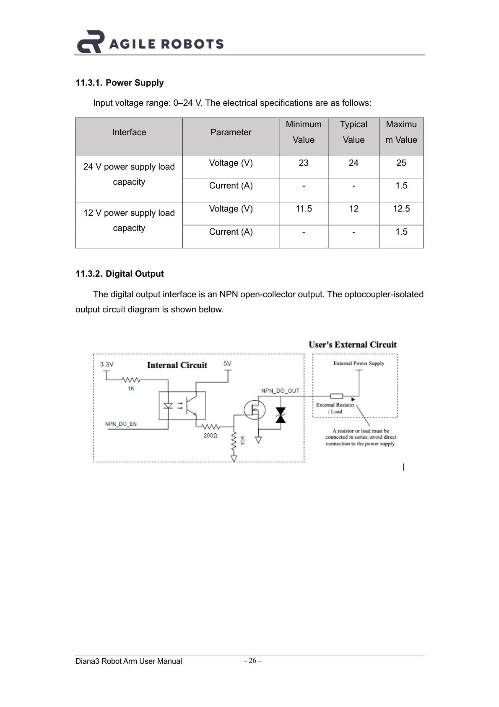



```
Diana3 Robot Arm User Manual  
 
- 26 - 
11.3.1. Power Supply 
Input voltage range: 0–24 V. The electrical specifications are as follows: 
Interface 
Parameter 
Minimum 
Value 
Typical 
Value 
Maximu
m Value 
24 V power supply load 
capacity 
Voltage (V) 
23 
24 
25 
Current (A) 
- 
- 
1.5 
12 V power supply load 
capacity 
Voltage (V) 
11.5 
12 
12.5 
Current (A) 
- 
- 
1.5 
 
11.3.2. Digital Output 
The digital output interface is an NPN open-collector output. The optocoupler-isolated 
output circuit diagram is shown below.
```



## PDF page 31

**Source:** Diana3 Robot Arm User Manual V1.1.0 EN.pdf, original pdf page 31. [Open the corresponding PDF reading-copy page](https://1292444914-files.gitbook.io/~/files/v0/b/gitbook-x-prod.appspot.com/o/spaces%2FtgOfPnscWebs1eh82EKq%2Fuploads%2FfELoSTcp5bZC8Xn5qFUE%2Fdiana3-robot-arm-user-manual-v1-1-0-en-pp-026-040.pdf?alt=media#page=6).



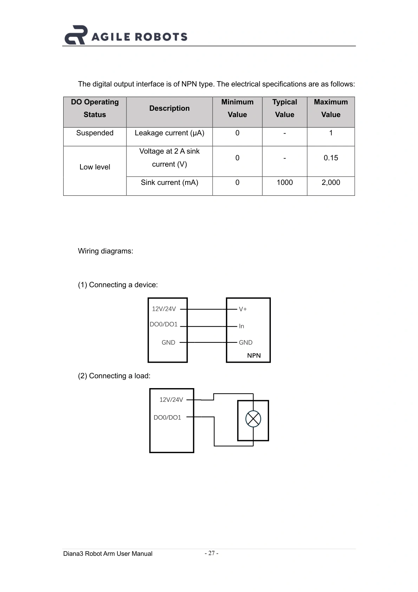



```
Diana3 Robot Arm User Manual  
 
- 27 - 
 
The digital output interface is of NPN type. The electrical specifications are as follows: 
DO Operating 
Status 
Description 
Minimum 
Value 
Typical 
Value 
Maximum 
Value 
Suspended 
Leakage current (μA) 
0 
- 
1 
Low level 
Voltage at 2 A sink 
current (V) 
0 
- 
0.15 
Sink current (mA) 
0 
1000 
2,000 
 
 
 
Wiring diagrams: 
 
(1) Connecting a device: 
 
(2) Connecting a load:
```



## PDF page 32

**Source:** Diana3 Robot Arm User Manual V1.1.0 EN.pdf, original pdf page 32. [Open the corresponding PDF reading-copy page](https://1292444914-files.gitbook.io/~/files/v0/b/gitbook-x-prod.appspot.com/o/spaces%2FtgOfPnscWebs1eh82EKq%2Fuploads%2FfELoSTcp5bZC8Xn5qFUE%2Fdiana3-robot-arm-user-manual-v1-1-0-en-pp-026-040.pdf?alt=media#page=7).



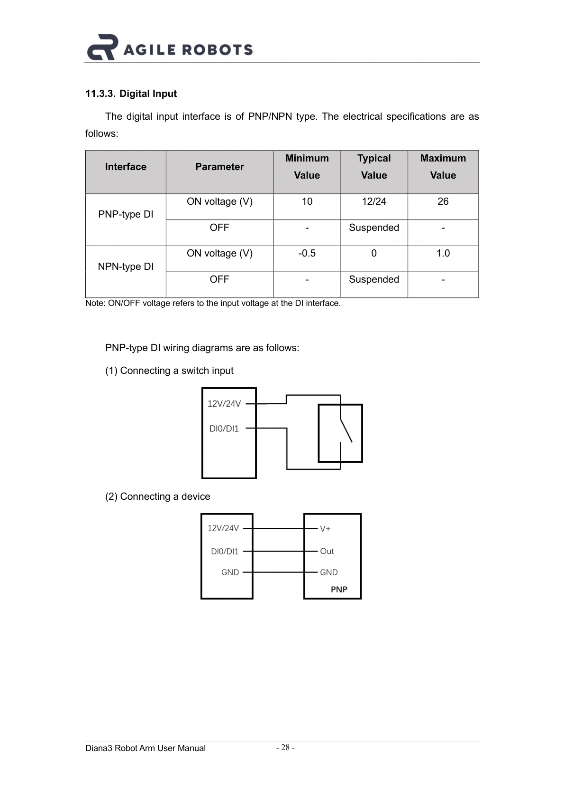



```
Diana3 Robot Arm User Manual  
 
- 28 - 
11.3.3. Digital Input 
The digital input interface is of PNP/NPN type. The electrical specifications are as 
follows: 
Interface 
Parameter 
Minimum 
Value 
Typical 
Value 
Maximum 
Value 
PNP-type DI 
ON voltage (V) 
10 
12/24 
26 
OFF 
- 
Suspended 
- 
NPN-type DI 
ON voltage (V) 
-0.5 
0 
1.0 
OFF 
- 
Suspended 
- 
Note: ON/OFF voltage refers to the input voltage at the DI interface. 
 
PNP-type DI wiring diagrams are as follows: 
(1) Connecting a switch input 
 
(2) Connecting a device
```



## PDF page 33

**Source:** Diana3 Robot Arm User Manual V1.1.0 EN.pdf, original pdf page 33. [Open the corresponding PDF reading-copy page](https://1292444914-files.gitbook.io/~/files/v0/b/gitbook-x-prod.appspot.com/o/spaces%2FtgOfPnscWebs1eh82EKq%2Fuploads%2FfELoSTcp5bZC8Xn5qFUE%2Fdiana3-robot-arm-user-manual-v1-1-0-en-pp-026-040.pdf?alt=media#page=8).



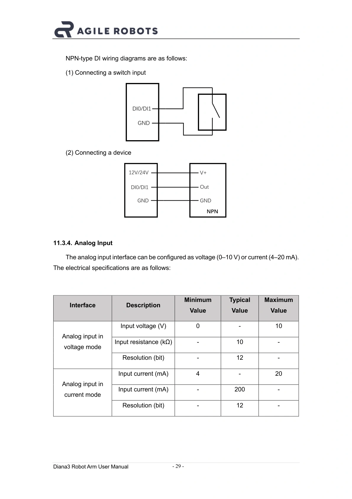



```
Diana3 Robot Arm User Manual  
 
- 29 - 
NPN-type DI wiring diagrams are as follows: 
(1) Connecting a switch input 
 
(2) Connecting a device 
 
 
11.3.4. Analog Input 
The analog input interface can be configured as voltage (0–10 V) or current (4–20 mA). 
The electrical specifications are as follows: 
  
 
Interface 
Description 
Minimum 
Value 
Typical 
Value 
Maximum 
Value 
Analog input in 
voltage mode 
Input voltage (V) 
0 
- 
10 
Input resistance (kΩ) 
- 
10 
- 
Resolution (bit) 
- 
12 
- 
Analog input in 
current mode 
Input current (mA) 
4 
- 
20 
Input current (mA) 
- 
200 
- 
Resolution (bit) 
- 
12 
-
```



## PDF page 34

**Source:** Diana3 Robot Arm User Manual V1.1.0 EN.pdf, original pdf page 34. [Open the corresponding PDF reading-copy page](https://1292444914-files.gitbook.io/~/files/v0/b/gitbook-x-prod.appspot.com/o/spaces%2FtgOfPnscWebs1eh82EKq%2Fuploads%2FfELoSTcp5bZC8Xn5qFUE%2Fdiana3-robot-arm-user-manual-v1-1-0-en-pp-026-040.pdf?alt=media#page=9).



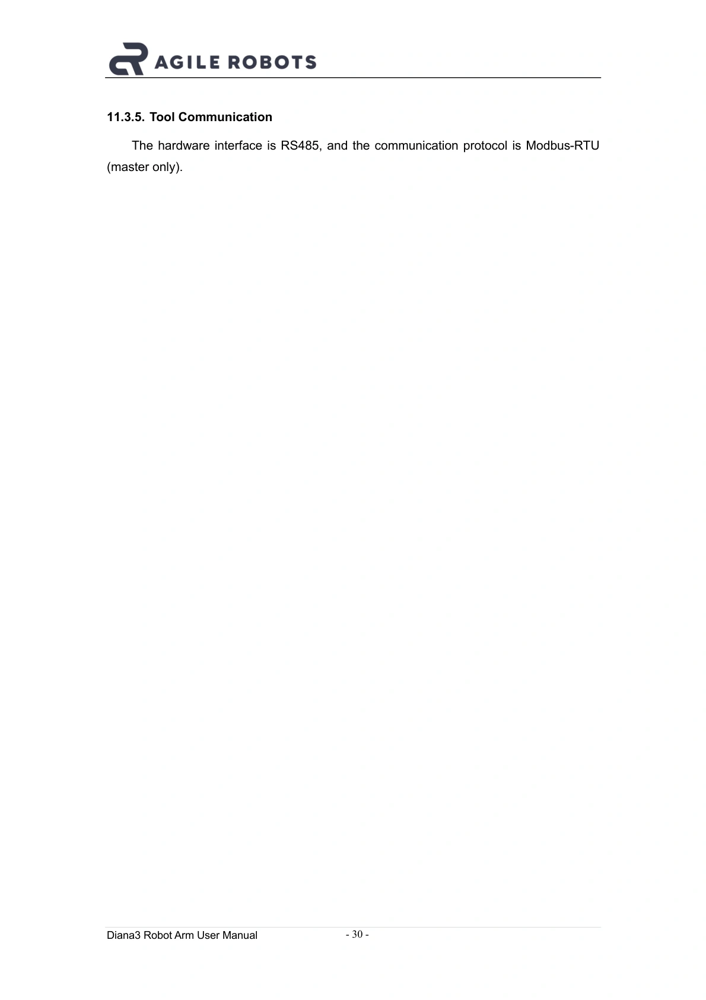



```
Diana3 Robot Arm User Manual  
 
- 30 - 
11.3.5. Tool Communication 
The hardware interface is RS485, and the communication protocol is Modbus-RTU 
(master only).
```



## PDF page 35

**Source:** Diana3 Robot Arm User Manual V1.1.0 EN.pdf, original pdf page 35. [Open the corresponding PDF reading-copy page](https://1292444914-files.gitbook.io/~/files/v0/b/gitbook-x-prod.appspot.com/o/spaces%2FtgOfPnscWebs1eh82EKq%2Fuploads%2FfELoSTcp5bZC8Xn5qFUE%2Fdiana3-robot-arm-user-manual-v1-1-0-en-pp-026-040.pdf?alt=media#page=10).



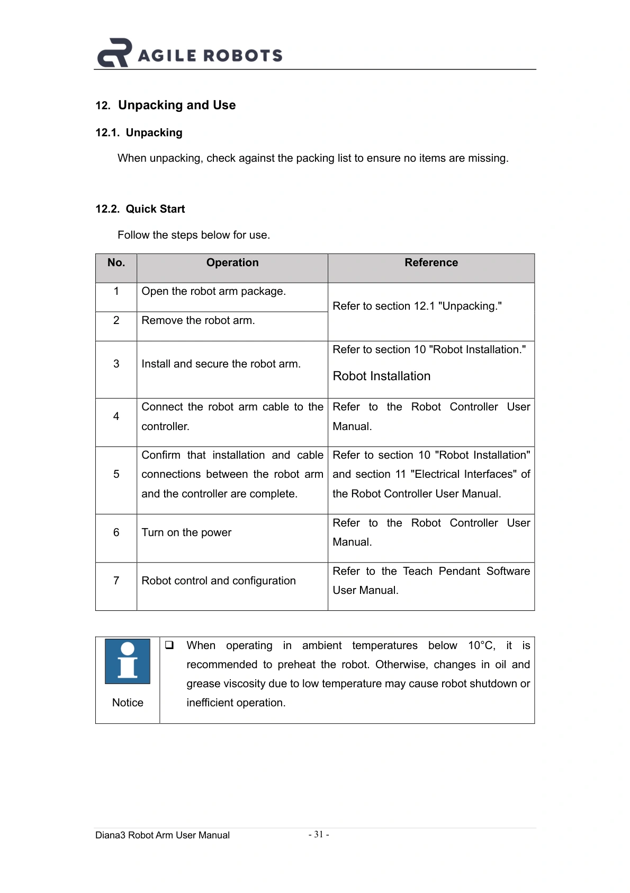



```
Diana3 Robot Arm User Manual  
 
- 31 - 
12. Unpacking and Use 
12.1. Unpacking 
When unpacking, check against the packing list to ensure no items are missing. 
 
12.2. Quick Start 
Follow the steps below for use. 
No. 
Operation 
Reference 
1 
Open the robot arm package. 
Refer to section 12.1 "Unpacking." 
2 
Remove the robot arm. 
3 
Install and secure the robot arm. 
Refer to section 10 "Robot Installation." 
Robot Installation 
4 
Connect the robot arm cable to the 
controller. 
Refer to the Robot Controller User 
Manual. 
5 
Confirm that installation and cable 
connections between the robot arm 
and the controller are complete. 
Refer to section 10 "Robot Installation" 
and section 11 "Electrical Interfaces" of 
the Robot Controller User Manual. 
6 
Turn on the power 
Refer to the Robot Controller User 
Manual. 
7 
Robot control and configuration 
Refer to the Teach Pendant Software 
User Manual. 
 
 
Notice 
q 
When operating in ambient temperatures below 10°C, it is 
recommended to preheat the robot. Otherwise, changes in oil and 
grease viscosity due to low temperature may cause robot shutdown or 
inefficient operation.
```



## PDF page 36

**Source:** Diana3 Robot Arm User Manual V1.1.0 EN.pdf, original pdf page 36. [Open the corresponding PDF reading-copy page](https://1292444914-files.gitbook.io/~/files/v0/b/gitbook-x-prod.appspot.com/o/spaces%2FtgOfPnscWebs1eh82EKq%2Fuploads%2FfELoSTcp5bZC8Xn5qFUE%2Fdiana3-robot-arm-user-manual-v1-1-0-en-pp-026-040.pdf?alt=media#page=11).



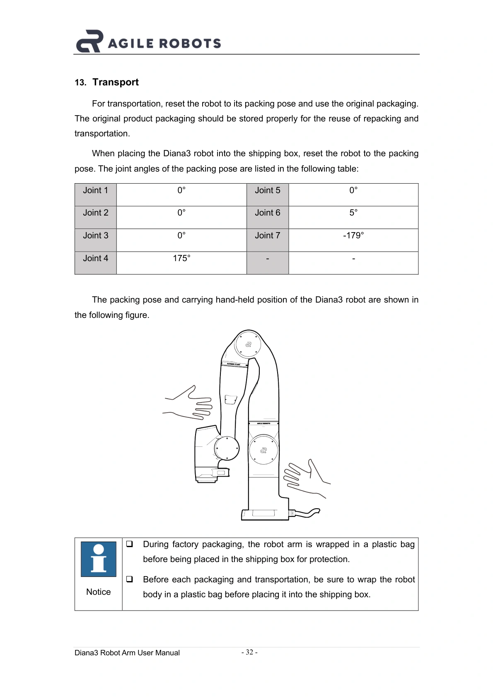



```
Diana3 Robot Arm User Manual  
 
- 32 - 
13. Transport 
For transportation, reset the robot to its packing pose and use the original packaging. 
The original product packaging should be stored properly for the reuse of repacking and 
transportation. 
When placing the Diana3 robot into the shipping box, reset the robot to the packing 
pose. The joint angles of the packing pose are listed in the following table: 
Joint 1 
0° 
Joint 5 
0° 
Joint 2 
0° 
Joint 6 
5° 
Joint 3 
0° 
Joint 7 
-179° 
Joint 4 
175° 
- 
- 
 
The packing pose and carrying hand-held position of the Diana3 robot are shown in 
the following figure. 
 
 
Notice 
q 
During factory packaging, the robot arm is wrapped in a plastic bag 
before being placed in the shipping box for protection. 
q 
Before each packaging and transportation, be sure to wrap the robot 
body in a plastic bag before placing it into the shipping box.
```



## PDF page 37

**Source:** Diana3 Robot Arm User Manual V1.1.0 EN.pdf, original pdf page 37. [Open the corresponding PDF reading-copy page](https://1292444914-files.gitbook.io/~/files/v0/b/gitbook-x-prod.appspot.com/o/spaces%2FtgOfPnscWebs1eh82EKq%2Fuploads%2FfELoSTcp5bZC8Xn5qFUE%2Fdiana3-robot-arm-user-manual-v1-1-0-en-pp-026-040.pdf?alt=media#page=12).



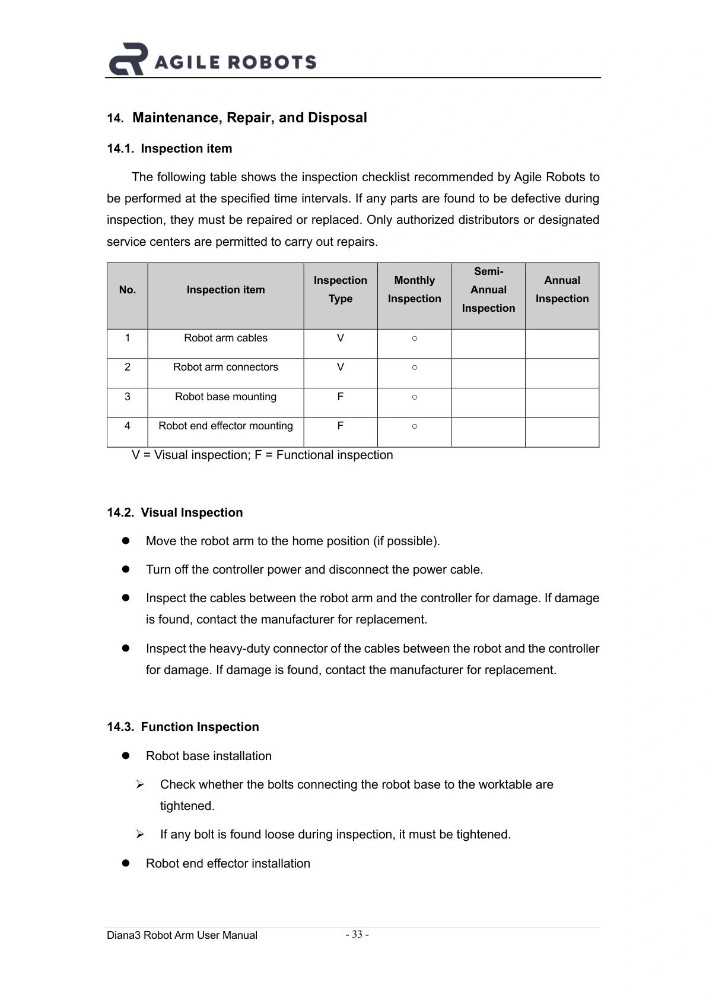



```
Diana3 Robot Arm User Manual  
 
- 33 - 
14. Maintenance, Repair, and Disposal 
14.1. Inspection item 
The following table shows the inspection checklist recommended by Agile Robots to 
be performed at the specified time intervals. If any parts are found to be defective during 
inspection, they must be repaired or replaced. Only authorized distributors or designated 
service centers are permitted to carry out repairs. 
No. 
Inspection item 
Inspection 
Type 
Monthly 
Inspection 
Semi-
Annual 
Inspection 
Annual 
Inspection 
1 
Robot arm cables 
V 
○ 
 
 
2 
Robot arm connectors 
V 
○ 
 
 
3 
Robot base mounting 
F 
○ 
 
 
4 
Robot end effector mounting 
F 
○ 
 
 
V = Visual inspection; F = Functional inspection 
 
14.2. Visual Inspection 
l 
Move the robot arm to the home position (if possible). 
l 
Turn off the controller power and disconnect the power cable. 
l 
Inspect the cables between the robot arm and the controller for damage. If damage 
is found, contact the manufacturer for replacement. 
l 
Inspect the heavy-duty connector of the cables between the robot and the controller 
for damage. If damage is found, contact the manufacturer for replacement. 
 
14.3. Function Inspection 
l 
Robot base installation 
Ø 
Check whether the bolts connecting the robot base to the worktable are 
tightened. 
Ø 
If any bolt is found loose during inspection, it must be tightened. 
l 
Robot end effector installation
```



## PDF page 38

**Source:** Diana3 Robot Arm User Manual V1.1.0 EN.pdf, original pdf page 38. [Open the corresponding PDF reading-copy page](https://1292444914-files.gitbook.io/~/files/v0/b/gitbook-x-prod.appspot.com/o/spaces%2FtgOfPnscWebs1eh82EKq%2Fuploads%2FfELoSTcp5bZC8Xn5qFUE%2Fdiana3-robot-arm-user-manual-v1-1-0-en-pp-026-040.pdf?alt=media#page=13).



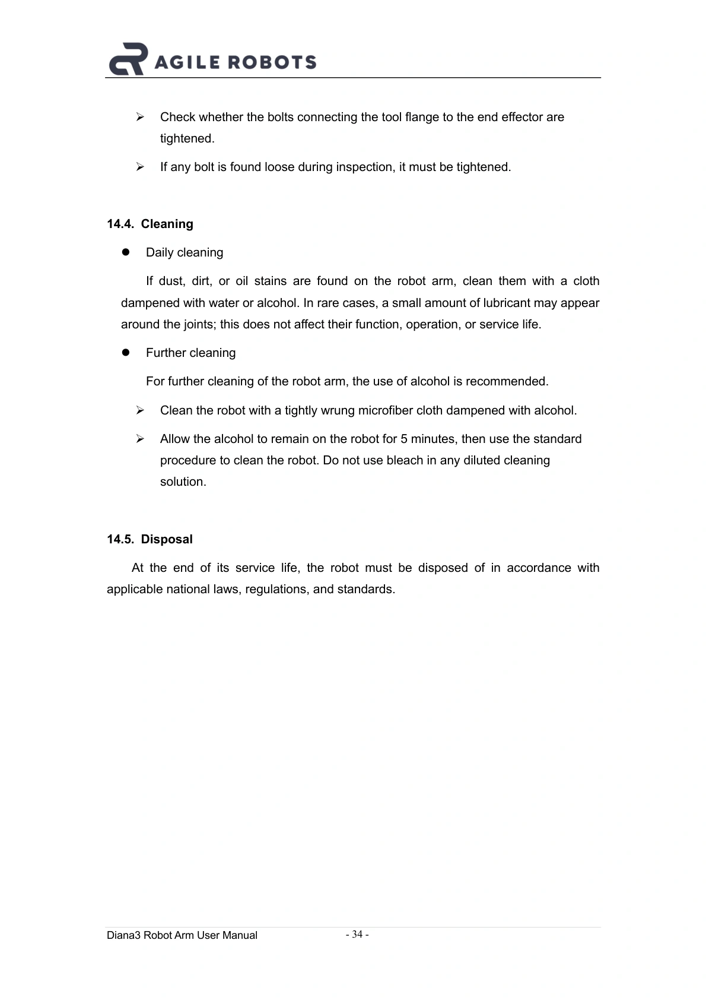



```
Diana3 Robot Arm User Manual  
 
- 34 - 
Ø 
Check whether the bolts connecting the tool flange to the end effector are 
tightened. 
Ø 
If any bolt is found loose during inspection, it must be tightened. 
 
14.4. Cleaning 
l 
Daily cleaning 
If dust, dirt, or oil stains are found on the robot arm, clean them with a cloth 
dampened with water or alcohol. In rare cases, a small amount of lubricant may appear 
around the joints; this does not affect their function, operation, or service life. 
l 
Further cleaning 
For further cleaning of the robot arm, the use of alcohol is recommended. 
Ø 
Clean the robot with a tightly wrung microfiber cloth dampened with alcohol. 
Ø 
Allow the alcohol to remain on the robot for 5 minutes, then use the standard 
procedure to clean the robot. Do not use bleach in any diluted cleaning 
solution. 
 
14.5. Disposal 
At the end of its service life, the robot must be disposed of in accordance with 
applicable national laws, regulations, and standards.
```



## PDF page 39

**Source:** Diana3 Robot Arm User Manual V1.1.0 EN.pdf, original pdf page 39. [Open the corresponding PDF reading-copy page](https://1292444914-files.gitbook.io/~/files/v0/b/gitbook-x-prod.appspot.com/o/spaces%2FtgOfPnscWebs1eh82EKq%2Fuploads%2FfELoSTcp5bZC8Xn5qFUE%2Fdiana3-robot-arm-user-manual-v1-1-0-en-pp-026-040.pdf?alt=media#page=14).



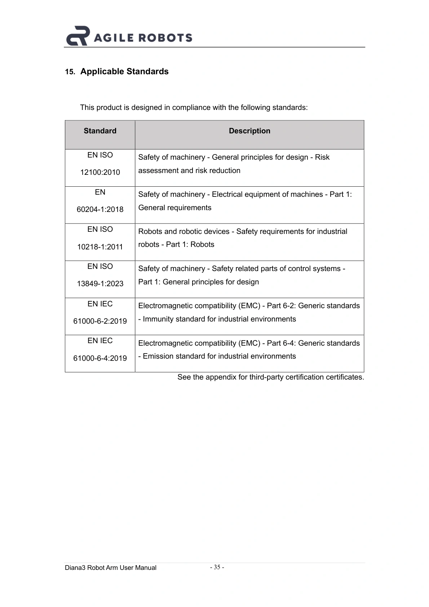



```
Diana3 Robot Arm User Manual  
 
- 35 - 
15. Applicable Standards 
 
This product is designed in compliance with the following standards: 
Standard 
Description 
EN ISO  
12100:2010 
Safety of machinery - General principles for design - Risk 
assessment and risk reduction 
EN  
60204-1:2018 
Safety of machinery - Electrical equipment of machines - Part 1: 
General requirements 
EN ISO  
10218-1:2011 
Robots and robotic devices - Safety requirements for industrial 
robots - Part 1: Robots 
EN ISO  
13849-1:2023 
Safety of machinery - Safety related parts of control systems - 
Part 1: General principles for design 
EN IEC  
61000-6-2:2019 
Electromagnetic compatibility (EMC) - Part 6-2: Generic standards 
- Immunity standard for industrial environments 
EN IEC  
61000-6-4:2019 
Electromagnetic compatibility (EMC) - Part 6-4: Generic standards 
- Emission standard for industrial environments 
See the appendix for third-party certification certificates.
```



## PDF page 40

**Source:** Diana3 Robot Arm User Manual V1.1.0 EN.pdf, original pdf page 40. [Open the corresponding PDF reading-copy page](https://1292444914-files.gitbook.io/~/files/v0/b/gitbook-x-prod.appspot.com/o/spaces%2FtgOfPnscWebs1eh82EKq%2Fuploads%2FfELoSTcp5bZC8Xn5qFUE%2Fdiana3-robot-arm-user-manual-v1-1-0-en-pp-026-040.pdf?alt=media#page=15).



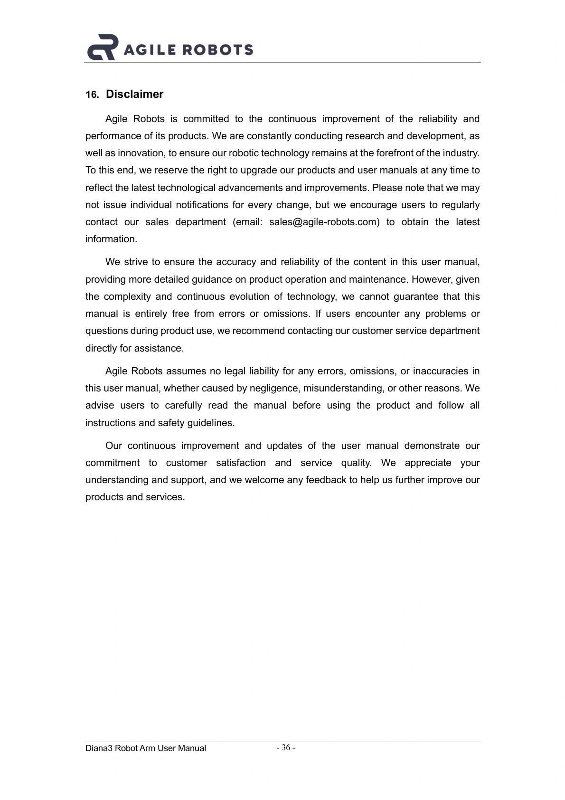



```
Diana3 Robot Arm User Manual  
 
- 36 - 
16. Disclaimer 
Agile Robots is committed to the continuous improvement of the reliability and 
performance of its products. We are constantly conducting research and development, as 
well as innovation, to ensure our robotic technology remains at the forefront of the industry. 
To this end, we reserve the right to upgrade our products and user manuals at any time to 
reflect the latest technological advancements and improvements. Please note that we may 
not issue individual notifications for every change, but we encourage users to regularly 
contact our sales department (email: sales@agile-robots.com) to obtain the latest 
information. 
We strive to ensure the accuracy and reliability of the content in this user manual, 
providing more detailed guidance on product operation and maintenance. However, given 
the complexity and continuous evolution of technology, we cannot guarantee that this 
manual is entirely free from errors or omissions. If users encounter any problems or 
questions during product use, we recommend contacting our customer service department 
directly for assistance. 
Agile Robots assumes no legal liability for any errors, omissions, or inaccuracies in 
this user manual, whether caused by negligence, misunderstanding, or other reasons. We 
advise users to carefully read the manual before using the product and follow all 
instructions and safety guidelines.  
Our continuous improvement and updates of the user manual demonstrate our 
commitment to customer satisfaction and service quality. We appreciate your 
understanding and support, and we welcome any feedback to help us further improve our 
products and services.
```



## PDF page 41

**Source:** Diana3 Robot Arm User Manual V1.1.0 EN.pdf, original pdf page 41. [Open the corresponding PDF reading-copy page](https://1292444914-files.gitbook.io/~/files/v0/b/gitbook-x-prod.appspot.com/o/spaces%2FtgOfPnscWebs1eh82EKq%2Fuploads%2FwDZavgcfRe5kWoaFmnlX%2Fdiana3-robot-arm-user-manual-v1-1-0-en-pp-041-043.pdf?alt=media#page=1).



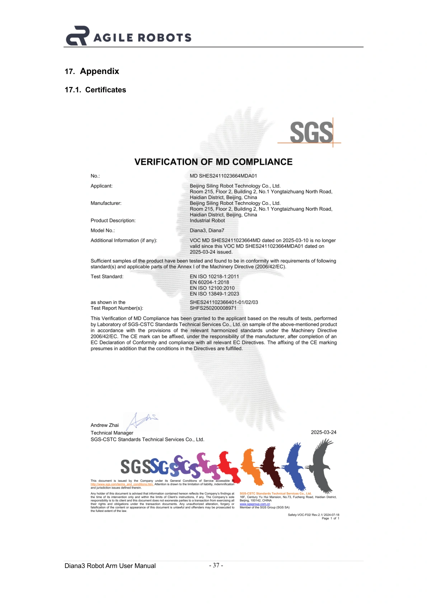



```
Diana3 Robot Arm User Manual  
 
- 37 - 
17. Appendix 
17.1. Certificates
```



## PDF page 42

**Source:** Diana3 Robot Arm User Manual V1.1.0 EN.pdf, original pdf page 42. [Open the corresponding PDF reading-copy page](https://1292444914-files.gitbook.io/~/files/v0/b/gitbook-x-prod.appspot.com/o/spaces%2FtgOfPnscWebs1eh82EKq%2Fuploads%2FwDZavgcfRe5kWoaFmnlX%2Fdiana3-robot-arm-user-manual-v1-1-0-en-pp-041-043.pdf?alt=media#page=2).



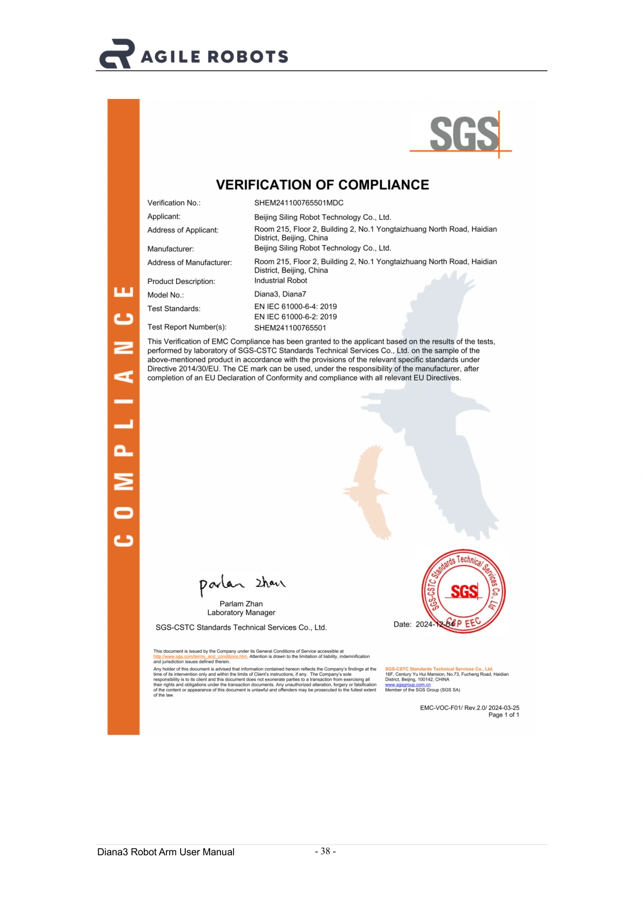



```
Diana3 Robot Arm User Manual  
 
- 38 -
```



## PDF page 43

**Source:** Diana3 Robot Arm User Manual V1.1.0 EN.pdf, original pdf page 43. [Open the corresponding PDF reading-copy page](https://1292444914-files.gitbook.io/~/files/v0/b/gitbook-x-prod.appspot.com/o/spaces%2FtgOfPnscWebs1eh82EKq%2Fuploads%2FwDZavgcfRe5kWoaFmnlX%2Fdiana3-robot-arm-user-manual-v1-1-0-en-pp-041-043.pdf?alt=media#page=3).



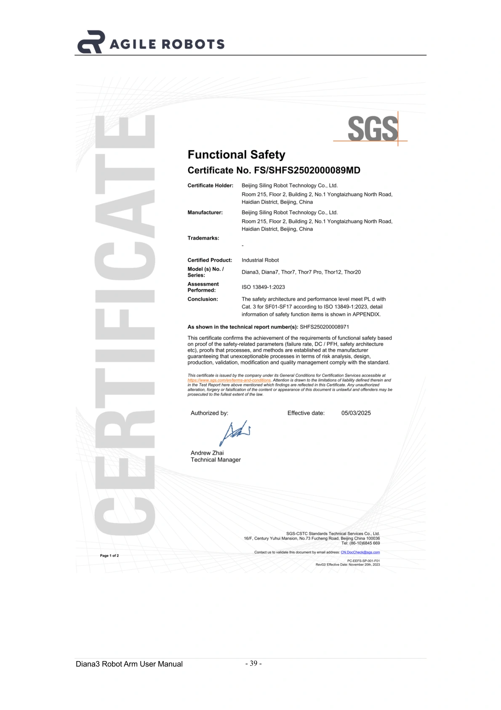



```
Diana3 Robot Arm User Manual  
 
- 39 -
```



## PDF page 44

**Source:** Diana3 Robot Arm User Manual V1.1.0 EN.pdf, original pdf page 44. [Open the corresponding PDF reading-copy page](https://1292444914-files.gitbook.io/~/files/v0/b/gitbook-x-prod.appspot.com/o/spaces%2FtgOfPnscWebs1eh82EKq%2Fuploads%2FOuLPP1k8EaNCP2Il6Qvp%2Fdiana3-robot-arm-user-manual-v1-1-0-en-pp-044-045.pdf?alt=media#page=1).



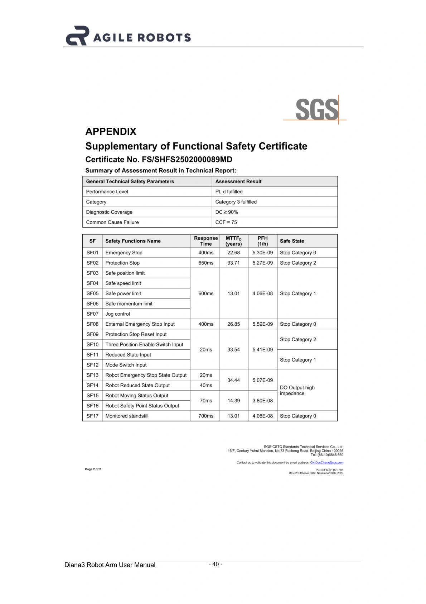



```
Diana3 Robot Arm User Manual  
 
- 40 -
```



## PDF page 45

**Source:** Diana3 Robot Arm User Manual V1.1.0 EN.pdf, original pdf page 45. [Open the corresponding PDF reading-copy page](https://1292444914-files.gitbook.io/~/files/v0/b/gitbook-x-prod.appspot.com/o/spaces%2FtgOfPnscWebs1eh82EKq%2Fuploads%2FOuLPP1k8EaNCP2Il6Qvp%2Fdiana3-robot-arm-user-manual-v1-1-0-en-pp-044-045.pdf?alt=media#page=2).







```
Diana3 Robot Arm User Manual  
 
- 41 - 
 
 
 
 
 
 
 
 
 
 
 
 
 
 
 
 
 
 
Agile Robots SE 
Plinganserstraße 134, 81369 Munich, Germany
```


