# Agile Robots training 1 — System Startup — complete reference


**Complete supplied source:** EN\_1\_System\_Startup.pptx · **Coverage:** 18 original slides. [Return to the Agile Robots source library](./).


Every source page is retained in the original order. The **Original page** view preserves complete diagrams, photographs, tables, equations, connector orientation, notices and examples. The **Searchable text** view preserves native PDF text or the slide’s native text, embedded links and substantive speaker notes. Text extraction can retain reading-order/character defects; use the original image for exact layout, table columns and code indentation.


The generic slide 4 supply wording does not override the exact CB-FS or RCB controller power range. Its 30% setting is not proof of a safe application speed. Factory safety-I/O jumper diagrams describe a supplied configuration; they are not permission to bypass an emergency stop, enabling device or protective circuit. Use the delivered circuit and validated safety design.


**Attribution:** the manufacturer and contributors identified in the supplied document. Original notices remain visible on every source page. Navigation, revision notes and the linked engineering explanations are OpenELAB editorial additions.

**Training-copy scope:** these images are rendered reading copies of the supplied PPTX slides. The native file remains authoritative for fonts, presentation effects and editable objects. All original slide numbers, including closing or hidden slides, are retained. Any embedded motion video is linked separately below.

## Document navigation

| Source section / function                           | Original page                                        |
| --------------------------------------------------- | ---------------------------------------------------- |
| Basic Training                                      | [Slide 1](complete-en-1-system-startup.md#slide-1)   |
| Overview                                            | [Slide 2](complete-en-1-system-startup.md#slide-2)   |
| Installation Tips                                   | [Slide 3](complete-en-1-system-startup.md#slide-3)   |
| Installation Tips (2)                               | [Slide 4](complete-en-1-system-startup.md#slide-4)   |
| Robot Arm                                           | [Slide 5](complete-en-1-system-startup.md#slide-5)   |
| 1.1 Diagram of the robot arm                        | [Slide 6](complete-en-1-system-startup.md#slide-6)   |
| 1.2 Specification Table                             | [Slide 7](complete-en-1-system-startup.md#slide-7)   |
| 1.3 Electrical Wiring Instructions                  | [Slide 8](complete-en-1-system-startup.md#slide-8)   |
| 1.4 Base Mounting                                   | [Slide 9](complete-en-1-system-startup.md#slide-9)   |
| 1.4 Base Mounting (2)                               | [Slide 10](complete-en-1-system-startup.md#slide-10) |
| Control Box                                         | [Slide 11](complete-en-1-system-startup.md#slide-11) |
| 2.1 Diagram of the control box                      | [Slide 12](complete-en-1-system-startup.md#slide-12) |
| 2.2 Specification Table                             | [Slide 13](complete-en-1-system-startup.md#slide-13) |
| 2.3 Electrical Interface Diagram of the Control Box | [Slide 14](complete-en-1-system-startup.md#slide-14) |
| 3. Teaching Pendant                                 | [Slide 15](complete-en-1-system-startup.md#slide-15) |
| 3.1 Diagram of the Teaching Pendant                 | [Slide 16](complete-en-1-system-startup.md#slide-16) |
| 3.3 Button Description                              | [Slide 17](complete-en-1-system-startup.md#slide-17) |
| Slide 18                                            | [Slide 18](complete-en-1-system-startup.md#slide-18) |

## Slide 1

**Source:** EN\_1\_System\_Startup.pptx, original slide 1.



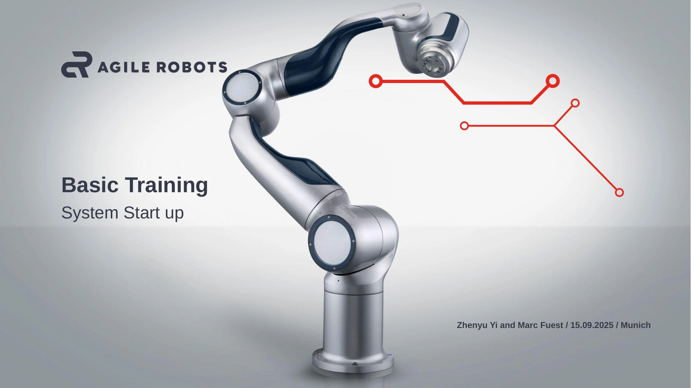



```
Basic Training
System Start up
Zhenyu Yi
 and Marc Fuest 
/
 15.09.2025 
/
 
Munich
```



## Slide 2

**Source:** EN\_1\_System\_Startup.pptx, original slide 2.



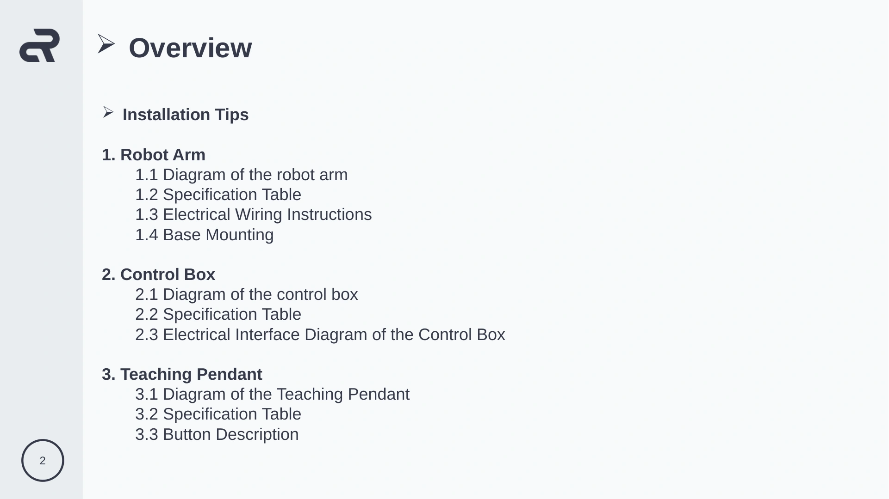



```
Overview
Installation Tips
1. Robot Arm
1.1 Diagram of the robot arm
1.2 Specification Table
1.3 Electrical Wiring Instructions
1.4 
Base Mounting
2.
 Control Box
2.1 Diagram of the control box
2.2 Specification Table
2.3 
Electrical Interface Diagram of the Control Box
3. Teaching Pendant
3.1 Diagram of the Teaching Pendant
3.2 
Specification Table
3.3 Button Description
```



## Slide 3

**Source:** EN\_1\_System\_Startup.pptx, original slide 3.



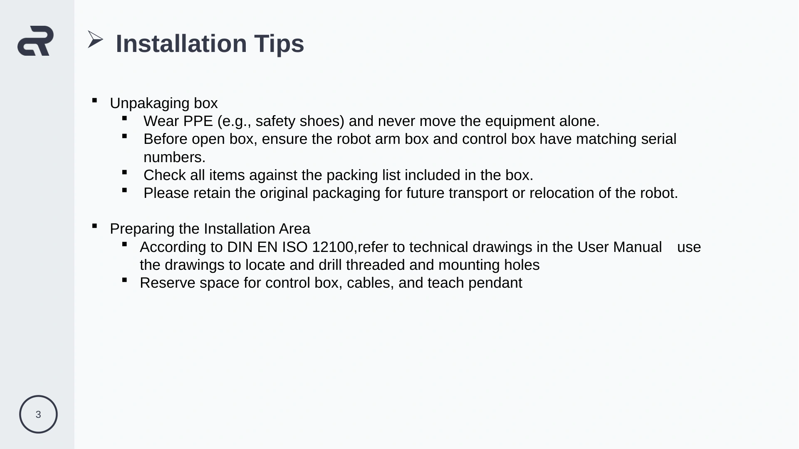



```
Installation Tips
Unpakaging
 box
Wear PPE (e.g., safety shoes) and never move the equipment alone.
Before open box, ensure the robot arm box and control box have matching serial numbers.
Check all items against the packing list included in the box.
Please retain the original packaging for future transport or relocation of the robot.
Preparing the Installation Area
According to DIN EN ISO 12100,refer to technical drawings in the User Manual，use the drawings to locate and drill threaded and mounting holes
Reserve space for control box, cables, and teach pendant
```



## Slide 4

**Source:** EN\_1\_System\_Startup.pptx, original slide 4.



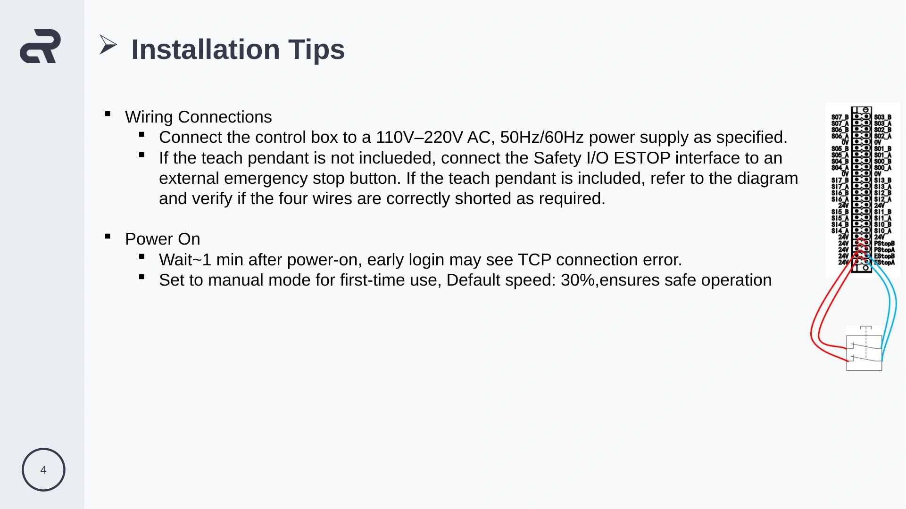



```
Installation Tips
Wiring
 Connections
Connect the control box to a 110V–220V AC, 50Hz/60Hz power supply as specified.
If the teach pendant is not 
inclueded
, connect the Safety I/O ESTOP interface to an external emergency stop button. If the teach pendant is included, refer to the diagram and verify if the four wires are correctly shorted as required.
Power On
Wait~1 min after power-on, early login may see TCP connection error.
Set to manual mode for first-time use, Default speed: 30%,ensures safe operation
```



## Slide 5

**Source:** EN\_1\_System\_Startup.pptx, original slide 5.



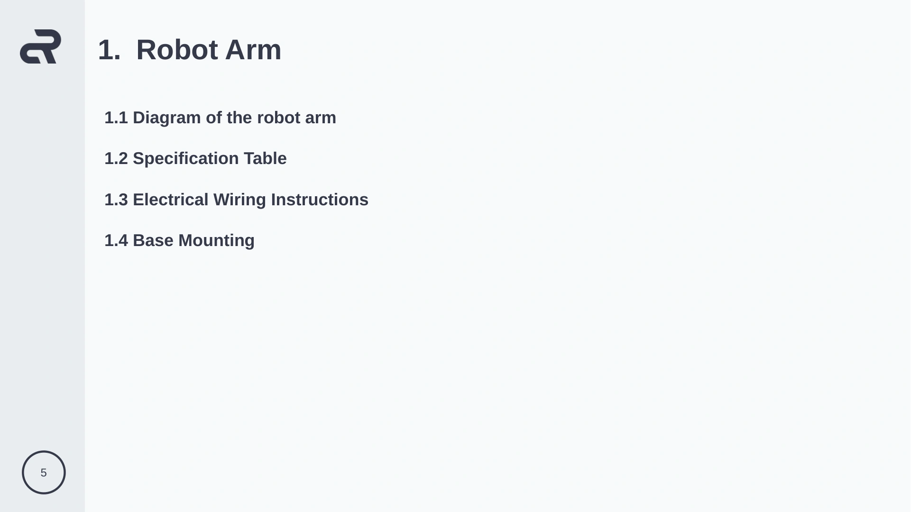



```
Robot Arm
1.1 Diagram of the robot arm
1.2 Specification Table
1.3 Electrical Wiring Instructions
1.4 Base Mounting
```



## Slide 6

**Source:** EN\_1\_System\_Startup.pptx, original slide 6.



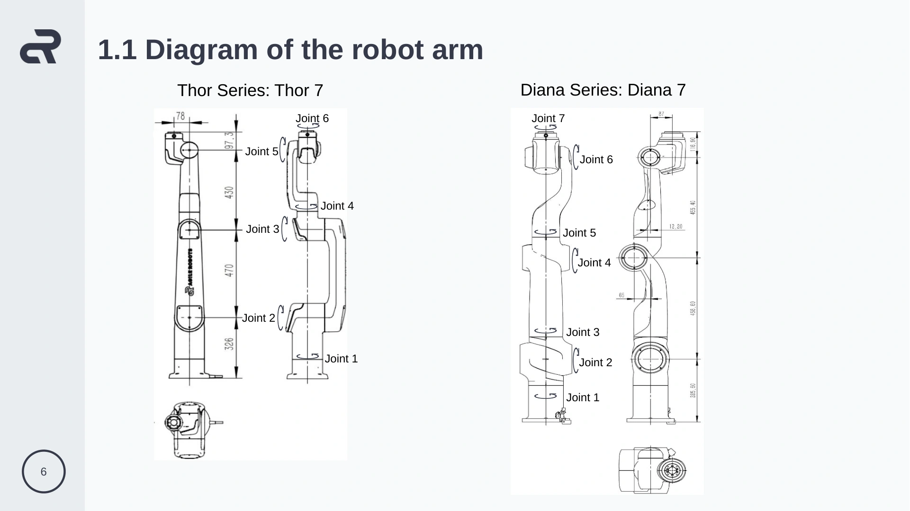



```
1.1 
D
iagram
 of the robot arm
Joint 1
Joint 2
Joint 3
Joint 4
Joint 5
Joint 6
Thor Series: Thor 7
Diana Series: Diana 7
Joint 1
Joint 2
Joint 3
Joint 4
Joint 5
Joint 6
Joint 7
```



## Slide 7

**Source:** EN\_1\_System\_Startup.pptx, original slide 7.



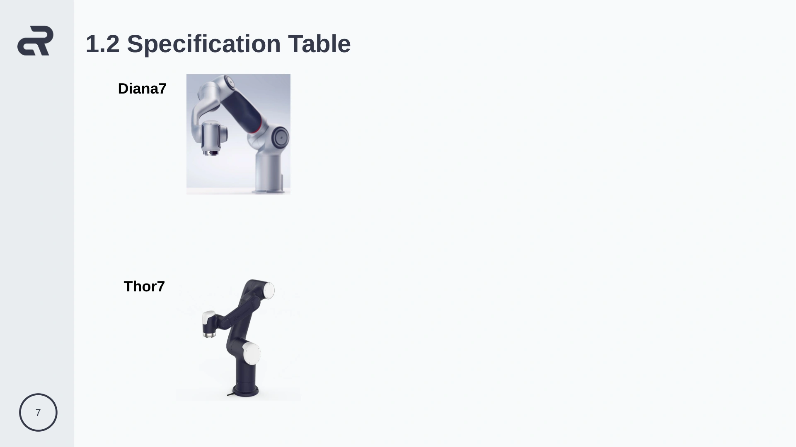



```
1.2 
Specification Table
Diana7
Thor7
```



## Slide 8

**Source:** EN\_1\_System\_Startup.pptx, original slide 8.



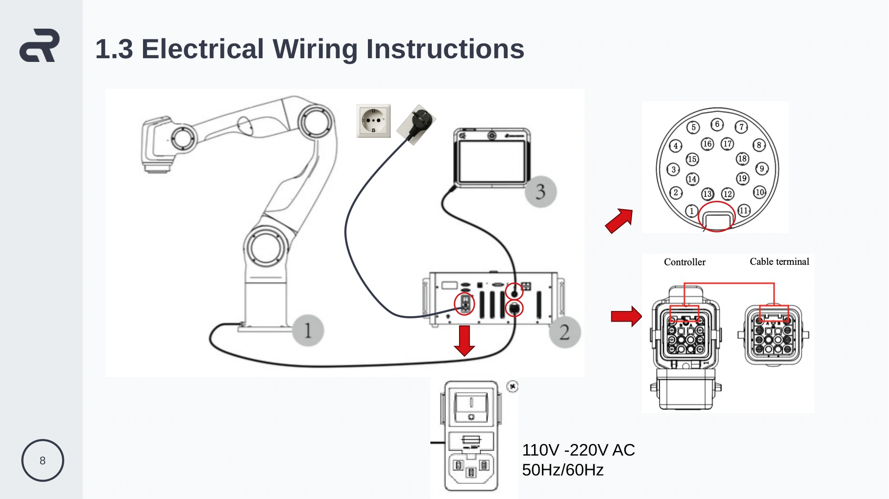



```
1.3 
Electrical Wiring Instructions
110V -220V AC     50Hz/60Hz
```



## Slide 9

**Source:** EN\_1\_System\_Startup.pptx, original slide 9.



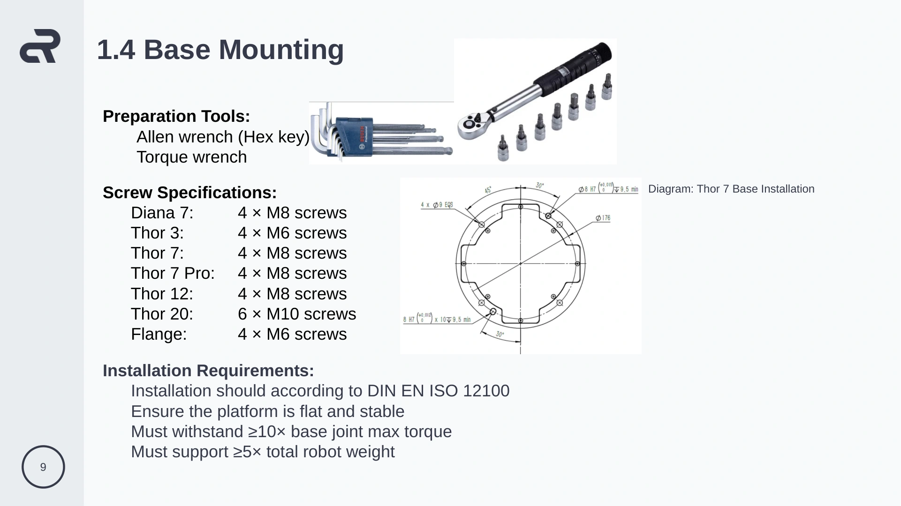



```
1.4 
Base Mounting
Preparation Tools:
Allen wrench (Hex key)
Torque wrench
Diagram: Thor 7 Base Installation
Screw Specifications:
      
Diana 7: 	4 × M8 screws
      Thor 3: 	4 × M6 screws
      Thor 7: 	4 × M8 screws
      Thor 7 Pro: 	4 × M8 screws
      Thor 12: 	4 × M8 screws
      Thor 20: 	6 × M10 screws
      Flange: 	4 × M6 screws
Installation Requirements:
      Installation should according to DIN EN ISO 12100
      Ensure the platform is flat and stable
      Must withstand ≥10× base joint max torque
      Must support ≥5× total robot weight
```



## Slide 10

**Source:** EN\_1\_System\_Startup.pptx, original slide 10.



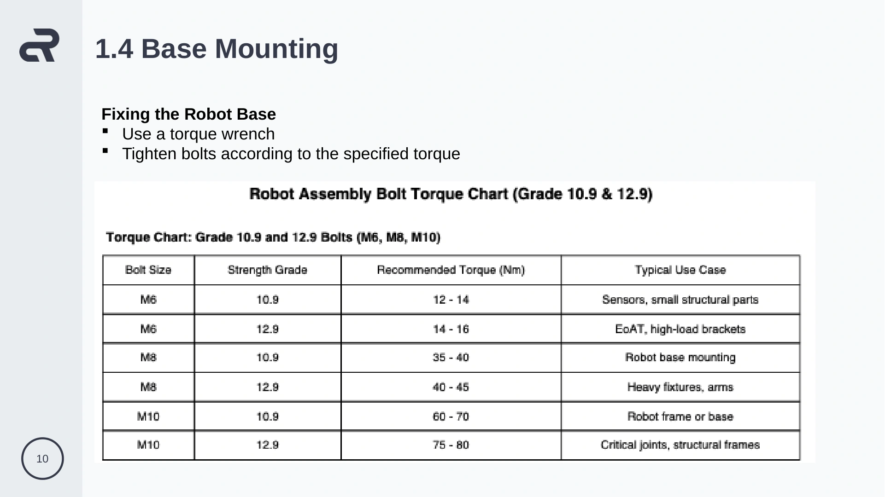



```
1.4 
Base Mounting
Fixing the Robot Base
Use a torque wrench
Tighten bolts according to the specified torque
```



## Slide 11

**Source:** EN\_1\_System\_Startup.pptx, original slide 11.



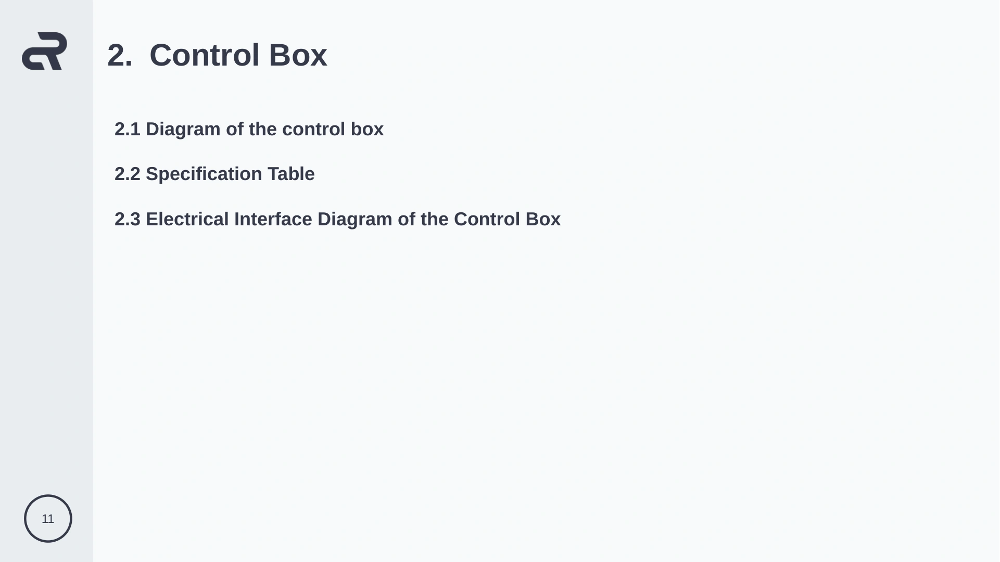



```
Control Box
2.1 
D
iagram
 of the control box
2.2 Specification Table
2.3 Electrical Interface Diagram of the Control Box
```



## Slide 12

**Source:** EN\_1\_System\_Startup.pptx, original slide 12.



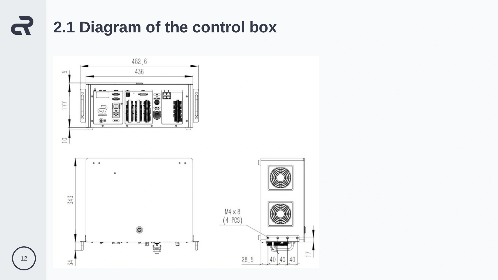



```
2.1 
D
iagram
 of the control box
```



## Slide 13

**Source:** EN\_1\_System\_Startup.pptx, original slide 13.



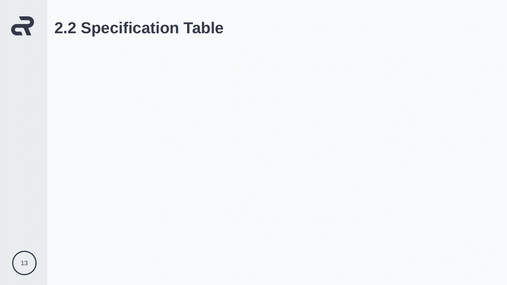



```
2.2 
Specification Table
```



## Slide 14

**Source:** EN\_1\_System\_Startup.pptx, original slide 14.



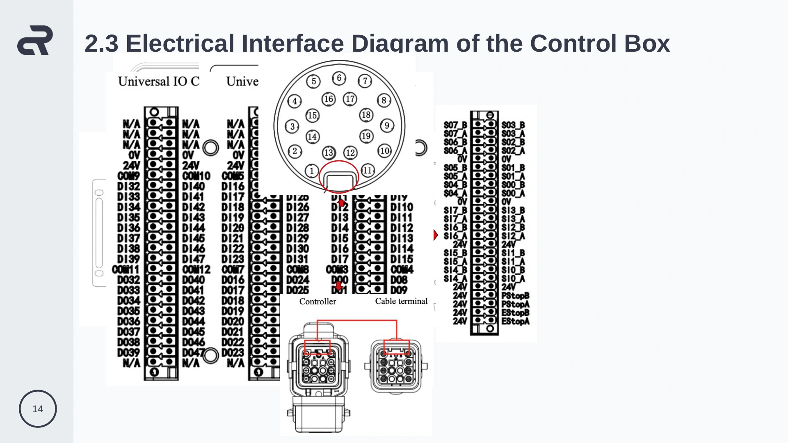



```
2.3 
Electrical Interface Diagram of the Control Box
```



## Slide 15

**Source:** EN\_1\_System\_Startup.pptx, original slide 15.



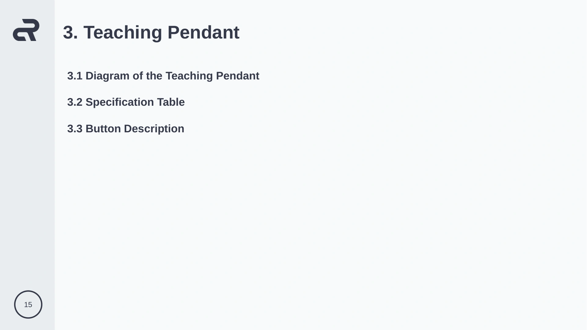



```
3. 
Teaching Pendant
3.1 Diagram of the Teaching Pendant
3.2 Specification Table
3.3 Button Description
```



## Slide 16

**Source:** EN\_1\_System\_Startup.pptx, original slide 16.



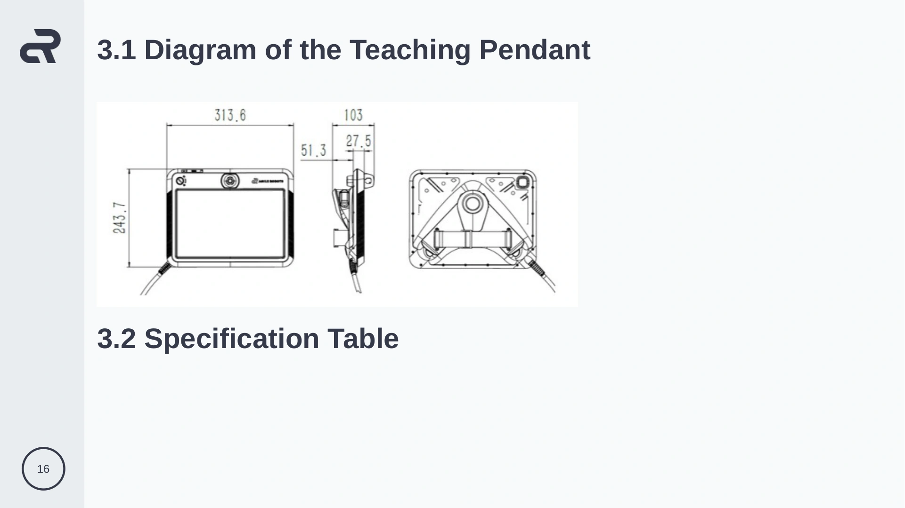



```
3.1 
D
iagram
 of the Teaching Pendant
3.2 
Specification Table
```



## Slide 17

**Source:** EN\_1\_System\_Startup.pptx, original slide 17.



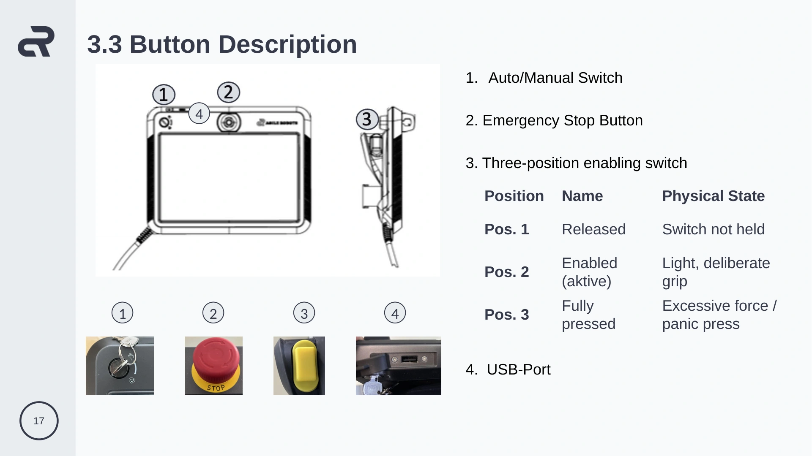



```
3.3 
Button Description
1
2
3
Auto/Manual Switch
2. 
Emergency 
Stop
 Button
3. 
Three
-position 
enabling
 switch
Position
Name
Physical
 State
Pos. 1
Released
Switch not 
held
Pos. 2
Enabled (aktive)
Light, 
deliberate
 
grip
Pos. 3
Fully 
pressed
Excessive
 
force
 / 
panic
 press
4
4
4.  USB-Port
```



## Slide 18

**Source:** EN\_1\_System\_Startup.pptx, original slide 18.







No native selectable text is present on this page. The complete original artwork or screenshot remains in the Original page view.


