# Agile Robots training 3 — Coordinates and End Effectors — complete reference


**Complete supplied source:** EN\_3\_Definition\_Coordinate\_Systems \_and\_Connection\_Endeffector.pptx · **Coverage:** 24 original slides. [Return to the Agile Robots source library](./).


Every source page is retained in the original order. The **Original page** view preserves complete diagrams, photographs, tables, equations, connector orientation, notices and examples. The **Searchable text** view preserves native PDF text or the slide’s native text, embedded links and substantive speaker notes. Text extraction can retain reading-order/character defects; use the original image for exact layout, table columns and code indentation.


TCP/workpiece calibration, payload identification and returning to recorded points require actual arm motion. Review the complete swept path with the installed tool. Slide 23 describes a gripper program that can resume after power restoration; isolate and review that behavior before energizing. The 3F15G component overview and RG2 command example do not establish one interchangeable gripper configuration.


**Attribution:** the manufacturer and contributors identified in the supplied document. Original notices remain visible on every source page. Navigation, revision notes and the linked engineering explanations are OpenELAB editorial additions.

**Training-copy scope:** these images are rendered reading copies of the supplied PPTX slides. The native file remains authoritative for fonts, presentation effects and editable objects. All original slide numbers, including closing or hidden slides, are retained. Any embedded motion video is linked separately below.

## Document navigation

| Source section / function             | Original page                                                                                  |
| ------------------------------------- | ---------------------------------------------------------------------------------------------- |
| Advanced Training                     | [Slide 1](complete-en-3-definition-coordinate-systems-and-connection-endeffector.md#slide-1)   |
| Advanced Training (2)                 | [Slide 2](complete-en-3-definition-coordinate-systems-and-connection-endeffector.md#slide-2)   |
| Definition of Coordinate Systems      | [Slide 3](complete-en-3-definition-coordinate-systems-and-connection-endeffector.md#slide-3)   |
| Slide 4                               | [Slide 4](complete-en-3-definition-coordinate-systems-and-connection-endeffector.md#slide-4)   |
| Slide 5                               | [Slide 5](complete-en-3-definition-coordinate-systems-and-connection-endeffector.md#slide-5)   |
| Definition of Coordinate Systems (2)  | [Slide 6](complete-en-3-definition-coordinate-systems-and-connection-endeffector.md#slide-6)   |
| Definition of Coordinate Systems (3)  | [Slide 7](complete-en-3-definition-coordinate-systems-and-connection-endeffector.md#slide-7)   |
| Slide 8                               | [Slide 8](complete-en-3-definition-coordinate-systems-and-connection-endeffector.md#slide-8)   |
| Definition of Coordinate Systems (4)  | [Slide 9](complete-en-3-definition-coordinate-systems-and-connection-endeffector.md#slide-9)   |
| Definition of Coordinate Systems (5)  | [Slide 10](complete-en-3-definition-coordinate-systems-and-connection-endeffector.md#slide-10) |
| Definition of Coordinate Systems (6)  | [Slide 11](complete-en-3-definition-coordinate-systems-and-connection-endeffector.md#slide-11) |
| Definition of Coordinate Systems (7)  | [Slide 12](complete-en-3-definition-coordinate-systems-and-connection-endeffector.md#slide-12) |
| 2.2 Payload Identification            | [Slide 13](complete-en-3-definition-coordinate-systems-and-connection-endeffector.md#slide-13) |
| Definition of Coordinate Systems (8)  | [Slide 14](complete-en-3-definition-coordinate-systems-and-connection-endeffector.md#slide-14) |
| Definition of Coordinate Systems (9)  | [Slide 15](complete-en-3-definition-coordinate-systems-and-connection-endeffector.md#slide-15) |
| Definition of Coordinate Systems (10) | [Slide 16](complete-en-3-definition-coordinate-systems-and-connection-endeffector.md#slide-16) |
| Definition of Coordinate Systems (11) | [Slide 17](complete-en-3-definition-coordinate-systems-and-connection-endeffector.md#slide-17) |
| Connection Endeffector (Gripper)      | [Slide 18](complete-en-3-definition-coordinate-systems-and-connection-endeffector.md#slide-18) |
| Connection Endeffector (Gripper) (2)  | [Slide 19](complete-en-3-definition-coordinate-systems-and-connection-endeffector.md#slide-19) |
| Connection Endeffector (Gripper) (3)  | [Slide 20](complete-en-3-definition-coordinate-systems-and-connection-endeffector.md#slide-20) |
| Connection Endeffector (Gripper) (4)  | [Slide 21](complete-en-3-definition-coordinate-systems-and-connection-endeffector.md#slide-21) |
| Connection Endeffector (Gripper) (5)  | [Slide 22](complete-en-3-definition-coordinate-systems-and-connection-endeffector.md#slide-22) |
| Connection Endeffector (Gripper) (6)  | [Slide 23](complete-en-3-definition-coordinate-systems-and-connection-endeffector.md#slide-23) |
| Slide 24                              | [Slide 24](complete-en-3-definition-coordinate-systems-and-connection-endeffector.md#slide-24) |

## Slide 1

**Source:** EN\_3\_Definition\_Coordinate\_Systems \_and\_Connection\_Endeffector.pptx, original slide 1.



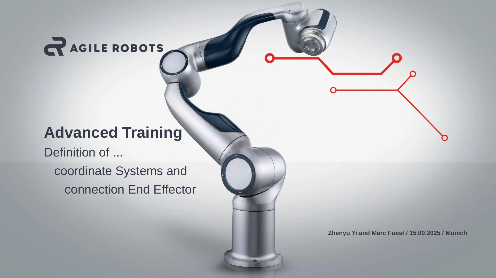



```
Advanced Training
Zhenyu Yi
 and Marc Fuest 
/
 15.09.2025 
/
 
Munich
Definition of 
...
   coordinate
 Systems and 
     
 
connection
 
End Effector
```



## Slide 2

**Source:** EN\_3\_Definition\_Coordinate\_Systems \_and\_Connection\_Endeffector.pptx, original slide 2.



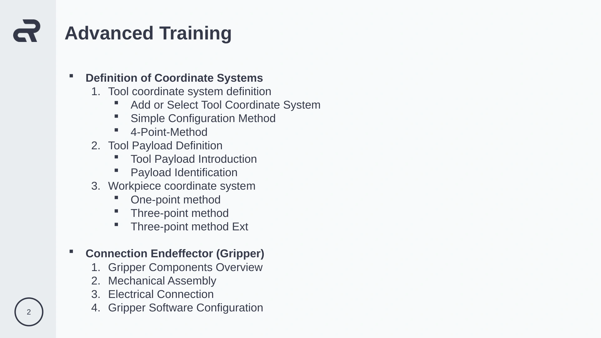



```
Advanced Training
Definition of Coordinate Systems
Tool coordinate system definition
Add or Select Tool Coordinate System
Simple Configuration Method
4-Point-Method
Tool Payload Definition
Tool Payload Introduction
Payload Identification
Workpiece coordinate system
One-point method
Three-point method
Three-point method Ext
Connection 
Endeffector
 (Gripper)
Gripper Components Overview
Mechanical Assembly
Electrical Connection
Gripper Software Configuration
```



## Slide 3

**Source:** EN\_3\_Definition\_Coordinate\_Systems \_and\_Connection\_Endeffector.pptx, original slide 3.



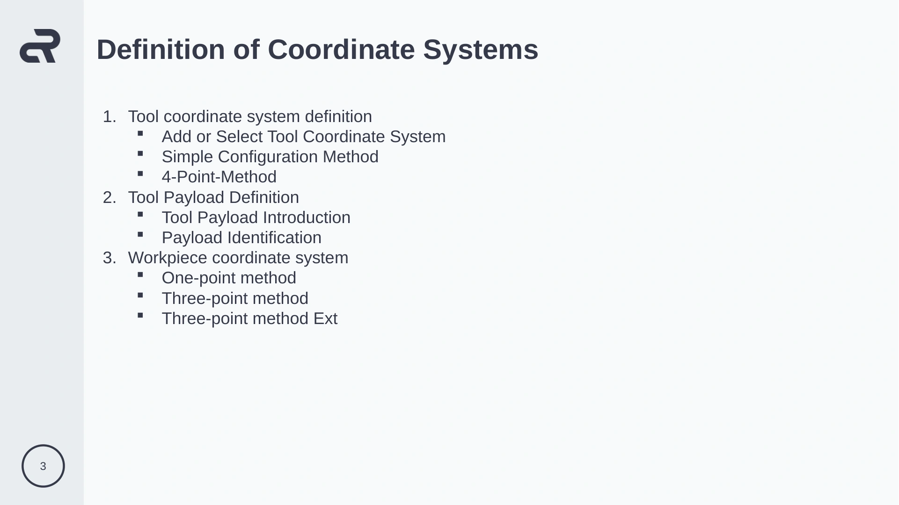



```
Definition of Coordinate Systems
Tool coordinate system definition
Add or Select Tool Coordinate System
Simple Configuration Method
4-Point-Method
Tool Payload Definition
Tool Payload Introduction
Payload Identification
Workpiece coordinate system
One-point method
Three-point method
Three-point method Ext
```



## Slide 4

**Source:** EN\_3\_Definition\_Coordinate\_Systems \_and\_Connection\_Endeffector.pptx, original slide 4.



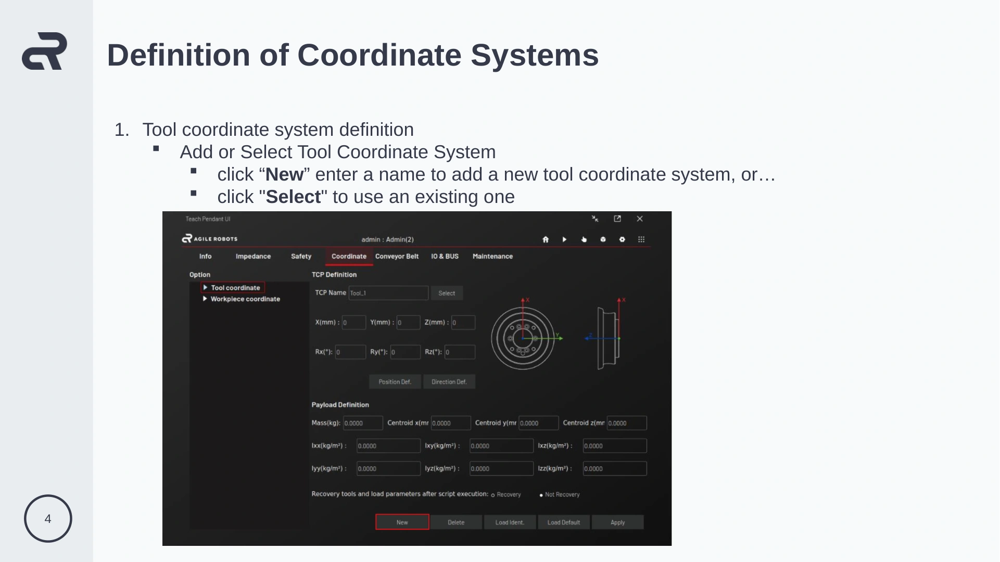



```
Definition of Coordinate Systems
Tool coordinate system definition
Add or Select Tool Coordinate System
click “
New
” enter a name to add a new tool coordinate system, or…
click "
Select
" to use an existing one
```



## Slide 5

**Source:** EN\_3\_Definition\_Coordinate\_Systems \_and\_Connection\_Endeffector.pptx, original slide 5.



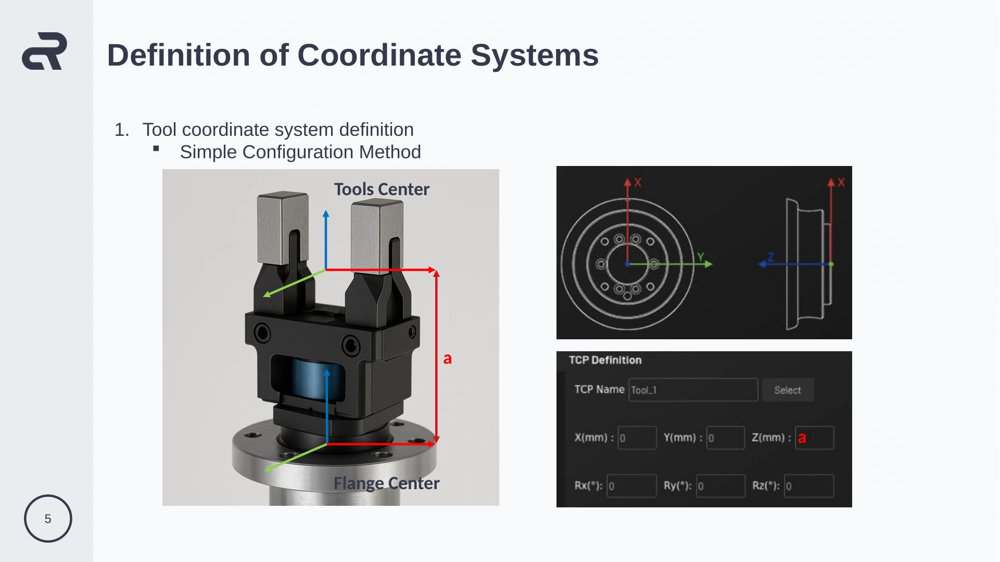



```
Flange Center
Tools Center
a
a
Definition of Coordinate Systems
Tool coordinate system definition
Simple Configuration Method
```



## Slide 6

**Source:** EN\_3\_Definition\_Coordinate\_Systems \_and\_Connection\_Endeffector.pptx, original slide 6.



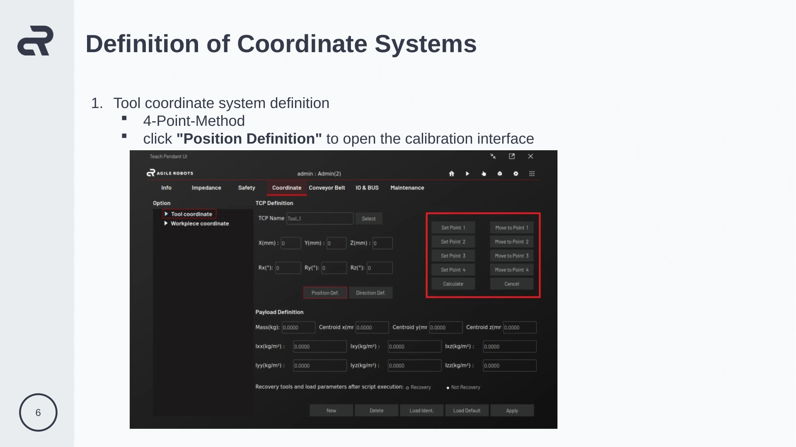



```
Definition of Coordinate Systems
Tool coordinate system definition
4-Point-Method
click 
"Position Definition"
 to open the calibration interface
```



## Slide 7

**Source:** EN\_3\_Definition\_Coordinate\_Systems \_and\_Connection\_Endeffector.pptx, original slide 7.



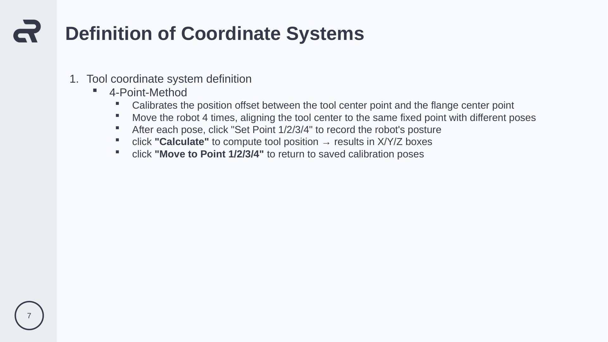



```
Definition of Coordinate Systems
Tool coordinate system definition
4-Point-Method
Calibrates the position offset between the tool center point and the flange center point
Move the robot 4 times, aligning the tool center to the same fixed point with different poses
After each pose, click "Set Point 1/2/3/4" to record the robot's posture
click 
"Calculate"
 to compute tool position → results in X/Y/Z boxes
click 
"Move to Point 1/2/3/4"
 to return to saved calibration poses
```



**Original embedded video:** [Watch or download the coordinate-frame animation](../../../.gitbook/assets/agile-en-3-definition-coordinate-systems-and-connection-endeffector-media1.mp4). This is the original MP4 embedded in source slides 7, 9; the still slide alone does not show its motion.

## Slide 8

**Source:** EN\_3\_Definition\_Coordinate\_Systems \_and\_Connection\_Endeffector.pptx, original slide 8.



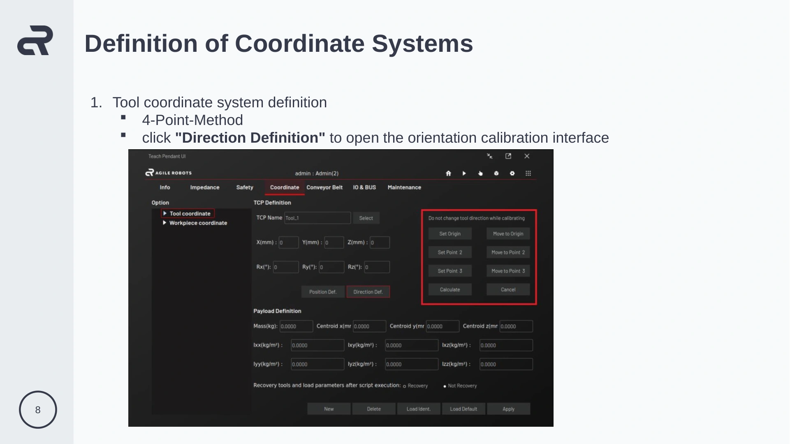



```
Definition of Coordinate Systems
Tool coordinate system definition
4-Point-Method
click 
"Direction Definition"
 to open the orientation calibration interface
```



## Slide 9

**Source:** EN\_3\_Definition\_Coordinate\_Systems \_and\_Connection\_Endeffector.pptx, original slide 9.



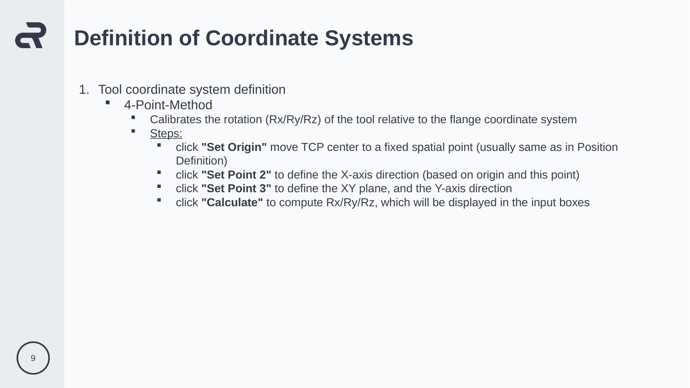



```
Definition of Coordinate Systems
Tool coordinate system definition
4-Point-Method
Calibrates the rotation (Rx/Ry/Rz) of the tool relative to the flange coordinate system
Steps:
click 
"Set Origin"
 move TCP center to a fixed spatial point (usually same as in Position Definition)
click 
"Set Point 2"
 to define the X-axis direction (based on origin and this point)
click 
"Set Point 3"
 to define the XY plane, and the Y-axis direction
click 
"Calculate"
 to compute Rx/Ry/Rz, which will be displayed in the input boxes
```



**Original embedded video:** [Watch or download the coordinate-frame animation](../../../.gitbook/assets/agile-en-3-definition-coordinate-systems-and-connection-endeffector-media1.mp4). This is the original MP4 embedded in source slides 7, 9; the still slide alone does not show its motion.

## Slide 10

**Source:** EN\_3\_Definition\_Coordinate\_Systems \_and\_Connection\_Endeffector.pptx, original slide 10.



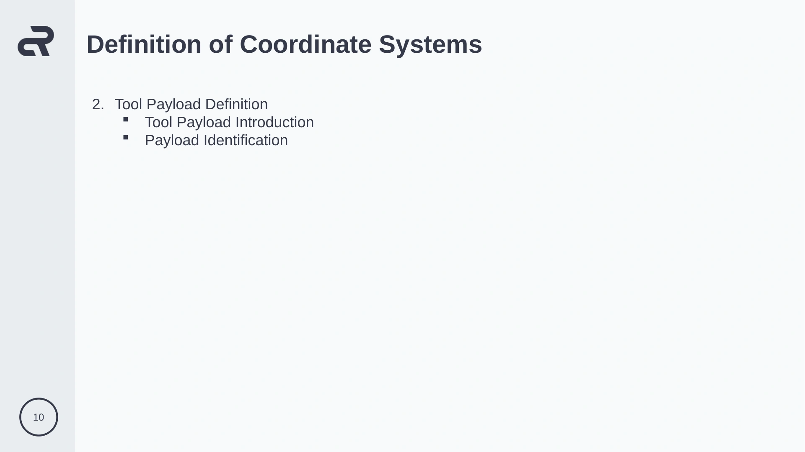



```
Definition of Coordinate Systems
Tool Payload Definition
Tool Payload Introduction
Payload Identification
```



## Slide 11

**Source:** EN\_3\_Definition\_Coordinate\_Systems \_and\_Connection\_Endeffector.pptx, original slide 11.



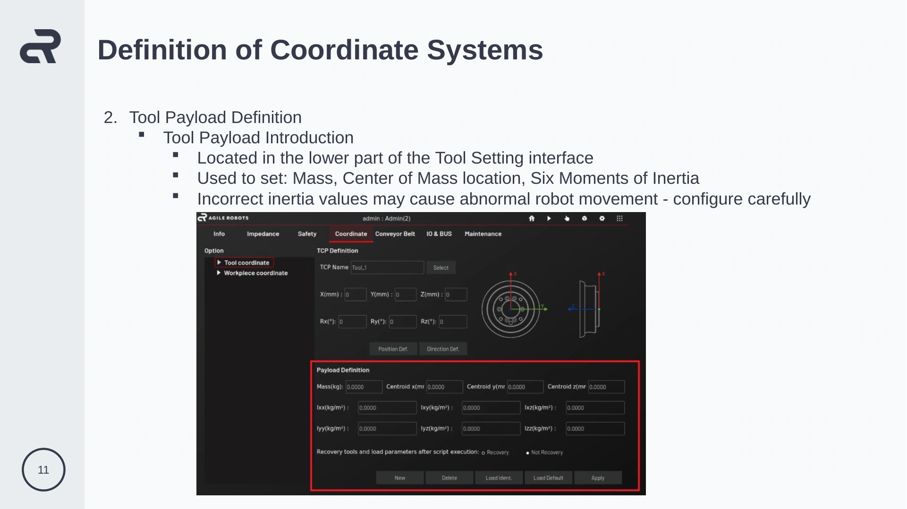



```
Definition of Coordinate Systems
Tool Payload Definition
Tool Payload Introduction
Located in the lower part of the Tool Setting interface
Used to set: Mass, Center of Mass location, Six Moments of Inertia
Incorrect inertia values may cause abnormal robot movement - configure carefully
```



## Slide 12

**Source:** EN\_3\_Definition\_Coordinate\_Systems \_and\_Connection\_Endeffector.pptx, original slide 12.



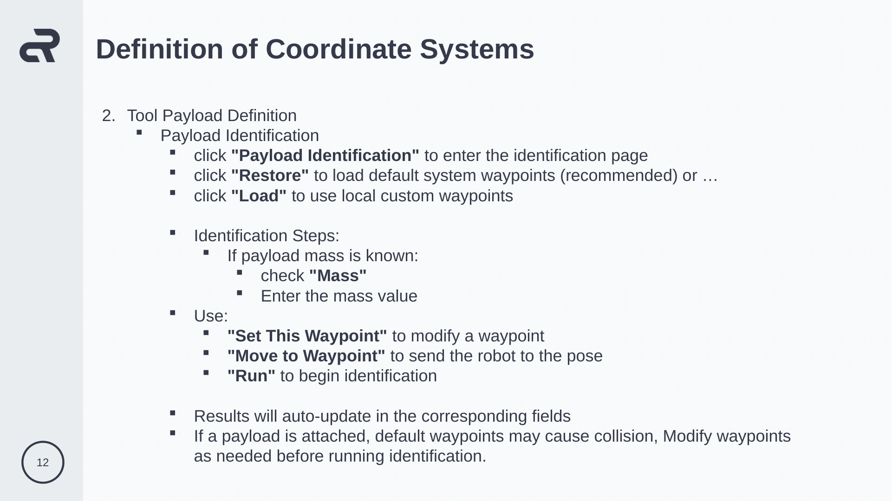



```
Definition of Coordinate Systems
Tool Payload Definition
Payload Identification
click 
"Payload Identification"
 to enter the identification page
click 
"Restore"
 to load default system waypoints (recommended) or …
click 
"Load"
 to use local custom waypoints
Identification Steps:
If payload mass is known:
check 
"Mass"
Enter the mass value
Use:
"Set This Waypoint"
 to modify a waypoint
"Move to Waypoint"
 to send the robot to the pose
"Run"
 to begin identification
Results will auto-update in the corresponding fields
If a payload is attached, default waypoints may cause collision, Modify waypoints as needed before running identification.
```



## Slide 13

**Source:** EN\_3\_Definition\_Coordinate\_Systems \_and\_Connection\_Endeffector.pptx, original slide 13.



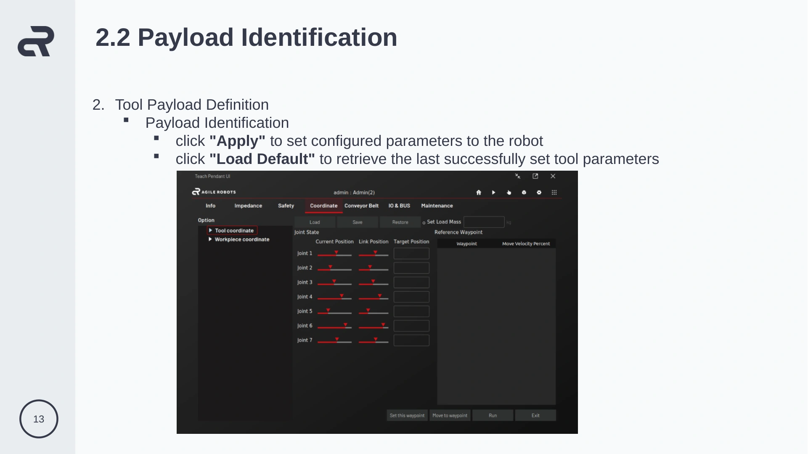



```
2.2 
Payload Identification
Tool Payload Definition
Payload Identification
click 
"Apply"
 to set configured parameters to the robot
click 
"Load Default"
 to retrieve the last successfully set tool parameters
```



## Slide 14

**Source:** EN\_3\_Definition\_Coordinate\_Systems \_and\_Connection\_Endeffector.pptx, original slide 14.



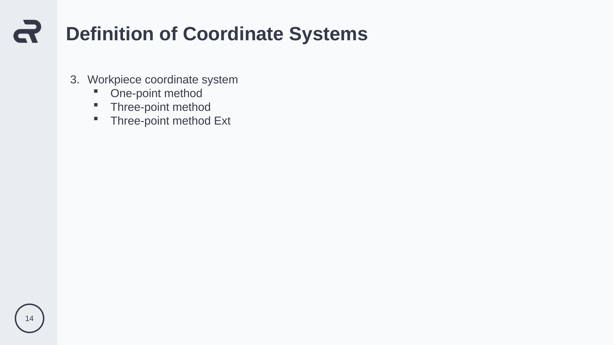



```
Definition of Coordinate Systems
Workpiece coordinate system
One-point method
Three-point method
Three-point method Ext
```



## Slide 15

**Source:** EN\_3\_Definition\_Coordinate\_Systems \_and\_Connection\_Endeffector.pptx, original slide 15.



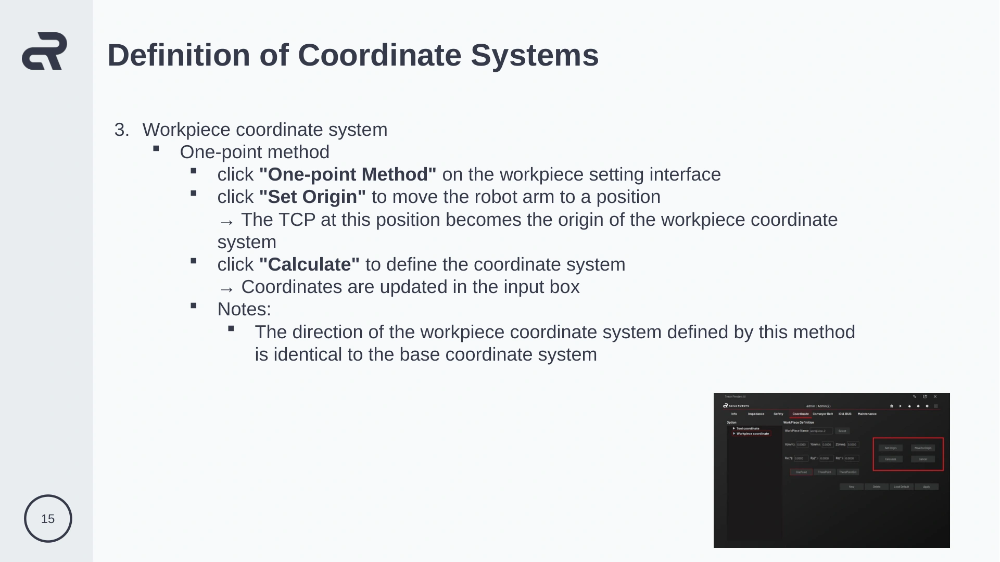



```
Definition of Coordinate Systems
Workpiece coordinate system
One-point method
click 
"One-point Method"
 on the workpiece setting interface
click 
"Set Origin"
 to move the robot arm to a position
→ The TCP at this position becomes the origin of the workpiece coordinate system
click 
"Calculate"
 to define the coordinate system
→ Coordinates are updated in the input box
Notes:
The direction of the workpiece coordinate system defined by this method is identical to the base coordinate system
```



## Slide 16

**Source:** EN\_3\_Definition\_Coordinate\_Systems \_and\_Connection\_Endeffector.pptx, original slide 16.



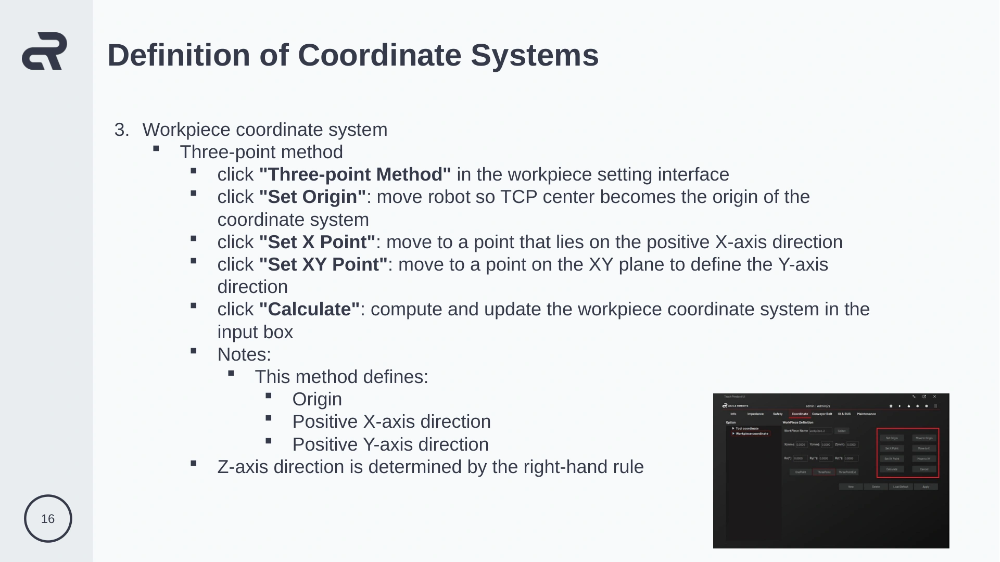



```
Definition of Coordinate Systems
Workpiece coordinate system
Three-point method
click 
"Three-point Method"
 in the workpiece setting interface
click 
"Set Origin"
: move robot so TCP center becomes the origin of the coordinate system
click 
"Set X Point"
: move to a point that lies on the positive X-axis direction
click 
"Set XY Point"
: move to a point on the XY plane to define the Y-axis direction
click 
"Calculate"
: compute and update the workpiece coordinate system in the input box
Notes:
This method defines:
Origin
Positive X-axis direction
Positive Y-axis direction
Z-axis direction is determined by the right-hand rule
```



## Slide 17

**Source:** EN\_3\_Definition\_Coordinate\_Systems \_and\_Connection\_Endeffector.pptx, original slide 17.



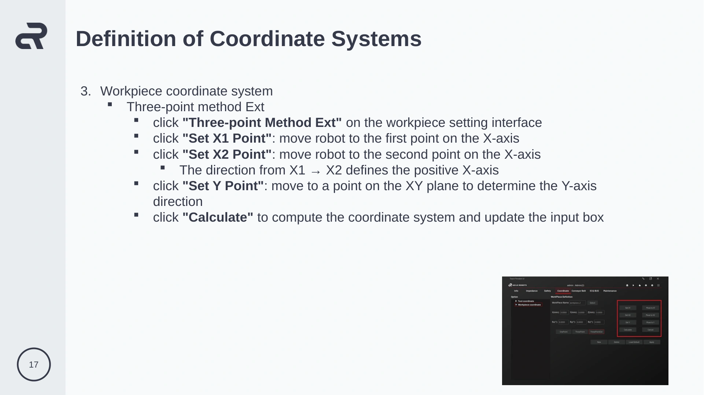



```
Definition of Coordinate Systems
Workpiece coordinate system
Three-point method Ext
click 
"Three-point Method Ext"
 on the workpiece setting interface
click 
"Set X1 Point"
: move robot to the first point on the X-axis
click 
"Set X2 Point"
: move robot to the second point on the X-axis
The direction from X1 → X2 defines the positive X-axis
click 
"Set Y Point"
: move to a point on the XY plane to determine the Y-axis direction
click 
"Calculate"
 to compute the coordinate system and update the input box
```



## Slide 18

**Source:** EN\_3\_Definition\_Coordinate\_Systems \_and\_Connection\_Endeffector.pptx, original slide 18.



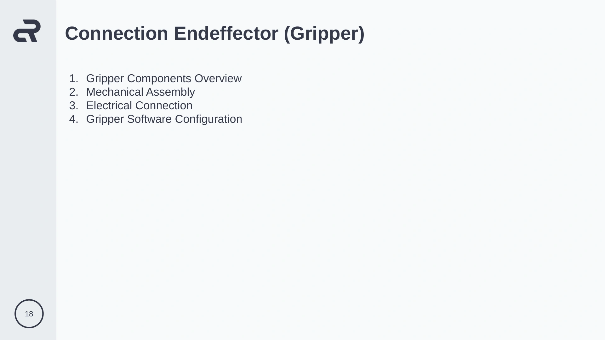



```
Connection 
Endeffector
 (Gripper)
Gripper Components Overview
Mechanical Assembly
Electrical Connection
Gripper Software Configuration
```



## Slide 19

**Source:** EN\_3\_Definition\_Coordinate\_Systems \_and\_Connection\_Endeffector.pptx, original slide 19.



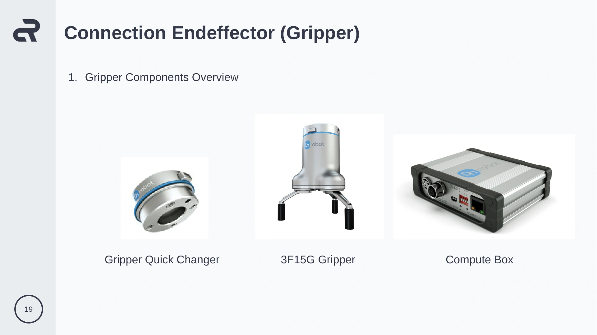



```
Connection 
Endeffector
 (Gripper)
Gripper Components Overview
3F15G
 
Gripper
Compute
 Box
Gripper Quick Changer
```



## Slide 20

**Source:** EN\_3\_Definition\_Coordinate\_Systems \_and\_Connection\_Endeffector.pptx, original slide 20.



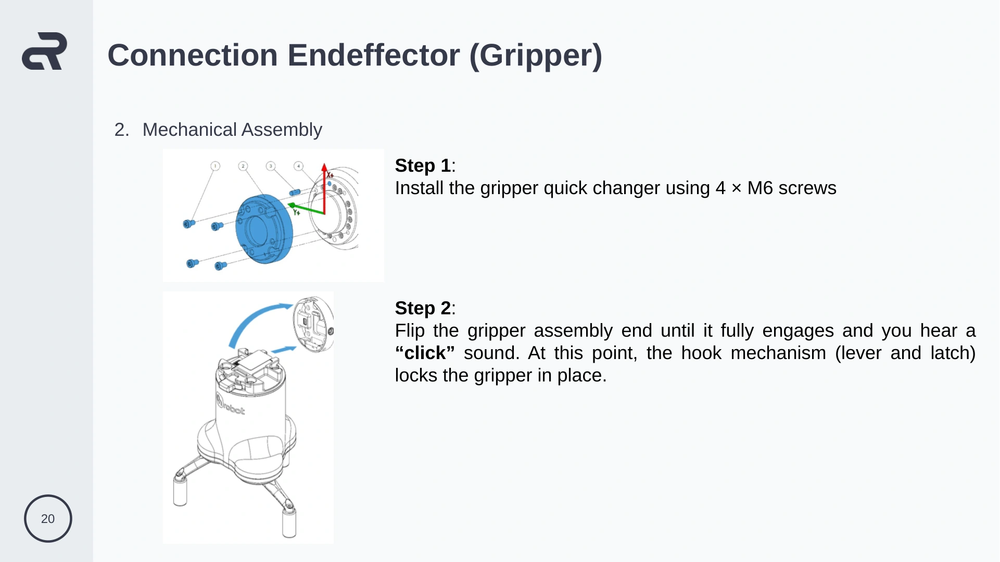



```
Connection 
Endeffector
 (Gripper)
Mechanical Assembly
Step
 1
: 
Install
 
the
 
gripper
 quick 
changer
 
using
 4 × M6 
screws
Step
 2
: 
Flip 
the
 
gripper
 
assembly
 end 
until
 
it
 fully 
engages
 and 
you
 
hear
 a 
“
click
”
 
sound
. At 
this
 
point
, 
the
 hook 
mechanism
 (
lever
 and 
latch
) 
locks
 
the
 
gripper
 in 
place
.
```



## Slide 21

**Source:** EN\_3\_Definition\_Coordinate\_Systems \_and\_Connection\_Endeffector.pptx, original slide 21.



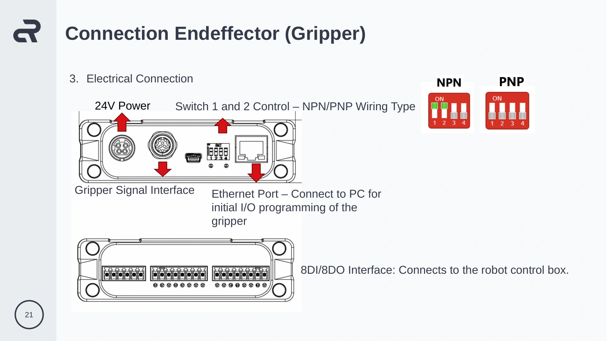



```
Gripper
 Signal Interface
Switch
 
1 and 2
 Control – NPN/PNP 
Wiring
 Type 
Ethernet Port – Connect 
to
 PC 
for
 initial I/O 
programming
 
of
 
the
 
gripper
8DI/8DO Interface: 
Connects
 
to
 
the
 
robot
 
control
 box.
24V Power
Connection 
Endeffector
 (Gripper)
Electrical Connection
```



## Slide 22

**Source:** EN\_3\_Definition\_Coordinate\_Systems \_and\_Connection\_Endeffector.pptx, original slide 22.



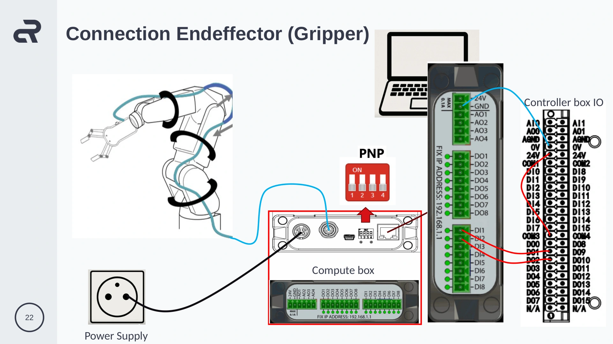



```
Compute box
Power Supply
Controller box IO
Connection 
Endeffector
 (Gripper)
```



## Slide 23

**Source:** EN\_3\_Definition\_Coordinate\_Systems \_and\_Connection\_Endeffector.pptx, original slide 23.



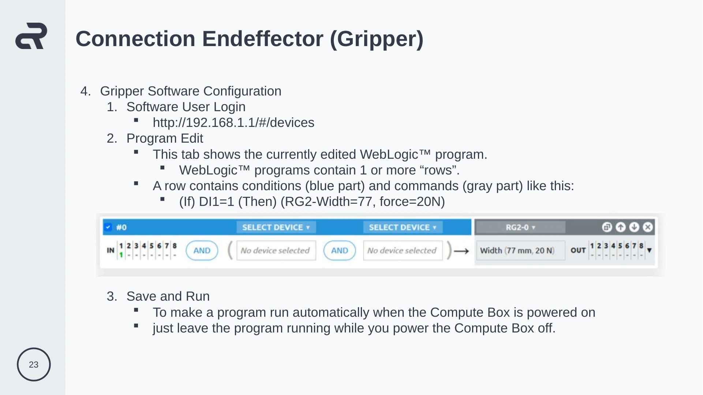



```
Connection 
Endeffector
 (Gripper)
Gripper Software Configuration
Software User Login
http://192.168.1.1/#/devices
Program Edit
This tab shows the currently edited WebLogic™ program.
WebLogic™ programs contain 1 or more “rows”.
A row contains conditions (blue part) and commands (gray part) like this:
(If) DI1=1 (Then) (RG2-Width=77, force=20N)
Save and Run
To make a program run automatically when the Compute Box is powered on
just leave the program running while you power the Compute Box off.
```



## Slide 24

**Source:** EN\_3\_Definition\_Coordinate\_Systems \_and\_Connection\_Endeffector.pptx, original slide 24.







No native selectable text is present on this page. The complete original artwork or screenshot remains in the Original page view.


