# Agile Robots training 4 — Interfaces and Programming — complete reference


**Complete supplied source:** EN\_4\_Interfaces\_and\_Programming.pptx · **Coverage:** 29 original slides. [Return to the Agile Robots source library](./).


Every source page is retained in the original order. The **Original page** view preserves complete diagrams, photographs, tables, equations, connector orientation, notices and examples. The **Searchable text** view preserves native PDF text or the slide’s native text, embedded links and substantive speaker notes. Text extraction can retain reading-order/character defects; use the original image for exact layout, table columns and code indentation.


Use only the exact model, hardware/controller and software revision covered by the source. Manufacturer examples involving motion, enabling, safety configuration, I/O, calibration, updates or resets require the complete applicable procedure and qualified personnel. No robot, SDK or process-equipment test was run.


**Attribution:** the manufacturer and contributors identified in the supplied document. Original notices remain visible on every source page. Navigation, revision notes and the linked engineering explanations are OpenELAB editorial additions.

**Training-copy scope:** these images are rendered reading copies of the supplied PPTX slides. The native file remains authoritative for fonts, presentation effects and editable objects. All original slide numbers, including closing or hidden slides, are retained. Any embedded motion video is linked separately below.

## Document navigation

| Source section / function                                        | Original page                                                    |
| ---------------------------------------------------------------- | ---------------------------------------------------------------- |
| Advanced Training                                                | [Slide 1](complete-en-4-interfaces-and-programming.md#slide-1)   |
| Interfaces and Programming                                       | [Slide 2](complete-en-4-interfaces-and-programming.md#slide-2)   |
| 1. Environment Setup and Preparation                             | [Slide 3](complete-en-4-interfaces-and-programming.md#slide-3)   |
| 1. Environment Setup and Preparation (2)                         | [Slide 4](complete-en-4-interfaces-and-programming.md#slide-4)   |
| 1. Environment Setup and Preparation (3)                         | [Slide 5](complete-en-4-interfaces-and-programming.md#slide-5)   |
| 2. API Usage Examples in Python                                  | [Slide 6](complete-en-4-interfaces-and-programming.md#slide-6)   |
| 2.1 System Call Function Description and Examples                | [Slide 7](complete-en-4-interfaces-and-programming.md#slide-7)   |
| 2.1 System Call Function Description and Examples (2)            | [Slide 8](complete-en-4-interfaces-and-programming.md#slide-8)   |
| 2.1 System Call Function Description and Examples (3)            | [Slide 9](complete-en-4-interfaces-and-programming.md#slide-9)   |
| 2.1 System Call Function Description and Examples (4)            | [Slide 10](complete-en-4-interfaces-and-programming.md#slide-10) |
| 2.1 System Call Function Description and Examples (5)            | [Slide 11](complete-en-4-interfaces-and-programming.md#slide-11) |
| 2.1 System Call Function Description and Examples (6)            | [Slide 12](complete-en-4-interfaces-and-programming.md#slide-12) |
| 2.2 Control Function Description and Examples                    | [Slide 13](complete-en-4-interfaces-and-programming.md#slide-13) |
| 2.2 Control Function Description and Examples (2)                | [Slide 14](complete-en-4-interfaces-and-programming.md#slide-14) |
| 2.2 Control Function Description and Examples (3)                | [Slide 15](complete-en-4-interfaces-and-programming.md#slide-15) |
| 2.2 Control Function Description and Examples (4)                | [Slide 16](complete-en-4-interfaces-and-programming.md#slide-16) |
| 2.2 Control Function Description and Examples (5)                | [Slide 17](complete-en-4-interfaces-and-programming.md#slide-17) |
| 2.2 Control Function Description and Examples (6)                | [Slide 18](complete-en-4-interfaces-and-programming.md#slide-18) |
| 2.2 Control Function Description and Examples (7)                | [Slide 19](complete-en-4-interfaces-and-programming.md#slide-19) |
| 2.2 Control Function Description and Examples (8)                | [Slide 20](complete-en-4-interfaces-and-programming.md#slide-20) |
| 2.2 Control Function Description and Examples (9)                | [Slide 21](complete-en-4-interfaces-and-programming.md#slide-21) |
| 2.2 Control Function Description and Examples (10)               | [Slide 22](complete-en-4-interfaces-and-programming.md#slide-22) |
| 2.3 External Communication Function Description and Examples     | [Slide 23](complete-en-4-interfaces-and-programming.md#slide-23) |
| 2.3 External Communication Function Description and Examples (2) | [Slide 24](complete-en-4-interfaces-and-programming.md#slide-24) |
| 2.3 External Communication Function Description and Examples (3) | [Slide 25](complete-en-4-interfaces-and-programming.md#slide-25) |
| 2.3 External Communication Function Description and Examples (4) | [Slide 26](complete-en-4-interfaces-and-programming.md#slide-26) |
| 2.3 External Communication Function Description and Examples (5) | [Slide 27](complete-en-4-interfaces-and-programming.md#slide-27) |
| 2.3 External Communication Function Description and Examples (6) | [Slide 28](complete-en-4-interfaces-and-programming.md#slide-28) |
| Slide 29                                                         | [Slide 29](complete-en-4-interfaces-and-programming.md#slide-29) |

## Slide 1

**Source:** EN\_4\_Interfaces\_and\_Programming.pptx, original slide 1.



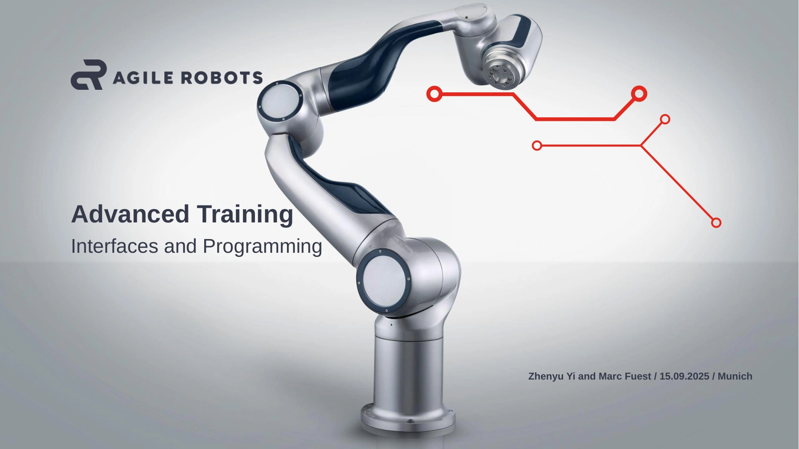



```
Advanced Training
Interfaces and Programming
Zhenyu Yi
 and Marc Fuest 
/
 15.09.2025 
/
 
Munich
```



## Slide 2

**Source:** EN\_4\_Interfaces\_and\_Programming.pptx, original slide 2.



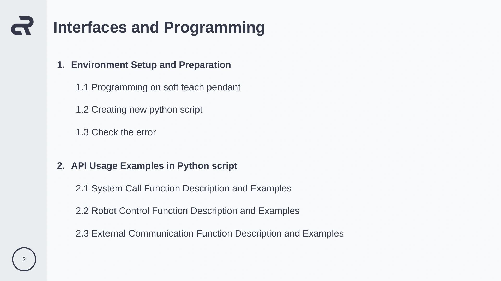



```
Interfaces and Programming
Environment Setup and Preparation
1.1 Programming on soft teach pendant
1.2 Creating new python script
1.3 Check the error
API Usage Examples in Python script
2.1 
System Call Function Description and Examples
2.2 
Robot Control Function Description and Examples
2.3 
External Communication Function Description and Examples
```



## Slide 3

**Source:** EN\_4\_Interfaces\_and\_Programming.pptx, original slide 3.



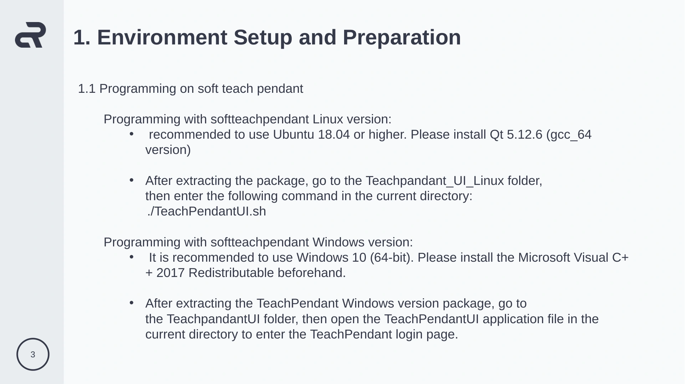



```
1. Environment Setup and Preparation
1.1 Programming on soft teach pendant
Programming with 
softteachpendant
 Linux version:
 recommended to use Ubuntu 18.04 or higher. Please install Qt 5.12.6 (gcc_64 version)
After extracting the package, go to the 
Teachpandant_UI_Linux
 folder,
then enter the following command in the current directory:
     ./TeachPendantUI.sh
Programming with 
softteachpendant
 Windows version:
 It is recommended to use Windows 10 (64-bit). Please install the Microsoft Visual C++ 2017 Redistributable beforehand
.
After extracting the 
TeachPendant
 Windows version package, go to the 
TeachpandantUI
 folder, then open the 
TeachPendantUI
 application file in the current directory to enter the 
TeachPendant
 login page.
```



## Slide 4

**Source:** EN\_4\_Interfaces\_and\_Programming.pptx, original slide 4.



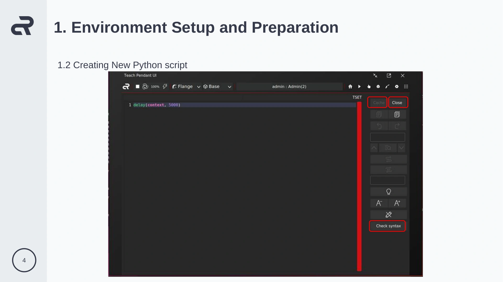



```
1. Environment Setup and Preparation
1.2 Creating New Python script
```



## Slide 5

**Source:** EN\_4\_Interfaces\_and\_Programming.pptx, original slide 5.



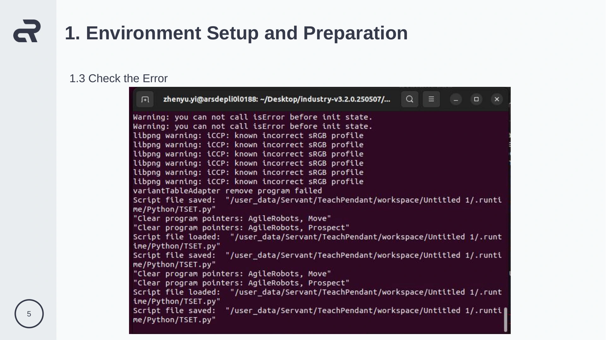



```
1. Environment Setup and Preparation
1.3 Check the Error
```



## Slide 6

**Source:** EN\_4\_Interfaces\_and\_Programming.pptx, original slide 6.



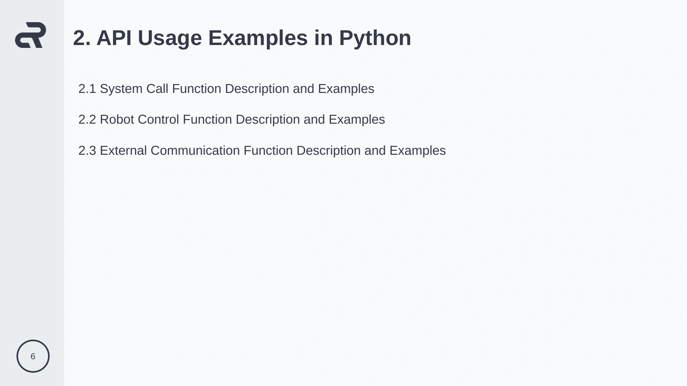



```
2.
 API Usage Examples in Python
2.1 
System Call Function Description and Examples
2.2 
Robot Control Function Description and Examples
2.3 
External Communication Function Description and Examples
```



## Slide 7

**Source:** EN\_4\_Interfaces\_and\_Programming.pptx, original slide 7.



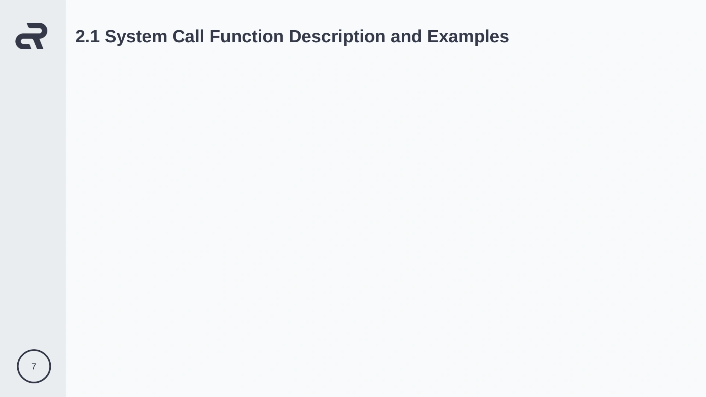



```
2.1 System Call Function Description and Examples
```



## Slide 8

**Source:** EN\_4\_Interfaces\_and\_Programming.pptx, original slide 8.



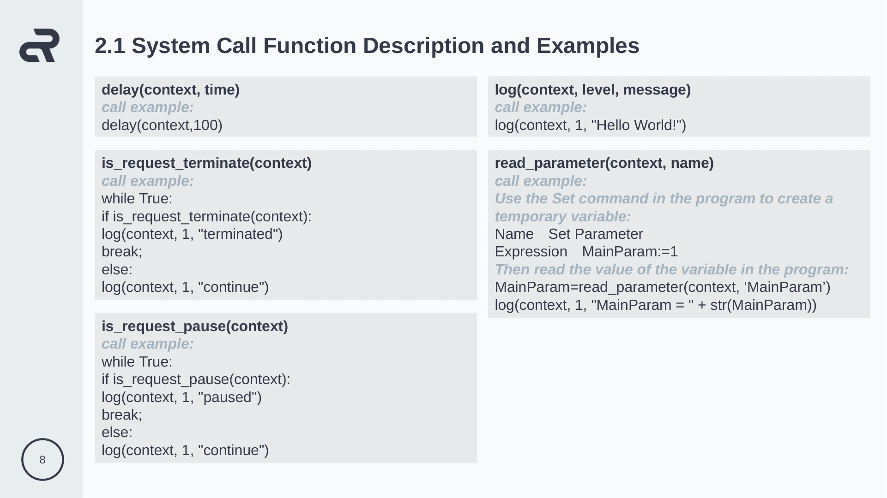



```
2.1 System Call Function Description and Examples
is_request_terminate
(context)
call example:
while True:
if 
is_request_terminate
(context):
log(context, 1, "terminated")
break;
else:
log(context, 1, "continue")
delay(context, time)
call example:
delay(context,100)
is_request_pause
(context)
call example:
while True:
if 
is_request_pause
(context):
log(context, 1, "paused")
break;
else:
log(context, 1, "continue")
log(context, level, message)
call example:
log(context, 1, "Hello World!")
read_parameter
(context, name)
call example:
Use the Set command in the program to create a temporary variable:
Name：Set
 Parameter
Expression：MainParam
:=1
Then read the value of the variable in the program:
MainParam=
read_parameter
(context, ‘MainParam’)
log(context, 1, "MainParam = " + str(MainParam))
```



## Slide 9

**Source:** EN\_4\_Interfaces\_and\_Programming.pptx, original slide 9.



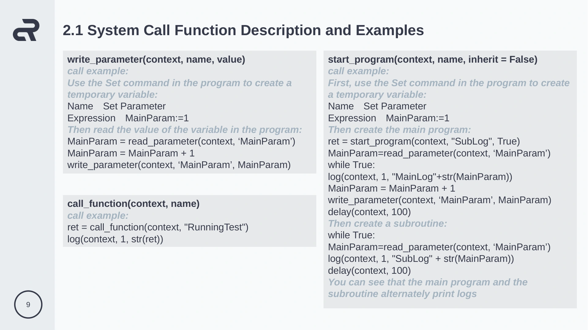



```
write_parameter
(context, name, value)
call example:
Use the Set command in the program to create a temporary variable:
Name：Set
 Parameter
Expression：MainParam
:=1
Then read the value of the variable in the program:
MainParam = 
read_parameter
(context, ‘MainParam’)
MainParam = MainParam + 1
write_parameter
(context, ‘MainParam’, MainParam)
start_program
(context, name, inherit = False)
call example:
First, use the Set command in the program to create a temporary variable:
Name：Set
 Parameter
Expression：MainParam
:=1
Then create the main program:
ret = 
start_program
(context, "
SubLog
", True)
MainParam=
read_parameter
(context, ‘MainParam’)
while True:
log(context, 1, "
MainLog
"+str(MainParam))
MainParam = MainParam + 1
write_parameter
(context, ‘MainParam’, MainParam)
delay(context, 100)
Then create a subroutine:
while True:
MainParam=
read_parameter
(context, ‘MainParam’)
log(context, 1, "
SubLog
" + str(MainParam))
delay(context, 100)
You can see that the main program and the subroutine alternately print logs
call_function
(context, name)
call example:
ret = 
call_function
(context, "
RunningTest
")
log(context, 1, str(ret))
2.1 System Call Function Description and Examples
```



## Slide 10

**Source:** EN\_4\_Interfaces\_and\_Programming.pptx, original slide 10.



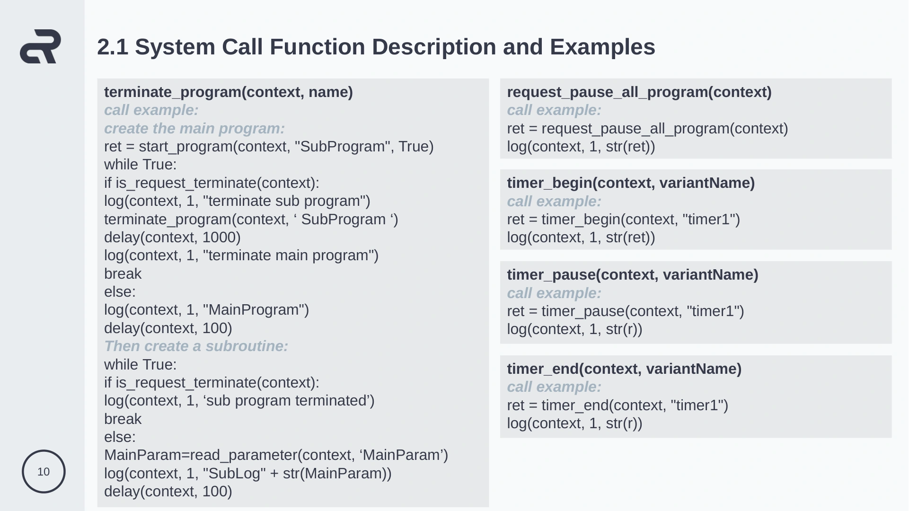



```
terminate_program
(context, name)
call example:
create the main program:
ret = 
start_program
(context, "
SubProgram
", True)
while True:
if 
is_request_terminate
(context):
log(context, 1, "terminate sub program")
terminate_program
(context, ‘ 
SubProgram
 ‘)
delay(context, 1000)
log(context, 1, "terminate main program")
break
else:
log(context, 1, "
MainProgram
")
delay(context, 100)
Then create a subroutine:
while True:
if 
is_request_terminate
(context):
log(context, 1, ‘sub program terminated’)
break
else:
MainParam=
read_parameter
(context, ‘MainParam’)
log(context, 1, "
SubLog
" + str(MainParam))
delay(context, 100)
request_pause_all_program
(context)
call example:
ret = 
request_pause_all_program
(context)
log(context, 1, str(ret))
timer_begin
(context, 
variantName
) 
call example:
ret = 
timer_begin
(context, "timer1")
log(context, 1, str(ret))
timer_pause
(context, 
variantName
)
call example:
ret = 
timer_pause
(context, "timer1")
log(context, 1, str(r))
timer_end
(context, 
variantName
)
call example:
ret = 
timer_end
(context, "timer1")
log(context, 1, str(r))
2.1 System Call Function Description and Examples
```



## Slide 11

**Source:** EN\_4\_Interfaces\_and\_Programming.pptx, original slide 11.



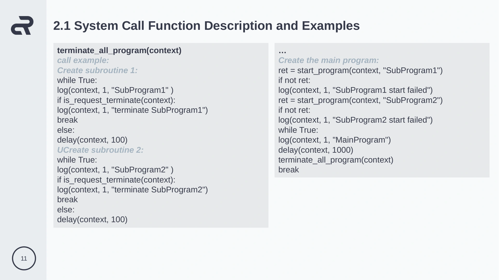



```
terminate_all_program
(context)
call example:
Create subroutine 1:
while True:
log(context, 1, "SubProgram1" )
if 
is_request_terminate
(context):
log(context, 1, "terminate SubProgram1")
break
else:
delay(context, 100)
UCreate subroutine 2:
while True:
log(context, 1, "SubProgram2" )
if 
is_request_terminate
(context):
log(context, 1, "terminate SubProgram2")
break
else:
delay(context, 100)
…
Create the main program:
ret = 
start_program
(context, "SubProgram1")
if not ret:
log(context, 1, "SubProgram1 start failed")
ret = 
start_program
(context, "SubProgram2")
if not ret:
log(context, 1, "SubProgram2 start failed")
while True:
log(context, 1, "
MainProgram
")
delay(context, 1000)
terminate_all_program
(context)
break
2.1 System Call Function Description and Examples
```



## Slide 12

**Source:** EN\_4\_Interfaces\_and\_Programming.pptx, original slide 12.



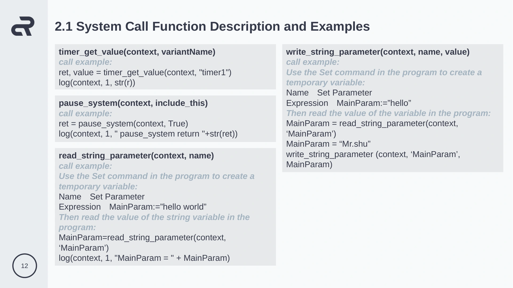



```
timer_get_value
(context, 
variantName
)
call example:
ret, value = 
timer_get_value
(context, "timer1")
log(context, 1, str(r))
write_string_parameter
(context, name, value)
call example:
Use the Set command in the program to create a temporary variable: 
Name：Set
 Parameter
Expression：MainParam
:=”hello”
Then read the value of the variable in the program:
MainParam = 
read_string_parameter
(context, ‘MainParam’)
MainParam = “
Mr.shu
”
write_string_parameter
 (context, ‘MainParam’, MainParam)
pause_system
(context, 
include_this
)
call example:
ret = 
pause_system
(context, True)
log(context, 1, " 
pause_system
 return "+str(ret))
read_string_parameter
(context, name)
call example:
Use the Set command in the program to create a temporary variable:
Name：Set
 Parameter
Expression：MainParam
:=”hello world”
Then read the value of the string variable in the program:
MainParam=
read_string_parameter
(context, ‘MainParam’)
log(context, 1, "MainParam = " + MainParam)
2.1 System Call Function Description and Examples
```



## Slide 13

**Source:** EN\_4\_Interfaces\_and\_Programming.pptx, original slide 13.







```
2.2 Control Function Description and Examples
```



## Slide 14

**Source:** EN\_4\_Interfaces\_and\_Programming.pptx, original slide 14.



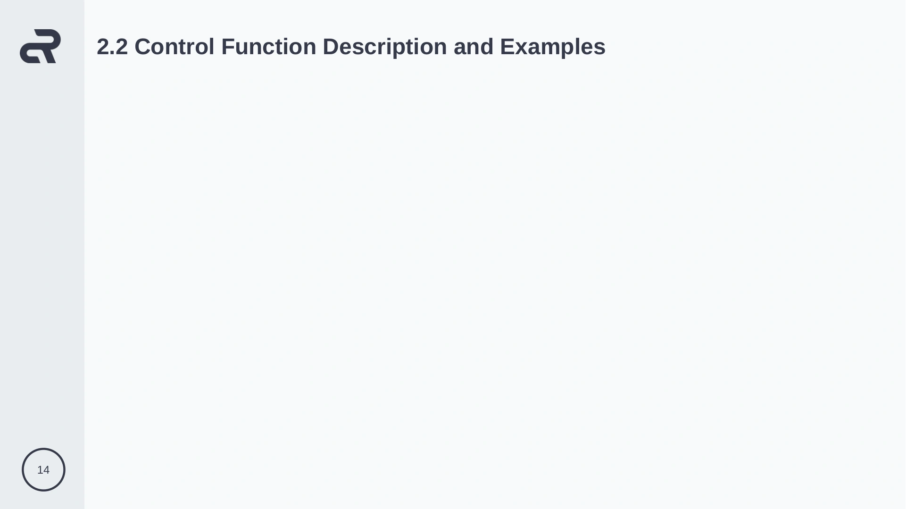



```
2.2 Control Function Description and Examples
```



## Slide 15

**Source:** EN\_4\_Interfaces\_and\_Programming.pptx, original slide 15.







```
2.2 Control Function Description and Examples
```



## Slide 16

**Source:** EN\_4\_Interfaces\_and\_Programming.pptx, original slide 16.



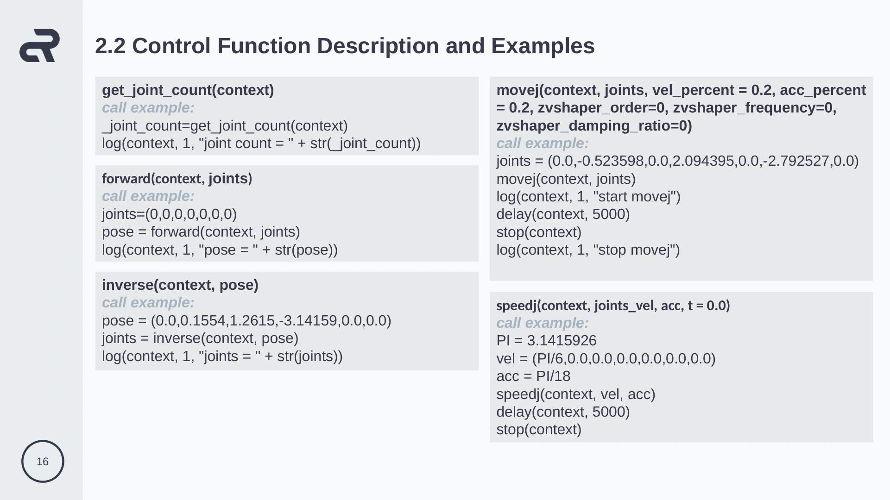



```
2.2 Control Function Description and Examples
get_joint_count
(context)
call example:
_
joint_count
=
get_joint_count
(context)
log(context, 1, "joint count = " + str(_
joint_count
))
movej
(context, joints, 
vel_percent
 = 0.2, 
acc_percent
 = 0.2, 
zvshaper_order
=0, 
zvshaper_frequency
=0,
zvshaper_damping_ratio
=0)
call example:
joints = (0.0,-0.523598,0.0,2.094395,0.0,-2.792527,0.0)
movej
(context, joints)
log(context, 1, "start 
movej
")
delay(context, 5000)
stop(context)
log(context, 1, "stop 
movej
")
forward(context, 
joints
)
call example:
joints=(0,0,0,0,0,0,0)
pose = forward(context, joints)
log(context, 1, "pose = " + str(pose))
inverse(context, pose)
call example:
pose = (0.0,0.1554,1.2615,-3.14159,0.0,0.0)
joints = inverse(context, pose)
log(context, 1, "joints = " + str(joints))
speedj
(context, 
joints_vel
, acc, t = 0.0)
call example:
PI = 3.1415926
vel = (PI/6,0.0,0.0,0.0,0.0,0.0,0.0)
acc = PI/18
speedj
(context, vel, acc)
delay(context, 5000)
stop(context)
```



## Slide 17

**Source:** EN\_4\_Interfaces\_and\_Programming.pptx, original slide 17.



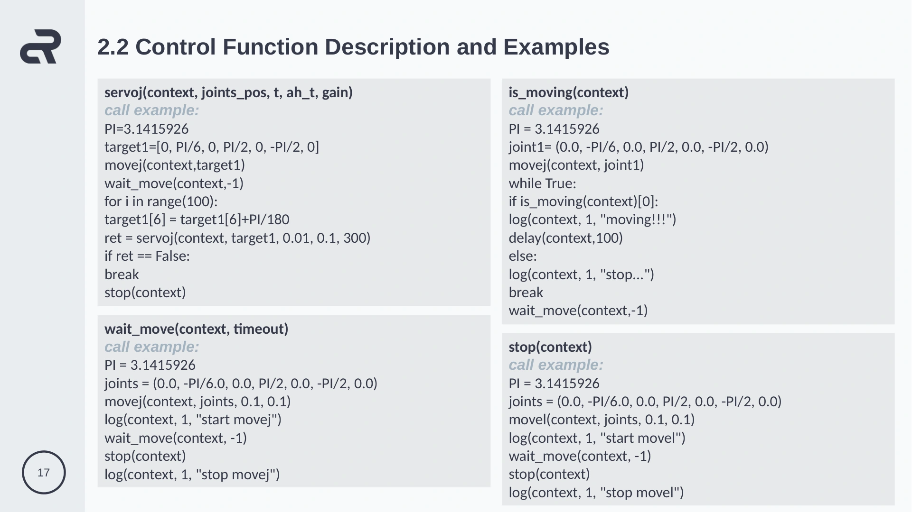



```
servoj
(context, 
joints_pos
, t, 
ah_t
, gain)
call example:
PI=3.1415926
target1=[0, PI/6, 0, PI/2, 0, -PI/2, 0]
movej
(context,target1)
wait_move
(context,-1)
for 
i
 in range(100):
target1[6] = target1[6]+PI/180
ret = 
servoj
(context, target1, 0.01, 0.1, 300)
if ret == False:
break
stop(context)
is_moving
(context)
call example:
PI = 3.1415926
joint1= (0.0, -PI/6, 0.0, PI/2, 0.0, -PI/2, 0.0)
movej
(context, joint1)
while True:
if 
is_moving
(context)[0]:
log(context, 1, "moving!!!")
delay(context,100)
else:
log(context, 1, "stop...")
break
wait_move
(context,-1)
wait_move
(context, timeout)
call example:
PI = 3.1415926
joints = (0.0, -PI/6.0, 0.0, PI/2, 0.0, -PI/2, 0.0)
movej
(context, joints, 0.1, 0.1)
log(context, 1, "start 
movej
")
wait_move
(context, -1)
stop(context)
log(context, 1, "stop 
movej
")
stop(context)
call example:
PI = 3.1415926
joints = (0.0, -PI/6.0, 0.0, PI/2, 0.0, -PI/2, 0.0)
movel
(context, joints, 0.1, 0.1)
log(context, 1, "start 
movel
")
wait_move
(context, -1)
stop(context)
log(context, 1, "stop 
movel
")
2.2 Control Function Description and Examples
```



## Slide 18

**Source:** EN\_4\_Interfaces\_and\_Programming.pptx, original slide 18.



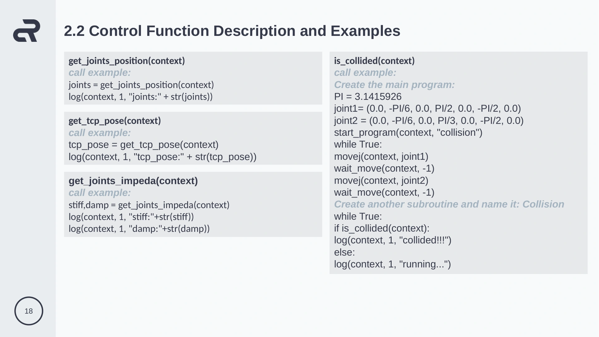



```
get_joints_position
(context)
call example:
joints = 
get_joints_position
(context)
log(context, 1, "joints:" + str(joints))
is_collided
(context)
call example:
Create the main program:
PI = 3.1415926
joint1= (0.0, -PI/6, 0.0, PI/2, 0.0, -PI/2, 0.0)
joint2 = (0.0, -PI/6, 0.0, PI/3, 0.0, -PI/2, 0.0)
start_program
(context, "collision")
while True:
movej
(context, joint1)
wait_move
(context, -1)
movej
(context, joint2)
wait_move
(context, -1)
Create another subroutine and name it: Collision
while True:
if 
is_collided
(context):
log(context, 1, "collided!!!")
else:
log(context, 1, "running...")
get_joints_impeda
(context)
call example:
stiff,damp
 = 
get_joints_impeda
(context)
log(context, 1, "stiff:"+str(stiff))
log(context, 1, "damp:"+str(damp))
get_tcp_pose
(context)
call example:
tcp_pose
 = 
get_tcp_pose
(context)
log(context, 1, "
tcp_pose
:" + str(
tcp_pose
))
2.2 Control Function Description and Examples
```



## Slide 19

**Source:** EN\_4\_Interfaces\_and\_Programming.pptx, original slide 19.



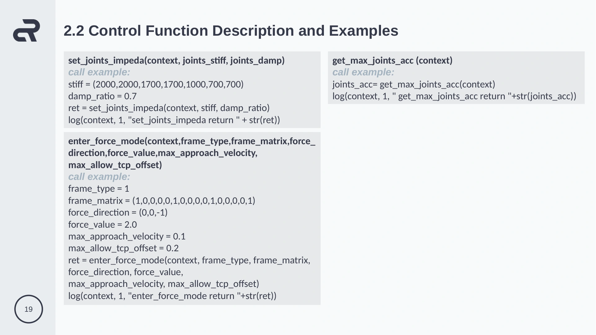



```
get_max_joints_acc
 (context)
call example:
joints_acc
= 
get_max_joints_acc
(context)
log(context, 1, " 
get_max_joints_acc
 return "+str(
joints_acc
))
set_joints_impeda
(context, 
joints_stiff
, 
joints_damp
)
call example:
stiff = (2000,2000,1700,1700,1000,700,700)
damp_ratio
 = 0.7
ret = 
set_joints_impeda
(context, stiff, 
damp_ratio
)
log(context, 1, "
set_joints_impeda
 return " + str(ret))
enter_force_mode
(context,frame_type,frame_matrix,force_direction,force_value,max_approach_velocity,
max_allow_tcp_offset
)
call example:
frame_type
 = 1
frame_matrix
 = (1,0,0,0,0,1,0,0,0,0,1,0,0,0,0,1)
force_direction
 = (0,0,-1)
force_value
 = 2.0
max_approach_velocity
 = 0.1
max_allow_tcp_offset
 = 0.2
ret = 
enter_force_mode
(context, 
frame_type
, 
frame_matrix
, 
force_direction
, 
force_value
,
max_approach_velocity
, 
max_allow_tcp_offset
)
log(context, 1, "
enter_force_mode
 return "+str(ret))
2.2 Control Function Description and Examples
```



## Slide 20

**Source:** EN\_4\_Interfaces\_and\_Programming.pptx, original slide 20.



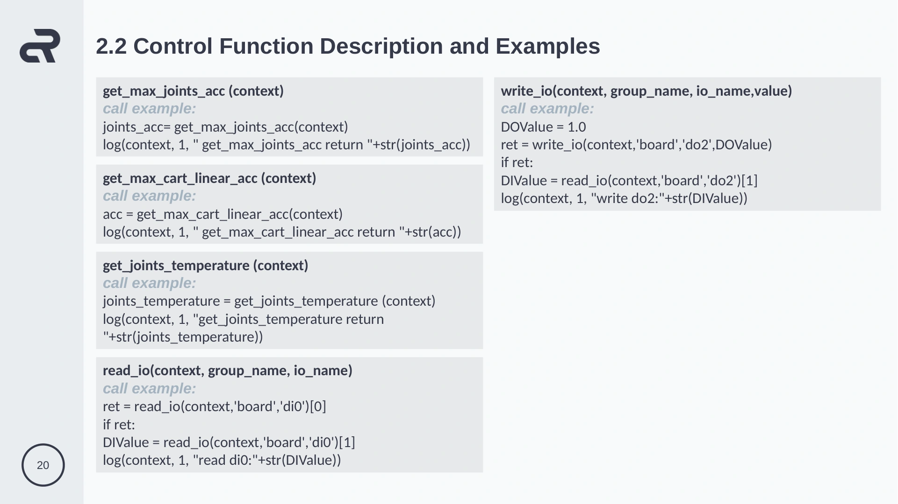



```
write_io
(context, 
group_name
, 
io_name,value
)
call example:
DOValue
 = 1.0
ret = 
write_io
(context,'board','do2',DOValue)
if ret:
DIValue
 = 
read_io
(context,'board','do2')[1]
log(context, 1, "write do2:"+str(
DIValue
))
get_max_joints_acc
 (context)
call example:
joints_acc
= 
get_max_joints_acc
(context)
log(context, 1, " 
get_max_joints_acc
 return "+str(
joints_acc
))
get_max_cart_linear_acc
 (context)
call example:
acc = 
get_max_cart_linear_acc
(context)
log(context, 1, " 
get_max_cart_linear_acc
 return "+str(acc))
get_joints_temperature
 (context)
call example:
joints_temperature
 = 
get_joints_temperature
 (context)
log(context, 1, "
get_joints_temperature
 return "+str(
joints_temperature
))
read_io
(context, 
group_name
, 
io_name
)
call example:
ret = 
read_io
(context,'board','di0')[0]
if ret:
DIValue
 = 
read_io
(context,'board','di0')[1]
log(context, 1, "read di0:"+str(
DIValue
))
2.2 Control Function Description and Examples
```



## Slide 21

**Source:** EN\_4\_Interfaces\_and\_Programming.pptx, original slide 21.



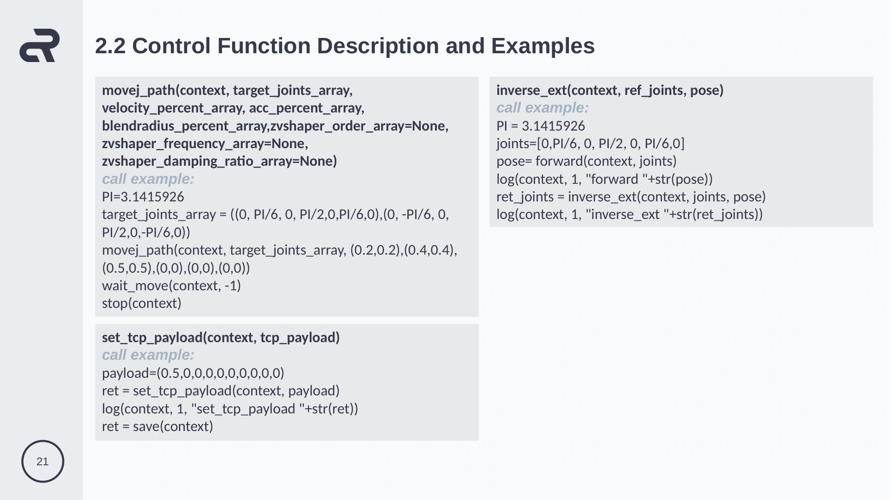



```
inverse_ext
(context, 
ref_joints
, pose)
call example:
PI = 3.1415926
joints=[0,PI/6, 0, PI/2, 0, PI/6,0]
pose= forward(context, joints)
log(context, 1, "forward "+str(pose))
ret_joints
 = 
inverse_ext
(context, joints, pose)
log(context, 1, "
inverse_ext
 "+str(
ret_joints
))
movej_path
(context, 
target_joints_array
, 
velocity_percent_array
, 
acc_percent_array
,
blendradius_percent_array,zvshaper_order_array
=None, 
zvshaper_frequency_array
=None,
zvshaper_damping_ratio_array
=None)
call example:
PI=3.1415926
target_joints_array
 = ((0, PI/6, 0, PI/2,0,PI/6,0),(0, -PI/6, 0, PI/2,0,-PI/6,0))
movej_path
(context, 
target_joints_array
, (0.2,0.2),(0.4,0.4),(0.5,0.5),(0,0),(0,0),(0,0))
wait_move
(context, -1)
stop(context)
set_tcp_payload
(context, 
tcp_payload
)
call example:
payload=(0.5,0,0,0,0,0,0,0,0,0)
ret = 
set_tcp_payload
(context, payload)
log(context, 1, "
set_tcp_payload
 "+str(ret))
ret = save(context)
2.2 Control Function Description and Examples
```



## Slide 22

**Source:** EN\_4\_Interfaces\_and\_Programming.pptx, original slide 22.



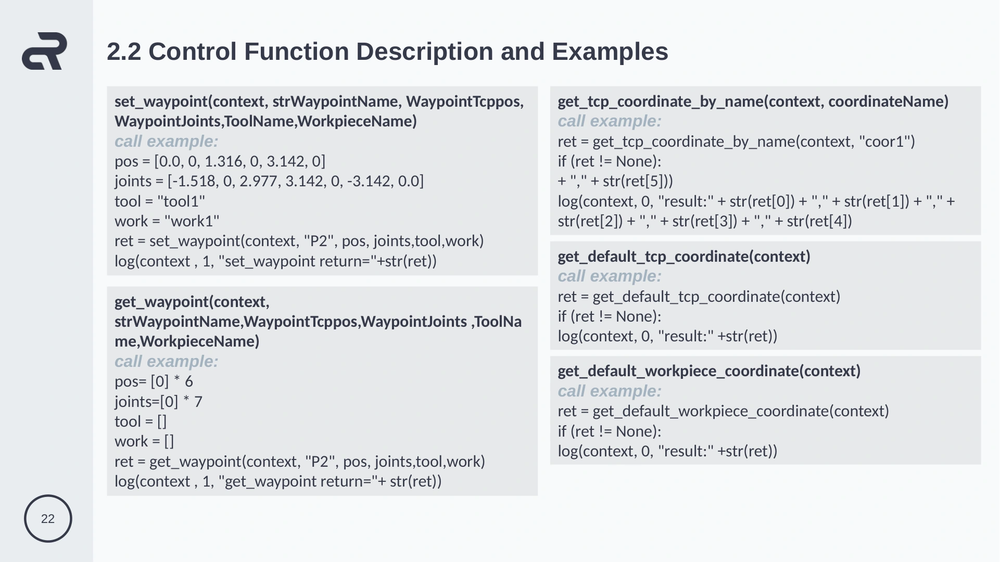



```
get_tcp_coordinate_by_name
(context, 
coordinateName
)
call example:
ret = 
get_tcp_coordinate_by_name
(context, "coor1")
if (ret != None):
+ "," + str(ret[5]))
log(context, 0, "result:" + str(ret[0]) + "," + str(ret[1]) + "," + str(ret[2]) + "," + str(ret[3]) + "," + str(ret[4])
set_waypoint
(context, 
strWaypointName
, 
WaypointTcppos
, 
WaypointJoints,ToolName,WorkpieceName
)
call example:
pos = [0.0, 0, 1.316, 0, 3.142, 0]
joints = [-1.518, 0, 2.977, 3.142, 0, -3.142, 0.0]
tool = "tool1"
work = "work1"
ret = 
set_waypoint
(context, "P2", pos, 
joints,tool,work
)
log(context , 1, "
set_waypoint
 return="+str(ret))
get_waypoint
(context, 
strWaypointName,WaypointTcppos,WaypointJoints
 ,
ToolName,WorkpieceName
)
call example:
pos= [0] * 6
joints=[0] * 7
tool = []
work = []
ret = 
get_waypoint
(context, "P2", pos, 
joints,tool,work
)
log(context , 1, "
get_waypoint
 return="+ str(ret))
get_default_tcp_coordinate
(context)
call example:
ret = 
get_default_tcp_coordinate
(context)
if (ret != None):
log(context, 0, "result:" +str(ret))
get_default_workpiece_coordinate
(context)
call example:
ret = 
get_default_workpiece_coordinate
(context)
if (ret != None):
log(context, 0, "result:" +str(ret))
2.2 Control Function Description and Examples
```



## Slide 23

**Source:** EN\_4\_Interfaces\_and\_Programming.pptx, original slide 23.



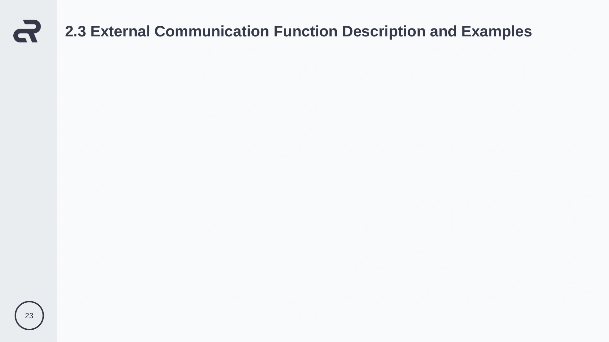



```
2.3 External Communication Function Description and Examples
```



## Slide 24

**Source:** EN\_4\_Interfaces\_and\_Programming.pptx, original slide 24.



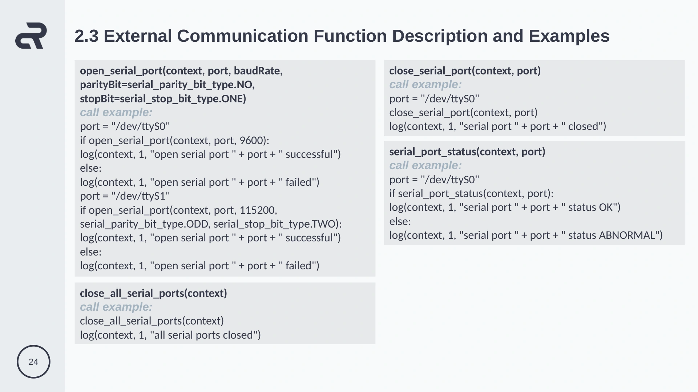



```
close_serial_port
(context, port)
call example:
port = "/dev/ttyS0"
close_serial_port
(context, port)
log(context, 1, "serial port " + port + " closed")
open_serial_port
(context, port, 
baudRate
, 
parityBit
=serial_parity_bit_type.NO,
stopBit
=serial_stop_bit_type.ONE)
call example:
port = "/dev/ttyS0"
if 
open_serial_port
(context, port, 9600):
log(context, 1, "open serial port " + port + " successful")
else:
log(context, 1, "open serial port " + port + " failed")
port = "/dev/ttyS1"
if 
open_serial_port
(context, port, 115200, 
serial_parity_bit_type.ODD
, 
serial_stop_bit_type.TWO
):
log(context, 1, "open serial port " + port + " successful")
else:
log(context, 1, "open serial port " + port + " failed")
close_all_serial_ports
(context)
call example:
close_all_serial_ports
(context)
log(context, 1, "all serial ports closed")
serial_port_status
(context, port)
call example:
port = "/dev/ttyS0"
if 
serial_port_status
(context, port):
log(context, 1, "serial port " + port + " status OK")
else:
log(context, 1, "serial port " + port + " status ABNORMAL")
2.3 External Communication Function Description and Examples
```



## Slide 25

**Source:** EN\_4\_Interfaces\_and\_Programming.pptx, original slide 25.



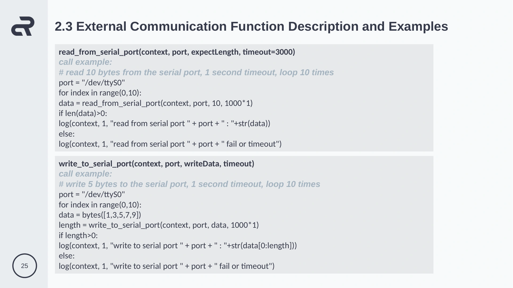



```
read_from_serial_port
(context, port, 
expectLength
, timeout=3000)
call example:
# read 10 bytes from the serial port, 1 second timeout, loop 10 times
port = "/dev/ttyS0"
for index in range(0,10):
data = 
read_from_serial_port
(context, port, 10, 1000*1)
if 
len
(data)>0:
log(context, 1, "read from serial port " + port + " : "+str(data))
else:
log(context, 1, "read from serial port " + port + " fail or timeout")
write_to_serial_port
(context, port, 
writeData
, timeout)
call example:
# write 5 bytes to the serial port, 1 second timeout, loop 10 times
port = "/dev/ttyS0"
for index in range(0,10):
data = bytes([1,3,5,7,9])
length = 
write_to_serial_port
(context, port, data, 1000*1)
if length>0:
log(context, 1, "write to serial port " + port + " : "+str(data[0:length]))
else:
log(context, 1, "write to serial port " + port + " fail or timeout")
2.3 External Communication Function Description and Examples
```



## Slide 26

**Source:** EN\_4\_Interfaces\_and\_Programming.pptx, original slide 26.



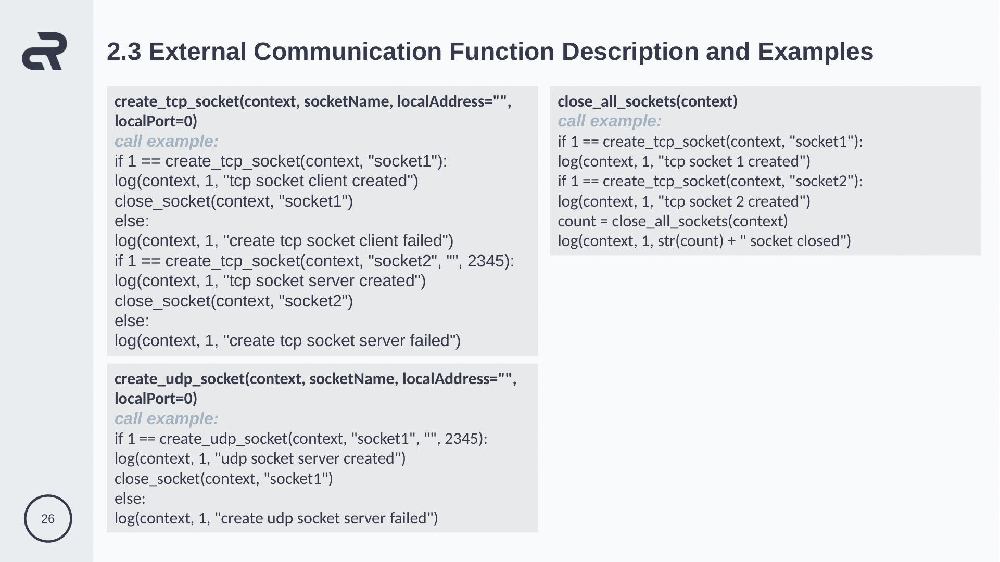



```
close_all_sockets
(context)
call example:
if 1 == 
create_tcp_socket
(context, "socket1"):
log(context, 1, "
tcp
 socket 1 created")
if 1 == 
create_tcp_socket
(context, "socket2"):
log(context, 1, "
tcp
 socket 2 created")
count = 
close_all_sockets
(context)
log(context, 1, str(count) + " socket closed")
create_tcp_socket
(context, 
socketName
, 
localAddress
="", 
localPort
=0)
call example:
if 1 == 
create_tcp_socket
(context, "socket1"):
log(context, 1, "
tcp
 socket client created")
close_socket
(context, "socket1")
else:
log(context, 1, "create 
tcp
 socket client failed")
if 1 == 
create_tcp_socket
(context, "socket2", "", 2345):
log(context, 1, "
tcp
 socket server created")
close_socket
(context, "socket2")
else:
log(context, 1, "create 
tcp
 socket server failed")
create_udp_socket
(context, 
socketName
, 
localAddress
="", 
localPort
=0)
call example:
if 1 == 
create_udp_socket
(context, "socket1", "", 2345):
log(context, 1, "
udp
 socket server created")
close_socket
(context, "socket1")
else:
log(context, 1, "create 
udp
 socket server failed")
2.3 External Communication Function Description and Examples
```



## Slide 27

**Source:** EN\_4\_Interfaces\_and\_Programming.pptx, original slide 27.



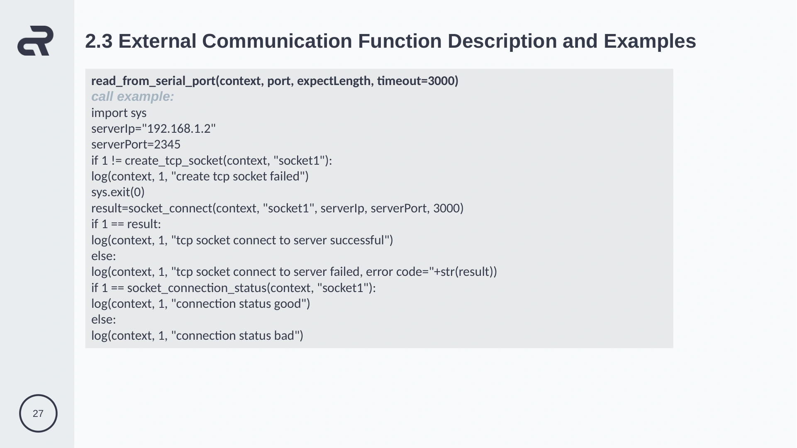



```
read_from_serial_port
(context, port, 
expectLength
, timeout=3000)
call example:
import sys
serverIp
="192.168.1.2"
serverPort
=2345
if 1 != 
create_tcp_socket
(context, "socket1"):
log(context, 1, "create 
tcp
 socket failed")
sys.exit
(0)
result=
socket_connect
(context, "socket1", 
serverIp
, 
serverPort
, 3000)
if 1 == result:
log(context, 1, "
tcp
 socket connect to server successful")
else:
log(context, 1, "
tcp
 socket connect to server failed, error code="+str(result))
if 1 == 
socket_connection_status
(context, "socket1"):
log(context, 1, "connection status good")
else:
log(context, 1, "connection status bad")
2.3 External Communication Function Description and Examples
```



## Slide 28

**Source:** EN\_4\_Interfaces\_and\_Programming.pptx, original slide 28.



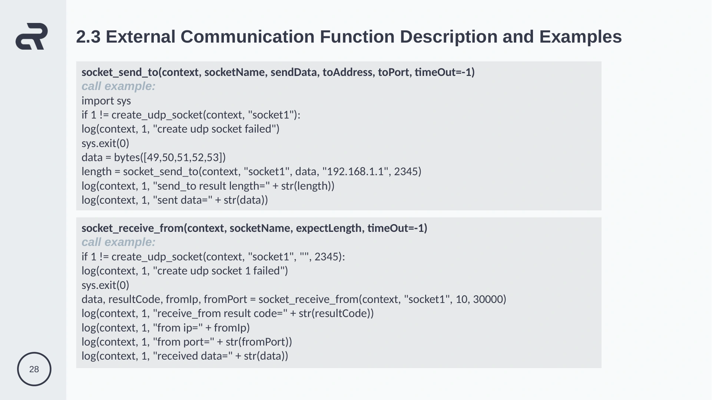



```
2.3 External Communication Function Description and Examples
socket_send_to
(context, 
socketName
, 
sendData
, 
toAddress
, 
toPort
, 
timeOut
=-1)
call example:
import sys
if 1 != 
create_udp_socket
(context, "socket1"):
log(context, 1, "create 
udp
 socket failed")
sys.exit
(0)
data = bytes([49,50,51,52,53])
length = 
socket_send_to
(context, "socket1", data, "192.168.1.1", 2345)
log(context, 1, "
send_to
 result length=" + str(length))
log(context, 1, "sent data=" + str(data))
socket_receive_from
(context, 
socketName
, 
expectLength
, 
timeOut
=-1)
call example:
if 1 != 
create_udp_socket
(context, "socket1", "", 2345):
log(context, 1, "create 
udp
 socket 1 failed")
sys.exit
(0)
data, 
resultCode
, 
fromIp
, 
fromPort
 = 
socket_receive_from
(context, "socket1", 10, 30000)
log(context, 1, "
receive_from
 result code=" + str(
resultCode
))
log(context, 1, "from 
ip
=" + 
fromIp
)
log(context, 1, "from port=" + str(
fromPort
))
log(context, 1, "received data=" + str(data))
```



## Slide 29

**Source:** EN\_4\_Interfaces\_and\_Programming.pptx, original slide 29.







No native selectable text is present on this page. The complete original artwork or screenshot remains in the Original page view.


