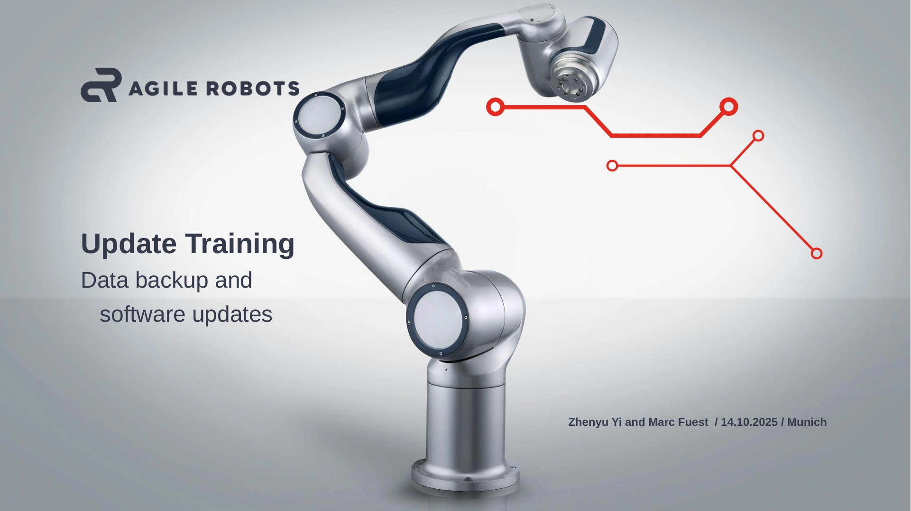
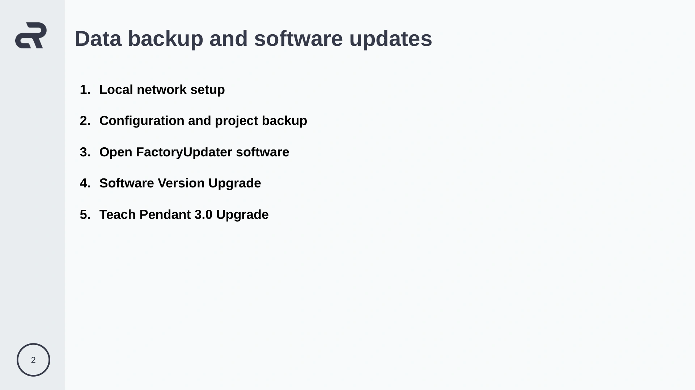
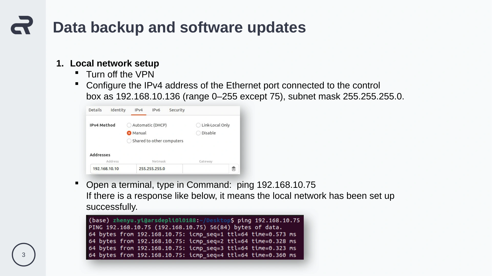
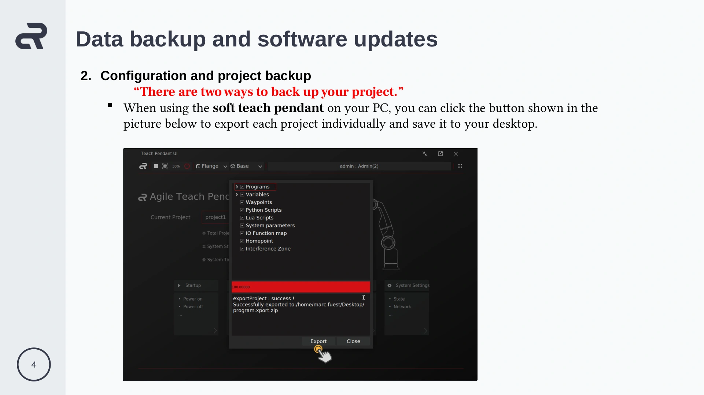
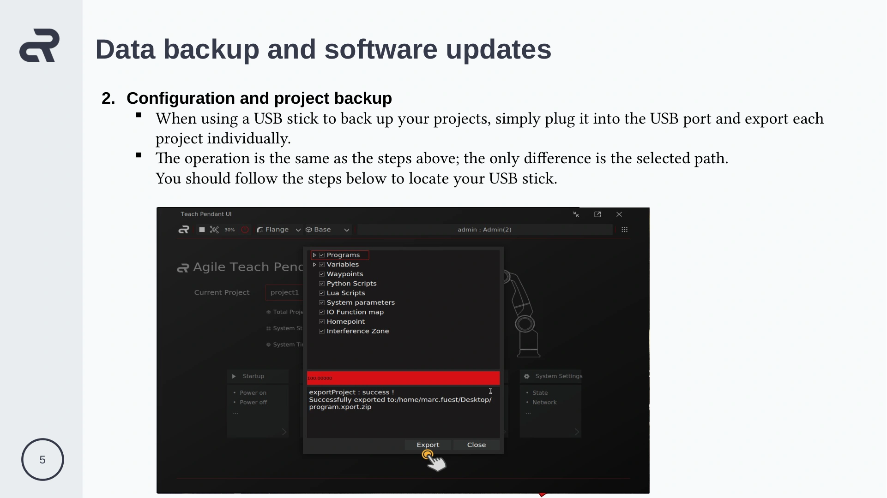
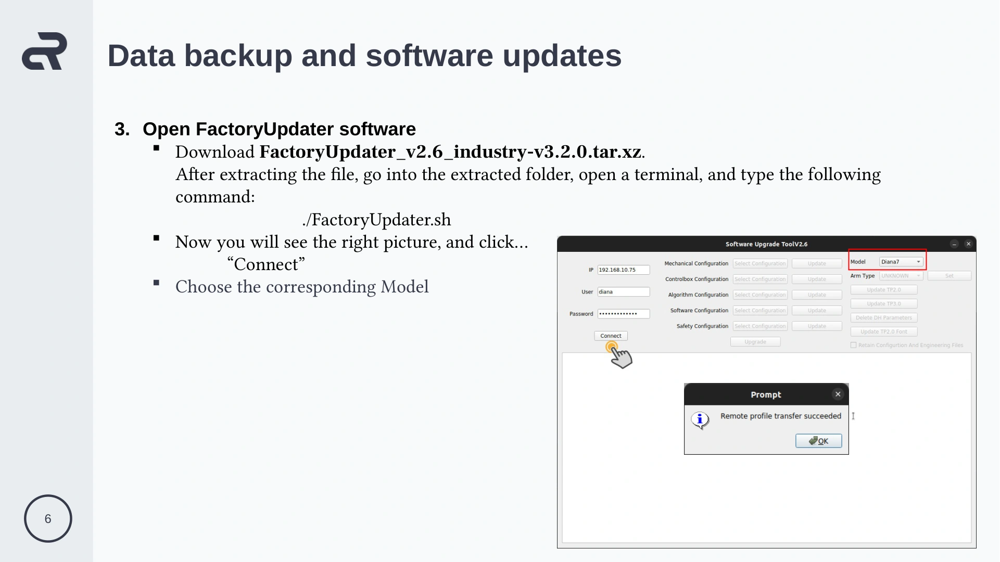
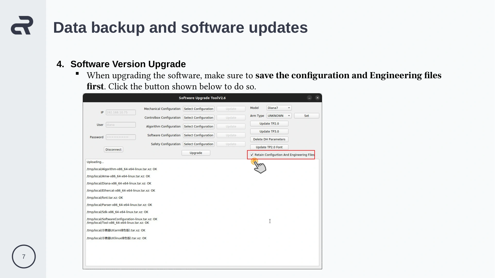
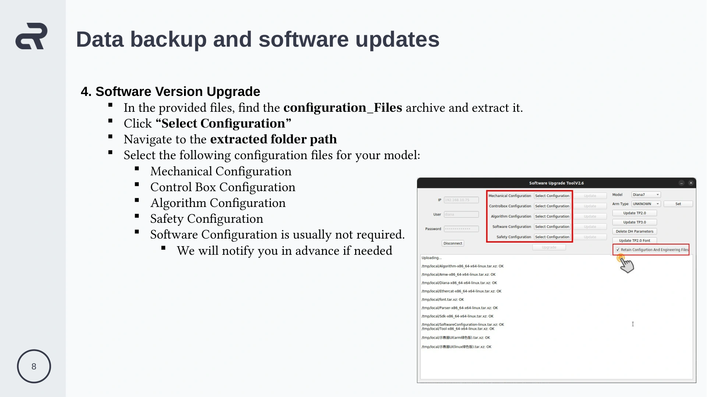
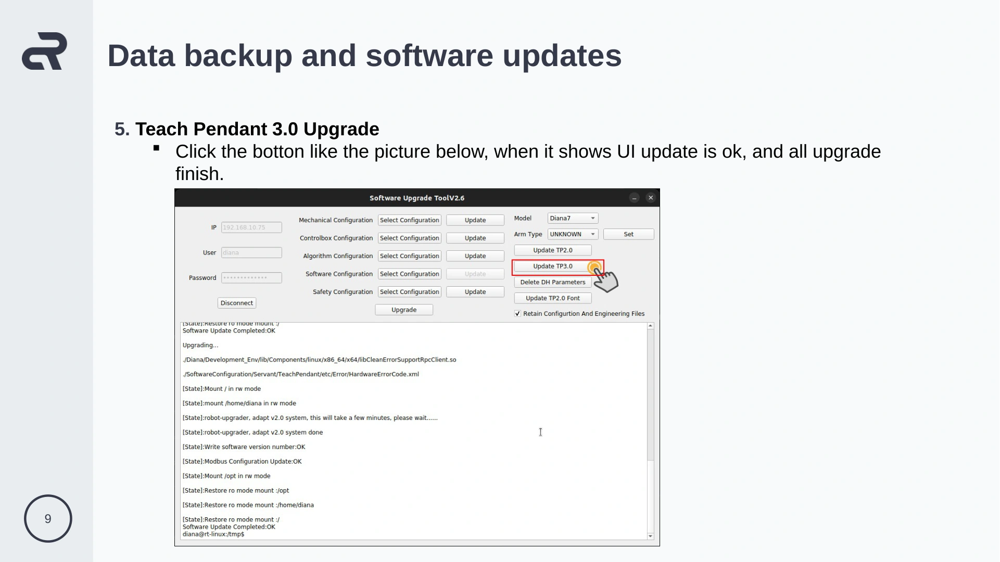

# Agile Robots training 5 — Backup and Updates — complete reference


**Complete supplied source:** EN\_5\_Data\_backup\_and\_software\_updates.pptx · **Coverage:** 10 original slides. [Return to the Agile Robots source library](./).


Every source page is retained in the original order. The **Original page** view preserves complete diagrams, photographs, tables, equations, connector orientation, notices and examples. The **Searchable text** view preserves native PDF text or the slide’s native text, embedded links and substantive speaker notes. Text extraction can retain reading-order/character defects; use the original image for exact layout, table columns and code indentation.


The training uses a historical FactoryUpdater V2.6 / industry V3.2.0 example. It does not authorize applying that package or another model configuration to a V3.3 system. In the shown /24 network, .0 and .255 are not ordinary host choices, despite the slide’s 0–255 wording. Use an approved unused host address and recoverable network configuration; preserve configuration, project and rollback evidence before an authorized update.


**Attribution:** the manufacturer and contributors identified in the supplied document. Original notices remain visible on every source page. Navigation, revision notes and the linked engineering explanations are OpenELAB editorial additions.

**Training-copy scope:** these images are rendered reading copies of the supplied PPTX slides. The native file remains authoritative for fonts, presentation effects and editable objects. All original slide numbers, including closing or hidden slides, are retained. Any embedded motion video is linked separately below.

## Document navigation

| Source section / function            | Original page                                                          |
| ------------------------------------ | ---------------------------------------------------------------------- |
| Update Training                      | [Slide 1](complete-en-5-data-backup-and-software-updates.md#slide-1)   |
| Data backup and software updates     | [Slide 2](complete-en-5-data-backup-and-software-updates.md#slide-2)   |
| Data backup and software updates (2) | [Slide 3](complete-en-5-data-backup-and-software-updates.md#slide-3)   |
| Data backup and software updates (3) | [Slide 4](complete-en-5-data-backup-and-software-updates.md#slide-4)   |
| Data backup and software updates (4) | [Slide 5](complete-en-5-data-backup-and-software-updates.md#slide-5)   |
| Data backup and software updates (5) | [Slide 6](complete-en-5-data-backup-and-software-updates.md#slide-6)   |
| Data backup and software updates (6) | [Slide 7](complete-en-5-data-backup-and-software-updates.md#slide-7)   |
| Data backup and software updates (7) | [Slide 8](complete-en-5-data-backup-and-software-updates.md#slide-8)   |
| Data backup and software updates (8) | [Slide 9](complete-en-5-data-backup-and-software-updates.md#slide-9)   |
| Slide 10                             | [Slide 10](complete-en-5-data-backup-and-software-updates.md#slide-10) |

## Slide 1

**Source:** EN\_5\_Data\_backup\_and\_software\_updates.pptx, original slide 1.







```
Update Training
Data backup and 
   software updates
Zhenyu Yi 
and Marc Fuest  
/ 14.10.2025 / Munich
```



## Slide 2

**Source:** EN\_5\_Data\_backup\_and\_software\_updates.pptx, original slide 2.







```
Data backup and software updates
Local network setup
Configuration and project backup
Open 
FactoryUpdater
 software
Software Version Upgrade
Teach Pendant 3.0 Upgrade
```



## Slide 3

**Source:** EN\_5\_Data\_backup\_and\_software\_updates.pptx, original slide 3.







```
Local network setup
Turn off the VPN 
Configure the IPv4 address of the Ethernet port connected to the control box as 192.168.10.136 (range 0–255 except 75), subnet mask 255.255.255.0.
Open a terminal, type in Command:  ping 192.168.10.75
If there is a response like below, it means the local network has been set up successfully.
Data backup and software updates
```



## Slide 4

**Source:** EN\_5\_Data\_backup\_and\_software\_updates.pptx, original slide 4.







```
Configuration and project backup
	“There are two ways to back up your project.”
When using the 
soft teach pendant
 on your PC, you can click the button shown in the picture below to export each project individually and save it to your desktop.
Data backup and software updates
```



## Slide 5

**Source:** EN\_5\_Data\_backup\_and\_software\_updates.pptx, original slide 5.







```
Configuration and project backup
When using a USB stick to back up your projects, simply plug it into the USB port and export each project individually.
The operation is the same as the steps above; the only difference is the selected path.
You should follow the steps below to locate your USB stick.
Data backup and software updates
```



## Slide 6

**Source:** EN\_5\_Data\_backup\_and\_software\_updates.pptx, original slide 6.







```
Open 
FactoryUpdater
 software
Download 
FactoryUpdater_v2.6_industry-v3.2.0.tar.xz
.
After extracting the file, go into the extracted folder, open a terminal, and type the following command:          
		./FactoryUpdater.sh
Now you will see the right picture, and click…
	“Connect”
Choose the corresponding Model 
Data backup and software updates
```



## Slide 7

**Source:** EN\_5\_Data\_backup\_and\_software\_updates.pptx, original slide 7.







```
Software Version Upgrade
When upgrading the software, make sure to 
save the configuration and Engineering files first
. Click the button shown below to do so.
Data backup and software updates
```



## Slide 8

**Source:** EN\_5\_Data\_backup\_and\_software\_updates.pptx, original slide 8.







```
4. Software Version Upgrade
In the provided files, find the 
configuration_Files
 archive and extract it.
Click 
“Select 
Configuration”
Navigate to the 
extracted folder path
Select the following configuration files for your model:
Mechanical Configuration
Control Box Configuration
Algorithm Configuration
Safety Configuration
Software Configuration is usually not required.
We will notify you in advance if needed
Data backup and software updates
```



## Slide 9

**Source:** EN\_5\_Data\_backup\_and\_software\_updates.pptx, original slide 9.







```
5. 
Teach Pendant 3.0 Upgrade
Click the 
botton
 like the picture below, when it shows UI update is ok, and all upgrade finish.
Data backup and software updates
```



## Slide 10

**Source:** EN\_5\_Data\_backup\_and\_software\_updates.pptx, original slide 10.







No native selectable text is present on this page. The complete original artwork or screenshot remains in the Original page view.


