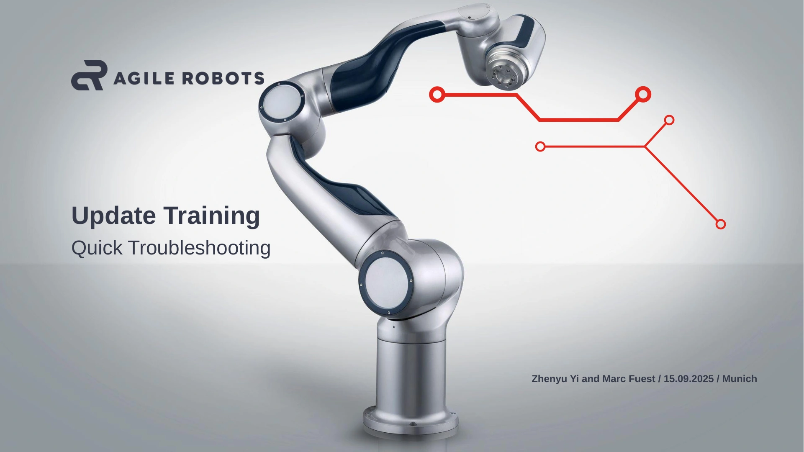
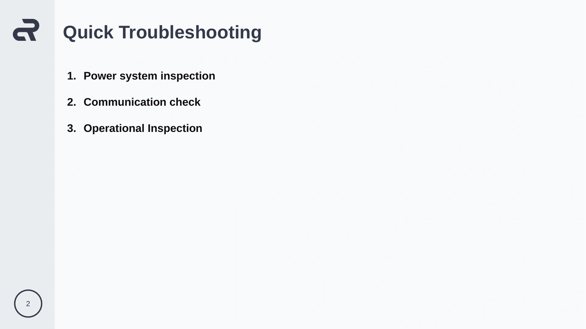
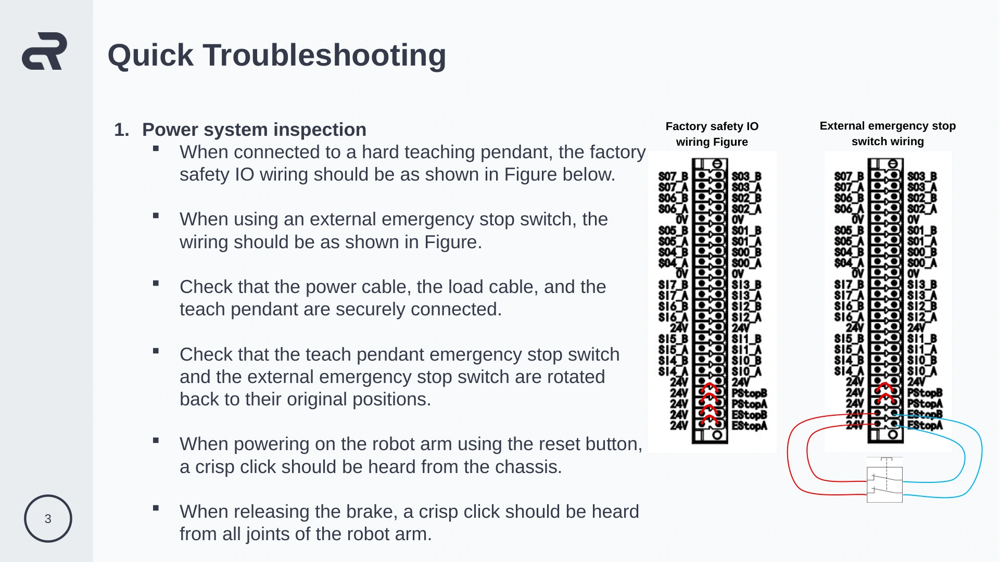
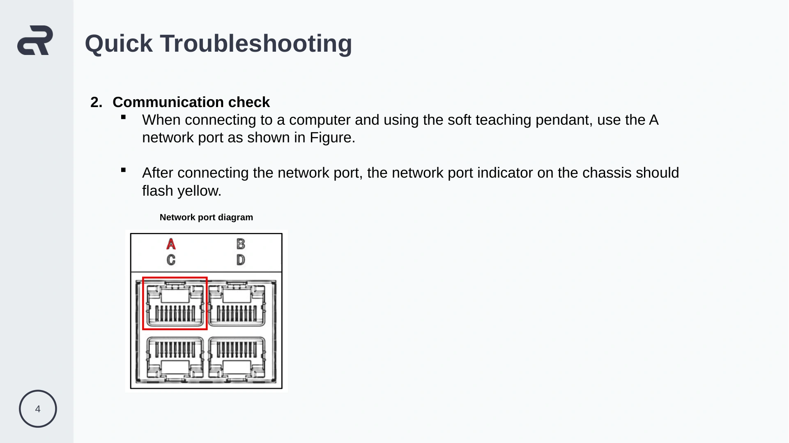
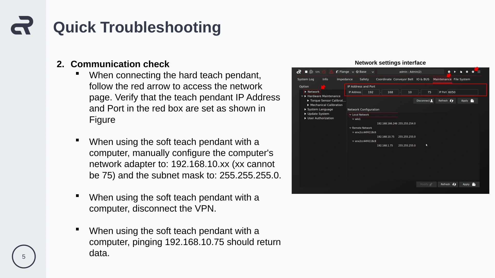
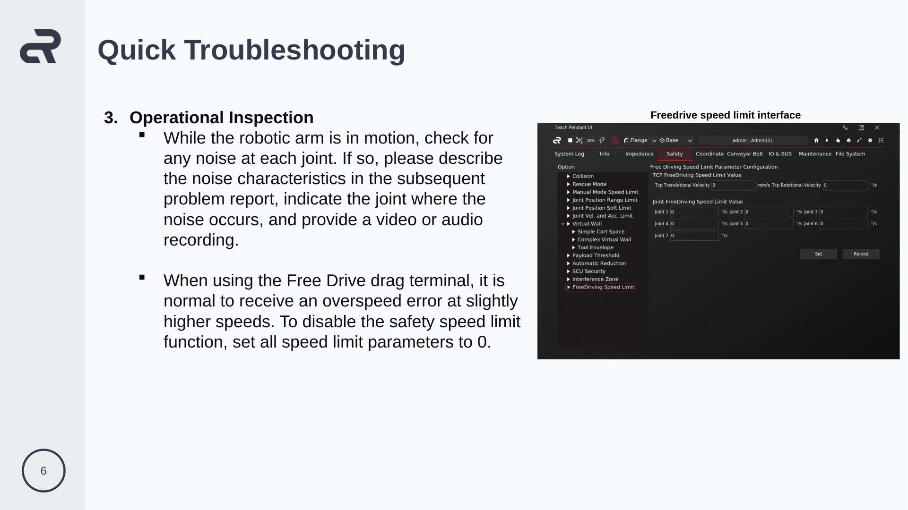
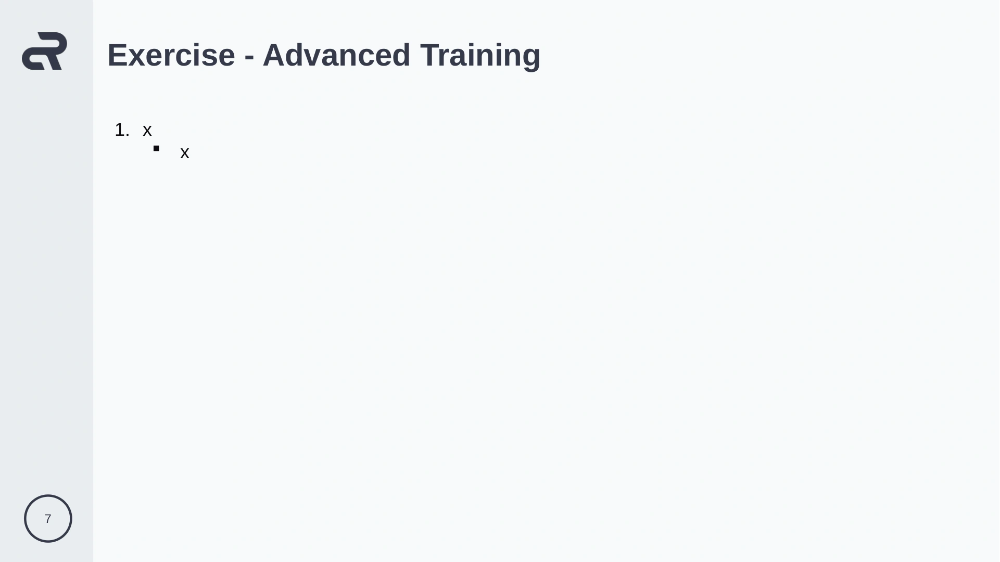

# Agile Robots training 6 — Troubleshooting — complete reference


**Complete supplied source:** EN\_6\_Quick\_Troubleshooting.pptx · **Coverage:** 8 original slides. [Return to the Agile Robots source library](./).


Every source page is retained in the original order. The **Original page** view preserves complete diagrams, photographs, tables, equations, connector orientation, notices and examples. The **Searchable text** view preserves native PDF text or the slide’s native text, embedded links and substantive speaker notes. Text extraction can retain reading-order/character defects; use the original image for exact layout, table columns and code indentation.


Slide 6 proposes disabling speed-limit functions by setting parameters to zero. That source statement is retained for completeness and must not be used as a general overspeed recovery procedure. Investigate the cause and use the approved safety limits, responsible safety review and delivered configuration. Brake clicks, network LEDs and ping are observations, not safety acceptance tests.


**Attribution:** the manufacturer and contributors identified in the supplied document. Original notices remain visible on every source page. Navigation, revision notes and the linked engineering explanations are OpenELAB editorial additions.

**Training-copy scope:** these images are rendered reading copies of the supplied PPTX slides. The native file remains authoritative for fonts, presentation effects and editable objects. All original slide numbers, including closing or hidden slides, are retained. Any embedded motion video is linked separately below.

## Document navigation

| Source section / function    | Original page                                             |
| ---------------------------- | --------------------------------------------------------- |
| Update Training              | [Slide 1](complete-en-6-quick-troubleshooting.md#slide-1) |
| Quick Troubleshooting        | [Slide 2](complete-en-6-quick-troubleshooting.md#slide-2) |
| Quick Troubleshooting (2)    | [Slide 3](complete-en-6-quick-troubleshooting.md#slide-3) |
| Quick Troubleshooting (3)    | [Slide 4](complete-en-6-quick-troubleshooting.md#slide-4) |
| Quick Troubleshooting (4)    | [Slide 5](complete-en-6-quick-troubleshooting.md#slide-5) |
| Quick Troubleshooting (5)    | [Slide 6](complete-en-6-quick-troubleshooting.md#slide-6) |
| Exercise - Advanced Training | [Slide 7](complete-en-6-quick-troubleshooting.md#slide-7) |
| Slide 8                      | [Slide 8](complete-en-6-quick-troubleshooting.md#slide-8) |

## Slide 1

**Source:** EN\_6\_Quick\_Troubleshooting.pptx, original slide 1.







```
Update Training
Quick Troubleshooting
Zhenyu Yi
 and Marc Fuest 
/
 15.09.2025 
/
 
Munich
```



## Slide 2

**Source:** EN\_6\_Quick\_Troubleshooting.pptx, original slide 2.







```
Quick Troubleshooting
Power system inspection
Communication check
Operational Inspection
```



## Slide 3

**Source:** EN\_6\_Quick\_Troubleshooting.pptx, original slide 3.







```
Quick Troubleshooting
Power system inspection
When connected to a hard teaching pendant, the factory safety IO wiring should be as shown in Figure below.
When using an external emergency stop switch, the wiring should be as shown in Figure.
Check that the power cable, the load cable, and the teach pendant are securely connected.
Check that the teach pendant emergency stop switch and the external emergency stop switch are rotated back to their original positions.
When powering on the robot arm using the reset button, a crisp click should be heard from the chassis.
When releasing the brake, a crisp click should be heard from all joints of the robot arm.
Factory safety IO wiring Figure
External
 
emergency stop switch wiring
```



## Slide 4

**Source:** EN\_6\_Quick\_Troubleshooting.pptx, original slide 4.







```
Quick Troubleshooting
Communication check
When connecting to a computer and using the soft teaching pendant, use the A network port as shown in Figure.
After connecting the network port, the network port indicator on the chassis should flash yellow.
Network port diagram
A
```



## Slide 5

**Source:** EN\_6\_Quick\_Troubleshooting.pptx, original slide 5.







```
Quick Troubleshooting
Communication check
When connecting the hard teach pendant, follow the red arrow to access the network page. Verify that the teach pendant IP Address and Port in the red box are set as shown in Figure
When using the soft teach pendant with a computer, manually configure the computer's network adapter to: 192.168.10.xx (xx cannot be 75) and the subnet mask to: 255.255.255.0.
When using the soft teach pendant with a computer, disconnect the VPN.
When using the soft teach pendant with a computer, pinging 192.168.10.75 should return data.
Network settings interface
```



## Slide 6

**Source:** EN\_6\_Quick\_Troubleshooting.pptx, original slide 6.







```
Quick Troubleshooting
Operational Inspection
While the robotic arm is in motion, check for any noise at each joint. If so, please describe the noise characteristics in the subsequent problem report, indicate the joint where the noise occurs, and provide a video or audio recording.
When using the Free Drive drag terminal, it is normal to receive an overspeed error at slightly higher speeds. To disable the safety speed limit function, set all speed limit parameters to 0.
Freedrive
 speed limit interface
```



## Slide 7

**Source:** EN\_6\_Quick\_Troubleshooting.pptx, original slide 7.







```
Exercise - Advanced Training
x
x
```



## Slide 8

**Source:** EN\_6\_Quick\_Troubleshooting.pptx, original slide 8.







No native selectable text is present on this page. The complete original artwork or screenshot remains in the Original page view.


