# Diana 7 FCI guide V1.3 — complete reference


**Complete supplied source:** How to Use FCI on Diana7（English version）V1.3-20260209.pdf · **Coverage:** 17 original PDF pages. [Return to the Agile Robots source library](./).


Every source page is retained in the original order. The **Original page** view preserves complete diagrams, photographs, tables, equations, connector orientation, notices and examples. The **Searchable text** view preserves native PDF text or the slide’s native text, embedded links and substantive speaker notes. Text extraction can retain reading-order/character defects; use the original image for exact layout, table columns and code indentation.


Diana FCI support is restricted to the configurations and release conditions in this guide. Its FCI V0.18.2 cover and older linked libfranka example are not a universal compatibility guarantee. Do not substitute FR3 network, gripper, safety or control assumptions.


**Attribution:** the manufacturer and contributors identified in the supplied document. Original notices remain visible on every source page. Navigation, revision notes and the linked engineering explanations are OpenELAB editorial additions.

## Document navigation

| Source section / function                          | Original page                                                                            |
| -------------------------------------------------- | ---------------------------------------------------------------------------------------- |
| 1. Introduction                                    | [PDF 3](complete-how-to-use-fci-on-diana7-english-version-v1-3-20260209.md#pdf-page-3)   |
| 2. Preparation                                     | [PDF 3](complete-how-to-use-fci-on-diana7-english-version-v1-3-20260209.md#pdf-page-3)   |
| 2.1. Operating the Robot                           | [PDF 3](complete-how-to-use-fci-on-diana7-english-version-v1-3-20260209.md#pdf-page-3)   |
| 2.2. FCI Client Connection                         | [PDF 4](complete-how-to-use-fci-on-diana7-english-version-v1-3-20260209.md#pdf-page-4)   |
| 2. 3. FCI Server Configuration                     | [PDF 6](complete-how-to-use-fci-on-diana7-english-version-v1-3-20260209.md#pdf-page-6)   |
| 2.4. FCI Function Enablement                       | [PDF 6](complete-how-to-use-fci-on-diana7-english-version-v1-3-20260209.md#pdf-page-6)   |
| 2.5. Robot Parameter Description                   | [PDF 11](complete-how-to-use-fci-on-diana7-english-version-v1-3-20260209.md#pdf-page-11) |
| 3. FCI Client Development Environment Installation | [PDF 12](complete-how-to-use-fci-on-diana7-english-version-v1-3-20260209.md#pdf-page-12) |
| 4. FCI Client Development Guidance                 | [PDF 13](complete-how-to-use-fci-on-diana7-english-version-v1-3-20260209.md#pdf-page-13) |
| 4.1. Non-Real-Time commands                        | [PDF 13](complete-how-to-use-fci-on-diana7-english-version-v1-3-20260209.md#pdf-page-13) |
| 4.2. Real-time Commands                            | [PDF 14](complete-how-to-use-fci-on-diana7-english-version-v1-3-20260209.md#pdf-page-14) |
| 4.3. Robot State                                   | [PDF 15](complete-how-to-use-fci-on-diana7-english-version-v1-3-20260209.md#pdf-page-15) |
| 4.4 . Official Examples                            | [PDF 16](complete-how-to-use-fci-on-diana7-english-version-v1-3-20260209.md#pdf-page-16) |
| 5. Disclaimer                                      | [PDF 16](complete-how-to-use-fci-on-diana7-english-version-v1-3-20260209.md#pdf-page-16) |

## PDF page 1

**Source:** How to Use FCI on Diana7（English version）V1.3-20260209.pdf, original pdf page 1. [Open the corresponding PDF reading-copy page](https://1292444914-files.gitbook.io/~/files/v0/b/gitbook-x-prod.appspot.com/o/spaces%2FtgOfPnscWebs1eh82EKq%2Fuploads%2FBYsoONhCdVXV4TIHiuuh%2Fhow-to-use-fci-on-diana7-english-version-v1-3-20260209-pp-001-006.pdf?alt=media#page=1).



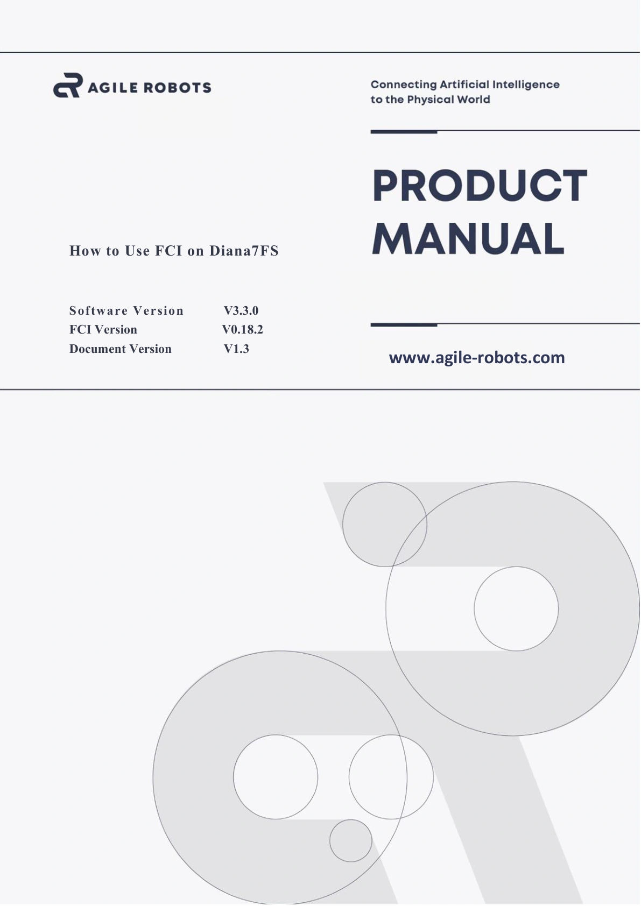



```
1 
www.agile-robots.com
 
 
 
 
 
 
 
 
 
 
 
 
 
 
 
How to Use FCI on Diana7FS  
 
Software Version      V3.3.0 
FCI Version             V0.18.2 
Document Version        V1.3
```



## PDF page 2

**Source:** How to Use FCI on Diana7（English version）V1.3-20260209.pdf, original pdf page 2. [Open the corresponding PDF reading-copy page](https://1292444914-files.gitbook.io/~/files/v0/b/gitbook-x-prod.appspot.com/o/spaces%2FtgOfPnscWebs1eh82EKq%2Fuploads%2FBYsoONhCdVXV4TIHiuuh%2Fhow-to-use-fci-on-diana7-english-version-v1-3-20260209-pp-001-006.pdf?alt=media#page=2).



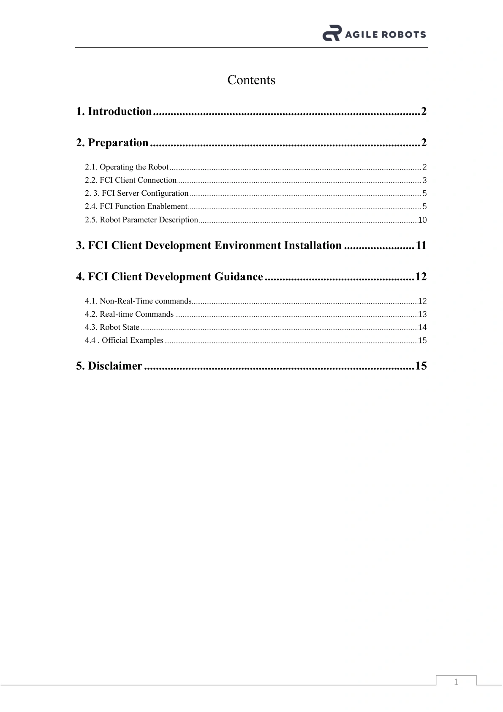



```
1 
Contents 
1. Introduction ........................................................................................... 2 
2. Preparation ............................................................................................ 2 
2.1. Operating the Robot .......................................................................................................................................... 2 
2.2. FCI Client Connection ...................................................................................................................................... 3 
2. 3. FCI Server Configuration ............................................................................................................................... 5 
2.4. FCI Function Enablement ................................................................................................................................ 5 
2.5. Robot Parameter Description ........................................................................................................................ 10 
3. FCI Client Development Environment Installation ........................ 11 
4. FCI Client Development Guidance ................................................... 12 
4.1. Non-Real-Time commands............................................................................................................................ 12 
4.2. Real-time Commands ..................................................................................................................................... 13 
4.3. Robot State ........................................................................................................................................................ 14 
4.4 . Official Examples ........................................................................................................................................... 15 
5. Disclaimer ............................................................................................ 15
```



**Original document cross-references:** [PDF 3](complete-how-to-use-fci-on-diana7-english-version-v1-3-20260209.md#pdf-page-3) · [PDF 4](complete-how-to-use-fci-on-diana7-english-version-v1-3-20260209.md#pdf-page-4) · [PDF 6](complete-how-to-use-fci-on-diana7-english-version-v1-3-20260209.md#pdf-page-6) · [PDF 11](complete-how-to-use-fci-on-diana7-english-version-v1-3-20260209.md#pdf-page-11) · [PDF 12](complete-how-to-use-fci-on-diana7-english-version-v1-3-20260209.md#pdf-page-12) · [PDF 13](complete-how-to-use-fci-on-diana7-english-version-v1-3-20260209.md#pdf-page-13) · [PDF 14](complete-how-to-use-fci-on-diana7-english-version-v1-3-20260209.md#pdf-page-14) · [PDF 15](complete-how-to-use-fci-on-diana7-english-version-v1-3-20260209.md#pdf-page-15) · [PDF 16](complete-how-to-use-fci-on-diana7-english-version-v1-3-20260209.md#pdf-page-16)

## PDF page 3

**Source:** How to Use FCI on Diana7（English version）V1.3-20260209.pdf, original pdf page 3. [Open the corresponding PDF reading-copy page](https://1292444914-files.gitbook.io/~/files/v0/b/gitbook-x-prod.appspot.com/o/spaces%2FtgOfPnscWebs1eh82EKq%2Fuploads%2FBYsoONhCdVXV4TIHiuuh%2Fhow-to-use-fci-on-diana7-english-version-v1-3-20260209-pp-001-006.pdf?alt=media#page=3).



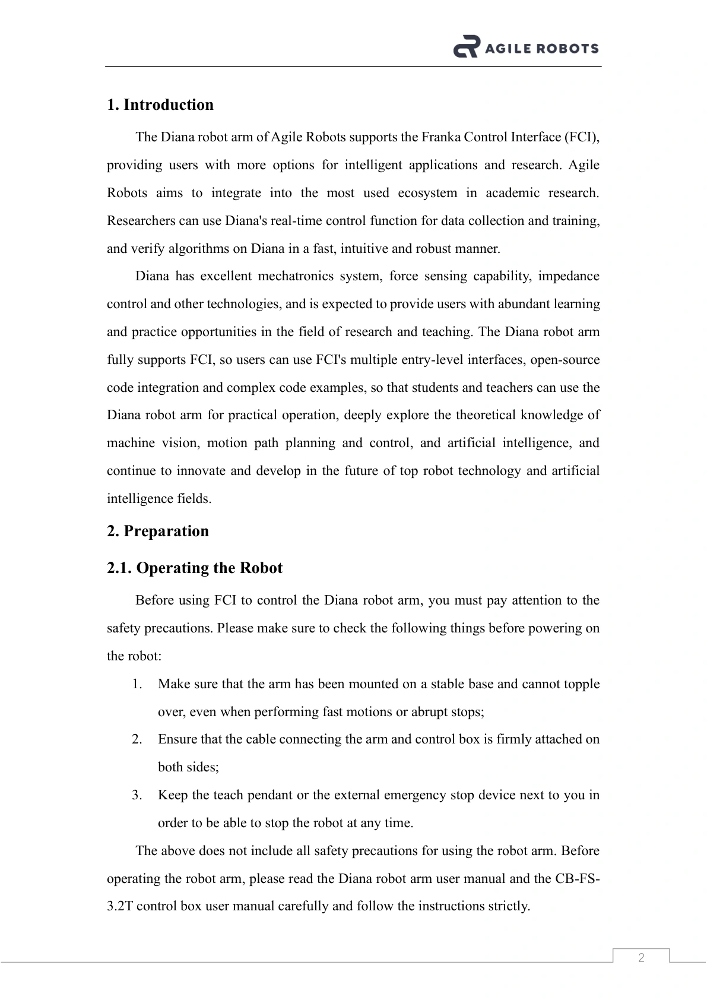



```
2 
1. Introduction 
The Diana robot arm of Agile Robots supports the Franka Control Interface (FCI), 
providing users with more options for intelligent applications and research. Agile 
Robots aims to integrate into the most used ecosystem in academic research. 
Researchers can use Diana's real-time control function for data collection and training, 
and verify algorithms on Diana in a fast, intuitive and robust manner. 
Diana has excellent mechatronics system, force sensing capability, impedance 
control and other technologies, and is expected to provide users with abundant learning 
and practice opportunities in the field of research and teaching. The Diana robot arm 
fully supports FCI, so users can use FCI's multiple entry-level interfaces, open-source 
code integration and complex code examples, so that students and teachers can use the 
Diana robot arm for practical operation, deeply explore the theoretical knowledge of 
machine vision, motion path planning and control, and artificial intelligence, and 
continue to innovate and develop in the future of top robot technology and artificial 
intelligence fields. 
2. Preparation 
2.1. Operating the Robot 
Before using FCI to control the Diana robot arm, you must pay attention to the 
safety precautions. Please make sure to check the following things before powering on 
the robot: 
1. 
Make sure that the arm has been mounted on a stable base and cannot topple 
over, even when performing fast motions or abrupt stops; 
2. 
Ensure that the cable connecting the arm and control box is firmly attached on 
both sides; 
3. 
Keep the teach pendant or the external emergency stop device next to you in 
order to be able to stop the robot at any time. 
The above does not include all safety precautions for using the robot arm. Before 
operating the robot arm, please read the Diana robot arm user manual and the CB-FS-
3.2T control box user manual carefully and follow the instructions strictly.
```



## PDF page 4

**Source:** How to Use FCI on Diana7（English version）V1.3-20260209.pdf, original pdf page 4. [Open the corresponding PDF reading-copy page](https://1292444914-files.gitbook.io/~/files/v0/b/gitbook-x-prod.appspot.com/o/spaces%2FtgOfPnscWebs1eh82EKq%2Fuploads%2FBYsoONhCdVXV4TIHiuuh%2Fhow-to-use-fci-on-diana7-english-version-v1-3-20260209-pp-001-006.pdf?alt=media#page=4).



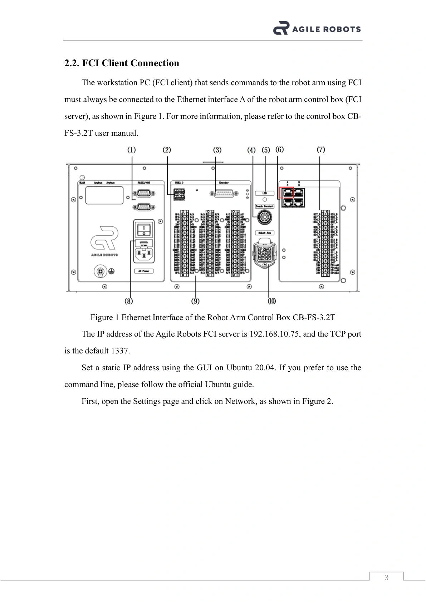



```
3 
2.2. FCI Client Connection 
The workstation PC (FCI client) that sends commands to the robot arm using FCI 
must always be connected to the Ethernet interface A of the robot arm control box (FCI 
server), as shown in Figure 1. For more information, please refer to the control box CB-
FS-3.2T user manual. 
 
Figure 1 Ethernet Interface of the Robot Arm Control Box CB-FS-3.2T 
The IP address of the Agile Robots FCI server is 192.168.10.75, and the TCP port 
is the default 1337. 
Set a static IP address using the GUI on Ubuntu 20.04. If you prefer to use the 
command line, please follow the official Ubuntu guide. 
First, open the Settings page and click on Network, as shown in Figure 2.
```



**Original document cross-references:** [PDF 4](complete-how-to-use-fci-on-diana7-english-version-v1-3-20260209.md#pdf-page-4) · [PDF 5](complete-how-to-use-fci-on-diana7-english-version-v1-3-20260209.md#pdf-page-5)

## PDF page 5

**Source:** How to Use FCI on Diana7（English version）V1.3-20260209.pdf, original pdf page 5. [Open the corresponding PDF reading-copy page](https://1292444914-files.gitbook.io/~/files/v0/b/gitbook-x-prod.appspot.com/o/spaces%2FtgOfPnscWebs1eh82EKq%2Fuploads%2FBYsoONhCdVXV4TIHiuuh%2Fhow-to-use-fci-on-diana7-english-version-v1-3-20260209-pp-001-006.pdf?alt=media#page=5).



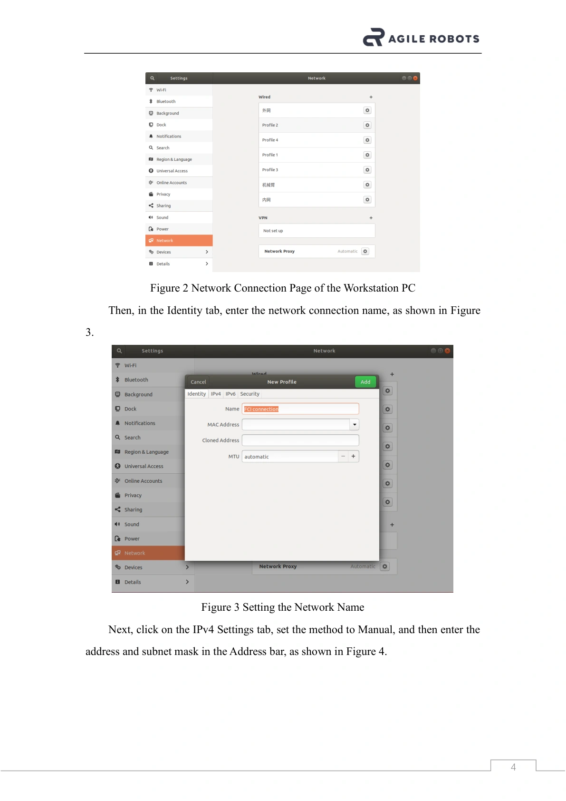



```
4 
 
Figure 2 Network Connection Page of the Workstation PC 
Then, in the Identity tab, enter the network connection name, as shown in Figure 
3. 
 
Figure 3 Setting the Network Name 
Next, click on the IPv4 Settings tab, set the method to Manual, and then enter the 
address and subnet mask in the Address bar, as shown in Figure 4.
```



**Original document cross-references:** [PDF 5](complete-how-to-use-fci-on-diana7-english-version-v1-3-20260209.md#pdf-page-5) · [PDF 6](complete-how-to-use-fci-on-diana7-english-version-v1-3-20260209.md#pdf-page-6)

## PDF page 6

**Source:** How to Use FCI on Diana7（English version）V1.3-20260209.pdf, original pdf page 6. [Open the corresponding PDF reading-copy page](https://1292444914-files.gitbook.io/~/files/v0/b/gitbook-x-prod.appspot.com/o/spaces%2FtgOfPnscWebs1eh82EKq%2Fuploads%2FBYsoONhCdVXV4TIHiuuh%2Fhow-to-use-fci-on-diana7-english-version-v1-3-20260209-pp-001-006.pdf?alt=media#page=6).



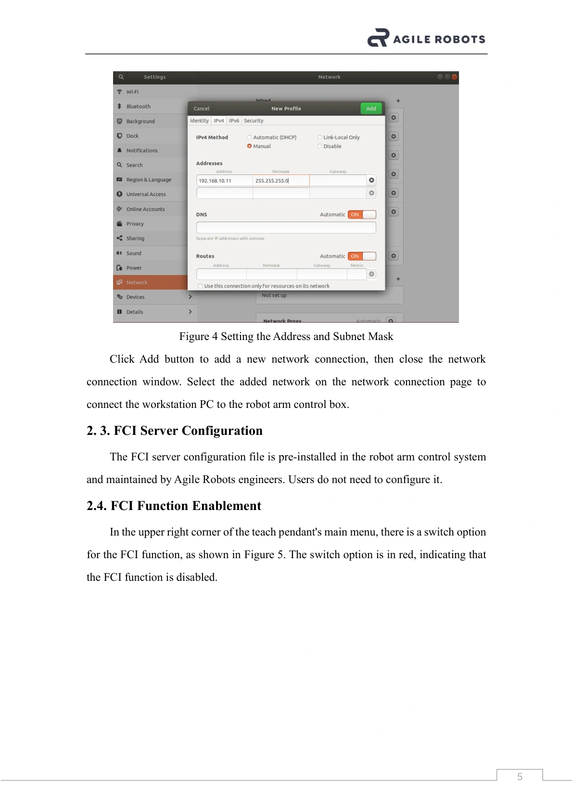



```
5 
 
Figure 4 Setting the Address and Subnet Mask 
Click Add button to add a new network connection, then close the network 
connection window. Select the added network on the network connection page to 
connect the workstation PC to the robot arm control box. 
2. 3. FCI Server Configuration 
The FCI server configuration file is pre-installed in the robot arm control system 
and maintained by Agile Robots engineers. Users do not need to configure it. 
2.4. FCI Function Enablement 
In the upper right corner of the teach pendant's main menu, there is a switch option 
for the FCI function, as shown in Figure 5. The switch option is in red, indicating that 
the FCI function is disabled.
```



**Original document cross-references:** [PDF 7](complete-how-to-use-fci-on-diana7-english-version-v1-3-20260209.md#pdf-page-7)

## PDF page 7

**Source:** How to Use FCI on Diana7（English version）V1.3-20260209.pdf, original pdf page 7. [Open the corresponding PDF reading-copy page](https://1292444914-files.gitbook.io/~/files/v0/b/gitbook-x-prod.appspot.com/o/spaces%2FtgOfPnscWebs1eh82EKq%2Fuploads%2FGNtGzPB1IjwifAVJvyEe%2Fhow-to-use-fci-on-diana7-english-version-v1-3-20260209-pp-007-014.pdf?alt=media#page=1).



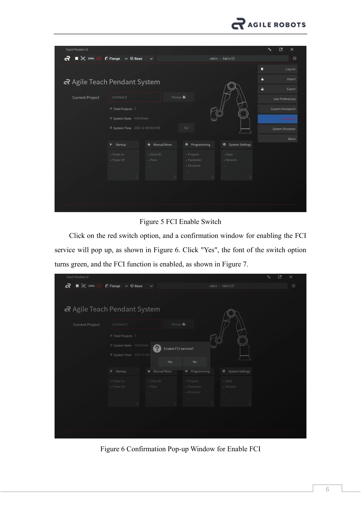



```
6 
 
Figure 5 FCI Enable Switch 
Click on the red switch option, and a confirmation window for enabling the FCI 
service will pop up, as shown in Figure 6. Click "Yes", the font of the switch option 
turns green, and the FCI function is enabled, as shown in Figure 7. 
 
Figure 6 Confirmation Pop-up Window for Enable FCI
```



**Original document cross-references:** [PDF 7](complete-how-to-use-fci-on-diana7-english-version-v1-3-20260209.md#pdf-page-7) · [PDF 8](complete-how-to-use-fci-on-diana7-english-version-v1-3-20260209.md#pdf-page-8)

## PDF page 8

**Source:** How to Use FCI on Diana7（English version）V1.3-20260209.pdf, original pdf page 8. [Open the corresponding PDF reading-copy page](https://1292444914-files.gitbook.io/~/files/v0/b/gitbook-x-prod.appspot.com/o/spaces%2FtgOfPnscWebs1eh82EKq%2Fuploads%2FGNtGzPB1IjwifAVJvyEe%2Fhow-to-use-fci-on-diana7-english-version-v1-3-20260209-pp-007-014.pdf?alt=media#page=2).



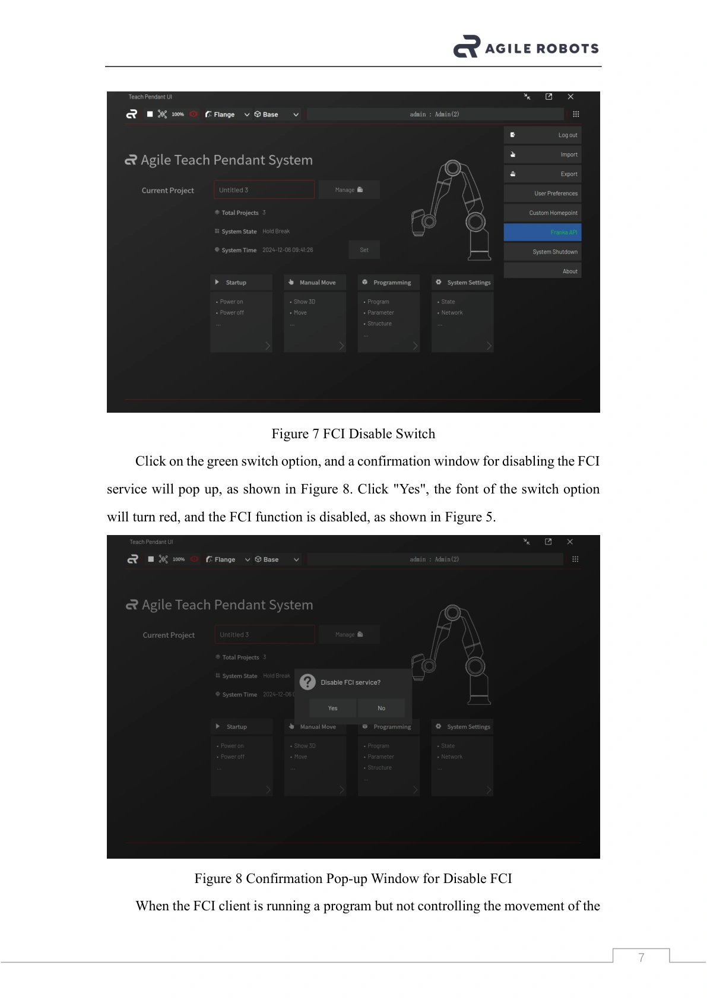



```
7 
 
Figure 7 FCI Disable Switch 
Click on the green switch option, and a confirmation window for disabling the FCI 
service will pop up, as shown in Figure 8. Click "Yes", the font of the switch option 
will turn red, and the FCI function is disabled, as shown in Figure 5. 
 
Figure 8 Confirmation Pop-up Window for Disable FCI  
When the FCI client is running a program but not controlling the movement of the
```



**Original document cross-references:** [PDF 8](complete-how-to-use-fci-on-diana7-english-version-v1-3-20260209.md#pdf-page-8) · [PDF 7](complete-how-to-use-fci-on-diana7-english-version-v1-3-20260209.md#pdf-page-7)

## PDF page 9

**Source:** How to Use FCI on Diana7（English version）V1.3-20260209.pdf, original pdf page 9. [Open the corresponding PDF reading-copy page](https://1292444914-files.gitbook.io/~/files/v0/b/gitbook-x-prod.appspot.com/o/spaces%2FtgOfPnscWebs1eh82EKq%2Fuploads%2FGNtGzPB1IjwifAVJvyEe%2Fhow-to-use-fci-on-diana7-english-version-v1-3-20260209-pp-007-014.pdf?alt=media#page=3).



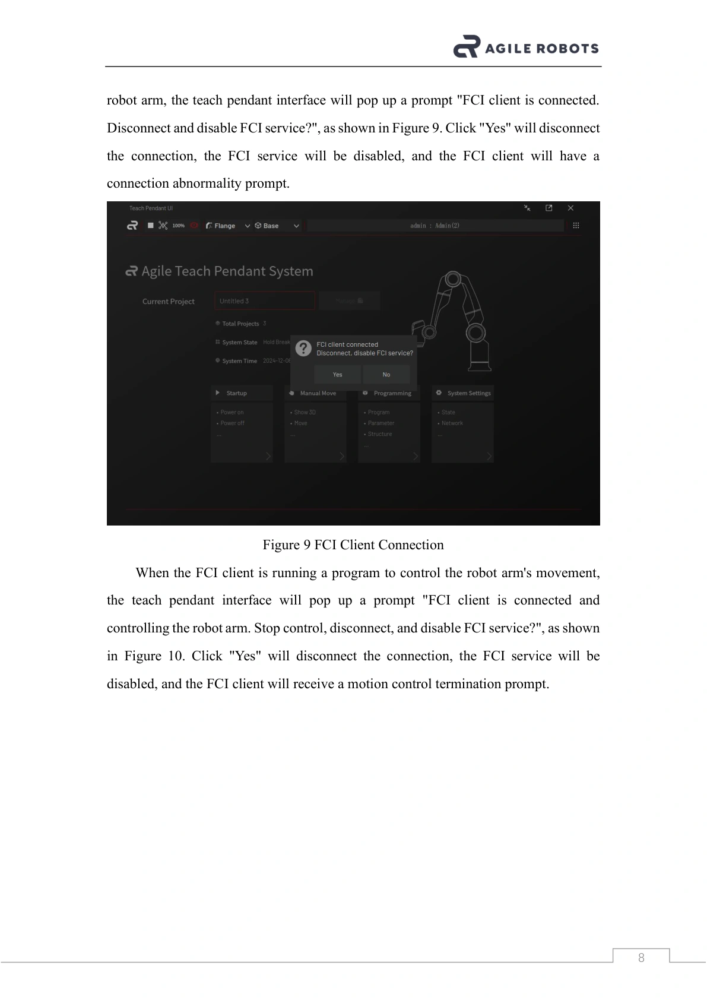



```
8 
robot arm, the teach pendant interface will pop up a prompt "FCI client is connected. 
Disconnect and disable FCI service?", as shown in Figure 9. Click "Yes" will disconnect 
the connection, the FCI service will be disabled, and the FCI client will have a 
connection abnormality prompt. 
 
Figure 9 FCI Client Connection 
When the FCI client is running a program to control the robot arm's movement, 
the teach pendant interface will pop up a prompt "FCI client is connected and 
controlling the robot arm. Stop control, disconnect, and disable FCI service?", as shown 
in Figure 10. Click "Yes" will disconnect the connection, the FCI service will be 
disabled, and the FCI client will receive a motion control termination prompt.
```



**Original document cross-references:** [PDF 9](complete-how-to-use-fci-on-diana7-english-version-v1-3-20260209.md#pdf-page-9) · [PDF 10](complete-how-to-use-fci-on-diana7-english-version-v1-3-20260209.md#pdf-page-10)

## PDF page 10

**Source:** How to Use FCI on Diana7（English version）V1.3-20260209.pdf, original pdf page 10. [Open the corresponding PDF reading-copy page](https://1292444914-files.gitbook.io/~/files/v0/b/gitbook-x-prod.appspot.com/o/spaces%2FtgOfPnscWebs1eh82EKq%2Fuploads%2FGNtGzPB1IjwifAVJvyEe%2Fhow-to-use-fci-on-diana7-english-version-v1-3-20260209-pp-007-014.pdf?alt=media#page=4).



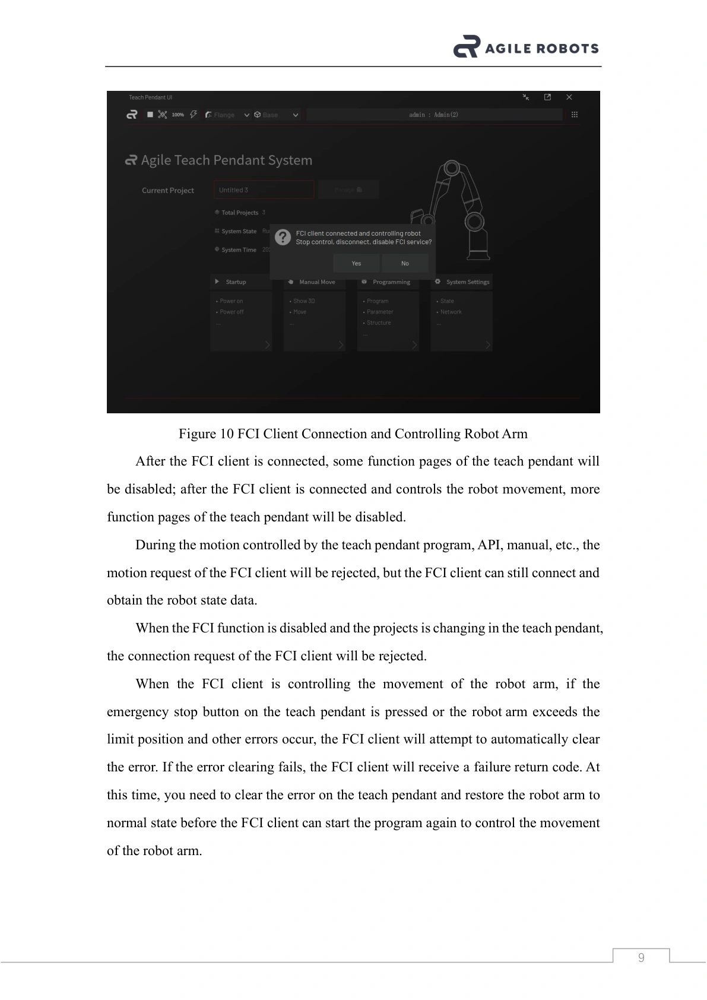



```
9 
 
Figure 10 FCI Client Connection and Controlling Robot Arm 
After the FCI client is connected, some function pages of the teach pendant will 
be disabled; after the FCI client is connected and controls the robot movement, more 
function pages of the teach pendant will be disabled. 
During the motion controlled by the teach pendant program, API, manual, etc., the 
motion request of the FCI client will be rejected, but the FCI client can still connect and 
obtain the robot state data. 
When the FCI function is disabled and the projects is changing in the teach pendant, 
the connection request of the FCI client will be rejected. 
When the FCI client is controlling the movement of the robot arm, if the 
emergency stop button on the teach pendant is pressed or the robot arm exceeds the 
limit position and other errors occur, the FCI client will attempt to automatically clear 
the error. If the error clearing fails, the FCI client will receive a failure return code. At 
this time, you need to clear the error on the teach pendant and restore the robot arm to 
normal state before the FCI client can start the program again to control the movement 
of the robot arm.
```



## PDF page 11

**Source:** How to Use FCI on Diana7（English version）V1.3-20260209.pdf, original pdf page 11. [Open the corresponding PDF reading-copy page](https://1292444914-files.gitbook.io/~/files/v0/b/gitbook-x-prod.appspot.com/o/spaces%2FtgOfPnscWebs1eh82EKq%2Fuploads%2FGNtGzPB1IjwifAVJvyEe%2Fhow-to-use-fci-on-diana7-english-version-v1-3-20260209-pp-007-014.pdf?alt=media#page=5).



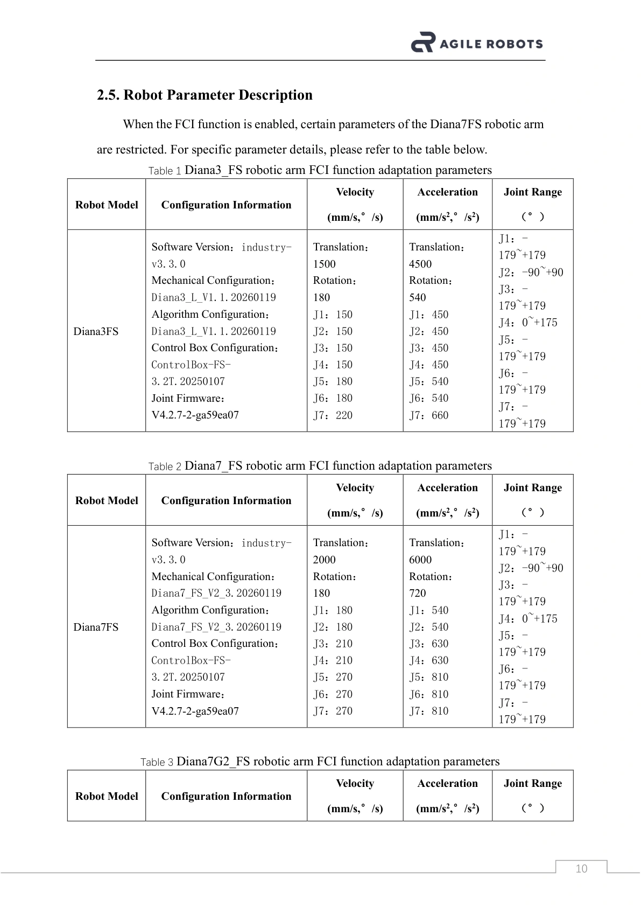



```
10 
2.5. Robot Parameter Description 
When the FCI function is enabled, certain parameters of the Diana7FS robotic arm 
are restricted. For specific parameter details, please refer to the table below. 
Table 1 Diana3_FS robotic arm FCI function adaptation parameters 
Robot Model 
Configuration Information 
Velocity 
(mm/s,°/s) 
Acceleration 
(mm/s2,°/s2) 
Joint Range 
（°） 
Diana3FS 
Software Version：industry-
v3.3.0 
Mechanical Configuration：
Diana3_L_V1.1.20260119 
Algorithm Configuration：
Diana3_L_V1.1.20260119 
Control Box Configuration：
ControlBox-FS-
3.2T.20250107 
Joint Firmware： 
V4.2.7-2-ga59ea07 
Translation： 
1500 
Rotation： 
180 
J1：150 
J2：150 
J3：150 
J4：150 
J5：180 
J6：180 
J7：220 
Translation：
4500 
Rotation： 
540 
J1：450 
J2：450 
J3：450 
J4：450 
J5：540 
J6：540 
J7：660 
J1：-
179~+179 
J2：-90~+90 
J3：-
179~+179 
J4：0~+175 
J5：-
179~+179 
J6：-
179~+179 
J7：-
179~+179 
 
Table 2 Diana7_FS robotic arm FCI function adaptation parameters 
Robot Model 
Configuration Information 
Velocity 
(mm/s,°/s) 
Acceleration 
(mm/s2,°/s2) 
Joint Range 
（°） 
Diana7FS 
Software Version：industry-
v3.3.0 
Mechanical Configuration：
Diana7_FS_V2_3.20260119 
Algorithm Configuration：
Diana7_FS_V2_3.20260119 
Control Box Configuration：
ControlBox-FS-
3.2T.20250107 
Joint Firmware： 
V4.2.7-2-ga59ea07 
Translation： 
2000 
Rotation： 
180 
J1：180 
J2：180 
J3：210 
J4：210 
J5：270 
J6：270 
J7：270 
Translation：
6000 
Rotation： 
720 
J1：540 
J2：540 
J3：630 
J4：630 
J5：810 
J6：810 
J7：810 
J1：-
179~+179 
J2：-90~+90 
J3：-
179~+179 
J4：0~+175 
J5：-
179~+179 
J6：-
179~+179 
J7：-
179~+179 
 
Table 3 Diana7G2_FS robotic arm FCI function adaptation parameters 
Robot Model 
Configuration Information 
Velocity 
(mm/s,°/s) 
Acceleration 
(mm/s2,°/s2) 
Joint Range 
（°）
```



## PDF page 12

**Source:** How to Use FCI on Diana7（English version）V1.3-20260209.pdf, original pdf page 12. [Open the corresponding PDF reading-copy page](https://1292444914-files.gitbook.io/~/files/v0/b/gitbook-x-prod.appspot.com/o/spaces%2FtgOfPnscWebs1eh82EKq%2Fuploads%2FGNtGzPB1IjwifAVJvyEe%2Fhow-to-use-fci-on-diana7-english-version-v1-3-20260209-pp-007-014.pdf?alt=media#page=6).



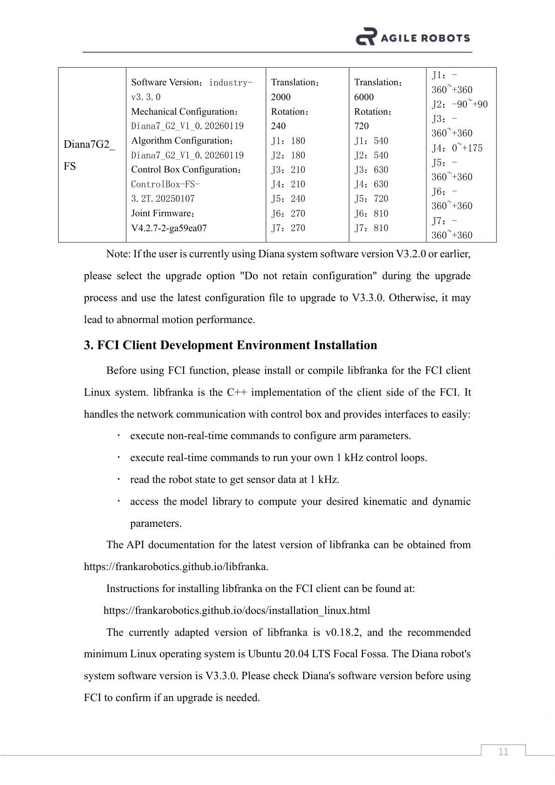



```
11 
Diana7G2_
FS 
Software Version：industry-
v3.3.0 
Mechanical Configuration：
Diana7_G2_V1_0.20260119 
Algorithm Configuration：
Diana7_G2_V1_0.20260119 
Control Box Configuration：
ControlBox-FS-
3.2T.20250107 
Joint Firmware： 
V4.2.7-2-ga59ea07 
Translation： 
2000 
Rotation： 
240 
J1：180 
J2：180 
J3：210 
J4：210 
J5：240 
J6：270 
J7：270 
Translation：
6000 
Rotation： 
720 
J1：540 
J2：540 
J3：630 
J4：630 
J5：720 
J6：810 
J7：810 
J1：-
360~+360 
J2：-90~+90 
J3：-
360~+360 
J4：0~+175 
J5：-
360~+360 
J6：-
360~+360 
J7：-
360~+360 
Note: If the user is currently using Diana system software version V3.2.0 or earlier, 
please select the upgrade option "Do not retain configuration" during the upgrade 
process and use the latest configuration file to upgrade to V3.3.0. Otherwise, it may 
lead to abnormal motion performance. 
3. FCI Client Development Environment Installation 
Before using FCI function, please install or compile libfranka for the FCI client 
Linux system. libfranka is the C++ implementation of the client side of the FCI. It 
handles the network communication with control box and provides interfaces to easily: 
 execute non-real-time commands to configure arm parameters. 
 execute real-time commands to run your own 1 kHz control loops. 
 read the robot state to get sensor data at 1 kHz. 
 access the model library to compute your desired kinematic and dynamic 
parameters. 
The API documentation for the latest version of libfranka can be obtained from 
https://frankarobotics.github.io/libfranka. 
Instructions for installing libfranka on the FCI client can be found at: 
https://frankarobotics.github.io/docs/installation_linux.html 
The currently adapted version of libfranka is v0.18.2, and the recommended 
minimum Linux operating system is Ubuntu 20.04 LTS Focal Fossa. The Diana robot's 
system software version is V3.3.0. Please check Diana's software version before using 
FCI to confirm if an upgrade is needed.
```



**Original PDF links:** [Source link 1](https://frankaemika.github.io/libfranka) · [Source link 2](https://frankaemika.github.io/docs/installation_linux.html)

## PDF page 13

**Source:** How to Use FCI on Diana7（English version）V1.3-20260209.pdf, original pdf page 13. [Open the corresponding PDF reading-copy page](https://1292444914-files.gitbook.io/~/files/v0/b/gitbook-x-prod.appspot.com/o/spaces%2FtgOfPnscWebs1eh82EKq%2Fuploads%2FGNtGzPB1IjwifAVJvyEe%2Fhow-to-use-fci-on-diana7-english-version-v1-3-20260209-pp-007-014.pdf?alt=media#page=7).



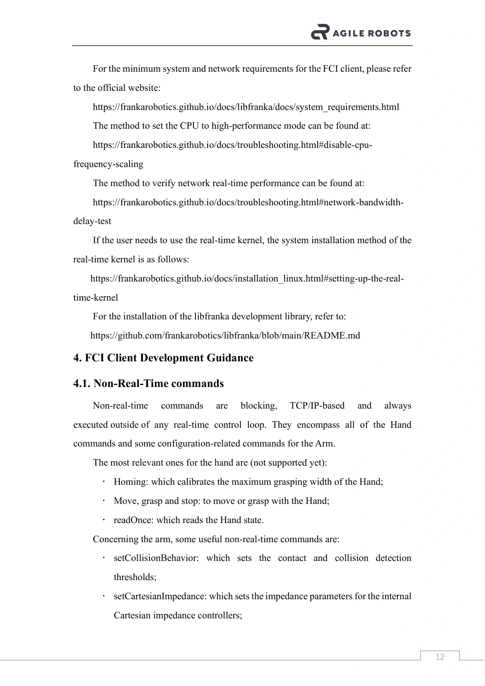



```
12 
For the minimum system and network requirements for the FCI client, please refer 
to the official website: 
https://frankarobotics.github.io/docs/libfranka/docs/system_requirements.html 
The method to set the CPU to high-performance mode can be found at: 
https://frankarobotics.github.io/docs/troubleshooting.html#disable-cpu-
frequency-scaling 
The method to verify network real-time performance can be found at: 
https://frankarobotics.github.io/docs/troubleshooting.html#network-bandwidth-
delay-test 
If the user needs to use the real-time kernel, the system installation method of the 
real-time kernel is as follows: 
https://frankarobotics.github.io/docs/installation_linux.html#setting-up-the-real-
time-kernel 
For the installation of the libfranka development library, refer to: 
https://github.com/frankarobotics/libfranka/blob/main/README.md 
4. FCI Client Development Guidance 
4.1. Non-Real-Time commands 
Non-real-time 
commands 
are 
blocking, 
TCP/IP-based 
and 
always 
executed outside of any real-time control loop. They encompass all of the Hand 
commands and some configuration-related commands for the Arm.  
The most relevant ones for the hand are (not supported yet): 
 Homing: which calibrates the maximum grasping width of the Hand; 
 Move, grasp and stop: to move or grasp with the Hand; 
 readOnce: which reads the Hand state. 
Concerning the arm, some useful non-real-time commands are: 
 setCollisionBehavior: which sets the contact and collision detection 
thresholds; 
 setCartesianImpedance: which sets the impedance parameters for the internal 
Cartesian impedance controllers;
```



**Original PDF links:** [Source link 1](https://frankaemika.github.io/docs/installation_linux.html#setting-up-the-real-time-kernel) · [Source link 2](https://github.com/frankaemika/libfranka/blob/main/README.md)

## PDF page 14

**Source:** How to Use FCI on Diana7（English version）V1.3-20260209.pdf, original pdf page 14. [Open the corresponding PDF reading-copy page](https://1292444914-files.gitbook.io/~/files/v0/b/gitbook-x-prod.appspot.com/o/spaces%2FtgOfPnscWebs1eh82EKq%2Fuploads%2FGNtGzPB1IjwifAVJvyEe%2Fhow-to-use-fci-on-diana7-english-version-v1-3-20260209-pp-007-014.pdf?alt=media#page=8).



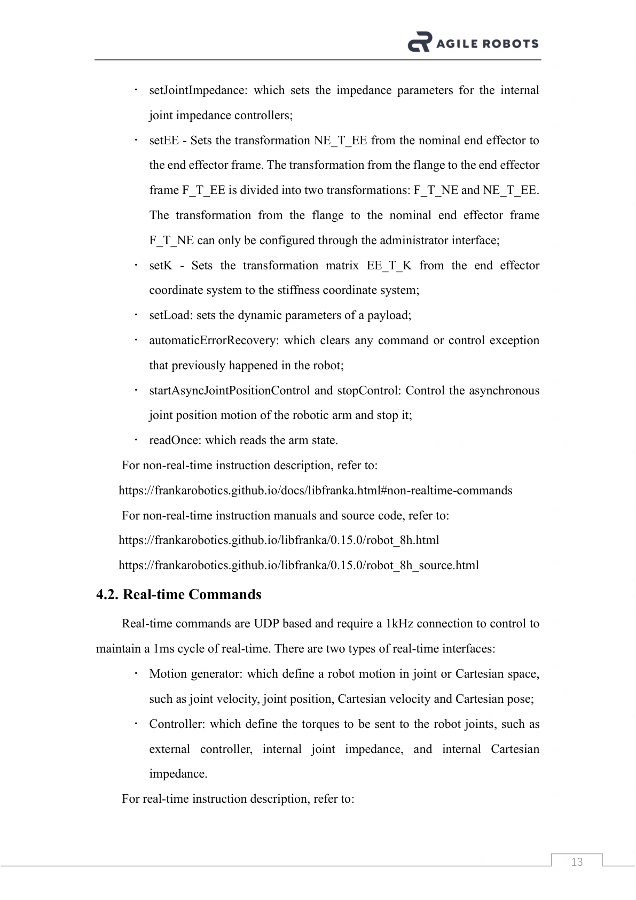



```
13 
 setJointImpedance: which sets the impedance parameters for the internal 
joint impedance controllers; 
 setEE - Sets the transformation NE_T_EE from the nominal end effector to 
the end effector frame. The transformation from the flange to the end effector 
frame F_T_EE is divided into two transformations: F_T_NE and NE_T_EE. 
The transformation from the flange to the nominal end effector frame 
F_T_NE can only be configured through the administrator interface; 
 setK - Sets the transformation matrix EE_T_K from the end effector 
coordinate system to the stiffness coordinate system; 
 setLoad: sets the dynamic parameters of a payload; 
 automaticErrorRecovery: which clears any command or control exception 
that previously happened in the robot; 
 startAsyncJointPositionControl and stopControl: Control the asynchronous 
joint position motion of the robotic arm and stop it; 
 readOnce: which reads the arm state. 
For non-real-time instruction description, refer to: 
https://frankarobotics.github.io/docs/libfranka.html#non-realtime-commands 
For non-real-time instruction manuals and source code, refer to: 
https://frankarobotics.github.io/libfranka/0.15.0/robot_8h.html 
https://frankarobotics.github.io/libfranka/0.15.0/robot_8h_source.html 
4.2. Real-time Commands 
Real-time commands are UDP based and require a 1kHz connection to control to 
maintain a 1ms cycle of real-time. There are two types of real-time interfaces: 
 Motion generator: which define a robot motion in joint or Cartesian space, 
such as joint velocity, joint position, Cartesian velocity and Cartesian pose; 
 Controller: which define the torques to be sent to the robot joints, such as 
external controller, internal joint impedance, and internal Cartesian 
impedance. 
For real-time instruction description, refer to:
```



**Original PDF links:** [Source link 1](https://frankaemika.github.io/docs/libfranka.html#non-realtime-commands) · [Source link 2](https://frankaemika.github.io/libfranka/0.15.0/robot_8h.html) · [Source link 3](https://frankaemika.github.io/libfranka/0.15.0/robot_8h_source.html)

## PDF page 15

**Source:** How to Use FCI on Diana7（English version）V1.3-20260209.pdf, original pdf page 15. [Open the corresponding PDF reading-copy page](https://1292444914-files.gitbook.io/~/files/v0/b/gitbook-x-prod.appspot.com/o/spaces%2FtgOfPnscWebs1eh82EKq%2Fuploads%2FiHp3Z8DTUEpcbenUDQWF%2Fhow-to-use-fci-on-diana7-english-version-v1-3-20260209-pp-015-017.pdf?alt=media#page=1).



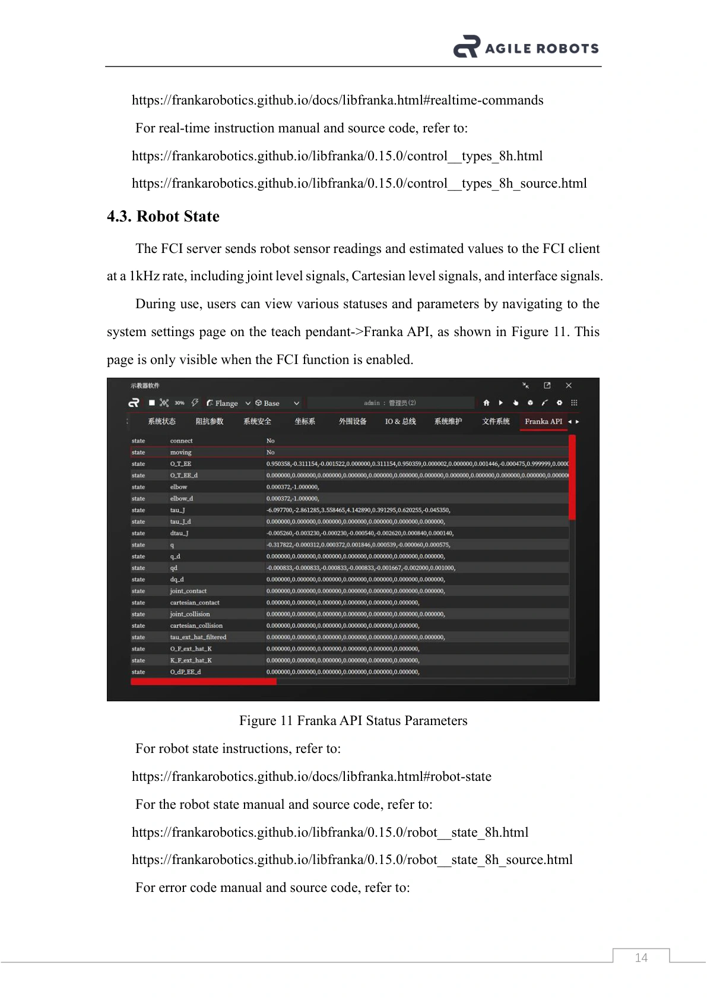



```
14 
https://frankarobotics.github.io/docs/libfranka.html#realtime-commands 
For real-time instruction manual and source code, refer to: 
https://frankarobotics.github.io/libfranka/0.15.0/control__types_8h.html 
https://frankarobotics.github.io/libfranka/0.15.0/control__types_8h_source.html 
4.3. Robot State 
The FCI server sends robot sensor readings and estimated values to the FCI client 
at a 1kHz rate, including joint level signals, Cartesian level signals, and interface signals. 
During use, users can view various statuses and parameters by navigating to the 
system settings page on the teach pendant->Franka API, as shown in Figure 11. This 
page is only visible when the FCI function is enabled. 
 
Figure 11 Franka API Status Parameters 
For robot state instructions, refer to: 
https://frankarobotics.github.io/docs/libfranka.html#robot-state 
For the robot state manual and source code, refer to: 
https://frankarobotics.github.io/libfranka/0.15.0/robot__state_8h.html 
https://frankarobotics.github.io/libfranka/0.15.0/robot__state_8h_source.html 
For error code manual and source code, refer to:
```



**Original PDF links:** [Source link 1](https://frankaemika.github.io/docs/libfranka.html#realtime-commands) · [Source link 2](https://frankaemika.github.io/libfranka/0.15.0/control__types_8h.html) · [Source link 3](https://frankaemika.github.io/libfranka/0.15.0/control__types_8h_source.html) · [Source link 4](https://frankaemika.github.io/docs/libfranka.html#robot-state) · [Source link 5](https://frankaemika.github.io/libfranka/0.15.0/robot__state_8h.html) · [Source link 6](https://frankaemika.github.io/libfranka/0.15.0/robot__state_8h_source.html)

## PDF page 16

**Source:** How to Use FCI on Diana7（English version）V1.3-20260209.pdf, original pdf page 16. [Open the corresponding PDF reading-copy page](https://1292444914-files.gitbook.io/~/files/v0/b/gitbook-x-prod.appspot.com/o/spaces%2FtgOfPnscWebs1eh82EKq%2Fuploads%2FiHp3Z8DTUEpcbenUDQWF%2Fhow-to-use-fci-on-diana7-english-version-v1-3-20260209-pp-015-017.pdf?alt=media#page=2).



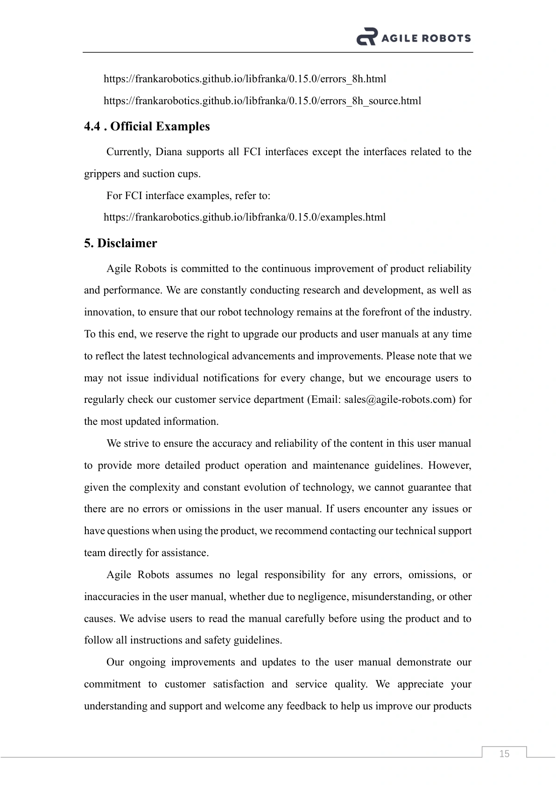



```
15 
https://frankarobotics.github.io/libfranka/0.15.0/errors_8h.html 
https://frankarobotics.github.io/libfranka/0.15.0/errors_8h_source.html 
4.4 . Official Examples 
Currently, Diana supports all FCI interfaces except the interfaces related to the 
grippers and suction cups. 
For FCI interface examples, refer to: 
https://frankarobotics.github.io/libfranka/0.15.0/examples.html 
5. Disclaimer 
Agile Robots is committed to the continuous improvement of product reliability 
and performance. We are constantly conducting research and development, as well as 
innovation, to ensure that our robot technology remains at the forefront of the industry. 
To this end, we reserve the right to upgrade our products and user manuals at any time 
to reflect the latest technological advancements and improvements. Please note that we 
may not issue individual notifications for every change, but we encourage users to 
regularly check our customer service department (Email: sales@agile-robots.com) for 
the most updated information. 
We strive to ensure the accuracy and reliability of the content in this user manual 
to provide more detailed product operation and maintenance guidelines. However, 
given the complexity and constant evolution of technology, we cannot guarantee that 
there are no errors or omissions in the user manual. If users encounter any issues or 
have questions when using the product, we recommend contacting our technical support 
team directly for assistance. 
Agile Robots assumes no legal responsibility for any errors, omissions, or 
inaccuracies in the user manual, whether due to negligence, misunderstanding, or other 
causes. We advise users to read the manual carefully before using the product and to 
follow all instructions and safety guidelines. 
Our ongoing improvements and updates to the user manual demonstrate our 
commitment to customer satisfaction and service quality. We appreciate your 
understanding and support and welcome any feedback to help us improve our products
```



**Original PDF links:** [Source link 1](https://frankaemika.github.io/libfranka/0.15.0/errors_8h.html) · [Source link 2](https://frankaemika.github.io/libfranka/0.15.0/errors_8h_source.html) · [Source link 3](https://frankaemika.github.io/libfranka/0.15.0/examples.html)

## PDF page 17

**Source:** How to Use FCI on Diana7（English version）V1.3-20260209.pdf, original pdf page 17. [Open the corresponding PDF reading-copy page](https://1292444914-files.gitbook.io/~/files/v0/b/gitbook-x-prod.appspot.com/o/spaces%2FtgOfPnscWebs1eh82EKq%2Fuploads%2FiHp3Z8DTUEpcbenUDQWF%2Fhow-to-use-fci-on-diana7-english-version-v1-3-20260209-pp-015-017.pdf?alt=media#page=3).







```
16 
and services.
```


