# Industrial C/C++ API manual V3.3.0 — PDF pages 1–72


**Complete supplied source:** Industrial API Manual (C\&C++ Edition) \_V3.3.0\_EN\_20260605.pdf · **Coverage:** 190 original PDF pages. [Return to the Agile Robots source library](../).


Every source page is retained in the original order. The **Original page** view preserves complete diagrams, photographs, tables, equations, connector orientation, notices and examples. The **Searchable text** view preserves native PDF text or the slide’s native text, embedded links and substantive speaker notes. Text extraction can retain reading-order/character defects; use the original image for exact layout, table columns and code indentation.


This is the supplied Industrial C/C++ API V3.3.0 reference dated 2026-06-05. Match the delivered SDK and controller firmware. Preserve argument types, array lengths, coordinate conventions, return codes and per-function units. State inspection, writes, enable/reset, calibration and motion have different effects.


**Attribution:** the manufacturer and contributors identified in the supplied document. Original notices remain visible on every source page. Navigation, revision notes and the linked engineering explanations are OpenELAB editorial additions.

[Full document index](./) · This reading section contains original PDF pages **1–72**.

## Document navigation

| Source section / function   | Original page                          |
| --------------------------- | -------------------------------------- |
| Overview                    | [PDF 10](pages-001-072.md#pdf-page-10) |
| Compatibility Statement     | [PDF 10](pages-001-072.md#pdf-page-10) |
| Function Description        | [PDF 10](pages-001-072.md#pdf-page-10) |
| 1 initSrvNetInfo            | [PDF 10](pages-001-072.md#pdf-page-10) |
| 2 initSrv                   | [PDF 11](pages-001-072.md#pdf-page-11) |
| 3 initSrvV2                 | [PDF 12](pages-001-072.md#pdf-page-12) |
| 4 destroySrv                | [PDF 14](pages-001-072.md#pdf-page-14) |
| 5 setPushPeriod             | [PDF 15](pages-001-072.md#pdf-page-15) |
| 6 moveTCP                   | [PDF 15](pages-001-072.md#pdf-page-15) |
| 7 rotationTCP               | [PDF 16](pages-001-072.md#pdf-page-16) |
| 8 moveJoint                 | [PDF 17](pages-001-072.md#pdf-page-17) |
| 9 moveJToTarget             | [PDF 18](pages-001-072.md#pdf-page-18) |
| 10 moveJToPose              | [PDF 19](pages-001-072.md#pdf-page-19) |
| 11 moveJ                    | [PDF 20](pages-001-072.md#pdf-page-20) |
| 12 moveL                    | [PDF 21](pages-001-072.md#pdf-page-21) |
| 13 moveLToTarget            | [PDF 22](pages-001-072.md#pdf-page-22) |
| 14 moveLToPose              | [PDF 23](pages-001-072.md#pdf-page-23) |
| 15 moveLToPose\_ex          | [PDF 24](pages-001-072.md#pdf-page-24) |
| 16 speedJ                   | [PDF 26](pages-001-072.md#pdf-page-26) |
| 17 speedL                   | [PDF 27](pages-001-072.md#pdf-page-27) |
| 18 freeDriving              | [PDF 28](pages-001-072.md#pdf-page-28) |
| 19 stop                     | [PDF 29](pages-001-072.md#pdf-page-29) |
| 20 forward                  | [PDF 29](pages-001-072.md#pdf-page-29) |
| 21 inverse                  | [PDF 30](pages-001-072.md#pdf-page-30) |
| 22 getJointPos              | [PDF 31](pages-001-072.md#pdf-page-31) |
| 23 getJointAngularVel       | [PDF 31](pages-001-072.md#pdf-page-31) |
| 24 getJointCurrent          | [PDF 32](pages-001-072.md#pdf-page-32) |
| 25 getJointTorque           | [PDF 33](pages-001-072.md#pdf-page-33) |
| 26 getTcpPos                | [PDF 33](pages-001-072.md#pdf-page-33) |
| 27 getTcpExternalForce      | [PDF 34](pages-001-072.md#pdf-page-34) |
| 28 releaseBrake             | [PDF 35](pages-001-072.md#pdf-page-35) |
| 29 holdBrake                | [PDF 35](pages-001-072.md#pdf-page-35) |
| 30 changeControlMode        | [PDF 36](pages-001-072.md#pdf-page-36) |
| 31 getLibraryVersion        | [PDF 36](pages-001-072.md#pdf-page-36) |
| 32 formatError              | [PDF 36](pages-001-072.md#pdf-page-36) |
| 33 getLastError             | [PDF 37](pages-001-072.md#pdf-page-37) |
| 34 setLastError             | [PDF 37](pages-001-072.md#pdf-page-37) |
| 35 getLastWarning           | [PDF 38](pages-001-072.md#pdf-page-38) |
| 36 setLastWarning           | [PDF 38](pages-001-072.md#pdf-page-38) |
| 37 setDefaultActiveTcp      | [PDF 39](pages-001-072.md#pdf-page-39) |
| 38 getLinkState             | [PDF 39](pages-001-072.md#pdf-page-39) |
| 39 getTcpForce              | [PDF 40](pages-001-072.md#pdf-page-40) |
| 40 getJointForce            | [PDF 41](pages-001-072.md#pdf-page-41) |
| 41 isCollision              | [PDF 41](pages-001-072.md#pdf-page-41) |
| 42 initDHCali               | [PDF 42](pages-001-072.md#pdf-page-42) |
| 43 getDHCaliResult          | [PDF 42](pages-001-072.md#pdf-page-42) |
| 44 setDH                    | [PDF 43](pages-001-072.md#pdf-page-43) |
| 45 setWrd2BasRT             | [PDF 44](pages-001-072.md#pdf-page-44) |
| 46 setFLa2TcpRT             | [PDF 45](pages-001-072.md#pdf-page-45) |
| 47 getRobotState            | [PDF 45](pages-001-072.md#pdf-page-45) |
| 48 resume                   | [PDF 46](pages-001-072.md#pdf-page-46) |
| 49 setJointCollision        | [PDF 47](pages-001-072.md#pdf-page-47) |
| 50 setCartCollision         | [PDF 47](pages-001-072.md#pdf-page-47) |
| 51 enterForceMode           | [PDF 48](pages-001-072.md#pdf-page-48) |
| 52 leaveForceMode           | [PDF 49](pages-001-072.md#pdf-page-49) |
| 53 setDefaultActiveTcpPose  | [PDF 49](pages-001-072.md#pdf-page-49) |
| 54 setResultantCollision    | [PDF 50](pages-001-072.md#pdf-page-50) |
| 55 setJointImpeda           | [PDF 50](pages-001-072.md#pdf-page-50) |
| 56 getJointImpeda           | [PDF 51](pages-001-072.md#pdf-page-51) |
| 57 setCartImpeda            | [PDF 52](pages-001-072.md#pdf-page-52) |
| 58 getCartImpeda            | [PDF 52](pages-001-072.md#pdf-page-52) |
| 59 zeroSpaceFreeDriving     | [PDF 53](pages-001-072.md#pdf-page-53) |
| 60 createPath               | [PDF 54](pages-001-072.md#pdf-page-54) |
| 61 addMoveL                 | [PDF 54](pages-001-072.md#pdf-page-54) |
| 62 addMoveJ                 | [PDF 55](pages-001-072.md#pdf-page-55) |
| 63 runPath                  | [PDF 57](pages-001-072.md#pdf-page-57) |
| 64 destroyPath              | [PDF 57](pages-001-072.md#pdf-page-57) |
| 65 rpy2Axis                 | [PDF 57](pages-001-072.md#pdf-page-57) |
| 66 axis2RPY                 | [PDF 58](pages-001-072.md#pdf-page-58) |
| 67 homogeneous2Pose         | [PDF 58](pages-001-072.md#pdf-page-58) |
| 68 pose2Homogeneous         | [PDF 59](pages-001-072.md#pdf-page-59) |
| 69 enableTorqueReceiver     | [PDF 59](pages-001-072.md#pdf-page-59) |
| 70 sendTorque\_rt           | [PDF 60](pages-001-072.md#pdf-page-60) |
| 71 enableCollisionDetection | [PDF 60](pages-001-072.md#pdf-page-60) |
| 72 setActiveTcpPayload      | [PDF 61](pages-001-072.md#pdf-page-61) |
| 73 servoJ                   | [PDF 61](pages-001-072.md#pdf-page-61) |
| 74 servoL                   | [PDF 62](pages-001-072.md#pdf-page-62) |
| 75 servoJ\_ex               | [PDF 63](pages-001-072.md#pdf-page-63) |
| 76 servoL\_ex               | [PDF 64](pages-001-072.md#pdf-page-64) |
| 77 speedJ\_ex               | [PDF 66](pages-001-072.md#pdf-page-66) |
| 78 speedL\_ex               | [PDF 66](pages-001-072.md#pdf-page-66) |
| 79 dumpToUDisk              | [PDF 68](pages-001-072.md#pdf-page-68) |
| 80 inverse\_ext             | [PDF 68](pages-001-072.md#pdf-page-68) |
| 81 getJointLinkPos          | [PDF 69](pages-001-072.md#pdf-page-69) |
| 82 createComplexPath        | [PDF 70](pages-001-072.md#pdf-page-70) |
| 83 addMoveLByTarget         | [PDF 70](pages-001-072.md#pdf-page-70) |
| 84 addMoveLByPose           | [PDF 72](pages-001-072.md#pdf-page-72) |

## PDF page 1

**Source:** Industrial API Manual (C\&C++ Edition) \_V3.3.0\_EN\_20260605.pdf, original pdf page 1. [Open the corresponding PDF reading-copy page](https://1292444914-files.gitbook.io/~/files/v0/b/gitbook-x-prod.appspot.com/o/spaces%2FtgOfPnscWebs1eh82EKq%2Fuploads%2FWGm4W5tbOjT5mD2c1h1g%2Findustrial-api-manual-c-c-edition-v3-3-0-en-20260605-pp-001-150.pdf?alt=media#page=1).



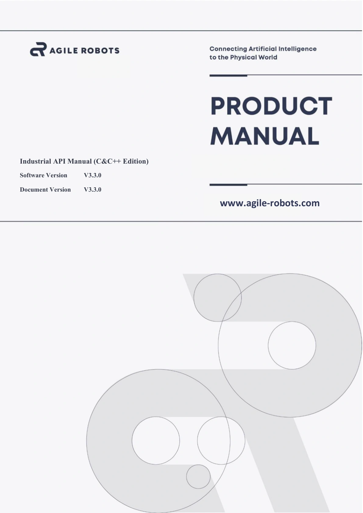



```
Agile Robots • Beijing  
www.agile-robots.com
Industrial API Manual (C&C++ Edition)  
Software Version  
V3.3.0  
Document Version 
V3.3.0
```



## PDF page 2

**Source:** Industrial API Manual (C\&C++ Edition) \_V3.3.0\_EN\_20260605.pdf, original pdf page 2. [Open the corresponding PDF reading-copy page](https://1292444914-files.gitbook.io/~/files/v0/b/gitbook-x-prod.appspot.com/o/spaces%2FtgOfPnscWebs1eh82EKq%2Fuploads%2FWGm4W5tbOjT5mD2c1h1g%2Findustrial-api-manual-c-c-edition-v3-3-0-en-20260605-pp-001-150.pdf?alt=media#page=2).



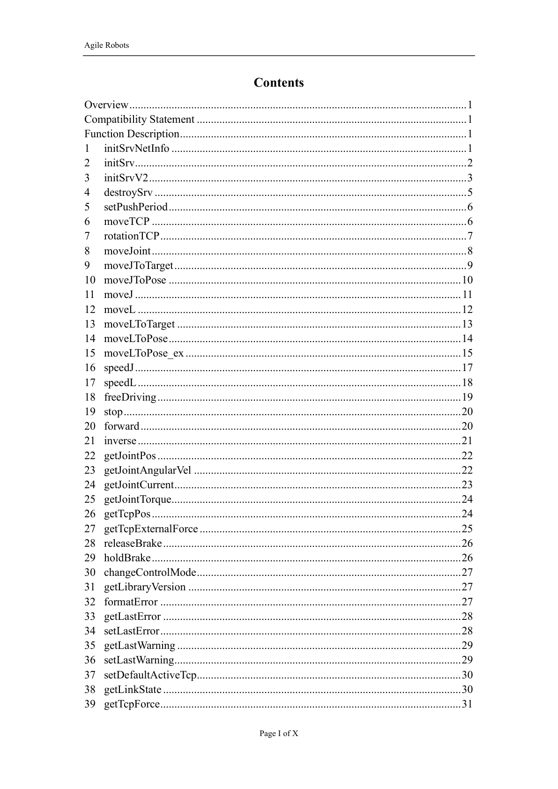



```
Agile Robots 
Page I of X 
Contents  
Overview ........................................................................................................................ 1 
Compatibility Statement ................................................................................................ 1 
Function Description ...................................................................................................... 1 
1 
initSrvNetInfo ......................................................................................................... 1 
2 
initSrv ...................................................................................................................... 2 
3 
initSrvV2 ................................................................................................................. 3 
4 
destroySrv ............................................................................................................... 5 
5 
setPushPeriod .......................................................................................................... 6 
6 
moveTCP ................................................................................................................ 6 
7 
rotationTCP ............................................................................................................. 7 
8 
moveJoint ................................................................................................................ 8 
9 
moveJToTarget ........................................................................................................ 9 
10 moveJToPose ........................................................................................................ 10 
11 moveJ .................................................................................................................... 11 
12 moveL ................................................................................................................... 12 
13 moveLToTarget ..................................................................................................... 13 
14 moveLToPose ........................................................................................................ 14 
15 moveLToPose_ex .................................................................................................. 15 
16 speedJ .................................................................................................................... 17 
17 speedL ................................................................................................................... 18 
18 freeDriving ............................................................................................................ 19 
19 stop ........................................................................................................................ 20 
20 forward .................................................................................................................. 20 
21 inverse ................................................................................................................... 21 
22 getJointPos ............................................................................................................ 22 
23 getJointAngularVel ............................................................................................... 22 
24 getJointCurrent ...................................................................................................... 23 
25 getJointTorque ....................................................................................................... 24 
26 getTcpPos .............................................................................................................. 24 
27 getTcpExternalForce ............................................................................................. 25 
28 releaseBrake .......................................................................................................... 26 
29 holdBrake .............................................................................................................. 26 
30 changeControlMode .............................................................................................. 27 
31 getLibraryVersion ................................................................................................. 27 
32 formatError ........................................................................................................... 27 
33 getLastError .......................................................................................................... 28 
34 setLastError ........................................................................................................... 28 
35 getLastWarning ..................................................................................................... 29 
36 setLastWarning ...................................................................................................... 29 
37 setDefaultActiveTcp.............................................................................................. 30 
38 getLinkState .......................................................................................................... 30 
39 getTcpForce ........................................................................................................... 31
```



**Original document cross-references:** [PDF 10](pages-001-072.md#pdf-page-10) · [PDF 11](pages-001-072.md#pdf-page-11) · [PDF 12](pages-001-072.md#pdf-page-12) · [PDF 14](pages-001-072.md#pdf-page-14) · [PDF 15](pages-001-072.md#pdf-page-15) · [PDF 16](pages-001-072.md#pdf-page-16) · [PDF 17](pages-001-072.md#pdf-page-17) · [PDF 18](pages-001-072.md#pdf-page-18) · [PDF 19](pages-001-072.md#pdf-page-19) · [PDF 20](pages-001-072.md#pdf-page-20) · [PDF 21](pages-001-072.md#pdf-page-21) · [PDF 22](pages-001-072.md#pdf-page-22) · [PDF 23](pages-001-072.md#pdf-page-23) · [PDF 24](pages-001-072.md#pdf-page-24) · [PDF 26](pages-001-072.md#pdf-page-26) · [PDF 27](pages-001-072.md#pdf-page-27) · [PDF 28](pages-001-072.md#pdf-page-28) · [PDF 29](pages-001-072.md#pdf-page-29) · [PDF 30](pages-001-072.md#pdf-page-30) · [PDF 31](pages-001-072.md#pdf-page-31) · [PDF 32](pages-001-072.md#pdf-page-32) · [PDF 33](pages-001-072.md#pdf-page-33) · [PDF 34](pages-001-072.md#pdf-page-34) · [PDF 35](pages-001-072.md#pdf-page-35) · [PDF 36](pages-001-072.md#pdf-page-36) · [PDF 37](pages-001-072.md#pdf-page-37) · [PDF 38](pages-001-072.md#pdf-page-38) · [PDF 39](pages-001-072.md#pdf-page-39) · [PDF 40](pages-001-072.md#pdf-page-40)

## PDF page 3

**Source:** Industrial API Manual (C\&C++ Edition) \_V3.3.0\_EN\_20260605.pdf, original pdf page 3. [Open the corresponding PDF reading-copy page](https://1292444914-files.gitbook.io/~/files/v0/b/gitbook-x-prod.appspot.com/o/spaces%2FtgOfPnscWebs1eh82EKq%2Fuploads%2FWGm4W5tbOjT5mD2c1h1g%2Findustrial-api-manual-c-c-edition-v3-3-0-en-20260605-pp-001-150.pdf?alt=media#page=3).



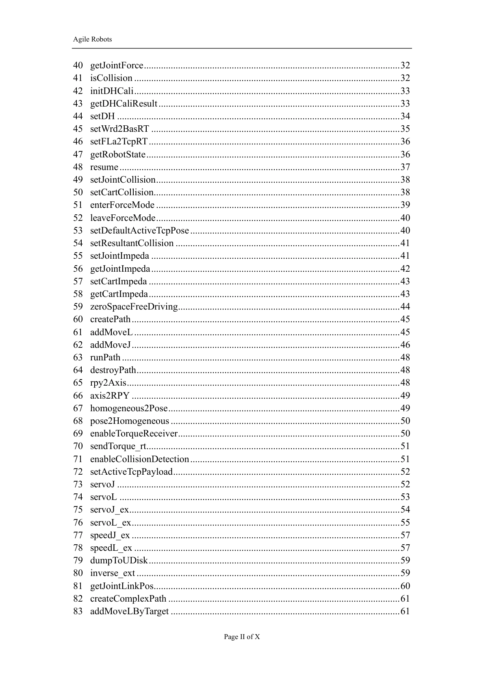



```
Agile Robots 
Page II of X 
40 getJointForce ......................................................................................................... 32 
41 isCollision ............................................................................................................. 32 
42 initDHCali ............................................................................................................. 33 
43 getDHCaliResult ................................................................................................... 33 
44 setDH .................................................................................................................... 34 
45 setWrd2BasRT ...................................................................................................... 35 
46 setFLa2TcpRT ....................................................................................................... 36 
47 getRobotState ........................................................................................................ 36 
48 resume ................................................................................................................... 37 
49 setJointCollision .................................................................................................... 38 
50 setCartCollision ..................................................................................................... 38 
51 enterForceMode .................................................................................................... 39 
52 leaveForceMode .................................................................................................... 40 
53 setDefaultActiveTcpPose ...................................................................................... 40 
54 setResultantCollision ............................................................................................ 41 
55 setJointImpeda ...................................................................................................... 41 
56 getJointImpeda ...................................................................................................... 42 
57 setCartImpeda ....................................................................................................... 43 
58 getCartImpeda ....................................................................................................... 43 
59 zeroSpaceFreeDriving ........................................................................................... 44 
60 createPath .............................................................................................................. 45 
61 addMoveL ............................................................................................................. 45 
62 addMoveJ .............................................................................................................. 46 
63 runPath .................................................................................................................. 48 
64 destroyPath ............................................................................................................ 48 
65 rpy2Axis ................................................................................................................ 48 
66 axis2RPY .............................................................................................................. 49 
67 homogeneous2Pose ............................................................................................... 49 
68 pose2Homogeneous .............................................................................................. 50 
69 enableTorqueReceiver ........................................................................................... 50 
70 sendTorque_rt........................................................................................................ 51 
71 enableCollisionDetection ...................................................................................... 51 
72 setActiveTcpPayload ............................................................................................. 52 
73 servoJ .................................................................................................................... 52 
74 servoL ................................................................................................................... 53 
75 servoJ_ex ............................................................................................................... 54 
76 servoL_ex .............................................................................................................. 55 
77 speedJ_ex .............................................................................................................. 57 
78 speedL_ex ............................................................................................................. 57 
79 dumpToUDisk ....................................................................................................... 59 
80 inverse_ext ............................................................................................................ 59 
81 getJointLinkPos ..................................................................................................... 60 
82 createComplexPath ............................................................................................... 61 
83 addMoveLByTarget .............................................................................................. 61
```



**Original document cross-references:** [PDF 41](pages-001-072.md#pdf-page-41) · [PDF 42](pages-001-072.md#pdf-page-42) · [PDF 43](pages-001-072.md#pdf-page-43) · [PDF 44](pages-001-072.md#pdf-page-44) · [PDF 45](pages-001-072.md#pdf-page-45) · [PDF 46](pages-001-072.md#pdf-page-46) · [PDF 47](pages-001-072.md#pdf-page-47) · [PDF 48](pages-001-072.md#pdf-page-48) · [PDF 49](pages-001-072.md#pdf-page-49) · [PDF 50](pages-001-072.md#pdf-page-50) · [PDF 51](pages-001-072.md#pdf-page-51) · [PDF 52](pages-001-072.md#pdf-page-52) · [PDF 53](pages-001-072.md#pdf-page-53) · [PDF 54](pages-001-072.md#pdf-page-54) · [PDF 55](pages-001-072.md#pdf-page-55) · [PDF 57](pages-001-072.md#pdf-page-57) · [PDF 58](pages-001-072.md#pdf-page-58) · [PDF 59](pages-001-072.md#pdf-page-59) · [PDF 60](pages-001-072.md#pdf-page-60) · [PDF 61](pages-001-072.md#pdf-page-61) · [PDF 62](pages-001-072.md#pdf-page-62) · [PDF 63](pages-001-072.md#pdf-page-63) · [PDF 64](pages-001-072.md#pdf-page-64) · [PDF 66](pages-001-072.md#pdf-page-66) · [PDF 68](pages-001-072.md#pdf-page-68) · [PDF 69](pages-001-072.md#pdf-page-69) · [PDF 70](pages-001-072.md#pdf-page-70)

## PDF page 4

**Source:** Industrial API Manual (C\&C++ Edition) \_V3.3.0\_EN\_20260605.pdf, original pdf page 4. [Open the corresponding PDF reading-copy page](https://1292444914-files.gitbook.io/~/files/v0/b/gitbook-x-prod.appspot.com/o/spaces%2FtgOfPnscWebs1eh82EKq%2Fuploads%2FWGm4W5tbOjT5mD2c1h1g%2Findustrial-api-manual-c-c-edition-v3-3-0-en-20260605-pp-001-150.pdf?alt=media#page=4).



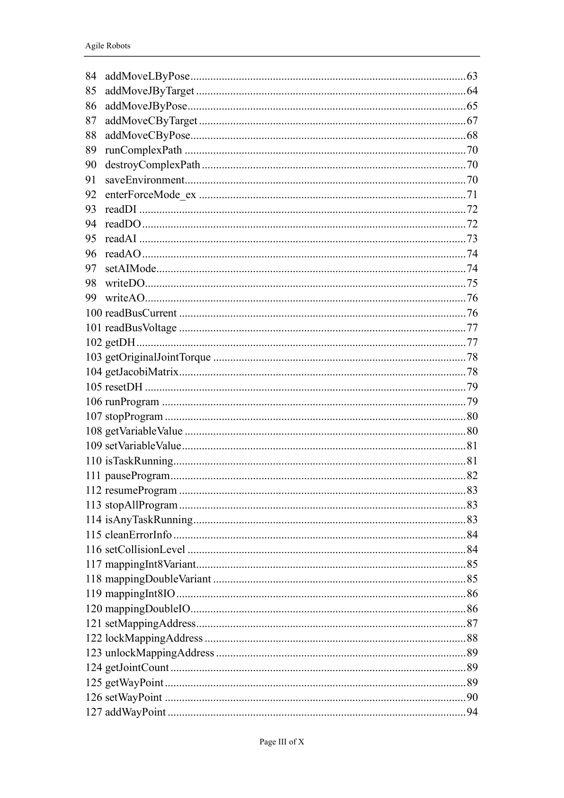



```
Agile Robots 
Page III of X 
84 addMoveLByPose ................................................................................................. 63 
85 addMoveJByTarget ............................................................................................... 64 
86 addMoveJByPose .................................................................................................. 65 
87 addMoveCByTarget .............................................................................................. 67 
88 addMoveCByPose ................................................................................................. 68 
89 runComplexPath ................................................................................................... 70 
90 destroyComplexPath ............................................................................................. 70 
91 saveEnvironment ................................................................................................... 70 
92 enterForceMode_ex .............................................................................................. 71 
93 readDI ................................................................................................................... 72 
94 readDO .................................................................................................................. 72 
95 readAI ................................................................................................................... 73 
96 readAO .................................................................................................................. 74 
97 setAIMode ............................................................................................................. 74 
98 writeDO ................................................................................................................. 75 
99 writeAO ................................................................................................................. 76 
100 readBusCurrent ..................................................................................................... 76 
101 readBusVoltage ..................................................................................................... 77 
102 getDH .................................................................................................................... 77 
103 getOriginalJointTorque ......................................................................................... 78 
104 getJacobiMatrix ..................................................................................................... 78 
105 resetDH ................................................................................................................. 79 
106 runProgram ........................................................................................................... 79 
107 stopProgram .......................................................................................................... 80 
108 getVariableValue ................................................................................................... 80 
109 setVariableValue .................................................................................................... 81 
110 isTaskRunning ....................................................................................................... 81 
111 pauseProgram ........................................................................................................ 82 
112 resumeProgram ..................................................................................................... 83 
113 stopAllProgram ..................................................................................................... 83 
114 isAnyTaskRunning ................................................................................................ 83 
115 cleanErrorInfo ....................................................................................................... 84 
116 setCollisionLevel .................................................................................................. 84 
117 mappingInt8Variant ............................................................................................... 85 
118 mappingDoubleVariant ......................................................................................... 85 
119 mappingInt8IO ...................................................................................................... 86 
120 mappingDoubleIO ................................................................................................. 86 
121 setMappingAddress ............................................................................................... 87 
122 lockMappingAddress ............................................................................................ 88 
123 unlockMappingAddress ........................................................................................ 89 
124 getJointCount ........................................................................................................ 89 
125 getWayPoint .......................................................................................................... 89 
126 setWayPoint .......................................................................................................... 90 
127 addWayPoint ......................................................................................................... 94
```



**Original document cross-references:** [PDF 72](pages-001-072.md#pdf-page-72) · [PDF 73](pages-073-144.md#pdf-page-73) · [PDF 74](pages-073-144.md#pdf-page-74) · [PDF 76](pages-073-144.md#pdf-page-76) · [PDF 77](pages-073-144.md#pdf-page-77) · [PDF 79](pages-073-144.md#pdf-page-79) · [PDF 80](pages-073-144.md#pdf-page-80) · [PDF 81](pages-073-144.md#pdf-page-81) · [PDF 82](pages-073-144.md#pdf-page-82) · [PDF 83](pages-073-144.md#pdf-page-83) · [PDF 84](pages-073-144.md#pdf-page-84) · [PDF 85](pages-073-144.md#pdf-page-85) · [PDF 86](pages-073-144.md#pdf-page-86) · [PDF 87](pages-073-144.md#pdf-page-87) · [PDF 88](pages-073-144.md#pdf-page-88) · [PDF 89](pages-073-144.md#pdf-page-89) · [PDF 90](pages-073-144.md#pdf-page-90) · [PDF 91](pages-073-144.md#pdf-page-91) · [PDF 92](pages-073-144.md#pdf-page-92) · [PDF 93](pages-073-144.md#pdf-page-93) · [PDF 94](pages-073-144.md#pdf-page-94) · [PDF 95](pages-073-144.md#pdf-page-95) · [PDF 96](pages-073-144.md#pdf-page-96) · [PDF 97](pages-073-144.md#pdf-page-97) · [PDF 98](pages-073-144.md#pdf-page-98) · [PDF 99](pages-073-144.md#pdf-page-99) · [PDF 103](pages-073-144.md#pdf-page-103)

## PDF page 5

**Source:** Industrial API Manual (C\&C++ Edition) \_V3.3.0\_EN\_20260605.pdf, original pdf page 5. [Open the corresponding PDF reading-copy page](https://1292444914-files.gitbook.io/~/files/v0/b/gitbook-x-prod.appspot.com/o/spaces%2FtgOfPnscWebs1eh82EKq%2Fuploads%2FWGm4W5tbOjT5mD2c1h1g%2Findustrial-api-manual-c-c-edition-v3-3-0-en-20260605-pp-001-150.pdf?alt=media#page=5).



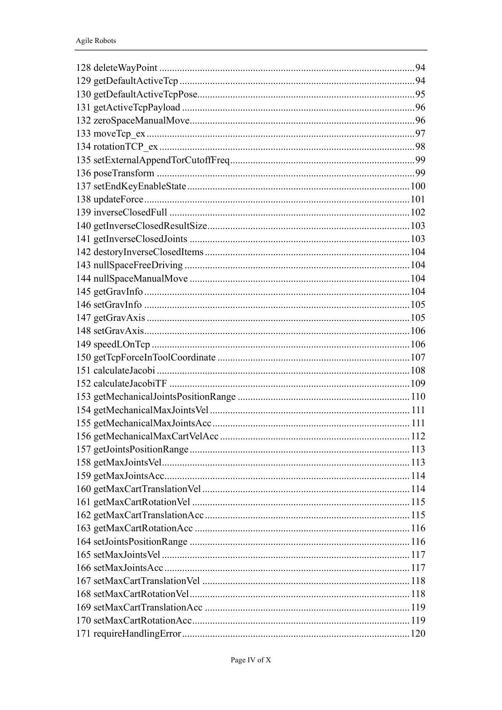



```
Agile Robots 
Page IV of X 
128 deleteWayPoint ..................................................................................................... 94 
129 getDefaultActiveTcp ............................................................................................. 94 
130 getDefaultActiveTcpPose...................................................................................... 95 
131 getActiveTcpPayload ............................................................................................ 96 
132 zeroSpaceManualMove ......................................................................................... 96 
133 moveTcp_ex .......................................................................................................... 97 
134 rotationTCP_ex ..................................................................................................... 98 
135 setExternalAppendTorCutoffFreq ......................................................................... 99 
136 poseTransform ...................................................................................................... 99 
137 setEndKeyEnableState ........................................................................................ 100 
138 updateForce ......................................................................................................... 101 
139 inverseClosedFull ............................................................................................... 102 
140 getInverseClosedResultSize ................................................................................ 103 
141 getInverseClosedJoints ....................................................................................... 103 
142 destoryInverseClosedItems ................................................................................. 104 
143 nullSpaceFreeDriving ......................................................................................... 104 
144 nullSpaceManualMove ....................................................................................... 104 
145 getGravInfo ......................................................................................................... 104 
146 setGravInfo ......................................................................................................... 105 
147 getGravAxis ........................................................................................................ 105 
148 setGravAxis ......................................................................................................... 106 
149 speedLOnTcp ...................................................................................................... 106 
150 getTcpForceInToolCoordinate ............................................................................ 107 
151 calculateJacobi .................................................................................................... 108 
152 calculateJacobiTF ............................................................................................... 109 
153 getMechanicalJointsPositionRange .................................................................... 110 
154 getMechanicalMaxJointsVel ............................................................................... 111 
155 getMechanicalMaxJointsAcc .............................................................................. 111 
156 getMechanicalMaxCartVelAcc ........................................................................... 112 
157 getJointsPositionRange ....................................................................................... 113 
158 getMaxJointsVel .................................................................................................. 113 
159 getMaxJointsAcc ................................................................................................. 114 
160 getMaxCartTranslationVel .................................................................................. 114 
161 getMaxCartRotationVel ...................................................................................... 115 
162 getMaxCartTranslationAcc ................................................................................. 115 
163 getMaxCartRotationAcc ..................................................................................... 116 
164 setJointsPositionRange ....................................................................................... 116 
165 setMaxJointsVel .................................................................................................. 117 
166 setMaxJointsAcc ................................................................................................. 117 
167 setMaxCartTranslationVel .................................................................................. 118 
168 setMaxCartRotationVel ....................................................................................... 118 
169 setMaxCartTranslationAcc ................................................................................. 119 
170 setMaxCartRotationAcc ...................................................................................... 119 
171 requireHandlingError .......................................................................................... 120
```



**Original document cross-references:** [PDF 103](pages-073-144.md#pdf-page-103) · [PDF 104](pages-073-144.md#pdf-page-104) · [PDF 105](pages-073-144.md#pdf-page-105) · [PDF 106](pages-073-144.md#pdf-page-106) · [PDF 107](pages-073-144.md#pdf-page-107) · [PDF 108](pages-073-144.md#pdf-page-108) · [PDF 109](pages-073-144.md#pdf-page-109) · [PDF 110](pages-073-144.md#pdf-page-110) · [PDF 111](pages-073-144.md#pdf-page-111) · [PDF 112](pages-073-144.md#pdf-page-112) · [PDF 113](pages-073-144.md#pdf-page-113) · [PDF 114](pages-073-144.md#pdf-page-114) · [PDF 115](pages-073-144.md#pdf-page-115) · [PDF 116](pages-073-144.md#pdf-page-116) · [PDF 117](pages-073-144.md#pdf-page-117) · [PDF 118](pages-073-144.md#pdf-page-118) · [PDF 119](pages-073-144.md#pdf-page-119) · [PDF 120](pages-073-144.md#pdf-page-120) · [PDF 121](pages-073-144.md#pdf-page-121) · [PDF 122](pages-073-144.md#pdf-page-122) · [PDF 123](pages-073-144.md#pdf-page-123) · [PDF 124](pages-073-144.md#pdf-page-124) · [PDF 125](pages-073-144.md#pdf-page-125) · [PDF 126](pages-073-144.md#pdf-page-126) · [PDF 127](pages-073-144.md#pdf-page-127) · [PDF 128](pages-073-144.md#pdf-page-128) · [PDF 129](pages-073-144.md#pdf-page-129)

## PDF page 6

**Source:** Industrial API Manual (C\&C++ Edition) \_V3.3.0\_EN\_20260605.pdf, original pdf page 6. [Open the corresponding PDF reading-copy page](https://1292444914-files.gitbook.io/~/files/v0/b/gitbook-x-prod.appspot.com/o/spaces%2FtgOfPnscWebs1eh82EKq%2Fuploads%2FWGm4W5tbOjT5mD2c1h1g%2Findustrial-api-manual-c-c-edition-v3-3-0-en-20260605-pp-001-150.pdf?alt=media#page=6).



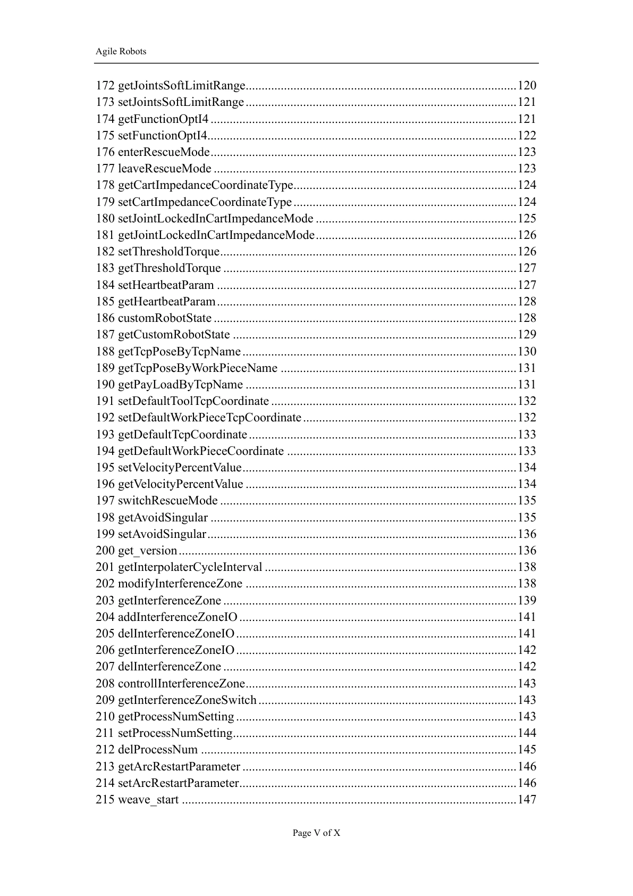



```
Agile Robots 
Page V of X 
172 getJointsSoftLimitRange ..................................................................................... 120 
173 setJointsSoftLimitRange ..................................................................................... 121 
174 getFunctionOptI4 ................................................................................................ 121 
175 setFunctionOptI4 ................................................................................................. 122 
176 enterRescueMode ................................................................................................ 123 
177 leaveRescueMode ............................................................................................... 123 
178 getCartImpedanceCoordinateType...................................................................... 124 
179 setCartImpedanceCoordinateType ...................................................................... 124 
180 setJointLockedInCartImpedanceMode ............................................................... 125 
181 getJointLockedInCartImpedanceMode ............................................................... 126 
182 setThresholdTorque ............................................................................................. 126 
183 getThresholdTorque ............................................................................................ 127 
184 setHeartbeatParam .............................................................................................. 127 
185 getHeartbeatParam .............................................................................................. 128 
186 customRobotState ............................................................................................... 128 
187 getCustomRobotState ......................................................................................... 129 
188 getTcpPoseByTcpName ...................................................................................... 130 
189 getTcpPoseByWorkPieceName .......................................................................... 131 
190 getPayLoadByTcpName ..................................................................................... 131 
191 setDefaultToolTcpCoordinate ............................................................................. 132 
192 setDefaultWorkPieceTcpCoordinate ................................................................... 132 
193 getDefaultTcpCoordinate .................................................................................... 133 
194 getDefaultWorkPieceCoordinate ........................................................................ 133 
195 setVelocityPercentValue ...................................................................................... 134 
196 getVelocityPercentValue ..................................................................................... 134 
197 switchRescueMode ............................................................................................. 135 
198 getAvoidSingular ................................................................................................ 135 
199 setAvoidSingular ................................................................................................. 136 
200 get_version .......................................................................................................... 136 
201 getInterpolaterCycleInterval ............................................................................... 138 
202 modifyInterferenceZone ..................................................................................... 138 
203 getInterferenceZone ............................................................................................ 139 
204 addInterferenceZoneIO ....................................................................................... 141 
205 delInterferenceZoneIO ........................................................................................ 141 
206 getInterferenceZoneIO ........................................................................................ 142 
207 delInterferenceZone ............................................................................................ 142 
208 controllInterferenceZone ..................................................................................... 143 
209 getInterferenceZoneSwitch ................................................................................. 143 
210 getProcessNumSetting ........................................................................................ 143 
211 setProcessNumSetting ......................................................................................... 144 
212 delProcessNum ................................................................................................... 145 
213 getArcRestartParameter ...................................................................................... 146 
214 setArcRestartParameter ....................................................................................... 146 
215 weave_start ......................................................................................................... 147
```



**Original document cross-references:** [PDF 129](pages-073-144.md#pdf-page-129) · [PDF 130](pages-073-144.md#pdf-page-130) · [PDF 131](pages-073-144.md#pdf-page-131) · [PDF 132](pages-073-144.md#pdf-page-132) · [PDF 133](pages-073-144.md#pdf-page-133) · [PDF 134](pages-073-144.md#pdf-page-134) · [PDF 135](pages-073-144.md#pdf-page-135) · [PDF 136](pages-073-144.md#pdf-page-136) · [PDF 137](pages-073-144.md#pdf-page-137) · [PDF 138](pages-073-144.md#pdf-page-138) · [PDF 139](pages-073-144.md#pdf-page-139) · [PDF 140](pages-073-144.md#pdf-page-140) · [PDF 141](pages-073-144.md#pdf-page-141) · [PDF 142](pages-073-144.md#pdf-page-142) · [PDF 143](pages-073-144.md#pdf-page-143) · [PDF 144](pages-073-144.md#pdf-page-144) · [PDF 145](pages-145-190.md#pdf-page-145) · [PDF 147](pages-145-190.md#pdf-page-147) · [PDF 148](pages-145-190.md#pdf-page-148) · [PDF 150](pages-145-190.md#pdf-page-150) · [PDF 151](pages-145-190.md#pdf-page-151) · [PDF 152](pages-145-190.md#pdf-page-152) · [PDF 153](pages-145-190.md#pdf-page-153) · [PDF 154](pages-145-190.md#pdf-page-154) · [PDF 155](pages-145-190.md#pdf-page-155) · [PDF 156](pages-145-190.md#pdf-page-156)

## PDF page 7

**Source:** Industrial API Manual (C\&C++ Edition) \_V3.3.0\_EN\_20260605.pdf, original pdf page 7. [Open the corresponding PDF reading-copy page](https://1292444914-files.gitbook.io/~/files/v0/b/gitbook-x-prod.appspot.com/o/spaces%2FtgOfPnscWebs1eh82EKq%2Fuploads%2FWGm4W5tbOjT5mD2c1h1g%2Findustrial-api-manual-c-c-edition-v3-3-0-en-20260605-pp-001-150.pdf?alt=media#page=7).



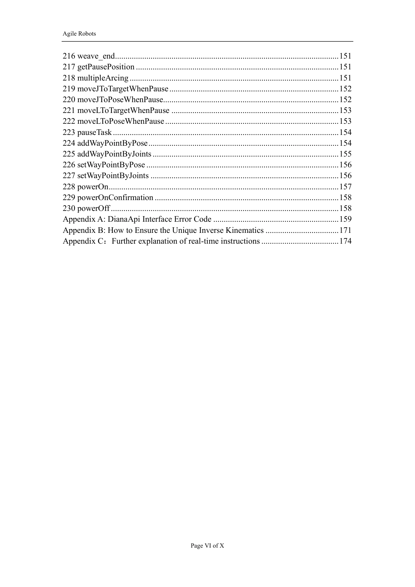



```
Agile Robots 
Page VI of X 
216 weave_end ........................................................................................................... 151 
217 getPausePosition ................................................................................................. 151 
218 multipleArcing .................................................................................................... 151 
219 moveJToTargetWhenPause ................................................................................. 152 
220 moveJToPoseWhenPause.................................................................................... 152 
221 moveLToTargetWhenPause ................................................................................ 153 
222 moveLToPoseWhenPause ................................................................................... 153 
223 pauseTask ............................................................................................................ 154 
224 addWayPointByPose ........................................................................................... 154 
225 addWayPointByJoints ......................................................................................... 155 
226 setWayPointByPose ............................................................................................ 156 
227 setWayPointByJoints .......................................................................................... 156 
228 powerOn .............................................................................................................. 157 
229 powerOnConfirmation ........................................................................................ 158 
230 powerOff ............................................................................................................. 158 
Appendix A: DianaApi Interface Error Code ............................................................ 159 
Appendix B: How to Ensure the Unique Inverse Kinematics ................................... 171 
Appendix C：Further explanation of real-time instructions ..................................... 174
```



**Original document cross-references:** [PDF 160](pages-145-190.md#pdf-page-160) · [PDF 161](pages-145-190.md#pdf-page-161) · [PDF 162](pages-145-190.md#pdf-page-162) · [PDF 163](pages-145-190.md#pdf-page-163) · [PDF 164](pages-145-190.md#pdf-page-164) · [PDF 165](pages-145-190.md#pdf-page-165) · [PDF 166](pages-145-190.md#pdf-page-166) · [PDF 167](pages-145-190.md#pdf-page-167) · [PDF 168](pages-145-190.md#pdf-page-168) · [PDF 180](pages-145-190.md#pdf-page-180) · [PDF 183](pages-145-190.md#pdf-page-183)

## PDF page 8

**Source:** Industrial API Manual (C\&C++ Edition) \_V3.3.0\_EN\_20260605.pdf, original pdf page 8. [Open the corresponding PDF reading-copy page](https://1292444914-files.gitbook.io/~/files/v0/b/gitbook-x-prod.appspot.com/o/spaces%2FtgOfPnscWebs1eh82EKq%2Fuploads%2FWGm4W5tbOjT5mD2c1h1g%2Findustrial-api-manual-c-c-edition-v3-3-0-en-20260605-pp-001-150.pdf?alt=media#page=8).



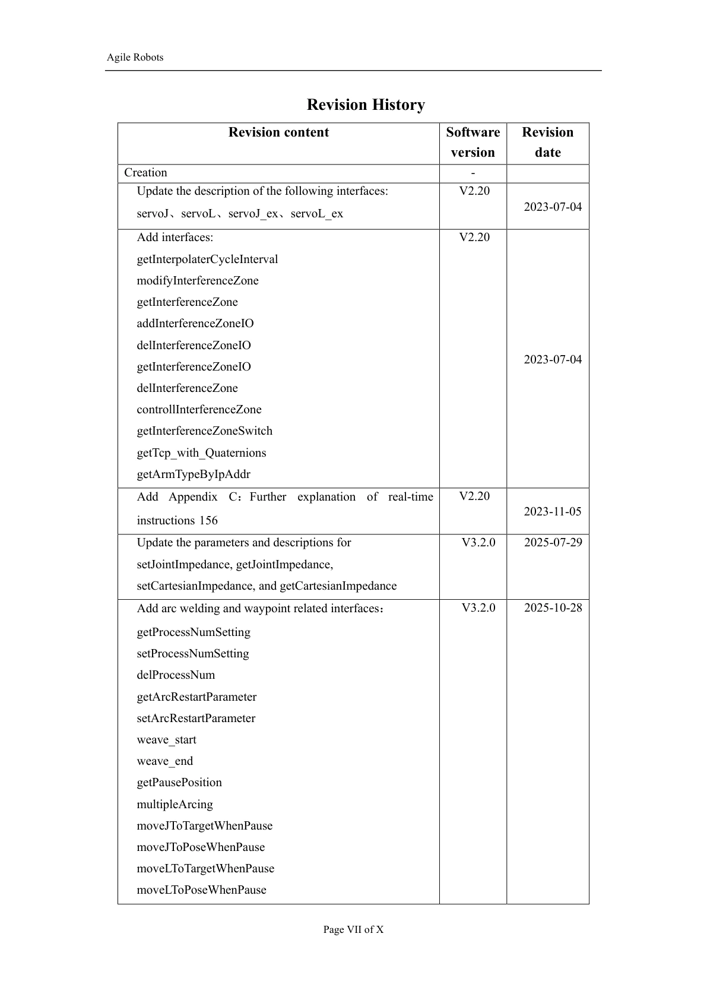



```
Agile Robots 
Page VII of X 
Revision History  
Revision content  
Software 
version  
Revision 
date  
Creation  
-  
 
Update the description of the following interfaces: 
servoJ、servoL、servoJ_ex、servoL_ex 
V2.20  
2023-07-04 
Add interfaces:  
getInterpolaterCycleInterval 
modifyInterferenceZone 
 
getInterferenceZone 
addInterferenceZoneIO 
delInterferenceZoneIO 
getInterferenceZoneIO 
delInterferenceZone 
controllInterferenceZone  
getInterferenceZoneSwitch 
getTcp_with_Quaternions 
getArmTypeByIpAddr 
V2.20  
2023-07-04 
Add Appendix C：Further explanation of real-time 
instructions 156 
V2.20  
2023-11-05 
Update the parameters and descriptions for 
setJointImpedance, getJointImpedance, 
setCartesianImpedance, and getCartesianImpedance 
V3.2.0 
2025-07-29 
Add arc welding and waypoint related interfaces： 
getProcessNumSetting 
setProcessNumSetting 
delProcessNum 
getArcRestartParameter 
setArcRestartParameter 
weave_start 
weave_end 
getPausePosition 
multipleArcing 
moveJToTargetWhenPause 
moveJToPoseWhenPause 
moveLToTargetWhenPause 
moveLToPoseWhenPause 
V3.2.0 
2025-10-28
```



## PDF page 9

**Source:** Industrial API Manual (C\&C++ Edition) \_V3.3.0\_EN\_20260605.pdf, original pdf page 9. [Open the corresponding PDF reading-copy page](https://1292444914-files.gitbook.io/~/files/v0/b/gitbook-x-prod.appspot.com/o/spaces%2FtgOfPnscWebs1eh82EKq%2Fuploads%2FWGm4W5tbOjT5mD2c1h1g%2Findustrial-api-manual-c-c-edition-v3-3-0-en-20260605-pp-001-150.pdf?alt=media#page=9).







```
Agile Robots 
Page VIII of X 
pauseTask 
addWayPointByPose 
addWayPointByJoints 
setWayPointByPose 
setWayPointByJoints 
Add new interface moveLToPose_ex. 
V3.3 
2025-11-25 
Add new interface： 
powerOn、powerOnConfirmation、powerOff 
V3.3 
2026-02-05
```



## PDF page 10

**Source:** Industrial API Manual (C\&C++ Edition) \_V3.3.0\_EN\_20260605.pdf, original pdf page 10. [Open the corresponding PDF reading-copy page](https://1292444914-files.gitbook.io/~/files/v0/b/gitbook-x-prod.appspot.com/o/spaces%2FtgOfPnscWebs1eh82EKq%2Fuploads%2FWGm4W5tbOjT5mD2c1h1g%2Findustrial-api-manual-c-c-edition-v3-3-0-en-20260605-pp-001-150.pdf?alt=media#page=10).



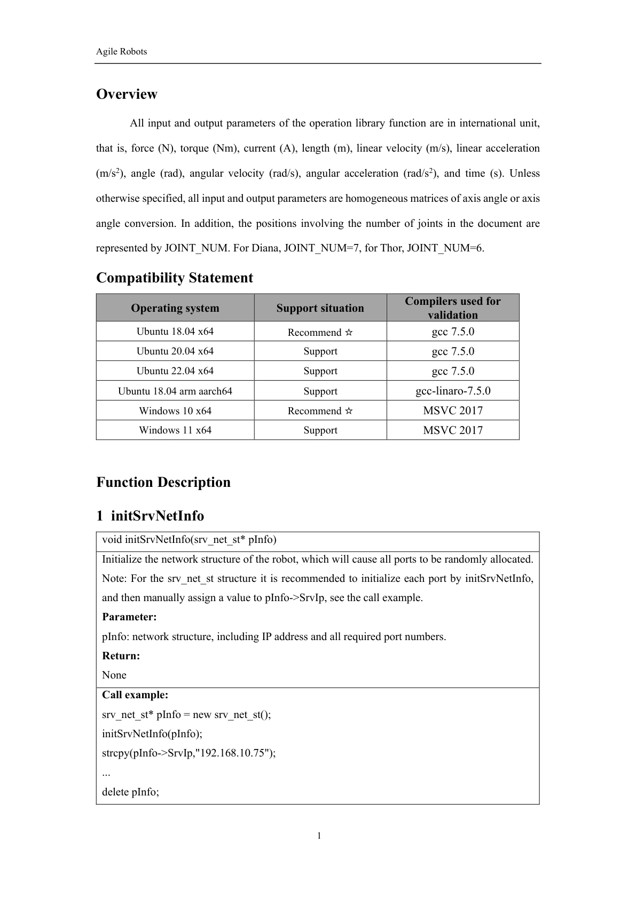



```
Agile Robots 
 1  
Overview  
All input and output parameters of the operation library function are in international unit, 
that is, force (N), torque (Nm), current (A), length (m), linear velocity (m/s), linear acceleration 
(m/s2), angle (rad), angular velocity (rad/s), angular acceleration (rad/s2), and time (s). Unless 
otherwise specified, all input and output parameters are homogeneous matrices of axis angle or axis 
angle conversion. In addition, the positions involving the number of joints in the document are 
represented by JOINT_NUM. For Diana, JOINT_NUM=7, for Thor, JOINT_NUM=6.  
Compatibility Statement  
Operating system  
Support situation  
Compilers used for 
validation  
Ubuntu 18.04 x64 
Recommend ☆  
gcc 7.5.0 
Ubuntu 20.04 x64 
Support  
gcc 7.5.0 
Ubuntu 22.04 x64 
Support  
gcc 7.5.0 
Ubuntu 18.04 arm aarch64 
Support  
gcc-linaro-7.5.0 
Windows 10 x64 
Recommend ☆  
MSVC 2017 
Windows 11 x64 
Support  
MSVC 2017 
 
Function Description  
1 initSrvNetInfo 
void initSrvNetInfo(srv_net_st* pInfo) 
Initialize the network structure of the robot, which will cause all ports to be randomly allocated. 
Note: For the srv_net_st structure it is recommended to initialize each port by initSrvNetInfo, 
and then manually assign a value to pInfo->SrvIp, see the call example. 
Parameter:  
pInfo: network structure, including IP address and all required port numbers.  
Return:  
None  
Call example:  
srv_net_st* pInfo = new srv_net_st(); 
initSrvNetInfo(pInfo); 
strcpy(pInfo->SrvIp,"192.168.10.75"); 
... 
delete pInfo;
```



## PDF page 11

**Source:** Industrial API Manual (C\&C++ Edition) \_V3.3.0\_EN\_20260605.pdf, original pdf page 11. [Open the corresponding PDF reading-copy page](https://1292444914-files.gitbook.io/~/files/v0/b/gitbook-x-prod.appspot.com/o/spaces%2FtgOfPnscWebs1eh82EKq%2Fuploads%2FWGm4W5tbOjT5mD2c1h1g%2Findustrial-api-manual-c-c-edition-v3-3-0-en-20260605-pp-001-150.pdf?alt=media#page=11).



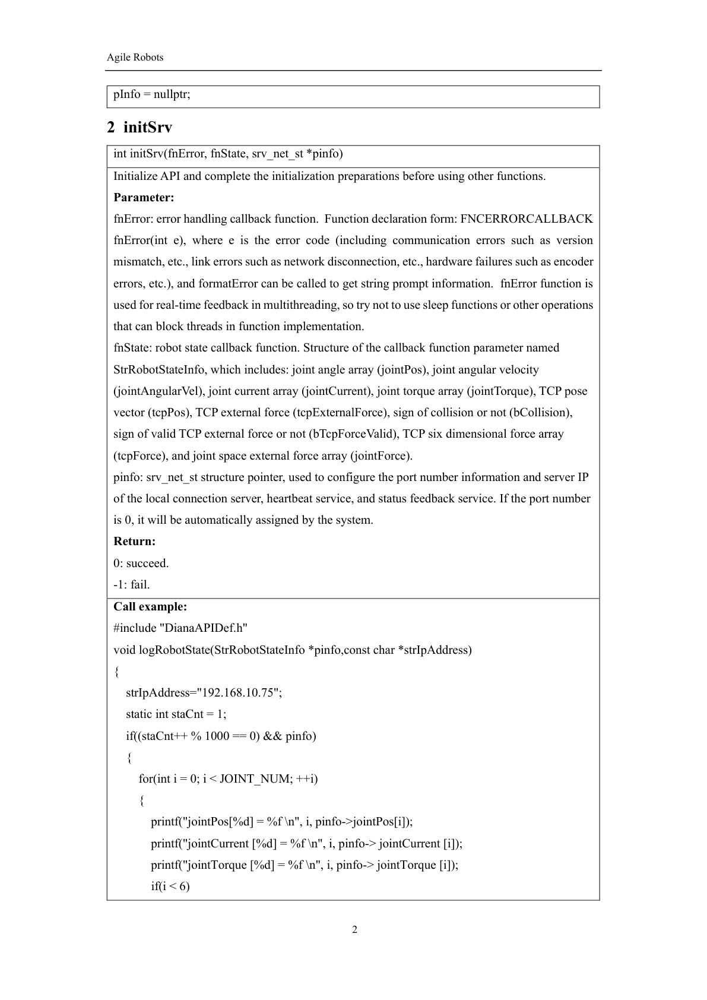



```
Agile Robots 
 2  
pInfo = nullptr; 
2 initSrv 
int initSrv(fnError, fnState, srv_net_st *pinfo) 
Initialize API and complete the initialization preparations before using other functions.  
Parameter:  
fnError: error handling callback function.  Function declaration form: FNCERRORCALLBACK 
fnError(int e), where e is the error code (including communication errors such as version 
mismatch, etc., link errors such as network disconnection, etc., hardware failures such as encoder 
errors, etc.), and formatError can be called to get string prompt information.  fnError function is 
used for real-time feedback in multithreading, so try not to use sleep functions or other operations 
that can block threads in function implementation.  
fnState: robot state callback function. Structure of the callback function parameter named 
StrRobotStateInfo, which includes: joint angle array (jointPos), joint angular velocity 
(jointAngularVel), joint current array (jointCurrent), joint torque array (jointTorque), TCP pose 
vector (tcpPos), TCP external force (tcpExternalForce), sign of collision or not (bCollision), 
sign of valid TCP external force or not (bTcpForceValid), TCP six dimensional force array 
(tcpForce), and joint space external force array (jointForce).  
pinfo: srv_net_st structure pointer, used to configure the port number information and server IP 
of the local connection server, heartbeat service, and status feedback service. If the port number 
is 0, it will be automatically assigned by the system.  
Return:  
0: succeed.  
-1: fail.  
Call example:  
#include "DianaAPIDef.h" 
void logRobotState(StrRobotStateInfo *pinfo,const char *strIpAddress) 
{ 
    strIpAddress="192.168.10.75"; 
    static int staCnt = 1; 
    if((staCnt++ % 1000 == 0) && pinfo) 
    { 
        for(int i = 0; i < JOINT_NUM; ++i) 
        { 
            printf("jointPos[%d] = %f \n", i, pinfo->jointPos[i]); 
            printf("jointCurrent [%d] = %f \n", i, pinfo-> jointCurrent [i]); 
            printf("jointTorque [%d] = %f \n", i, pinfo-> jointTorque [i]); 
            if(i < 6)
```



## PDF page 12

**Source:** Industrial API Manual (C\&C++ Edition) \_V3.3.0\_EN\_20260605.pdf, original pdf page 12. [Open the corresponding PDF reading-copy page](https://1292444914-files.gitbook.io/~/files/v0/b/gitbook-x-prod.appspot.com/o/spaces%2FtgOfPnscWebs1eh82EKq%2Fuploads%2FWGm4W5tbOjT5mD2c1h1g%2Findustrial-api-manual-c-c-edition-v3-3-0-en-20260605-pp-001-150.pdf?alt=media#page=12).



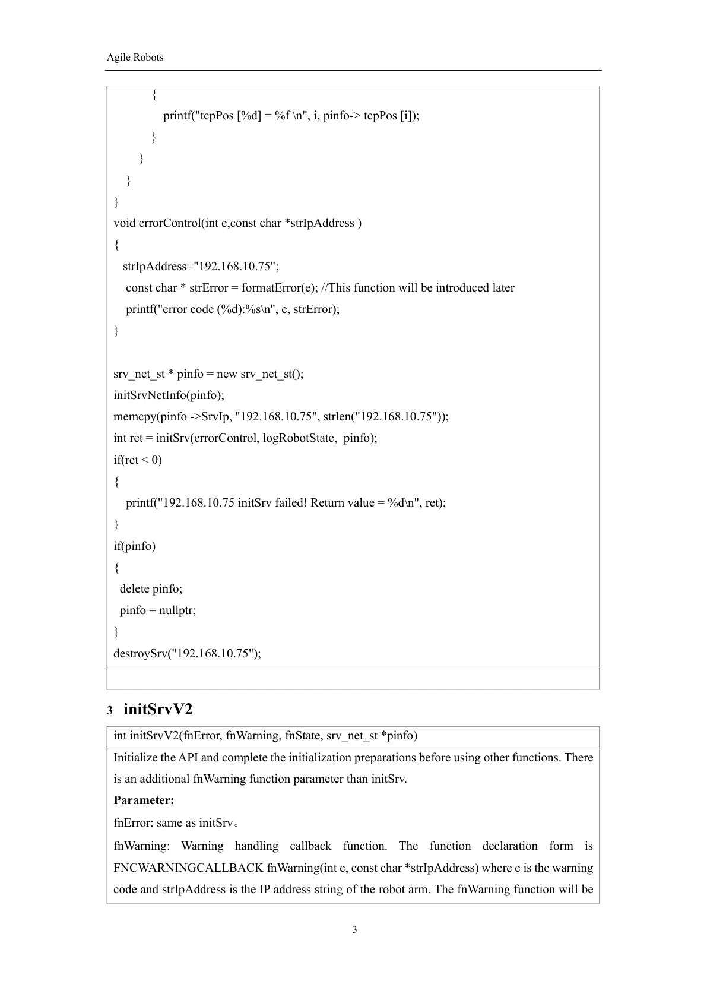



```
Agile Robots 
 3  
            { 
                printf("tcpPos [%d] = %f \n", i, pinfo-> tcpPos [i]); 
            } 
        } 
} 
} 
void errorControl(int e,const char *strIpAddress ) 
{ 
   strIpAddress="192.168.10.75"; 
const char * strError = formatError(e); //This function will be introduced later  
printf("error code (%d):%s\n", e, strError); 
} 
 
srv_net_st * pinfo = new srv_net_st(); 
initSrvNetInfo(pinfo); 
memcpy(pinfo ->SrvIp, "192.168.10.75", strlen("192.168.10.75")); 
int ret = initSrv(errorControl, logRobotState,  pinfo); 
if(ret < 0) 
{ 
    printf("192.168.10.75 initSrv failed! Return value = %d\n", ret); 
} 
if(pinfo) 
{ 
  delete pinfo; 
  pinfo = nullptr; 
} 
destroySrv("192.168.10.75"); 
 
3 initSrvV2 
int initSrvV2(fnError, fnWarning, fnState, srv_net_st *pinfo) 
Initialize the API and complete the initialization preparations before using other functions. There 
is an additional fnWarning function parameter than initSrv. 
Parameter:  
fnError: same as initSrv。 
fnWarning: Warning handling callback function. The function declaration form is 
FNCWARNINGCALLBACK fnWarning(int e, const char *strIpAddress) where e is the warning 
code and strIpAddress is the IP address string of the robot arm. The fnWarning function will be
```



## PDF page 13

**Source:** Industrial API Manual (C\&C++ Edition) \_V3.3.0\_EN\_20260605.pdf, original pdf page 13. [Open the corresponding PDF reading-copy page](https://1292444914-files.gitbook.io/~/files/v0/b/gitbook-x-prod.appspot.com/o/spaces%2FtgOfPnscWebs1eh82EKq%2Fuploads%2FWGm4W5tbOjT5mD2c1h1g%2Findustrial-api-manual-c-c-edition-v3-3-0-en-20260605-pp-001-150.pdf?alt=media#page=13).



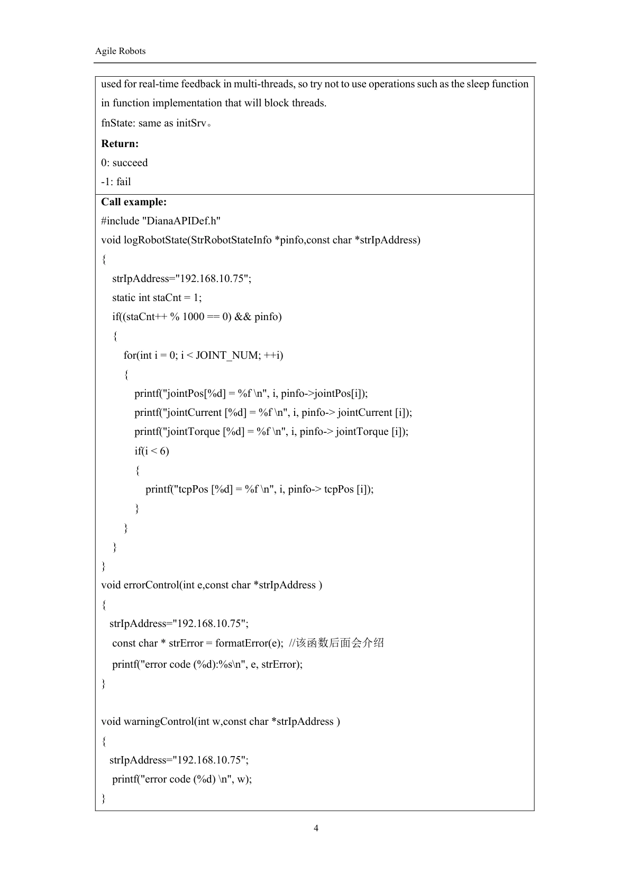



```
Agile Robots 
 4  
used for real-time feedback in multi-threads, so try not to use operations such as the sleep function 
in function implementation that will block threads.  
fnState: same as initSrv。 
Return:  
0: succeed  
-1: fail  
Call example:  
#include "DianaAPIDef.h" 
void logRobotState(StrRobotStateInfo *pinfo,const char *strIpAddress) 
{ 
    strIpAddress="192.168.10.75"; 
    static int staCnt = 1; 
    if((staCnt++ % 1000 == 0) && pinfo) 
    { 
        for(int i = 0; i < JOINT_NUM; ++i) 
        { 
            printf("jointPos[%d] = %f \n", i, pinfo->jointPos[i]); 
            printf("jointCurrent [%d] = %f \n", i, pinfo-> jointCurrent [i]); 
            printf("jointTorque [%d] = %f \n", i, pinfo-> jointTorque [i]); 
            if(i < 6) 
            { 
                printf("tcpPos [%d] = %f \n", i, pinfo-> tcpPos [i]); 
            } 
        } 
} 
} 
void errorControl(int e,const char *strIpAddress ) 
{ 
   strIpAddress="192.168.10.75"; 
const char * strError = formatError(e);  //该函数后面会介绍 
printf("error code (%d):%s\n", e, strError); 
} 
 
void warningControl(int w,const char *strIpAddress ) 
{ 
   strIpAddress="192.168.10.75"; 
printf("error code (%d) \n", w); 
}
```



## PDF page 14

**Source:** Industrial API Manual (C\&C++ Edition) \_V3.3.0\_EN\_20260605.pdf, original pdf page 14. [Open the corresponding PDF reading-copy page](https://1292444914-files.gitbook.io/~/files/v0/b/gitbook-x-prod.appspot.com/o/spaces%2FtgOfPnscWebs1eh82EKq%2Fuploads%2FWGm4W5tbOjT5mD2c1h1g%2Findustrial-api-manual-c-c-edition-v3-3-0-en-20260605-pp-001-150.pdf?alt=media#page=14).



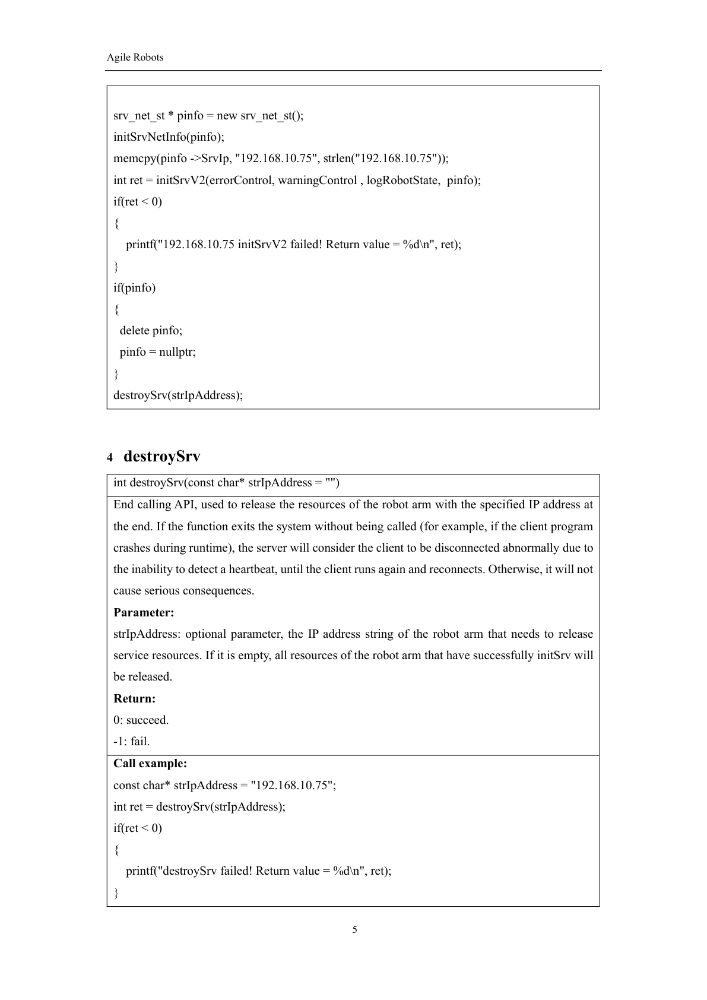



```
Agile Robots 
 5  
 
srv_net_st * pinfo = new srv_net_st(); 
initSrvNetInfo(pinfo); 
memcpy(pinfo ->SrvIp, "192.168.10.75", strlen("192.168.10.75")); 
int ret = initSrvV2(errorControl, warningControl , logRobotState,  pinfo); 
if(ret < 0) 
{ 
    printf("192.168.10.75 initSrvV2 failed! Return value = %d\n", ret); 
} 
if(pinfo) 
{ 
  delete pinfo; 
  pinfo = nullptr; 
} 
destroySrv(strIpAddress); 
 
4 destroySrv 
int destroySrv(const char* strIpAddress = "") 
End calling API, used to release the resources of the robot arm with the specified IP address at 
the end. If the function exits the system without being called (for example, if the client program 
crashes during runtime), the server will consider the client to be disconnected abnormally due to 
the inability to detect a heartbeat, until the client runs again and reconnects. Otherwise, it will not 
cause serious consequences.  
Parameter:  
strIpAddress: optional parameter, the IP address string of the robot arm that needs to release 
service resources. If it is empty, all resources of the robot arm that have successfully initSrv will 
be released.  
Return:  
0: succeed.  
-1: fail.  
Call example:  
const char* strIpAddress = "192.168.10.75";  
int ret = destroySrv(strIpAddress); 
if(ret < 0) 
{ 
    printf("destroySrv failed! Return value = %d\n", ret); 
}
```



## PDF page 15

**Source:** Industrial API Manual (C\&C++ Edition) \_V3.3.0\_EN\_20260605.pdf, original pdf page 15. [Open the corresponding PDF reading-copy page](https://1292444914-files.gitbook.io/~/files/v0/b/gitbook-x-prod.appspot.com/o/spaces%2FtgOfPnscWebs1eh82EKq%2Fuploads%2FWGm4W5tbOjT5mD2c1h1g%2Findustrial-api-manual-c-c-edition-v3-3-0-en-20260605-pp-001-150.pdf?alt=media#page=15).



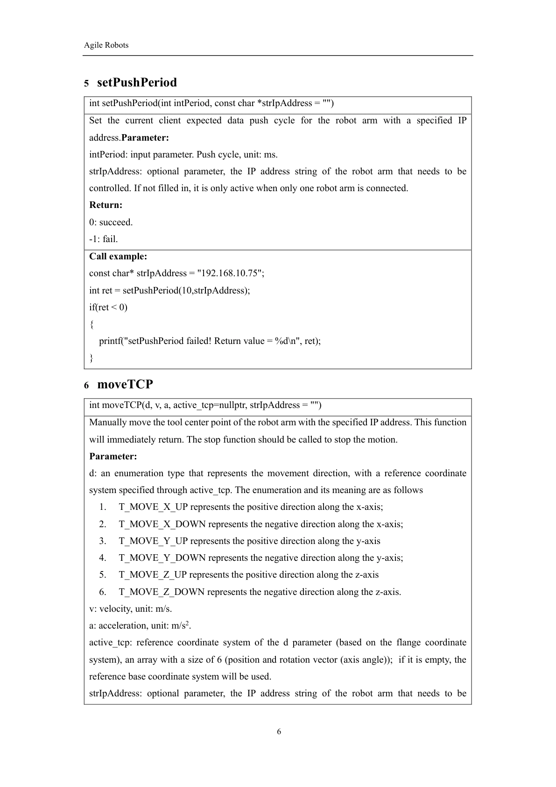



```
Agile Robots 
 6  
5 setPushPeriod 
int setPushPeriod(int intPeriod, const char *strIpAddress = "") 
Set the current client expected data push cycle for the robot arm with a specified IP 
address.Parameter:  
intPeriod: input parameter. Push cycle, unit: ms.  
strIpAddress: optional parameter, the IP address string of the robot arm that needs to be 
controlled. If not filled in, it is only active when only one robot arm is connected.  
Return:  
0: succeed.  
-1: fail.  
Call example:  
const char* strIpAddress = "192.168.10.75";  
int ret = setPushPeriod(10,strIpAddress);  
if(ret < 0)  
{  
    printf("setPushPeriod failed! Return value = %d\n", ret);  
}  
6 moveTCP  
int moveTCP(d, v, a, active_tcp=nullptr, strIpAddress = "")  
Manually move the tool center point of the robot arm with the specified IP address. This function 
will immediately return. The stop function should be called to stop the motion.  
Parameter:  
d: an enumeration type that represents the movement direction, with a reference coordinate 
system specified through active_tcp. The enumeration and its meaning are as follows  
1.  T_MOVE_X_UP represents the positive direction along the x-axis;  
2.  T_MOVE_X_DOWN represents the negative direction along the x-axis;  
3.  T_MOVE_Y_UP represents the positive direction along the y-axis  
4.  T_MOVE_Y_DOWN represents the negative direction along the y-axis;  
5.  T_MOVE_Z_UP represents the positive direction along the z-axis  
6.  T_MOVE_Z_DOWN represents the negative direction along the z-axis.  
v: velocity, unit: m/s.  
a: acceleration, unit: m/s2.  
active_tcp: reference coordinate system of the d parameter (based on the flange coordinate 
system), an array with a size of 6 (position and rotation vector (axis angle));  if it is empty, the 
reference base coordinate system will be used.  
strIpAddress: optional parameter, the IP address string of the robot arm that needs to be
```



## PDF page 16

**Source:** Industrial API Manual (C\&C++ Edition) \_V3.3.0\_EN\_20260605.pdf, original pdf page 16. [Open the corresponding PDF reading-copy page](https://1292444914-files.gitbook.io/~/files/v0/b/gitbook-x-prod.appspot.com/o/spaces%2FtgOfPnscWebs1eh82EKq%2Fuploads%2FWGm4W5tbOjT5mD2c1h1g%2Findustrial-api-manual-c-c-edition-v3-3-0-en-20260605-pp-001-150.pdf?alt=media#page=16).



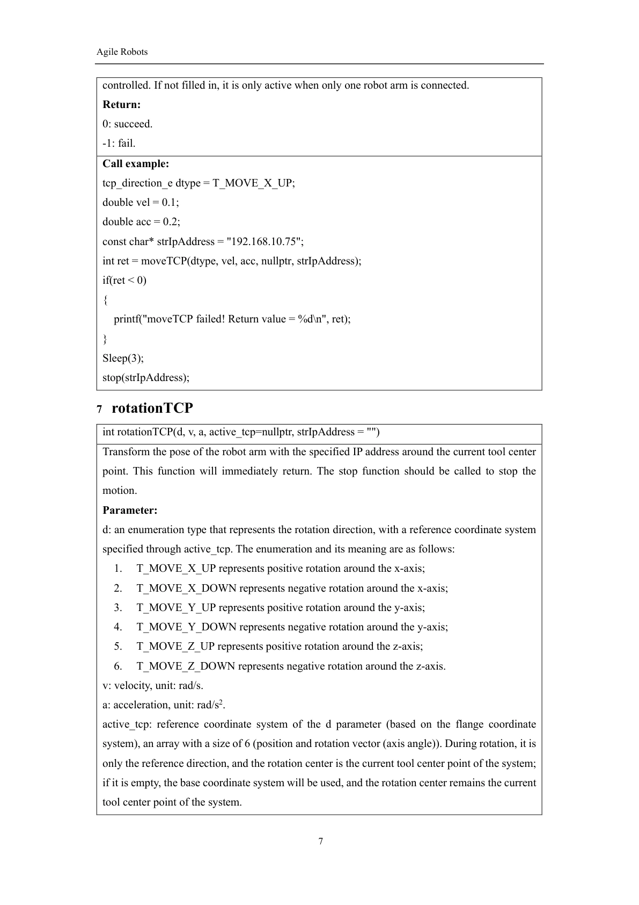



```
Agile Robots 
 7  
controlled. If not filled in, it is only active when only one robot arm is connected.  
Return:  
0: succeed.  
-1: fail.  
Call example:  
tcp_direction_e dtype = T_MOVE_X_UP; 
double vel = 0.1; 
double acc = 0.2; 
const char* strIpAddress = "192.168.10.75"; 
int ret = moveTCP(dtype, vel, acc, nullptr, strIpAddress); 
if(ret < 0) 
{ 
    printf("moveTCP failed! Return value = %d\n", ret); 
} 
Sleep(3); 
stop(strIpAddress); 
7 rotationTCP  
int rotationTCP(d, v, a, active_tcp=nullptr, strIpAddress = "")  
Transform the pose of the robot arm with the specified IP address around the current tool center 
point. This function will immediately return. The stop function should be called to stop the 
motion.  
Parameter:  
d: an enumeration type that represents the rotation direction, with a reference coordinate system 
specified through active_tcp. The enumeration and its meaning are as follows:  
1.  T_MOVE_X_UP represents positive rotation around the x-axis;  
2.  T_MOVE_X_DOWN represents negative rotation around the x-axis;  
3.  T_MOVE_Y_UP represents positive rotation around the y-axis;  
4.  T_MOVE_Y_DOWN represents negative rotation around the y-axis;  
5.  T_MOVE_Z_UP represents positive rotation around the z-axis;  
6.  T_MOVE_Z_DOWN represents negative rotation around the z-axis.  
v: velocity, unit: rad/s.  
a: acceleration, unit: rad/s2.  
active_tcp: reference coordinate system of the d parameter (based on the flange coordinate 
system), an array with a size of 6 (position and rotation vector (axis angle)). During rotation, it is 
only the reference direction, and the rotation center is the current tool center point of the system; 
if it is empty, the base coordinate system will be used, and the rotation center remains the current 
tool center point of the system.
```



## PDF page 17

**Source:** Industrial API Manual (C\&C++ Edition) \_V3.3.0\_EN\_20260605.pdf, original pdf page 17. [Open the corresponding PDF reading-copy page](https://1292444914-files.gitbook.io/~/files/v0/b/gitbook-x-prod.appspot.com/o/spaces%2FtgOfPnscWebs1eh82EKq%2Fuploads%2FWGm4W5tbOjT5mD2c1h1g%2Findustrial-api-manual-c-c-edition-v3-3-0-en-20260605-pp-001-150.pdf?alt=media#page=17).



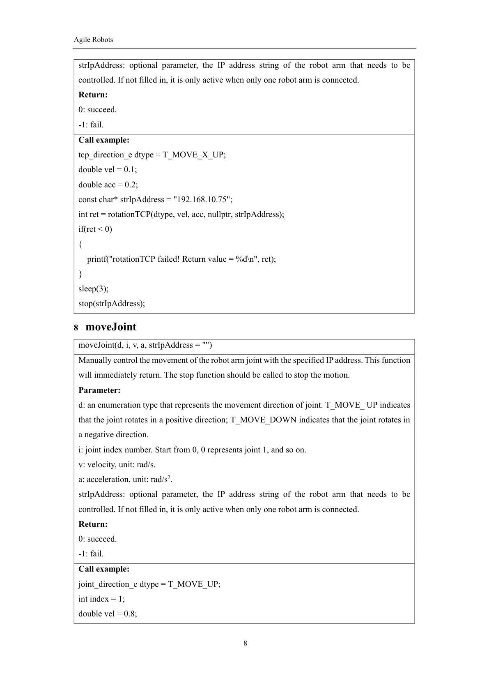



```
Agile Robots 
 8  
strIpAddress: optional parameter, the IP address string of the robot arm that needs to be 
controlled. If not filled in, it is only active when only one robot arm is connected.  
Return:  
0: succeed.  
-1: fail.  
Call example:  
tcp_direction_e dtype = T_MOVE_X_UP; 
double vel = 0.1; 
double acc = 0.2; 
const char* strIpAddress = "192.168.10.75"; 
int ret = rotationTCP(dtype, vel, acc, nullptr, strIpAddress); 
if(ret < 0) 
{ 
    printf("rotationTCP failed! Return value = %d\n", ret); 
} 
sleep(3); 
stop(strIpAddress); 
8 moveJoint  
moveJoint(d, i, v, a, strIpAddress = "")  
Manually control the movement of the robot arm joint with the specified IP address. This function 
will immediately return. The stop function should be called to stop the motion.  
Parameter:  
d: an enumeration type that represents the movement direction of joint. T_MOVE_ UP indicates 
that the joint rotates in a positive direction; T_MOVE_DOWN indicates that the joint rotates in 
a negative direction.  
i: joint index number. Start from 0, 0 represents joint 1, and so on. 
v: velocity, unit: rad/s.  
a: acceleration, unit: rad/s2.  
strIpAddress: optional parameter, the IP address string of the robot arm that needs to be 
controlled. If not filled in, it is only active when only one robot arm is connected.  
Return:  
0: succeed.  
-1: fail.  
Call example:  
joint_direction_e dtype = T_MOVE_UP; 
int index = 1; 
double vel = 0.8;
```



## PDF page 18

**Source:** Industrial API Manual (C\&C++ Edition) \_V3.3.0\_EN\_20260605.pdf, original pdf page 18. [Open the corresponding PDF reading-copy page](https://1292444914-files.gitbook.io/~/files/v0/b/gitbook-x-prod.appspot.com/o/spaces%2FtgOfPnscWebs1eh82EKq%2Fuploads%2FWGm4W5tbOjT5mD2c1h1g%2Findustrial-api-manual-c-c-edition-v3-3-0-en-20260605-pp-001-150.pdf?alt=media#page=18).



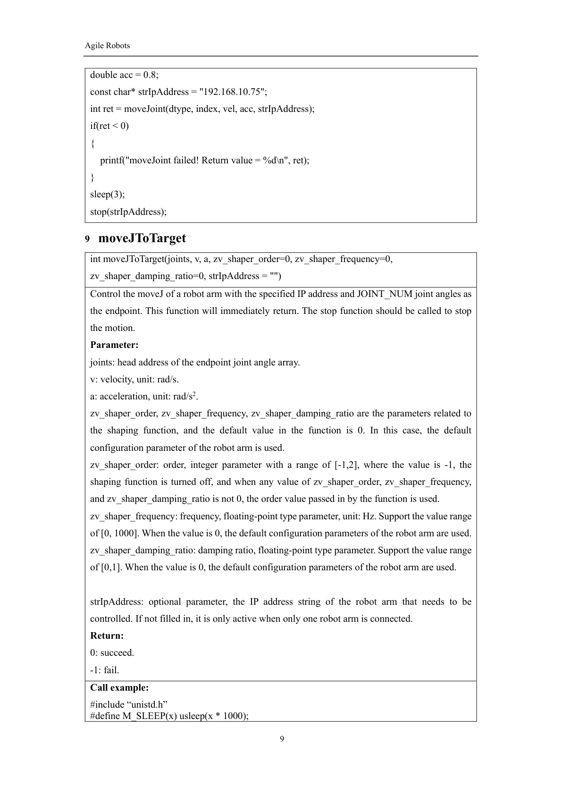



```
Agile Robots 
 9  
double acc = 0.8; 
const char* strIpAddress = "192.168.10.75"; 
int ret = moveJoint(dtype, index, vel, acc, strIpAddress); 
if(ret < 0) 
{ 
    printf("moveJoint failed! Return value = %d\n", ret); 
} 
sleep(3); 
stop(strIpAddress); 
9 moveJToTarget  
int moveJToTarget(joints, v, a, zv_shaper_order=0, zv_shaper_frequency=0, 
zv_shaper_damping_ratio=0, strIpAddress = "")  
Control the moveJ of a robot arm with the specified IP address and JOINT_NUM joint angles as 
the endpoint. This function will immediately return. The stop function should be called to stop 
the motion.  
Parameter:  
joints: head address of the endpoint joint angle array.  
v: velocity, unit: rad/s.  
a: acceleration, unit: rad/s2.  
zv_shaper_order, zv_shaper_frequency, zv_shaper_damping_ratio are the parameters related to 
the shaping function, and the default value in the function is 0. In this case, the default 
configuration parameter of the robot arm is used.  
zv_shaper_order: order, integer parameter with a range of [-1,2], where the value is -1, the 
shaping function is turned off, and when any value of zv_shaper_order, zv_shaper_frequency, 
and zv_shaper_damping_ratio is not 0, the order value passed in by the function is used.  
zv_shaper_frequency: frequency, floating-point type parameter, unit: Hz. Support the value range 
of [0, 1000]. When the value is 0, the default configuration parameters of the robot arm are used.  
zv_shaper_damping_ratio: damping ratio, floating-point type parameter. Support the value range 
of [0,1]. When the value is 0, the default configuration parameters of the robot arm are used.  
 
strIpAddress: optional parameter, the IP address string of the robot arm that needs to be 
controlled. If not filled in, it is only active when only one robot arm is connected.  
Return:  
0: succeed.  
-1: fail.  
Call example:  
#include “unistd.h” 
#define M_SLEEP(x) usleep(x * 1000);
```



## PDF page 19

**Source:** Industrial API Manual (C\&C++ Edition) \_V3.3.0\_EN\_20260605.pdf, original pdf page 19. [Open the corresponding PDF reading-copy page](https://1292444914-files.gitbook.io/~/files/v0/b/gitbook-x-prod.appspot.com/o/spaces%2FtgOfPnscWebs1eh82EKq%2Fuploads%2FWGm4W5tbOjT5mD2c1h1g%2Findustrial-api-manual-c-c-edition-v3-3-0-en-20260605-pp-001-150.pdf?alt=media#page=19).



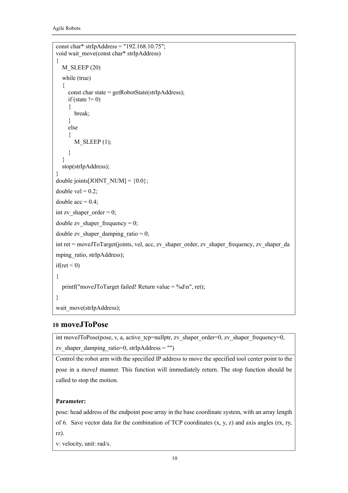



```
Agile Robots 
 10  
const char* strIpAddress = "192.168.10.75"; 
void wait_move(const char* strIpAddress) 
{ 
M_SLEEP (20) 
    while (true) 
    { 
        const char state = getRobotState(strIpAddress); 
        if (state != 0) 
        { 
            break; 
        } 
        else 
{ 
            M_SLEEP (1); 
} 
    } 
    stop(strIpAddress); 
} 
double joints[JOINT_NUM] = {0.0}; 
double vel = 0.2; 
double acc = 0.4; 
int zv_shaper_order = 0; 
double zv_shaper_frequency = 0; 
double zv_shaper_damping_ratio = 0; 
int ret = moveJToTarget(joints, vel, acc, zv_shaper_order, zv_shaper_frequency, zv_shaper_da
mping_ratio, strIpAddress); 
if(ret < 0) 
{ 
    printf("moveJToTarget failed! Return value = %d\n", ret); 
} 
wait_move(strIpAddress); 
10 moveJToPose  
int moveJToPose(pose, v, a, active_tcp=nullptr, zv_shaper_order=0, zv_shaper_frequency=0, 
zv_shaper_damping_ratio=0, strIpAddress = "") 
Control the robot arm with the specified IP address to move the specified tool center point to the 
pose in a moveJ manner. This function will immediately return. The stop function should be 
called to stop the motion.  
 
Parameter:  
pose: head address of the endpoint pose array in the base coordinate system, with an array length 
of 6.  Save vector data for the combination of TCP coordinates (x, y, z) and axis angles (rx, ry, 
rz).  
v: velocity, unit: rad/s.
```



## PDF page 20

**Source:** Industrial API Manual (C\&C++ Edition) \_V3.3.0\_EN\_20260605.pdf, original pdf page 20. [Open the corresponding PDF reading-copy page](https://1292444914-files.gitbook.io/~/files/v0/b/gitbook-x-prod.appspot.com/o/spaces%2FtgOfPnscWebs1eh82EKq%2Fuploads%2FWGm4W5tbOjT5mD2c1h1g%2Findustrial-api-manual-c-c-edition-v3-3-0-en-20260605-pp-001-150.pdf?alt=media#page=20).



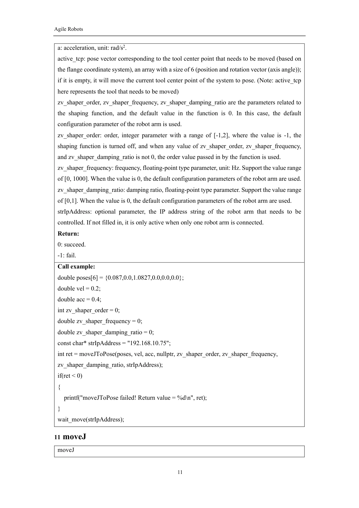



```
Agile Robots 
 11  
a: acceleration, unit: rad/s2.  
active_tcp: pose vector corresponding to the tool center point that needs to be moved (based on 
the flange coordinate system), an array with a size of 6 (position and rotation vector (axis angle));  
if it is empty, it will move the current tool center point of the system to pose. (Note: active_tcp 
here represents the tool that needs to be moved)  
zv_shaper_order, zv_shaper_frequency, zv_shaper_damping_ratio are the parameters related to 
the shaping function, and the default value in the function is 0. In this case, the default 
configuration parameter of the robot arm is used.  
zv_shaper_order: order, integer parameter with a range of [-1,2], where the value is -1, the 
shaping function is turned off, and when any value of zv_shaper_order, zv_shaper_frequency, 
and zv_shaper_damping_ratio is not 0, the order value passed in by the function is used.  
zv_shaper_frequency: frequency, floating-point type parameter, unit: Hz. Support the value range 
of [0, 1000]. When the value is 0, the default configuration parameters of the robot arm are used.  
zv_shaper_damping_ratio: damping ratio, floating-point type parameter. Support the value range 
of [0,1]. When the value is 0, the default configuration parameters of the robot arm are used.  
strIpAddress: optional parameter, the IP address string of the robot arm that needs to be 
controlled. If not filled in, it is only active when only one robot arm is connected.  
Return:  
0: succeed.  
-1: fail.  
Call example:  
double poses[6] = {0.087,0.0,1.0827,0.0,0.0,0.0}; 
double vel = 0.2; 
double acc = 0.4;  
int zv_shaper_order = 0; 
double zv_shaper_frequency = 0; 
double zv_shaper_damping_ratio = 0; 
const char* strIpAddress = "192.168.10.75"; 
int ret = moveJToPose(poses, vel, acc, nullptr, zv_shaper_order, zv_shaper_frequency, 
zv_shaper_damping_ratio, strIpAddress); 
if(ret < 0) 
{ 
    printf("moveJToPose failed! Return value = %d\n", ret); 
} 
wait_move(strIpAddress); 
11 moveJ  
moveJ
```



## PDF page 21

**Source:** Industrial API Manual (C\&C++ Edition) \_V3.3.0\_EN\_20260605.pdf, original pdf page 21. [Open the corresponding PDF reading-copy page](https://1292444914-files.gitbook.io/~/files/v0/b/gitbook-x-prod.appspot.com/o/spaces%2FtgOfPnscWebs1eh82EKq%2Fuploads%2FWGm4W5tbOjT5mD2c1h1g%2Findustrial-api-manual-c-c-edition-v3-3-0-en-20260605-pp-001-150.pdf?alt=media#page=21).



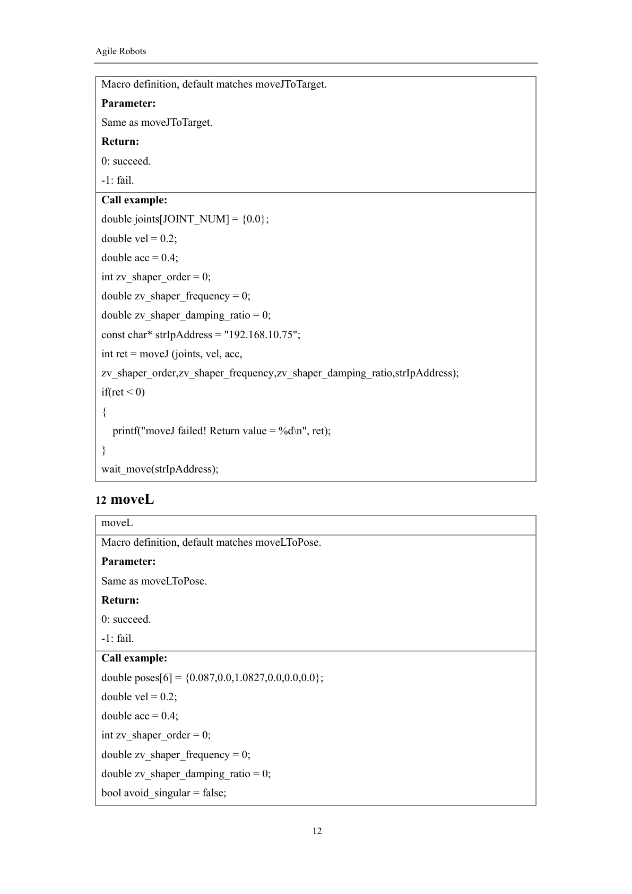



```
Agile Robots 
 12  
Macro definition, default matches moveJToTarget.  
Parameter:  
Same as moveJToTarget.  
Return:  
0: succeed.  
-1: fail.  
Call example:  
double joints[JOINT_NUM] = {0.0}; 
double vel = 0.2; 
double acc = 0.4; 
int zv_shaper_order = 0; 
double zv_shaper_frequency = 0; 
double zv_shaper_damping_ratio = 0; 
const char* strIpAddress = "192.168.10.75"; 
int ret = moveJ (joints, vel, acc, 
zv_shaper_order,zv_shaper_frequency,zv_shaper_damping_ratio,strIpAddress); 
if(ret < 0) 
{ 
    printf("moveJ failed! Return value = %d\n", ret); 
} 
wait_move(strIpAddress); 
12 moveL  
moveL  
Macro definition, default matches moveLToPose.  
Parameter:  
Same as moveLToPose.  
Return:  
0: succeed.  
-1: fail.  
Call example:  
double poses[6] = {0.087,0.0,1.0827,0.0,0.0,0.0}; 
double vel = 0.2; 
double acc = 0.4; 
int zv_shaper_order = 0; 
double zv_shaper_frequency = 0; 
double zv_shaper_damping_ratio = 0; 
bool avoid_singular = false;
```



## PDF page 22

**Source:** Industrial API Manual (C\&C++ Edition) \_V3.3.0\_EN\_20260605.pdf, original pdf page 22. [Open the corresponding PDF reading-copy page](https://1292444914-files.gitbook.io/~/files/v0/b/gitbook-x-prod.appspot.com/o/spaces%2FtgOfPnscWebs1eh82EKq%2Fuploads%2FWGm4W5tbOjT5mD2c1h1g%2Findustrial-api-manual-c-c-edition-v3-3-0-en-20260605-pp-001-150.pdf?alt=media#page=22).



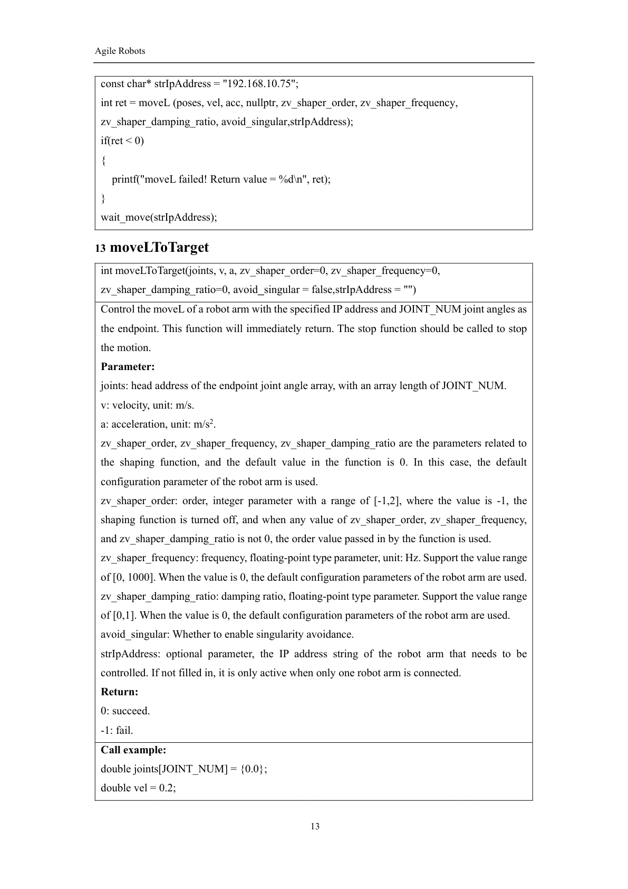



```
Agile Robots 
 13  
const char* strIpAddress = "192.168.10.75"; 
int ret = moveL (poses, vel, acc, nullptr, zv_shaper_order, zv_shaper_frequency, 
zv_shaper_damping_ratio, avoid_singular,strIpAddress); 
if(ret < 0) 
{ 
    printf("moveL failed! Return value = %d\n", ret); 
} 
wait_move(strIpAddress); 
13 moveLToTarget  
int moveLToTarget(joints, v, a, zv_shaper_order=0, zv_shaper_frequency=0, 
zv_shaper_damping_ratio=0, avoid_singular = false,strIpAddress = "") 
Control the moveL of a robot arm with the specified IP address and JOINT_NUM joint angles as 
the endpoint. This function will immediately return. The stop function should be called to stop 
the motion.  
Parameter:  
joints: head address of the endpoint joint angle array, with an array length of JOINT_NUM.  
v: velocity, unit: m/s.  
a: acceleration, unit: m/s2.  
zv_shaper_order, zv_shaper_frequency, zv_shaper_damping_ratio are the parameters related to 
the shaping function, and the default value in the function is 0. In this case, the default 
configuration parameter of the robot arm is used.  
zv_shaper_order: order, integer parameter with a range of [-1,2], where the value is -1, the 
shaping function is turned off, and when any value of zv_shaper_order, zv_shaper_frequency, 
and zv_shaper_damping_ratio is not 0, the order value passed in by the function is used.  
zv_shaper_frequency: frequency, floating-point type parameter, unit: Hz. Support the value range 
of [0, 1000]. When the value is 0, the default configuration parameters of the robot arm are used.  
zv_shaper_damping_ratio: damping ratio, floating-point type parameter. Support the value range 
of [0,1]. When the value is 0, the default configuration parameters of the robot arm are used.  
avoid_singular: Whether to enable singularity avoidance. 
strIpAddress: optional parameter, the IP address string of the robot arm that needs to be 
controlled. If not filled in, it is only active when only one robot arm is connected.  
Return:  
0: succeed.  
-1: fail.  
Call example:  
double joints[JOINT_NUM] = {0.0}; 
double vel = 0.2;
```



## PDF page 23

**Source:** Industrial API Manual (C\&C++ Edition) \_V3.3.0\_EN\_20260605.pdf, original pdf page 23. [Open the corresponding PDF reading-copy page](https://1292444914-files.gitbook.io/~/files/v0/b/gitbook-x-prod.appspot.com/o/spaces%2FtgOfPnscWebs1eh82EKq%2Fuploads%2FWGm4W5tbOjT5mD2c1h1g%2Findustrial-api-manual-c-c-edition-v3-3-0-en-20260605-pp-001-150.pdf?alt=media#page=23).



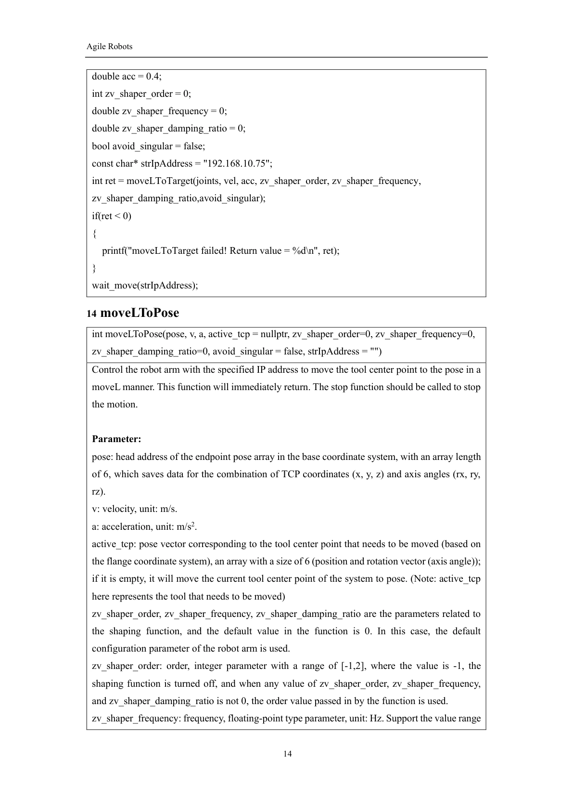



```
Agile Robots 
 14  
double acc = 0.4; 
int zv_shaper_order = 0; 
double zv_shaper_frequency = 0; 
double zv_shaper_damping_ratio = 0; 
bool avoid_singular = false; 
const char* strIpAddress = "192.168.10.75"; 
int ret = moveLToTarget(joints, vel, acc, zv_shaper_order, zv_shaper_frequency, 
zv_shaper_damping_ratio,avoid_singular); 
if(ret < 0) 
{ 
    printf("moveLToTarget failed! Return value = %d\n", ret); 
} 
wait_move(strIpAddress); 
14 moveLToPose  
int moveLToPose(pose, v, a, active_tcp = nullptr, zv_shaper_order=0, zv_shaper_frequency=0, 
zv_shaper_damping_ratio=0, avoid_singular = false, strIpAddress = "") 
Control the robot arm with the specified IP address to move the tool center point to the pose in a 
moveL manner. This function will immediately return. The stop function should be called to stop 
the motion.  
 
Parameter:  
pose: head address of the endpoint pose array in the base coordinate system, with an array length 
of 6, which saves data for the combination of TCP coordinates (x, y, z) and axis angles (rx, ry, 
rz).  
v: velocity, unit: m/s.  
a: acceleration, unit: m/s2.  
active_tcp: pose vector corresponding to the tool center point that needs to be moved (based on 
the flange coordinate system), an array with a size of 6 (position and rotation vector (axis angle));  
if it is empty, it will move the current tool center point of the system to pose. (Note: active_tcp 
here represents the tool that needs to be moved)  
zv_shaper_order, zv_shaper_frequency, zv_shaper_damping_ratio are the parameters related to 
the shaping function, and the default value in the function is 0. In this case, the default 
configuration parameter of the robot arm is used.  
zv_shaper_order: order, integer parameter with a range of [-1,2], where the value is -1, the 
shaping function is turned off, and when any value of zv_shaper_order, zv_shaper_frequency, 
and zv_shaper_damping_ratio is not 0, the order value passed in by the function is used.  
zv_shaper_frequency: frequency, floating-point type parameter, unit: Hz. Support the value range
```



## PDF page 24

**Source:** Industrial API Manual (C\&C++ Edition) \_V3.3.0\_EN\_20260605.pdf, original pdf page 24. [Open the corresponding PDF reading-copy page](https://1292444914-files.gitbook.io/~/files/v0/b/gitbook-x-prod.appspot.com/o/spaces%2FtgOfPnscWebs1eh82EKq%2Fuploads%2FWGm4W5tbOjT5mD2c1h1g%2Findustrial-api-manual-c-c-edition-v3-3-0-en-20260605-pp-001-150.pdf?alt=media#page=24).



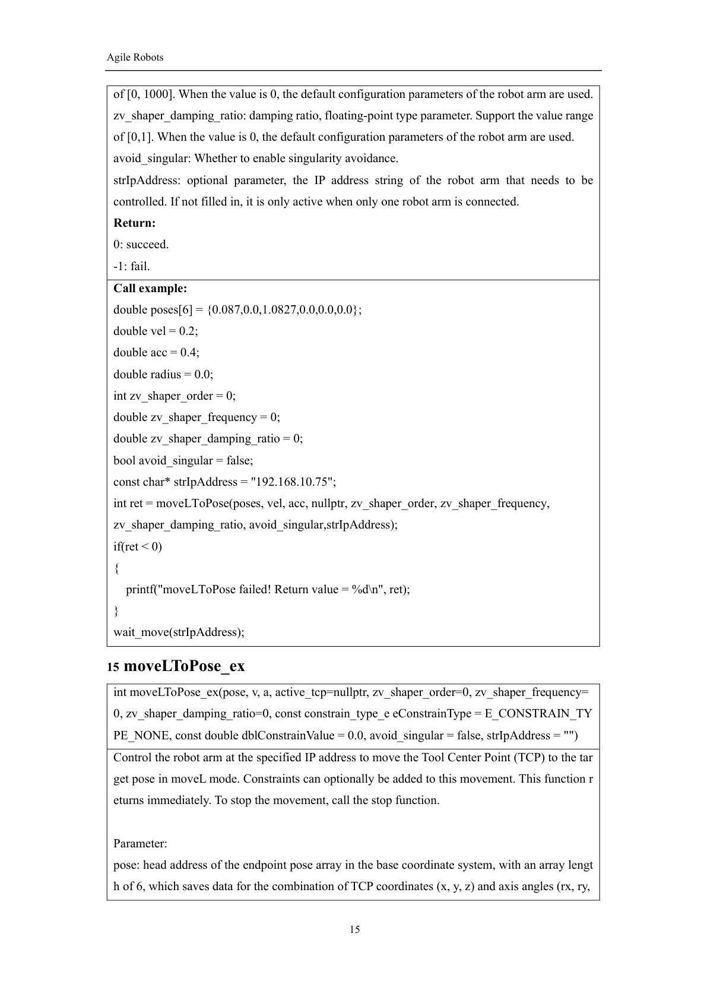



```
Agile Robots 
 15  
of [0, 1000]. When the value is 0, the default configuration parameters of the robot arm are used.  
zv_shaper_damping_ratio: damping ratio, floating-point type parameter. Support the value range 
of [0,1]. When the value is 0, the default configuration parameters of the robot arm are used.  
avoid_singular: Whether to enable singularity avoidance. 
strIpAddress: optional parameter, the IP address string of the robot arm that needs to be 
controlled. If not filled in, it is only active when only one robot arm is connected.  
Return:  
0: succeed.  
-1: fail.  
Call example:  
double poses[6] = {0.087,0.0,1.0827,0.0,0.0,0.0}; 
double vel = 0.2; 
double acc = 0.4; 
double radius = 0.0; 
int zv_shaper_order = 0; 
double zv_shaper_frequency = 0; 
double zv_shaper_damping_ratio = 0; 
bool avoid_singular = false; 
const char* strIpAddress = "192.168.10.75"; 
int ret = moveLToPose(poses, vel, acc, nullptr, zv_shaper_order, zv_shaper_frequency, 
zv_shaper_damping_ratio, avoid_singular,strIpAddress); 
if(ret < 0) 
{ 
    printf("moveLToPose failed! Return value = %d\n", ret); 
} 
wait_move(strIpAddress); 
15 moveLToPose_ex 
int moveLToPose_ex(pose, v, a, active_tcp=nullptr, zv_shaper_order=0, zv_shaper_frequency=
0, zv_shaper_damping_ratio=0, const constrain_type_e eConstrainType = E_CONSTRAIN_TY
PE_NONE, const double dblConstrainValue = 0.0, avoid_singular = false, strIpAddress = "") 
Control the robot arm at the specified IP address to move the Tool Center Point (TCP) to the tar
get pose in moveL mode. Constraints can optionally be added to this movement. This function r
eturns immediately. To stop the movement, call the stop function. 
 
Parameter:  
pose: head address of the endpoint pose array in the base coordinate system, with an array lengt
h of 6, which saves data for the combination of TCP coordinates (x, y, z) and axis angles (rx, ry,
```



## PDF page 25

**Source:** Industrial API Manual (C\&C++ Edition) \_V3.3.0\_EN\_20260605.pdf, original pdf page 25. [Open the corresponding PDF reading-copy page](https://1292444914-files.gitbook.io/~/files/v0/b/gitbook-x-prod.appspot.com/o/spaces%2FtgOfPnscWebs1eh82EKq%2Fuploads%2FWGm4W5tbOjT5mD2c1h1g%2Findustrial-api-manual-c-c-edition-v3-3-0-en-20260605-pp-001-150.pdf?alt=media#page=25).



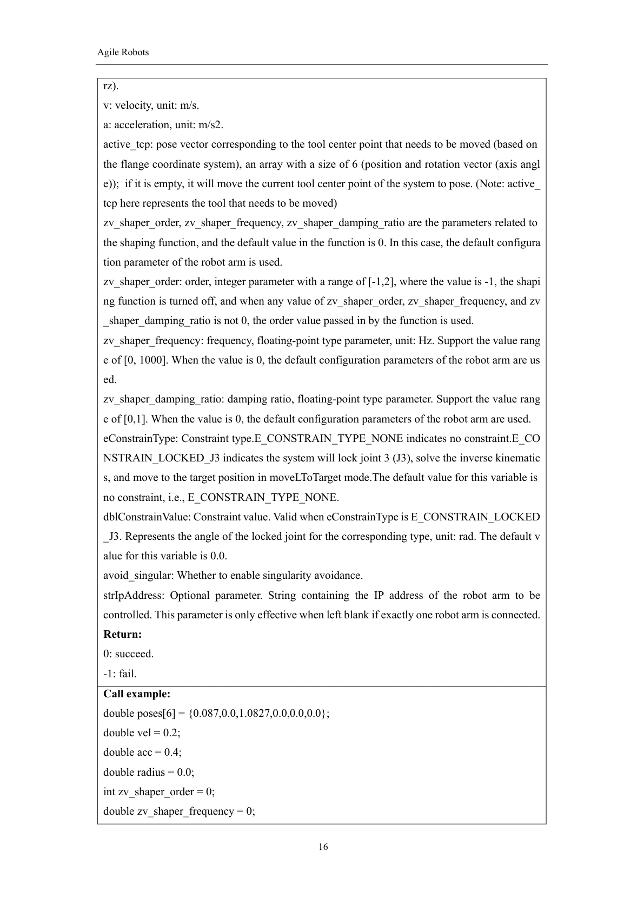



```
Agile Robots 
 16  
rz).  
v: velocity, unit: m/s.  
a: acceleration, unit: m/s2.  
active_tcp: pose vector corresponding to the tool center point that needs to be moved (based on 
the flange coordinate system), an array with a size of 6 (position and rotation vector (axis angl
e));  if it is empty, it will move the current tool center point of the system to pose. (Note: active_
tcp here represents the tool that needs to be moved)  
zv_shaper_order, zv_shaper_frequency, zv_shaper_damping_ratio are the parameters related to 
the shaping function, and the default value in the function is 0. In this case, the default configura
tion parameter of the robot arm is used.  
zv_shaper_order: order, integer parameter with a range of [-1,2], where the value is -1, the shapi
ng function is turned off, and when any value of zv_shaper_order, zv_shaper_frequency, and zv
_shaper_damping_ratio is not 0, the order value passed in by the function is used.  
zv_shaper_frequency: frequency, floating-point type parameter, unit: Hz. Support the value rang
e of [0, 1000]. When the value is 0, the default configuration parameters of the robot arm are us
ed.  
zv_shaper_damping_ratio: damping ratio, floating-point type parameter. Support the value rang
e of [0,1]. When the value is 0, the default configuration parameters of the robot arm are used.  
eConstrainType: Constraint type.E_CONSTRAIN_TYPE_NONE indicates no constraint.E_CO
NSTRAIN_LOCKED_J3 indicates the system will lock joint 3 (J3), solve the inverse kinematic
s, and move to the target position in moveLToTarget mode.The default value for this variable is 
no constraint, i.e., E_CONSTRAIN_TYPE_NONE. 
dblConstrainValue: Constraint value. Valid when eConstrainType is E_CONSTRAIN_LOCKED
_J3. Represents the angle of the locked joint for the corresponding type, unit: rad. The default v
alue for this variable is 0.0. 
avoid_singular: Whether to enable singularity avoidance. 
strIpAddress: Optional parameter. String containing the IP address of the robot arm to be 
controlled. This parameter is only effective when left blank if exactly one robot arm is connected. 
Return:  
0: succeed.  
-1: fail. 
Call example:  
double poses[6] = {0.087,0.0,1.0827,0.0,0.0,0.0}; 
double vel = 0.2; 
double acc = 0.4; 
double radius = 0.0; 
int zv_shaper_order = 0; 
double zv_shaper_frequency = 0;
```



## PDF page 26

**Source:** Industrial API Manual (C\&C++ Edition) \_V3.3.0\_EN\_20260605.pdf, original pdf page 26. [Open the corresponding PDF reading-copy page](https://1292444914-files.gitbook.io/~/files/v0/b/gitbook-x-prod.appspot.com/o/spaces%2FtgOfPnscWebs1eh82EKq%2Fuploads%2FWGm4W5tbOjT5mD2c1h1g%2Findustrial-api-manual-c-c-edition-v3-3-0-en-20260605-pp-001-150.pdf?alt=media#page=26).



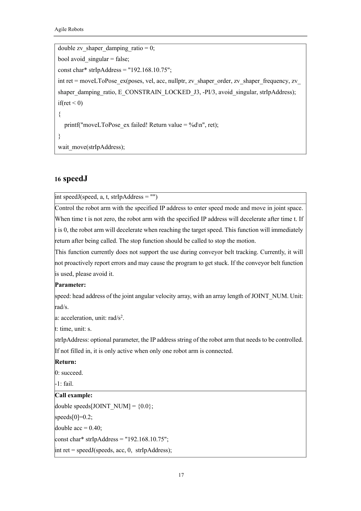



```
Agile Robots 
 17  
double zv_shaper_damping_ratio = 0; 
bool avoid_singular = false; 
const char* strIpAddress = "192.168.10.75"; 
int ret = moveLToPose_ex(poses, vel, acc, nullptr, zv_shaper_order, zv_shaper_frequency, zv_
shaper_damping_ratio, E_CONSTRAIN_LOCKED_J3, -PI/3, avoid_singular, strIpAddress); 
if(ret < 0) 
{ 
    printf("moveLToPose_ex failed! Return value = %d\n", ret); 
} 
wait_move(strIpAddress); 
 
16 speedJ  
int speedJ(speed, a, t, strIpAddress = "")  
Control the robot arm with the specified IP address to enter speed mode and move in joint space. 
When time t is not zero, the robot arm with the specified IP address will decelerate after time t. If 
t is 0, the robot arm will decelerate when reaching the target speed. This function will immediately 
return after being called. The stop function should be called to stop the motion.  
This function currently does not support the use during conveyor belt tracking. Currently, it will 
not proactively report errors and may cause the program to get stuck. If the conveyor belt function 
is used, please avoid it.  
Parameter:  
speed: head address of the joint angular velocity array, with an array length of JOINT_NUM. Unit: 
rad/s.  
a: acceleration, unit: rad/s2.  
t: time, unit: s.  
strIpAddress: optional parameter, the IP address string of the robot arm that needs to be controlled. 
If not filled in, it is only active when only one robot arm is connected.  
Return:  
0: succeed.  
-1: fail.  
Call example:  
double speeds[JOINT_NUM] = {0.0}; 
speeds[0]=0.2; 
double acc = 0.40; 
const char* strIpAddress = "192.168.10.75"; 
int ret = speedJ(speeds, acc, 0,  strIpAddress);
```



## PDF page 27

**Source:** Industrial API Manual (C\&C++ Edition) \_V3.3.0\_EN\_20260605.pdf, original pdf page 27. [Open the corresponding PDF reading-copy page](https://1292444914-files.gitbook.io/~/files/v0/b/gitbook-x-prod.appspot.com/o/spaces%2FtgOfPnscWebs1eh82EKq%2Fuploads%2FWGm4W5tbOjT5mD2c1h1g%2Findustrial-api-manual-c-c-edition-v3-3-0-en-20260605-pp-001-150.pdf?alt=media#page=27).



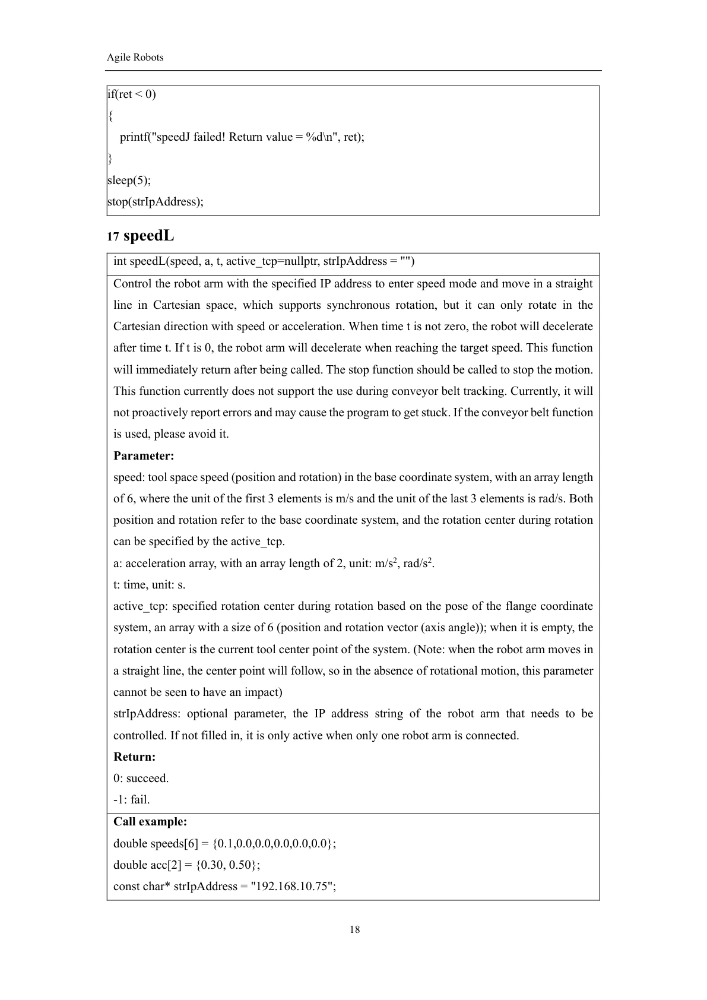



```
Agile Robots 
 18  
17 speedL  
int speedL(speed, a, t, active_tcp=nullptr, strIpAddress = "")  
Control the robot arm with the specified IP address to enter speed mode and move in a straight 
line in Cartesian space, which supports synchronous rotation, but it can only rotate in the 
Cartesian direction with speed or acceleration. When time t is not zero, the robot will decelerate 
after time t. If t is 0, the robot arm will decelerate when reaching the target speed. This function 
will immediately return after being called. The stop function should be called to stop the motion.  
This function currently does not support the use during conveyor belt tracking. Currently, it will 
not proactively report errors and may cause the program to get stuck. If the conveyor belt function 
is used, please avoid it.  
Parameter:  
speed: tool space speed (position and rotation) in the base coordinate system, with an array length 
of 6, where the unit of the first 3 elements is m/s and the unit of the last 3 elements is rad/s. Both 
position and rotation refer to the base coordinate system, and the rotation center during rotation 
can be specified by the active_tcp.  
a: acceleration array, with an array length of 2, unit: m/s2, rad/s2.  
t: time, unit: s.  
active_tcp: specified rotation center during rotation based on the pose of the flange coordinate 
system, an array with a size of 6 (position and rotation vector (axis angle)); when it is empty, the 
rotation center is the current tool center point of the system. (Note: when the robot arm moves in 
a straight line, the center point will follow, so in the absence of rotational motion, this parameter 
cannot be seen to have an impact)  
strIpAddress: optional parameter, the IP address string of the robot arm that needs to be 
controlled. If not filled in, it is only active when only one robot arm is connected.  
Return:  
0: succeed.  
-1: fail.  
Call example:  
double speeds[6] = {0.1,0.0,0.0,0.0,0.0,0.0}; 
double acc[2] = {0.30, 0.50}; 
const char* strIpAddress = "192.168.10.75"; 
if(ret < 0) 
{ 
   printf("speedJ failed! Return value = %d\n", ret); 
} 
sleep(5); 
stop(strIpAddress);
```



## PDF page 28

**Source:** Industrial API Manual (C\&C++ Edition) \_V3.3.0\_EN\_20260605.pdf, original pdf page 28. [Open the corresponding PDF reading-copy page](https://1292444914-files.gitbook.io/~/files/v0/b/gitbook-x-prod.appspot.com/o/spaces%2FtgOfPnscWebs1eh82EKq%2Fuploads%2FWGm4W5tbOjT5mD2c1h1g%2Findustrial-api-manual-c-c-edition-v3-3-0-en-20260605-pp-001-150.pdf?alt=media#page=28).



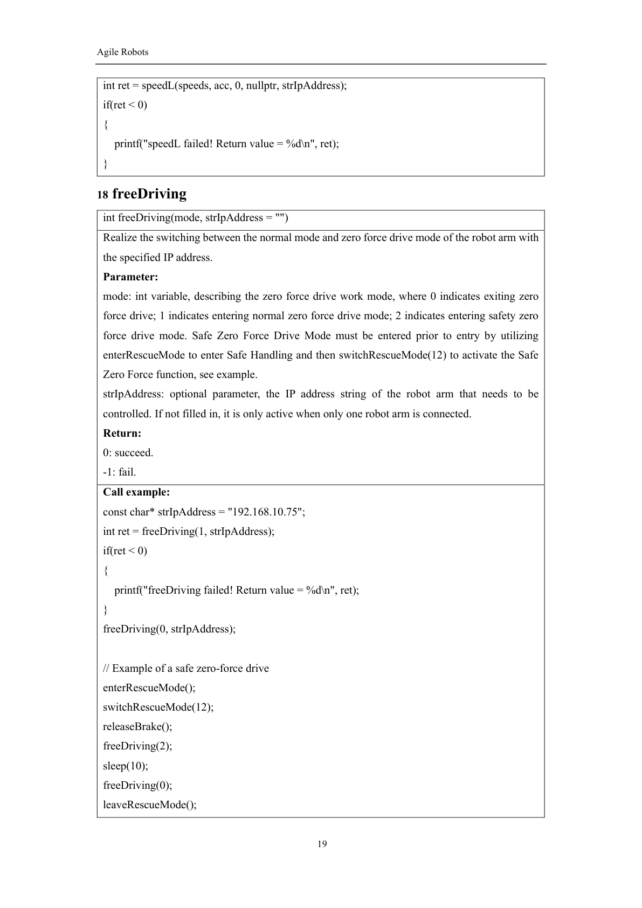



```
Agile Robots 
 19  
int ret = speedL(speeds, acc, 0, nullptr, strIpAddress); 
if(ret < 0) 
{ 
    printf("speedL failed! Return value = %d\n", ret); 
} 
18 freeDriving  
int freeDriving(mode, strIpAddress = "")  
Realize the switching between the normal mode and zero force drive mode of the robot arm with 
the specified IP address.  
Parameter:  
mode: int variable, describing the zero force drive work mode, where 0 indicates exiting zero 
force drive; 1 indicates entering normal zero force drive mode; 2 indicates entering safety zero 
force drive mode. Safe Zero Force Drive Mode must be entered prior to entry by utilizing 
enterRescueMode to enter Safe Handling and then switchRescueMode(12) to activate the Safe 
Zero Force function, see example. 
strIpAddress: optional parameter, the IP address string of the robot arm that needs to be 
controlled. If not filled in, it is only active when only one robot arm is connected.  
Return:  
0: succeed.  
-1: fail.  
Call example:  
const char* strIpAddress = "192.168.10.75"; 
int ret = freeDriving(1, strIpAddress); 
if(ret < 0) 
{ 
    printf("freeDriving failed! Return value = %d\n", ret); 
}  
freeDriving(0, strIpAddress); 
 
// Example of a safe zero-force drive 
enterRescueMode(); 
switchRescueMode(12); 
releaseBrake(); 
freeDriving(2); 
sleep(10); 
freeDriving(0); 
leaveRescueMode();
```



## PDF page 29

**Source:** Industrial API Manual (C\&C++ Edition) \_V3.3.0\_EN\_20260605.pdf, original pdf page 29. [Open the corresponding PDF reading-copy page](https://1292444914-files.gitbook.io/~/files/v0/b/gitbook-x-prod.appspot.com/o/spaces%2FtgOfPnscWebs1eh82EKq%2Fuploads%2FWGm4W5tbOjT5mD2c1h1g%2Findustrial-api-manual-c-c-edition-v3-3-0-en-20260605-pp-001-150.pdf?alt=media#page=29).



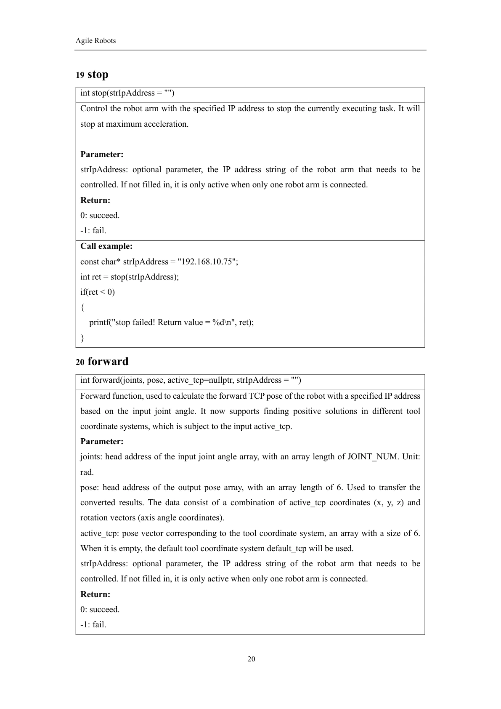



```
Agile Robots 
 20  
19 stop  
int stop(strIpAddress = "")  
Control the robot arm with the specified IP address to stop the currently executing task. It will 
stop at maximum acceleration.  
 
Parameter:  
strIpAddress: optional parameter, the IP address string of the robot arm that needs to be 
controlled. If not filled in, it is only active when only one robot arm is connected.  
Return:  
0: succeed.  
-1: fail.  
Call example:  
const char* strIpAddress = "192.168.10.75"; 
int ret = stop(strIpAddress); 
if(ret < 0) 
{ 
    printf("stop failed! Return value = %d\n", ret); 
} 
20 forward  
int forward(joints, pose, active_tcp=nullptr, strIpAddress = "")  
Forward function, used to calculate the forward TCP pose of the robot with a specified IP address 
based on the input joint angle. It now supports finding positive solutions in different tool 
coordinate systems, which is subject to the input active_tcp.  
Parameter:  
joints: head address of the input joint angle array, with an array length of JOINT_NUM. Unit: 
rad.  
pose: head address of the output pose array, with an array length of 6. Used to transfer the 
converted results. The data consist of a combination of active_tcp coordinates (x, y, z) and 
rotation vectors (axis angle coordinates).  
active_tcp: pose vector corresponding to the tool coordinate system, an array with a size of 6. 
When it is empty, the default tool coordinate system default_tcp will be used.  
strIpAddress: optional parameter, the IP address string of the robot arm that needs to be 
controlled. If not filled in, it is only active when only one robot arm is connected.  
Return:  
0: succeed.  
-1: fail.
```



## PDF page 30

**Source:** Industrial API Manual (C\&C++ Edition) \_V3.3.0\_EN\_20260605.pdf, original pdf page 30. [Open the corresponding PDF reading-copy page](https://1292444914-files.gitbook.io/~/files/v0/b/gitbook-x-prod.appspot.com/o/spaces%2FtgOfPnscWebs1eh82EKq%2Fuploads%2FWGm4W5tbOjT5mD2c1h1g%2Findustrial-api-manual-c-c-edition-v3-3-0-en-20260605-pp-001-150.pdf?alt=media#page=30).



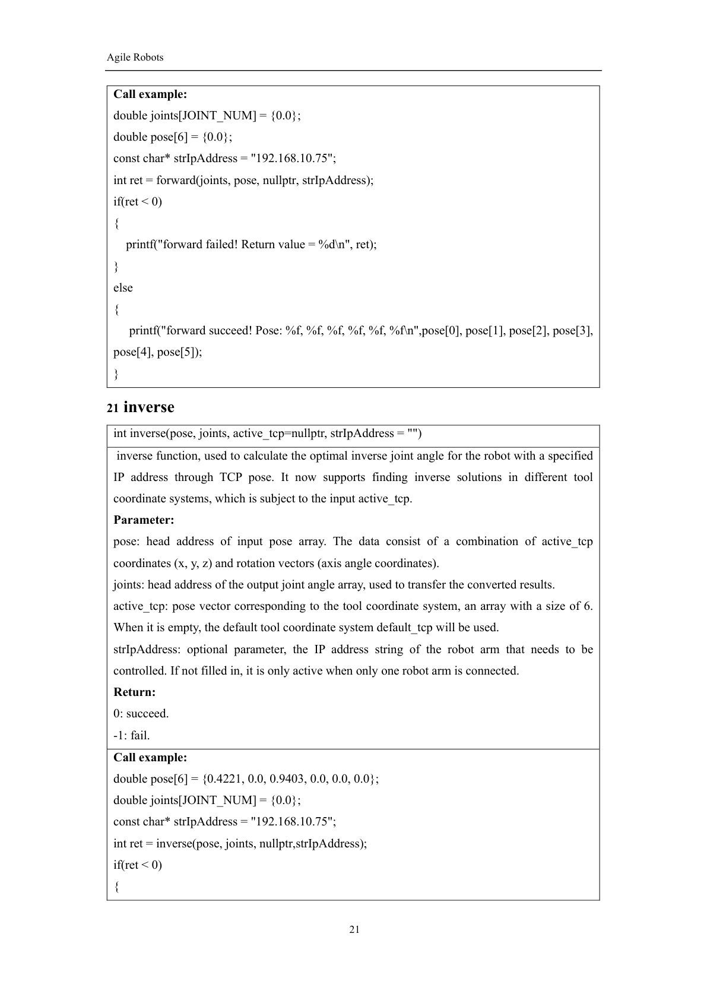



```
Agile Robots 
 21  
Call example:  
double joints[JOINT_NUM] = {0.0}; 
double pose[6] = {0.0}; 
const char* strIpAddress = "192.168.10.75"; 
int ret = forward(joints, pose, nullptr, strIpAddress); 
if(ret < 0) 
{ 
    printf("forward failed! Return value = %d\n", ret); 
} 
else 
{ 
printf("forward succeed! Pose: %f, %f, %f, %f, %f, %f\n",pose[0], pose[1], pose[2], pose[3], 
pose[4], pose[5]); 
} 
21 inverse  
int inverse(pose, joints, active_tcp=nullptr, strIpAddress = "")  
 inverse function, used to calculate the optimal inverse joint angle for the robot with a specified 
IP address through TCP pose. It now supports finding inverse solutions in different tool 
coordinate systems, which is subject to the input active_tcp.  
Parameter:  
pose: head address of input pose array. The data consist of a combination of active_tcp 
coordinates (x, y, z) and rotation vectors (axis angle coordinates).  
joints: head address of the output joint angle array, used to transfer the converted results.  
active_tcp: pose vector corresponding to the tool coordinate system, an array with a size of 6. 
When it is empty, the default tool coordinate system default_tcp will be used.  
strIpAddress: optional parameter, the IP address string of the robot arm that needs to be 
controlled. If not filled in, it is only active when only one robot arm is connected.  
Return:  
0: succeed.  
-1: fail.  
Call example:  
double pose[6] = {0.4221, 0.0, 0.9403, 0.0, 0.0, 0.0}; 
double joints[JOINT_NUM] = {0.0}; 
const char* strIpAddress = "192.168.10.75"; 
int ret = inverse(pose, joints, nullptr,strIpAddress); 
if(ret < 0)  
{
```



## PDF page 31

**Source:** Industrial API Manual (C\&C++ Edition) \_V3.3.0\_EN\_20260605.pdf, original pdf page 31. [Open the corresponding PDF reading-copy page](https://1292444914-files.gitbook.io/~/files/v0/b/gitbook-x-prod.appspot.com/o/spaces%2FtgOfPnscWebs1eh82EKq%2Fuploads%2FWGm4W5tbOjT5mD2c1h1g%2Findustrial-api-manual-c-c-edition-v3-3-0-en-20260605-pp-001-150.pdf?alt=media#page=31).



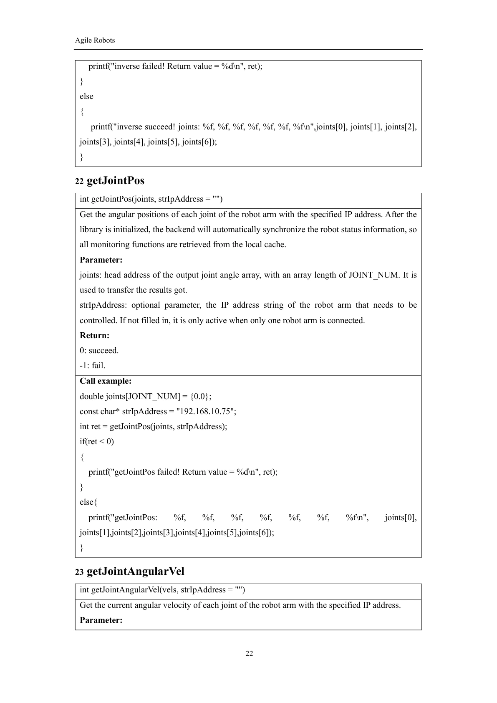



```
Agile Robots 
 22  
    printf("inverse failed! Return value = %d\n", ret); 
} 
else 
{ 
printf("inverse succeed! joints: %f, %f, %f, %f, %f, %f, %f\n",joints[0], joints[1], joints[2], 
joints[3], joints[4], joints[5], joints[6]); 
} 
22 getJointPos  
int getJointPos(joints, strIpAddress = "")  
Get the angular positions of each joint of the robot arm with the specified IP address. After the 
library is initialized, the backend will automatically synchronize the robot status information, so 
all monitoring functions are retrieved from the local cache.  
Parameter:  
joints: head address of the output joint angle array, with an array length of JOINT_NUM. It is 
used to transfer the results got.  
strIpAddress: optional parameter, the IP address string of the robot arm that needs to be 
controlled. If not filled in, it is only active when only one robot arm is connected.  
Return:  
0: succeed.  
-1: fail.  
Call example:  
double joints[JOINT_NUM] = {0.0}; 
const char* strIpAddress = "192.168.10.75"; 
int ret = getJointPos(joints, strIpAddress); 
if(ret < 0) 
{ 
    printf("getJointPos failed! Return value = %d\n", ret); 
} 
else{ 
    printf("getJointPos: 
%f, 
%f, 
%f, 
%f, 
%f, 
%f, 
%f\n", 
joints[0], 
joints[1],joints[2],joints[3],joints[4],joints[5],joints[6]); 
} 
23 getJointAngularVel  
int getJointAngularVel(vels, strIpAddress = "")  
Get the current angular velocity of each joint of the robot arm with the specified IP address.  
Parameter:
```



## PDF page 32

**Source:** Industrial API Manual (C\&C++ Edition) \_V3.3.0\_EN\_20260605.pdf, original pdf page 32. [Open the corresponding PDF reading-copy page](https://1292444914-files.gitbook.io/~/files/v0/b/gitbook-x-prod.appspot.com/o/spaces%2FtgOfPnscWebs1eh82EKq%2Fuploads%2FWGm4W5tbOjT5mD2c1h1g%2Findustrial-api-manual-c-c-edition-v3-3-0-en-20260605-pp-001-150.pdf?alt=media#page=32).



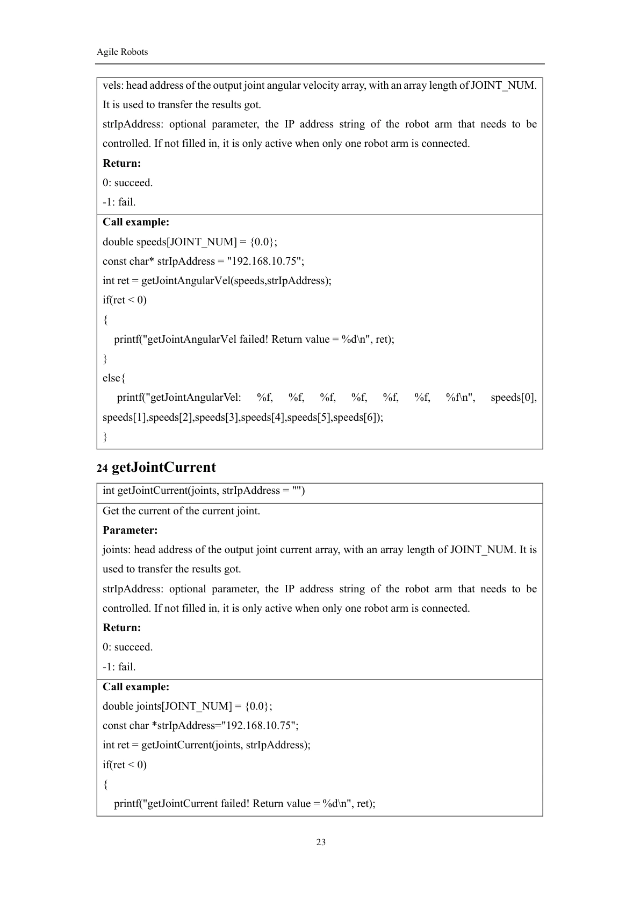



```
Agile Robots 
 23  
vels: head address of the output joint angular velocity array, with an array length of JOINT_NUM. 
It is used to transfer the results got.  
strIpAddress: optional parameter, the IP address string of the robot arm that needs to be 
controlled. If not filled in, it is only active when only one robot arm is connected.  
Return:  
0: succeed.  
-1: fail.  
Call example:  
double speeds[JOINT_NUM] = {0.0}; 
const char* strIpAddress = "192.168.10.75"; 
int ret = getJointAngularVel(speeds,strIpAddress); 
if(ret < 0) 
{ 
    printf("getJointAngularVel failed! Return value = %d\n", ret); 
} 
else{ 
printf("getJointAngularVel: 
%f, 
%f, 
%f, 
%f, 
%f, 
%f, 
%f\n", 
speeds[0], 
speeds[1],speeds[2],speeds[3],speeds[4],speeds[5],speeds[6]); 
} 
24 getJointCurrent  
int getJointCurrent(joints, strIpAddress = "")  
Get the current of the current joint.  
Parameter:  
joints: head address of the output joint current array, with an array length of JOINT_NUM. It is 
used to transfer the results got.  
strIpAddress: optional parameter, the IP address string of the robot arm that needs to be 
controlled. If not filled in, it is only active when only one robot arm is connected.  
Return:  
0: succeed.  
-1: fail.  
Call example:  
double joints[JOINT_NUM] = {0.0}; 
const char *strIpAddress="192.168.10.75"; 
int ret = getJointCurrent(joints, strIpAddress); 
if(ret < 0) 
{ 
    printf("getJointCurrent failed! Return value = %d\n", ret);
```



## PDF page 33

**Source:** Industrial API Manual (C\&C++ Edition) \_V3.3.0\_EN\_20260605.pdf, original pdf page 33. [Open the corresponding PDF reading-copy page](https://1292444914-files.gitbook.io/~/files/v0/b/gitbook-x-prod.appspot.com/o/spaces%2FtgOfPnscWebs1eh82EKq%2Fuploads%2FWGm4W5tbOjT5mD2c1h1g%2Findustrial-api-manual-c-c-edition-v3-3-0-en-20260605-pp-001-150.pdf?alt=media#page=33).



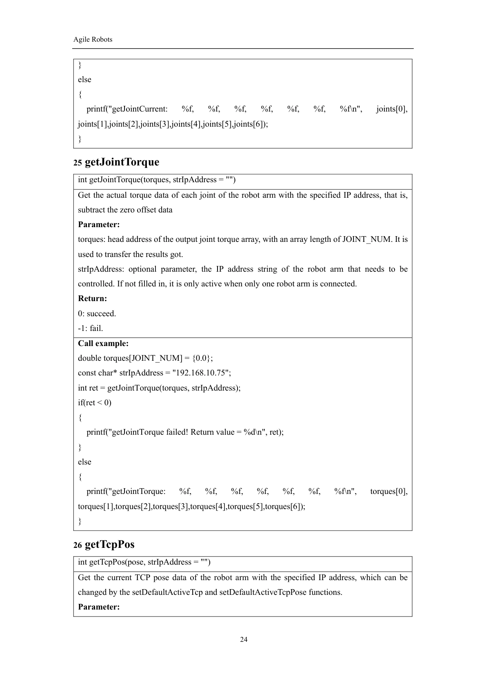



```
Agile Robots 
 24  
} 
else 
{ 
    printf("getJointCurrent: 
%f, 
%f, 
%f, 
%f, 
%f, 
%f, 
%f\n", 
joints[0], 
joints[1],joints[2],joints[3],joints[4],joints[5],joints[6]); 
} 
25 getJointTorque  
int getJointTorque(torques, strIpAddress = "")  
Get the actual torque data of each joint of the robot arm with the specified IP address, that is, 
subtract the zero offset data  
Parameter:  
torques: head address of the output joint torque array, with an array length of JOINT_NUM. It is 
used to transfer the results got.  
strIpAddress: optional parameter, the IP address string of the robot arm that needs to be 
controlled. If not filled in, it is only active when only one robot arm is connected.  
Return:  
0: succeed.  
-1: fail.  
Call example:  
double torques[JOINT_NUM] = {0.0}; 
const char* strIpAddress = "192.168.10.75"; 
int ret = getJointTorque(torques, strIpAddress); 
if(ret < 0) 
{ 
    printf("getJointTorque failed! Return value = %d\n", ret); 
} 
else 
{ 
    printf("getJointTorque: 
%f, 
%f, 
%f, 
%f, 
%f, 
%f, 
%f\n", 
torques[0], 
torques[1],torques[2],torques[3],torques[4],torques[5],torques[6]); 
} 
26 getTcpPos  
int getTcpPos(pose, strIpAddress = "")  
Get the current TCP pose data of the robot arm with the specified IP address, which can be 
changed by the setDefaultActiveTcp and setDefaultActiveTcpPose functions.  
Parameter:
```



## PDF page 34

**Source:** Industrial API Manual (C\&C++ Edition) \_V3.3.0\_EN\_20260605.pdf, original pdf page 34. [Open the corresponding PDF reading-copy page](https://1292444914-files.gitbook.io/~/files/v0/b/gitbook-x-prod.appspot.com/o/spaces%2FtgOfPnscWebs1eh82EKq%2Fuploads%2FWGm4W5tbOjT5mD2c1h1g%2Findustrial-api-manual-c-c-edition-v3-3-0-en-20260605-pp-001-150.pdf?alt=media#page=34).



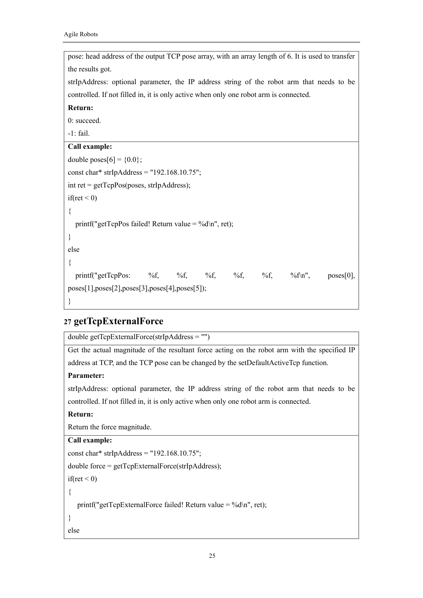



```
Agile Robots 
 25  
pose: head address of the output TCP pose array, with an array length of 6. It is used to transfer 
the results got.  
strIpAddress: optional parameter, the IP address string of the robot arm that needs to be 
controlled. If not filled in, it is only active when only one robot arm is connected.  
Return:  
0: succeed.  
-1: fail.  
Call example:  
double poses[6] = {0.0}; 
const char* strIpAddress = "192.168.10.75"; 
int ret = getTcpPos(poses, strIpAddress); 
if(ret < 0) 
{ 
    printf("getTcpPos failed! Return value = %d\n", ret); 
} 
else 
{ 
    printf("getTcpPos: 
%f, 
%f, 
%f, 
%f, 
%f, 
%f\n", 
poses[0], 
poses[1],poses[2],poses[3],poses[4],poses[5]); 
} 
27 getTcpExternalForce  
double getTcpExternalForce(strIpAddress = "")  
Get the actual magnitude of the resultant force acting on the robot arm with the specified IP 
address at TCP, and the TCP pose can be changed by the setDefaultActiveTcp function.  
Parameter:  
strIpAddress: optional parameter, the IP address string of the robot arm that needs to be 
controlled. If not filled in, it is only active when only one robot arm is connected.  
Return:  
Return the force magnitude.  
Call example:  
const char* strIpAddress = "192.168.10.75"; 
double force = getTcpExternalForce(strIpAddress); 
if(ret < 0) 
{ 
     printf("getTcpExternalForce failed! Return value = %d\n", ret); 
} 
else
```



## PDF page 35

**Source:** Industrial API Manual (C\&C++ Edition) \_V3.3.0\_EN\_20260605.pdf, original pdf page 35. [Open the corresponding PDF reading-copy page](https://1292444914-files.gitbook.io/~/files/v0/b/gitbook-x-prod.appspot.com/o/spaces%2FtgOfPnscWebs1eh82EKq%2Fuploads%2FWGm4W5tbOjT5mD2c1h1g%2Findustrial-api-manual-c-c-edition-v3-3-0-en-20260605-pp-001-150.pdf?alt=media#page=35).



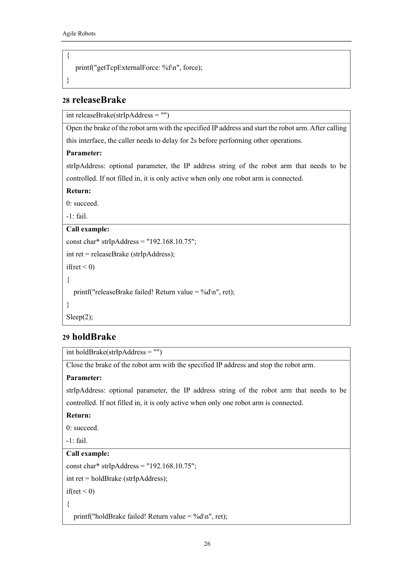



```
Agile Robots 
 26  
{ 
     printf("getTcpExternalForce: %f\n", force); 
} 
28 releaseBrake  
int releaseBrake(strIpAddress = "")  
Open the brake of the robot arm with the specified IP address and start the robot arm. After calling 
this interface, the caller needs to delay for 2s before performing other operations.  
Parameter:  
strIpAddress: optional parameter, the IP address string of the robot arm that needs to be 
controlled. If not filled in, it is only active when only one robot arm is connected.  
Return:  
0: succeed.  
-1: fail.  
Call example:  
const char* strIpAddress = "192.168.10.75"; 
int ret = releaseBrake (strIpAddress); 
if(ret < 0) 
{ 
    printf("releaseBrake failed! Return value = %d\n", ret); 
} 
Sleep(2); 
29 holdBrake  
int holdBrake(strIpAddress = "")  
Close the brake of the robot arm with the specified IP address and stop the robot arm.  
Parameter:  
strIpAddress: optional parameter, the IP address string of the robot arm that needs to be 
controlled. If not filled in, it is only active when only one robot arm is connected.  
Return:  
0: succeed.  
-1: fail.  
Call example:  
const char* strIpAddress = "192.168.10.75"; 
int ret = holdBrake (strIpAddress); 
if(ret < 0) 
{ 
    printf("holdBrake failed! Return value = %d\n", ret);
```



## PDF page 36

**Source:** Industrial API Manual (C\&C++ Edition) \_V3.3.0\_EN\_20260605.pdf, original pdf page 36. [Open the corresponding PDF reading-copy page](https://1292444914-files.gitbook.io/~/files/v0/b/gitbook-x-prod.appspot.com/o/spaces%2FtgOfPnscWebs1eh82EKq%2Fuploads%2FWGm4W5tbOjT5mD2c1h1g%2Findustrial-api-manual-c-c-edition-v3-3-0-en-20260605-pp-001-150.pdf?alt=media#page=36).



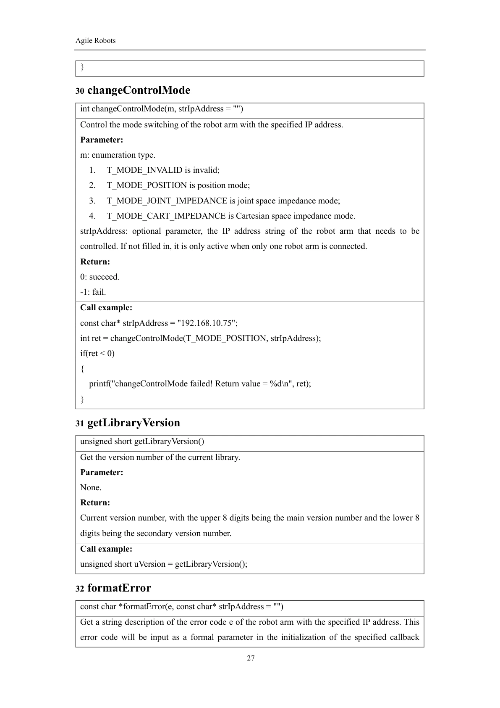



```
Agile Robots 
 27  
} 
30 changeControlMode  
int changeControlMode(m, strIpAddress = "")  
Control the mode switching of the robot arm with the specified IP address.  
Parameter:  
m: enumeration type.  
1.  T_MODE_INVALID is invalid;  
2.  T_MODE_POSITION is position mode;  
3.  T_MODE_JOINT_IMPEDANCE is joint space impedance mode;  
4.  T_MODE_CART_IMPEDANCE is Cartesian space impedance mode.  
strIpAddress: optional parameter, the IP address string of the robot arm that needs to be 
controlled. If not filled in, it is only active when only one robot arm is connected.  
Return:  
0: succeed.  
-1: fail.  
Call example:  
const char* strIpAddress = "192.168.10.75"; 
int ret = changeControlMode(T_MODE_POSITION, strIpAddress); 
if(ret < 0) 
{ 
    printf("changeControlMode failed! Return value = %d\n", ret); 
} 
31 getLibraryVersion  
unsigned short getLibraryVersion()  
Get the version number of the current library.  
Parameter:  
None.  
Return:  
Current version number, with the upper 8 digits being the main version number and the lower 8 
digits being the secondary version number.  
Call example:  
unsigned short uVersion = getLibraryVersion();  
32 formatError  
const char *formatError(e, const char* strIpAddress = "")  
Get a string description of the error code e of the robot arm with the specified IP address. This 
error code will be input as a formal parameter in the initialization of the specified callback
```



## PDF page 37

**Source:** Industrial API Manual (C\&C++ Edition) \_V3.3.0\_EN\_20260605.pdf, original pdf page 37. [Open the corresponding PDF reading-copy page](https://1292444914-files.gitbook.io/~/files/v0/b/gitbook-x-prod.appspot.com/o/spaces%2FtgOfPnscWebs1eh82EKq%2Fuploads%2FWGm4W5tbOjT5mD2c1h1g%2Findustrial-api-manual-c-c-edition-v3-3-0-en-20260605-pp-001-150.pdf?alt=media#page=37).



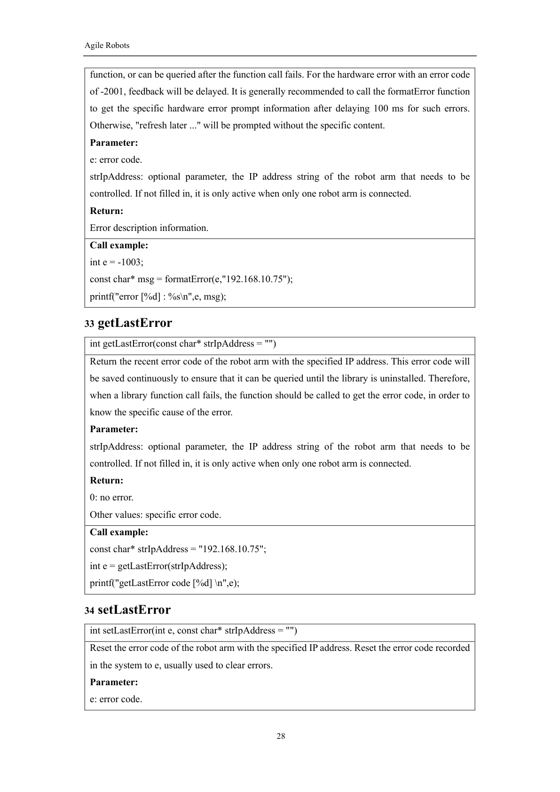



```
Agile Robots 
 28  
function, or can be queried after the function call fails. For the hardware error with an error code 
of -2001, feedback will be delayed. It is generally recommended to call the formatError function 
to get the specific hardware error prompt information after delaying 100 ms for such errors. 
Otherwise, "refresh later ..." will be prompted without the specific content.  
Parameter:  
e: error code.  
strIpAddress: optional parameter, the IP address string of the robot arm that needs to be 
controlled. If not filled in, it is only active when only one robot arm is connected.  
Return:  
Error description information.  
Call example:  
int e = -1003; 
const char* msg = formatError(e,"192.168.10.75"); 
printf("error [%d] : %s\n",e, msg); 
33 getLastError  
int getLastError(const char* strIpAddress = "")  
Return the recent error code of the robot arm with the specified IP address. This error code will 
be saved continuously to ensure that it can be queried until the library is uninstalled. Therefore, 
when a library function call fails, the function should be called to get the error code, in order to 
know the specific cause of the error.  
Parameter:  
strIpAddress: optional parameter, the IP address string of the robot arm that needs to be 
controlled. If not filled in, it is only active when only one robot arm is connected.  
Return:  
0: no error.  
Other values: specific error code.  
Call example:  
const char* strIpAddress = "192.168.10.75";  
int e = getLastError(strIpAddress); 
printf("getLastError code [%d] \n",e); 
34 setLastError  
int setLastError(int e, const char* strIpAddress = "")  
Reset the error code of the robot arm with the specified IP address. Reset the error code recorded 
in the system to e, usually used to clear errors.  
Parameter:  
e: error code.
```



## PDF page 38

**Source:** Industrial API Manual (C\&C++ Edition) \_V3.3.0\_EN\_20260605.pdf, original pdf page 38. [Open the corresponding PDF reading-copy page](https://1292444914-files.gitbook.io/~/files/v0/b/gitbook-x-prod.appspot.com/o/spaces%2FtgOfPnscWebs1eh82EKq%2Fuploads%2FWGm4W5tbOjT5mD2c1h1g%2Findustrial-api-manual-c-c-edition-v3-3-0-en-20260605-pp-001-150.pdf?alt=media#page=38).



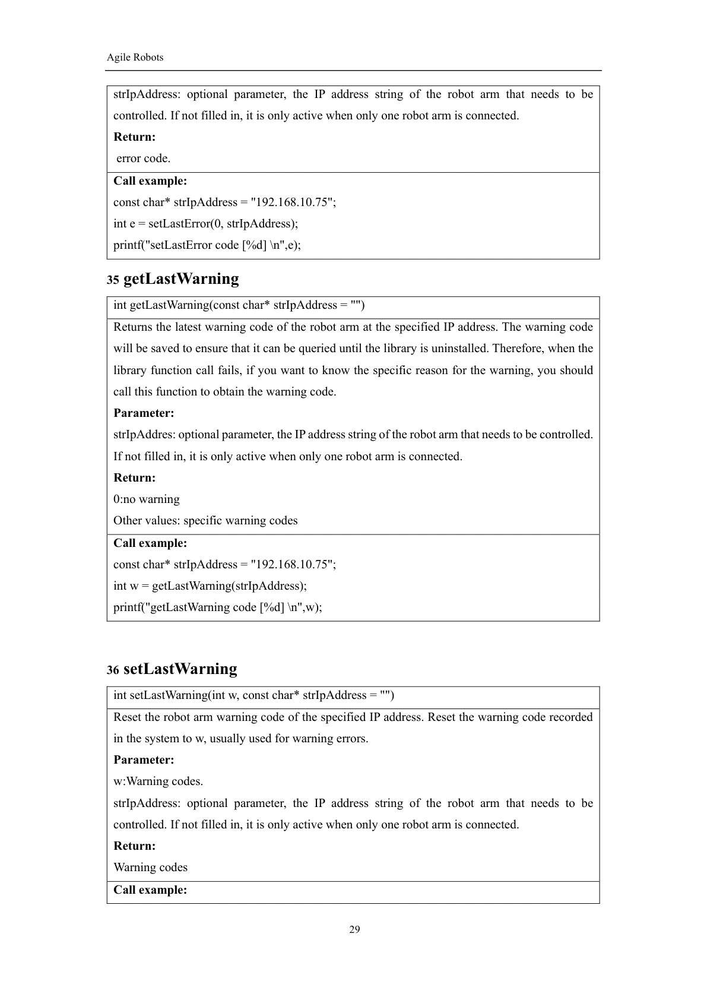



```
Agile Robots 
 29  
strIpAddress: optional parameter, the IP address string of the robot arm that needs to be 
controlled. If not filled in, it is only active when only one robot arm is connected.  
Return:  
 error code.  
Call example:  
const char* strIpAddress = "192.168.10.75"; 
int e = setLastError(0, strIpAddress); 
printf("setLastError code [%d] \n",e); 
35 getLastWarning 
int getLastWarning(const char* strIpAddress = "") 
Returns the latest warning code of the robot arm at the specified IP address. The warning code 
will be saved to ensure that it can be queried until the library is uninstalled. Therefore, when the 
library function call fails, if you want to know the specific reason for the warning, you should 
call this function to obtain the warning code.  
Parameter:  
strIpAddres: optional parameter, the IP address string of the robot arm that needs to be controlled. 
If not filled in, it is only active when only one robot arm is connected.  
Return:  
0:no warning  
Other values: specific warning codes  
Call example:  
const char* strIpAddress = "192.168.10.75";  
int w = getLastWarning(strIpAddress); 
printf("getLastWarning code [%d] \n",w); 
 
36 setLastWarning 
int setLastWarning(int w, const char* strIpAddress = "") 
Reset the robot arm warning code of the specified IP address. Reset the warning code recorded 
in the system to w, usually used for warning errors.  
Parameter:  
w:Warning codes.  
strIpAddress: optional parameter, the IP address string of the robot arm that needs to be 
controlled. If not filled in, it is only active when only one robot arm is connected.  
Return:  
Warning codes 
Call example:
```



## PDF page 39

**Source:** Industrial API Manual (C\&C++ Edition) \_V3.3.0\_EN\_20260605.pdf, original pdf page 39. [Open the corresponding PDF reading-copy page](https://1292444914-files.gitbook.io/~/files/v0/b/gitbook-x-prod.appspot.com/o/spaces%2FtgOfPnscWebs1eh82EKq%2Fuploads%2FWGm4W5tbOjT5mD2c1h1g%2Findustrial-api-manual-c-c-edition-v3-3-0-en-20260605-pp-001-150.pdf?alt=media#page=39).



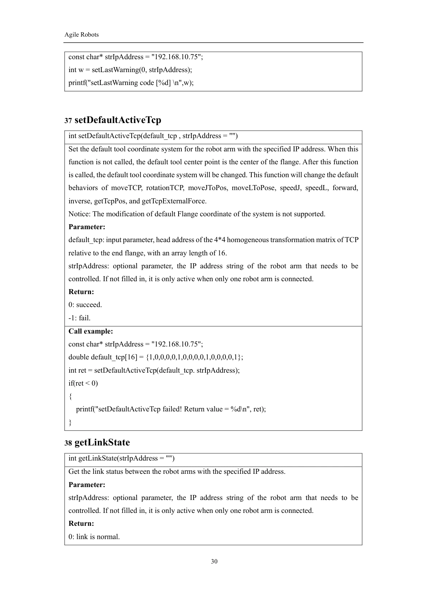



```
Agile Robots 
 30  
const char* strIpAddress = "192.168.10.75"; 
int w = setLastWarning(0, strIpAddress); 
printf("setLastWarning code [%d] \n",w); 
 
37 setDefaultActiveTcp  
int setDefaultActiveTcp(default_tcp , strIpAddress = "")  
Set the default tool coordinate system for the robot arm with the specified IP address. When this 
function is not called, the default tool center point is the center of the flange. After this function 
is called, the default tool coordinate system will be changed. This function will change the default 
behaviors of moveTCP, rotationTCP, moveJToPos, moveLToPose, speedJ, speedL, forward, 
inverse, getTcpPos, and getTcpExternalForce.  
Notice: The modification of default Flange coordinate of the system is not supported.  
Parameter:  
default_tcp: input parameter, head address of the 4*4 homogeneous transformation matrix of TCP 
relative to the end flange, with an array length of 16.  
strIpAddress: optional parameter, the IP address string of the robot arm that needs to be 
controlled. If not filled in, it is only active when only one robot arm is connected.  
Return:  
0: succeed.  
-1: fail.  
Call example:  
const char* strIpAddress = "192.168.10.75"; 
double default_tcp[16] = {1,0,0,0,0,1,0,0,0,0,1,0,0,0,0,1}; 
int ret = setDefaultActiveTcp(default_tcp. strIpAddress); 
if(ret < 0) 
{ 
    printf("setDefaultActiveTcp failed! Return value = %d\n", ret); 
} 
38 getLinkState  
int getLinkState(strIpAddress = "") 
Get the link status between the robot arms with the specified IP address.  
Parameter:  
strIpAddress: optional parameter, the IP address string of the robot arm that needs to be 
controlled. If not filled in, it is only active when only one robot arm is connected.  
Return:  
0: link is normal.
```



## PDF page 40

**Source:** Industrial API Manual (C\&C++ Edition) \_V3.3.0\_EN\_20260605.pdf, original pdf page 40. [Open the corresponding PDF reading-copy page](https://1292444914-files.gitbook.io/~/files/v0/b/gitbook-x-prod.appspot.com/o/spaces%2FtgOfPnscWebs1eh82EKq%2Fuploads%2FWGm4W5tbOjT5mD2c1h1g%2Findustrial-api-manual-c-c-edition-v3-3-0-en-20260605-pp-001-150.pdf?alt=media#page=40).



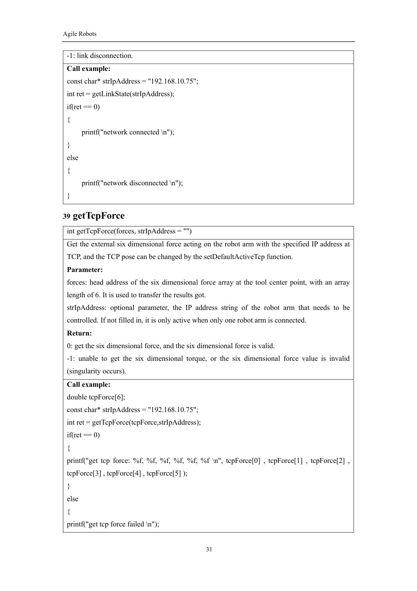



```
Agile Robots 
 31  
-1: link disconnection.  
Call example:  
const char* strIpAddress = "192.168.10.75"; 
int ret = getLinkState(strIpAddress); 
if(ret == 0) 
{ 
printf("network connected \n"); 
} 
else 
{ 
printf("network disconnected \n"); 
} 
39 getTcpForce  
int getTcpForce(forces, strIpAddress = "") 
Get the external six dimensional force acting on the robot arm with the specified IP address at 
TCP, and the TCP pose can be changed by the setDefaultActiveTcp function.  
Parameter:  
forces: head address of the six dimensional force array at the tool center point, with an array 
length of 6. It is used to transfer the results got.  
strIpAddress: optional parameter, the IP address string of the robot arm that needs to be 
controlled. If not filled in, it is only active when only one robot arm is connected.  
Return:  
0: get the six dimensional force, and the six dimensional force is valid.  
-1: unable to get the six dimensional torque, or the six dimensional force value is invalid 
(singularity occurs).  
Call example:  
double tcpForce[6]; 
const char* strIpAddress = "192.168.10.75"; 
int ret = getTcpForce(tcpForce,strIpAddress); 
if(ret == 0) 
{ 
printf("get tcp force: %f, %f, %f, %f, %f, %f \n", tcpForce[0] , tcpForce[1] , tcpForce[2] , 
tcpForce[3] , tcpForce[4] , tcpForce[5] ); 
} 
else 
{ 
printf("get tcp force failed \n");
```



## PDF page 41

**Source:** Industrial API Manual (C\&C++ Edition) \_V3.3.0\_EN\_20260605.pdf, original pdf page 41. [Open the corresponding PDF reading-copy page](https://1292444914-files.gitbook.io/~/files/v0/b/gitbook-x-prod.appspot.com/o/spaces%2FtgOfPnscWebs1eh82EKq%2Fuploads%2FWGm4W5tbOjT5mD2c1h1g%2Findustrial-api-manual-c-c-edition-v3-3-0-en-20260605-pp-001-150.pdf?alt=media#page=41).



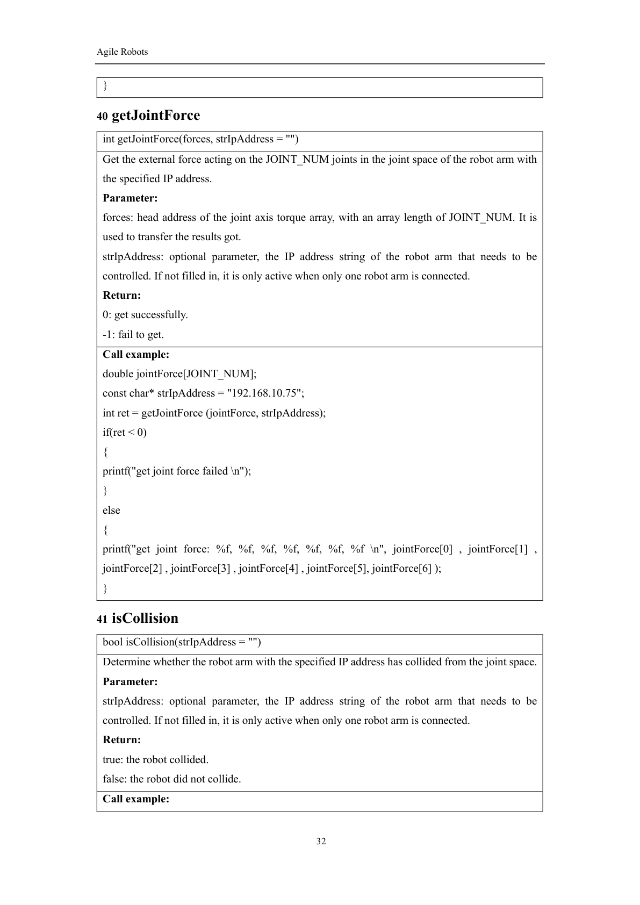



```
Agile Robots 
 32  
} 
40 getJointForce  
int getJointForce(forces, strIpAddress = "") 
Get the external force acting on the JOINT_NUM joints in the joint space of the robot arm with 
the specified IP address.  
Parameter:  
forces: head address of the joint axis torque array, with an array length of JOINT_NUM. It is 
used to transfer the results got.  
strIpAddress: optional parameter, the IP address string of the robot arm that needs to be 
controlled. If not filled in, it is only active when only one robot arm is connected.  
Return:  
0: get successfully.  
-1: fail to get.  
Call example:  
double jointForce[JOINT_NUM]; 
const char* strIpAddress = "192.168.10.75"; 
int ret = getJointForce (jointForce, strIpAddress); 
if(ret < 0) 
{ 
printf("get joint force failed \n"); 
} 
else 
{ 
printf("get joint force: %f, %f, %f, %f, %f, %f, %f \n", jointForce[0] , jointForce[1] , 
jointForce[2] , jointForce[3] , jointForce[4] , jointForce[5], jointForce[6] ); 
} 
41 isCollision  
bool isCollision(strIpAddress = "")  
Determine whether the robot arm with the specified IP address has collided from the joint space.  
Parameter:  
strIpAddress: optional parameter, the IP address string of the robot arm that needs to be 
controlled. If not filled in, it is only active when only one robot arm is connected.  
Return:  
true: the robot collided.  
false: the robot did not collide.  
Call example:
```



## PDF page 42

**Source:** Industrial API Manual (C\&C++ Edition) \_V3.3.0\_EN\_20260605.pdf, original pdf page 42. [Open the corresponding PDF reading-copy page](https://1292444914-files.gitbook.io/~/files/v0/b/gitbook-x-prod.appspot.com/o/spaces%2FtgOfPnscWebs1eh82EKq%2Fuploads%2FWGm4W5tbOjT5mD2c1h1g%2Findustrial-api-manual-c-c-edition-v3-3-0-en-20260605-pp-001-150.pdf?alt=media#page=42).



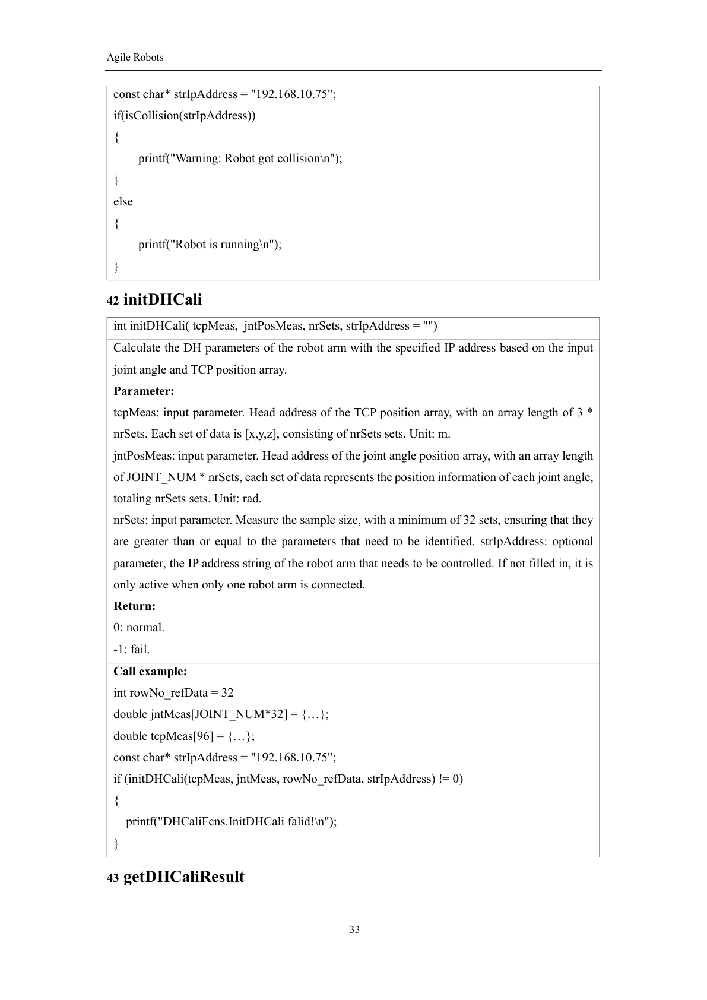



```
Agile Robots 
 33  
const char* strIpAddress = "192.168.10.75"; 
if(isCollision(strIpAddress)) 
{ 
printf("Warning: Robot got collision\n"); 
} 
else 
{ 
printf("Robot is running\n"); 
} 
42 initDHCali  
int initDHCali( tcpMeas,  jntPosMeas, nrSets, strIpAddress = "") 
Calculate the DH parameters of the robot arm with the specified IP address based on the input 
joint angle and TCP position array.  
Parameter:  
tcpMeas: input parameter. Head address of the TCP position array, with an array length of 3 * 
nrSets. Each set of data is [x,y,z], consisting of nrSets sets. Unit: m.  
jntPosMeas: input parameter. Head address of the joint angle position array, with an array length 
of JOINT_NUM * nrSets, each set of data represents the position information of each joint angle, 
totaling nrSets sets. Unit: rad.  
nrSets: input parameter. Measure the sample size, with a minimum of 32 sets, ensuring that they 
are greater than or equal to the parameters that need to be identified. strIpAddress: optional 
parameter, the IP address string of the robot arm that needs to be controlled. If not filled in, it is 
only active when only one robot arm is connected.  
Return:  
0: normal.  
-1: fail.  
Call example:  
int rowNo_refData = 32 
double jntMeas[JOINT_NUM*32] = {…}; 
double tcpMeas[96] = {…}; 
const char* strIpAddress = "192.168.10.75"; 
if (initDHCali(tcpMeas, jntMeas, rowNo_refData, strIpAddress) != 0) 
{ 
    printf("DHCaliFcns.InitDHCali falid!\n"); 
} 
43 getDHCaliResult
```



## PDF page 43

**Source:** Industrial API Manual (C\&C++ Edition) \_V3.3.0\_EN\_20260605.pdf, original pdf page 43. [Open the corresponding PDF reading-copy page](https://1292444914-files.gitbook.io/~/files/v0/b/gitbook-x-prod.appspot.com/o/spaces%2FtgOfPnscWebs1eh82EKq%2Fuploads%2FWGm4W5tbOjT5mD2c1h1g%2Findustrial-api-manual-c-c-edition-v3-3-0-en-20260605-pp-001-150.pdf?alt=media#page=43).



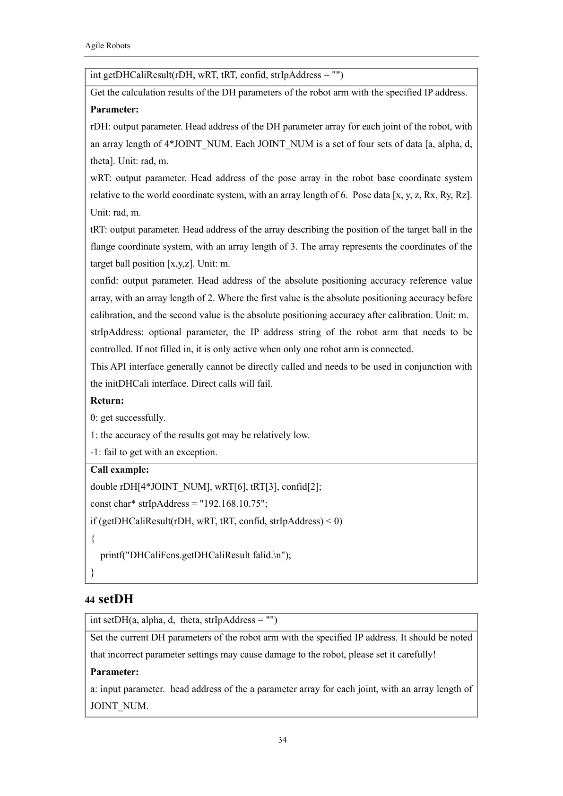



```
Agile Robots 
 34  
int getDHCaliResult(rDH, wRT, tRT, confid, strIpAddress = "") 
Get the calculation results of the DH parameters of the robot arm with the specified IP address.  
Parameter:  
rDH: output parameter. Head address of the DH parameter array for each joint of the robot, with 
an array length of 4*JOINT_NUM. Each JOINT_NUM is a set of four sets of data [a, alpha, d, 
theta]. Unit: rad, m.  
wRT: output parameter. Head address of the pose array in the robot base coordinate system 
relative to the world coordinate system, with an array length of 6.  Pose data [x, y, z, Rx, Ry, Rz]. 
Unit: rad, m.  
tRT: output parameter. Head address of the array describing the position of the target ball in the 
flange coordinate system, with an array length of 3. The array represents the coordinates of the 
target ball position [x,y,z]. Unit: m.  
confid: output parameter. Head address of the absolute positioning accuracy reference value 
array, with an array length of 2. Where the first value is the absolute positioning accuracy before 
calibration, and the second value is the absolute positioning accuracy after calibration. Unit: m.  
strIpAddress: optional parameter, the IP address string of the robot arm that needs to be 
controlled. If not filled in, it is only active when only one robot arm is connected.  
This API interface generally cannot be directly called and needs to be used in conjunction with 
the initDHCali interface. Direct calls will fail.  
Return:  
0: get successfully.  
1: the accuracy of the results got may be relatively low.  
-1: fail to get with an exception.  
Call example:  
double rDH[4*JOINT_NUM], wRT[6], tRT[3], confid[2]; 
const char* strIpAddress = "192.168.10.75"; 
if (getDHCaliResult(rDH, wRT, tRT, confid, strIpAddress) < 0) 
{ 
    printf("DHCaliFcns.getDHCaliResult falid.\n"); 
} 
44 setDH  
int setDH(a, alpha, d,  theta, strIpAddress = "") 
Set the current DH parameters of the robot arm with the specified IP address. It should be noted 
that incorrect parameter settings may cause damage to the robot, please set it carefully!  
Parameter:  
a: input parameter.  head address of the a parameter array for each joint, with an array length of 
JOINT_NUM.
```



## PDF page 44

**Source:** Industrial API Manual (C\&C++ Edition) \_V3.3.0\_EN\_20260605.pdf, original pdf page 44. [Open the corresponding PDF reading-copy page](https://1292444914-files.gitbook.io/~/files/v0/b/gitbook-x-prod.appspot.com/o/spaces%2FtgOfPnscWebs1eh82EKq%2Fuploads%2FWGm4W5tbOjT5mD2c1h1g%2Findustrial-api-manual-c-c-edition-v3-3-0-en-20260605-pp-001-150.pdf?alt=media#page=44).



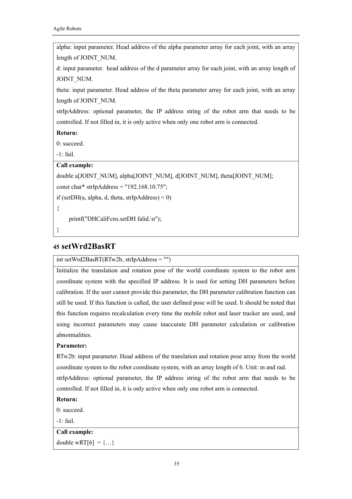



```
Agile Robots 
 35  
alpha: input parameter. Head address of the alpha parameter array for each joint, with an array 
length of JOINT_NUM.  
d: input parameter.  head address of the d parameter array for each joint, with an array length of 
JOINT_NUM.  
theta: input parameter. Head address of the theta parameter array for each joint, with an array 
length of JOINT_NUM.  
strIpAddress: optional parameter, the IP address string of the robot arm that needs to be 
controlled. If not filled in, it is only active when only one robot arm is connected.  
Return:  
0: succeed.  
 
-1: fail.  
Call example:  
double a[JOINT_NUM], alpha[JOINT_NUM], d[JOINT_NUM], theta[JOINT_NUM]; 
const char* strIpAddress = "192.168.10.75"; 
if (setDH(a, alpha, d, theta, strIpAddress) < 0) 
{ 
printf("DHCaliFcns.setDH falid.\n"); 
} 
45 setWrd2BasRT  
int setWrd2BasRT(RTw2b, strIpAddress = "") 
Initialize the translation and rotation pose of the world coordinate system to the robot arm 
coordinate system with the specified IP address. It is used for setting DH parameters before 
calibration. If the user cannot provide this parameter, the DH parameter calibration function can 
still be used. If this function is called, the user defined pose will be used. It should be noted that 
this function requires recalculation every time the mobile robot and laser tracker are used, and 
using incorrect parameters may cause inaccurate DH parameter calculation or calibration 
abnormalities.  
Parameter:  
RTw2b: input parameter. Head address of the translation and rotation pose array from the world 
coordinate system to the robot coordinate system, with an array length of 6. Unit: m and rad.  
strIpAddress: optional parameter, the IP address string of the robot arm that needs to be 
controlled. If not filled in, it is only active when only one robot arm is connected.  
Return:  
0: succeed.  
 
-1: fail.  
Call example:  
double wRT[6]  = {…}
```



## PDF page 45

**Source:** Industrial API Manual (C\&C++ Edition) \_V3.3.0\_EN\_20260605.pdf, original pdf page 45. [Open the corresponding PDF reading-copy page](https://1292444914-files.gitbook.io/~/files/v0/b/gitbook-x-prod.appspot.com/o/spaces%2FtgOfPnscWebs1eh82EKq%2Fuploads%2FWGm4W5tbOjT5mD2c1h1g%2Findustrial-api-manual-c-c-edition-v3-3-0-en-20260605-pp-001-150.pdf?alt=media#page=45).



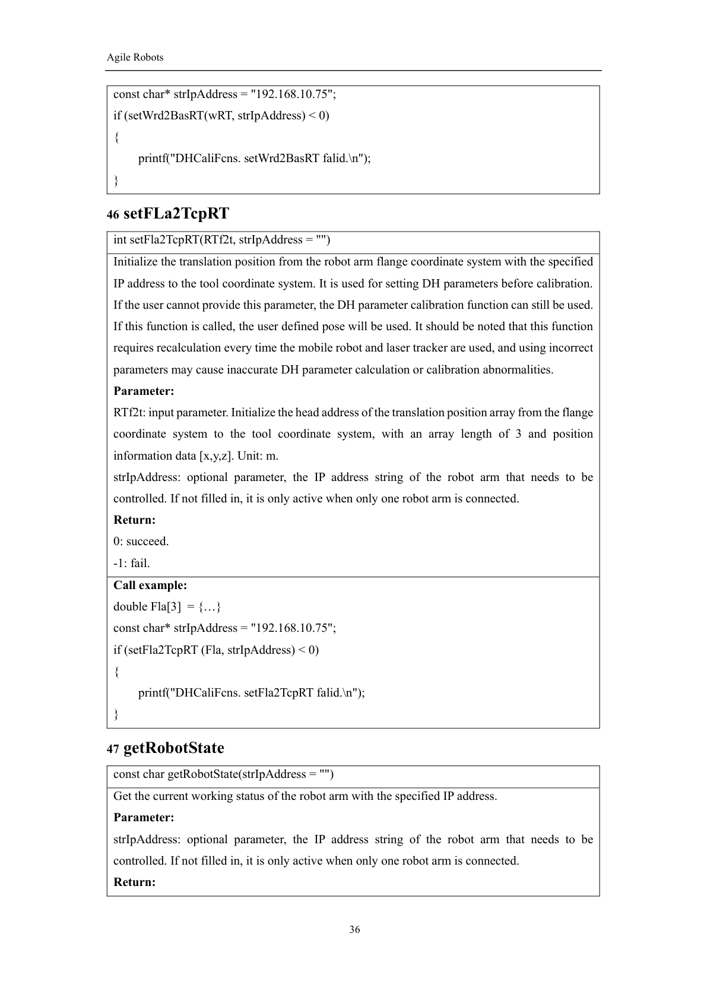



```
Agile Robots 
 36  
const char* strIpAddress = "192.168.10.75"; 
if (setWrd2BasRT(wRT, strIpAddress) < 0) 
{ 
printf("DHCaliFcns. setWrd2BasRT falid.\n"); 
} 
46 setFLa2TcpRT  
int setFla2TcpRT(RTf2t, strIpAddress = "") 
Initialize the translation position from the robot arm flange coordinate system with the specified 
IP address to the tool coordinate system. It is used for setting DH parameters before calibration. 
If the user cannot provide this parameter, the DH parameter calibration function can still be used. 
If this function is called, the user defined pose will be used. It should be noted that this function 
requires recalculation every time the mobile robot and laser tracker are used, and using incorrect 
parameters may cause inaccurate DH parameter calculation or calibration abnormalities.  
Parameter:  
RTf2t: input parameter. Initialize the head address of the translation position array from the flange 
coordinate system to the tool coordinate system, with an array length of 3 and position 
information data [x,y,z]. Unit: m.  
strIpAddress: optional parameter, the IP address string of the robot arm that needs to be 
controlled. If not filled in, it is only active when only one robot arm is connected.  
Return:  
0: succeed.  
 
-1: fail.  
Call example:  
double Fla[3]  = {…} 
const char* strIpAddress = "192.168.10.75"; 
if (setFla2TcpRT (Fla, strIpAddress) < 0) 
{ 
printf("DHCaliFcns. setFla2TcpRT falid.\n"); 
} 
47 getRobotState  
const char getRobotState(strIpAddress = "") 
Get the current working status of the robot arm with the specified IP address.  
Parameter:  
strIpAddress: optional parameter, the IP address string of the robot arm that needs to be 
controlled. If not filled in, it is only active when only one robot arm is connected.  
Return:
```



## PDF page 46

**Source:** Industrial API Manual (C\&C++ Edition) \_V3.3.0\_EN\_20260605.pdf, original pdf page 46. [Open the corresponding PDF reading-copy page](https://1292444914-files.gitbook.io/~/files/v0/b/gitbook-x-prod.appspot.com/o/spaces%2FtgOfPnscWebs1eh82EKq%2Fuploads%2FWGm4W5tbOjT5mD2c1h1g%2Findustrial-api-manual-c-c-edition-v3-3-0-en-20260605-pp-001-150.pdf?alt=media#page=46).



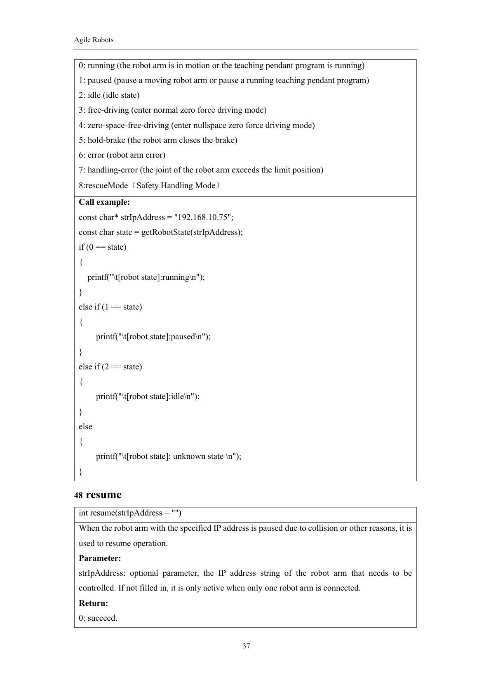



```
Agile Robots 
 37  
0: running (the robot arm is in motion or the teaching pendant program is running)  
1: paused (pause a moving robot arm or pause a running teaching pendant program)  
2: idle (idle state)  
3: free-driving (enter normal zero force driving mode)  
4: zero-space-free-driving (enter nullspace zero force driving mode)  
5: hold-brake (the robot arm closes the brake)  
6: error (robot arm error)  
7: handling-error (the joint of the robot arm exceeds the limit position)  
8:rescueMode（Safety Handling Mode） 
Call example:  
const char* strIpAddress = "192.168.10.75"; 
const char state = getRobotState(strIpAddress); 
if (0 == state) 
{ 
    printf("\t[robot state]:running\n"); 
} 
else if (1 == state) 
{ 
printf("\t[robot state]:paused\n"); 
} 
else if (2 == state) 
{ 
printf("\t[robot state]:idle\n");     
} 
else 
{ 
printf("\t[robot state]: unknown state \n"); 
} 
48 resume  
int resume(strIpAddress = "") 
When the robot arm with the specified IP address is paused due to collision or other reasons, it is 
used to resume operation.  
Parameter:  
strIpAddress: optional parameter, the IP address string of the robot arm that needs to be 
controlled. If not filled in, it is only active when only one robot arm is connected.  
Return:  
0: succeed.
```



## PDF page 47

**Source:** Industrial API Manual (C\&C++ Edition) \_V3.3.0\_EN\_20260605.pdf, original pdf page 47. [Open the corresponding PDF reading-copy page](https://1292444914-files.gitbook.io/~/files/v0/b/gitbook-x-prod.appspot.com/o/spaces%2FtgOfPnscWebs1eh82EKq%2Fuploads%2FWGm4W5tbOjT5mD2c1h1g%2Findustrial-api-manual-c-c-edition-v3-3-0-en-20260605-pp-001-150.pdf?alt=media#page=47).



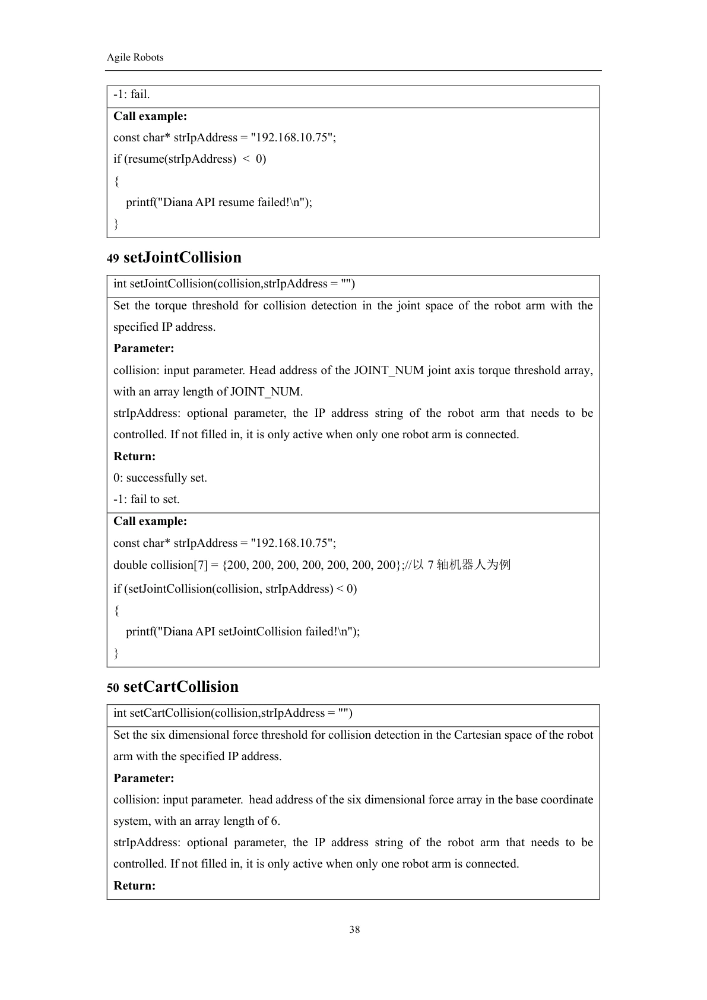



```
Agile Robots 
 38  
-1: fail.  
Call example:  
const char* strIpAddress = "192.168.10.75"; 
if (resume(strIpAddress)  <  0) 
{ 
    printf("Diana API resume failed!\n"); 
}  
49 setJointCollision 
int setJointCollision(collision,strIpAddress = "") 
Set the torque threshold for collision detection in the joint space of the robot arm with the 
specified IP address.  
Parameter:  
collision: input parameter. Head address of the JOINT_NUM joint axis torque threshold array, 
with an array length of JOINT_NUM.  
strIpAddress: optional parameter, the IP address string of the robot arm that needs to be 
controlled. If not filled in, it is only active when only one robot arm is connected.  
Return:  
0: successfully set.  
-1: fail to set.  
Call example:  
const char* strIpAddress = "192.168.10.75"; 
double collision[7] = {200, 200, 200, 200, 200, 200, 200};//以7 轴机器人为例 
if (setJointCollision(collision, strIpAddress) < 0) 
{ 
    printf("Diana API setJointCollision failed!\n"); 
}  
50 setCartCollision 
int setCartCollision(collision,strIpAddress = "") 
Set the six dimensional force threshold for collision detection in the Cartesian space of the robot 
arm with the specified IP address.  
Parameter:  
collision: input parameter.  head address of the six dimensional force array in the base coordinate 
system, with an array length of 6.  
strIpAddress: optional parameter, the IP address string of the robot arm that needs to be 
controlled. If not filled in, it is only active when only one robot arm is connected.  
Return:
```



## PDF page 48

**Source:** Industrial API Manual (C\&C++ Edition) \_V3.3.0\_EN\_20260605.pdf, original pdf page 48. [Open the corresponding PDF reading-copy page](https://1292444914-files.gitbook.io/~/files/v0/b/gitbook-x-prod.appspot.com/o/spaces%2FtgOfPnscWebs1eh82EKq%2Fuploads%2FWGm4W5tbOjT5mD2c1h1g%2Findustrial-api-manual-c-c-edition-v3-3-0-en-20260605-pp-001-150.pdf?alt=media#page=48).



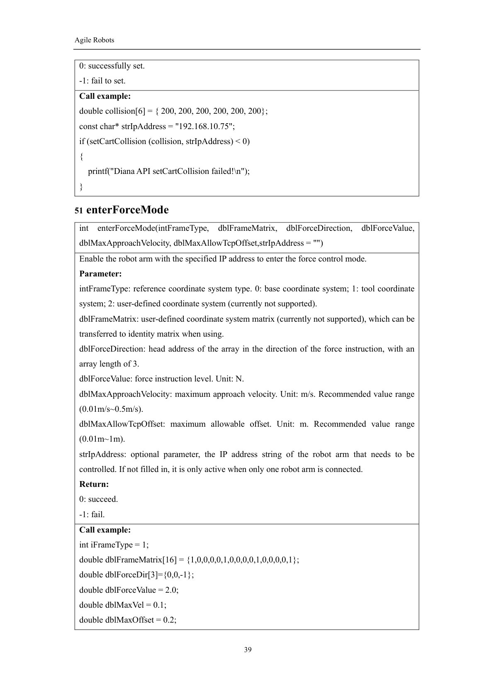



```
Agile Robots 
 39  
0: successfully set.  
-1: fail to set.  
Call example:  
double collision[6] = { 200, 200, 200, 200, 200, 200}; 
const char* strIpAddress = "192.168.10.75"; 
if (setCartCollision (collision, strIpAddress) < 0) 
{ 
    printf("Diana API setCartCollision failed!\n"); 
} 
51 enterForceMode 
int enterForceMode(intFrameType, dblFrameMatrix, dblForceDirection, dblForceValue, 
dblMaxApproachVelocity, dblMaxAllowTcpOffset,strIpAddress = "") 
Enable the robot arm with the specified IP address to enter the force control mode.  
Parameter:  
intFrameType: reference coordinate system type. 0: base coordinate system; 1: tool coordinate 
system; 2: user-defined coordinate system (currently not supported).  
dblFrameMatrix: user-defined coordinate system matrix (currently not supported), which can be 
transferred to identity matrix when using.  
dblForceDirection: head address of the array in the direction of the force instruction, with an 
array length of 3.  
dblForceValue: force instruction level. Unit: N.  
dblMaxApproachVelocity: maximum approach velocity. Unit: m/s. Recommended value range 
(0.01m/s~0.5m/s).  
dblMaxAllowTcpOffset: maximum allowable offset. Unit: m. Recommended value range 
(0.01m~1m).  
strIpAddress: optional parameter, the IP address string of the robot arm that needs to be 
controlled. If not filled in, it is only active when only one robot arm is connected.  
Return:  
0: succeed.  
-1: fail.  
Call example:  
int iFrameType = 1; 
double dblFrameMatrix[16] = {1,0,0,0,0,1,0,0,0,0,1,0,0,0,0,1}; 
double dblForceDir[3]={0,0,-1}; 
double dblForceValue = 2.0; 
double dblMaxVel = 0.1; 
double dblMaxOffset = 0.2;
```



## PDF page 49

**Source:** Industrial API Manual (C\&C++ Edition) \_V3.3.0\_EN\_20260605.pdf, original pdf page 49. [Open the corresponding PDF reading-copy page](https://1292444914-files.gitbook.io/~/files/v0/b/gitbook-x-prod.appspot.com/o/spaces%2FtgOfPnscWebs1eh82EKq%2Fuploads%2FWGm4W5tbOjT5mD2c1h1g%2Findustrial-api-manual-c-c-edition-v3-3-0-en-20260605-pp-001-150.pdf?alt=media#page=49).



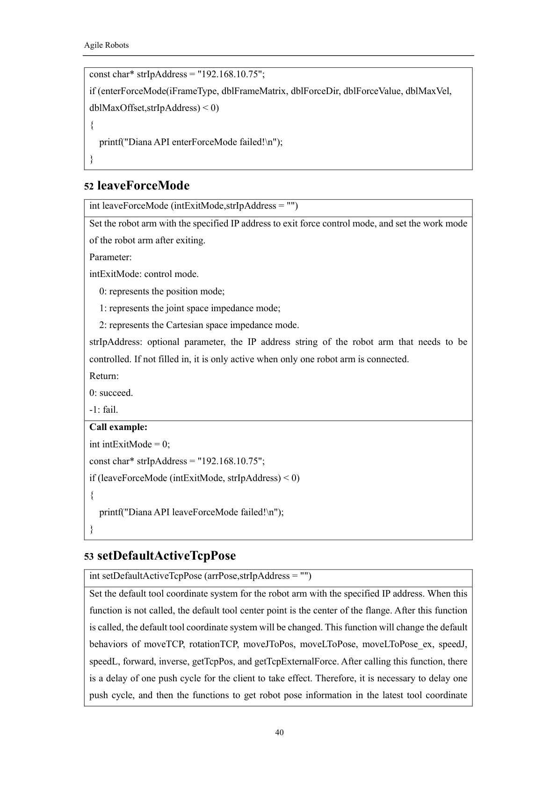



```
Agile Robots 
 40  
const char* strIpAddress = "192.168.10.75"; 
if (enterForceMode(iFrameType, dblFrameMatrix, dblForceDir, dblForceValue, dblMaxVel, 
dblMaxOffset,strIpAddress) < 0) 
{ 
    printf("Diana API enterForceMode failed!\n"); 
} 
52 leaveForceMode  
int leaveForceMode (intExitMode,strIpAddress = "") 
Set the robot arm with the specified IP address to exit force control mode, and set the work mode 
of the robot arm after exiting.  
Parameter:  
intExitMode: control mode.  
0: represents the position mode;   
1: represents the joint space impedance mode;  
2: represents the Cartesian space impedance mode.  
strIpAddress: optional parameter, the IP address string of the robot arm that needs to be 
controlled. If not filled in, it is only active when only one robot arm is connected.  
Return:  
0: succeed.  
-1: fail.  
Call example:  
int intExitMode = 0; 
const char* strIpAddress = "192.168.10.75"; 
if (leaveForceMode (intExitMode, strIpAddress) < 0) 
{ 
    printf("Diana API leaveForceMode failed!\n"); 
} 
53 setDefaultActiveTcpPose  
int setDefaultActiveTcpPose (arrPose,strIpAddress = "")  
Set the default tool coordinate system for the robot arm with the specified IP address. When this 
function is not called, the default tool center point is the center of the flange. After this function 
is called, the default tool coordinate system will be changed. This function will change the default 
behaviors of moveTCP, rotationTCP, moveJToPos, moveLToPose, moveLToPose_ex, speedJ, 
speedL, forward, inverse, getTcpPos, and getTcpExternalForce. After calling this function, there 
is a delay of one push cycle for the client to take effect. Therefore, it is necessary to delay one 
push cycle, and then the functions to get robot pose information in the latest tool coordinate
```



## PDF page 50

**Source:** Industrial API Manual (C\&C++ Edition) \_V3.3.0\_EN\_20260605.pdf, original pdf page 50. [Open the corresponding PDF reading-copy page](https://1292444914-files.gitbook.io/~/files/v0/b/gitbook-x-prod.appspot.com/o/spaces%2FtgOfPnscWebs1eh82EKq%2Fuploads%2FWGm4W5tbOjT5mD2c1h1g%2Findustrial-api-manual-c-c-edition-v3-3-0-en-20260605-pp-001-150.pdf?alt=media#page=50).



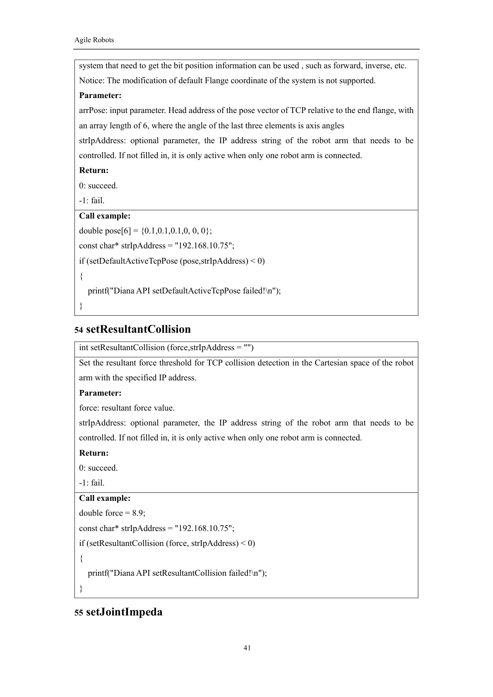



```
Agile Robots 
 41  
system that need to get the bit position information can be used , such as forward, inverse, etc. 
Notice: The modification of default Flange coordinate of the system is not supported.  
Parameter:  
arrPose: input parameter. Head address of the pose vector of TCP relative to the end flange, with 
an array length of 6, where the angle of the last three elements is axis angles  
strIpAddress: optional parameter, the IP address string of the robot arm that needs to be 
controlled. If not filled in, it is only active when only one robot arm is connected.  
Return:  
0: succeed.  
-1: fail.  
Call example:  
double pose[6] = {0.1,0.1,0.1,0, 0, 0}; 
const char* strIpAddress = "192.168.10.75"; 
if (setDefaultActiveTcpPose (pose,strIpAddress) < 0) 
{ 
    printf("Diana API setDefaultActiveTcpPose failed!\n"); 
} 
54 setResultantCollision  
int setResultantCollision (force,strIpAddress = "") 
Set the resultant force threshold for TCP collision detection in the Cartesian space of the robot 
arm with the specified IP address.  
Parameter:  
force: resultant force value.  
strIpAddress: optional parameter, the IP address string of the robot arm that needs to be 
controlled. If not filled in, it is only active when only one robot arm is connected.  
Return:  
0: succeed.  
-1: fail.  
Call example:  
double force = 8.9; 
const char* strIpAddress = "192.168.10.75"; 
if (setResultantCollision (force, strIpAddress) < 0) 
{ 
    printf("Diana API setResultantCollision failed!\n"); 
} 
55 setJointImpeda
```



## PDF page 51

**Source:** Industrial API Manual (C\&C++ Edition) \_V3.3.0\_EN\_20260605.pdf, original pdf page 51. [Open the corresponding PDF reading-copy page](https://1292444914-files.gitbook.io/~/files/v0/b/gitbook-x-prod.appspot.com/o/spaces%2FtgOfPnscWebs1eh82EKq%2Fuploads%2FWGm4W5tbOjT5mD2c1h1g%2Findustrial-api-manual-c-c-edition-v3-3-0-en-20260605-pp-001-150.pdf?alt=media#page=51).



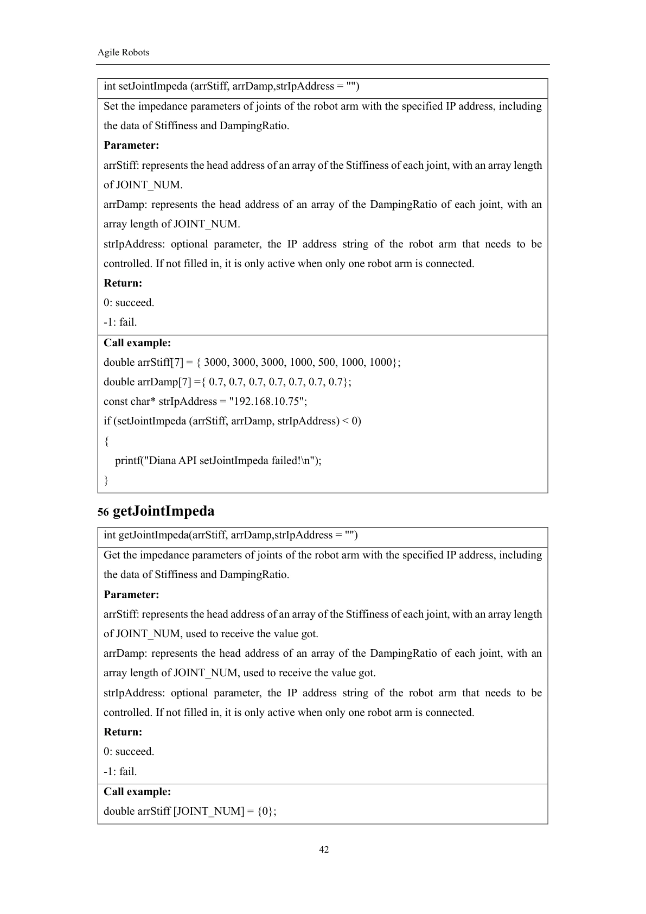



```
Agile Robots 
 42  
int setJointImpeda (arrStiff, arrDamp,strIpAddress = "") 
Set the impedance parameters of joints of the robot arm with the specified IP address, including 
the data of Stiffiness and DampingRatio.  
Parameter:  
arrStiff: represents the head address of an array of the Stiffiness of each joint, with an array length 
of JOINT_NUM.  
arrDamp: represents the head address of an array of the DampingRatio of each joint, with an 
array length of JOINT_NUM. 
strIpAddress: optional parameter, the IP address string of the robot arm that needs to be 
controlled. If not filled in, it is only active when only one robot arm is connected.  
Return:  
0: succeed.  
-1: fail.  
Call example:  
double arrStiff[7] = { 3000, 3000, 3000, 1000, 500, 1000, 1000}; 
double arrDamp[7] ={ 0.7, 0.7, 0.7, 0.7, 0.7, 0.7, 0.7}; 
const char* strIpAddress = "192.168.10.75"; 
if (setJointImpeda (arrStiff, arrDamp, strIpAddress) < 0) 
{ 
    printf("Diana API setJointImpeda failed!\n"); 
} 
56 getJointImpeda  
int getJointImpeda(arrStiff, arrDamp,strIpAddress = "") 
Get the impedance parameters of joints of the robot arm with the specified IP address, including 
the data of Stiffiness and DampingRatio.  
Parameter:  
arrStiff: represents the head address of an array of the Stiffiness of each joint, with an array length 
of JOINT_NUM, used to receive the value got.  
arrDamp: represents the head address of an array of the DampingRatio of each joint, with an 
array length of JOINT_NUM, used to receive the value got.  
strIpAddress: optional parameter, the IP address string of the robot arm that needs to be 
controlled. If not filled in, it is only active when only one robot arm is connected.  
Return:  
0: succeed.  
-1: fail.  
Call example:  
double arrStiff [JOINT_NUM] = {0};
```



## PDF page 52

**Source:** Industrial API Manual (C\&C++ Edition) \_V3.3.0\_EN\_20260605.pdf, original pdf page 52. [Open the corresponding PDF reading-copy page](https://1292444914-files.gitbook.io/~/files/v0/b/gitbook-x-prod.appspot.com/o/spaces%2FtgOfPnscWebs1eh82EKq%2Fuploads%2FWGm4W5tbOjT5mD2c1h1g%2Findustrial-api-manual-c-c-edition-v3-3-0-en-20260605-pp-001-150.pdf?alt=media#page=52).







```
Agile Robots 
 43  
double arrDamp[JOINT_NUM] = {0}; 
const char* strIpAddress = "192.168.10.75"; 
if (getJointImpeda (arrStiff, arrDamp, strIpAddress) < 0) 
{ 
    printf("Diana API getJointImpeda failed!\n"); 
} 
else 
{ 
    printf("getJointImpeda : Stiff=%f, %f, %f, %f, %f, %f, %f\n Damp=%f, %f, %f, %f, %f, %f,
 %f \n", 
    arrStiff[0], arrStiff[1], arrStiff[2], arrStiff[3], arrStiff[4], arrStiff[5], arrStiff[6], 
    arrDamp[0], arrDamp[1], arrDamp[2], arrDamp[3], arrDamp[4], arrDamp[5], arrDamp[6]); 
} 
57 setCartImpeda  
int setCartImpeda (arrStiff, arrDamp, strIpAddress = "") 
Set the impedance parameters in the Cartesian space of the robot arm with the specified IP 
address.  
Parameter:  
arrStiff: represents the head address of an array of the Stiffiness of each dimension in Cartesian 
space, with an array length of 6.  
arrDamp: represents the head address of an array of the DampingRatio of each dimension in 
Cartesian space, with an array length of 6.   
strIpAddress: optional parameter, the IP address string of the robot arm that needs to be 
controlled. If not filled in, it is only active when only one robot arm is connected.  
Return:  
0: succeed.  
-1: fail.  
Call example:  
double arrStiff[6] = { 1000, 1000, 1000, 500, 500, 500}; 
double arrDamp[6] = {0.7, 0.7, 0.7, 0.7, 0.7, 0.7}; 
const char* strIpAddress = "192.168.10.75"; 
if (setCartImpeda(arrStiff, arrDamp, strIpAddress) < 0) 
{ 
    printf("Diana API setCartImpeda failed!\n"); 
} 
58 getCartImpeda
```



## PDF page 53

**Source:** Industrial API Manual (C\&C++ Edition) \_V3.3.0\_EN\_20260605.pdf, original pdf page 53. [Open the corresponding PDF reading-copy page](https://1292444914-files.gitbook.io/~/files/v0/b/gitbook-x-prod.appspot.com/o/spaces%2FtgOfPnscWebs1eh82EKq%2Fuploads%2FWGm4W5tbOjT5mD2c1h1g%2Findustrial-api-manual-c-c-edition-v3-3-0-en-20260605-pp-001-150.pdf?alt=media#page=53).







```
Agile Robots 
 44  
int getCartImpeda (arrStiff, arrDamp, strIpAddress = "") 
Get the impedance parameters of each dimension in Cartesian space of the robot arm with the 
specified IP address, including the data of Stiffiness and DampingRatio.  
Parameter:  
arrStiff: represents the head address of an array of the Stiffiness of each dimension in Cartesian 
space, with an array length of 6, used to receive the value got.  
arrDamp: represents the head address of an array of the DampingRatio of each dimension in 
Cartesian space, with an array length of 6, used to receive the value got.  
strIpAddress: optional parameter, the IP address string of the robot arm that needs to be 
controlled. If not filled in, it is only active when only one robot arm is connected.  
Return:  
0: succeed.  
-1: fail.  
Call example:  
double arrStiff [6] = {0}; 
double arrDamp[6] = {0}; 
const char* strIpAddress = "192.168.10.75"; 
if (getCartImpeda (arrStiff, arrDamp, strIpAddress) < 0) 
{ 
    printf("Diana API getCartImpeda failed!\n"); 
} 
else 
{ 
    printf("getCartImpeda: Stiff=%f, %f, %f, %f, %f, %f\n Damp=%f, %f, %f, %f, %f, %f \n", 
    arrStiff[0], arrStiff[1], arrStiff[2], arrStiff[3], arrStiff[4], arrStiff[5], 
arrDamp[0], arrDamp[1], arrDamp[2], arrDamp[3], arrDamp[4], arrDamp[5]); 
} 
59 zeroSpaceFreeDriving  
int zeroSpaceFreeDriving (enable, strIpAddress = "") 
Control the robot arm with the specified IP address to enter or exit nullspace free drive mode.  
Parameter:  
enable: input parameter.  
true means entering nullspace free drive mode;  
false means exiting nullspace free drive mode.  
strIpAddress: optional parameter, the IP address string of the robot arm that needs to be 
controlled. If not filled in, it is only active when only one robot arm is connected.  
Return:
```



## PDF page 54

**Source:** Industrial API Manual (C\&C++ Edition) \_V3.3.0\_EN\_20260605.pdf, original pdf page 54. [Open the corresponding PDF reading-copy page](https://1292444914-files.gitbook.io/~/files/v0/b/gitbook-x-prod.appspot.com/o/spaces%2FtgOfPnscWebs1eh82EKq%2Fuploads%2FWGm4W5tbOjT5mD2c1h1g%2Findustrial-api-manual-c-c-edition-v3-3-0-en-20260605-pp-001-150.pdf?alt=media#page=54).







```
Agile Robots 
 45  
0: succeed.  
-1: fail.  
Call example:  
const char* strIpAddress = "192.168.10.75"; 
if (zeroSpaceFreeDriving (true, strIpAddress) < 0) 
{ 
    printf("Diana API zeroSpaceFreeDriving failed!\n"); 
} 
else 
{   
printf("Diana API zeroSpaceFreeDriving succeed!\n"); 
sleep(5); 
zeroSpaceFreeDriving(false, strIpAddress); 
} 
60 createPath 
int createPath (type, id_path, strIpAddress = "") 
Create a segment for the robot arm with the specified IP address.  
Parameter:  
type: input parameter. 1 : represents moveJ, 2: represents moveL.  
id_path: output parameter. Used to save the ID of the newly created Path.  
strIpAddress: optional parameter, the IP address string of the robot arm that needs to be 
controlled. If not filled in, it is only active when only one robot arm is connected.  
Return:  
0: succeed.  
-1: fail.  
Call example:  
Refer to the call examples of addMoveJ or addMoveL for details.  
61 addMoveL 
int addMoveL (id_path, joints, vel, acc, blendradius, avoid_singular=false, strIpAddress = "") 
Add a MoveL waypoint to the segment created by the robot arm with the specified IP address.  
Parameter:  
id_path: input parameter. Path ID of the waypoint to be added.  
joints: input parameter. Waypoint to be added, which is the head address of the array of joint 
angles for that waypoint, with an array length of JOINT_NUM. Unit: rad.  
vel: the velocity at which moveL moves to the target waypoint. Unit: m/s.  
acc: the acceleration at which moveL moves to the target waypoint. Unit: m/s2.
```



## PDF page 55

**Source:** Industrial API Manual (C\&C++ Edition) \_V3.3.0\_EN\_20260605.pdf, original pdf page 55. [Open the corresponding PDF reading-copy page](https://1292444914-files.gitbook.io/~/files/v0/b/gitbook-x-prod.appspot.com/o/spaces%2FtgOfPnscWebs1eh82EKq%2Fuploads%2FWGm4W5tbOjT5mD2c1h1g%2Findustrial-api-manual-c-c-edition-v3-3-0-en-20260605-pp-001-150.pdf?alt=media#page=55).







```
Agile Robots 
 46  
blendradius: blending radius. Unit: m.  
avoid_singular: Whether to enable singularity avoidance. The default value is false. 
strIpAddress: optional parameter, the IP address string of the robot arm that needs to be 
controlled. If not filled in, it is only active when only one robot arm is connected.  
Return:  
0: succeed.  
-1: fail.  
Call example:  
 
#define PI 3.14159265358979323846 
#define DEGREE_TO_RAD(x) ((x)*PI / 180.0)  
#define RAD_TO_DEGREE(x) ((x)*180.0 / PI) 
 
double dblFirstPosition[7] = { DEGREE_TO_RAD(0.0), DEGREE_TO_RAD(0.0), 
DEGREE_TO_RAD(0.0), DEGREE_TO_RAD(90.0), DEGREE_TO_RAD(0.0), 
DEGREE_TO_RAD(-90.0), DEGREE_TO_RAD(0.0) }; 
double dblSecondPosition[7] = { DEGREE_TO_RAD(0.0), DEGREE_TO_RAD(0.0), 
DEGREE_TO_RAD(0.0), DEGREE_TO_RAD(120.0), DEGREE_TO_RAD(0.0), 
DEGREE_TO_RAD(-60.0), DEGREE_TO_RAD(0.0) }; 
double dblThirdPosition[7] = { DEGREE_TO_RAD(0.0), DEGREE_TO_RAD(0.0), 
DEGREE_TO_RAD(0.0), DEGREE_TO_RAD(150.0), DEGREE_TO_RAD(0.0), 
DEGREE_TO_RAD(-30.0), DEGREE_TO_RAD(0.0) }; 
 
unsigned int path_id = 0; 
printf("start test moveJ path.\n"); 
const char* strIpAddress = "192.168.10.75"; 
bool avoid_singular = false; 
createPath(2, path_id,strIpAddress); 
addMoveL(path_id, dblFirstMoveLPosition, 0.2, 0.2, 0.3, avoid_singular, strIpAddress); 
addMoveL(path_id, dblSecondMoveLPosition, 0.2, 0.2, 0.3, avoid_singular, strIpAddress); 
addMoveL(path_id, dblThirdMoveLPosition, 0.2, 0.2, 0.3, avoid_singular, strIpAddress); 
runPath(path_id,strIpAddress); 
destroyPath(path_id,strIpAddress); 
wait_move(strIpAddress); 
62 addMoveJ 
int addMoveJ (id_path, joints, vel_percent, acc_percent, blendradius_percent, strIpAddress = "") 
Add a MoveJ waypoint to the segment created by the robot arm with the specified IP address.
```



## PDF page 56

**Source:** Industrial API Manual (C\&C++ Edition) \_V3.3.0\_EN\_20260605.pdf, original pdf page 56. [Open the corresponding PDF reading-copy page](https://1292444914-files.gitbook.io/~/files/v0/b/gitbook-x-prod.appspot.com/o/spaces%2FtgOfPnscWebs1eh82EKq%2Fuploads%2FWGm4W5tbOjT5mD2c1h1g%2Findustrial-api-manual-c-c-edition-v3-3-0-en-20260605-pp-001-150.pdf?alt=media#page=56).







```
Agile Robots 
 47  
Parameter:  
id_path: input parameter. Path ID of the waypoint to be added.  
joints: input parameter. Waypoint to be added, which is the head address of the array of joint 
angles for that waypoint, with an array length of JOINT_NUM. Unit: rad.  
vel_percent: the percentage of velocity at which moveJ moves to the target waypoint.  
acc_percent: the percentage of acceleration at which moveJ moves to the target waypoint.  
blendradius _percent: the percentage of blending radius.  
strIpAddress: optional parameter, the IP address string of the robot arm that needs to be 
controlled. If not filled in, it is only active when only one robot arm is connected.  
Return:  
0: succeed.  
-1: fail.  
Call example:  
 
#define PI 3.14159265358979323846 
#define DEGREE_TO_RAD(x) ((x)*PI / 180.0)  
#define RAD_TO_DEGREE(x) ((x)*180.0 / PI) 
 
double dblFirstPosition[7] = { DEGREE_TO_RAD(0.0), DEGREE_TO_RAD(0.0), 
DEGREE_TO_RAD(0.0), DEGREE_TO_RAD(90.0), DEGREE_TO_RAD(0.0), 
DEGREE_TO_RAD(-90.0), DEGREE_TO_RAD(0.0) }; 
double dblSecondPosition[7] = { DEGREE_TO_RAD(0.0), DEGREE_TO_RAD(0.0), 
DEGREE_TO_RAD(0.0), DEGREE_TO_RAD(120.0), DEGREE_TO_RAD(0.0), 
DEGREE_TO_RAD(-60.0), DEGREE_TO_RAD(0.0) }; 
double dblThirdPosition[7] = { DEGREE_TO_RAD(0.0), DEGREE_TO_RAD(0.0), 
DEGREE_TO_RAD(0.0), DEGREE_TO_RAD(150.0), DEGREE_TO_RAD(0.0), 
DEGREE_TO_RAD(-30.0), DEGREE_TO_RAD(0.0) }; 
 
unsigned int path_id = 0; 
printf("start test moveJ path.\n"); 
const char* strIpAddress = "192.168.10.75"; 
createPath(1, path_id,strIpAddress); 
addMoveJ(path_id, dblFirstPosition, 0.2, 0.2, 0.3,strIpAddress); 
addMoveJ(path_id, dblSecondPosition, 0.2, 0.2, 0.3,strIpAddress); 
addMoveJ(path_id, dblThirdPosition, 0.2, 0.2, 0.3,strIpAddress); 
runPath(path_id,strIpAddress); 
destroyPath(path_id,strIpAddress); 
wait_move(strIpAddress);
```



## PDF page 57

**Source:** Industrial API Manual (C\&C++ Edition) \_V3.3.0\_EN\_20260605.pdf, original pdf page 57. [Open the corresponding PDF reading-copy page](https://1292444914-files.gitbook.io/~/files/v0/b/gitbook-x-prod.appspot.com/o/spaces%2FtgOfPnscWebs1eh82EKq%2Fuploads%2FWGm4W5tbOjT5mD2c1h1g%2Findustrial-api-manual-c-c-edition-v3-3-0-en-20260605-pp-001-150.pdf?alt=media#page=57).







```
Agile Robots 
 48  
63 runPath 
int runPath (id_path, strIpAddress = "") 
Start the segment set for the robot arm with the specified IP address.  
Parameter:  
id_path: input parameter. ID of path to run.  
strIpAddress: optional parameter, the IP address string of the robot arm that needs to be 
controlled. If not filled in, it is only active when only one robot arm is connected.  
Return:  
0: succeed.  
-1: fail.  
Call example:  
Refer to the call examples of addMoveJ or addMoveL for details.  
64 destroyPath 
int destroyPath (id_path, strIpAddress = "") 
Destroy a certain segment of the robot arm with the specified IP address.  
Parameter:  
id_path: input parameter. ID of path to destroy.  
strIpAddress: optional parameter, the IP address string of the robot arm that needs to be 
controlled. If not filled in, it is only active when only one robot arm is connected.  
Return:  
0: succeed.  
-1: fail.  
Call example:  
Refer to the call examples of addMoveJ or addMoveL for details.  
65 rpy2Axis 
int rpy2Axis (arr) 
Conversion of euler angle to axis angle.  
Parameter:  
arr: input parameter. Head address of the euler angle array, with an array length of 3.  
Return:  
0: succeed.  
-1: fail.  
Call example:  
const double PI= 3.1415926; 
double rpy[3]={PI, PI/3, PI/6}; 
int ret = rpy2Axis(rpy);
```



## PDF page 58

**Source:** Industrial API Manual (C\&C++ Edition) \_V3.3.0\_EN\_20260605.pdf, original pdf page 58. [Open the corresponding PDF reading-copy page](https://1292444914-files.gitbook.io/~/files/v0/b/gitbook-x-prod.appspot.com/o/spaces%2FtgOfPnscWebs1eh82EKq%2Fuploads%2FWGm4W5tbOjT5mD2c1h1g%2Findustrial-api-manual-c-c-edition-v3-3-0-en-20260605-pp-001-150.pdf?alt=media#page=58).







```
Agile Robots 
 49  
printf("Diana API rpy2Axis got: %f, %f, %f\n", rpy[0] , rpy[1] , rpy[2]); 
Output results: 2.431323, 0.651471, -1.403725  
66 axis2RPY  
int axis2RPY (arr)  
Conversion of axis angle to euler angle.  
Parameter:  
arr: input parameter. Head address of the axis angle array, with an array length of 3.  
Return:  
0: succeed.  
-1: fail.  
Call example:  
const double PI= 3.1415926;  
double rpy[3]={2.431323, 0.651471, -1.403725};  
ret = axis2RPY(rpy);  
printf("Diana API axis2Rpy got: %f, %f, %f\n", rpy[0] , rpy[1] , rpy[2]);  
Output results: -3.141593, 1.047198, 0.523599  
67 homogeneous2Pose 
int homogeneous2Pose (matrix, pose) 
Conversion of homogeneous transformation matrix to pose.  
Parameter:  
matrix: head address of a homogeneous transformation matrix array, with an array length of 16.  
pose: head address of the pose array, with an array length of 6.  
Return:  
0: succeed.  
-1: fail.  
Call example:  
double pose[6]={-0.231, 0.155, 0.934, PI, PI/3, PI/6};     
double matrix[16]={ 0.433013, 0.250000, -0.866025, 0.000000, 0.500000, -0.866025, -
0.000000, 0.000000, -0.750000, -0.433013, -0.500000, 0.000000, -0.231000, 0.155000, 
0.934000, 1.000000}; 
int ret = homogeneous2Pose(matrix, pose); 
printf("Diana API pose2Homogeneous got: %f, %f, %f, %f, %f, %f\n",  
           pose[0] , pose[1] , pose[2] , pose[3], pose[4] , pose[5]); 
Output results:  
Diana API pose2Homogeneous got: -0.231000, 0.155000, 0.934000, 2.431323, 0.651471, -
1.403724
```



## PDF page 59

**Source:** Industrial API Manual (C\&C++ Edition) \_V3.3.0\_EN\_20260605.pdf, original pdf page 59. [Open the corresponding PDF reading-copy page](https://1292444914-files.gitbook.io/~/files/v0/b/gitbook-x-prod.appspot.com/o/spaces%2FtgOfPnscWebs1eh82EKq%2Fuploads%2FWGm4W5tbOjT5mD2c1h1g%2Findustrial-api-manual-c-c-edition-v3-3-0-en-20260605-pp-001-150.pdf?alt=media#page=59).







```
Agile Robots 
 50  
68 pose2Homogeneous 
int pose2Homogeneous (pose, matrix) 
Conversion of pose to homogeneous transformation matrix.  
Parameter:  
pose: head address of the pose array, with an array length of 6.  
matrix: head address of a homogeneous transformation matrix array, with an array length of 16.  
Return:  
0: succeed.  
-1: fail.  
Call example:  
const double PI= 3.1415926; 
double pose[6]={-0.231, 0.155, 0.934, PI, PI/3, PI/6}; 
double matrix[16]={0}; 
ret = pose2Homogeneous(pose, matrix); 
printf("Diana API pose2Homogeneous got: 
\n%f, %f, %f, %f\n%f, %f, %f, %f\n%f, %f, %f, %f\n%f, %f, %f, %f\n",  
           matrix[0] , matrix[1] , matrix[2] , matrix[3], 
           matrix[4] , matrix[5] , matrix[6] , matrix[7], 
           matrix[8] , matrix[9] , matrix[10] , matrix[11], 
           matrix[12] , matrix[13] , matrix[14] , matrix[15]); 
Output results:  
Diana API pose2Homogeneous got:  
0.758804, 0.546150, 0.354875, 0.000000 
0.611590, -0.784849, -0.099843, 0.000000 
0.223995, 0.292800, -0.929567, 0.000000 
-0.231000, 0.155000, 0.934000, 1.000000 
69 enableTorqueReceiver 
int enableTorqueReceiver(bEnable, strIpAddress = "") 
Turn on or off the receiving of real-time torque on the robot arm with the specified IP address.  
Parameter:  
bEnable: input parameters, used to enable the receiving of real-time torque.  
strIpAddress: optional parameter, the IP address string of the robot arm that needs to be 
controlled. If not filled in, it is only active when only one robot arm is connected.  
Return:  
0: succeed.  
-1: fail.
```



## PDF page 60

**Source:** Industrial API Manual (C\&C++ Edition) \_V3.3.0\_EN\_20260605.pdf, original pdf page 60. [Open the corresponding PDF reading-copy page](https://1292444914-files.gitbook.io/~/files/v0/b/gitbook-x-prod.appspot.com/o/spaces%2FtgOfPnscWebs1eh82EKq%2Fuploads%2FWGm4W5tbOjT5mD2c1h1g%2Findustrial-api-manual-c-c-edition-v3-3-0-en-20260605-pp-001-150.pdf?alt=media#page=60).







```
Agile Robots 
 51  
Call example:  
const char* strIpAddress = "192.168.10.75"; 
bool bEnable = true; 
int ret = enableTorqueReceiver (bEnable,strIpAddress); 
if(ret < 0) 
{ 
    printf("enableTorqueReceiver failed! Return value = %d\n", ret); 
} 
70 sendTorque_rt 
int sendTorque_rt(torque,t,strIpAddress = "") 
The user sends real-time torque for the robot arm with the specified IP address  
Parameter:  
torque: input parameter, the torque value input by the user, and an array with a size of 
JOINT_NUM.  
t: duration, unit: s  
strIpAddress: optional parameter, the IP address string of the robot arm that needs to be 
controlled. If not filled in, it is only active when only one robot arm is connected.  
Return:  
0: succeed.  
Less than 0: Indicates failure and returns an error code. 
Call example:  
const char* strIpAddress = "192.168.10.75"; 
double dblTorque[JOINT_NUM] = {0.0}; 
double t = 1000; 
int ret = sendTorque_rt(dblTorque,t,strIpAddress); 
if(ret < 0) 
{ 
    printf("sendTorque_rt failed! Return value = %d\n", ret); 
} 
71 enableCollisionDetection 
int enableCollisionDetection(bEnable,strIpAddress = "") 
Enable or disable collision detection of the robot arm with the specified IP address  
Parameter:  
bEnable: input parameter, used to enable collision detection mode.  
strIpAddress: optional parameter, the IP address string of the robot arm that needs to be 
controlled. If not filled in, it is only active when only one robot arm is connected.
```



## PDF page 61

**Source:** Industrial API Manual (C\&C++ Edition) \_V3.3.0\_EN\_20260605.pdf, original pdf page 61. [Open the corresponding PDF reading-copy page](https://1292444914-files.gitbook.io/~/files/v0/b/gitbook-x-prod.appspot.com/o/spaces%2FtgOfPnscWebs1eh82EKq%2Fuploads%2FWGm4W5tbOjT5mD2c1h1g%2Findustrial-api-manual-c-c-edition-v3-3-0-en-20260605-pp-001-150.pdf?alt=media#page=61).







```
Agile Robots 
 52  
Return:  
0: succeed.  
-1: fail.  
Call example:  
const char* strIpAddress = "192.168.10.75"; 
int ret = enableCollisionDetection(true,strIpAddress); 
if(ret < 0) 
{ 
    printf("enableCollisionDetection failed! Return value = %d\n", ret); 
} 
72 setActiveTcpPayload 
int setActiveTcpPayload(payload,strIpAddress = "") 
Set the payload information of the robot arm with the specified IP address  
Parameter:  
payload: payload information, with an array length of 10, where the first bit is mass; the 2-4 bits 
are centroids; the 5-10 bits are tensors  
strIpAddress: optional parameter, the IP address string of the robot arm that needs to be 
controlled. If not filled in, it is only active when only one robot arm is connected.  
Return:  
0: succeed.  
-1: fail.  
Call example:  
const char* strIpAddress = "192.168.10.75"; 
double dblPayload[10] = {0.0}; 
int ret = setActiveTcpPayload (dblPayload,strIpAddress); 
if(ret < 0) 
{ 
    printf("setActiveTcpPayload failed! Return value = %d\n", ret); 
} 
73 servoJ 
int servoJ (joints, time, look_ahead_time, gain, strIpAddress = "") 
In the joint space, servo the robot arm with the specified IP address to the specified joint angle 
position.  servoJ function is used to control the robot arm online, and lookahead time and gain 
can adjust whether the trajectory is smooth or sharp. Note: Too high gain or too short lookahead 
time may lead to instability. Since this function is mainly used for multiple frequent calls with a 
short displacement as the target point, it is recommended to use it in a real-time system
```



## PDF page 62

**Source:** Industrial API Manual (C\&C++ Edition) \_V3.3.0\_EN\_20260605.pdf, original pdf page 62. [Open the corresponding PDF reading-copy page](https://1292444914-files.gitbook.io/~/files/v0/b/gitbook-x-prod.appspot.com/o/spaces%2FtgOfPnscWebs1eh82EKq%2Fuploads%2FWGm4W5tbOjT5mD2c1h1g%2Findustrial-api-manual-c-c-edition-v3-3-0-en-20260605-pp-001-150.pdf?alt=media#page=62).







```
Agile Robots 
 53  
environment.  
This function currently does not support the use during conveyor belt tracking. Currently, it will 
not proactively report errors and may cause the program to get stuck. If the conveyor belt function 
is used, please avoid it.  
Parameter:  
joints: head address of the target joint angle position array, with an array length of JOINT_NUM. 
Unit: rad.  
time: motion time. Unit: s. Notice: The movement time should not be less than the control cycle. 
look_ahead_time: time (S), range (0.03-0.2) Use this parameter to make the trajectory smoother.  
gain: proportional amplifier for target position, with a range of (100,2000).  
strIpAddress: optional parameter, the IP address string of the robot arm that needs to be 
controlled. If not filled in, it is only active when only one robot arm is connected.  
Return:  
0: succeed.  
Less than 0: Indicates failure and returns an error code. 
Call example:  
const double PI=3.1415926; 
//Take the 7-axis robot as an example  
double target1[7]={0, PI/6, 0, PI/2, 0, -PI/2, 0}; 
const char* strIpAddress = "192.168.10.75"; 
for(int i = 0; i < 100; ++i) 
{ 
  target1[6] = target1[6]+PI/180; 
  ret = servoJ( target1, 0.01, 0.1, 300, strIpAddress); 
  if(ret < 0) 
break; 
  sleep(0.001); 
} 
stop(strIpAddress); 
74 servoL 
int servoL (pose, time, look_ahead_time, gain, scale, active_tcp=nullptr, strIpAddress = "") 
In Cartesian space, control the tool center point of the robot arm with the specified IP address to 
the specified pose. Since this function is mainly used for multiple frequent calls with a short 
displacement as the target point, it is recommended to use it in a real-time system environment.  
This function currently does not support the use during conveyor belt tracking. Currently, it will 
not proactively report errors and may cause the program to get stuck. If the conveyor belt function 
is used, please avoid it.
```



## PDF page 63

**Source:** Industrial API Manual (C\&C++ Edition) \_V3.3.0\_EN\_20260605.pdf, original pdf page 63. [Open the corresponding PDF reading-copy page](https://1292444914-files.gitbook.io/~/files/v0/b/gitbook-x-prod.appspot.com/o/spaces%2FtgOfPnscWebs1eh82EKq%2Fuploads%2FWGm4W5tbOjT5mD2c1h1g%2Findustrial-api-manual-c-c-edition-v3-3-0-en-20260605-pp-001-150.pdf?alt=media#page=63).







```
Agile Robots 
 54  
Parameter:  
pose: head address of the target pose array in the base coordinate system, with an array length of 
6.  The unit of the first three elements is: m;  the unit of the last three elements is: rad. Note that 
the last three angles need to be axis angles.  
time: motion time. Unit: s. Notice: The movement time should not be less than the control cycle.  
look_ahead_time: time (S), range (0.03-0.2) Use this parameter to make the trajectory smoother.  
gain: proportional amplifier for target position, with a range of (100,2000).  
scale: smooth scale coefficient. Range (0.0~1.0).  
active_tcp: pose vector corresponding to the tool center point that needs to be moved (based on 
the flange coordinate system), with an array size of 6. When it is empty, the current tool center 
point in the system will be moved to the position. (Note: active_tcp is used as a tool here)  
strIpAddress: optional parameter, the IP address string of the robot arm that needs to be 
controlled. If not filled in, it is only active when only one robot arm is connected.  
Return:  
0: succeed.  
Less than 0: Indicates failure and returns an error code. 
Call example:  
const double PI=3.141592653; 
const char* strIpAddress = "192.168.10.75"; 
double joints[7]={0, 0, 0, PI/2, 0, -PI/2, 0}; //Take the 7-axis robot as an example  
moveJ(joints,0.1,0.1,strIpAddress); 
wait_move(strIpAddress); 
double pose[6]={0}; 
getTcpPos(pose,strIpAddress); 
for(int i = 0; i < 1000; ++i){ 
  pose[2] = pose[2] + 0.001; 
  ret = servoL(pose, 0.01, 0.1, 300, 1.0, nullptr, strIpAddress); 
  if(ret < 0) 
    break; 
  sleep(0.001); 
} 
stop(strIpAddress); 
75 servoJ_ex 
int servoJ_ex (joints, time, look_ahead_time, gain, realiable, strIpAddress = "") 
In the joint space, servo the robot arm with the specified IP address to the optimized version of 
the specified joint angle position. servoJ_ex function is used to control the robot online, and 
lookahead time and gain can adjust whether the trajectory is smooth or sharp. Note: Too high
```



## PDF page 64

**Source:** Industrial API Manual (C\&C++ Edition) \_V3.3.0\_EN\_20260605.pdf, original pdf page 64. [Open the corresponding PDF reading-copy page](https://1292444914-files.gitbook.io/~/files/v0/b/gitbook-x-prod.appspot.com/o/spaces%2FtgOfPnscWebs1eh82EKq%2Fuploads%2FWGm4W5tbOjT5mD2c1h1g%2Findustrial-api-manual-c-c-edition-v3-3-0-en-20260605-pp-001-150.pdf?alt=media#page=64).







```
Agile Robots 
 55  
gain or too short lookahead time may lead to instability. Since this function is mainly used for 
multiple frequent calls with a short displacement as the target point, it is recommended to use it 
in a real-time system environment.  
This function currently does not support the use during conveyor belt tracking. Currently, it will 
not proactively report errors and may cause the program to get stuck. If the conveyor belt function 
is used, please avoid it.  
Parameter:  
joints: head address of the target joint angle position array, with an array length of JOINT_NUM. 
Unit: rad.  
time: motion time. Unit: s. Notice: The movement time should not be less than the control cycle. 
look_ahead_time: time (S), range (0.03-0.2) Use this parameter to make the trajectory smoother.  
gain: proportional amplifier for target position, with a range of (100,2000).  
realiable: bool type variable. If the value is true, the socket needs to provide feedback on 
communication status, with behavior equivalent to servoJ; if the value is false, it will return 
directly without feedback.  
strIpAddress: optional parameter, the IP address string of the robot arm that needs to be 
controlled. If not filled in, it is only active when only one robot arm is connected.  
Return:  
0: succeed.  
-1: fail.  
Call example:  
  timespec next_time; 
//Get system time and save it to next_time  
const char* strIpAddress = "192.168.10.75"; 
    for (int i = 0; i < 50000; i++) 
    { 
        target_point[0] = (cos(2 * PI / 5 * i * 0.001) - 1) * PI / 3; 
        servoJ_ex(target_point, 0.01, 0.1, 500, false, strIpAddress);  
        next_time.tv_nsec += 1000000; //Calculate the next wake-up time  
//sleep to next_time  
    } 
    stop(strIpAddress); 
76 servoL_ex 
int servoL_ex (pose, time, look_ahead_time, gain, scale, realiable, active_tcp=nullptr, 
strIpAddress = "") 
In Cartesian space, control the tool center point of the robot arm with the specified IP address to 
the optimized version of the specified pose. Since this function is mainly used for multiple
```



## PDF page 65

**Source:** Industrial API Manual (C\&C++ Edition) \_V3.3.0\_EN\_20260605.pdf, original pdf page 65. [Open the corresponding PDF reading-copy page](https://1292444914-files.gitbook.io/~/files/v0/b/gitbook-x-prod.appspot.com/o/spaces%2FtgOfPnscWebs1eh82EKq%2Fuploads%2FWGm4W5tbOjT5mD2c1h1g%2Findustrial-api-manual-c-c-edition-v3-3-0-en-20260605-pp-001-150.pdf?alt=media#page=65).







```
Agile Robots 
 56  
frequent calls with a short displacement as the target point, it is recommended to use it in a real-
time system environment.  
This function currently does not support the use during conveyor belt tracking. Currently, it will 
not proactively report errors and may cause the program to get stuck. If the conveyor belt function 
is used, please avoid it.  
Parameter:  
pose: head address of the target pose array in the base coordinate system, with an array length of 
6.  The unit of the first three elements is: m;  the unit of the last three elements is: rad.  Note that 
the last three angles need to be axis angles.  
time: motion time. Unit: s. Notice: The movement time should not be less than the control cycle.  
look_ahead_time: time (S), range (0.03-0.2) Use this parameter to make the trajectory smoother.  
gain: proportional amplifier for target position, with a range of (100,2000).  
scale: smooth scale coefficient. Range (0.0~1.0).  
realiable: bool type variable. If the value is true, the socket needs to provide feedback on 
communication status, with behavior equivalent to servoJ; if the value is false, it will return 
directly without feedback.  
active_tcp: pose vector corresponding to the tool center point that needs to be moved (based on 
the flange coordinate system), with an array size of 6. When it is empty, the current tool center 
point in the system will be moved to the position. (Note: active_tcp is used as a tool here)  
strIpAddress: optional parameter, the IP address string of the robot arm that needs to be 
controlled. If not filled in, it is only active when only one robot arm is connected.  
Return:  
0: succeed.  
-1: fail.  
Call example:  
const double PI=3.141592653; 
const char* strIpAddress = "192.168.10.75"; 
double joints[7]={0, 0, 0, PI/2, 0, -PI/2, 0};//以7 轴机器人为例 
moveJ(joints,0.1,0.1); 
wait_move(strIpAddress); 
double pose[6]={0}; 
getTcpPos(pose,strIpAddress); 
for(int i = 0; i < 1000; ++i){ 
  pose[2] = pose[2] + 0.001; 
  ret = servoL_ex(pose, 0.01, 0.1, 300, 1.0, true,nullptr, strIpAddress); 
  if(ret < 0) 
    break; 
  sleep(0.001);
```



## PDF page 66

**Source:** Industrial API Manual (C\&C++ Edition) \_V3.3.0\_EN\_20260605.pdf, original pdf page 66. [Open the corresponding PDF reading-copy page](https://1292444914-files.gitbook.io/~/files/v0/b/gitbook-x-prod.appspot.com/o/spaces%2FtgOfPnscWebs1eh82EKq%2Fuploads%2FWGm4W5tbOjT5mD2c1h1g%2Findustrial-api-manual-c-c-edition-v3-3-0-en-20260605-pp-001-150.pdf?alt=media#page=66).







```
Agile Robots 
 57  
} 
stop(strIpAddress); 
77 speedJ_ex 
int speedJ_ex (speed, a, t, realiable, strIpAddress = "") 
The optimized version of the speed mode enables the robot arm with the specified IP address to 
move in the joint space. When time t is not zero, the robot will decelerate after time t. If t is 0, 
the robot will decelerate when reaching the target speed. This function will immediately return 
after being called. The stop function should be called to stop the motion.  
This function currently does not support the use during conveyor belt tracking. Currently, it will 
not proactively report errors and may cause the program to get stuck. If the conveyor belt function 
is used, please avoid it.  
Parameter:  
speed: head address of the joint angular velocity array, with an array length of JOINT_NUM. 
Unit: rad/s.  
a: acceleration, unit: rad/s2.  
t: time, unit: s.  
realiable: bool type variable. If the value is true, the socket needs to provide feedback on 
communication status, with behavior equivalent to speedJ; if the value is false, it will return 
directly without feedback.  
strIpAddress: optional parameter, the IP address string of the robot arm that needs to be 
controlled. If not filled in, it is only active when only one robot arm is connected.  
Return:  
0: succeed.  
-1: fail.  
Call example:  
double speeds[JOINT_NUM] = {0.0}; 
speeds[1]=0.2; 
double acc = 0.40; 
const char* strIpAddress = "192.168.10.75"; 
int ret = speedJ_ex(speeds, acc, 0, true, strIpAddress); 
if(ret < 0) 
{ 
    printf("speedJ_ex failed! Return value = %d\n", ret); 
} 
78 speedL_ex 
int speedL_ex(speed, a, t,,realiable, active_tcp=nullptr, strIpAddress = "")
```



## PDF page 67

**Source:** Industrial API Manual (C\&C++ Edition) \_V3.3.0\_EN\_20260605.pdf, original pdf page 67. [Open the corresponding PDF reading-copy page](https://1292444914-files.gitbook.io/~/files/v0/b/gitbook-x-prod.appspot.com/o/spaces%2FtgOfPnscWebs1eh82EKq%2Fuploads%2FWGm4W5tbOjT5mD2c1h1g%2Findustrial-api-manual-c-c-edition-v3-3-0-en-20260605-pp-001-150.pdf?alt=media#page=67).







```
Agile Robots 
 58  
The optimized version of the speed mode enables the robot arm with the specified IP address to 
move in a straight line in Cartesian space, and supports synchronous rotation, but it can only 
rotate in the Cartesian direction with speed or acceleration. When time t is not zero, the robot will 
decelerate after time t. If t is 0, the robot will decelerate when reaching the target speed. This 
function will immediately return after being called. The stop function should be called to stop the 
motion.  
This function currently does not support the use during conveyor belt tracking. Currently, it will 
not proactively report errors and may cause the program to get stuck. If the conveyor belt function 
is used, please avoid it.  
Parameter:  
speed: tool space speed in the base coordinate system, with an array length of 6 (position and 
rotation), where the unit of the first 3 elements is m/s and the unit of the last 3 elements is rad/s. 
Both position and rotation refer to the base coordinate system, and the rotation center during 
rotation can be specified by the active_tcp.  
a: acceleration array, with an array length of 2, unit: m/s2, rad/s2.  
t: time, unit: s.  
realiable: bool type variable. If the value is true, the socket needs to provide feedback on 
communication status, with behavior equivalent to speedL; if the value is false, it will return 
directly without feedback.  
active_tcp: specified rotation center during rotation based on the pose of the flange coordinate 
system, an array with a size of 6 (position and rotation vector (axis angle)); when it is empty, the 
rotation center is the current tool center point of the system. (Note: when the robot arm moves in 
a straight line, the center point will follow, so in the absence of rotational motion, this parameter 
cannot be seen to have an impact)  
strIpAddress: optional parameter, the IP address string of the robot arm that needs to be 
controlled. If not filled in, it is only active when only one robot arm is connected.  
Return:  
0: succeed.  
-1: fail.  
Call example:  
double speeds[6] = {0.1,0.0,0.0,0.0,0.0,0.0}; 
double acc[2] = {0.30, 0.50}; 
const char* strIpAddress = "192.168.10.75"; 
int ret = speedL_ex(speeds, acc, 0,  true, nullptr, strIpAddress); 
if(ret < 0) 
{ 
    printf("speedL_ex failed! Return value = %d\n", ret); 
}
```



## PDF page 68

**Source:** Industrial API Manual (C\&C++ Edition) \_V3.3.0\_EN\_20260605.pdf, original pdf page 68. [Open the corresponding PDF reading-copy page](https://1292444914-files.gitbook.io/~/files/v0/b/gitbook-x-prod.appspot.com/o/spaces%2FtgOfPnscWebs1eh82EKq%2Fuploads%2FWGm4W5tbOjT5mD2c1h1g%2Findustrial-api-manual-c-c-edition-v3-3-0-en-20260605-pp-001-150.pdf?alt=media#page=68).







```
Agile Robots 
 59  
79 dumpToUDisk 
int dumpToUDisk(time_out, strIpAddress = "") 
Export the log file of the robot arm with the specified IP address to the USB disk. The system log 
files in the control box (mainly including ControllerLog.txt and DianaServerLog.txt) will be 
automatically copied to the USB disk. It should be noted that the current control box only supports 
FAT32 format USB disk. Before calling the dumpToUDisk function, the USB disk must be 
inserted first. If the system log copy fails, there will be no prompt.  
Parameter:  
time_out: The unit is seconds. Set the timeout, which generally needs to be greater than 3 seconds. 
-1 means setting the timeout to infinity.  
strIpAddress: optional parameter, the IP address string of the robot arm that needs to be 
controlled. If not filled in, it is only active when only one robot arm is connected.  
Return:  
0: succeed.  
-1: fail.  
Call example:  
1.  System start-up  
2.  Insert the USB disk into the control box  
3.  Call the Api function dumpToUDisk (-1, "192.168.10.75")  
4.  Unplug the USB disk to view  
80 inverse_ext 
int inverse_ext(ref_joints, pose,joints,active_tcp=nullptr, strIpAddress = "") 
For the robot with the specified IP address, the inverse function is used to calculate the inverse 
solution with the closest Euclidean distance based on a reference joint angle. It now supports 
finding inverse solutions in different tool coordinate systems, which is subject to the input 
active_tcp.  
Parameter:  
ref_joints: Reference joint angle, with an array size of JOINT_NUM.  
pose: head address of input pose array. The data consist of a combination of active_tcp 
coordinates (x, y, z) and rotation vectors (axis angle coordinates).  
joints: head address of the output joint angle array, used to transfer the conversion result, with an 
array size of JOINT_NUM.  
active_tcp: pose vector corresponding to the tool coordinate system, an array with a size of 6. 
When it is empty, the default tool coordinate system default_tcp will be used.  
strIpAddress: optional parameter, the IP address string of the robot arm that needs to be 
controlled. If not filled in, it is only active when only one robot arm is connected.
```



## PDF page 69

**Source:** Industrial API Manual (C\&C++ Edition) \_V3.3.0\_EN\_20260605.pdf, original pdf page 69. [Open the corresponding PDF reading-copy page](https://1292444914-files.gitbook.io/~/files/v0/b/gitbook-x-prod.appspot.com/o/spaces%2FtgOfPnscWebs1eh82EKq%2Fuploads%2FWGm4W5tbOjT5mD2c1h1g%2Findustrial-api-manual-c-c-edition-v3-3-0-en-20260605-pp-001-150.pdf?alt=media#page=69).







```
Agile Robots 
 60  
Return:  
0: succeed.  
-1: fail.  
Call example:  
double ref_joints[JOINT_NUM] = {0.0}; 
double pose[6] = {0.4221, 0.0, 0.9403, 0.0, 0.0, 0.0}; 
double joints[JOINT_NUM] = {0.0}; 
const char* strIpAddress = "192.168.10.75"; 
int ret = inverse_ext(ref_joints,pose, joints, nullptr,strIpAddress); 
if(ret < 0) 
{ 
    printf("inverse_ext failed! Return value = %d\n", ret); 
} 
else 
{ 
    printf("inverse_ext :%f, %f, %f, %f, %f, %f, %f\n", joints[0], joints[1], joints[2], joints[3], 
joints[4], joints[5], joints[6]); 
} 
81 getJointLinkPos 
int getJointLinkPos(joints,strIpAddress = "") 
Get the current low speed side joint angle of the robot arm with the specified IP address  
Parameter:  
joints: output parameter. Low speed side joint angle, with an array size of JOINT_NUM.  
strIpAddress: optional parameter, the IP address string of the robot arm that needs to be 
controlled. If not filled in, it is only active when only one robot arm is connected.  
Return:  
0: succeed.  
-1: fail.  
Call example:  
const char* strIpAddress = "192.168.10.75"; 
double joints[JOINT_NUM] = {0.0}; 
int ret = getJointLinkPos(joints,strIpAddress); 
if(ret < 0) 
{ 
    printf("getJointLinkPos failed! Return value = %d\n", ret); 
} 
else
```



## PDF page 70

**Source:** Industrial API Manual (C\&C++ Edition) \_V3.3.0\_EN\_20260605.pdf, original pdf page 70. [Open the corresponding PDF reading-copy page](https://1292444914-files.gitbook.io/~/files/v0/b/gitbook-x-prod.appspot.com/o/spaces%2FtgOfPnscWebs1eh82EKq%2Fuploads%2FWGm4W5tbOjT5mD2c1h1g%2Findustrial-api-manual-c-c-edition-v3-3-0-en-20260605-pp-001-150.pdf?alt=media#page=70).







```
Agile Robots 
 61  
{ 
    printf("getJointLinkPos :%f, %f, %f, %f, %f, %f, %f\n", joints[0], joints[1], joints[2], 
joints[3], joints[4], joints[5], joints[6]); 
} 
82 createComplexPath 
int createComplexPath (complex_path_type,  complex_path_id, strIpAddress = "") 
Create a complex segment on the robot arm with the specified IP address.  
Parameter:  
complex_path_type: input parameter.  
0 : represents NORMAL_JOINT. In this mode, path points corresponding to moveL, moveJ, and 
moveC can be added to the path. The path points are determined by JOINT_NUM joint angles.  
1: represents MOVEP_JOINT. In this mode, the robot arm joints perform point-to-point uniform 
motion, and path points corresponding to moveL and moveC can be added to the path, but path 
points corresponding to moveJ cannot be added. The path points are determined by JOINT_NUM 
joint angles.  
2:  represents NORMAL_POSE. In this mode, path points corresponding to moveL, moveJ and 
moveC can be added to the path. The path points are determined by the end TCP pose data.  
3: represents MOVEP_POSE. In this mode, the end of the robot arm performs point-to-point 
uniform motion, and path points corresponding to moveL and moveC can be added to the path, 
but path points corresponding to moveJ cannot be added. The path points are determined by the 
end TCP pose data.  
complex_path_id: output parameter. Used to save the ID of the newly created complexPath.  
strIpAddress: optional parameter, the IP address string of the robot arm that needs to be 
controlled. If not filled in, it is only active when only one robot arm is connected.  
Return:  
0: succeed.  
-1: fail.  
Call example:  
Refer to the call examples of addMoveJByTarget or addMoveLByTarget for details.  
83 addMoveLByTarget 
int 
addMoveLByTarget 
(complex_path_id, 
target_joints, 
vel, 
acc, 
blendradius, 
zv_shaper_order=0, zv_shaper_frequency=0, zv_shaper_damping_ratio=0, avoid_singular = 
false, strIpAddress = "") 
Add a MoveL waypoint to the segment created on the robot arm with the specified IP address.  
Parameter:  
complex_path_id: input parameter. Path ID of the waypoint to be added.
```



## PDF page 71

**Source:** Industrial API Manual (C\&C++ Edition) \_V3.3.0\_EN\_20260605.pdf, original pdf page 71. [Open the corresponding PDF reading-copy page](https://1292444914-files.gitbook.io/~/files/v0/b/gitbook-x-prod.appspot.com/o/spaces%2FtgOfPnscWebs1eh82EKq%2Fuploads%2FWGm4W5tbOjT5mD2c1h1g%2Findustrial-api-manual-c-c-edition-v3-3-0-en-20260605-pp-001-150.pdf?alt=media#page=71).







```
Agile Robots 
 62  
target_joints: input parameter. Waypoint to be added, which is the head address of the array of 
joint angles for that waypoint, with an array length of JOINT_NUM. Unit: rad.  
vel: the velocity at which moveL moves to the target waypoint. Unit: m/s.  
acc: the acceleration at which moveL moves to the target waypoint. Unit: m/s2.  
blendradius: blending radius. Unit: m.  
zv_shaper_order, zv_shaper_frequency, zv_shaper_damping_ratio are the parameters related to 
the shaping function, and the default value in the function is 0. In this case, the default 
configuration parameter of the robot arm is used.  
zv_shaper_order: order, integer parameter with a range of [-1,2], where the value is -1, the 
shaping function is turned off, and when any value of zv_shaper_order, zv_shaper_frequency, 
and zv_shaper_damping_ratio is not 0, the order value passed in by the function is used.  
zv_shaper_frequency: frequency, floating-point type parameter, unit: Hz. Support the value range 
of [0, 1000]. When the value is 0, the default configuration parameters of the robot arm are used.  
zv_shaper_damping_ratio: damping ratio, floating-point type parameter. Support the value range 
of [0,1]. When the value is 0, the default configuration parameters of the robot arm are used.  
avoid_singular: Whether to enable singularity avoidance. 
strIpAddress: optional parameter, the IP address string of the robot arm that needs to be 
controlled. If not filled in, it is only active when only one robot arm is connected.  
Return:  
0: succeed.  
-1: fail.  
Call example:  
 
#define PI 3.14159265358979323846 
#define DEGREE_TO_RAD(x) ((x)*PI / 180.0)  
#define RAD_TO_DEGREE(x) ((x)*180.0 / PI) 
 
double dblFirstPosition [JOINT_NUM] = {DEGREE_TO_RAD(0.0), 
DEGREE_TO_RAD(0.0), DEGREE_TO_RAD(0.0), DEGREE_TO_RAD(90.0), 
DEGREE_TO_RAD(0.0), DEGREE_TO_RAD(-90.0), DEGREE_TO_RAD(0.0)}; 
double dblSecondPosition [JOINT_NUM] = {DEGREE_TO_RAD(0.0), 
DEGREE_TO_RAD(0.0), DEGREE_TO_RAD(0.0), DEGREE_TO_RAD(150.0), 
DEGREE_TO_RAD(0.0), DEGREE_TO_RAD(-30.0), DEGREE_TO_RAD(0.0) }; 
 
unsigned int uintComplexPathId = 0; 
int zv_shaper_order = 0; 
double zv_shaper_frequency = 0; 
double zv_shaper_damping_ratio = 0;
```



## PDF page 72

**Source:** Industrial API Manual (C\&C++ Edition) \_V3.3.0\_EN\_20260605.pdf, original pdf page 72. [Open the corresponding PDF reading-copy page](https://1292444914-files.gitbook.io/~/files/v0/b/gitbook-x-prod.appspot.com/o/spaces%2FtgOfPnscWebs1eh82EKq%2Fuploads%2FWGm4W5tbOjT5mD2c1h1g%2Findustrial-api-manual-c-c-edition-v3-3-0-en-20260605-pp-001-150.pdf?alt=media#page=72).







```
Agile Robots 
 63  
bool avoid_singular = false; 
const char* strIpAddress = "192.168.10.75"; 
createComplexPath(NORMAL_JOINT_PATH, uintComplexPathId, strIpAddress); 
addMoveLByTarget(uintComplexPathId, dblFirstPosition, 0.2, 0.4, 0,  zv_shaper_order, 
zv_shaper_frequency, zv_shaper_damping_ratio, avoid_singular ,strIpAddress); 
addMoveLByTarget(uintComplexPathId, dblSecondPosition, 0.2, 0.2, 0,  zv_shaper_order, 
zv_shaper_frequency, zv_shaper_damping_ratio, avoid_singular, strIpAddress); 
runComplexPath(uintComplexPathId, strIpAddress); 
destroyComplexPath(uintComplexPathId, strIpAddress); 
wait_move(strIpAddress); 
84 addMoveLByPose 
int addMoveLByPose(complex_path_id, target_pose, vel, acc, blendradius, zv_shaper_order=0, 
zv_shaper_frequency=0, zv_shaper_damping_ratio=0, avoid_singular =false, strIpAddress = "") 
Add a MoveL waypoint to the segment created on the robot arm with the specified IP address.  
Parameter:  
complex_path_id,: input parameter. Path ID of the waypoint to be added.  
target_pose: input parameter.  head address of the path point pose array, with an array length of 
6, which saves ave data for the combination of TCP coordinates (x, y, z) and axis angles (rx, ry, 
rz).  
vel: the velocity at which moveL moves to the target waypoint. Unit: m/s.  
acc: the acceleration at which moveL moves to the target waypoint. Unit: m/s2.  
blendradius: blending radius. Unit: m.  
zv_shaper_order, zv_shaper_frequency, zv_shaper_damping_ratio are the parameters related to 
the shaping function, and the default value in the function is 0. In this case, the default 
configuration parameter of the robot arm is used.  
zv_shaper_order: order, integer parameter with a range of [-1,2], where the value is -1, the 
shaping function is turned off, and when any value of zv_shaper_order, zv_shaper_frequency, 
and zv_shaper_damping_ratio is not 0, the order value passed in by the function is used.  
zv_shaper_frequency: frequency, floating-point type parameter, unit: Hz. Support the value range 
of [0, 1000]. When the value is 0, the default configuration parameters of the robot arm are used.  
zv_shaper_damping_ratio: damping ratio, floating-point type parameter. Support the value range 
of [0,1]. When the value is 0, the default configuration parameters of the robot arm are used.  
avoid_singular: Whether to enable singularity avoidance. 
strIpAddress: optional parameter, the IP address string of the robot arm that needs to be 
controlled. If not filled in, it is only active when only one robot arm is connected.  
Return:  
0: succeed.
```


