# Industrial C/C++ API manual V3.3.0 — PDF pages 73–144


**Complete supplied source:** Industrial API Manual (C\&C++ Edition) \_V3.3.0\_EN\_20260605.pdf · **Coverage:** 190 original PDF pages. [Return to the Agile Robots source library](../).


Every source page is retained in the original order. The **Original page** view preserves complete diagrams, photographs, tables, equations, connector orientation, notices and examples. The **Searchable text** view preserves native PDF text or the slide’s native text, embedded links and substantive speaker notes. Text extraction can retain reading-order/character defects; use the original image for exact layout, table columns and code indentation.


This is the supplied Industrial C/C++ API V3.3.0 reference dated 2026-06-05. Match the delivered SDK and controller firmware. Preserve argument types, array lengths, coordinate conventions, return codes and per-function units. State inspection, writes, enable/reset, calibration and motion have different effects.


**Attribution:** the manufacturer and contributors identified in the supplied document. Original notices remain visible on every source page. Navigation, revision notes and the linked engineering explanations are OpenELAB editorial additions.

[Full document index](./) · This reading section contains original PDF pages **73–144**.

## Document navigation

| Source section / function             | Original page                            |
| ------------------------------------- | ---------------------------------------- |
| 85 addMoveJByTarget                   | [PDF 73](pages-073-144.md#pdf-page-73)   |
| 86 addMoveJByPose                     | [PDF 74](pages-073-144.md#pdf-page-74)   |
| 87 addMoveCByTarget                   | [PDF 76](pages-073-144.md#pdf-page-76)   |
| 88 addMoveCByPose                     | [PDF 77](pages-073-144.md#pdf-page-77)   |
| 89 runComplexPath                     | [PDF 79](pages-073-144.md#pdf-page-79)   |
| 90 destroyComplexPath                 | [PDF 79](pages-073-144.md#pdf-page-79)   |
| 91 saveEnvironment                    | [PDF 79](pages-073-144.md#pdf-page-79)   |
| 92 enterForceMode\_ex                 | [PDF 80](pages-073-144.md#pdf-page-80)   |
| 93 readDI                             | [PDF 81](pages-073-144.md#pdf-page-81)   |
| 94 readDO                             | [PDF 81](pages-073-144.md#pdf-page-81)   |
| 95 readAI                             | [PDF 82](pages-073-144.md#pdf-page-82)   |
| 96 readAO                             | [PDF 83](pages-073-144.md#pdf-page-83)   |
| 97 setAIMode                          | [PDF 83](pages-073-144.md#pdf-page-83)   |
| 98 writeDO                            | [PDF 84](pages-073-144.md#pdf-page-84)   |
| 99 writeAO                            | [PDF 85](pages-073-144.md#pdf-page-85)   |
| 100 readBusCurrent                    | [PDF 85](pages-073-144.md#pdf-page-85)   |
| 101 readBusVoltage                    | [PDF 86](pages-073-144.md#pdf-page-86)   |
| 102 getDH                             | [PDF 86](pages-073-144.md#pdf-page-86)   |
| 103 getOriginalJointTorque            | [PDF 87](pages-073-144.md#pdf-page-87)   |
| 104 getJacobiMatrix                   | [PDF 87](pages-073-144.md#pdf-page-87)   |
| 105 resetDH                           | [PDF 88](pages-073-144.md#pdf-page-88)   |
| 106 runProgram                        | [PDF 88](pages-073-144.md#pdf-page-88)   |
| 107 stopProgram                       | [PDF 89](pages-073-144.md#pdf-page-89)   |
| 108 getVariableValue                  | [PDF 89](pages-073-144.md#pdf-page-89)   |
| 109 setVariableValue                  | [PDF 90](pages-073-144.md#pdf-page-90)   |
| 110 isTaskRunning                     | [PDF 90](pages-073-144.md#pdf-page-90)   |
| 111 pauseProgram                      | [PDF 91](pages-073-144.md#pdf-page-91)   |
| 112 resumeProgram                     | [PDF 92](pages-073-144.md#pdf-page-92)   |
| 113 stopAllProgram                    | [PDF 92](pages-073-144.md#pdf-page-92)   |
| 114 isAnyTaskRunning                  | [PDF 92](pages-073-144.md#pdf-page-92)   |
| 115 cleanErrorInfo                    | [PDF 93](pages-073-144.md#pdf-page-93)   |
| 116 setCollisionLevel                 | [PDF 93](pages-073-144.md#pdf-page-93)   |
| 117 mappingInt8Variant                | [PDF 94](pages-073-144.md#pdf-page-94)   |
| 118 mappingDoubleVariant              | [PDF 94](pages-073-144.md#pdf-page-94)   |
| 119 mappingInt8IO                     | [PDF 95](pages-073-144.md#pdf-page-95)   |
| 120 mappingDoubleIO                   | [PDF 95](pages-073-144.md#pdf-page-95)   |
| 121 setMappingAddress                 | [PDF 96](pages-073-144.md#pdf-page-96)   |
| 122 lockMappingAddress                | [PDF 97](pages-073-144.md#pdf-page-97)   |
| 123 unlockMappingAddress              | [PDF 98](pages-073-144.md#pdf-page-98)   |
| 124 getJointCount                     | [PDF 98](pages-073-144.md#pdf-page-98)   |
| 125 getWayPoint                       | [PDF 98](pages-073-144.md#pdf-page-98)   |
| 126 setWayPoint                       | [PDF 99](pages-073-144.md#pdf-page-99)   |
| 127 addWayPoint                       | [PDF 103](pages-073-144.md#pdf-page-103) |
| 128 deleteWayPoint                    | [PDF 103](pages-073-144.md#pdf-page-103) |
| 129 getDefaultActiveTcp               | [PDF 103](pages-073-144.md#pdf-page-103) |
| 130 getDefaultActiveTcpPose           | [PDF 104](pages-073-144.md#pdf-page-104) |
| 131 getActiveTcpPayload               | [PDF 105](pages-073-144.md#pdf-page-105) |
| 132 zeroSpaceManualMove               | [PDF 105](pages-073-144.md#pdf-page-105) |
| 133 moveTcp\_ex                       | [PDF 106](pages-073-144.md#pdf-page-106) |
| 134 rotationTCP\_ex                   | [PDF 107](pages-073-144.md#pdf-page-107) |
| 135 setExternalAppendTorCutoffFreq    | [PDF 108](pages-073-144.md#pdf-page-108) |
| 136 poseTransform                     | [PDF 108](pages-073-144.md#pdf-page-108) |
| 137 setEndKeyEnableState              | [PDF 109](pages-073-144.md#pdf-page-109) |
| 138 updateForce                       | [PDF 110](pages-073-144.md#pdf-page-110) |
| 139 inverseClosedFull                 | [PDF 111](pages-073-144.md#pdf-page-111) |
| 140 getInverseClosedResultSize        | [PDF 112](pages-073-144.md#pdf-page-112) |
| 141 getInverseClosedJoints            | [PDF 112](pages-073-144.md#pdf-page-112) |
| 142 destoryInverseClosedItems         | [PDF 113](pages-073-144.md#pdf-page-113) |
| 143 nullSpaceFreeDriving              | [PDF 113](pages-073-144.md#pdf-page-113) |
| 144 nullSpaceManualMove               | [PDF 113](pages-073-144.md#pdf-page-113) |
| 145 getGravInfo                       | [PDF 113](pages-073-144.md#pdf-page-113) |
| 146 setGravInfo                       | [PDF 114](pages-073-144.md#pdf-page-114) |
| 147 getGravAxis                       | [PDF 114](pages-073-144.md#pdf-page-114) |
| 148 setGravAxis                       | [PDF 115](pages-073-144.md#pdf-page-115) |
| 149 speedLOnTcp                       | [PDF 115](pages-073-144.md#pdf-page-115) |
| 150 getTcpForceInToolCoordinate       | [PDF 116](pages-073-144.md#pdf-page-116) |
| 151 calculateJacobi                   | [PDF 117](pages-073-144.md#pdf-page-117) |
| 152 calculateJacobiTF                 | [PDF 118](pages-073-144.md#pdf-page-118) |
| 153 getMechanicalJointsPositionRange  | [PDF 119](pages-073-144.md#pdf-page-119) |
| 154 getMechanicalMaxJointsVel         | [PDF 120](pages-073-144.md#pdf-page-120) |
| 155 getMechanicalMaxJointsAcc         | [PDF 120](pages-073-144.md#pdf-page-120) |
| 156 getMechanicalMaxCartVelAcc        | [PDF 121](pages-073-144.md#pdf-page-121) |
| 157 getJointsPositionRange            | [PDF 122](pages-073-144.md#pdf-page-122) |
| 158 getMaxJointsVel                   | [PDF 122](pages-073-144.md#pdf-page-122) |
| 159 getMaxJointsAcc                   | [PDF 123](pages-073-144.md#pdf-page-123) |
| 160 getMaxCartTranslationVel          | [PDF 123](pages-073-144.md#pdf-page-123) |
| 161 getMaxCartRotationVel             | [PDF 124](pages-073-144.md#pdf-page-124) |
| 162 getMaxCartTranslationAcc          | [PDF 124](pages-073-144.md#pdf-page-124) |
| 163 getMaxCartRotationAcc             | [PDF 125](pages-073-144.md#pdf-page-125) |
| 164 setJointsPositionRange            | [PDF 125](pages-073-144.md#pdf-page-125) |
| 165 setMaxJointsVel                   | [PDF 126](pages-073-144.md#pdf-page-126) |
| 166 setMaxJointsAcc                   | [PDF 126](pages-073-144.md#pdf-page-126) |
| 167 setMaxCartTranslationVel          | [PDF 127](pages-073-144.md#pdf-page-127) |
| 168 setMaxCartRotationVel             | [PDF 127](pages-073-144.md#pdf-page-127) |
| 169 setMaxCartTranslationAcc          | [PDF 128](pages-073-144.md#pdf-page-128) |
| 170 setMaxCartRotationAcc             | [PDF 128](pages-073-144.md#pdf-page-128) |
| 171 requireHandlingError              | [PDF 129](pages-073-144.md#pdf-page-129) |
| 172 getJointsSoftLimitRange           | [PDF 129](pages-073-144.md#pdf-page-129) |
| 173 setJointsSoftLimitRange           | [PDF 130](pages-073-144.md#pdf-page-130) |
| 174 getFunctionOptI4                  | [PDF 130](pages-073-144.md#pdf-page-130) |
| 175 setFunctionOptI4                  | [PDF 131](pages-073-144.md#pdf-page-131) |
| 176 enterRescueMode                   | [PDF 132](pages-073-144.md#pdf-page-132) |
| 177 leaveRescueMode                   | [PDF 132](pages-073-144.md#pdf-page-132) |
| 178 getCartImpedanceCoordinateType    | [PDF 133](pages-073-144.md#pdf-page-133) |
| 179 setCartImpedanceCoordinateType    | [PDF 133](pages-073-144.md#pdf-page-133) |
| 180 setJointLockedInCartImpedanceMode | [PDF 134](pages-073-144.md#pdf-page-134) |
| 181 getJointLockedInCartImpedanceMode | [PDF 135](pages-073-144.md#pdf-page-135) |
| 182 setThresholdTorque                | [PDF 135](pages-073-144.md#pdf-page-135) |
| 183 getThresholdTorque                | [PDF 136](pages-073-144.md#pdf-page-136) |
| 184 setHeartbeatParam                 | [PDF 136](pages-073-144.md#pdf-page-136) |
| 185 getHeartbeatParam                 | [PDF 137](pages-073-144.md#pdf-page-137) |
| 186 customRobotState                  | [PDF 137](pages-073-144.md#pdf-page-137) |
| 187 getCustomRobotState               | [PDF 138](pages-073-144.md#pdf-page-138) |
| 188 getTcpPoseByTcpName               | [PDF 139](pages-073-144.md#pdf-page-139) |
| 189 getTcpPoseByWorkPieceName         | [PDF 140](pages-073-144.md#pdf-page-140) |
| 190 getPayLoadByTcpName               | [PDF 140](pages-073-144.md#pdf-page-140) |
| 191 setDefaultToolTcpCoordinate       | [PDF 141](pages-073-144.md#pdf-page-141) |
| 192 setDefaultWorkPieceTcpCoordinate  | [PDF 141](pages-073-144.md#pdf-page-141) |
| 193 getDefaultTcpCoordinate           | [PDF 142](pages-073-144.md#pdf-page-142) |
| 194 getDefaultWorkPieceCoordinate     | [PDF 142](pages-073-144.md#pdf-page-142) |
| 195 setVelocityPercentValue           | [PDF 143](pages-073-144.md#pdf-page-143) |
| 196 getVelocityPercentValue           | [PDF 143](pages-073-144.md#pdf-page-143) |
| 197 switchRescueMode                  | [PDF 144](pages-073-144.md#pdf-page-144) |
| 198 getAvoidSingular                  | [PDF 144](pages-073-144.md#pdf-page-144) |

## PDF page 73

**Source:** Industrial API Manual (C\&C++ Edition) \_V3.3.0\_EN\_20260605.pdf, original pdf page 73. [Open the corresponding PDF reading-copy page](https://1292444914-files.gitbook.io/~/files/v0/b/gitbook-x-prod.appspot.com/o/spaces%2FtgOfPnscWebs1eh82EKq%2Fuploads%2FWGm4W5tbOjT5mD2c1h1g%2Findustrial-api-manual-c-c-edition-v3-3-0-en-20260605-pp-001-150.pdf?alt=media#page=73).



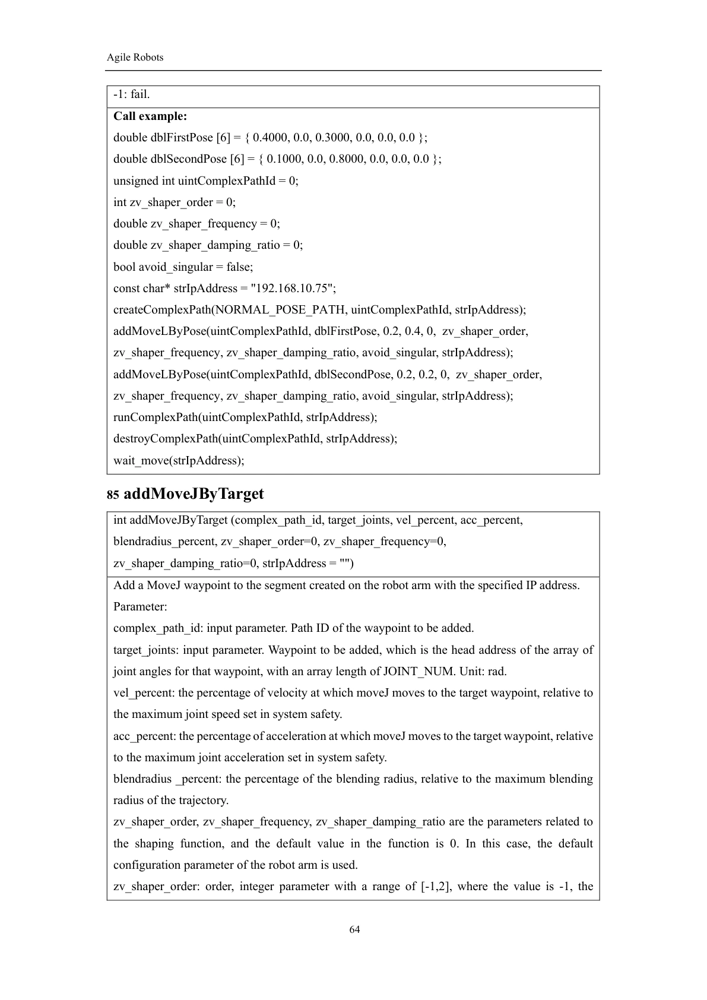



```
Agile Robots 
 64  
-1: fail.  
Call example:  
double dblFirstPose [6] = { 0.4000, 0.0, 0.3000, 0.0, 0.0, 0.0 }; 
double dblSecondPose [6] = { 0.1000, 0.0, 0.8000, 0.0, 0.0, 0.0 }; 
unsigned int uintComplexPathId = 0; 
int zv_shaper_order = 0; 
double zv_shaper_frequency = 0; 
double zv_shaper_damping_ratio = 0; 
bool avoid_singular = false; 
const char* strIpAddress = "192.168.10.75"; 
createComplexPath(NORMAL_POSE_PATH, uintComplexPathId, strIpAddress); 
addMoveLByPose(uintComplexPathId, dblFirstPose, 0.2, 0.4, 0,  zv_shaper_order, 
zv_shaper_frequency, zv_shaper_damping_ratio, avoid_singular, strIpAddress); 
addMoveLByPose(uintComplexPathId, dblSecondPose, 0.2, 0.2, 0,  zv_shaper_order, 
zv_shaper_frequency, zv_shaper_damping_ratio, avoid_singular, strIpAddress); 
runComplexPath(uintComplexPathId, strIpAddress); 
destroyComplexPath(uintComplexPathId, strIpAddress); 
wait_move(strIpAddress); 
85 addMoveJByTarget 
int addMoveJByTarget (complex_path_id, target_joints, vel_percent, acc_percent, 
blendradius_percent, zv_shaper_order=0, zv_shaper_frequency=0, 
zv_shaper_damping_ratio=0, strIpAddress = "") 
Add a MoveJ waypoint to the segment created on the robot arm with the specified IP address.  
Parameter:  
complex_path_id: input parameter. Path ID of the waypoint to be added.  
target_joints: input parameter. Waypoint to be added, which is the head address of the array of 
joint angles for that waypoint, with an array length of JOINT_NUM. Unit: rad.  
vel_percent: the percentage of velocity at which moveJ moves to the target waypoint, relative to 
the maximum joint speed set in system safety.  
acc_percent: the percentage of acceleration at which moveJ moves to the target waypoint, relative 
to the maximum joint acceleration set in system safety.  
blendradius _percent: the percentage of the blending radius, relative to the maximum blending 
radius of the trajectory.  
zv_shaper_order, zv_shaper_frequency, zv_shaper_damping_ratio are the parameters related to 
the shaping function, and the default value in the function is 0. In this case, the default 
configuration parameter of the robot arm is used.  
zv_shaper_order: order, integer parameter with a range of [-1,2], where the value is -1, the
```



## PDF page 74

**Source:** Industrial API Manual (C\&C++ Edition) \_V3.3.0\_EN\_20260605.pdf, original pdf page 74. [Open the corresponding PDF reading-copy page](https://1292444914-files.gitbook.io/~/files/v0/b/gitbook-x-prod.appspot.com/o/spaces%2FtgOfPnscWebs1eh82EKq%2Fuploads%2FWGm4W5tbOjT5mD2c1h1g%2Findustrial-api-manual-c-c-edition-v3-3-0-en-20260605-pp-001-150.pdf?alt=media#page=74).



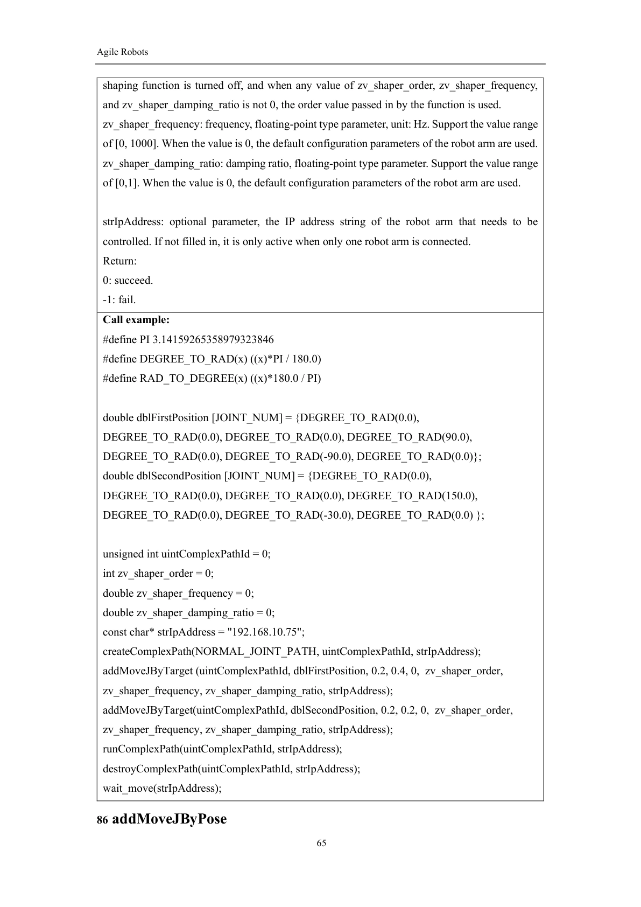



```
Agile Robots 
 65  
shaping function is turned off, and when any value of zv_shaper_order, zv_shaper_frequency, 
and zv_shaper_damping_ratio is not 0, the order value passed in by the function is used.  
zv_shaper_frequency: frequency, floating-point type parameter, unit: Hz. Support the value range 
of [0, 1000]. When the value is 0, the default configuration parameters of the robot arm are used.  
zv_shaper_damping_ratio: damping ratio, floating-point type parameter. Support the value range 
of [0,1]. When the value is 0, the default configuration parameters of the robot arm are used.  
 
strIpAddress: optional parameter, the IP address string of the robot arm that needs to be 
controlled. If not filled in, it is only active when only one robot arm is connected.  
Return:  
0: succeed.  
-1: fail.  
Call example:  
#define PI 3.14159265358979323846 
#define DEGREE_TO_RAD(x) ((x)*PI / 180.0)  
#define RAD_TO_DEGREE(x) ((x)*180.0 / PI) 
 
double dblFirstPosition [JOINT_NUM] = {DEGREE_TO_RAD(0.0), 
DEGREE_TO_RAD(0.0), DEGREE_TO_RAD(0.0), DEGREE_TO_RAD(90.0), 
DEGREE_TO_RAD(0.0), DEGREE_TO_RAD(-90.0), DEGREE_TO_RAD(0.0)}; 
double dblSecondPosition [JOINT_NUM] = {DEGREE_TO_RAD(0.0), 
DEGREE_TO_RAD(0.0), DEGREE_TO_RAD(0.0), DEGREE_TO_RAD(150.0), 
DEGREE_TO_RAD(0.0), DEGREE_TO_RAD(-30.0), DEGREE_TO_RAD(0.0) }; 
 
unsigned int uintComplexPathId = 0; 
int zv_shaper_order = 0; 
double zv_shaper_frequency = 0; 
double zv_shaper_damping_ratio = 0; 
const char* strIpAddress = "192.168.10.75"; 
createComplexPath(NORMAL_JOINT_PATH, uintComplexPathId, strIpAddress); 
addMoveJByTarget (uintComplexPathId, dblFirstPosition, 0.2, 0.4, 0,  zv_shaper_order, 
zv_shaper_frequency, zv_shaper_damping_ratio, strIpAddress); 
addMoveJByTarget(uintComplexPathId, dblSecondPosition, 0.2, 0.2, 0,  zv_shaper_order, 
zv_shaper_frequency, zv_shaper_damping_ratio, strIpAddress); 
runComplexPath(uintComplexPathId, strIpAddress); 
destroyComplexPath(uintComplexPathId, strIpAddress); 
wait_move(strIpAddress); 
86 addMoveJByPose
```



## PDF page 75

**Source:** Industrial API Manual (C\&C++ Edition) \_V3.3.0\_EN\_20260605.pdf, original pdf page 75. [Open the corresponding PDF reading-copy page](https://1292444914-files.gitbook.io/~/files/v0/b/gitbook-x-prod.appspot.com/o/spaces%2FtgOfPnscWebs1eh82EKq%2Fuploads%2FWGm4W5tbOjT5mD2c1h1g%2Findustrial-api-manual-c-c-edition-v3-3-0-en-20260605-pp-001-150.pdf?alt=media#page=75).



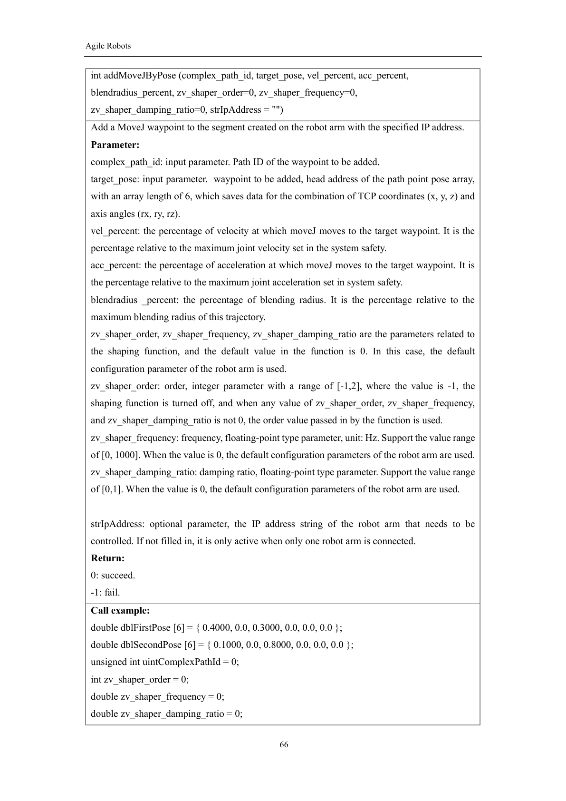



```
Agile Robots 
 66  
int addMoveJByPose (complex_path_id, target_pose, vel_percent, acc_percent, 
blendradius_percent, zv_shaper_order=0, zv_shaper_frequency=0, 
zv_shaper_damping_ratio=0, strIpAddress = "") 
Add a MoveJ waypoint to the segment created on the robot arm with the specified IP address.  
Parameter:  
complex_path_id: input parameter. Path ID of the waypoint to be added.  
target_pose: input parameter.  waypoint to be added, head address of the path point pose array, 
with an array length of 6, which saves data for the combination of TCP coordinates (x, y, z) and 
axis angles (rx, ry, rz).  
vel_percent: the percentage of velocity at which moveJ moves to the target waypoint. It is the 
percentage relative to the maximum joint velocity set in the system safety.  
acc_percent: the percentage of acceleration at which moveJ moves to the target waypoint. It is 
the percentage relative to the maximum joint acceleration set in system safety.  
blendradius _percent: the percentage of blending radius. It is the percentage relative to the 
maximum blending radius of this trajectory.  
zv_shaper_order, zv_shaper_frequency, zv_shaper_damping_ratio are the parameters related to 
the shaping function, and the default value in the function is 0. In this case, the default 
configuration parameter of the robot arm is used.  
zv_shaper_order: order, integer parameter with a range of [-1,2], where the value is -1, the 
shaping function is turned off, and when any value of zv_shaper_order, zv_shaper_frequency, 
and zv_shaper_damping_ratio is not 0, the order value passed in by the function is used.  
zv_shaper_frequency: frequency, floating-point type parameter, unit: Hz. Support the value range 
of [0, 1000]. When the value is 0, the default configuration parameters of the robot arm are used.  
zv_shaper_damping_ratio: damping ratio, floating-point type parameter. Support the value range 
of [0,1]. When the value is 0, the default configuration parameters of the robot arm are used.  
 
strIpAddress: optional parameter, the IP address string of the robot arm that needs to be 
controlled. If not filled in, it is only active when only one robot arm is connected.  
Return:  
0: succeed.  
-1: fail.  
Call example:  
double dblFirstPose [6] = { 0.4000, 0.0, 0.3000, 0.0, 0.0, 0.0 }; 
double dblSecondPose [6] = { 0.1000, 0.0, 0.8000, 0.0, 0.0, 0.0 }; 
unsigned int uintComplexPathId = 0; 
int zv_shaper_order = 0; 
double zv_shaper_frequency = 0; 
double zv_shaper_damping_ratio = 0;
```



## PDF page 76

**Source:** Industrial API Manual (C\&C++ Edition) \_V3.3.0\_EN\_20260605.pdf, original pdf page 76. [Open the corresponding PDF reading-copy page](https://1292444914-files.gitbook.io/~/files/v0/b/gitbook-x-prod.appspot.com/o/spaces%2FtgOfPnscWebs1eh82EKq%2Fuploads%2FWGm4W5tbOjT5mD2c1h1g%2Findustrial-api-manual-c-c-edition-v3-3-0-en-20260605-pp-001-150.pdf?alt=media#page=76).



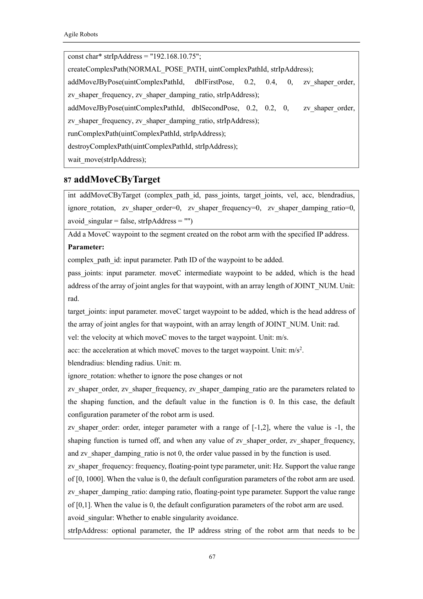



```
Agile Robots 
 67  
const char* strIpAddress = "192.168.10.75"; 
createComplexPath(NORMAL_POSE_PATH, uintComplexPathId, strIpAddress); 
addMoveJByPose(uintComplexPathId, 
dblFirstPose, 
0.2, 
0.4, 
0, 
zv_shaper_order, 
zv_shaper_frequency, zv_shaper_damping_ratio, strIpAddress); 
addMoveJByPose(uintComplexPathId, dblSecondPose, 0.2, 0.2, 0,  zv_shaper_order, 
zv_shaper_frequency, zv_shaper_damping_ratio, strIpAddress); 
runComplexPath(uintComplexPathId, strIpAddress); 
destroyComplexPath(uintComplexPathId, strIpAddress); 
wait_move(strIpAddress); 
87 addMoveCByTarget 
int addMoveCByTarget (complex_path_id, pass_joints, target_joints, vel, acc, blendradius, 
ignore_rotation, zv_shaper_order=0, zv_shaper_frequency=0, zv_shaper_damping_ratio=0, 
avoid_singular = false, strIpAddress = "") 
Add a MoveC waypoint to the segment created on the robot arm with the specified IP address.  
Parameter:  
complex_path_id: input parameter. Path ID of the waypoint to be added.  
pass_joints: input parameter. moveC intermediate waypoint to be added, which is the head 
address of the array of joint angles for that waypoint, with an array length of JOINT_NUM. Unit: 
rad.  
target_joints: input parameter. moveC target waypoint to be added, which is the head address of 
the array of joint angles for that waypoint, with an array length of JOINT_NUM. Unit: rad.  
vel: the velocity at which moveC moves to the target waypoint. Unit: m/s.  
acc: the acceleration at which moveC moves to the target waypoint. Unit: m/s2.  
blendradius: blending radius. Unit: m.  
ignore_rotation: whether to ignore the pose changes or not  
zv_shaper_order, zv_shaper_frequency, zv_shaper_damping_ratio are the parameters related to 
the shaping function, and the default value in the function is 0. In this case, the default 
configuration parameter of the robot arm is used.  
zv_shaper_order: order, integer parameter with a range of [-1,2], where the value is -1, the 
shaping function is turned off, and when any value of zv_shaper_order, zv_shaper_frequency, 
and zv_shaper_damping_ratio is not 0, the order value passed in by the function is used.  
zv_shaper_frequency: frequency, floating-point type parameter, unit: Hz. Support the value range 
of [0, 1000]. When the value is 0, the default configuration parameters of the robot arm are used.  
zv_shaper_damping_ratio: damping ratio, floating-point type parameter. Support the value range 
of [0,1]. When the value is 0, the default configuration parameters of the robot arm are used.  
avoid_singular: Whether to enable singularity avoidance. 
strIpAddress: optional parameter, the IP address string of the robot arm that needs to be
```



## PDF page 77

**Source:** Industrial API Manual (C\&C++ Edition) \_V3.3.0\_EN\_20260605.pdf, original pdf page 77. [Open the corresponding PDF reading-copy page](https://1292444914-files.gitbook.io/~/files/v0/b/gitbook-x-prod.appspot.com/o/spaces%2FtgOfPnscWebs1eh82EKq%2Fuploads%2FWGm4W5tbOjT5mD2c1h1g%2Findustrial-api-manual-c-c-edition-v3-3-0-en-20260605-pp-001-150.pdf?alt=media#page=77).



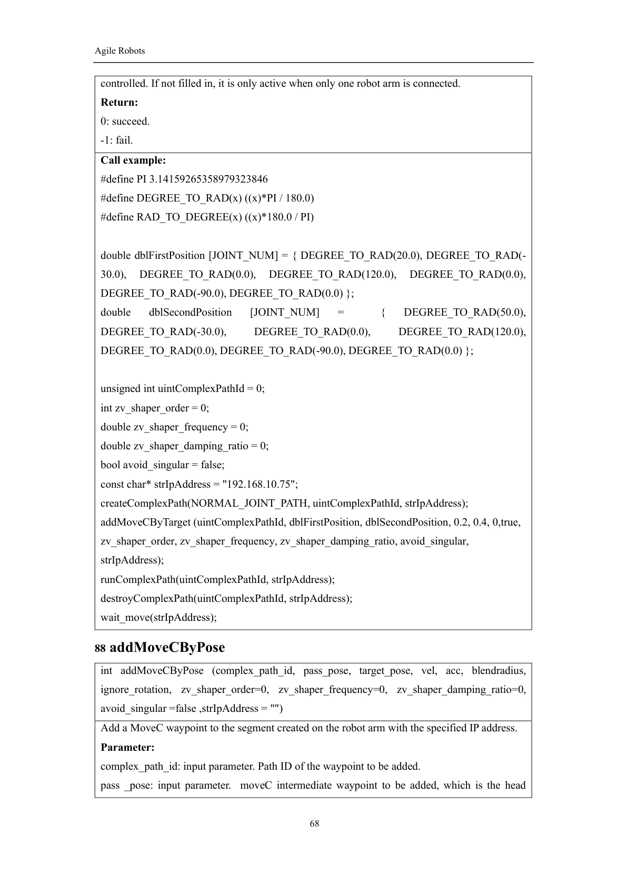



```
Agile Robots 
 68  
controlled. If not filled in, it is only active when only one robot arm is connected.  
Return:  
0: succeed.  
-1: fail.  
Call example:  
#define PI 3.14159265358979323846 
#define DEGREE_TO_RAD(x) ((x)*PI / 180.0)  
#define RAD_TO_DEGREE(x) ((x)*180.0 / PI) 
 
double dblFirstPosition [JOINT_NUM] = { DEGREE_TO_RAD(20.0), DEGREE_TO_RAD(-
30.0), 
DEGREE_TO_RAD(0.0), 
DEGREE_TO_RAD(120.0), 
DEGREE_TO_RAD(0.0), 
DEGREE_TO_RAD(-90.0), DEGREE_TO_RAD(0.0) }; 
double 
dblSecondPosition 
[JOINT_NUM] 
= 
 
{ 
DEGREE_TO_RAD(50.0), 
DEGREE_TO_RAD(-30.0), 
DEGREE_TO_RAD(0.0), 
DEGREE_TO_RAD(120.0), 
DEGREE_TO_RAD(0.0), DEGREE_TO_RAD(-90.0), DEGREE_TO_RAD(0.0) }; 
 
unsigned int uintComplexPathId = 0; 
int zv_shaper_order = 0; 
double zv_shaper_frequency = 0; 
double zv_shaper_damping_ratio = 0; 
bool avoid_singular = false; 
const char* strIpAddress = "192.168.10.75"; 
createComplexPath(NORMAL_JOINT_PATH, uintComplexPathId, strIpAddress); 
addMoveCByTarget (uintComplexPathId, dblFirstPosition, dblSecondPosition, 0.2, 0.4, 0,true,  
zv_shaper_order, zv_shaper_frequency, zv_shaper_damping_ratio, avoid_singular, 
strIpAddress); 
runComplexPath(uintComplexPathId, strIpAddress); 
destroyComplexPath(uintComplexPathId, strIpAddress); 
wait_move(strIpAddress); 
88 addMoveCByPose 
int addMoveCByPose (complex_path_id, pass_pose, target_pose, vel, acc, blendradius, 
ignore_rotation, zv_shaper_order=0, zv_shaper_frequency=0, zv_shaper_damping_ratio=0, 
avoid_singular =false ,strIpAddress = "") 
Add a MoveC waypoint to the segment created on the robot arm with the specified IP address.  
Parameter:  
complex_path_id: input parameter. Path ID of the waypoint to be added.  
pass _pose: input parameter.  moveC intermediate waypoint to be added, which is the head
```



## PDF page 78

**Source:** Industrial API Manual (C\&C++ Edition) \_V3.3.0\_EN\_20260605.pdf, original pdf page 78. [Open the corresponding PDF reading-copy page](https://1292444914-files.gitbook.io/~/files/v0/b/gitbook-x-prod.appspot.com/o/spaces%2FtgOfPnscWebs1eh82EKq%2Fuploads%2FWGm4W5tbOjT5mD2c1h1g%2Findustrial-api-manual-c-c-edition-v3-3-0-en-20260605-pp-001-150.pdf?alt=media#page=78).



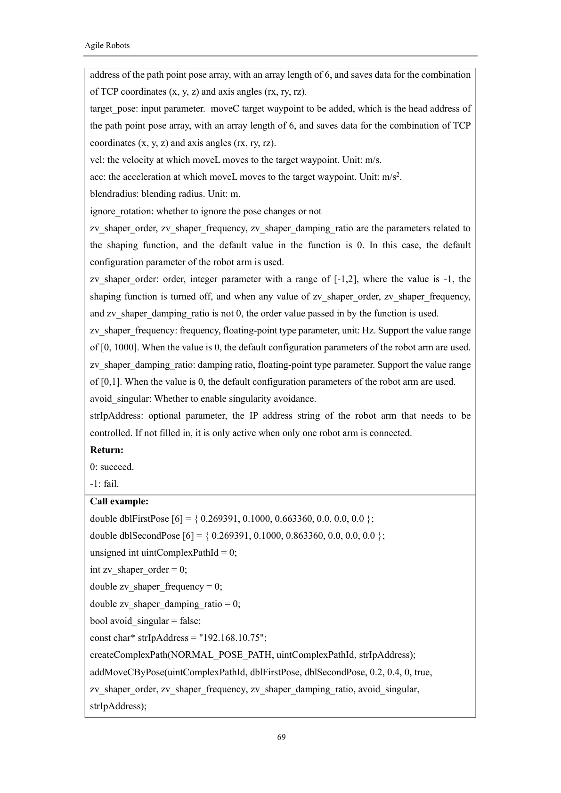



```
Agile Robots 
 69  
address of the path point pose array, with an array length of 6, and saves data for the combination 
of TCP coordinates (x, y, z) and axis angles (rx, ry, rz).  
target_pose: input parameter.  moveC target waypoint to be added, which is the head address of 
the path point pose array, with an array length of 6, and saves data for the combination of TCP 
coordinates (x, y, z) and axis angles (rx, ry, rz).  
vel: the velocity at which moveL moves to the target waypoint. Unit: m/s.  
acc: the acceleration at which moveL moves to the target waypoint. Unit: m/s2.  
blendradius: blending radius. Unit: m.  
ignore_rotation: whether to ignore the pose changes or not  
zv_shaper_order, zv_shaper_frequency, zv_shaper_damping_ratio are the parameters related to 
the shaping function, and the default value in the function is 0. In this case, the default 
configuration parameter of the robot arm is used.  
zv_shaper_order: order, integer parameter with a range of [-1,2], where the value is -1, the 
shaping function is turned off, and when any value of zv_shaper_order, zv_shaper_frequency, 
and zv_shaper_damping_ratio is not 0, the order value passed in by the function is used.  
zv_shaper_frequency: frequency, floating-point type parameter, unit: Hz. Support the value range 
of [0, 1000]. When the value is 0, the default configuration parameters of the robot arm are used.  
zv_shaper_damping_ratio: damping ratio, floating-point type parameter. Support the value range 
of [0,1]. When the value is 0, the default configuration parameters of the robot arm are used.  
avoid_singular: Whether to enable singularity avoidance. 
strIpAddress: optional parameter, the IP address string of the robot arm that needs to be 
controlled. If not filled in, it is only active when only one robot arm is connected.  
Return:  
0: succeed.  
-1: fail.  
Call example:  
double dblFirstPose [6] = { 0.269391, 0.1000, 0.663360, 0.0, 0.0, 0.0 }; 
double dblSecondPose [6] = { 0.269391, 0.1000, 0.863360, 0.0, 0.0, 0.0 }; 
unsigned int uintComplexPathId = 0; 
int zv_shaper_order = 0; 
double zv_shaper_frequency = 0; 
double zv_shaper_damping_ratio = 0; 
bool avoid_singular = false; 
const char* strIpAddress = "192.168.10.75"; 
createComplexPath(NORMAL_POSE_PATH, uintComplexPathId, strIpAddress); 
addMoveCByPose(uintComplexPathId, dblFirstPose, dblSecondPose, 0.2, 0.4, 0, true,  
zv_shaper_order, zv_shaper_frequency, zv_shaper_damping_ratio, avoid_singular, 
strIpAddress);
```



## PDF page 79

**Source:** Industrial API Manual (C\&C++ Edition) \_V3.3.0\_EN\_20260605.pdf, original pdf page 79. [Open the corresponding PDF reading-copy page](https://1292444914-files.gitbook.io/~/files/v0/b/gitbook-x-prod.appspot.com/o/spaces%2FtgOfPnscWebs1eh82EKq%2Fuploads%2FWGm4W5tbOjT5mD2c1h1g%2Findustrial-api-manual-c-c-edition-v3-3-0-en-20260605-pp-001-150.pdf?alt=media#page=79).



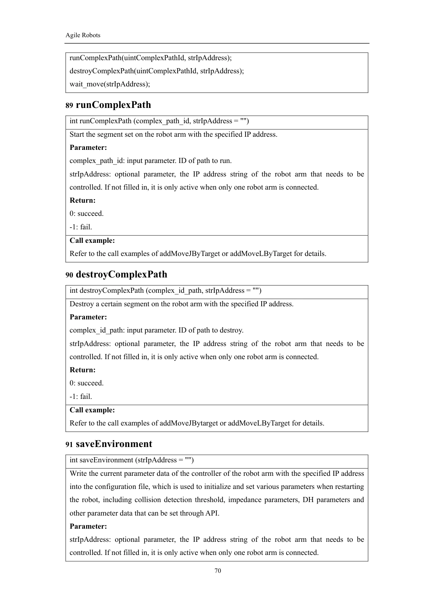



```
Agile Robots 
 70  
runComplexPath(uintComplexPathId, strIpAddress); 
destroyComplexPath(uintComplexPathId, strIpAddress); 
wait_move(strIpAddress); 
89 runComplexPath 
int runComplexPath (complex_path_id, strIpAddress = "") 
Start the segment set on the robot arm with the specified IP address.  
Parameter:  
complex_path_id: input parameter. ID of path to run.  
strIpAddress: optional parameter, the IP address string of the robot arm that needs to be 
controlled. If not filled in, it is only active when only one robot arm is connected.  
Return:  
0: succeed.  
-1: fail.  
Call example:  
Refer to the call examples of addMoveJByTarget or addMoveLByTarget for details.  
90 destroyComplexPath 
int destroyComplexPath (complex_id_path, strIpAddress = "") 
Destroy a certain segment on the robot arm with the specified IP address.  
Parameter:  
complex_id_path: input parameter. ID of path to destroy.  
strIpAddress: optional parameter, the IP address string of the robot arm that needs to be 
controlled. If not filled in, it is only active when only one robot arm is connected.  
Return:  
0: succeed.  
-1: fail.  
Call example:  
Refer to the call examples of addMoveJBytarget or addMoveLByTarget for details.  
91 saveEnvironment 
int saveEnvironment (strIpAddress = "") 
Write the current parameter data of the controller of the robot arm with the specified IP address 
into the configuration file, which is used to initialize and set various parameters when restarting 
the robot, including collision detection threshold, impedance parameters, DH parameters and 
other parameter data that can be set through API.  
Parameter:  
strIpAddress: optional parameter, the IP address string of the robot arm that needs to be 
controlled. If not filled in, it is only active when only one robot arm is connected.
```



## PDF page 80

**Source:** Industrial API Manual (C\&C++ Edition) \_V3.3.0\_EN\_20260605.pdf, original pdf page 80. [Open the corresponding PDF reading-copy page](https://1292444914-files.gitbook.io/~/files/v0/b/gitbook-x-prod.appspot.com/o/spaces%2FtgOfPnscWebs1eh82EKq%2Fuploads%2FWGm4W5tbOjT5mD2c1h1g%2Findustrial-api-manual-c-c-edition-v3-3-0-en-20260605-pp-001-150.pdf?alt=media#page=80).



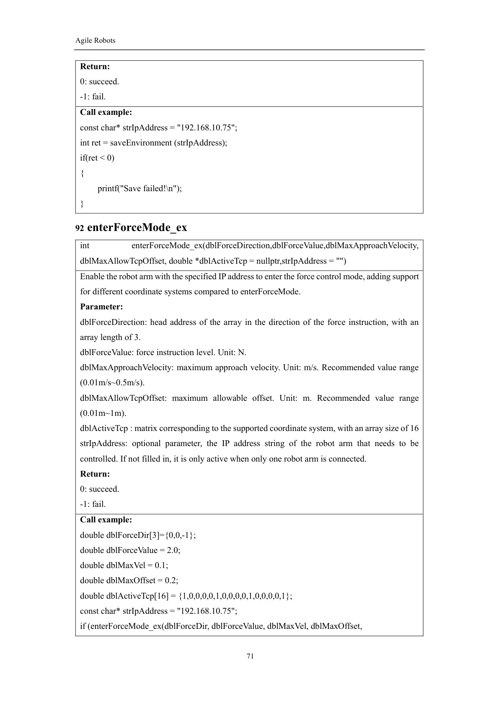



```
Agile Robots 
 71  
Return:  
0: succeed.  
-1: fail.  
Call example:  
const char* strIpAddress = "192.168.10.75"; 
int ret = saveEnvironment (strIpAddress); 
if(ret < 0) 
{ 
printf("Save failed!\n"); 
} 
92 enterForceMode_ex 
int 
enterForceMode_ex(dblForceDirection,dblForceValue,dblMaxApproachVelocity, 
dblMaxAllowTcpOffset, double *dblActiveTcp = nullptr,strIpAddress = "") 
Enable the robot arm with the specified IP address to enter the force control mode, adding support 
for different coordinate systems compared to enterForceMode.  
Parameter:  
dblForceDirection: head address of the array in the direction of the force instruction, with an 
array length of 3.  
dblForceValue: force instruction level. Unit: N.  
dblMaxApproachVelocity: maximum approach velocity. Unit: m/s. Recommended value range 
(0.01m/s~0.5m/s).  
dblMaxAllowTcpOffset: maximum allowable offset. Unit: m. Recommended value range 
(0.01m~1m).  
dblActiveTcp : matrix corresponding to the supported coordinate system, with an array size of 16  
strIpAddress: optional parameter, the IP address string of the robot arm that needs to be 
controlled. If not filled in, it is only active when only one robot arm is connected.  
Return:  
0: succeed.  
-1: fail.  
Call example:  
double dblForceDir[3]={0,0,-1}; 
double dblForceValue = 2.0; 
double dblMaxVel = 0.1; 
double dblMaxOffset = 0.2; 
double dblActiveTcp[16] = {1,0,0,0,0,1,0,0,0,0,1,0,0,0,0,1}; 
const char* strIpAddress = "192.168.10.75"; 
if (enterForceMode_ex(dblForceDir, dblForceValue, dblMaxVel, dblMaxOffset,
```



## PDF page 81

**Source:** Industrial API Manual (C\&C++ Edition) \_V3.3.0\_EN\_20260605.pdf, original pdf page 81. [Open the corresponding PDF reading-copy page](https://1292444914-files.gitbook.io/~/files/v0/b/gitbook-x-prod.appspot.com/o/spaces%2FtgOfPnscWebs1eh82EKq%2Fuploads%2FWGm4W5tbOjT5mD2c1h1g%2Findustrial-api-manual-c-c-edition-v3-3-0-en-20260605-pp-001-150.pdf?alt=media#page=81).



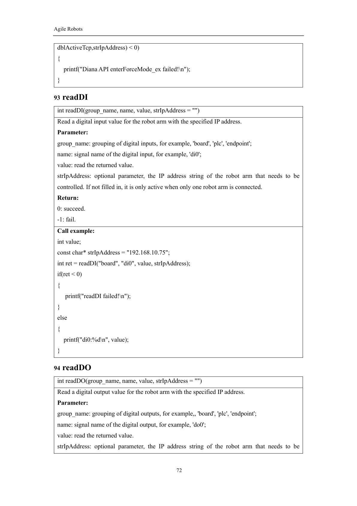



```
Agile Robots 
 72  
dblActiveTcp,strIpAddress) < 0) 
{ 
    printf("Diana API enterForceMode_ex failed!\n"); 
} 
93 readDI 
int readDI(group_name, name, value, strIpAddress = "") 
Read a digital input value for the robot arm with the specified IP address.  
Parameter:  
group_name: grouping of digital inputs, for example, 'board', 'plc', 'endpoint';  
name: signal name of the digital input, for example, 'di0';  
value: read the returned value.  
strIpAddress: optional parameter, the IP address string of the robot arm that needs to be 
controlled. If not filled in, it is only active when only one robot arm is connected.  
Return:  
0: succeed.  
-1: fail.  
Call example:  
int value; 
const char* strIpAddress = "192.168.10.75"; 
int ret = readDI("board", "di0", value, strIpAddress); 
if(ret < 0) 
{ 
 printf("readDI failed!\n"); 
} 
else 
{ 
    printf("di0:%d\n", value); 
} 
94 readDO 
int readDO(group_name, name, value, strIpAddress = "") 
Read a digital output value for the robot arm with the specified IP address.  
Parameter:  
group_name: grouping of digital outputs, for example,, 'board', 'plc', 'endpoint';  
name: signal name of the digital output, for example, 'do0';  
value: read the returned value.  
strIpAddress: optional parameter, the IP address string of the robot arm that needs to be
```



## PDF page 82

**Source:** Industrial API Manual (C\&C++ Edition) \_V3.3.0\_EN\_20260605.pdf, original pdf page 82. [Open the corresponding PDF reading-copy page](https://1292444914-files.gitbook.io/~/files/v0/b/gitbook-x-prod.appspot.com/o/spaces%2FtgOfPnscWebs1eh82EKq%2Fuploads%2FWGm4W5tbOjT5mD2c1h1g%2Findustrial-api-manual-c-c-edition-v3-3-0-en-20260605-pp-001-150.pdf?alt=media#page=82).



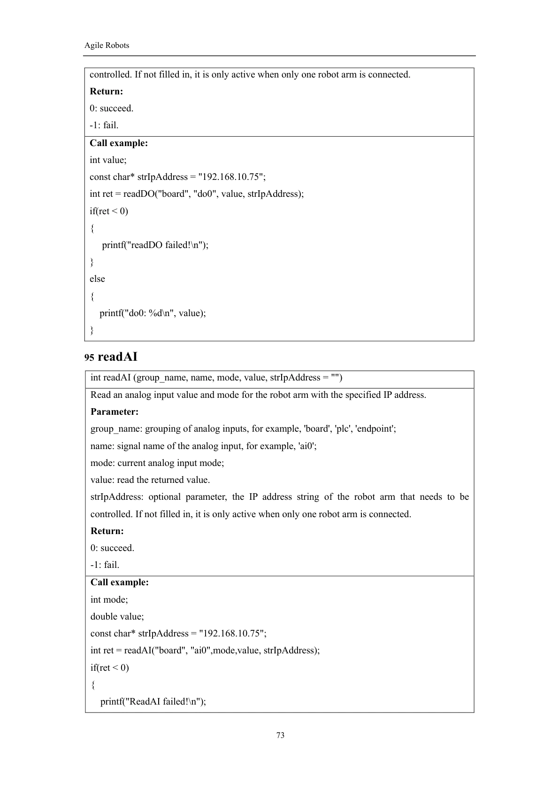



```
Agile Robots 
 73  
controlled. If not filled in, it is only active when only one robot arm is connected.  
Return:  
0: succeed.  
-1: fail.  
Call example:  
int value; 
const char* strIpAddress = "192.168.10.75"; 
int ret = readDO("board", "do0", value, strIpAddress); 
if(ret < 0) 
{ 
 printf("readDO failed!\n"); 
} 
else 
{ 
printf("do0: %d\n", value); 
} 
95 readAI 
int readAI (group_name, name, mode, value, strIpAddress = "") 
Read an analog input value and mode for the robot arm with the specified IP address.  
Parameter:  
group_name: grouping of analog inputs, for example, 'board', 'plc', 'endpoint';  
name: signal name of the analog input, for example, 'ai0';  
mode: current analog input mode;  
value: read the returned value.  
strIpAddress: optional parameter, the IP address string of the robot arm that needs to be 
controlled. If not filled in, it is only active when only one robot arm is connected.  
Return:  
0: succeed.  
-1: fail.  
Call example:  
int mode; 
double value; 
const char* strIpAddress = "192.168.10.75"; 
int ret = readAI("board", "ai0",mode,value, strIpAddress); 
if(ret < 0) 
{ 
    printf("ReadAI failed!\n");
```



## PDF page 83

**Source:** Industrial API Manual (C\&C++ Edition) \_V3.3.0\_EN\_20260605.pdf, original pdf page 83. [Open the corresponding PDF reading-copy page](https://1292444914-files.gitbook.io/~/files/v0/b/gitbook-x-prod.appspot.com/o/spaces%2FtgOfPnscWebs1eh82EKq%2Fuploads%2FWGm4W5tbOjT5mD2c1h1g%2Findustrial-api-manual-c-c-edition-v3-3-0-en-20260605-pp-001-150.pdf?alt=media#page=83).



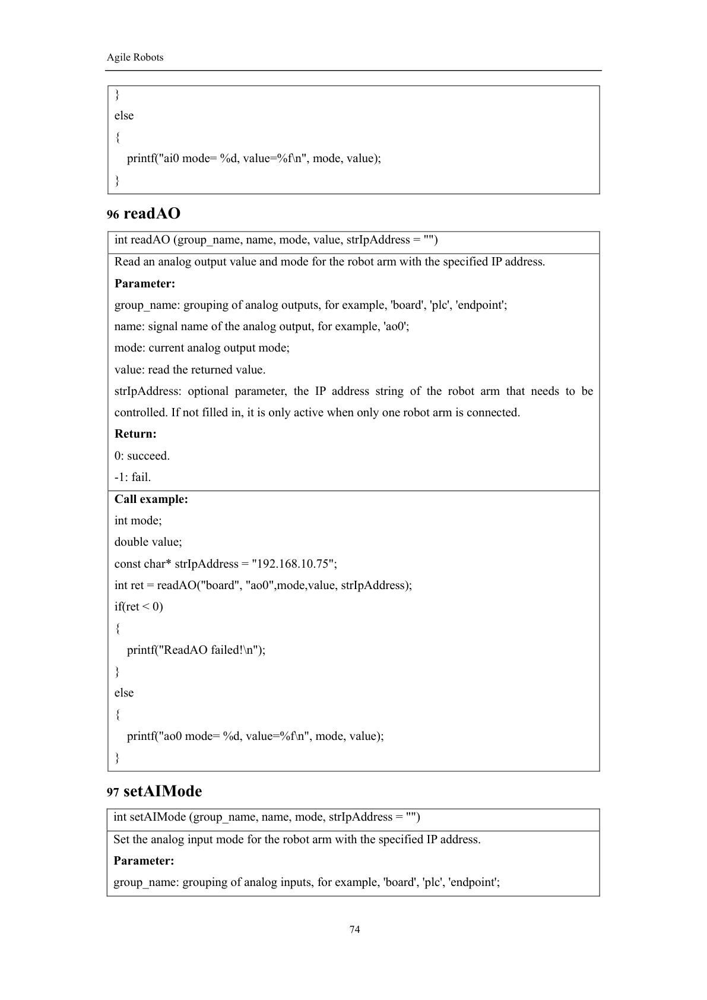



```
Agile Robots 
 74  
} 
else 
{ 
    printf("ai0 mode= %d, value=%f\n", mode, value); 
} 
96 readAO 
int readAO (group_name, name, mode, value, strIpAddress = "") 
Read an analog output value and mode for the robot arm with the specified IP address.  
Parameter:  
group_name: grouping of analog outputs, for example, 'board', 'plc', 'endpoint';  
name: signal name of the analog output, for example, 'ao0';  
mode: current analog output mode;  
value: read the returned value.  
strIpAddress: optional parameter, the IP address string of the robot arm that needs to be 
controlled. If not filled in, it is only active when only one robot arm is connected.  
Return:  
0: succeed.  
-1: fail.  
Call example:  
int mode; 
double value; 
const char* strIpAddress = "192.168.10.75"; 
int ret = readAO("board", "ao0",mode,value, strIpAddress); 
if(ret < 0) 
{ 
    printf("ReadAO failed!\n"); 
} 
else 
{ 
    printf("ao0 mode= %d, value=%f\n", mode, value); 
} 
97 setAIMode 
int setAIMode (group_name, name, mode, strIpAddress = "") 
Set the analog input mode for the robot arm with the specified IP address.  
Parameter:  
group_name: grouping of analog inputs, for example, 'board', 'plc', 'endpoint';
```



## PDF page 84

**Source:** Industrial API Manual (C\&C++ Edition) \_V3.3.0\_EN\_20260605.pdf, original pdf page 84. [Open the corresponding PDF reading-copy page](https://1292444914-files.gitbook.io/~/files/v0/b/gitbook-x-prod.appspot.com/o/spaces%2FtgOfPnscWebs1eh82EKq%2Fuploads%2FWGm4W5tbOjT5mD2c1h1g%2Findustrial-api-manual-c-c-edition-v3-3-0-en-20260605-pp-001-150.pdf?alt=media#page=84).



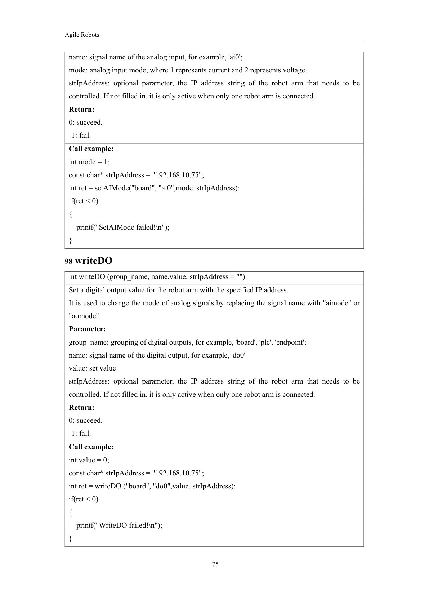



```
Agile Robots 
 75  
name: signal name of the analog input, for example, 'ai0';  
mode: analog input mode, where 1 represents current and 2 represents voltage.  
strIpAddress: optional parameter, the IP address string of the robot arm that needs to be 
controlled. If not filled in, it is only active when only one robot arm is connected.  
Return:  
0: succeed.  
-1: fail.  
Call example:  
int mode = 1; 
const char* strIpAddress = "192.168.10.75"; 
int ret = setAIMode("board", "ai0",mode, strIpAddress); 
if(ret < 0) 
{ 
    printf("SetAIMode failed!\n"); 
} 
98 writeDO 
int writeDO (group_name, name,value, strIpAddress = "") 
Set a digital output value for the robot arm with the specified IP address.  
It is used to change the mode of analog signals by replacing the signal name with "aimode" or 
"aomode".  
Parameter:  
group_name: grouping of digital outputs, for example, 'board', 'plc', 'endpoint';  
name: signal name of the digital output, for example, 'do0'  
value: set value 
strIpAddress: optional parameter, the IP address string of the robot arm that needs to be 
controlled. If not filled in, it is only active when only one robot arm is connected.  
Return:  
0: succeed.  
-1: fail.  
Call example:  
int value = 0; 
const char* strIpAddress = "192.168.10.75"; 
int ret = writeDO ("board", "do0",value, strIpAddress); 
if(ret < 0) 
{ 
    printf("WriteDO failed!\n"); 
}
```



## PDF page 85

**Source:** Industrial API Manual (C\&C++ Edition) \_V3.3.0\_EN\_20260605.pdf, original pdf page 85. [Open the corresponding PDF reading-copy page](https://1292444914-files.gitbook.io/~/files/v0/b/gitbook-x-prod.appspot.com/o/spaces%2FtgOfPnscWebs1eh82EKq%2Fuploads%2FWGm4W5tbOjT5mD2c1h1g%2Findustrial-api-manual-c-c-edition-v3-3-0-en-20260605-pp-001-150.pdf?alt=media#page=85).



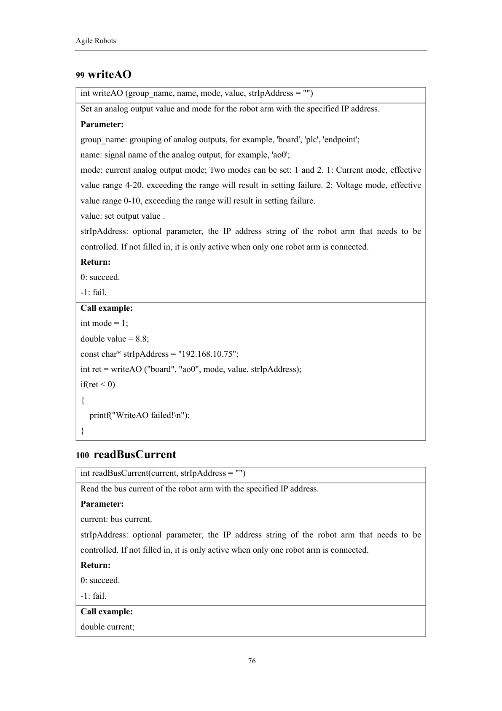



```
Agile Robots 
 76  
99 writeAO  
int writeAO (group_name, name, mode, value, strIpAddress = "") 
Set an analog output value and mode for the robot arm with the specified IP address.  
Parameter:  
group_name: grouping of analog outputs, for example, 'board', 'plc', 'endpoint';  
name: signal name of the analog output, for example, 'ao0';  
mode: current analog output mode; Two modes can be set: 1 and 2. 1: Current mode, effective 
value range 4-20, exceeding the range will result in setting failure. 2: Voltage mode, effective 
value range 0-10, exceeding the range will result in setting failure. 
value: set output value .  
strIpAddress: optional parameter, the IP address string of the robot arm that needs to be 
controlled. If not filled in, it is only active when only one robot arm is connected.  
Return:  
0: succeed.  
-1: fail.  
Call example:  
int mode = 1; 
double value = 8.8; 
const char* strIpAddress = "192.168.10.75"; 
int ret = writeAO ("board", "ao0", mode, value, strIpAddress); 
if(ret < 0) 
{ 
    printf("WriteAO failed!\n"); 
} 
100 readBusCurrent 
int readBusCurrent(current, strIpAddress = "") 
Read the bus current of the robot arm with the specified IP address.  
Parameter:  
current: bus current.  
strIpAddress: optional parameter, the IP address string of the robot arm that needs to be 
controlled. If not filled in, it is only active when only one robot arm is connected.  
Return:  
0: succeed.  
-1: fail.  
Call example:  
double current;
```



## PDF page 86

**Source:** Industrial API Manual (C\&C++ Edition) \_V3.3.0\_EN\_20260605.pdf, original pdf page 86. [Open the corresponding PDF reading-copy page](https://1292444914-files.gitbook.io/~/files/v0/b/gitbook-x-prod.appspot.com/o/spaces%2FtgOfPnscWebs1eh82EKq%2Fuploads%2FWGm4W5tbOjT5mD2c1h1g%2Findustrial-api-manual-c-c-edition-v3-3-0-en-20260605-pp-001-150.pdf?alt=media#page=86).



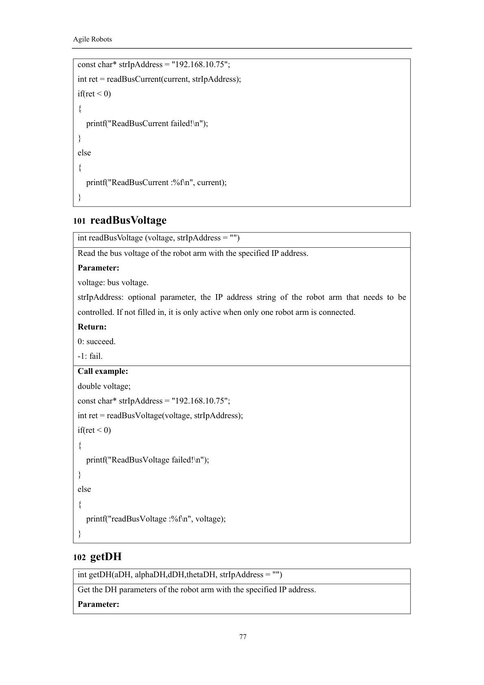



```
Agile Robots 
 77  
const char* strIpAddress = "192.168.10.75"; 
int ret = readBusCurrent(current, strIpAddress); 
if(ret < 0) 
{ 
    printf("ReadBusCurrent failed!\n"); 
} 
else 
{ 
    printf("ReadBusCurrent :%f\n", current); 
} 
101 readBusVoltage 
int readBusVoltage (voltage, strIpAddress = "") 
Read the bus voltage of the robot arm with the specified IP address.  
Parameter:  
voltage: bus voltage.  
strIpAddress: optional parameter, the IP address string of the robot arm that needs to be 
controlled. If not filled in, it is only active when only one robot arm is connected.  
Return:  
0: succeed.  
-1: fail.  
Call example:  
double voltage; 
const char* strIpAddress = "192.168.10.75"; 
int ret = readBusVoltage(voltage, strIpAddress); 
if(ret < 0) 
{ 
    printf("ReadBusVoltage failed!\n"); 
} 
else 
{ 
    printf("readBusVoltage :%f\n", voltage); 
} 
102 getDH 
int getDH(aDH, alphaDH,dDH,thetaDH, strIpAddress = "") 
Get the DH parameters of the robot arm with the specified IP address.  
Parameter:
```



## PDF page 87

**Source:** Industrial API Manual (C\&C++ Edition) \_V3.3.0\_EN\_20260605.pdf, original pdf page 87. [Open the corresponding PDF reading-copy page](https://1292444914-files.gitbook.io/~/files/v0/b/gitbook-x-prod.appspot.com/o/spaces%2FtgOfPnscWebs1eh82EKq%2Fuploads%2FWGm4W5tbOjT5mD2c1h1g%2Findustrial-api-manual-c-c-edition-v3-3-0-en-20260605-pp-001-150.pdf?alt=media#page=87).



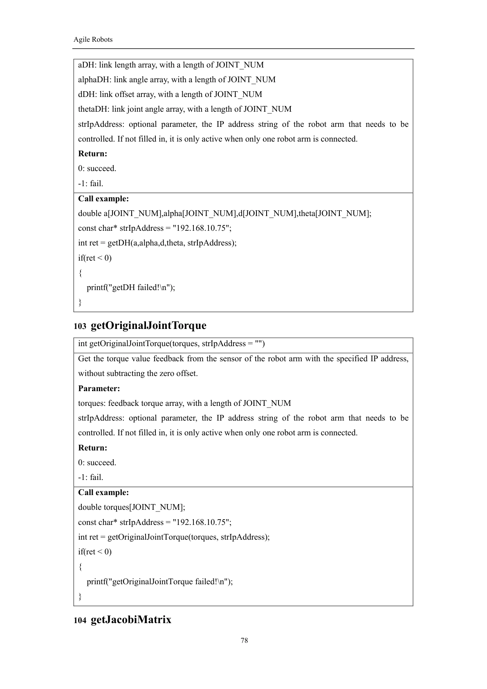



```
Agile Robots 
 78  
aDH: link length array, with a length of JOINT_NUM  
alphaDH: link angle array, with a length of JOINT_NUM  
dDH: link offset array, with a length of JOINT_NUM  
thetaDH: link joint angle array, with a length of JOINT_NUM  
strIpAddress: optional parameter, the IP address string of the robot arm that needs to be 
controlled. If not filled in, it is only active when only one robot arm is connected.  
Return:  
0: succeed.  
-1: fail.  
Call example:  
double a[JOINT_NUM],alpha[JOINT_NUM],d[JOINT_NUM],theta[JOINT_NUM]; 
const char* strIpAddress = "192.168.10.75"; 
int ret = getDH(a,alpha,d,theta, strIpAddress); 
if(ret < 0) 
{ 
    printf("getDH failed!\n"); 
} 
103 getOriginalJointTorque 
int getOriginalJointTorque(torques, strIpAddress = "") 
Get the torque value feedback from the sensor of the robot arm with the specified IP address, 
without subtracting the zero offset.  
Parameter:  
torques: feedback torque array, with a length of JOINT_NUM  
strIpAddress: optional parameter, the IP address string of the robot arm that needs to be 
controlled. If not filled in, it is only active when only one robot arm is connected.  
Return:  
0: succeed.  
-1: fail.  
Call example:  
double torques[JOINT_NUM]; 
const char* strIpAddress = "192.168.10.75"; 
int ret = getOriginalJointTorque(torques, strIpAddress); 
if(ret < 0) 
{ 
    printf("getOriginalJointTorque failed!\n"); 
} 
104 getJacobiMatrix
```



## PDF page 88

**Source:** Industrial API Manual (C\&C++ Edition) \_V3.3.0\_EN\_20260605.pdf, original pdf page 88. [Open the corresponding PDF reading-copy page](https://1292444914-files.gitbook.io/~/files/v0/b/gitbook-x-prod.appspot.com/o/spaces%2FtgOfPnscWebs1eh82EKq%2Fuploads%2FWGm4W5tbOjT5mD2c1h1g%2Findustrial-api-manual-c-c-edition-v3-3-0-en-20260605-pp-001-150.pdf?alt=media#page=88).



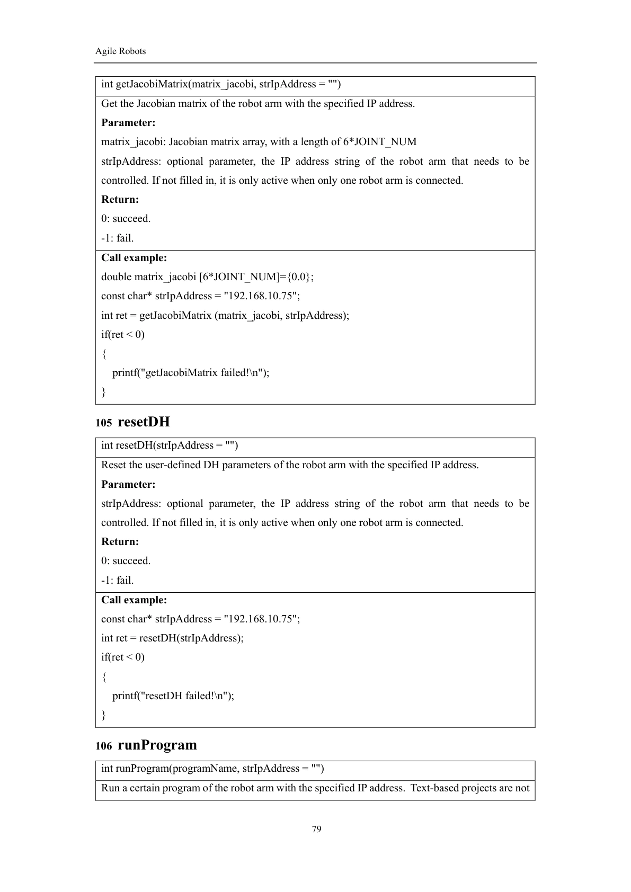



```
Agile Robots 
 79  
int getJacobiMatrix(matrix_jacobi, strIpAddress = "") 
Get the Jacobian matrix of the robot arm with the specified IP address.  
Parameter:  
matrix_jacobi: Jacobian matrix array, with a length of 6*JOINT_NUM  
strIpAddress: optional parameter, the IP address string of the robot arm that needs to be 
controlled. If not filled in, it is only active when only one robot arm is connected.  
Return:  
0: succeed.  
-1: fail.  
Call example:  
double matrix_jacobi [6*JOINT_NUM]={0.0}; 
const char* strIpAddress = "192.168.10.75"; 
int ret = getJacobiMatrix (matrix_jacobi, strIpAddress); 
if(ret < 0) 
{ 
    printf("getJacobiMatrix failed!\n"); 
} 
105 resetDH 
int resetDH(strIpAddress = "") 
Reset the user-defined DH parameters of the robot arm with the specified IP address.  
Parameter:  
strIpAddress: optional parameter, the IP address string of the robot arm that needs to be 
controlled. If not filled in, it is only active when only one robot arm is connected.  
Return:  
0: succeed.  
-1: fail.  
Call example:  
const char* strIpAddress = "192.168.10.75"; 
int ret = resetDH(strIpAddress); 
if(ret < 0) 
{ 
    printf("resetDH failed!\n"); 
} 
106 runProgram 
int runProgram(programName, strIpAddress = "") 
Run a certain program of the robot arm with the specified IP address.  Text-based projects are not
```



## PDF page 89

**Source:** Industrial API Manual (C\&C++ Edition) \_V3.3.0\_EN\_20260605.pdf, original pdf page 89. [Open the corresponding PDF reading-copy page](https://1292444914-files.gitbook.io/~/files/v0/b/gitbook-x-prod.appspot.com/o/spaces%2FtgOfPnscWebs1eh82EKq%2Fuploads%2FWGm4W5tbOjT5mD2c1h1g%2Findustrial-api-manual-c-c-edition-v3-3-0-en-20260605-pp-001-150.pdf?alt=media#page=89).



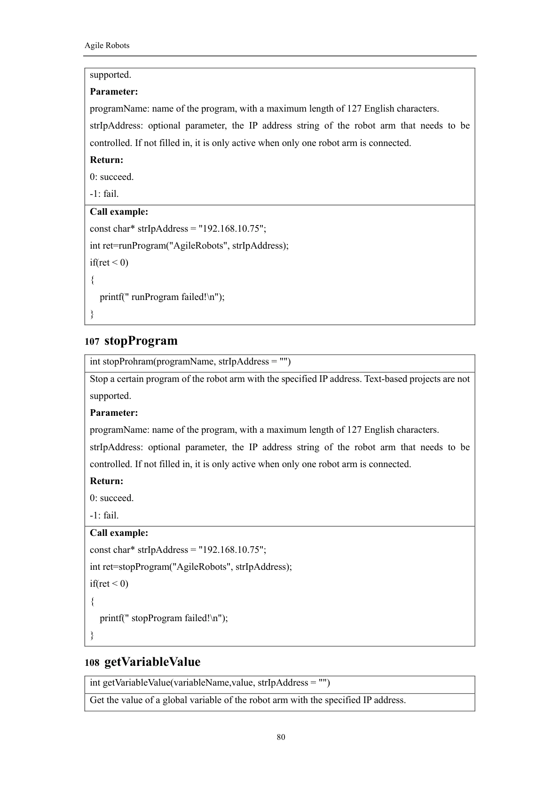



```
Agile Robots 
 80  
supported. 
Parameter:  
programName: name of the program, with a maximum length of 127 English characters.  
strIpAddress: optional parameter, the IP address string of the robot arm that needs to be 
controlled. If not filled in, it is only active when only one robot arm is connected.  
Return:  
0: succeed.  
-1: fail.  
Call example:  
const char* strIpAddress = "192.168.10.75"; 
int ret=runProgram("AgileRobots", strIpAddress); 
if(ret < 0) 
{ 
    printf(" runProgram failed!\n"); 
} 
107 stopProgram 
int stopProhram(programName, strIpAddress = "") 
Stop a certain program of the robot arm with the specified IP address. Text-based projects are not 
supported. 
Parameter:  
programName: name of the program, with a maximum length of 127 English characters.  
strIpAddress: optional parameter, the IP address string of the robot arm that needs to be 
controlled. If not filled in, it is only active when only one robot arm is connected.  
Return:  
0: succeed.  
-1: fail.  
Call example:  
const char* strIpAddress = "192.168.10.75"; 
int ret=stopProgram("AgileRobots", strIpAddress); 
if(ret < 0) 
{ 
    printf(" stopProgram failed!\n"); 
} 
108 getVariableValue 
int getVariableValue(variableName,value, strIpAddress = "") 
Get the value of a global variable of the robot arm with the specified IP address.
```



## PDF page 90

**Source:** Industrial API Manual (C\&C++ Edition) \_V3.3.0\_EN\_20260605.pdf, original pdf page 90. [Open the corresponding PDF reading-copy page](https://1292444914-files.gitbook.io/~/files/v0/b/gitbook-x-prod.appspot.com/o/spaces%2FtgOfPnscWebs1eh82EKq%2Fuploads%2FWGm4W5tbOjT5mD2c1h1g%2Findustrial-api-manual-c-c-edition-v3-3-0-en-20260605-pp-001-150.pdf?alt=media#page=90).



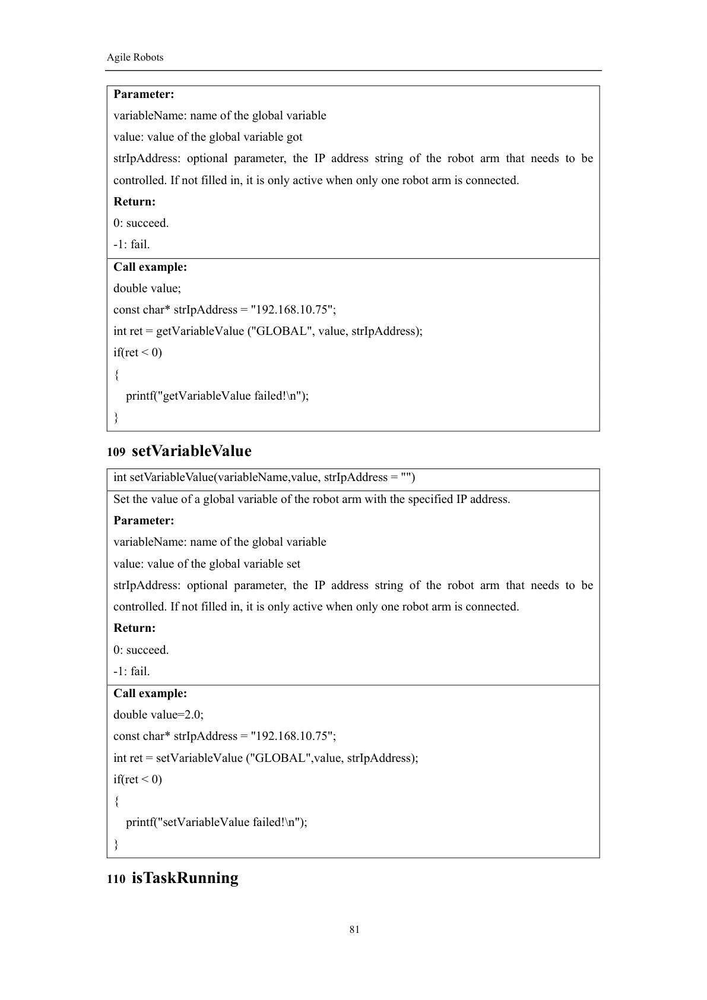



```
Agile Robots 
 81  
Parameter:  
variableName: name of the global variable  
value: value of the global variable got  
strIpAddress: optional parameter, the IP address string of the robot arm that needs to be 
controlled. If not filled in, it is only active when only one robot arm is connected.  
Return:  
0: succeed.  
-1: fail.  
Call example:  
double value; 
const char* strIpAddress = "192.168.10.75"; 
int ret = getVariableValue ("GLOBAL", value, strIpAddress); 
if(ret < 0) 
{ 
    printf("getVariableValue failed!\n"); 
} 
109 setVariableValue  
int setVariableValue(variableName,value, strIpAddress = "")  
Set the value of a global variable of the robot arm with the specified IP address.  
Parameter:  
variableName: name of the global variable  
value: value of the global variable set  
strIpAddress: optional parameter, the IP address string of the robot arm that needs to be 
controlled. If not filled in, it is only active when only one robot arm is connected.  
Return:  
0: succeed.  
-1: fail.  
Call example:  
double value=2.0; 
const char* strIpAddress = "192.168.10.75"; 
int ret = setVariableValue ("GLOBAL",value, strIpAddress); 
if(ret < 0) 
{ 
    printf("setVariableValue failed!\n"); 
} 
110 isTaskRunning
```



## PDF page 91

**Source:** Industrial API Manual (C\&C++ Edition) \_V3.3.0\_EN\_20260605.pdf, original pdf page 91. [Open the corresponding PDF reading-copy page](https://1292444914-files.gitbook.io/~/files/v0/b/gitbook-x-prod.appspot.com/o/spaces%2FtgOfPnscWebs1eh82EKq%2Fuploads%2FWGm4W5tbOjT5mD2c1h1g%2Findustrial-api-manual-c-c-edition-v3-3-0-en-20260605-pp-001-150.pdf?alt=media#page=91).



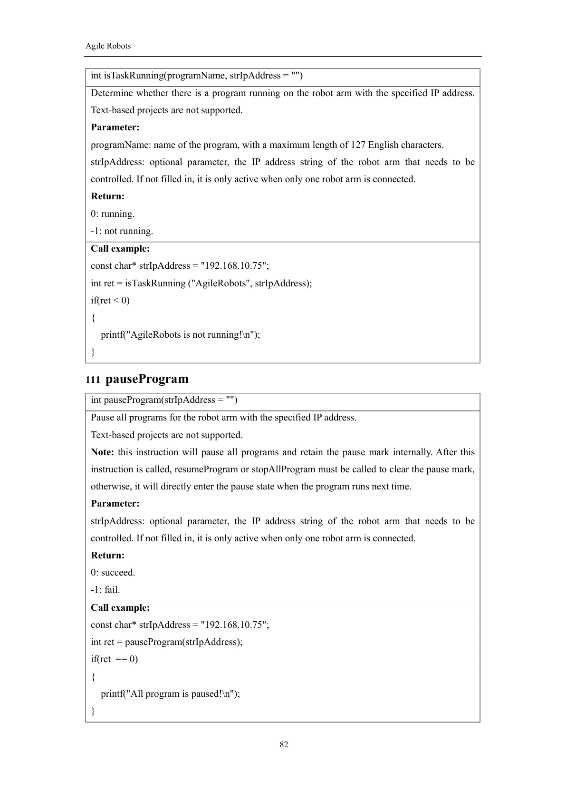



```
Agile Robots 
 82  
int isTaskRunning(programName, strIpAddress = "") 
Determine whether there is a program running on the robot arm with the specified IP address. 
Text-based projects are not supported. 
Parameter:  
programName: name of the program, with a maximum length of 127 English characters.  
strIpAddress: optional parameter, the IP address string of the robot arm that needs to be 
controlled. If not filled in, it is only active when only one robot arm is connected.  
Return:  
0: running.  
-1: not running.  
Call example:  
const char* strIpAddress = "192.168.10.75"; 
int ret = isTaskRunning ("AgileRobots", strIpAddress); 
if(ret < 0) 
{ 
    printf("AgileRobots is not running!\n"); 
} 
111 pauseProgram 
int pauseProgram(strIpAddress = "") 
Pause all programs for the robot arm with the specified IP address.  
Text-based projects are not supported. 
Note: this instruction will pause all programs and retain the pause mark internally. After this 
instruction is called, resumeProgram or stopAllProgram must be called to clear the pause mark, 
otherwise, it will directly enter the pause state when the program runs next time.  
Parameter:  
strIpAddress: optional parameter, the IP address string of the robot arm that needs to be 
controlled. If not filled in, it is only active when only one robot arm is connected.  
Return:  
0: succeed.  
-1: fail.  
Call example:  
const char* strIpAddress = "192.168.10.75"; 
int ret = pauseProgram(strIpAddress); 
if(ret  == 0) 
{ 
    printf("All program is paused!\n"); 
}
```



## PDF page 92

**Source:** Industrial API Manual (C\&C++ Edition) \_V3.3.0\_EN\_20260605.pdf, original pdf page 92. [Open the corresponding PDF reading-copy page](https://1292444914-files.gitbook.io/~/files/v0/b/gitbook-x-prod.appspot.com/o/spaces%2FtgOfPnscWebs1eh82EKq%2Fuploads%2FWGm4W5tbOjT5mD2c1h1g%2Findustrial-api-manual-c-c-edition-v3-3-0-en-20260605-pp-001-150.pdf?alt=media#page=92).



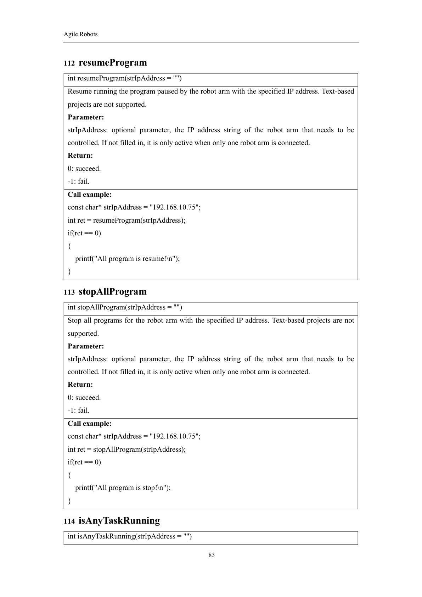



```
Agile Robots 
 83  
112 resumeProgram 
int resumeProgram(strIpAddress = "") 
Resume running the program paused by the robot arm with the specified IP address. Text-based 
projects are not supported. 
Parameter:  
strIpAddress: optional parameter, the IP address string of the robot arm that needs to be 
controlled. If not filled in, it is only active when only one robot arm is connected.  
Return:  
0: succeed.  
-1: fail.  
Call example:  
const char* strIpAddress = "192.168.10.75"; 
int ret = resumeProgram(strIpAddress); 
if(ret == 0) 
{ 
    printf("All program is resume!\n"); 
} 
113 stopAllProgram 
int stopAllProgram(strIpAddress = "") 
Stop all programs for the robot arm with the specified IP address. Text-based projects are not 
supported. 
Parameter:  
strIpAddress: optional parameter, the IP address string of the robot arm that needs to be 
controlled. If not filled in, it is only active when only one robot arm is connected.  
Return:  
0: succeed.  
-1: fail.  
Call example:  
const char* strIpAddress = "192.168.10.75"; 
int ret = stopAllProgram(strIpAddress); 
if(ret == 0) 
{ 
    printf("All program is stop!\n"); 
} 
114 isAnyTaskRunning 
int isAnyTaskRunning(strIpAddress = "")
```



## PDF page 93

**Source:** Industrial API Manual (C\&C++ Edition) \_V3.3.0\_EN\_20260605.pdf, original pdf page 93. [Open the corresponding PDF reading-copy page](https://1292444914-files.gitbook.io/~/files/v0/b/gitbook-x-prod.appspot.com/o/spaces%2FtgOfPnscWebs1eh82EKq%2Fuploads%2FWGm4W5tbOjT5mD2c1h1g%2Findustrial-api-manual-c-c-edition-v3-3-0-en-20260605-pp-001-150.pdf?alt=media#page=93).



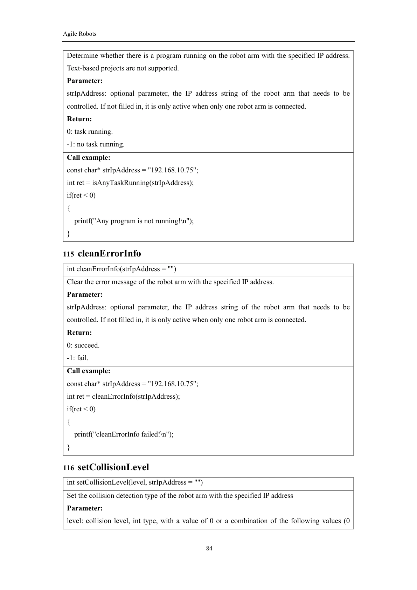



```
Agile Robots 
 84  
Determine whether there is a program running on the robot arm with the specified IP address. 
Text-based projects are not supported. 
Parameter:  
strIpAddress: optional parameter, the IP address string of the robot arm that needs to be 
controlled. If not filled in, it is only active when only one robot arm is connected.  
Return:  
0: task running.  
-1: no task running.  
Call example:  
const char* strIpAddress = "192.168.10.75"; 
int ret = isAnyTaskRunning(strIpAddress); 
if(ret < 0) 
{ 
    printf("Any program is not running!\n"); 
} 
115 cleanErrorInfo  
int cleanErrorInfo(strIpAddress = "")  
Clear the error message of the robot arm with the specified IP address.  
Parameter:  
strIpAddress: optional parameter, the IP address string of the robot arm that needs to be 
controlled. If not filled in, it is only active when only one robot arm is connected.  
Return:  
0: succeed.  
-1: fail.  
Call example:  
const char* strIpAddress = "192.168.10.75"; 
int ret = cleanErrorInfo(strIpAddress); 
if(ret < 0) 
{ 
    printf("cleanErrorInfo failed!\n"); 
} 
116 setCollisionLevel 
int setCollisionLevel(level, strIpAddress = "") 
Set the collision detection type of the robot arm with the specified IP address  
Parameter:  
level: collision level, int type, with a value of 0 or a combination of the following values (0
```



## PDF page 94

**Source:** Industrial API Manual (C\&C++ Edition) \_V3.3.0\_EN\_20260605.pdf, original pdf page 94. [Open the corresponding PDF reading-copy page](https://1292444914-files.gitbook.io/~/files/v0/b/gitbook-x-prod.appspot.com/o/spaces%2FtgOfPnscWebs1eh82EKq%2Fuploads%2FWGm4W5tbOjT5mD2c1h1g%2Findustrial-api-manual-c-c-edition-v3-3-0-en-20260605-pp-001-150.pdf?alt=media#page=94).



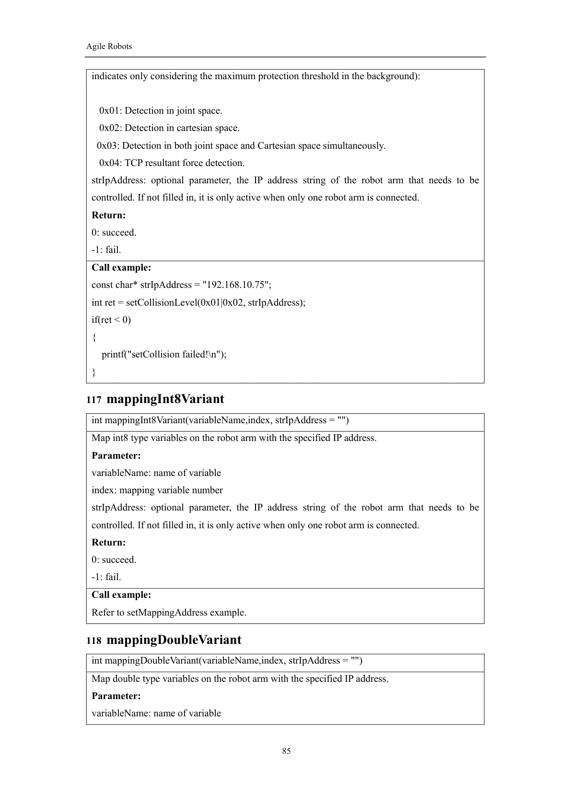



```
Agile Robots 
 85  
indicates only considering the maximum protection threshold in the background):  
   
   0x01: Detection in joint space. 
   0x02: Detection in cartesian space.  
  0x03: Detection in both joint space and Cartesian space simultaneously. 
   0x04: TCP resultant force detection.  
strIpAddress: optional parameter, the IP address string of the robot arm that needs to be 
controlled. If not filled in, it is only active when only one robot arm is connected.  
Return:  
0: succeed.  
-1: fail.  
Call example:  
const char* strIpAddress = "192.168.10.75"; 
int ret = setCollisionLevel(0x01|0x02, strIpAddress); 
if(ret < 0) 
{ 
    printf("setCollision failed!\n"); 
} 
117 mappingInt8Variant 
int mappingInt8Variant(variableName,index, strIpAddress = "") 
Map int8 type variables on the robot arm with the specified IP address.  
Parameter:  
variableName: name of variable  
index: mapping variable number  
strIpAddress: optional parameter, the IP address string of the robot arm that needs to be 
controlled. If not filled in, it is only active when only one robot arm is connected.  
Return:  
0: succeed.  
-1: fail.  
Call example:  
Refer to setMappingAddress example.  
118 mappingDoubleVariant 
int mappingDoubleVariant(variableName,index, strIpAddress = "") 
Map double type variables on the robot arm with the specified IP address.  
Parameter:  
variableName: name of variable
```



## PDF page 95

**Source:** Industrial API Manual (C\&C++ Edition) \_V3.3.0\_EN\_20260605.pdf, original pdf page 95. [Open the corresponding PDF reading-copy page](https://1292444914-files.gitbook.io/~/files/v0/b/gitbook-x-prod.appspot.com/o/spaces%2FtgOfPnscWebs1eh82EKq%2Fuploads%2FWGm4W5tbOjT5mD2c1h1g%2Findustrial-api-manual-c-c-edition-v3-3-0-en-20260605-pp-001-150.pdf?alt=media#page=95).



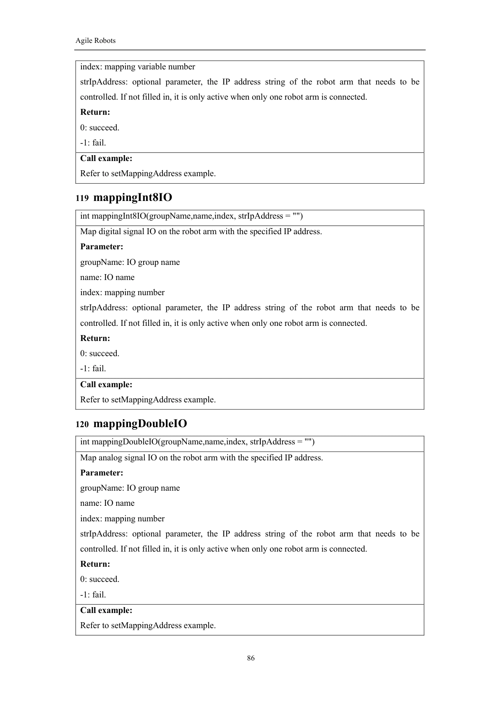



```
Agile Robots 
 86  
index: mapping variable number  
strIpAddress: optional parameter, the IP address string of the robot arm that needs to be 
controlled. If not filled in, it is only active when only one robot arm is connected.  
Return:  
0: succeed.  
-1: fail.  
Call example:  
Refer to setMappingAddress example.  
119 mappingInt8IO 
int mappingInt8IO(groupName,name,index, strIpAddress = "") 
Map digital signal IO on the robot arm with the specified IP address.  
Parameter:  
groupName: IO group name  
name: IO name  
index: mapping number  
strIpAddress: optional parameter, the IP address string of the robot arm that needs to be 
controlled. If not filled in, it is only active when only one robot arm is connected.  
Return:  
0: succeed.  
-1: fail.  
Call example:  
Refer to setMappingAddress example.  
120 mappingDoubleIO 
int mappingDoubleIO(groupName,name,index, strIpAddress = "") 
Map analog signal IO on the robot arm with the specified IP address.  
Parameter:  
groupName: IO group name  
name: IO name  
index: mapping number  
strIpAddress: optional parameter, the IP address string of the robot arm that needs to be 
controlled. If not filled in, it is only active when only one robot arm is connected.  
Return:  
0: succeed.  
-1: fail.  
Call example:  
Refer to setMappingAddress example.
```



## PDF page 96

**Source:** Industrial API Manual (C\&C++ Edition) \_V3.3.0\_EN\_20260605.pdf, original pdf page 96. [Open the corresponding PDF reading-copy page](https://1292444914-files.gitbook.io/~/files/v0/b/gitbook-x-prod.appspot.com/o/spaces%2FtgOfPnscWebs1eh82EKq%2Fuploads%2FWGm4W5tbOjT5mD2c1h1g%2Findustrial-api-manual-c-c-edition-v3-3-0-en-20260605-pp-001-150.pdf?alt=media#page=96).



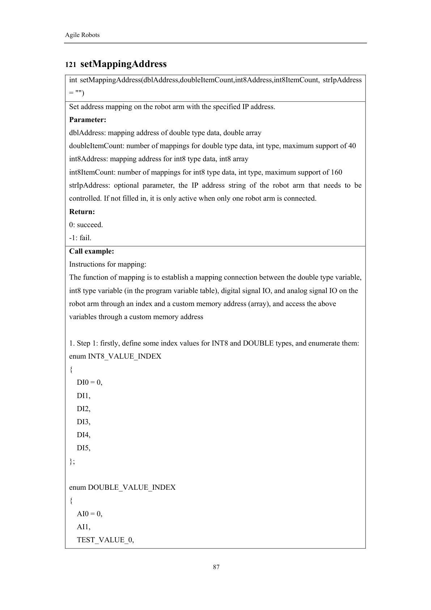



```
Agile Robots 
 87  
121 setMappingAddress  
int setMappingAddress(dblAddress,doubleItemCount,int8Address,int8ItemCount, strIpAddress 
= "") 
Set address mapping on the robot arm with the specified IP address.  
Parameter:  
dblAddress: mapping address of double type data, double array  
doubleItemCount: number of mappings for double type data, int type, maximum support of 40  
int8Address: mapping address for int8 type data, int8 array  
int8ItemCount: number of mappings for int8 type data, int type, maximum support of 160  
strIpAddress: optional parameter, the IP address string of the robot arm that needs to be 
controlled. If not filled in, it is only active when only one robot arm is connected.  
Return:  
0: succeed.  
-1: fail.  
Call example:  
Instructions for mapping:  
The function of mapping is to establish a mapping connection between the double type variable, 
int8 type variable (in the program variable table), digital signal IO, and analog signal IO on the 
robot arm through an index and a custom memory address (array), and access the above 
variables through a custom memory address  
 
1. Step 1: firstly, define some index values for INT8 and DOUBLE types, and enumerate them:  
enum INT8_VALUE_INDEX 
{ 
    DI0 = 0, 
    DI1, 
    DI2, 
    DI3, 
    DI4, 
    DI5, 
}; 
 
enum DOUBLE_VALUE_INDEX 
{ 
    AI0 = 0, 
    AI1, 
    TEST_VALUE_0,
```



## PDF page 97

**Source:** Industrial API Manual (C\&C++ Edition) \_V3.3.0\_EN\_20260605.pdf, original pdf page 97. [Open the corresponding PDF reading-copy page](https://1292444914-files.gitbook.io/~/files/v0/b/gitbook-x-prod.appspot.com/o/spaces%2FtgOfPnscWebs1eh82EKq%2Fuploads%2FWGm4W5tbOjT5mD2c1h1g%2Findustrial-api-manual-c-c-edition-v3-3-0-en-20260605-pp-001-150.pdf?alt=media#page=97).



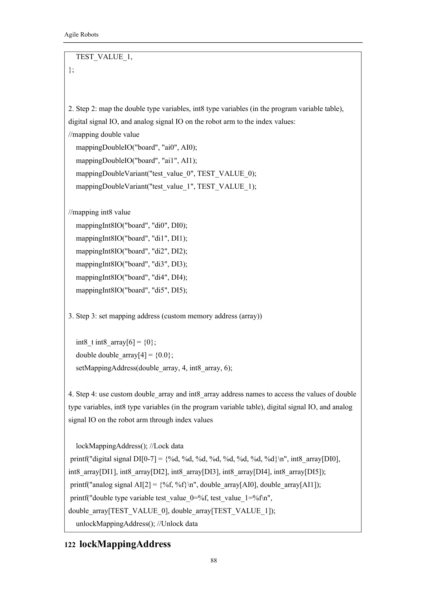



```
Agile Robots 
 88  
    TEST_VALUE_1, 
}; 
 
 
2. Step 2: map the double type variables, int8 type variables (in the program variable table), 
digital signal IO, and analog signal IO on the robot arm to the index values:  
//mapping double value 
    mappingDoubleIO("board", "ai0", AI0); 
    mappingDoubleIO("board", "ai1", AI1); 
    mappingDoubleVariant("test_value_0", TEST_VALUE_0); 
    mappingDoubleVariant("test_value_1", TEST_VALUE_1); 
 
//mapping int8 value 
    mappingInt8IO("board", "di0", DI0); 
    mappingInt8IO("board", "di1", DI1); 
    mappingInt8IO("board", "di2", DI2); 
    mappingInt8IO("board", "di3", DI3); 
    mappingInt8IO("board", "di4", DI4); 
    mappingInt8IO("board", "di5", DI5); 
 
3. Step 3: set mapping address (custom memory address (array))  
 
    int8_t int8_array[6] = {0}; 
    double double_array[4] = {0.0}; 
    setMappingAddress(double_array, 4, int8_array, 6); 
 
4. Step 4: use custom double_array and int8_array address names to access the values of double 
type variables, int8 type variables (in the program variable table), digital signal IO, and analog 
signal IO on the robot arm through index values  
 
    lockMappingAddress(); //Lock data  
 printf("digital signal DI[0-7] = {%d, %d, %d, %d, %d, %d, %d, %d}\n", int8_array[DI0], 
int8_array[DI1], int8_array[DI2], int8_array[DI3], int8_array[DI4], int8_array[DI5]);     
 printf("analog signal AI[2] = {%f, %f}\n", double_array[AI0], double_array[AI1]);  
 printf("double type variable test_value_0=%f, test_value_1=%f\n", 
double_array[TEST_VALUE_0], double_array[TEST_VALUE_1]);  
    unlockMappingAddress(); //Unlock data  
122 lockMappingAddress
```



## PDF page 98

**Source:** Industrial API Manual (C\&C++ Edition) \_V3.3.0\_EN\_20260605.pdf, original pdf page 98. [Open the corresponding PDF reading-copy page](https://1292444914-files.gitbook.io/~/files/v0/b/gitbook-x-prod.appspot.com/o/spaces%2FtgOfPnscWebs1eh82EKq%2Fuploads%2FWGm4W5tbOjT5mD2c1h1g%2Findustrial-api-manual-c-c-edition-v3-3-0-en-20260605-pp-001-150.pdf?alt=media#page=98).



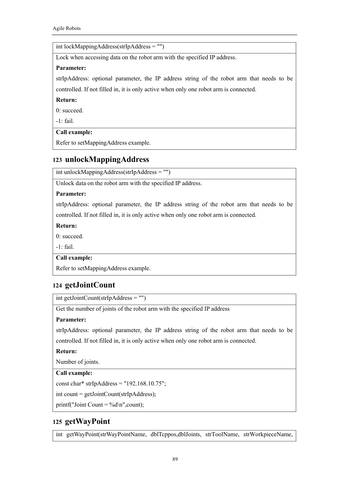



```
Agile Robots 
 89  
int lockMappingAddress(strIpAddress = "") 
Lock when accessing data on the robot arm with the specified IP address.  
Parameter:  
strIpAddress: optional parameter, the IP address string of the robot arm that needs to be 
controlled. If not filled in, it is only active when only one robot arm is connected.  
Return:  
0: succeed.  
-1: fail.  
Call example:  
Refer to setMappingAddress example.  
123 unlockMappingAddress  
int unlockMappingAddress(strIpAddress = "") 
Unlock data on the robot arm with the specified IP address.  
Parameter:  
strIpAddress: optional parameter, the IP address string of the robot arm that needs to be 
controlled. If not filled in, it is only active when only one robot arm is connected.  
Return:  
0: succeed.  
-1: fail.  
Call example:  
Refer to setMappingAddress example.  
124 getJointCount 
int getJointCount(strIpAddress = "") 
Get the number of joints of the robot arm with the specified IP address  
Parameter:  
strIpAddress: optional parameter, the IP address string of the robot arm that needs to be 
controlled. If not filled in, it is only active when only one robot arm is connected.  
Return:  
Number of joints.  
Call example:  
const char* strIpAddress = "192.168.10.75"; 
int count = getJointCount(strIpAddress); 
printf("Joint Count = %d\n",count); 
125 getWayPoint  
int getWayPoint(strWayPointName, dblTcppos,dblJoints, strToolName, strWorkpieceName,
```



## PDF page 99

**Source:** Industrial API Manual (C\&C++ Edition) \_V3.3.0\_EN\_20260605.pdf, original pdf page 99. [Open the corresponding PDF reading-copy page](https://1292444914-files.gitbook.io/~/files/v0/b/gitbook-x-prod.appspot.com/o/spaces%2FtgOfPnscWebs1eh82EKq%2Fuploads%2FWGm4W5tbOjT5mD2c1h1g%2Findustrial-api-manual-c-c-edition-v3-3-0-en-20260605-pp-001-150.pdf?alt=media#page=99).



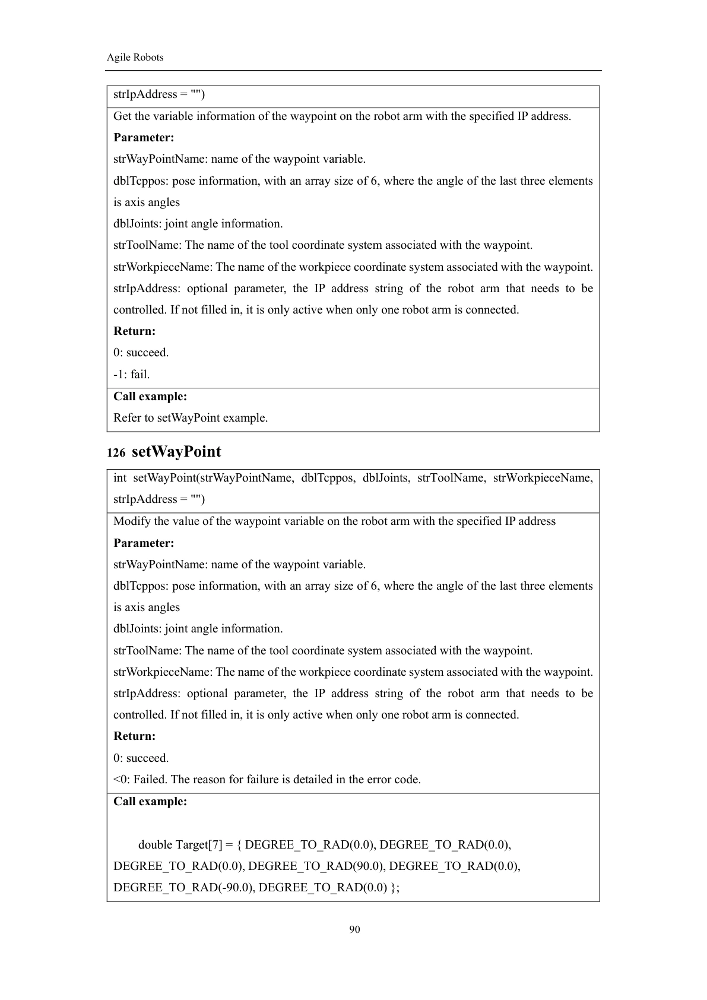



```
Agile Robots 
 90  
strIpAddress = "") 
Get the variable information of the waypoint on the robot arm with the specified IP address.  
Parameter:  
strWayPointName: name of the waypoint variable.  
dblTcppos: pose information, with an array size of 6, where the angle of the last three elements 
is axis angles  
dblJoints: joint angle information.  
strToolName: The name of the tool coordinate system associated with the waypoint.  
strWorkpieceName: The name of the workpiece coordinate system associated with the waypoint.  
strIpAddress: optional parameter, the IP address string of the robot arm that needs to be 
controlled. If not filled in, it is only active when only one robot arm is connected.  
Return:  
0: succeed.  
-1: fail.  
Call example:  
Refer to setWayPoint example.  
126 setWayPoint  
int setWayPoint(strWayPointName, dblTcppos, dblJoints, strToolName, strWorkpieceName, 
strIpAddress = "") 
Modify the value of the waypoint variable on the robot arm with the specified IP address  
Parameter:  
strWayPointName: name of the waypoint variable.  
dblTcppos: pose information, with an array size of 6, where the angle of the last three elements 
is axis angles  
dblJoints: joint angle information.  
strToolName: The name of the tool coordinate system associated with the waypoint.  
strWorkpieceName: The name of the workpiece coordinate system associated with the waypoint.  
strIpAddress: optional parameter, the IP address string of the robot arm that needs to be 
controlled. If not filled in, it is only active when only one robot arm is connected.  
Return:  
0: succeed.  
<0: Failed. The reason for failure is detailed in the error code. 
Call example:  
 
 
double Target[7] = { DEGREE_TO_RAD(0.0), DEGREE_TO_RAD(0.0), 
DEGREE_TO_RAD(0.0), DEGREE_TO_RAD(90.0), DEGREE_TO_RAD(0.0), 
DEGREE_TO_RAD(-90.0), DEGREE_TO_RAD(0.0) };
```



## PDF page 100

**Source:** Industrial API Manual (C\&C++ Edition) \_V3.3.0\_EN\_20260605.pdf, original pdf page 100. [Open the corresponding PDF reading-copy page](https://1292444914-files.gitbook.io/~/files/v0/b/gitbook-x-prod.appspot.com/o/spaces%2FtgOfPnscWebs1eh82EKq%2Fuploads%2FWGm4W5tbOjT5mD2c1h1g%2Findustrial-api-manual-c-c-edition-v3-3-0-en-20260605-pp-001-150.pdf?alt=media#page=100).



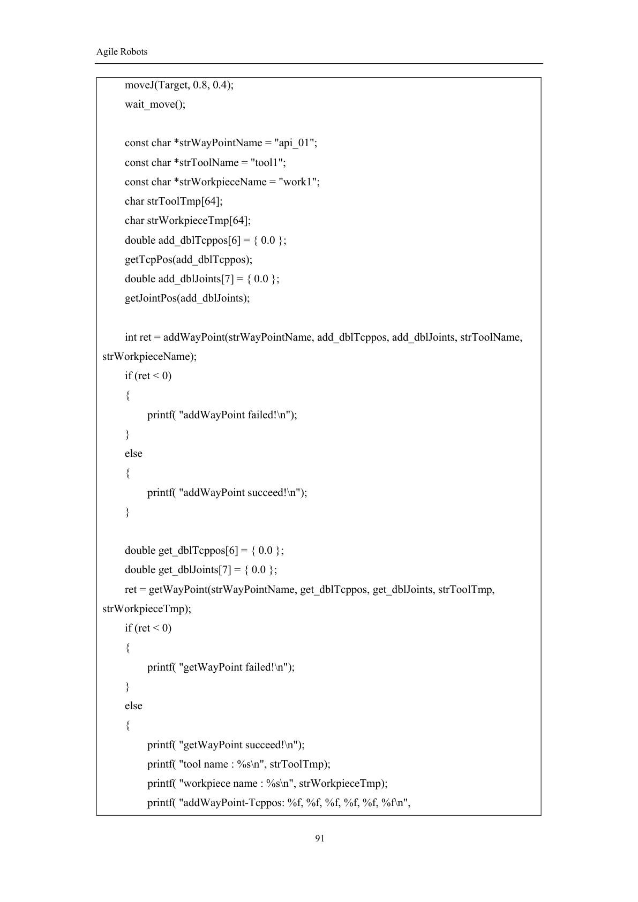



```
Agile Robots 
 91  
 
moveJ(Target, 0.8, 0.4); 
 
wait_move(); 
 
 
const char *strWayPointName = "api_01"; 
const char *strToolName = "tool1"; 
const char *strWorkpieceName = "work1"; 
char strToolTmp[64]; 
char strWorkpieceTmp[64]; 
 
double add_dblTcppos[6] = { 0.0 }; 
 
getTcpPos(add_dblTcppos); 
 
double add_dblJoints[7] = { 0.0 }; 
 
getJointPos(add_dblJoints); 
 
 
int ret = addWayPoint(strWayPointName, add_dblTcppos, add_dblJoints, strToolName, 
strWorkpieceName); 
 
if (ret < 0) 
 
{ 
 
 
printf( "addWayPoint failed!\n"); 
 
} 
 
else 
 
{ 
 
 
printf( "addWayPoint succeed!\n"); 
 
} 
 
 
double get_dblTcppos[6] = { 0.0 }; 
 
double get_dblJoints[7] = { 0.0 }; 
 
ret = getWayPoint(strWayPointName, get_dblTcppos, get_dblJoints, strToolTmp, 
strWorkpieceTmp); 
 
if (ret < 0) 
 
{ 
 
 
printf( "getWayPoint failed!\n"); 
 
} 
 
else 
 
{ 
 
 
printf( "getWayPoint succeed!\n"); 
printf( "tool name : %s\n", strToolTmp); 
                printf( "workpiece name : %s\n", strWorkpieceTmp); 
 
 
printf( "addWayPoint-Tcppos: %f, %f, %f, %f, %f, %f\n",
```



## PDF page 101

**Source:** Industrial API Manual (C\&C++ Edition) \_V3.3.0\_EN\_20260605.pdf, original pdf page 101. [Open the corresponding PDF reading-copy page](https://1292444914-files.gitbook.io/~/files/v0/b/gitbook-x-prod.appspot.com/o/spaces%2FtgOfPnscWebs1eh82EKq%2Fuploads%2FWGm4W5tbOjT5mD2c1h1g%2Findustrial-api-manual-c-c-edition-v3-3-0-en-20260605-pp-001-150.pdf?alt=media#page=101).



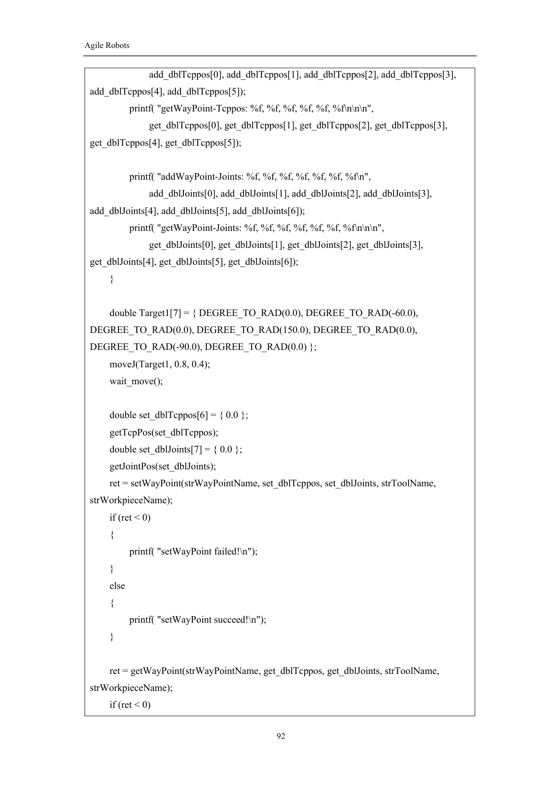



```
Agile Robots 
 92  
 
 
 
add_dblTcppos[0], add_dblTcppos[1], add_dblTcppos[2], add_dblTcppos[3], 
add_dblTcppos[4], add_dblTcppos[5]); 
 
 
printf( "getWayPoint-Tcppos: %f, %f, %f, %f, %f, %f\n\n\n", 
 
 
 
get_dblTcppos[0], get_dblTcppos[1], get_dblTcppos[2], get_dblTcppos[3], 
get_dblTcppos[4], get_dblTcppos[5]); 
 
 
 
printf( "addWayPoint-Joints: %f, %f, %f, %f, %f, %f, %f\n", 
 
 
 
add_dblJoints[0], add_dblJoints[1], add_dblJoints[2], add_dblJoints[3], 
add_dblJoints[4], add_dblJoints[5], add_dblJoints[6]); 
 
 
printf( "getWayPoint-Joints: %f, %f, %f, %f, %f, %f, %f\n\n\n", 
 
 
 
get_dblJoints[0], get_dblJoints[1], get_dblJoints[2], get_dblJoints[3], 
get_dblJoints[4], get_dblJoints[5], get_dblJoints[6]); 
 
} 
 
 
double Target1[7] = { DEGREE_TO_RAD(0.0), DEGREE_TO_RAD(-60.0), 
DEGREE_TO_RAD(0.0), DEGREE_TO_RAD(150.0), DEGREE_TO_RAD(0.0), 
DEGREE_TO_RAD(-90.0), DEGREE_TO_RAD(0.0) }; 
 
moveJ(Target1, 0.8, 0.4); 
 
wait_move(); 
 
 
double set_dblTcppos[6] = { 0.0 }; 
 
getTcpPos(set_dblTcppos); 
 
double set_dblJoints[7] = { 0.0 }; 
 
getJointPos(set_dblJoints); 
 
ret = setWayPoint(strWayPointName, set_dblTcppos, set_dblJoints, strToolName, 
strWorkpieceName); 
 
if (ret < 0) 
 
{ 
 
 
printf( "setWayPoint failed!\n"); 
 
} 
 
else 
 
{ 
 
 
printf( "setWayPoint succeed!\n"); 
 
} 
 
 
ret = getWayPoint(strWayPointName, get_dblTcppos, get_dblJoints, strToolName, 
strWorkpieceName); 
 
if (ret < 0)
```



## PDF page 102

**Source:** Industrial API Manual (C\&C++ Edition) \_V3.3.0\_EN\_20260605.pdf, original pdf page 102. [Open the corresponding PDF reading-copy page](https://1292444914-files.gitbook.io/~/files/v0/b/gitbook-x-prod.appspot.com/o/spaces%2FtgOfPnscWebs1eh82EKq%2Fuploads%2FWGm4W5tbOjT5mD2c1h1g%2Findustrial-api-manual-c-c-edition-v3-3-0-en-20260605-pp-001-150.pdf?alt=media#page=102).



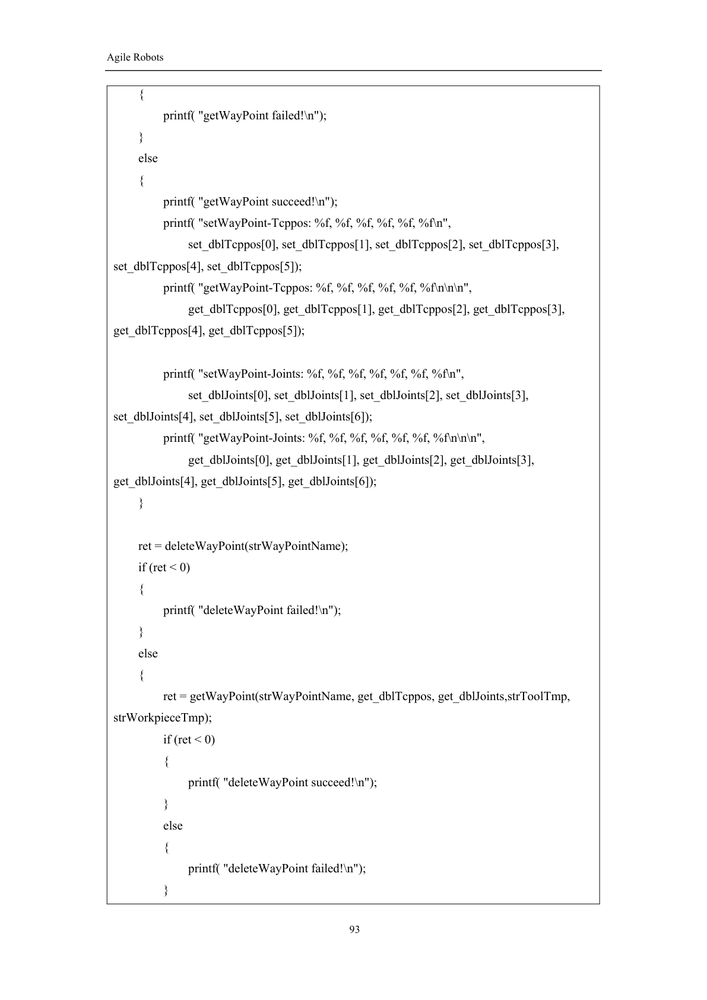



```
Agile Robots 
 93  
 
{ 
 
 
printf( "getWayPoint failed!\n"); 
 
} 
 
else 
 
{ 
 
 
printf( "getWayPoint succeed!\n"); 
 
 
printf( "setWayPoint-Tcppos: %f, %f, %f, %f, %f, %f\n", 
 
 
 
set_dblTcppos[0], set_dblTcppos[1], set_dblTcppos[2], set_dblTcppos[3], 
set_dblTcppos[4], set_dblTcppos[5]); 
 
 
printf( "getWayPoint-Tcppos: %f, %f, %f, %f, %f, %f\n\n\n", 
 
 
 
get_dblTcppos[0], get_dblTcppos[1], get_dblTcppos[2], get_dblTcppos[3], 
get_dblTcppos[4], get_dblTcppos[5]); 
 
 
 
printf( "setWayPoint-Joints: %f, %f, %f, %f, %f, %f, %f\n", 
 
 
 
set_dblJoints[0], set_dblJoints[1], set_dblJoints[2], set_dblJoints[3], 
set_dblJoints[4], set_dblJoints[5], set_dblJoints[6]); 
 
 
printf( "getWayPoint-Joints: %f, %f, %f, %f, %f, %f, %f\n\n\n", 
 
 
 
get_dblJoints[0], get_dblJoints[1], get_dblJoints[2], get_dblJoints[3], 
get_dblJoints[4], get_dblJoints[5], get_dblJoints[6]); 
 
} 
 
 
ret = deleteWayPoint(strWayPointName); 
 
if (ret < 0) 
 
{ 
 
 
printf( "deleteWayPoint failed!\n"); 
 
} 
 
else 
 
{ 
 
 
ret = getWayPoint(strWayPointName, get_dblTcppos, get_dblJoints,strToolTmp, 
strWorkpieceTmp); 
 
 
if (ret < 0) 
 
 
{ 
 
 
 
printf( "deleteWayPoint succeed!\n"); 
 
 
} 
 
 
else 
 
 
{ 
 
 
 
printf( "deleteWayPoint failed!\n"); 
 
 
}
```



## PDF page 103

**Source:** Industrial API Manual (C\&C++ Edition) \_V3.3.0\_EN\_20260605.pdf, original pdf page 103. [Open the corresponding PDF reading-copy page](https://1292444914-files.gitbook.io/~/files/v0/b/gitbook-x-prod.appspot.com/o/spaces%2FtgOfPnscWebs1eh82EKq%2Fuploads%2FWGm4W5tbOjT5mD2c1h1g%2Findustrial-api-manual-c-c-edition-v3-3-0-en-20260605-pp-001-150.pdf?alt=media#page=103).



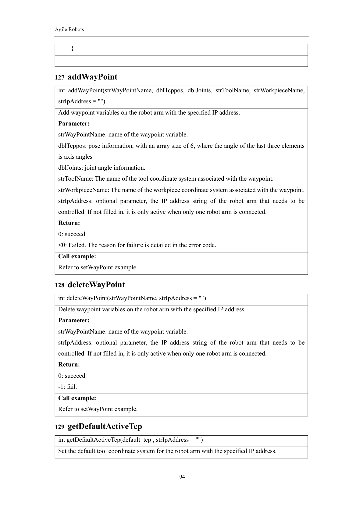



```
Agile Robots 
 94  
 
} 
 
127 addWayPoint  
int addWayPoint(strWayPointName, dblTcppos, dblJoints, strToolName, strWorkpieceName,  
strIpAddress = "") 
Add waypoint variables on the robot arm with the specified IP address.  
Parameter:  
strWayPointName: name of the waypoint variable.  
dblTcppos: pose information, with an array size of 6, where the angle of the last three elements 
is axis angles  
dblJoints: joint angle information.  
strToolName: The name of the tool coordinate system associated with the waypoint.  
strWorkpieceName: The name of the workpiece coordinate system associated with the waypoint.  
strIpAddress: optional parameter, the IP address string of the robot arm that needs to be 
controlled. If not filled in, it is only active when only one robot arm is connected.  
Return:  
0: succeed.  
<0: Failed. The reason for failure is detailed in the error code. 
Call example:  
Refer to setWayPoint example.  
128 deleteWayPoint  
int deleteWayPoint(strWayPointName, strIpAddress = "") 
Delete waypoint variables on the robot arm with the specified IP address.  
Parameter:  
strWayPointName: name of the waypoint variable.  
strIpAddress: optional parameter, the IP address string of the robot arm that needs to be 
controlled. If not filled in, it is only active when only one robot arm is connected.  
Return:  
0: succeed.  
-1: fail.  
Call example:  
Refer to setWayPoint example.  
129 getDefaultActiveTcp 
int getDefaultActiveTcp(default_tcp , strIpAddress = "") 
Set the default tool coordinate system for the robot arm with the specified IP address.
```



## PDF page 104

**Source:** Industrial API Manual (C\&C++ Edition) \_V3.3.0\_EN\_20260605.pdf, original pdf page 104. [Open the corresponding PDF reading-copy page](https://1292444914-files.gitbook.io/~/files/v0/b/gitbook-x-prod.appspot.com/o/spaces%2FtgOfPnscWebs1eh82EKq%2Fuploads%2FWGm4W5tbOjT5mD2c1h1g%2Findustrial-api-manual-c-c-edition-v3-3-0-en-20260605-pp-001-150.pdf?alt=media#page=104).



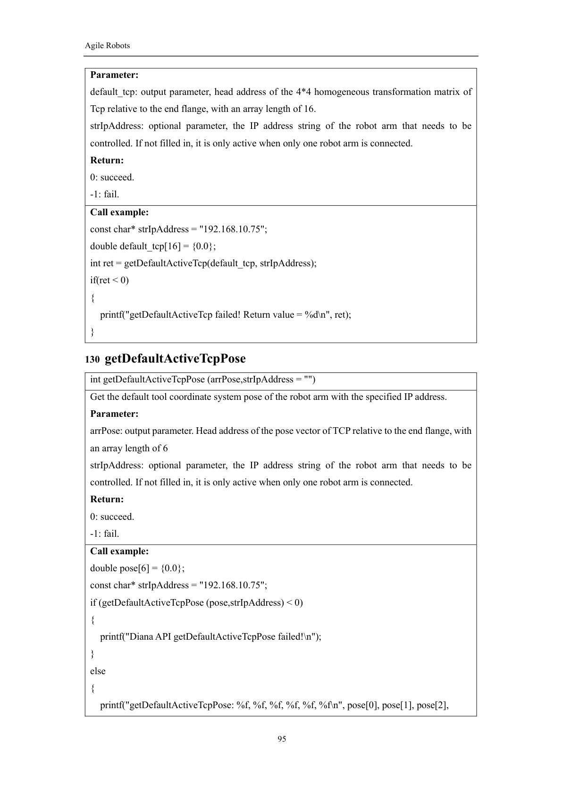



```
Agile Robots 
 95  
Parameter:  
default_tcp: output parameter, head address of the 4*4 homogeneous transformation matrix of 
Tcp relative to the end flange, with an array length of 16.  
strIpAddress: optional parameter, the IP address string of the robot arm that needs to be 
controlled. If not filled in, it is only active when only one robot arm is connected.  
Return:  
0: succeed.  
-1: fail.  
Call example:  
const char* strIpAddress = "192.168.10.75"; 
double default_tcp[16] = {0.0}; 
int ret = getDefaultActiveTcp(default_tcp, strIpAddress); 
if(ret < 0) 
{ 
    printf("getDefaultActiveTcp failed! Return value = %d\n", ret); 
} 
130 getDefaultActiveTcpPose 
int getDefaultActiveTcpPose (arrPose,strIpAddress = "") 
Get the default tool coordinate system pose of the robot arm with the specified IP address.  
Parameter:  
arrPose: output parameter. Head address of the pose vector of TCP relative to the end flange, with 
an array length of 6  
strIpAddress: optional parameter, the IP address string of the robot arm that needs to be 
controlled. If not filled in, it is only active when only one robot arm is connected.  
Return:  
0: succeed.  
-1: fail.  
Call example:  
double pose[6] = {0.0}; 
const char* strIpAddress = "192.168.10.75"; 
if (getDefaultActiveTcpPose (pose,strIpAddress) < 0) 
{ 
    printf("Diana API getDefaultActiveTcpPose failed!\n"); 
} 
else 
{ 
    printf("getDefaultActiveTcpPose: %f, %f, %f, %f, %f, %f\n", pose[0], pose[1], pose[2],
```



## PDF page 105

**Source:** Industrial API Manual (C\&C++ Edition) \_V3.3.0\_EN\_20260605.pdf, original pdf page 105. [Open the corresponding PDF reading-copy page](https://1292444914-files.gitbook.io/~/files/v0/b/gitbook-x-prod.appspot.com/o/spaces%2FtgOfPnscWebs1eh82EKq%2Fuploads%2FWGm4W5tbOjT5mD2c1h1g%2Findustrial-api-manual-c-c-edition-v3-3-0-en-20260605-pp-001-150.pdf?alt=media#page=105).



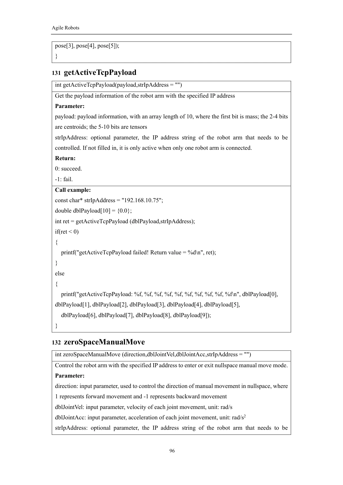



```
Agile Robots 
 96  
pose[3], pose[4], pose[5]); 
} 
131 getActiveTcpPayload 
int getActiveTcpPayload(payload,strIpAddress = "") 
Get the payload information of the robot arm with the specified IP address  
Parameter:  
payload: payload information, with an array length of 10, where the first bit is mass; the 2-4 bits 
are centroids; the 5-10 bits are tensors  
strIpAddress: optional parameter, the IP address string of the robot arm that needs to be 
controlled. If not filled in, it is only active when only one robot arm is connected.  
Return:  
0: succeed.  
-1: fail.  
Call example:  
const char* strIpAddress = "192.168.10.75"; 
double dblPayload[10] = {0.0}; 
int ret = getActiveTcpPayload (dblPayload,strIpAddress); 
if(ret < 0) 
{ 
    printf("getActiveTcpPayload failed! Return value = %d\n", ret); 
} 
else 
{ 
    printf("getActiveTcpPayload: %f, %f, %f, %f, %f, %f, %f, %f, %f, %f\n", dblPayload[0], 
dblPayload[1], dblPayload[2], dblPayload[3], dblPayload[4], dblPayload[5], 
    dblPayload[6], dblPayload[7], dblPayload[8], dblPayload[9]); 
} 
132 zeroSpaceManualMove 
int zeroSpaceManualMove (direction,dblJointVel,dblJointAcc,strIpAddress = "") 
Control the robot arm with the specified IP address to enter or exit nullspace manual move mode.  
Parameter:  
direction: input parameter, used to control the direction of manual movement in nullspace, where 
1 represents forward movement and -1 represents backward movement  
dblJointVel: input parameter, velocity of each joint movement, unit: rad/s  
dblJointAcc: input parameter, acceleration of each joint movement, unit: rad/s2  
strIpAddress: optional parameter, the IP address string of the robot arm that needs to be
```



## PDF page 106

**Source:** Industrial API Manual (C\&C++ Edition) \_V3.3.0\_EN\_20260605.pdf, original pdf page 106. [Open the corresponding PDF reading-copy page](https://1292444914-files.gitbook.io/~/files/v0/b/gitbook-x-prod.appspot.com/o/spaces%2FtgOfPnscWebs1eh82EKq%2Fuploads%2FWGm4W5tbOjT5mD2c1h1g%2Findustrial-api-manual-c-c-edition-v3-3-0-en-20260605-pp-001-150.pdf?alt=media#page=106).



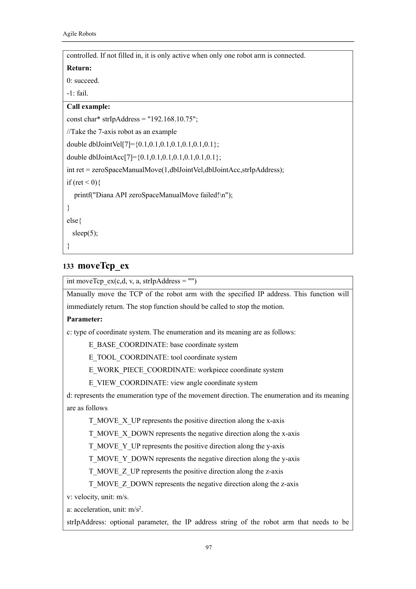



```
Agile Robots 
 97  
controlled. If not filled in, it is only active when only one robot arm is connected.  
Return:  
0: succeed.  
-1: fail.  
Call example:  
const char* strIpAddress = "192.168.10.75"; 
//Take the 7-axis robot as an example  
double dblJointVel[7]={0.1,0.1,0.1,0.1,0.1,0.1,0.1}; 
double dblJointAcc[7]={0.1,0.1,0.1,0.1,0.1,0.1,0.1}; 
int ret = zeroSpaceManualMove(1,dblJointVel,dblJointAcc,strIpAddress); 
if (ret < 0){ 
    printf("Diana API zeroSpaceManualMove failed!\n"); 
} 
else{ 
   sleep(5);  
} 
133 moveTcp_ex 
int moveTcp_ex(c,d, v, a, strIpAddress = "") 
Manually move the TCP of the robot arm with the specified IP address. This function will 
immediately return. The stop function should be called to stop the motion.  
Parameter:  
c: type of coordinate system. The enumeration and its meaning are as follows:  
  E_BASE_COORDINATE: base coordinate system  
  E_TOOL_COORDINATE: tool coordinate system  
  E_WORK_PIECE_COORDINATE: workpiece coordinate system  
  E_VIEW_COORDINATE: view angle coordinate system  
d: represents the enumeration type of the movement direction. The enumeration and its meaning 
are as follows  
  T_MOVE_X_UP represents the positive direction along the x-axis  
  T_MOVE_X_DOWN represents the negative direction along the x-axis  
  T_MOVE_Y_UP represents the positive direction along the y-axis  
  T_MOVE_Y_DOWN represents the negative direction along the y-axis  
  T_MOVE_Z_UP represents the positive direction along the z-axis  
  T_MOVE_Z_DOWN represents the negative direction along the z-axis  
v: velocity, unit: m/s.  
a: acceleration, unit: m/s2.  
strIpAddress: optional parameter, the IP address string of the robot arm that needs to be
```



## PDF page 107

**Source:** Industrial API Manual (C\&C++ Edition) \_V3.3.0\_EN\_20260605.pdf, original pdf page 107. [Open the corresponding PDF reading-copy page](https://1292444914-files.gitbook.io/~/files/v0/b/gitbook-x-prod.appspot.com/o/spaces%2FtgOfPnscWebs1eh82EKq%2Fuploads%2FWGm4W5tbOjT5mD2c1h1g%2Findustrial-api-manual-c-c-edition-v3-3-0-en-20260605-pp-001-150.pdf?alt=media#page=107).



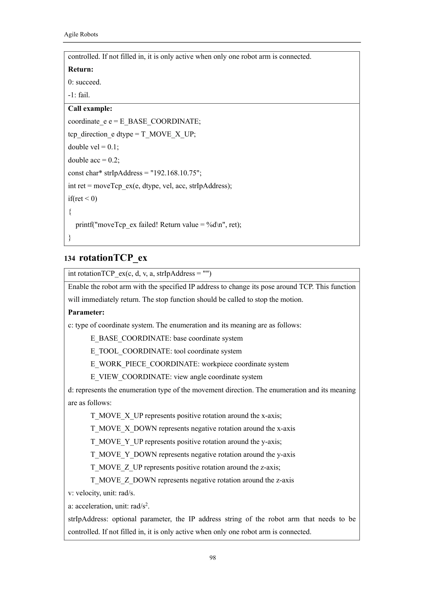



```
Agile Robots 
 98  
controlled. If not filled in, it is only active when only one robot arm is connected.  
Return:  
0: succeed.  
-1: fail.  
Call example:  
coordinate_e e = E_BASE_COORDINATE; 
tcp_direction_e dtype = T_MOVE_X_UP; 
double vel = 0.1; 
double acc = 0.2; 
const char* strIpAddress = "192.168.10.75"; 
int ret = moveTcp_ex(e, dtype, vel, acc, strIpAddress); 
if(ret < 0) 
{ 
    printf("moveTcp_ex failed! Return value = %d\n", ret); 
} 
134 rotationTCP_ex 
int rotationTCP_ex(c, d, v, a, strIpAddress = "") 
Enable the robot arm with the specified IP address to change its pose around TCP. This function 
will immediately return. The stop function should be called to stop the motion.  
Parameter:  
c: type of coordinate system. The enumeration and its meaning are as follows:  
  E_BASE_COORDINATE: base coordinate system  
  E_TOOL_COORDINATE: tool coordinate system  
  E_WORK_PIECE_COORDINATE: workpiece coordinate system  
  E_VIEW_COORDINATE: view angle coordinate system  
d: represents the enumeration type of the movement direction. The enumeration and its meaning 
are as follows:  
  T_MOVE_X_UP represents positive rotation around the x-axis;  
  T_MOVE_X_DOWN represents negative rotation around the x-axis  
  T_MOVE_Y_UP represents positive rotation around the y-axis;  
  T_MOVE_Y_DOWN represents negative rotation around the y-axis  
  T_MOVE_Z_UP represents positive rotation around the z-axis;  
  T_MOVE_Z_DOWN represents negative rotation around the z-axis  
v: velocity, unit: rad/s.  
a: acceleration, unit: rad/s2.  
strIpAddress: optional parameter, the IP address string of the robot arm that needs to be 
controlled. If not filled in, it is only active when only one robot arm is connected.
```



## PDF page 108

**Source:** Industrial API Manual (C\&C++ Edition) \_V3.3.0\_EN\_20260605.pdf, original pdf page 108. [Open the corresponding PDF reading-copy page](https://1292444914-files.gitbook.io/~/files/v0/b/gitbook-x-prod.appspot.com/o/spaces%2FtgOfPnscWebs1eh82EKq%2Fuploads%2FWGm4W5tbOjT5mD2c1h1g%2Findustrial-api-manual-c-c-edition-v3-3-0-en-20260605-pp-001-150.pdf?alt=media#page=108).



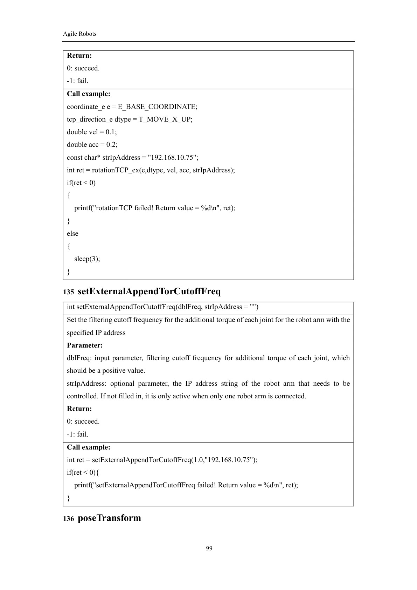



```
Agile Robots 
 99  
Return:  
0: succeed.  
-1: fail.  
Call example:  
coordinate_e e = E_BASE_COORDINATE; 
tcp_direction_e dtype = T_MOVE_X_UP; 
double vel = 0.1; 
double acc = 0.2; 
const char* strIpAddress = "192.168.10.75"; 
int ret = rotationTCP_ex(e,dtype, vel, acc, strIpAddress); 
if(ret < 0) 
{ 
    printf("rotationTCP failed! Return value = %d\n", ret); 
} 
else 
{ 
    sleep(3); 
} 
135 setExternalAppendTorCutoffFreq 
int setExternalAppendTorCutoffFreq(dblFreq, strIpAddress = "") 
Set the filtering cutoff frequency for the additional torque of each joint for the robot arm with the 
specified IP address  
Parameter:  
dblFreq: input parameter, filtering cutoff frequency for additional torque of each joint, which 
should be a positive value.  
strIpAddress: optional parameter, the IP address string of the robot arm that needs to be 
controlled. If not filled in, it is only active when only one robot arm is connected.  
Return:  
0: succeed.  
-1: fail.  
Call example:  
int ret = setExternalAppendTorCutoffFreq(1.0,"192.168.10.75"); 
if(ret < 0){ 
    printf("setExternalAppendTorCutoffFreq failed! Return value = %d\n", ret); 
} 
136 poseTransform
```



## PDF page 109

**Source:** Industrial API Manual (C\&C++ Edition) \_V3.3.0\_EN\_20260605.pdf, original pdf page 109. [Open the corresponding PDF reading-copy page](https://1292444914-files.gitbook.io/~/files/v0/b/gitbook-x-prod.appspot.com/o/spaces%2FtgOfPnscWebs1eh82EKq%2Fuploads%2FWGm4W5tbOjT5mD2c1h1g%2Findustrial-api-manual-c-c-edition-v3-3-0-en-20260605-pp-001-150.pdf?alt=media#page=109).



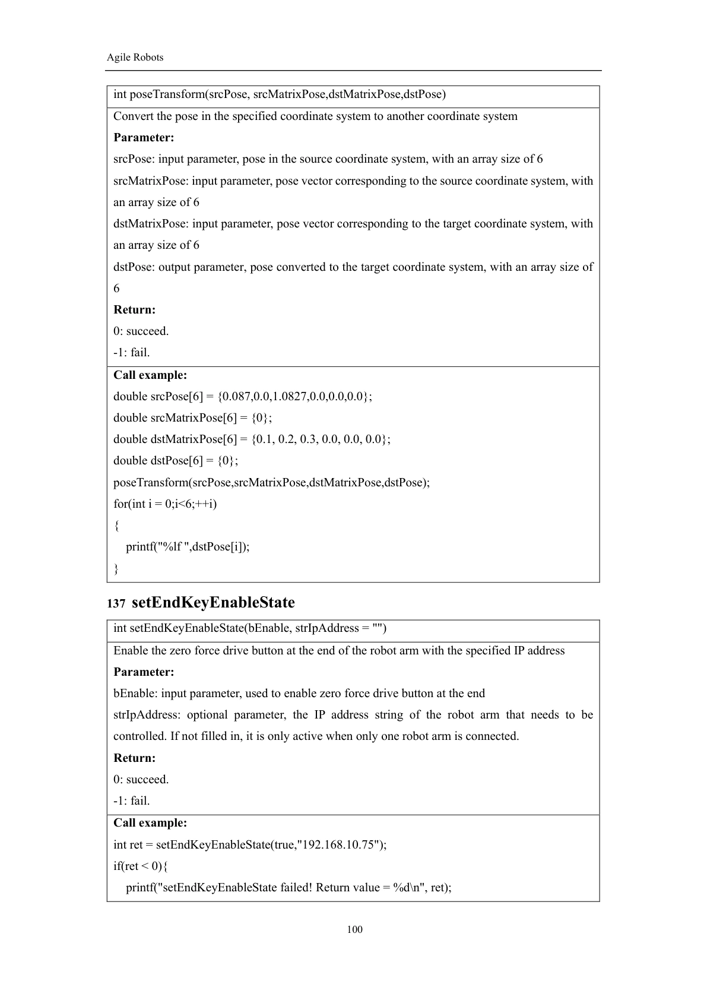



```
Agile Robots 
 100  
int poseTransform(srcPose, srcMatrixPose,dstMatrixPose,dstPose) 
Convert the pose in the specified coordinate system to another coordinate system  
Parameter:  
srcPose: input parameter, pose in the source coordinate system, with an array size of 6  
srcMatrixPose: input parameter, pose vector corresponding to the source coordinate system, with 
an array size of 6  
dstMatrixPose: input parameter, pose vector corresponding to the target coordinate system, with 
an array size of 6  
dstPose: output parameter, pose converted to the target coordinate system, with an array size of 
6  
Return:  
0: succeed.  
-1: fail.  
Call example:  
double srcPose[6] = {0.087,0.0,1.0827,0.0,0.0,0.0}; 
double srcMatrixPose[6] = {0}; 
double dstMatrixPose[6] = {0.1, 0.2, 0.3, 0.0, 0.0, 0.0}; 
double dstPose[6] = {0}; 
poseTransform(srcPose,srcMatrixPose,dstMatrixPose,dstPose); 
for(int i = 0;i<6;++i) 
{ 
    printf("%lf ",dstPose[i]); 
} 
137 setEndKeyEnableState 
int setEndKeyEnableState(bEnable, strIpAddress = "") 
Enable the zero force drive button at the end of the robot arm with the specified IP address  
Parameter:  
bEnable: input parameter, used to enable zero force drive button at the end  
strIpAddress: optional parameter, the IP address string of the robot arm that needs to be 
controlled. If not filled in, it is only active when only one robot arm is connected.  
Return:  
0: succeed.  
-1: fail.  
Call example:  
int ret = setEndKeyEnableState(true,"192.168.10.75"); 
if(ret < 0){ 
    printf("setEndKeyEnableState failed! Return value = %d\n", ret);
```



## PDF page 110

**Source:** Industrial API Manual (C\&C++ Edition) \_V3.3.0\_EN\_20260605.pdf, original pdf page 110. [Open the corresponding PDF reading-copy page](https://1292444914-files.gitbook.io/~/files/v0/b/gitbook-x-prod.appspot.com/o/spaces%2FtgOfPnscWebs1eh82EKq%2Fuploads%2FWGm4W5tbOjT5mD2c1h1g%2Findustrial-api-manual-c-c-edition-v3-3-0-en-20260605-pp-001-150.pdf?alt=media#page=110).



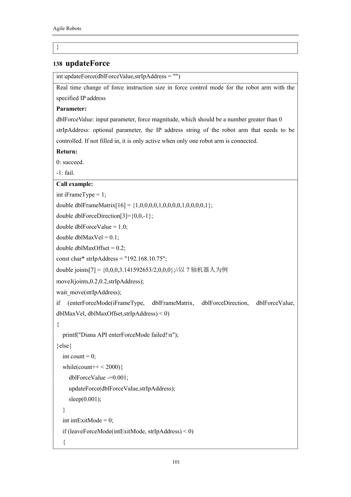



```
Agile Robots 
 101  
} 
138 updateForce 
int updateForce(dblForceValue,strIpAddress = "") 
Real time change of force instruction size in force control mode for the robot arm with the 
specified IP address  
Parameter:  
dblForceValue: input parameter, force magnitude, which should be a number greater than 0  
strIpAddress: optional parameter, the IP address string of the robot arm that needs to be 
controlled. If not filled in, it is only active when only one robot arm is connected.  
Return:  
0: succeed.  
-1: fail.  
Call example:  
int iFrameType = 1; 
double dblFrameMatrix[16] = {1,0,0,0,0,1,0,0,0,0,1,0,0,0,0,1}; 
double dblForceDirection[3]={0,0,-1}; 
double dblForceValue = 1.0; 
double dblMaxVel = 0.1; 
double dblMaxOffset = 0.2; 
const char* strIpAddress = "192.168.10.75"; 
double joints[7] = {0,0,0,3.141592653/2,0,0,0};//以7 轴机器人为例 
moveJ(joints,0.2,0.2,strIpAddress); 
wait_move(strIpAddress); 
if 
(enterForceMode(iFrameType, 
dblFrameMatrix, 
dblForceDirection, 
dblForceValue, 
dblMaxVel, dblMaxOffset,strIpAddress) < 0) 
{ 
    printf("Diana API enterForceMode failed!\n"); 
}else{ 
    int count = 0; 
    while(count++ < 2000){ 
        dblForceValue -=0.001; 
        updateForce(dblForceValue,strIpAddress); 
        sleep(0.001); 
    } 
    int intExitMode = 0; 
    if (leaveForceMode(intExitMode, strIpAddress) < 0) 
    {
```



## PDF page 111

**Source:** Industrial API Manual (C\&C++ Edition) \_V3.3.0\_EN\_20260605.pdf, original pdf page 111. [Open the corresponding PDF reading-copy page](https://1292444914-files.gitbook.io/~/files/v0/b/gitbook-x-prod.appspot.com/o/spaces%2FtgOfPnscWebs1eh82EKq%2Fuploads%2FWGm4W5tbOjT5mD2c1h1g%2Findustrial-api-manual-c-c-edition-v3-3-0-en-20260605-pp-001-150.pdf?alt=media#page=111).



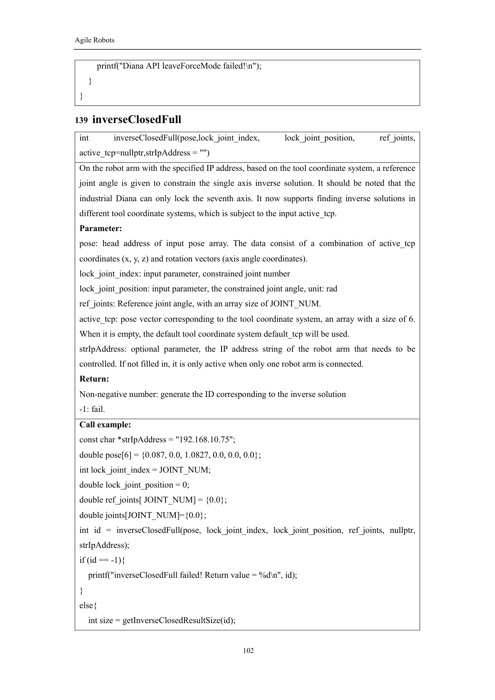



```
Agile Robots 
 102  
        printf("Diana API leaveForceMode failed!\n"); 
    } 
} 
139 inverseClosedFull 
int 
inverseClosedFull(pose,lock_joint_index, 
lock_joint_position, 
ref_joints, 
active_tcp=nullptr,strIpAddress = "") 
On the robot arm with the specified IP address, based on the tool coordinate system, a reference 
joint angle is given to constrain the single axis inverse solution. It should be noted that the 
industrial Diana can only lock the seventh axis. It now supports finding inverse solutions in 
different tool coordinate systems, which is subject to the input active_tcp.  
Parameter:  
pose: head address of input pose array. The data consist of a combination of active_tcp 
coordinates (x, y, z) and rotation vectors (axis angle coordinates).  
lock_joint_index: input parameter, constrained joint number  
lock_joint_position: input parameter, the constrained joint angle, unit: rad  
ref_joints: Reference joint angle, with an array size of JOINT_NUM.  
active_tcp: pose vector corresponding to the tool coordinate system, an array with a size of 6. 
When it is empty, the default tool coordinate system default_tcp will be used.  
strIpAddress: optional parameter, the IP address string of the robot arm that needs to be 
controlled. If not filled in, it is only active when only one robot arm is connected.  
Return:  
Non-negative number: generate the ID corresponding to the inverse solution  
-1: fail.  
Call example:  
const char *strIpAddress = "192.168.10.75"; 
double pose[6] = {0.087, 0.0, 1.0827, 0.0, 0.0, 0.0}; 
int lock_joint_index = JOINT_NUM; 
double lock_joint_position = 0; 
double ref_joints[ JOINT_NUM] = {0.0}; 
double joints[JOINT_NUM]={0.0}; 
int id = inverseClosedFull(pose, lock_joint_index, lock_joint_position, ref_joints, nullptr, 
strIpAddress); 
if (id == -1){ 
    printf("inverseClosedFull failed! Return value = %d\n", id); 
} 
else{ 
    int size = getInverseClosedResultSize(id);
```



## PDF page 112

**Source:** Industrial API Manual (C\&C++ Edition) \_V3.3.0\_EN\_20260605.pdf, original pdf page 112. [Open the corresponding PDF reading-copy page](https://1292444914-files.gitbook.io/~/files/v0/b/gitbook-x-prod.appspot.com/o/spaces%2FtgOfPnscWebs1eh82EKq%2Fuploads%2FWGm4W5tbOjT5mD2c1h1g%2Findustrial-api-manual-c-c-edition-v3-3-0-en-20260605-pp-001-150.pdf?alt=media#page=112).



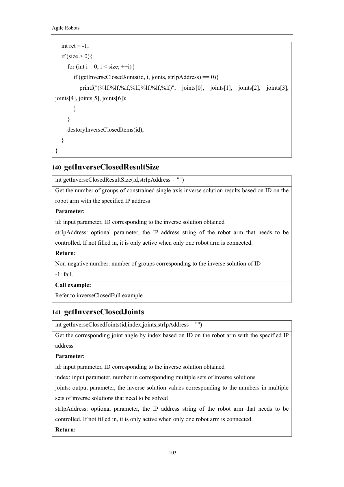



```
Agile Robots 
 103  
    int ret = -1; 
    if (size > 0){ 
        for (int i = 0; i < size; ++i){ 
            if (getInverseClosedJoints(id, i, joints, strIpAddress) == 0){ 
                printf("(%lf,%lf,%lf,%lf,%lf,%lf,%lf)", joints[0], joints[1], joints[2], joints[3], 
joints[4], joints[5], joints[6]); 
            } 
        } 
        destoryInverseClosedItems(id); 
    } 
} 
140 getInverseClosedResultSize 
int getInverseClosedResultSize(id,strIpAddress = "") 
Get the number of groups of constrained single axis inverse solution results based on ID on the 
robot arm with the specified IP address  
Parameter:  
id: input parameter, ID corresponding to the inverse solution obtained  
strIpAddress: optional parameter, the IP address string of the robot arm that needs to be 
controlled. If not filled in, it is only active when only one robot arm is connected.  
Return:  
Non-negative number: number of groups corresponding to the inverse solution of ID  
-1: fail.  
Call example:  
Refer to inverseClosedFull example  
141 getInverseClosedJoints 
int getInverseClosedJoints(id,index,joints,strIpAddress = "") 
Get the corresponding joint angle by index based on ID on the robot arm with the specified IP 
address  
Parameter:  
id: input parameter, ID corresponding to the inverse solution obtained  
index: input parameter, number in corresponding multiple sets of inverse solutions  
joints: output parameter, the inverse solution values corresponding to the numbers in multiple 
sets of inverse solutions that need to be solved  
strIpAddress: optional parameter, the IP address string of the robot arm that needs to be 
controlled. If not filled in, it is only active when only one robot arm is connected.  
Return:
```



## PDF page 113

**Source:** Industrial API Manual (C\&C++ Edition) \_V3.3.0\_EN\_20260605.pdf, original pdf page 113. [Open the corresponding PDF reading-copy page](https://1292444914-files.gitbook.io/~/files/v0/b/gitbook-x-prod.appspot.com/o/spaces%2FtgOfPnscWebs1eh82EKq%2Fuploads%2FWGm4W5tbOjT5mD2c1h1g%2Findustrial-api-manual-c-c-edition-v3-3-0-en-20260605-pp-001-150.pdf?alt=media#page=113).



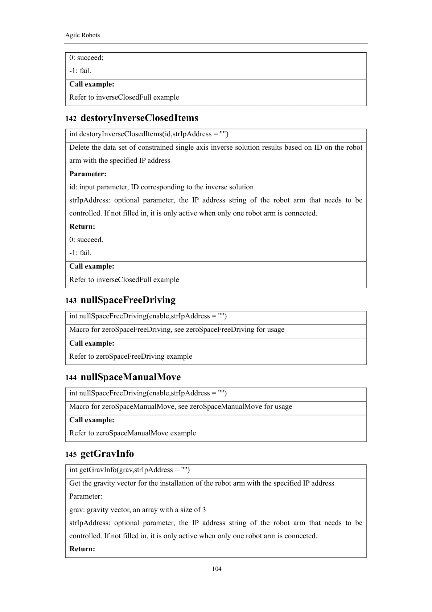



```
Agile Robots 
 104  
0: succeed;  
-1: fail.  
Call example:  
Refer to inverseClosedFull example  
142 destoryInverseClosedItems 
int destoryInverseClosedItems(id,strIpAddress = "") 
Delete the data set of constrained single axis inverse solution results based on ID on the robot 
arm with the specified IP address  
Parameter:  
id: input parameter, ID corresponding to the inverse solution  
strIpAddress: optional parameter, the IP address string of the robot arm that needs to be 
controlled. If not filled in, it is only active when only one robot arm is connected.  
Return:  
0: succeed.  
-1: fail.  
Call example:  
Refer to inverseClosedFull example  
143 nullSpaceFreeDriving 
int nullSpaceFreeDriving(enable,strIpAddress = "") 
Macro for zeroSpaceFreeDriving, see zeroSpaceFreeDriving for usage  
Call example:  
Refer to zeroSpaceFreeDriving example  
144 nullSpaceManualMove 
int nullSpaceFreeDriving(enable,strIpAddress = "") 
Macro for zeroSpaceManualMove, see zeroSpaceManualMove for usage  
Call example:  
Refer to zeroSpaceManualMove example  
145 getGravInfo 
int getGravInfo(grav,strIpAddress = "") 
Get the gravity vector for the installation of the robot arm with the specified IP address  
Parameter:  
grav: gravity vector, an array with a size of 3  
strIpAddress: optional parameter, the IP address string of the robot arm that needs to be 
controlled. If not filled in, it is only active when only one robot arm is connected.  
Return:
```



## PDF page 114

**Source:** Industrial API Manual (C\&C++ Edition) \_V3.3.0\_EN\_20260605.pdf, original pdf page 114. [Open the corresponding PDF reading-copy page](https://1292444914-files.gitbook.io/~/files/v0/b/gitbook-x-prod.appspot.com/o/spaces%2FtgOfPnscWebs1eh82EKq%2Fuploads%2FWGm4W5tbOjT5mD2c1h1g%2Findustrial-api-manual-c-c-edition-v3-3-0-en-20260605-pp-001-150.pdf?alt=media#page=114).



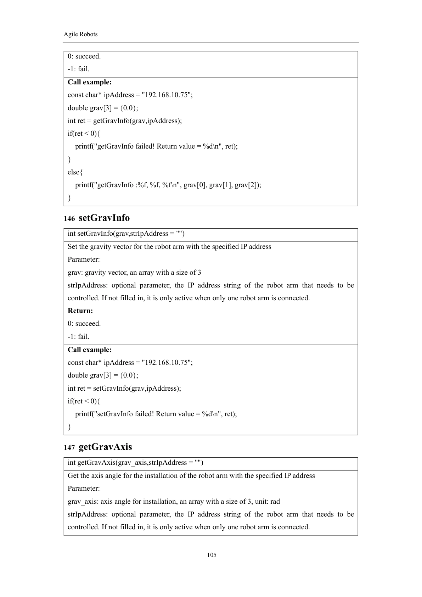



```
Agile Robots 
 105  
0: succeed.  
-1: fail.  
Call example:  
const char* ipAddress = "192.168.10.75"; 
double grav[3] = {0.0}; 
int ret = getGravInfo(grav,ipAddress); 
if(ret < 0){ 
    printf("getGravInfo failed! Return value = %d\n", ret); 
} 
else{ 
    printf("getGravInfo :%f, %f, %f\n", grav[0], grav[1], grav[2]); 
} 
146 setGravInfo 
int setGravInfo(grav,strIpAddress = "") 
Set the gravity vector for the robot arm with the specified IP address  
Parameter:  
grav: gravity vector, an array with a size of 3  
strIpAddress: optional parameter, the IP address string of the robot arm that needs to be 
controlled. If not filled in, it is only active when only one robot arm is connected.  
Return:  
0: succeed.  
-1: fail.  
Call example:  
const char* ipAddress = "192.168.10.75"; 
double grav[3] = {0.0}; 
int ret = setGravInfo(grav,ipAddress); 
if(ret < 0){ 
    printf("setGravInfo failed! Return value = %d\n", ret); 
} 
147 getGravAxis 
int getGravAxis(grav_axis,strIpAddress = "") 
Get the axis angle for the installation of the robot arm with the specified IP address  
Parameter:  
grav_axis: axis angle for installation, an array with a size of 3, unit: rad  
strIpAddress: optional parameter, the IP address string of the robot arm that needs to be 
controlled. If not filled in, it is only active when only one robot arm is connected.
```



## PDF page 115

**Source:** Industrial API Manual (C\&C++ Edition) \_V3.3.0\_EN\_20260605.pdf, original pdf page 115. [Open the corresponding PDF reading-copy page](https://1292444914-files.gitbook.io/~/files/v0/b/gitbook-x-prod.appspot.com/o/spaces%2FtgOfPnscWebs1eh82EKq%2Fuploads%2FWGm4W5tbOjT5mD2c1h1g%2Findustrial-api-manual-c-c-edition-v3-3-0-en-20260605-pp-001-150.pdf?alt=media#page=115).



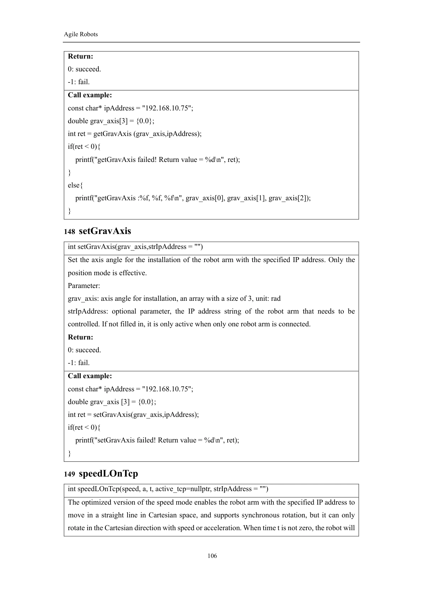



```
Agile Robots 
 106  
Return:  
0: succeed.  
-1: fail.  
Call example:  
const char* ipAddress = "192.168.10.75"; 
double grav_axis[3] = {0.0}; 
int ret = getGravAxis (grav_axis,ipAddress); 
if(ret < 0){ 
    printf("getGravAxis failed! Return value = %d\n", ret); 
} 
else{ 
    printf("getGravAxis :%f, %f, %f\n", grav_axis[0], grav_axis[1], grav_axis[2]); 
} 
148 setGravAxis 
int setGravAxis(grav_axis,strIpAddress = "") 
Set the axis angle for the installation of the robot arm with the specified IP address. Only the 
position mode is effective. 
Parameter:  
grav_axis: axis angle for installation, an array with a size of 3, unit: rad  
strIpAddress: optional parameter, the IP address string of the robot arm that needs to be 
controlled. If not filled in, it is only active when only one robot arm is connected.  
Return:  
0: succeed.  
-1: fail.  
Call example:  
const char* ipAddress = "192.168.10.75"; 
double grav_axis [3] = {0.0}; 
int ret = setGravAxis(grav_axis,ipAddress); 
if(ret < 0){ 
    printf("setGravAxis failed! Return value = %d\n", ret); 
} 
149 speedLOnTcp 
int speedLOnTcp(speed, a, t, active_tcp=nullptr, strIpAddress = "") 
The optimized version of the speed mode enables the robot arm with the specified IP address to 
move in a straight line in Cartesian space, and supports synchronous rotation, but it can only 
rotate in the Cartesian direction with speed or acceleration. When time t is not zero, the robot will
```



## PDF page 116

**Source:** Industrial API Manual (C\&C++ Edition) \_V3.3.0\_EN\_20260605.pdf, original pdf page 116. [Open the corresponding PDF reading-copy page](https://1292444914-files.gitbook.io/~/files/v0/b/gitbook-x-prod.appspot.com/o/spaces%2FtgOfPnscWebs1eh82EKq%2Fuploads%2FWGm4W5tbOjT5mD2c1h1g%2Findustrial-api-manual-c-c-edition-v3-3-0-en-20260605-pp-001-150.pdf?alt=media#page=116).



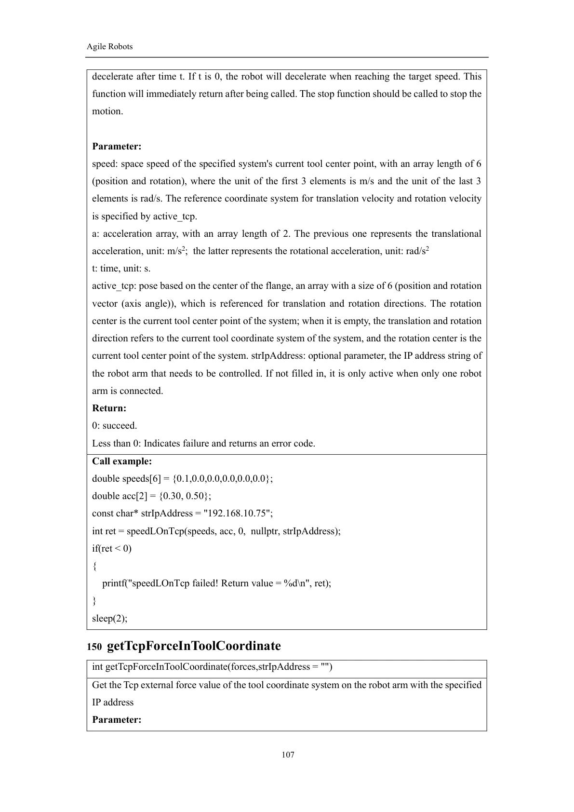



```
Agile Robots 
 107  
decelerate after time t. If t is 0, the robot will decelerate when reaching the target speed. This 
function will immediately return after being called. The stop function should be called to stop the 
motion.  
 
Parameter:  
speed: space speed of the specified system's current tool center point, with an array length of 6 
(position and rotation), where the unit of the first 3 elements is m/s and the unit of the last 3 
elements is rad/s. The reference coordinate system for translation velocity and rotation velocity 
is specified by active_tcp.  
a: acceleration array, with an array length of 2. The previous one represents the translational 
acceleration, unit: m/s2;  the latter represents the rotational acceleration, unit: rad/s2  
t: time, unit: s.  
active_tcp: pose based on the center of the flange, an array with a size of 6 (position and rotation 
vector (axis angle)), which is referenced for translation and rotation directions. The rotation 
center is the current tool center point of the system; when it is empty, the translation and rotation 
direction refers to the current tool coordinate system of the system, and the rotation center is the 
current tool center point of the system. strIpAddress: optional parameter, the IP address string of 
the robot arm that needs to be controlled. If not filled in, it is only active when only one robot 
arm is connected.  
Return:  
0: succeed.  
Less than 0: Indicates failure and returns an error code. 
Call example:  
double speeds[6] = {0.1,0.0,0.0,0.0,0.0,0.0}; 
double acc[2] = {0.30, 0.50}; 
const char* strIpAddress = "192.168.10.75"; 
int ret = speedLOnTcp(speeds, acc, 0,  nullptr, strIpAddress); 
if(ret < 0) 
{ 
    printf("speedLOnTcp failed! Return value = %d\n", ret); 
} 
sleep(2); 
150 getTcpForceInToolCoordinate 
int getTcpForceInToolCoordinate(forces,strIpAddress = "") 
Get the Tcp external force value of the tool coordinate system on the robot arm with the specified 
IP address  
Parameter:
```



## PDF page 117

**Source:** Industrial API Manual (C\&C++ Edition) \_V3.3.0\_EN\_20260605.pdf, original pdf page 117. [Open the corresponding PDF reading-copy page](https://1292444914-files.gitbook.io/~/files/v0/b/gitbook-x-prod.appspot.com/o/spaces%2FtgOfPnscWebs1eh82EKq%2Fuploads%2FWGm4W5tbOjT5mD2c1h1g%2Findustrial-api-manual-c-c-edition-v3-3-0-en-20260605-pp-001-150.pdf?alt=media#page=117).



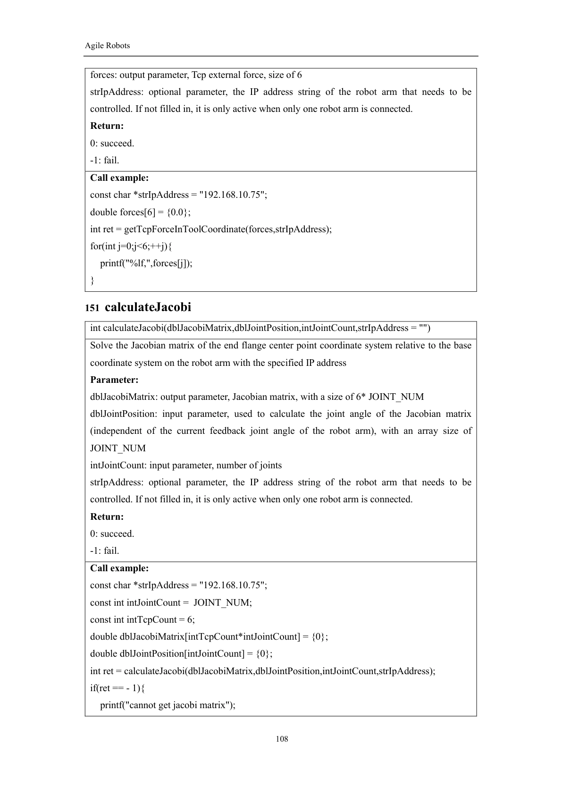



```
Agile Robots 
 108  
forces: output parameter, Tcp external force, size of 6  
strIpAddress: optional parameter, the IP address string of the robot arm that needs to be 
controlled. If not filled in, it is only active when only one robot arm is connected.  
Return:  
0: succeed.  
-1: fail.  
Call example:  
const char *strIpAddress = "192.168.10.75"; 
double forces[6] = {0.0}; 
int ret = getTcpForceInToolCoordinate(forces,strIpAddress); 
for(int j=0;j<6;++j){ 
    printf("%lf,",forces[j]); 
} 
151 calculateJacobi 
int calculateJacobi(dblJacobiMatrix,dblJointPosition,intJointCount,strIpAddress = "") 
Solve the Jacobian matrix of the end flange center point coordinate system relative to the base 
coordinate system on the robot arm with the specified IP address  
Parameter:  
dblJacobiMatrix: output parameter, Jacobian matrix, with a size of 6* JOINT_NUM  
dblJointPosition: input parameter, used to calculate the joint angle of the Jacobian matrix 
(independent of the current feedback joint angle of the robot arm), with an array size of 
JOINT_NUM  
intJointCount: input parameter, number of joints  
strIpAddress: optional parameter, the IP address string of the robot arm that needs to be 
controlled. If not filled in, it is only active when only one robot arm is connected.  
Return:  
0: succeed.  
-1: fail.  
Call example:  
const char *strIpAddress = "192.168.10.75"; 
const int intJointCount =  JOINT_NUM; 
const int intTcpCount = 6; 
double dblJacobiMatrix[intTcpCount*intJointCount] = {0}; 
double dblJointPosition[intJointCount] = {0}; 
int ret = calculateJacobi(dblJacobiMatrix,dblJointPosition,intJointCount,strIpAddress); 
if(ret == - 1){ 
    printf("cannot get jacobi matrix");
```



## PDF page 118

**Source:** Industrial API Manual (C\&C++ Edition) \_V3.3.0\_EN\_20260605.pdf, original pdf page 118. [Open the corresponding PDF reading-copy page](https://1292444914-files.gitbook.io/~/files/v0/b/gitbook-x-prod.appspot.com/o/spaces%2FtgOfPnscWebs1eh82EKq%2Fuploads%2FWGm4W5tbOjT5mD2c1h1g%2Findustrial-api-manual-c-c-edition-v3-3-0-en-20260605-pp-001-150.pdf?alt=media#page=118).



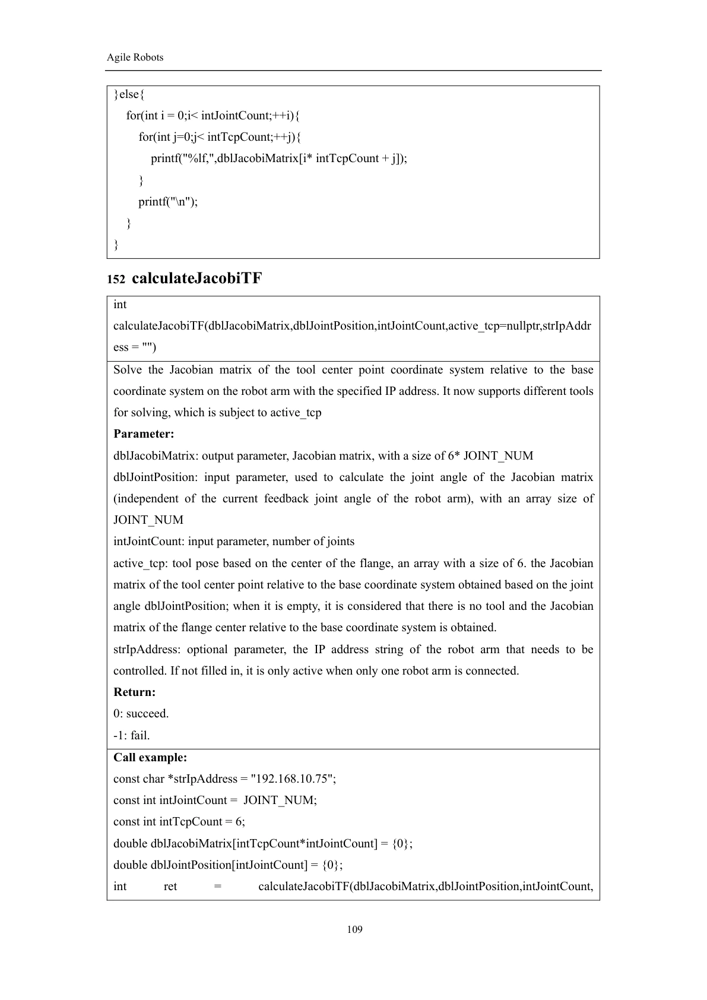



```
Agile Robots 
 109  
}else{ 
    for(int i = 0;i< intJointCount;++i){ 
        for(int j=0;j< intTcpCount;++j){ 
            printf("%lf,",dblJacobiMatrix[i* intTcpCount + j]); 
        } 
        printf("\n"); 
    } 
} 
152 calculateJacobiTF 
int 
calculateJacobiTF(dblJacobiMatrix,dblJointPosition,intJointCount,active_tcp=nullptr,strIpAddr
ess = "") 
Solve the Jacobian matrix of the tool center point coordinate system relative to the base 
coordinate system on the robot arm with the specified IP address. It now supports different tools 
for solving, which is subject to active_tcp  
Parameter:  
dblJacobiMatrix: output parameter, Jacobian matrix, with a size of 6* JOINT_NUM  
dblJointPosition: input parameter, used to calculate the joint angle of the Jacobian matrix 
(independent of the current feedback joint angle of the robot arm), with an array size of 
JOINT_NUM  
intJointCount: input parameter, number of joints  
active_tcp: tool pose based on the center of the flange, an array with a size of 6. the Jacobian 
matrix of the tool center point relative to the base coordinate system obtained based on the joint 
angle dblJointPosition; when it is empty, it is considered that there is no tool and the Jacobian 
matrix of the flange center relative to the base coordinate system is obtained.  
strIpAddress: optional parameter, the IP address string of the robot arm that needs to be 
controlled. If not filled in, it is only active when only one robot arm is connected.  
Return:  
0: succeed.  
-1: fail.  
Call example:  
const char *strIpAddress = "192.168.10.75"; 
const int intJointCount =  JOINT_NUM; 
const int intTcpCount = 6; 
double dblJacobiMatrix[intTcpCount*intJointCount] = {0}; 
double dblJointPosition[intJointCount] = {0}; 
int 
ret 
= 
calculateJacobiTF(dblJacobiMatrix,dblJointPosition,intJointCount,
```



## PDF page 119

**Source:** Industrial API Manual (C\&C++ Edition) \_V3.3.0\_EN\_20260605.pdf, original pdf page 119. [Open the corresponding PDF reading-copy page](https://1292444914-files.gitbook.io/~/files/v0/b/gitbook-x-prod.appspot.com/o/spaces%2FtgOfPnscWebs1eh82EKq%2Fuploads%2FWGm4W5tbOjT5mD2c1h1g%2Findustrial-api-manual-c-c-edition-v3-3-0-en-20260605-pp-001-150.pdf?alt=media#page=119).



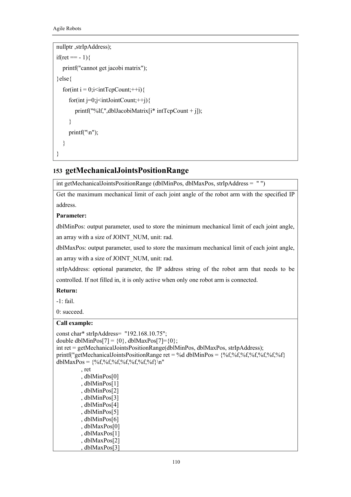



```
Agile Robots 
 110  
nullptr ,strIpAddress); 
if(ret == - 1){ 
    printf("cannot get jacobi matrix"); 
}else{ 
    for(int i = 0;i<intTcpCount;++i){ 
        for(int j=0;j<intJointCount;++j){ 
            printf("%lf,",dblJacobiMatrix[i* intTcpCount + j]); 
        } 
        printf("\n"); 
    } 
} 
153 getMechanicalJointsPositionRange 
int getMechanicalJointsPositionRange (dblMinPos, dblMaxPos, strIpAddress =  " ") 
Get the maximum mechanical limit of each joint angle of the robot arm with the specified IP 
address.  
Parameter:  
dblMinPos: output parameter, used to store the minimum mechanical limit of each joint angle, 
an array with a size of JOINT_NUM, unit: rad.  
dblMaxPos: output parameter, used to store the maximum mechanical limit of each joint angle, 
an array with a size of JOINT_NUM, unit: rad.  
strIpAddress: optional parameter, the IP address string of the robot arm that needs to be 
controlled. If not filled in, it is only active when only one robot arm is connected.  
Return:  
-1: fail.  
0: succeed.  
Call example:  
const char* strIpAddress=  "192.168.10.75"; 
double dblMinPos[7] = {0}, dblMaxPos[7]={0}; 
int ret = getMechanicalJointsPositionRange(dblMinPos, dblMaxPos, strIpAddress); 
printf("getMechanicalJointsPositionRange ret = %d dblMinPos = {%f,%f,%f,%f,%f,%f,%f} 
dblMaxPos = {%f,%f,%f,%f,%f,%f,%f}\n" 
 
 
, ret 
 
 
, dblMinPos[0] 
 
 
, dblMinPos[1] 
 
 
, dblMinPos[2] 
 
 
, dblMinPos[3] 
 
 
, dblMinPos[4] 
 
 
, dblMinPos[5] 
 
 
, dblMinPos[6] 
 
 
, dblMaxPos[0] 
 
 
, dblMaxPos[1] 
 
 
, dblMaxPos[2] 
 
 
, dblMaxPos[3]
```



## PDF page 120

**Source:** Industrial API Manual (C\&C++ Edition) \_V3.3.0\_EN\_20260605.pdf, original pdf page 120. [Open the corresponding PDF reading-copy page](https://1292444914-files.gitbook.io/~/files/v0/b/gitbook-x-prod.appspot.com/o/spaces%2FtgOfPnscWebs1eh82EKq%2Fuploads%2FWGm4W5tbOjT5mD2c1h1g%2Findustrial-api-manual-c-c-edition-v3-3-0-en-20260605-pp-001-150.pdf?alt=media#page=120).



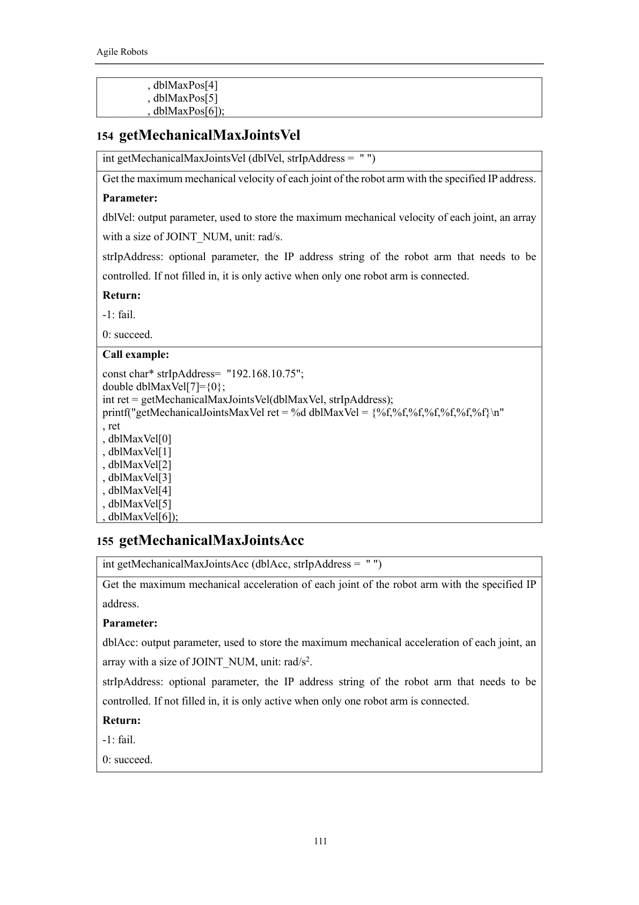



```
Agile Robots 
 111  
 
 
, dblMaxPos[4] 
 
 
, dblMaxPos[5] 
 
 
, dblMaxPos[6]); 
154 getMechanicalMaxJointsVel 
int getMechanicalMaxJointsVel (dblVel, strIpAddress =  " ") 
Get the maximum mechanical velocity of each joint of the robot arm with the specified IP address.  
Parameter:  
dblVel: output parameter, used to store the maximum mechanical velocity of each joint, an array 
with a size of JOINT_NUM, unit: rad/s.  
strIpAddress: optional parameter, the IP address string of the robot arm that needs to be 
controlled. If not filled in, it is only active when only one robot arm is connected.  
Return:  
-1: fail.  
0: succeed.  
Call example:  
const char* strIpAddress=  "192.168.10.75"; 
double dblMaxVel[7]={0}; 
int ret = getMechanicalMaxJointsVel(dblMaxVel, strIpAddress); 
printf("getMechanicalJointsMaxVel ret = %d dblMaxVel = {%f,%f,%f,%f,%f,%f,%f}\n" 
, ret 
, dblMaxVel[0] 
, dblMaxVel[1] 
, dblMaxVel[2] 
, dblMaxVel[3] 
, dblMaxVel[4] 
, dblMaxVel[5] 
, dblMaxVel[6]); 
155 getMechanicalMaxJointsAcc 
int getMechanicalMaxJointsAcc (dblAcc, strIpAddress =  " ") 
Get the maximum mechanical acceleration of each joint of the robot arm with the specified IP 
address.  
Parameter:  
dblAcc: output parameter, used to store the maximum mechanical acceleration of each joint, an 
array with a size of JOINT_NUM, unit: rad/s2.  
strIpAddress: optional parameter, the IP address string of the robot arm that needs to be 
controlled. If not filled in, it is only active when only one robot arm is connected.  
Return:  
-1: fail.  
0: succeed.
```



## PDF page 121

**Source:** Industrial API Manual (C\&C++ Edition) \_V3.3.0\_EN\_20260605.pdf, original pdf page 121. [Open the corresponding PDF reading-copy page](https://1292444914-files.gitbook.io/~/files/v0/b/gitbook-x-prod.appspot.com/o/spaces%2FtgOfPnscWebs1eh82EKq%2Fuploads%2FWGm4W5tbOjT5mD2c1h1g%2Findustrial-api-manual-c-c-edition-v3-3-0-en-20260605-pp-001-150.pdf?alt=media#page=121).



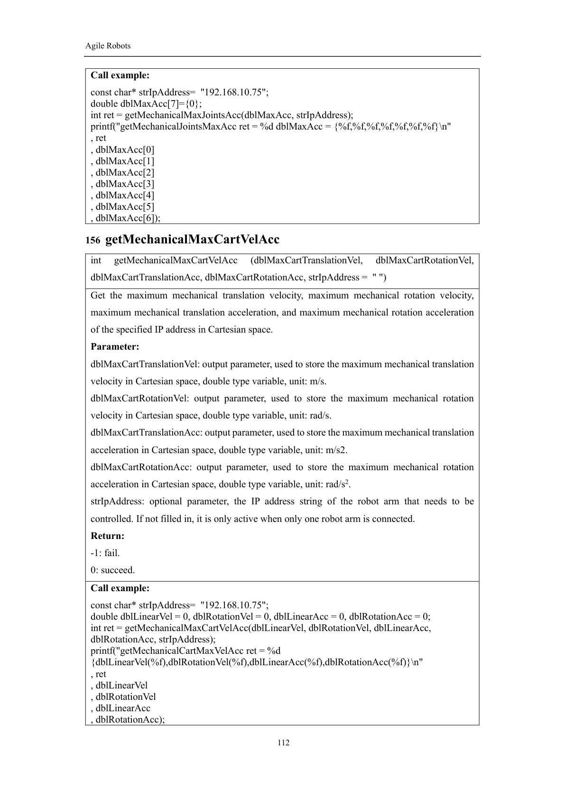



```
Agile Robots 
 112  
Call example:  
const char* strIpAddress=  "192.168.10.75"; 
double dblMaxAcc[7]={0}; 
int ret = getMechanicalMaxJointsAcc(dblMaxAcc, strIpAddress); 
printf("getMechanicalJointsMaxAcc ret = %d dblMaxAcc = {%f,%f,%f,%f,%f,%f,%f}\n" 
, ret 
, dblMaxAcc[0] 
, dblMaxAcc[1] 
, dblMaxAcc[2] 
, dblMaxAcc[3] 
, dblMaxAcc[4] 
, dblMaxAcc[5] 
, dblMaxAcc[6]); 
156 getMechanicalMaxCartVelAcc 
int 
getMechanicalMaxCartVelAcc 
(dblMaxCartTranslationVel, 
dblMaxCartRotationVel, 
dblMaxCartTranslationAcc, dblMaxCartRotationAcc, strIpAddress =  " ") 
Get the maximum mechanical translation velocity, maximum mechanical rotation velocity, 
maximum mechanical translation acceleration, and maximum mechanical rotation acceleration 
of the specified IP address in Cartesian space.  
Parameter:  
dblMaxCartTranslationVel: output parameter, used to store the maximum mechanical translation 
velocity in Cartesian space, double type variable, unit: m/s.  
dblMaxCartRotationVel: output parameter, used to store the maximum mechanical rotation 
velocity in Cartesian space, double type variable, unit: rad/s.  
dblMaxCartTranslationAcc: output parameter, used to store the maximum mechanical translation 
acceleration in Cartesian space, double type variable, unit: m/s2.  
dblMaxCartRotationAcc: output parameter, used to store the maximum mechanical rotation 
acceleration in Cartesian space, double type variable, unit: rad/s2.  
strIpAddress: optional parameter, the IP address string of the robot arm that needs to be 
controlled. If not filled in, it is only active when only one robot arm is connected.  
Return:  
-1: fail.  
0: succeed.  
Call example:  
const char* strIpAddress=  "192.168.10.75"; 
double dblLinearVel = 0, dblRotationVel = 0, dblLinearAcc = 0, dblRotationAcc = 0; 
int ret = getMechanicalMaxCartVelAcc(dblLinearVel, dblRotationVel, dblLinearAcc, 
dblRotationAcc, strIpAddress); 
printf("getMechanicalCartMaxVelAcc ret = %d 
{dblLinearVel(%f),dblRotationVel(%f),dblLinearAcc(%f),dblRotationAcc(%f)}\n" 
, ret 
, dblLinearVel 
, dblRotationVel 
, dblLinearAcc 
, dblRotationAcc);
```



## PDF page 122

**Source:** Industrial API Manual (C\&C++ Edition) \_V3.3.0\_EN\_20260605.pdf, original pdf page 122. [Open the corresponding PDF reading-copy page](https://1292444914-files.gitbook.io/~/files/v0/b/gitbook-x-prod.appspot.com/o/spaces%2FtgOfPnscWebs1eh82EKq%2Fuploads%2FWGm4W5tbOjT5mD2c1h1g%2Findustrial-api-manual-c-c-edition-v3-3-0-en-20260605-pp-001-150.pdf?alt=media#page=122).



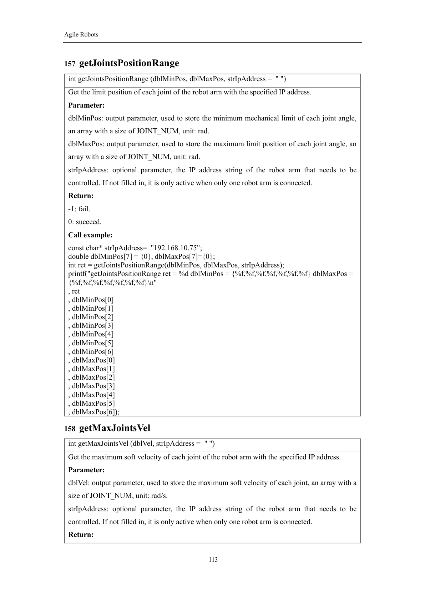



```
Agile Robots 
 113  
157 getJointsPositionRange 
int getJointsPositionRange (dblMinPos, dblMaxPos, strIpAddress =  " ") 
Get the limit position of each joint of the robot arm with the specified IP address.  
Parameter:  
dblMinPos: output parameter, used to store the minimum mechanical limit of each joint angle, 
an array with a size of JOINT_NUM, unit: rad.  
dblMaxPos: output parameter, used to store the maximum limit position of each joint angle, an 
array with a size of JOINT_NUM, unit: rad.  
strIpAddress: optional parameter, the IP address string of the robot arm that needs to be 
controlled. If not filled in, it is only active when only one robot arm is connected.  
Return:  
-1: fail.  
0: succeed.  
Call example:  
const char* strIpAddress=  "192.168.10.75"; 
double dblMinPos[7] = {0}, dblMaxPos[7]={0}; 
int ret = getJointsPositionRange(dblMinPos, dblMaxPos, strIpAddress); 
printf("getJointsPositionRange ret = %d dblMinPos = {%f,%f,%f,%f,%f,%f,%f} dblMaxPos = 
{%f,%f,%f,%f,%f,%f,%f}\n" 
, ret 
, dblMinPos[0] 
, dblMinPos[1] 
, dblMinPos[2] 
, dblMinPos[3] 
, dblMinPos[4] 
, dblMinPos[5] 
, dblMinPos[6] 
, dblMaxPos[0] 
, dblMaxPos[1] 
, dblMaxPos[2] 
, dblMaxPos[3] 
, dblMaxPos[4] 
, dblMaxPos[5] 
, dblMaxPos[6]); 
158 getMaxJointsVel 
int getMaxJointsVel (dblVel, strIpAddress =  " ") 
Get the maximum soft velocity of each joint of the robot arm with the specified IP address.  
Parameter:  
dblVel: output parameter, used to store the maximum soft velocity of each joint, an array with a 
size of JOINT_NUM, unit: rad/s.  
strIpAddress: optional parameter, the IP address string of the robot arm that needs to be 
controlled. If not filled in, it is only active when only one robot arm is connected.  
Return:
```



## PDF page 123

**Source:** Industrial API Manual (C\&C++ Edition) \_V3.3.0\_EN\_20260605.pdf, original pdf page 123. [Open the corresponding PDF reading-copy page](https://1292444914-files.gitbook.io/~/files/v0/b/gitbook-x-prod.appspot.com/o/spaces%2FtgOfPnscWebs1eh82EKq%2Fuploads%2FWGm4W5tbOjT5mD2c1h1g%2Findustrial-api-manual-c-c-edition-v3-3-0-en-20260605-pp-001-150.pdf?alt=media#page=123).







```
Agile Robots 
 114  
-1: fail.  
0: succeed.  
Call example:  
const char* strIpAddress=  "192.168.10.75"; 
double dblMaxVel[7]={0}; 
int ret = getMaxJointsVel(dblMaxVel, strIpAddress); 
printf("getMaxJointsVel ret = %d dblMaxVel = {%f,%f,%f,%f,%f,%f,%f}\n" 
, ret 
, dblMaxVel[0] 
, dblMaxVel[1] 
, dblMaxVel[2] 
, dblMaxVel[3] 
, dblMaxVel[4] 
, dblMaxVel[5] 
, dblMaxVel[6]); 
159 getMaxJointsAcc 
int getMaxJointsAcc (dblAcc, strIpAddress =  " ") 
Get the maximum soft acceleration of each joint of the robot arm with the specified IP address.  
Parameter:  
dblAcc: output parameter, used to store the maximum soft acceleration of each joint, an array 
with a size of JOINT_NUM, unit: rad/s2.  
strIpAddress: optional parameter, the IP address string of the robot arm that needs to be 
controlled. If not filled in, it is only active when only one robot arm is connected.  
Return:  
-1: fail.  
0: succeed.  
Call example:  
const char* strIpAddress=  "192.168.10.75"; 
double dblMaxAcc[7]={0}; 
int ret = getMaxJointsAcc(dblMaxAcc, strIpAddress); 
printf("getMaxJointsAcc ret = %d dblMaxAcc = {%f,%f,%f,%f,%f,%f,%f}\n" 
, ret 
, dblMaxAcc[0] 
, dblMaxAcc[1] 
, dblMaxAcc[2] 
, dblMaxAcc[3] 
, dblMaxAcc[4] 
, dblMaxAcc[5] 
, dblMaxAcc[6]); 
160 getMaxCartTranslationVel 
int getMaxCartTranslationVel (dblMaxCartTranslationVel, strIpAddress =  " ") 
Get the maximum soft translation velocity of the robot arm with the specified IP address in 
Cartesian space.  
Parameter:
```



## PDF page 124

**Source:** Industrial API Manual (C\&C++ Edition) \_V3.3.0\_EN\_20260605.pdf, original pdf page 124. [Open the corresponding PDF reading-copy page](https://1292444914-files.gitbook.io/~/files/v0/b/gitbook-x-prod.appspot.com/o/spaces%2FtgOfPnscWebs1eh82EKq%2Fuploads%2FWGm4W5tbOjT5mD2c1h1g%2Findustrial-api-manual-c-c-edition-v3-3-0-en-20260605-pp-001-150.pdf?alt=media#page=124).







```
Agile Robots 
 115  
dblMaxCartTranslationVel: output parameter, used to store the maximum soft translation velocity 
in Cartesian space, double type variable, unit: m/s.  
strIpAddress: optional parameter, the IP address string of the robot arm that needs to be 
controlled. If not filled in, it is only active when only one robot arm is connected.  
Return:  
-1: fail.  
0: succeed.  
Call example:  
const char* strIpAddress=  "192.168.10.75"; 
double dblLinearVel = 0; 
int ret = getMaxCartTranslationVel(dblLinearVel, strIpAddress); 
printf("getMaxCartTranslationVel ret = %d dblLinearVel=%f\n" 
, ret 
, dblLinearVel 
); 
161 getMaxCartRotationVel 
int getMaxCartRotationVel (dblMaxCartRotationVel, strIpAddress =  " ") 
Get the maximum soft rotation velocity of the robot arm with the specified IP address in Cartesian 
space.  
Parameter:  
dblMaxCartRotationVel: output parameter, used to store the maximum soft rotation velocity in 
Cartesian space, double type variable, unit: rad/s.  
strIpAddress: optional parameter, the IP address string of the robot arm that needs to be 
controlled. If not filled in, it is only active when only one robot arm is connected.  
Return:  
-1: fail.  
0: succeed.  
Call example:  
const char* strIpAddress=  "192.168.10.75"; 
double dblRotationVel = 0; 
int ret = getMaxCartRotationVel(dblRotationVel, strIpAddress); 
printf("getMaxCartRotationVel ret = %d dblRotationVel=%f\n" 
, ret 
, dblRotationVel); 
162 getMaxCartTranslationAcc 
int getMaxCartTranslationAcc (dblMaxCartTranslationAcc, strIpAddress =  " ") 
Get the maximum soft translation acceleration of the robot arm with the specified IP address in 
Cartesian space.  
Parameter:  
dblMaxCartTranslationAcc: output parameter, used to store the maximum soft translation 
acceleration in Cartesian space, double type variable, unit: m/s2.
```



## PDF page 125

**Source:** Industrial API Manual (C\&C++ Edition) \_V3.3.0\_EN\_20260605.pdf, original pdf page 125. [Open the corresponding PDF reading-copy page](https://1292444914-files.gitbook.io/~/files/v0/b/gitbook-x-prod.appspot.com/o/spaces%2FtgOfPnscWebs1eh82EKq%2Fuploads%2FWGm4W5tbOjT5mD2c1h1g%2Findustrial-api-manual-c-c-edition-v3-3-0-en-20260605-pp-001-150.pdf?alt=media#page=125).







```
Agile Robots 
 116  
strIpAddress: optional parameter, the IP address string of the robot arm that needs to be 
controlled. If not filled in, it is only active when only one robot arm is connected.  
Return:  
-1: fail.  
0: succeed.  
Call example:  
const char* strIpAddress=  "192.168.10.75"; 
double dblLinearAcc = 0; 
int ret = getMaxCartTranslationAcc(dblLinearAcc, strIpAddress); 
printf("getMaxCartTranslationAcc ret = %d dblLinearAcc=%f\n" 
, ret 
, dblLinearAcc); 
163 getMaxCartRotationAcc 
int getMaxCartRotationAcc (dblMaxCartRotationAcc, strIpAddress =  " ") 
Maximum soft rotation acceleration of the robot arm with the specified IP address in Cartesian 
space.  
Parameter:  
dblMaxCartRotationAcc: output parameter, used to store the maximum soft rotation acceleration 
in Cartesian space, double type variable, unit: rad/s2.  
strIpAddress: optional parameter, the IP address string of the robot arm that needs to be 
controlled. If not filled in, it is only active when only one robot arm is connected.  
Return:  
-1: fail.  
0: succeed.  
Call example:  
const char* strIpAddress=  "192.168.10.75"; 
double dblRotationAcc = 0; 
int ret = getMaxCartRotationAcc(dblRotationAcc, strIpAddress); 
printf("getMaxCartRotationAcc ret = %d dblRotationAcc=%f\n" 
, ret 
, dblRotationAcc); 
164 setJointsPositionRange 
int setJointsPositionRange (dblMinPos, dblMaxPos, strIpAddress =  " ") 
Set the limit position of each joint of the robot arm with the specified IP address.  
Parameter:  
dblMinPos: input parameter, minimum limit position of joint angle, an array with size of 
JOINT_NUM, unit: rad.  
dblMaxPos: input parameter, maximum limit position of joint angle, an array with size of 
JOINT_NUM, unit: rad.  
strIpAddress: optional parameter, the IP address string of the robot arm that needs to be
```



## PDF page 126

**Source:** Industrial API Manual (C\&C++ Edition) \_V3.3.0\_EN\_20260605.pdf, original pdf page 126. [Open the corresponding PDF reading-copy page](https://1292444914-files.gitbook.io/~/files/v0/b/gitbook-x-prod.appspot.com/o/spaces%2FtgOfPnscWebs1eh82EKq%2Fuploads%2FWGm4W5tbOjT5mD2c1h1g%2Findustrial-api-manual-c-c-edition-v3-3-0-en-20260605-pp-001-150.pdf?alt=media#page=126).







```
Agile Robots 
 117  
controlled. If not filled in, it is only active when only one robot arm is connected.  
Return:  
<0: Failed. The reason for failure is detailed in the error code. 
0: succeed.  
Call example:  
const char* strIpAddress=  "192.168.10.75"; 
double dblMinPos[7] = {0}, dblMaxPos[7]={0}; 
int ret = getJointsPositionRange(dblMinPos, dblMaxPos, strIpAddress);  
for (int i = 0;  i < 7;  ++i) {  
 
dblMinPos[i]++; 
  
 
dblMaxPos[i]--;  
}  
ret = setJointsPositionRange(dblMinPos,dblMaxPos,strIpAddress);  
printf("setJointsPositionRange return %d\n",ret);  
ret = saveEnvironment(strIpAddress);  
printf("saveEnvironment return %d\n",ret);  
165 setMaxJointsVel  
int setMaxJointsVel (dblVel, strIpAddress =  " ")  
Set the maximum soft velocity of each joint of the robot arm with the specified IP address.  
Parameter:  
dblVel: input parameter, the maximum soft acceleration of each joint, an array with a size of 
JOINT_NUM, unit: rad/s.  
strIpAddress: optional parameter, the IP address string of the robot arm that needs to be 
controlled. If not filled in, it is only active when only one robot arm is connected.  
Return:  
<0: Failed. The reason for failure is detailed in the error code. 
0: succeed.  
Call example:  
const char* strIpAddress=  "192.168.10.75"; 
double dblMaxVel[7]={0}; 
int ret = getMaxJointsVel(dblMaxVel, strIpAddress); 
for (int i = 0; i < 7; ++i) { 
 
dblMaxVel[i]--; 
} 
ret = setMaxJointsVel(dblMaxVel, strIpAddress); 
printf("setMaxJointsVel return %d\n",ret); 
ret = saveEnvironment(strIpAddress); 
printf("saveEnvironment return %d\n",ret); 
166 setMaxJointsAcc 
int setMaxJointsAcc (dblAcc, strIpAddress =  " ") 
Set the maximum soft acceleration of each joint of the robot arm with the specified IP address.  
Parameter:  
dblAcc: input parameter, used to store the maximum soft acceleration of each joint, an array with
```



## PDF page 127

**Source:** Industrial API Manual (C\&C++ Edition) \_V3.3.0\_EN\_20260605.pdf, original pdf page 127. [Open the corresponding PDF reading-copy page](https://1292444914-files.gitbook.io/~/files/v0/b/gitbook-x-prod.appspot.com/o/spaces%2FtgOfPnscWebs1eh82EKq%2Fuploads%2FWGm4W5tbOjT5mD2c1h1g%2Findustrial-api-manual-c-c-edition-v3-3-0-en-20260605-pp-001-150.pdf?alt=media#page=127).







```
Agile Robots 
 118  
a size of JOINT_NUM, unit: rad/s2.  
strIpAddress: optional parameter, the IP address string of the robot arm that needs to be 
controlled. If not filled in, it is only active when only one robot arm is connected.  
Return:  
-1: fail.  
0: succeed.  
Call example:  
const char* strIpAddress=  "192.168.10.75"; 
double dblMaxAcc[7]={0}; 
int ret = getMaxJointsAcc(dblMaxAcc, strIpAddress); 
for (int i = 0; i < 7; ++i) { 
 
dblMaxAcc[i]--; 
} 
ret = setMaxJointsAcc(dblMaxAcc, strIpAddress); 
ret = saveEnvironment(strIpAddress); 
printf("saveEnvironment return %d\n",ret); 
167 setMaxCartTranslationVel 
int setMaxCartTranslationVel (dblMaxCartTranslationVel, strIpAddress =  " ") 
Set the maximum soft translation velocity of the robot arm with the specified IP address in 
Cartesian space.  
Parameter:  
dblMaxCartTranslationVel: input parameter, used to store the maximum soft translation velocity 
in Cartesian space, double type variable, unit: m/s.  
strIpAddress: optional parameter, the IP address string of the robot arm that needs to be 
controlled. If not filled in, it is only active when only one robot arm is connected.  
Return:  
-1: fail.  
0: succeed.  
Call example:  
const char* strIpAddress=  "192.168.10.75"; 
double dblLinearVel = 0.5; 
int ret = setMaxCartTranslationVel(dblLinearVel, strIpAddress); 
printf("setMaxCartTranslationVel return = %d\n",ret); 
ret = saveEnvironment(strIpAddress); 
printf("saveEnvironment return %d\n",ret); 
168 setMaxCartRotationVel 
int setMaxCartRotationVel (dblMaxCartRotationVel, strIpAddress =  " ") 
Set the maximum soft rotation velocity of the robot arm with the specified IP address in Cartesian 
space.  
Parameter:  
dblMaxCartRotationVel: input parameter, maximum soft rotation velocity in Cartesian space, 
double type variable, unit: rad/s.
```



## PDF page 128

**Source:** Industrial API Manual (C\&C++ Edition) \_V3.3.0\_EN\_20260605.pdf, original pdf page 128. [Open the corresponding PDF reading-copy page](https://1292444914-files.gitbook.io/~/files/v0/b/gitbook-x-prod.appspot.com/o/spaces%2FtgOfPnscWebs1eh82EKq%2Fuploads%2FWGm4W5tbOjT5mD2c1h1g%2Findustrial-api-manual-c-c-edition-v3-3-0-en-20260605-pp-001-150.pdf?alt=media#page=128).







```
Agile Robots 
 119  
strIpAddress: optional parameter, the IP address string of the robot arm that needs to be 
controlled. If not filled in, it is only active when only one robot arm is connected.  
Return:  
-1: fail.  
0: succeed.  
Call example:  
const char* strIpAddress=  "192.168.10.75"; 
double dblRotationVel = 1; 
int ret = setMaxCartRotationVel(dblRotationVel, strIpAddress); 
printf("setMaxCartRotationVel return = %d\n",ret); 
ret = saveEnvironment(strIpAddress); 
printf("saveEnvironment return %d\n",ret); 
169 setMaxCartTranslationAcc 
int setMaxCartTranslationAcc (dblMaxCartTranslationAcc, strIpAddress =  " ") 
Set the maximum soft translation acceleration of the robot arm with the specified IP address in 
Cartesian space.  
Parameter:  
dblMaxCartTranslationAcc: input parameter, the maximum soft translation acceleration in 
Cartesian space, double type variable, unit: m/s2.  
strIpAddress: optional parameter, the IP address string of the robot arm that needs to be 
controlled. If not filled in, it is only active when only one robot arm is connected.  
Return:  
-1: fail.  
0: succeed.  
Call example:  
const char* strIpAddress=  "192.168.10.75"; 
double dblLinearAcc = 1; 
int ret = setMaxCartTranslationAcc(dblLinearAcc, strIpAddress); 
printf("setMaxCartTranslationAcc return = %d\n",ret); 
ret = saveEnvironment(strIpAddress); 
printf("saveEnvironment return %d\n",ret); 
170 setMaxCartRotationAcc 
int setMaxCartRotationAcc (dblMaxCartRotationAcc, strIpAddress =  " ") 
Set the maximum soft rotation acceleration of the robot arm with the specified IP address in 
Cartesian space.  
Parameter:  
dblMaxCartRotationAcc: input parameter, maximum soft rotation acceleration in Cartesian 
space, double type variable, unit: rad/s2.  
strIpAddress: optional parameter, the IP address string of the robot arm that needs to be 
controlled. If not filled in, it is only active when only one robot arm is connected.
```



## PDF page 129

**Source:** Industrial API Manual (C\&C++ Edition) \_V3.3.0\_EN\_20260605.pdf, original pdf page 129. [Open the corresponding PDF reading-copy page](https://1292444914-files.gitbook.io/~/files/v0/b/gitbook-x-prod.appspot.com/o/spaces%2FtgOfPnscWebs1eh82EKq%2Fuploads%2FWGm4W5tbOjT5mD2c1h1g%2Findustrial-api-manual-c-c-edition-v3-3-0-en-20260605-pp-001-150.pdf?alt=media#page=129).







```
Agile Robots 
 120  
Return:  
-1: fail.  
0: succeed.  
Call example:  
const char* strIpAddress=  "192.168.10.75"; 
double dblRotationAcc = 1; 
int ret = setMaxCartRotationAcc(dblRotationAcc, strIpAddress); 
printf("setMaxCartRotationAcc return = %d\n",ret); 
ret = saveEnvironment(strIpAddress); 
printf("saveEnvironment return %d\n",ret); 
 
171 requireHandlingError 
int requireHandlingError (int *error, strIpAddress =  " ") 
Get the confirmed and pending error code.  
Parameter:  
error: calue used to store the error code  
strIpAddress: optional parameter, the IP address string of the robot arm that needs to be 
controlled. If not filled in, it is only active when only one robot arm is connected.  
Return:  
-1: fail.  
0: succeed.  
Call example:  
int errorCode  = 0; 
ret = requireHandlingError(&errorCode); 
 
 
172 getJointsSoftLimitRange 
int getJointsSoftLimitRange (double* dblMinPos, double* dblMaxPos, strIpAddress =  " ") 
Get the soft limit of each joint of the robot arm with the specified IP address.  
Parameter:  
dblMinPos: output parameter, minimum soft limit of joint angle, an array with size of 
JOINT_NUM, unit: rad.  
dblMaxPos: output parameter, maximum soft limit of joint angle, an array with size of 
JOINT_NUM, unit: rad.  
strIpAddress: optional parameter, the IP address string of the robot arm that needs to be 
controlled. If not filled in, it is only active when only one robot arm is connected.  
Return:
```



## PDF page 130

**Source:** Industrial API Manual (C\&C++ Edition) \_V3.3.0\_EN\_20260605.pdf, original pdf page 130. [Open the corresponding PDF reading-copy page](https://1292444914-files.gitbook.io/~/files/v0/b/gitbook-x-prod.appspot.com/o/spaces%2FtgOfPnscWebs1eh82EKq%2Fuploads%2FWGm4W5tbOjT5mD2c1h1g%2Findustrial-api-manual-c-c-edition-v3-3-0-en-20260605-pp-001-150.pdf?alt=media#page=130).







```
Agile Robots 
 121  
<0: Failed. The reason for failure is detailed in the error code. 
0: succeed.  
Call example:  
const char* strIpAddress=  "192.168.10.75"; 
double dblMinPos[7] = {0}, dblMaxPos[7]={0}; 
int ret = getJointsSoftLimitRange(dblMinPos, dblMaxPos, strIpAddress); 
printf("getJointsSoftLimitRange return %d\n",ret); 
for (int i = 0; i < 7; ++i) { 
printf("Joint %d min:%f\n", i + 1, dblMinPos[i]); 
printf("Joint %d max:%f\n", i + 1, dblMaxPos[i]); 
 
} 
 
173 setJointsSoftLimitRange 
int setJointsSoftLimitRange (dblMinPos, dblMaxPos, strIpAddress =  " ") 
Set the soft limit of each joint of the robot arm with the specified IP address.  
Parameter:  
dblMinPos: input parameter, minimum soft limit of joint angle, an array with size of 
JOINT_NUM, unit: rad.  
dblMaxPos: input parameter, maximum soft limit of joint angle, an array with size of 
JOINT_NUM, unit: rad.  
strIpAddress: optional parameter, the IP address string of the robot arm that needs to be 
controlled. If not filled in, it is only active when only one robot arm is connected.  
Return:  
-1: fail.  
0: succeed.  
Call example:  
const char* strIpAddress=  "192.168.10.75"; 
double dblMinPos[7] = {0}, dblMaxPos[7]={0}; 
int ret = getJointsSoftLimitRange(dblMinPos, dblMaxPos, strIpAddress); 
for (int i = 0; i < 7; ++i) { 
 
dblMinPos[i]++; 
 
dblMaxPos[i]--; 
} 
setJointsSoftLimitRange(dblMinPos, dblMaxPos, strIpAddress); 
 
174 getFunctionOptI4 
int getFunctionOptI4 (function_id, opt_name, int *opt_value, strIpAddress =  " ") 
Get optional parameters for the specified function.  
Parameter:  
function_id: Id of the specified function, where 0 is free drive (currently not supported) and 1 is
```



## PDF page 131

**Source:** Industrial API Manual (C\&C++ Edition) \_V3.3.0\_EN\_20260605.pdf, original pdf page 131. [Open the corresponding PDF reading-copy page](https://1292444914-files.gitbook.io/~/files/v0/b/gitbook-x-prod.appspot.com/o/spaces%2FtgOfPnscWebs1eh82EKq%2Fuploads%2FWGm4W5tbOjT5mD2c1h1g%2Findustrial-api-manual-c-c-edition-v3-3-0-en-20260605-pp-001-150.pdf?alt=media#page=131).







```
Agile Robots 
 122  
Cartesian impedance.  
opt_name: optional parameter for function. When the function_id is 1, the parameters are as 
follows:  
a)  0x10100: get the reference coordinate system for Cartesian impedance;  
b)  0x10101: get whether Cartesian impedance locks the axis.  
opt_value: value used to store parameters, which varies with the value of opt_name:  
a)  0x10100: 0 represents the base coordinate system, and 1 represents the tool 
coordinate system;  
b)  0x10101: 1 represents the locking axis.  
strIpAddress: optional parameter, the IP address string of the robot arm that needs to be 
controlled. If not filled in, it is only active when only one robot arm is connected.  
Return:  
-1: fail.  
0: succeed.  
Call example:  
int opt_value = 0; 
int ret = getFunctionOptI4 (1, 0x10100, &opt_value); 
 
 
175 setFunctionOptI4 
int setFunctionOptI4 (function_id, opt_name, int opt_value, strIpAddress =  " ") 
Set optional parameters for the specified function.  
Parameter:  
function_id: Id of the specified function, where 0 is free drive (currently not supported) and 1 is 
Cartesian impedance.  
opt_name: optional parameter for function. When the function_id is 1, the parameters are as 
follows:  
a)  0x10100: represent the reference coordinate system for Cartesian impedance;  
b)  0x10102: Cartesian impedance locking axis.  
opt_value: value used to set parameters, which varies with the value of opt_name:  
a)  0x10100: 0 represents the base coordinate system, and 1 represents the tool 
coordinate system;  
b)  0x10102: the current version only supports locking the third axis (i.e. value 2), 
where -1 represents unlocking.  
strIpAddress: optional parameter, the IP address string of the robot arm that needs to be 
controlled. If not filled in, it is only active when only one robot arm is connected.  
Return:
```



## PDF page 132

**Source:** Industrial API Manual (C\&C++ Edition) \_V3.3.0\_EN\_20260605.pdf, original pdf page 132. [Open the corresponding PDF reading-copy page](https://1292444914-files.gitbook.io/~/files/v0/b/gitbook-x-prod.appspot.com/o/spaces%2FtgOfPnscWebs1eh82EKq%2Fuploads%2FWGm4W5tbOjT5mD2c1h1g%2Findustrial-api-manual-c-c-edition-v3-3-0-en-20260605-pp-001-150.pdf?alt=media#page=132).







```
Agile Robots 
 123  
-1: fail.  
0: succeed.  
Call example:  
int ret = setFunctionOptI4 (1, 0x10100, 1); 
 
 
176 enterRescueMode 
int enterRescueMode(strIpAddress = "") 
Enter safety handling state, there are three modes of safety handling state, safety zero force mode, 
joint drive mode and Cartesian drive mode, default enter joint drive mode, after enter safety 
handling state, you can switch the safety handling mode by switchRescueMode, only when the 
controller is in Idle state, you can do this operation. The original function name is enterSafetyIdle. 
Parameter:  
strIpAddress: optional parameter, the IP address string of the robot arm that needs to be 
controlled. If not filled in, it is only active when only one robot arm is connected.  
Return:  
0: succeed.  
-1: fail.  
Call example:  
const char* strIpAddress = "192.168.10.75"; 
int ret = enterRescueMode(strIpAddress); 
 
177 leaveRescueMode 
int leavRescueMode (strIpAddress = "") 
Exits the safety processing mode. The original function is named leaveSafetyIdle. 
Parameter:  
strIpAddress: optional parameter, the IP address string of the robot arm that needs to be 
controlled. If not filled in, it is only active when only one robot arm is connected.  
Return:  
0: succeed.  
-1: fail.  
Call example:  
const char* strIpAddress = "192.168.10.75"; 
int ret = leaveRescueMode (strIpAddress);
```



## PDF page 133

**Source:** Industrial API Manual (C\&C++ Edition) \_V3.3.0\_EN\_20260605.pdf, original pdf page 133. [Open the corresponding PDF reading-copy page](https://1292444914-files.gitbook.io/~/files/v0/b/gitbook-x-prod.appspot.com/o/spaces%2FtgOfPnscWebs1eh82EKq%2Fuploads%2FWGm4W5tbOjT5mD2c1h1g%2Findustrial-api-manual-c-c-edition-v3-3-0-en-20260605-pp-001-150.pdf?alt=media#page=133).







```
Agile Robots 
 124  
 
178 getCartImpedanceCoordinateType 
int getCartImpedanceCoordinateType(strIpAddress =  " ") 
Get the coordinate system type on the robot arm with the specified IP address in the Cartesian 
impedance mode.  
Parameter:  
strIpAddress: optional parameter, the IP address string of the robot arm that needs to be 
controlled. If not filled in, it is only active when only one robot arm is connected.  
Return:  
Type of coordinate system, 0: base coordinate system,  1: tool coordinate system.  
Call example:  
const char* strIpAddress =  "192.168.10.75 "; 
int ret = getCartImpedanceCoordinateType(strIpAddress); 
if(ret == 0){ 
    printf( "it’s base coordinate\n "); 
} 
else{ 
    printf( "it’s tool coordinate\n "); 
} 
 
179 setCartImpedanceCoordinateType 
int setCartImpedanceCoordinateType(intCoordinateType, strIpAddress =  " ") 
Set the coordinate system type on the robot arm with the specified IP address in the Cartesian 
impedance mode.  
Parameter:  
intCoordinateType: Type of coordinate system, 0: base coordinate system,  1: tool coordinate 
system.  
strIpAddress: optional parameter, the IP address string of the robot arm that needs to be 
controlled. If not filled in, it is only active when only one robot arm is connected.  
Return:  
0: succeed.  
-1: fail.  
Call example:  
const char* strIpAddress =  "192.168.10.75 "; 
int ret = setCartImpedanceCoordinateType(0,strIpAddress); 
if(ret < 0){
```



## PDF page 134

**Source:** Industrial API Manual (C\&C++ Edition) \_V3.3.0\_EN\_20260605.pdf, original pdf page 134. [Open the corresponding PDF reading-copy page](https://1292444914-files.gitbook.io/~/files/v0/b/gitbook-x-prod.appspot.com/o/spaces%2FtgOfPnscWebs1eh82EKq%2Fuploads%2FWGm4W5tbOjT5mD2c1h1g%2Findustrial-api-manual-c-c-edition-v3-3-0-en-20260605-pp-001-150.pdf?alt=media#page=134).







```
Agile Robots 
 125  
    printf( "setCartImpedanceCoordinateType failed! Return value = %d\n ", ret); 
} 
 
180 setJointLockedInCartImpedanceMode 
int setJointLockedInCartImpedanceMode(const bool bLock, const int intLockedJointIndex, 
strIpAddress =  "") 
Set the robot arm with the specified IP address to lock/unlock an axis in Cartesian impedance 
and/or force control mode (current version only supports locking the third axis). This setting will 
be officially active when the robot arm enters Cartesian impedance or force control mode. (Note: 
This API is a setup option that does not lock axis by default. If you need to lock an axis in 
Cartesian impedance mode or force control mode, you need to set this option before entering 
Cartesian impedance mode or force control mode) 
Parameter:  
bLock: input parameter. If this value is true, it means that the robot arm will lock a certain axis 
in Cartesian impedance and/or force control mode (the current version only supports locking the 
third axis, that is, intLockedJointIdex must be 2, otherwise locking is invalid); if this value is 
false, regardless of the value of intLockedJointIdex, it means that the robot arm unlocks an axis 
in Cartesian impedance and/or force control mode (the current version only supports unlocking 
the third axis).  
intLockedJointIdex: optional input parameter, the index value of the axis (starting from 0), with 
a default value of 2 (i.e. the third axis).  
strIpAddress: optional parameter, the IP address string of the robot arm that needs to be 
controlled. If not filled in, it is only active when only one robot arm is connected.  
Return:  
-1: fail.  
0: succeed.  
Call example:  
//Set to lock the third axis  
const char* robot0 =  "192.168.10.75"; 
const bool bLock = true; 
int intLockedJointIndex = 2; 
int ret = setJointLockedInCartImpedanceMode(bLock, intLockedJointIndex, robot0); 
printf("setJointLockedInCartImpedanceMode return = %d\n",ret); 
 
//Set to unlock the third axis  
const char* robot0 =  "192.168.10.75"; 
const bool bLock = false; 
int intLockedJointIndex = -1; 
int ret = setJointLockedInCartImpedanceMode(bLock, intLockedJointIndex, robot0); 
printf("setJointLockedInCartImpedanceMode return = %d\n",ret);
```



## PDF page 135

**Source:** Industrial API Manual (C\&C++ Edition) \_V3.3.0\_EN\_20260605.pdf, original pdf page 135. [Open the corresponding PDF reading-copy page](https://1292444914-files.gitbook.io/~/files/v0/b/gitbook-x-prod.appspot.com/o/spaces%2FtgOfPnscWebs1eh82EKq%2Fuploads%2FWGm4W5tbOjT5mD2c1h1g%2Findustrial-api-manual-c-c-edition-v3-3-0-en-20260605-pp-001-150.pdf?alt=media#page=135).







```
Agile Robots 
 126  
181 getJointLockedInCartImpedanceMode 
int getJointLockedInCartImpedanceMode(bool &isLocked, strIpAddress =  "") 
Query whether the robot arm with the specified IP address locks/unlocks a certain axis in 
Cartesian impedance and/or force control mode (the current version only supports the third axis).  
Parameter:  
isLocked: output parameter. If this value is true, it means that the robot arm locks an axis in 
Cartesian impedance and/or force control mode (the current version only supports the third axis); 
if this value is false, it means that the robot arm unlocks an axis in Cartesian impedance and/or 
force control mode (the current version only supports the third axis).  
strIpAddress: optional parameter, the IP address string of the robot arm that needs to be 
controlled. If not filled in, it is only active when only one robot arm is connected.  
Return:  
-1: fail.  
0: succeed.  
Call example:  
const char* robot0 =  "192.168.10.75"; 
bool bIsLocked = false; 
int ret = getJointLockedInCartImpedanceMode(bIsLocked, robot0); 
printf("getJointLockedInCartImpedanceMode return = %d\n",ret); 
182 setThresholdTorque 
int setThresholdTorque (arrThreshold,strIpAddress = "") 
Set the detection threshold for each joint torque sensor of the robot arm with the specified IP 
address, which is used to detect whether to allow the switching between work modes.  
Parameter:  
arrThreshold: head address of the array of arrThresholds for each joint torque threshold, with an 
array length of JOINT_NUM, unit (N.m)  
strIpAddress: optional parameter, the IP address string of the robot arm that needs to be 
controlled. If not filled in, it is only active when only one robot arm is connected.  
Return:  
0: succeed.  
-1: fail.  
Call example:  
double arrThreshold[7] = { 6, 6, 5, 5, 2, 2, 2}; 
const char* strIpAddress = "192.168.10.75"; 
if (setThresholdTorque (arrThreshold, strIpAddress) < 0) 
{ 
    printf("Diana API setThresholdTorque failed!\n"); 
}
```



## PDF page 136

**Source:** Industrial API Manual (C\&C++ Edition) \_V3.3.0\_EN\_20260605.pdf, original pdf page 136. [Open the corresponding PDF reading-copy page](https://1292444914-files.gitbook.io/~/files/v0/b/gitbook-x-prod.appspot.com/o/spaces%2FtgOfPnscWebs1eh82EKq%2Fuploads%2FWGm4W5tbOjT5mD2c1h1g%2Findustrial-api-manual-c-c-edition-v3-3-0-en-20260605-pp-001-150.pdf?alt=media#page=136).







```
Agile Robots 
 127  
183 getThresholdTorque 
int getThresholdTorque(arrThreshold,strIpAddress = "") 
Get the detection threshold for each joint torque sensor of the robot arm with the specified IP 
address, which is used to detect whether to allow the switching between work modes.  
Parameter:  
arrThreshold: head address of the array of arrThresholds for each joint torque threshold, with an 
array length of JOINT_NUM, unit (N.m)  
strIpAddress: optional parameter, the IP address string of the robot arm that needs to be 
controlled. If not filled in, it is only active when only one robot arm is connected.  
Return:  
0: succeed.  
-1: fail.  
Call example:  
double arrThreshold [JOINT_NUM] = { 0}; 
const char* strIpAddress = "192.168.10.75"; 
if ( getThresholdTorque (arrThreshold, strIpAddress) < 0) 
{ 
    printf("Diana API getThresholdTorque failed!\n"); 
} 
else 
{ 
    printf(" getThresholdTorque : arrThreshold=%f, %f, %f, %f, %f, %f, %f\n", 
    arrThreshold[0], arrThreshold[1], arrThreshold[2], arrThreshold[3], arrThreshold[4], 
arrThreshold[5], arrThreshold[6]); 
} 
184 setHeartbeatParam 
int setHeartbeatParam(int disconnectTimeout, int stopRobotTimeout, strIpAddress = "") 
Set the timeout time related to API heartbeat.  
Parameter:  
disconnectTimeout: API disconnection timeout time, unit: ms (-1 is equivalent to never 
disconnecting)  
stopRobotTimeout: timeout for stopping the robot, unit: ms (-1 is equivalent to never stopping)  
strIpAddress: optional parameter, the IP address string of the robot arm that needs to be 
controlled. If not filled in, it is only active when only one robot arm is connected.  
Return:  
0: succeed.
```



## PDF page 137

**Source:** Industrial API Manual (C\&C++ Edition) \_V3.3.0\_EN\_20260605.pdf, original pdf page 137. [Open the corresponding PDF reading-copy page](https://1292444914-files.gitbook.io/~/files/v0/b/gitbook-x-prod.appspot.com/o/spaces%2FtgOfPnscWebs1eh82EKq%2Fuploads%2FWGm4W5tbOjT5mD2c1h1g%2Findustrial-api-manual-c-c-edition-v3-3-0-en-20260605-pp-001-150.pdf?alt=media#page=137).







```
Agile Robots 
 128  
-1: fail.  
Call example:  
const char* strIpAddress = "192.168.10.75"; 
int ret = setHeartbeatParam(-1, -1, strIpAddress); 
if (ret == -1) { 
    printf("setHeartbeatParam fail\n"); 
} 
185 getHeartbeatParam 
int getHeartbeatParam(int *disconnectTimeout, int *stopRobotTimeout, strIpAddress = "") 
Get the timeout time related to API heartbeat.  
Parameter:  
disconnectTimeout: API disconnection timeout time, unit: ms (-1 is equivalent to never 
disconnecting)  
stopRobotTimeout: timeout for stopping the robot, unit: ms (-1 is equivalent to never stopping)  
strIpAddress: optional parameter, the IP address string of the robot arm that needs to be 
controlled. If not filled in, it is only active when only one robot arm is connected.  
Return:  
0: succeed.  
-1: fail.  
Call example:  
const char* strIpAddress = "192.168.10.75"; 
int disconnectTimeout; 
int stopRobotTimeout; 
int ret = getHeartbeatParam(&disconnectTimeout, &stopRobotTimeout, strIpAddress); 
if (ret == 0) { 
    printf("timeout:%d:%d\n", disconnectTimeout, stopRobotTimeout); 
} 
186 customRobotState 
int customRobotState(int action, unsigned long long customBits, strIpAddress = "") 
Customize robot status push information.  
Parameter:  
action: _CustmRoobotStateAction enumeration type, defined as:  
    API_CUSTOM_ADD: add push information indicated by customBits.  
    API_CUSTOM_DEL: delete push information indicated by customBits.  
    API_CUSTOM_RSEET: reset push information indicated by customBits.  
CustomBits: customized push information bits. The following information can be customized:
```



## PDF page 138

**Source:** Industrial API Manual (C\&C++ Edition) \_V3.3.0\_EN\_20260605.pdf, original pdf page 138. [Open the corresponding PDF reading-copy page](https://1292444914-files.gitbook.io/~/files/v0/b/gitbook-x-prod.appspot.com/o/spaces%2FtgOfPnscWebs1eh82EKq%2Fuploads%2FWGm4W5tbOjT5mD2c1h1g%2Findustrial-api-manual-c-c-edition-v3-3-0-en-20260605-pp-001-150.pdf?alt=media#page=138).







```
Agile Robots 
 129  
#define    ROBOTSTATE_CUSTOM_BASIC                (0x00000001)    //Basic status information, 
must be pushed and cannot be customized, including stateBits, trajectoryState in 
BasicRobotState_1 and all data in BasicRobotState2  
#define    ROBOTSTATE_CUSTOM_JOINTPOS             (0x00000002)    //Joint feedback 
position  
#define    ROBOTSTATE_CUSTOM_LINKJOINTPOS         (0x00000004)    // Low speed side 
joint feedback position  
#define    ROBOTSTATE_CUSTOM_JOINTANGULARVEL      (0x00000008)     //Joint 
feedback velocity  
#define    ROBOTSTATE_CUSTOM_JOINTCURRENT         (0x00000010)    //Joint feedback 
current  
#define    ROBOTSTATE_CUSTOM_ORIGINJOINTTORQUE    (0x00000020)    //Joint 
feedback torque (including zero offset)  
#define    ROBOTSTATE_CUSTOM_JOINTTORQUEOFFSET    (0x00000040)    //Zero offset 
of joint torque sensor  
#define    ROBOTSTATE_CUSTOM_JOINTFORCE           (0x00000080)    //Joint external force  
#define    ROBOTSTATE_CUSTOM_TCPFORCE             (0x00000100)    //External force on 
the end  
#define    ROBOTSTATE_CUSTOM_ALL                  (0xffffffff)    //Customize all  
 
strIpAddress: optional parameter, the IP address string of the robot arm that needs to be 
controlled. If not filled in, it is only active when only one robot arm is connected.  
Return:  
0: succeed.  
-1: fail.  
Call example:  
const char* strIpAddress = "192.168.10.75"; 
int ret = customRobotState(API_CUSTOM_RESET, ROBOTSTATE_CUSTOM_TCPFORCE 
| ROBOTSTATE_CUSTOM_JOINTFORCE | 
ROBOTSTATE_CUSTOM_JOINTANGULARVEL, strIpAddress); 
if (ret == -1) { 
    printf("customRobotState failed\n"); 
} 
187 getCustomRobotState 
int getCustomRobotState(unsigned long long *customBits, strIpAddress = "") 
Get the current customized push information.  
Parameter:
```



## PDF page 139

**Source:** Industrial API Manual (C\&C++ Edition) \_V3.3.0\_EN\_20260605.pdf, original pdf page 139. [Open the corresponding PDF reading-copy page](https://1292444914-files.gitbook.io/~/files/v0/b/gitbook-x-prod.appspot.com/o/spaces%2FtgOfPnscWebs1eh82EKq%2Fuploads%2FWGm4W5tbOjT5mD2c1h1g%2Findustrial-api-manual-c-c-edition-v3-3-0-en-20260605-pp-001-150.pdf?alt=media#page=139).







```
Agile Robots 
 130  
customBits: customized push information bits. Refer to customRobotState  
strIpAddress: optional parameter, the IP address string of the robot arm that needs to be 
controlled. If not filled in, it is only active when only one robot arm is connected.  
Return:  
0: succeed.  
-1: fail.  
Call example:  
const char* strIpAddress = "192.168.10.75";  
unsigned long long stateFlags = 0; 
ret = getCustomRobotState(&stateFlags, strIpAddress); 
if (ret == -1) { 
    printf("getCustomRobotState failed\n"); 
   } else { 
    if (stateFlags & ROBOTSTATE_CUSTOM_JOINTPOS == 0) { 
 printf("Joint feedback position push information not customized")  
    } else { 
 printf("Joint feedback position push information customized")  
    } 
} 
188 getTcpPoseByTcpName 
int getTcpPoseByTcpName(const char *tcpName, double *coordinate,strIpAddress = "") 
Get the pose of the tool coordinate system based on its name.  
Parameter:  
tcpName: name of the tool coordinate system  
cooridnate: head address of the pose array, with an array length of 6.  
strIpAddress: optional parameter, the IP address string of the robot arm that needs to be 
controlled. If not filled in, it is only active when only one robot arm is connected.  
Return:  
0: succeed.  
-1: fail.  
Call example:  
const char* strIpAddress = "192.168.10.75"; 
const char *tcpName = "coor1"; 
double coorTcpPose[6]; 
int ret = getTcpPoseByTcpName(tcpName, coorTcpPose, strIpAddress); 
if (ret == 0) { 
    for (int i = 0; i < 6; i++) {
```



## PDF page 140

**Source:** Industrial API Manual (C\&C++ Edition) \_V3.3.0\_EN\_20260605.pdf, original pdf page 140. [Open the corresponding PDF reading-copy page](https://1292444914-files.gitbook.io/~/files/v0/b/gitbook-x-prod.appspot.com/o/spaces%2FtgOfPnscWebs1eh82EKq%2Fuploads%2FWGm4W5tbOjT5mD2c1h1g%2Findustrial-api-manual-c-c-edition-v3-3-0-en-20260605-pp-001-150.pdf?alt=media#page=140).







```
Agile Robots 
 131  
        printf("%f, ", coorTcpPose[i]); 
    } 
} 
189 getTcpPoseByWorkPieceName 
int getTcpPoseByWorkPieceName(const char *workPieceName, double *coordinate, 
strIpAddress = "") 
Get the pose of the workpiece coordinate system based on its name.  
Parameter:  
workPieceName: name of the workpiece coordinate system  
cooridnate: head address of the pose array, with an array length of 6.  
strIpAddress: optional parameter, the IP address string of the robot arm that needs to be 
controlled. If not filled in, it is only active when only one robot arm is connected.  
Return:  
0: succeed.  
-1: fail.  
Call example:  
const char* strIpAddress = "192.168.10.75"; 
const char *tcpName = "wpcoor1"; 
double coorTcpPose[6]; 
int ret = getTcpPoseByWorkPieceName(tcpName, coorTcpPose, strIpAddress); 
if (ret == 0) { 
    for (int i = 0; i < 6; i++) { 
        printf("%f, ", coorTcpPose[i]); 
    } 
} 
190 getPayLoadByTcpName  
int getPayLoadByTcpName(const char *tcpName, double *payload, strIpAddress = "")  
Get the tool coordinate system payload information based on the name of the tool coordinate 
system.  
Parameter:  
tcpName: name of the tool coordinate system  
payload: head address of payload array, with an array length of 10  
strIpAddress: optional parameter, the IP address string of the robot arm that needs to be 
controlled. If not filled in, it is only active when only one robot arm is connected.  
Return:  
0: succeed.
```



## PDF page 141

**Source:** Industrial API Manual (C\&C++ Edition) \_V3.3.0\_EN\_20260605.pdf, original pdf page 141. [Open the corresponding PDF reading-copy page](https://1292444914-files.gitbook.io/~/files/v0/b/gitbook-x-prod.appspot.com/o/spaces%2FtgOfPnscWebs1eh82EKq%2Fuploads%2FWGm4W5tbOjT5mD2c1h1g%2Findustrial-api-manual-c-c-edition-v3-3-0-en-20260605-pp-001-150.pdf?alt=media#page=141).







```
Agile Robots 
 132  
-1: fail.  
Call example:  
const char* strIpAddress = "192.168.10.75"; 
const char *tcpName = "coor1"; 
double payLoad[10]; 
int ret = getPayLoadByTcpName(tcpName, payLoad, strIpAddress); 
if (ret == 0) { 
    for (int i = 0; i < 10; i++) { 
        printf("%f, ", payLoad[i]); 
    } 
} 
191 setDefaultToolTcpCoordinate 
int setDefaultToolTcpCoordinate(const char *tcpName, strIpAddress = "") 
Set default tool coordinate system.  
Parameter:  
tcpName: name of the tool coordinate system  
strIpAddress: optional parameter, the IP address string of the robot arm that needs to be 
controlled. If not filled in, it is only active when only one robot arm is connected.  
Return:  
0: succeed.  
-1: fail.  
Call example:  
const char* strIpAddress = "192.168.10.75"; 
const char *tcpName = "coor1"; 
int ret = setDefaultToolTcpCoordinate(tcpName, strIpAddress); 
if (ret == -1) { 
    printf("setDefaultToolTcpCoordinate fail \n"); 
} 
192 setDefaultWorkPieceTcpCoordinate 
int setDefaultWorkPieceTcpCoordinate(const char *workPieceName, strIpAddress = "") 
Set default workpiece coordinate system.  
Parameter:  
workPieceName: name of the workpiece coordinate system  
strIpAddress: optional parameter, the IP address string of the robot arm that needs to be 
controlled. If not filled in, it is only active when only one robot arm is connected.  
Return:
```



## PDF page 142

**Source:** Industrial API Manual (C\&C++ Edition) \_V3.3.0\_EN\_20260605.pdf, original pdf page 142. [Open the corresponding PDF reading-copy page](https://1292444914-files.gitbook.io/~/files/v0/b/gitbook-x-prod.appspot.com/o/spaces%2FtgOfPnscWebs1eh82EKq%2Fuploads%2FWGm4W5tbOjT5mD2c1h1g%2Findustrial-api-manual-c-c-edition-v3-3-0-en-20260605-pp-001-150.pdf?alt=media#page=142).







```
Agile Robots 
 133  
0: succeed.  
-1: fail.  
Call example:  
const char* strIpAddress = "192.168.10.75"; 
const char *setWpName = "wpcoor1"; 
int ret = setDefaultWorkPieceTcpCoordinate(setWpName, strIpAddress); 
if (ret == -1) { 
    printf(" setDefaultWorkPieceTcpCoordinate fail \n"); 
} 
193 getDefaultTcpCoordinate 
int getDefaultTcpCoordinate(char *tcpName, strIpAddress = "") 
Get the default tool coordinate system name.  
Parameter:  
tcpName: head address of tool coordinate system name array, with an array length not greater 
than 256  
strIpAddress: optional parameter, the IP address string of the robot arm that needs to be 
controlled. If not filled in, it is only active when only one robot arm is connected.  
Return:  
0: succeed.  
-1: fail.  
Call example:  
const char* strIpAddress = "192.168.10.75"; 
char defaultTcpName[256]; 
int ret = getDefaultTcpCoordinate(defaultTcpName, strIpAddress); 
if (ret == 0) { 
    printf("default Tcp Name:%s\n", defaultTcpName); 
} 
194 getDefaultWorkPieceCoordinate  
int getDefaultWorkPieceCoordinate(const char *workpieceName, strIpAddress = "")  
Get the default workpiece coordinate system name.  
Parameter:  
workpieceName: head address of workpiece coordinate system name array, with an array length 
not more than 256  
strIpAddress: optional parameter, the IP address string of the robot arm that needs to be 
controlled. If not filled in, it is only active when only one robot arm is connected.  
Return:
```



## PDF page 143

**Source:** Industrial API Manual (C\&C++ Edition) \_V3.3.0\_EN\_20260605.pdf, original pdf page 143. [Open the corresponding PDF reading-copy page](https://1292444914-files.gitbook.io/~/files/v0/b/gitbook-x-prod.appspot.com/o/spaces%2FtgOfPnscWebs1eh82EKq%2Fuploads%2FWGm4W5tbOjT5mD2c1h1g%2Findustrial-api-manual-c-c-edition-v3-3-0-en-20260605-pp-001-150.pdf?alt=media#page=143).







```
Agile Robots 
 134  
0: succeed.  
-1: fail.  
Call example:  
const char* strIpAddress = "192.168.10.75"; 
char defaultWpName[256]; 
int ret = getDefaultWorkPieceCoordinate(defaultWpName, strIpAddress); 
if (ret == 0) { 
    printf("defaultWpName:%s\n", defaultWpName); 
} 
195 setVelocityPercentValue 
int setVelocityPercentValue(int value, strIpAddress = "") 
Set the velocity percentage.  
Parameter:  
value: integer，Speed percentage during program execution, range: 0-100. 
strIpAddress: optional parameter, the IP address string of the robot arm that needs to be 
controlled. If not filled in, it is only active when only one robot arm is connected.  
Return:  
0: succeed.  
-1: fail.  
Call example:  
const char* strIpAddress = "192.168.10.75"; 
int value = 20; 
int ret = setVelocityPercentValue(value, strIpAddress); 
if (ret == 0) { 
    printf("setVelocityPercentValue:%s\n", value); 
} 
196 getVelocityPercentValue 
int getVelocityPercentValue (int &value, strIpAddress = "") 
Get the speed percentage. 
Parameters: 
Value: Output parameters, shaping, percentage values. 
strIpAddress: Optional parameter, requires controlling the IP address string of the robotic arm, if 
not filled in, it takes effect when only one robot arm is connected. 
Return: 
0: success. 
-1: Failure.
```



## PDF page 144

**Source:** Industrial API Manual (C\&C++ Edition) \_V3.3.0\_EN\_20260605.pdf, original pdf page 144. [Open the corresponding PDF reading-copy page](https://1292444914-files.gitbook.io/~/files/v0/b/gitbook-x-prod.appspot.com/o/spaces%2FtgOfPnscWebs1eh82EKq%2Fuploads%2FWGm4W5tbOjT5mD2c1h1g%2Findustrial-api-manual-c-c-edition-v3-3-0-en-20260605-pp-001-150.pdf?alt=media#page=144).







```
Agile Robots 
 135  
Call example:  
const char* strIpAddress = "192.168.10.75"; 
int value = 0; 
int ret = getVelocityPercentValue (value, strIpAddress); 
if (ret == 0) { 
    printf("getVelocityPercentValue:%d\n", value); 
} 
197 switchRescueMode 
int switchRescueMode (int scuWorkMode, strIpAddress = "") 
Toggles the safety handling mode, which can only be done in the safety handling mode. 
For robotic arms with an SCU, after entering safety handling, you must switch to the corresponding 
mode before performing any related motions. 
For example: 
After calling switchRescueMode(12), you can execute freeDriving(2). 
After calling switchRescueMode(13), you can execute moveJoint. 
After calling switchRescueMode(14), you can execute moveTcp. 
For robotic arms without an SCU, there is no concept of motion mode switching. Once safety handling
is activated, you can directly execute freeDriving(2), moveJoint, or moveTcp without calling 
switchRescueMode. 
Parameters: 
scuWorkMode: safety handling mode, the values are: 12-safe zero force mode, 13-joint drive mode,
14-Cartesian drive mode. 
strIpAddress: optional parameter, need to control the IP address string of the robotic arm, unfilled 
only takes effect when only one robotic arm is connected. 
Return: 
0: success. 
-1: Failure. 
Call example:  
const char* strIpAddress = "192.168.10.75"; 
int ret = enterRescueMode(strIpAddress); 
if (ret == 0) { 
    ret = switchRescueMode(12, strIpAddress); 
} 
198 getAvoidSingular 
int getAvoidSingular(bool* bEnable, strIpAddress = "") 
Gets whether singularity avoidance is enabled in the manual operator interface.
```


