# Industrial C/C++ API manual V3.3.0 — PDF pages 145–190


**Complete supplied source:** Industrial API Manual (C\&C++ Edition) \_V3.3.0\_EN\_20260605.pdf · **Coverage:** 190 original PDF pages. [Return to the Agile Robots source library](../).


Every source page is retained in the original order. The **Original page** view preserves complete diagrams, photographs, tables, equations, connector orientation, notices and examples. The **Searchable text** view preserves native PDF text or the slide’s native text, embedded links and substantive speaker notes. Text extraction can retain reading-order/character defects; use the original image for exact layout, table columns and code indentation.


This is the supplied Industrial C/C++ API V3.3.0 reference dated 2026-06-05. Match the delivered SDK and controller firmware. Preserve argument types, array lengths, coordinate conventions, return codes and per-function units. State inspection, writes, enable/reset, calibration and motion have different effects.


**Attribution:** the manufacturer and contributors identified in the supplied document. Original notices remain visible on every source page. Navigation, revision notes and the linked engineering explanations are OpenELAB editorial additions.

[Full document index](./) · This reading section contains original PDF pages **145–190**.

## Document navigation

| Source section / function                                | Original page                            |
| -------------------------------------------------------- | ---------------------------------------- |
| 199 setAvoidSingular                                     | [PDF 145](pages-145-190.md#pdf-page-145) |
| 200 get\_version                                         | [PDF 145](pages-145-190.md#pdf-page-145) |
| 201 getInterpolaterCycleInterval                         | [PDF 147](pages-145-190.md#pdf-page-147) |
| 202 modifyInterferenceZone                               | [PDF 147](pages-145-190.md#pdf-page-147) |
| 203 getInterferenceZone                                  | [PDF 148](pages-145-190.md#pdf-page-148) |
| 204 addInterferenceZoneIO                                | [PDF 150](pages-145-190.md#pdf-page-150) |
| 205 delInterferenceZoneIO                                | [PDF 150](pages-145-190.md#pdf-page-150) |
| 206 getInterferenceZoneIO                                | [PDF 151](pages-145-190.md#pdf-page-151) |
| 207 delInterferenceZone                                  | [PDF 151](pages-145-190.md#pdf-page-151) |
| 208 controllInterferenceZone                             | [PDF 152](pages-145-190.md#pdf-page-152) |
| 209 getInterferenceZoneSwitch                            | [PDF 152](pages-145-190.md#pdf-page-152) |
| 210 getProcessNumSetting                                 | [PDF 152](pages-145-190.md#pdf-page-152) |
| 211 setProcessNumSetting                                 | [PDF 153](pages-145-190.md#pdf-page-153) |
| 212 delProcessNum                                        | [PDF 154](pages-145-190.md#pdf-page-154) |
| 213 getArcRestartParameter                               | [PDF 155](pages-145-190.md#pdf-page-155) |
| 214 setArcRestartParameter                               | [PDF 155](pages-145-190.md#pdf-page-155) |
| 215 weave\_start                                         | [PDF 156](pages-145-190.md#pdf-page-156) |
| 216 weave\_end                                           | [PDF 160](pages-145-190.md#pdf-page-160) |
| 217 getPausePosition                                     | [PDF 160](pages-145-190.md#pdf-page-160) |
| 218 multipleArcing                                       | [PDF 160](pages-145-190.md#pdf-page-160) |
| 219 moveJToTargetWhenPause                               | [PDF 161](pages-145-190.md#pdf-page-161) |
| 220 moveJToPoseWhenPause                                 | [PDF 161](pages-145-190.md#pdf-page-161) |
| 221 moveLToTargetWhenPause                               | [PDF 162](pages-145-190.md#pdf-page-162) |
| 222 moveLToPoseWhenPause                                 | [PDF 162](pages-145-190.md#pdf-page-162) |
| 223 pauseTask                                            | [PDF 163](pages-145-190.md#pdf-page-163) |
| 224 addWayPointByPose                                    | [PDF 163](pages-145-190.md#pdf-page-163) |
| 225 addWayPointByJoints                                  | [PDF 164](pages-145-190.md#pdf-page-164) |
| 226 setWayPointByPose                                    | [PDF 165](pages-145-190.md#pdf-page-165) |
| 227 setWayPointByJoints                                  | [PDF 165](pages-145-190.md#pdf-page-165) |
| 228 powerOn                                              | [PDF 166](pages-145-190.md#pdf-page-166) |
| 229 powerOnConfirmation                                  | [PDF 167](pages-145-190.md#pdf-page-167) |
| 230 powerOff                                             | [PDF 167](pages-145-190.md#pdf-page-167) |
| Appendix A: DianaApi Interface Error Code                | [PDF 168](pages-145-190.md#pdf-page-168) |
| Appendix B: How to Ensure the Unique Inverse Kinematics  | [PDF 180](pages-145-190.md#pdf-page-180) |
| Appendix C：Further explanation of real-time instructions | [PDF 183](pages-145-190.md#pdf-page-183) |

## PDF page 145

**Source:** Industrial API Manual (C\&C++ Edition) \_V3.3.0\_EN\_20260605.pdf, original pdf page 145. [Open the corresponding PDF reading-copy page](https://1292444914-files.gitbook.io/~/files/v0/b/gitbook-x-prod.appspot.com/o/spaces%2FtgOfPnscWebs1eh82EKq%2Fuploads%2FWGm4W5tbOjT5mD2c1h1g%2Findustrial-api-manual-c-c-edition-v3-3-0-en-20260605-pp-001-150.pdf?alt=media#page=145).



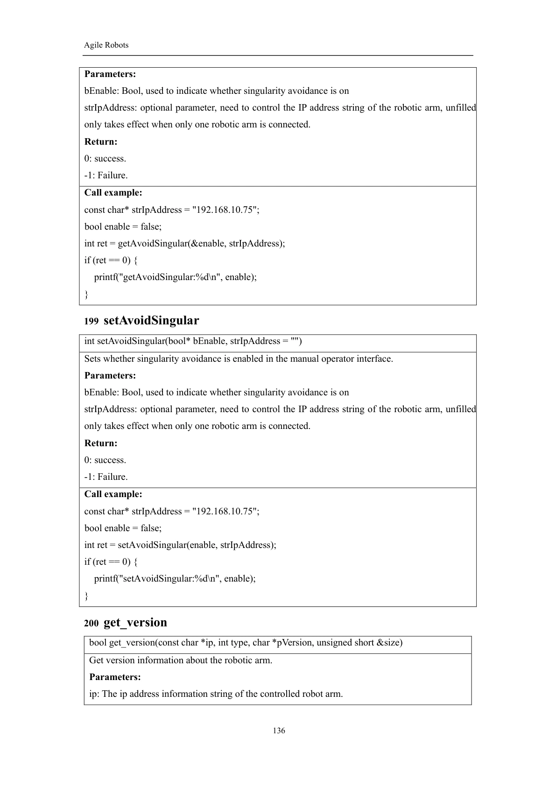



```
Agile Robots 
 136  
Parameters: 
bEnable: Bool, used to indicate whether singularity avoidance is on 
strIpAddress: optional parameter, need to control the IP address string of the robotic arm, unfilled 
only takes effect when only one robotic arm is connected. 
Return: 
0: success. 
-1: Failure. 
Call example:  
const char* strIpAddress = "192.168.10.75"; 
 bool enable = false; 
int ret = getAvoidSingular(&enable, strIpAddress); 
if (ret == 0) { 
    printf("getAvoidSingular:%d\n", enable); 
} 
199 setAvoidSingular 
int setAvoidSingular(bool* bEnable, strIpAddress = "") 
Sets whether singularity avoidance is enabled in the manual operator interface. 
Parameters: 
bEnable: Bool, used to indicate whether singularity avoidance is on 
strIpAddress: optional parameter, need to control the IP address string of the robotic arm, unfilled 
only takes effect when only one robotic arm is connected. 
Return: 
0: success. 
-1: Failure. 
Call example:  
const char* strIpAddress = "192.168.10.75"; 
 bool enable = false; 
int ret = setAvoidSingular(enable, strIpAddress); 
if (ret == 0) { 
    printf("setAvoidSingular:%d\n", enable); 
} 
200 get_version 
bool get_version(const char *ip, int type, char *pVersion, unsigned short &size) 
Get version information about the robotic arm. 
Parameters: 
ip: The ip address information string of the controlled robot arm.
```



## PDF page 146

**Source:** Industrial API Manual (C\&C++ Edition) \_V3.3.0\_EN\_20260605.pdf, original pdf page 146. [Open the corresponding PDF reading-copy page](https://1292444914-files.gitbook.io/~/files/v0/b/gitbook-x-prod.appspot.com/o/spaces%2FtgOfPnscWebs1eh82EKq%2Fuploads%2FWGm4W5tbOjT5mD2c1h1g%2Findustrial-api-manual-c-c-edition-v3-3-0-en-20260605-pp-001-150.pdf?alt=media#page=146).



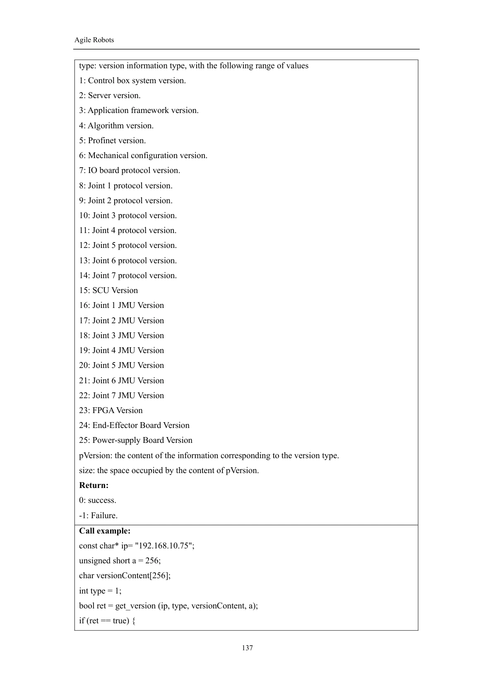



```
Agile Robots 
 137  
type: version information type, with the following range of values 
1: Control box system version. 
2: Server version. 
3: Application framework version. 
4: Algorithm version. 
5: Profinet version. 
6: Mechanical configuration version. 
7: IO board protocol version. 
8: Joint 1 protocol version. 
9: Joint 2 protocol version. 
10: Joint 3 protocol version. 
11: Joint 4 protocol version. 
12: Joint 5 protocol version. 
13: Joint 6 protocol version. 
14: Joint 7 protocol version. 
15: SCU Version 
16: Joint 1 JMU Version 
17: Joint 2 JMU Version 
18: Joint 3 JMU Version 
19: Joint 4 JMU Version 
20: Joint 5 JMU Version 
21: Joint 6 JMU Version 
22: Joint 7 JMU Version 
23: FPGA Version 
24: End-Effector Board Version 
25: Power-supply Board Version 
pVersion: the content of the information corresponding to the version type. 
size: the space occupied by the content of pVersion. 
Return: 
0: success. 
-1: Failure. 
Call example:  
const char* ip= "192.168.10.75"; 
unsigned short a = 256; 
char versionContent[256]; 
int type = 1; 
bool ret = get_version (ip, type, versionContent, a); 
if (ret == true) {
```



## PDF page 147

**Source:** Industrial API Manual (C\&C++ Edition) \_V3.3.0\_EN\_20260605.pdf, original pdf page 147. [Open the corresponding PDF reading-copy page](https://1292444914-files.gitbook.io/~/files/v0/b/gitbook-x-prod.appspot.com/o/spaces%2FtgOfPnscWebs1eh82EKq%2Fuploads%2FWGm4W5tbOjT5mD2c1h1g%2Findustrial-api-manual-c-c-edition-v3-3-0-en-20260605-pp-001-150.pdf?alt=media#page=147).



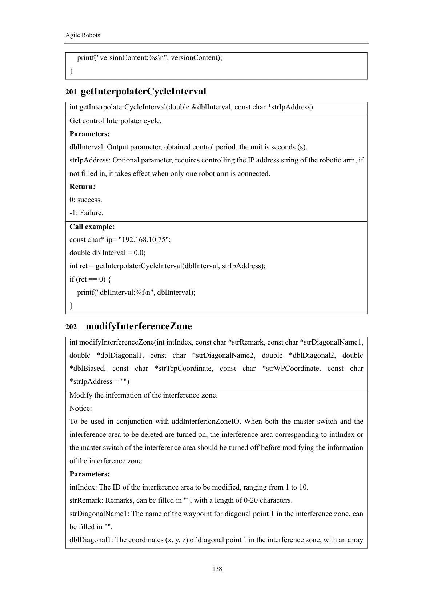



```
Agile Robots 
 138  
    printf("versionContent:%s\n", versionContent); 
} 
201 getInterpolaterCycleInterval 
int getInterpolaterCycleInterval(double &dblInterval, const char *strIpAddress) 
Get control Interpolater cycle. 
Parameters: 
dblInterval: Output parameter, obtained control period, the unit is seconds (s). 
strIpAddress: Optional parameter, requires controlling the IP address string of the robotic arm, if 
not filled in, it takes effect when only one robot arm is connected. 
Return: 
0: success. 
-1: Failure. 
Call example:  
const char* ip= "192.168.10.75"; 
double dblInterval = 0.0; 
int ret = getInterpolaterCycleInterval(dblInterval, strIpAddress); 
if (ret == 0) { 
    printf("dblInterval:%f\n", dblInterval); 
} 
202   modifyInterferenceZone 
int modifyInterferenceZone(int intIndex, const char *strRemark, const char *strDiagonalName1, 
double *dblDiagonal1, const char *strDiagonalName2, double *dblDiagonal2, double 
*dblBiased, const char *strTcpCoordinate, const char *strWPCoordinate, const char 
*strIpAddress = "") 
Modify the information of the interference zone. 
Notice: 
To be used in conjunction with addInterferionZoneIO. When both the master switch and the 
interference area to be deleted are turned on, the interference area corresponding to intIndex or 
the master switch of the interference area should be turned off before modifying the information 
of the interference zone 
Parameters: 
intIndex: The ID of the interference area to be modified, ranging from 1 to 10. 
strRemark: Remarks, can be filled in "", with a length of 0-20 characters. 
strDiagonalName1: The name of the waypoint for diagonal point 1 in the interference zone, can 
be filled in "". 
dblDiagonal1: The coordinates (x, y, z) of diagonal point 1 in the interference zone, with an array
```



## PDF page 148

**Source:** Industrial API Manual (C\&C++ Edition) \_V3.3.0\_EN\_20260605.pdf, original pdf page 148. [Open the corresponding PDF reading-copy page](https://1292444914-files.gitbook.io/~/files/v0/b/gitbook-x-prod.appspot.com/o/spaces%2FtgOfPnscWebs1eh82EKq%2Fuploads%2FWGm4W5tbOjT5mD2c1h1g%2Findustrial-api-manual-c-c-edition-v3-3-0-en-20260605-pp-001-150.pdf?alt=media#page=148).



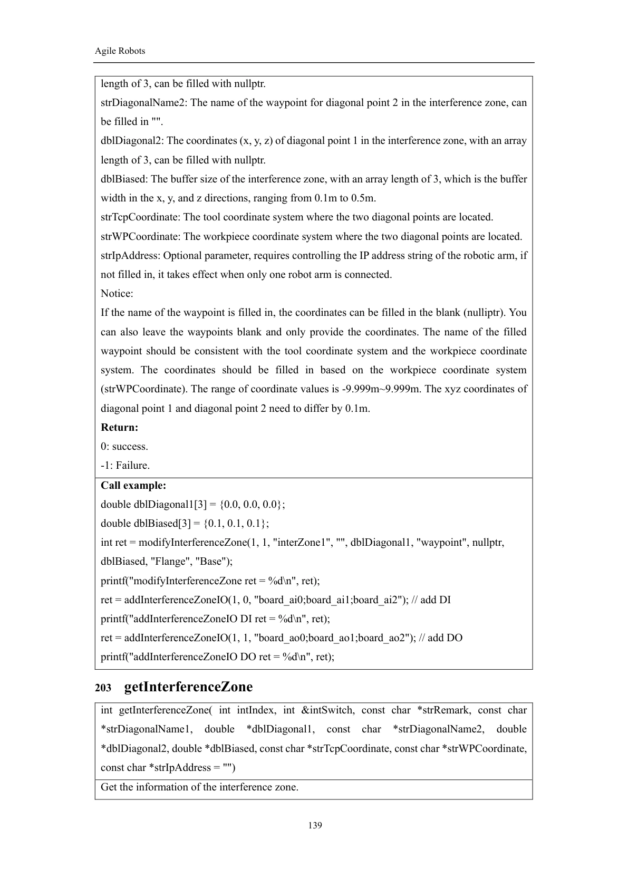



```
Agile Robots 
 139  
length of 3, can be filled with nullptr. 
strDiagonalName2: The name of the waypoint for diagonal point 2 in the interference zone, can 
be filled in "". 
dblDiagonal2: The coordinates (x, y, z) of diagonal point 1 in the interference zone, with an array 
length of 3, can be filled with nullptr. 
dblBiased: The buffer size of the interference zone, with an array length of 3, which is the buffer 
width in the x, y, and z directions, ranging from 0.1m to 0.5m. 
strTcpCoordinate: The tool coordinate system where the two diagonal points are located. 
strWPCoordinate: The workpiece coordinate system where the two diagonal points are located. 
strIpAddress: Optional parameter, requires controlling the IP address string of the robotic arm, if 
not filled in, it takes effect when only one robot arm is connected. 
Notice: 
If the name of the waypoint is filled in, the coordinates can be filled in the blank (nulliptr). You 
can also leave the waypoints blank and only provide the coordinates. The name of the filled 
waypoint should be consistent with the tool coordinate system and the workpiece coordinate 
system. The coordinates should be filled in based on the workpiece coordinate system 
(strWPCoordinate). The range of coordinate values is -9.999m~9.999m. The xyz coordinates of 
diagonal point 1 and diagonal point 2 need to differ by 0.1m. 
Return: 
0: success. 
-1: Failure. 
Call example:  
double dblDiagonal1[3] = {0.0, 0.0, 0.0}; 
double dblBiased[3] = {0.1, 0.1, 0.1}; 
int ret = modifyInterferenceZone(1, 1, "interZone1", "", dblDiagonal1, "waypoint", nullptr, 
dblBiased, "Flange", "Base"); 
printf("modifyInterferenceZone ret = %d\n", ret); 
ret = addInterferenceZoneIO(1, 0, "board_ai0;board_ai1;board_ai2"); // add DI 
printf("addInterferenceZoneIO DI ret = %d\n", ret); 
ret = addInterferenceZoneIO(1, 1, "board_ao0;board_ao1;board_ao2"); // add DO 
printf("addInterferenceZoneIO DO ret = %d\n", ret); 
203   getInterferenceZone 
int getInterferenceZone( int intIndex, int &intSwitch, const char *strRemark, const char 
*strDiagonalName1, 
double 
*dblDiagonal1, 
const 
char 
*strDiagonalName2, 
double 
*dblDiagonal2, double *dblBiased, const char *strTcpCoordinate, const char *strWPCoordinate, 
const char *strIpAddress = "") 
Get the information of the interference zone.
```



## PDF page 149

**Source:** Industrial API Manual (C\&C++ Edition) \_V3.3.0\_EN\_20260605.pdf, original pdf page 149. [Open the corresponding PDF reading-copy page](https://1292444914-files.gitbook.io/~/files/v0/b/gitbook-x-prod.appspot.com/o/spaces%2FtgOfPnscWebs1eh82EKq%2Fuploads%2FWGm4W5tbOjT5mD2c1h1g%2Findustrial-api-manual-c-c-edition-v3-3-0-en-20260605-pp-001-150.pdf?alt=media#page=149).



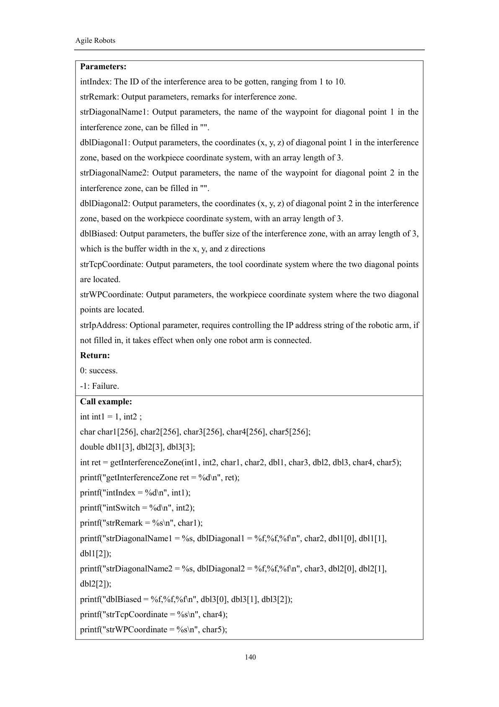



```
Agile Robots 
 140  
Parameters: 
intIndex: The ID of the interference area to be gotten, ranging from 1 to 10. 
strRemark: Output parameters, remarks for interference zone. 
strDiagonalName1: Output parameters, the name of the waypoint for diagonal point 1 in the 
interference zone, can be filled in "". 
dblDiagonal1: Output parameters, the coordinates (x, y, z) of diagonal point 1 in the interference 
zone, based on the workpiece coordinate system, with an array length of 3. 
strDiagonalName2: Output parameters, the name of the waypoint for diagonal point 2 in the 
interference zone, can be filled in "". 
dblDiagonal2: Output parameters, the coordinates (x, y, z) of diagonal point 2 in the interference 
zone, based on the workpiece coordinate system, with an array length of 3. 
dblBiased: Output parameters, the buffer size of the interference zone, with an array length of 3, 
which is the buffer width in the x, y, and z directions 
strTcpCoordinate: Output parameters, the tool coordinate system where the two diagonal points 
are located. 
strWPCoordinate: Output parameters, the workpiece coordinate system where the two diagonal 
points are located. 
strIpAddress: Optional parameter, requires controlling the IP address string of the robotic arm, if 
not filled in, it takes effect when only one robot arm is connected. 
Return: 
0: success. 
-1: Failure. 
Call example:  
int int1 = 1, int2 ; 
char char1[256], char2[256], char3[256], char4[256], char5[256]; 
double dbl1[3], dbl2[3], dbl3[3]; 
int ret = getInterferenceZone(int1, int2, char1, char2, dbl1, char3, dbl2, dbl3, char4, char5); 
printf("getInterferenceZone ret = %d\n", ret); 
printf("intIndex = %d\n", int1); 
printf("intSwitch = %d\n", int2); 
printf("strRemark = %s\n", char1); 
printf("strDiagonalName1 = %s, dblDiagonal1 = %f,%f,%f\n", char2, dbl1[0], dbl1[1], 
dbl1[2]); 
printf("strDiagonalName2 = %s, dblDiagonal2 = %f,%f,%f\n", char3, dbl2[0], dbl2[1], 
dbl2[2]); 
printf("dblBiased = %f,%f,%f\n", dbl3[0], dbl3[1], dbl3[2]); 
printf("strTcpCoordinate = %s\n", char4); 
printf("strWPCoordinate = %s\n", char5);
```



## PDF page 150

**Source:** Industrial API Manual (C\&C++ Edition) \_V3.3.0\_EN\_20260605.pdf, original pdf page 150. [Open the corresponding PDF reading-copy page](https://1292444914-files.gitbook.io/~/files/v0/b/gitbook-x-prod.appspot.com/o/spaces%2FtgOfPnscWebs1eh82EKq%2Fuploads%2FWGm4W5tbOjT5mD2c1h1g%2Findustrial-api-manual-c-c-edition-v3-3-0-en-20260605-pp-001-150.pdf?alt=media#page=150).



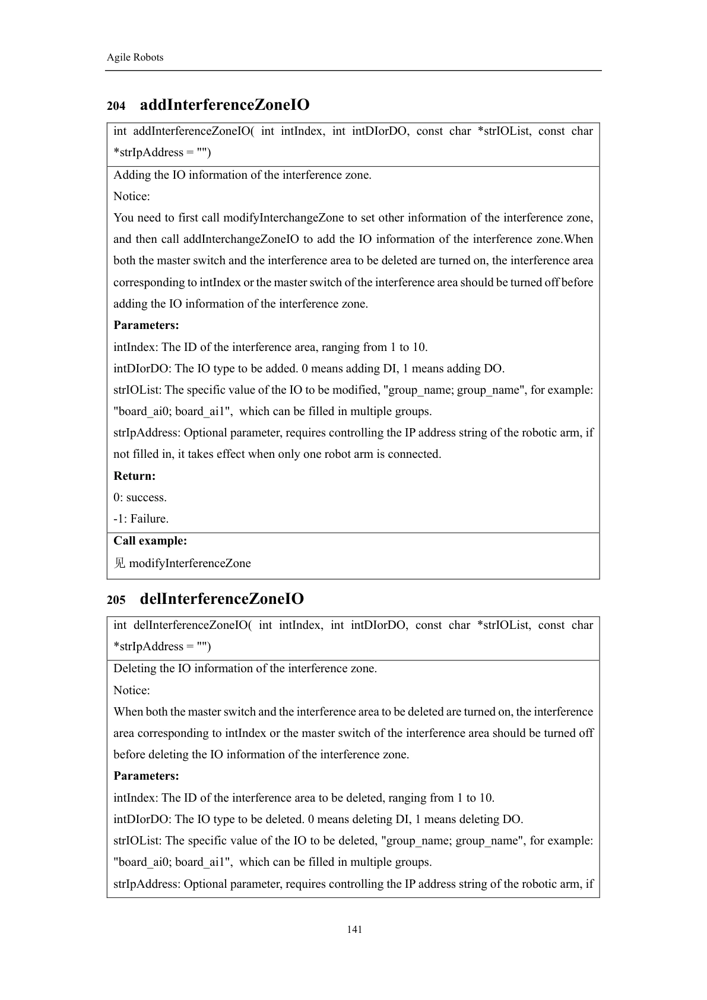



```
Agile Robots 
 141  
204   addInterferenceZoneIO 
int addInterferenceZoneIO( int intIndex, int intDIorDO, const char *strIOList, const char 
*strIpAddress = "") 
Adding the IO information of the interference zone. 
Notice: 
You need to first call modifyInterchangeZone to set other information of the interference zone, 
and then call addInterchangeZoneIO to add the IO information of the interference zone.When 
both the master switch and the interference area to be deleted are turned on, the interference area 
corresponding to intIndex or the master switch of the interference area should be turned off before 
adding the IO information of the interference zone. 
Parameters: 
intIndex: The ID of the interference area, ranging from 1 to 10. 
intDIorDO: The IO type to be added. 0 means adding DI, 1 means adding DO. 
strIOList: The specific value of the IO to be modified, "group_name; group_name", for example: 
"board_ai0; board_ai1",  which can be filled in multiple groups. 
strIpAddress: Optional parameter, requires controlling the IP address string of the robotic arm, if 
not filled in, it takes effect when only one robot arm is connected. 
Return: 
0: success. 
-1: Failure. 
Call example:  
见modifyInterferenceZone 
205   delInterferenceZoneIO 
int delInterferenceZoneIO( int intIndex, int intDIorDO, const char *strIOList, const char 
*strIpAddress = "") 
Deleting the IO information of the interference zone. 
Notice: 
When both the master switch and the interference area to be deleted are turned on, the interference 
area corresponding to intIndex or the master switch of the interference area should be turned off 
before deleting the IO information of the interference zone. 
Parameters: 
intIndex: The ID of the interference area to be deleted, ranging from 1 to 10. 
intDIorDO: The IO type to be deleted. 0 means deleting DI, 1 means deleting DO. 
strIOList: The specific value of the IO to be deleted, "group_name; group_name", for example: 
"board_ai0; board_ai1",  which can be filled in multiple groups. 
strIpAddress: Optional parameter, requires controlling the IP address string of the robotic arm, if
```



## PDF page 151

**Source:** Industrial API Manual (C\&C++ Edition) \_V3.3.0\_EN\_20260605.pdf, original pdf page 151. [Open the corresponding PDF reading-copy page](https://1292444914-files.gitbook.io/~/files/v0/b/gitbook-x-prod.appspot.com/o/spaces%2FtgOfPnscWebs1eh82EKq%2Fuploads%2FTe9EomLTfFiBJ7zB0WdG%2Findustrial-api-manual-c-c-edition-v3-3-0-en-20260605-pp-151-188.pdf?alt=media#page=1).



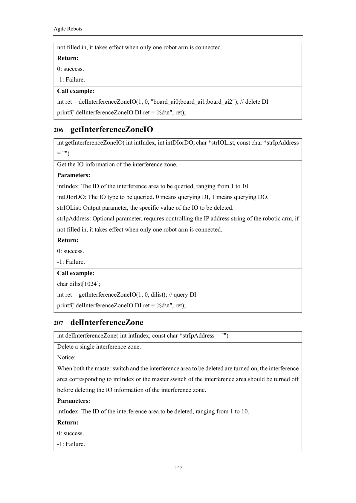



```
Agile Robots 
 142  
not filled in, it takes effect when only one robot arm is connected. 
Return: 
0: success. 
-1: Failure. 
Call example:  
int ret = delInterferenceZoneIO(1, 0, "board_ai0;board_ai1;board_ai2"); // delete DI 
printf("delInterferenceZoneIO DI ret = %d\n", ret); 
206   getInterferenceZoneIO 
int getInterferenceZoneIO( int intIndex, int intDIorDO, char *strIOList, const char *strIpAddress 
= "") 
Get the IO information of the interference zone. 
Parameters: 
intIndex: The ID of the interference area to be queried, ranging from 1 to 10. 
intDIorDO: The IO type to be queried. 0 means querying DI, 1 means querying DO. 
strIOList: Output parameter, the specific value of the IO to be deleted. 
strIpAddress: Optional parameter, requires controlling the IP address string of the robotic arm, if 
not filled in, it takes effect when only one robot arm is connected. 
Return: 
0: success. 
-1: Failure. 
Call example:  
char dilist[1024]; 
int ret = getInterferenceZoneIO(1, 0, dilist); // query DI 
printf("delInterferenceZoneIO DI ret = %d\n", ret); 
207   delInterferenceZone 
int delInterferenceZone( int intIndex, const char *strIpAddress = "") 
Delete a single interference zone. 
Notice: 
When both the master switch and the interference area to be deleted are turned on, the interference 
area corresponding to intIndex or the master switch of the interference area should be turned off 
before deleting the IO information of the interference zone. 
Parameters: 
intIndex: The ID of the interference area to be deleted, ranging from 1 to 10. 
Return: 
0: success. 
-1: Failure.
```



## PDF page 152

**Source:** Industrial API Manual (C\&C++ Edition) \_V3.3.0\_EN\_20260605.pdf, original pdf page 152. [Open the corresponding PDF reading-copy page](https://1292444914-files.gitbook.io/~/files/v0/b/gitbook-x-prod.appspot.com/o/spaces%2FtgOfPnscWebs1eh82EKq%2Fuploads%2FTe9EomLTfFiBJ7zB0WdG%2Findustrial-api-manual-c-c-edition-v3-3-0-en-20260605-pp-151-188.pdf?alt=media#page=2).



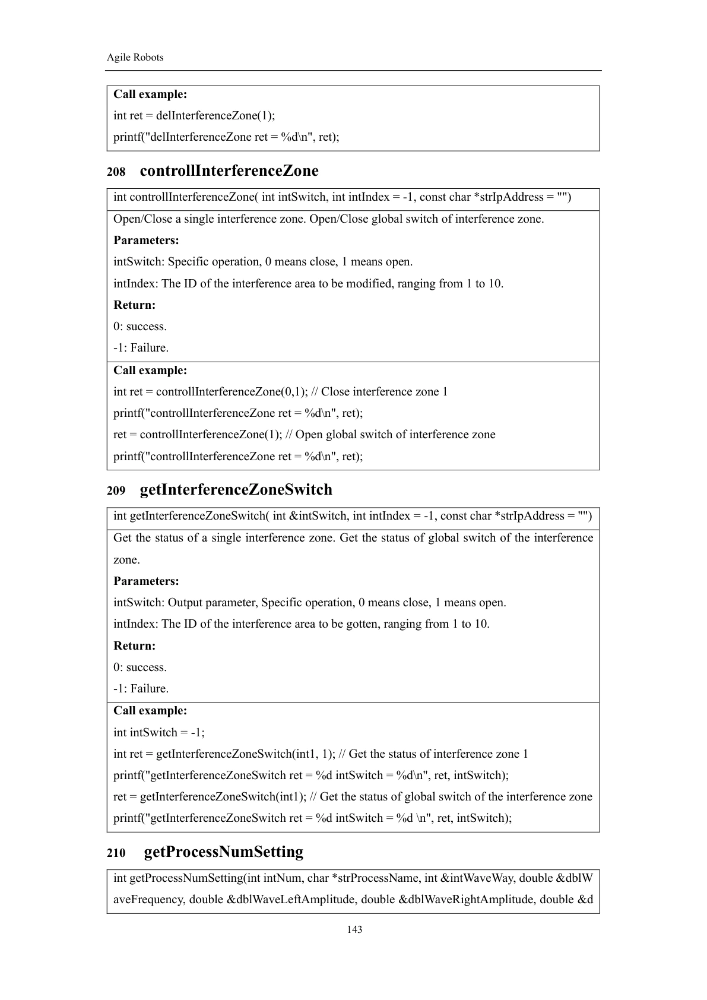



```
Agile Robots 
 143  
Call example:  
int ret = delInterferenceZone(1); 
printf("delInterferenceZone ret = %d\n", ret); 
208   controllInterferenceZone 
int controllInterferenceZone( int intSwitch, int intIndex = -1, const char *strIpAddress = "") 
Open/Close a single interference zone. Open/Close global switch of interference zone. 
Parameters: 
intSwitch: Specific operation, 0 means close, 1 means open. 
intIndex: The ID of the interference area to be modified, ranging from 1 to 10. 
Return: 
0: success. 
-1: Failure. 
Call example:  
int ret = controllInterferenceZone(0,1); // Close interference zone 1 
printf("controllInterferenceZone ret = %d\n", ret); 
ret = controllInterferenceZone(1); // Open global switch of interference zone 
printf("controllInterferenceZone ret = %d\n", ret); 
209   getInterferenceZoneSwitch 
int getInterferenceZoneSwitch( int &intSwitch, int intIndex = -1, const char *strIpAddress = "") 
Get the status of a single interference zone. Get the status of global switch of the interference 
zone. 
Parameters: 
intSwitch: Output parameter, Specific operation, 0 means close, 1 means open. 
intIndex: The ID of the interference area to be gotten, ranging from 1 to 10. 
Return: 
0: success. 
-1: Failure. 
Call example:  
int intSwitch = -1; 
int ret = getInterferenceZoneSwitch(int1, 1); // Get the status of interference zone 1 
printf("getInterferenceZoneSwitch ret = %d intSwitch = %d\n", ret, intSwitch); 
ret = getInterferenceZoneSwitch(int1); // Get the status of global switch of the interference zone 
printf("getInterferenceZoneSwitch ret = %d intSwitch = %d \n", ret, intSwitch); 
210    getProcessNumSetting 
int getProcessNumSetting(int intNum, char *strProcessName, int &intWaveWay, double &dblW
aveFrequency, double &dblWaveLeftAmplitude, double &dblWaveRightAmplitude, double &d
```



## PDF page 153

**Source:** Industrial API Manual (C\&C++ Edition) \_V3.3.0\_EN\_20260605.pdf, original pdf page 153. [Open the corresponding PDF reading-copy page](https://1292444914-files.gitbook.io/~/files/v0/b/gitbook-x-prod.appspot.com/o/spaces%2FtgOfPnscWebs1eh82EKq%2Fuploads%2FTe9EomLTfFiBJ7zB0WdG%2Findustrial-api-manual-c-c-edition-v3-3-0-en-20260605-pp-151-188.pdf?alt=media#page=3).



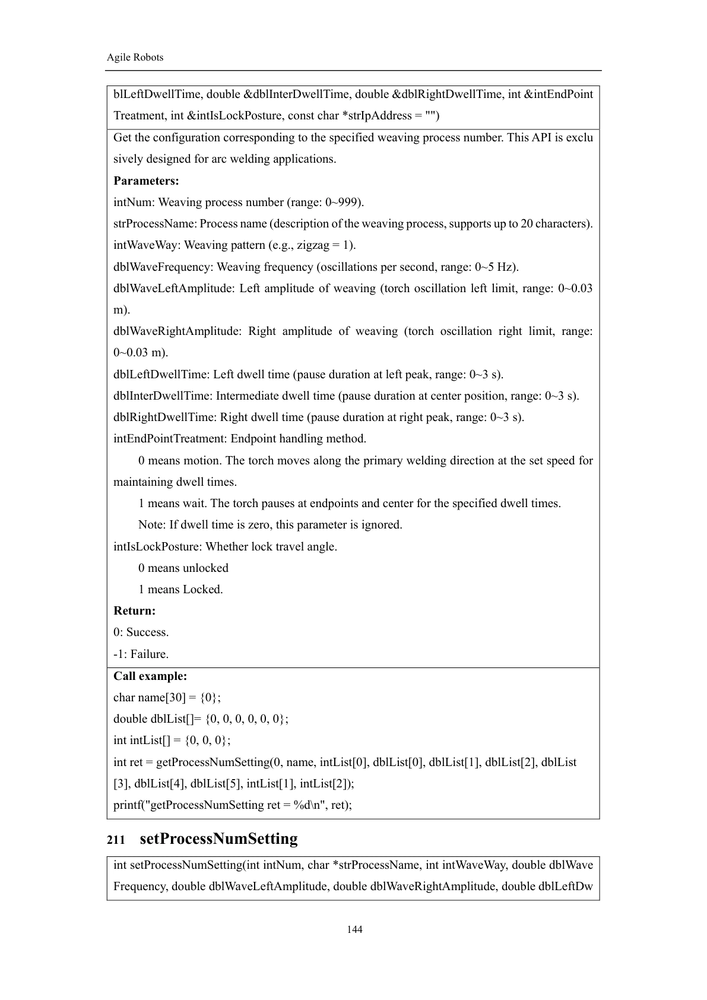



```
Agile Robots 
 144  
blLeftDwellTime, double &dblInterDwellTime, double &dblRightDwellTime, int &intEndPoint
Treatment, int &intIsLockPosture, const char *strIpAddress = "") 
Get the configuration corresponding to the specified weaving process number. This API is exclu
sively designed for arc welding applications. 
Parameters: 
intNum: Weaving process number (range: 0~999). 
strProcessName: Process name (description of the weaving process, supports up to 20 characters). 
intWaveWay: Weaving pattern (e.g., zigzag = 1). 
dblWaveFrequency: Weaving frequency (oscillations per second, range: 0~5 Hz). 
dblWaveLeftAmplitude: Left amplitude of weaving (torch oscillation left limit, range: 0~0.03 
m). 
dblWaveRightAmplitude: Right amplitude of weaving (torch oscillation right limit, range: 
0~0.03 m). 
dblLeftDwellTime: Left dwell time (pause duration at left peak, range: 0~3 s). 
dblInterDwellTime: Intermediate dwell time (pause duration at center position, range: 0~3 s). 
dblRightDwellTime: Right dwell time (pause duration at right peak, range: 0~3 s). 
intEndPointTreatment: Endpoint handling method. 
0 means motion. The torch moves along the primary welding direction at the set speed for 
maintaining dwell times. 
1 means wait. The torch pauses at endpoints and center for the specified dwell times. 
Note: If dwell time is zero, this parameter is ignored. 
intIsLockPosture: Whether lock travel angle. 
0 means unlocked 
1 means Locked. 
Return: 
0: Success. 
-1: Failure. 
Call example: 
char name[30] = {0}; 
double dblList[]= {0, 0, 0, 0, 0, 0}; 
int intList[] = {0, 0, 0}; 
int ret = getProcessNumSetting(0, name, intList[0], dblList[0], dblList[1], dblList[2], dblList
[3], dblList[4], dblList[5], intList[1], intList[2]); 
printf("getProcessNumSetting ret = %d\n", ret); 
211   setProcessNumSetting 
int setProcessNumSetting(int intNum, char *strProcessName, int intWaveWay, double dblWave
Frequency, double dblWaveLeftAmplitude, double dblWaveRightAmplitude, double dblLeftDw
```



## PDF page 154

**Source:** Industrial API Manual (C\&C++ Edition) \_V3.3.0\_EN\_20260605.pdf, original pdf page 154. [Open the corresponding PDF reading-copy page](https://1292444914-files.gitbook.io/~/files/v0/b/gitbook-x-prod.appspot.com/o/spaces%2FtgOfPnscWebs1eh82EKq%2Fuploads%2FTe9EomLTfFiBJ7zB0WdG%2Findustrial-api-manual-c-c-edition-v3-3-0-en-20260605-pp-151-188.pdf?alt=media#page=4).



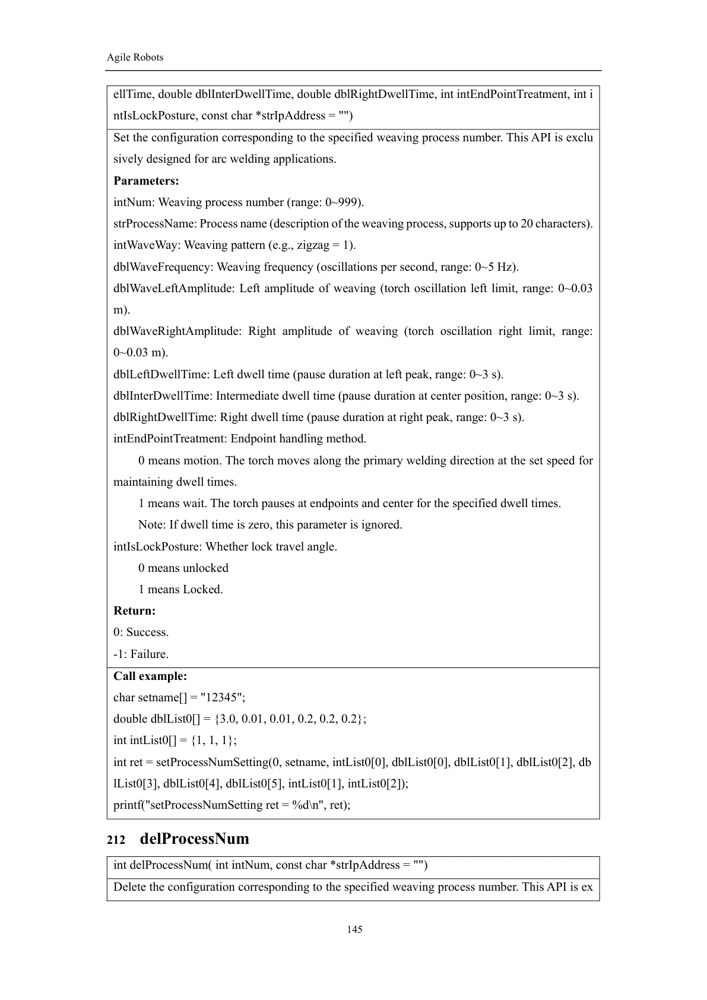



```
Agile Robots 
 145  
ellTime, double dblInterDwellTime, double dblRightDwellTime, int intEndPointTreatment, int i
ntIsLockPosture, const char *strIpAddress = "") 
Set the configuration corresponding to the specified weaving process number. This API is exclu
sively designed for arc welding applications. 
Parameters: 
intNum: Weaving process number (range: 0~999). 
strProcessName: Process name (description of the weaving process, supports up to 20 characters). 
intWaveWay: Weaving pattern (e.g., zigzag = 1). 
dblWaveFrequency: Weaving frequency (oscillations per second, range: 0~5 Hz). 
dblWaveLeftAmplitude: Left amplitude of weaving (torch oscillation left limit, range: 0~0.03 
m). 
dblWaveRightAmplitude: Right amplitude of weaving (torch oscillation right limit, range: 
0~0.03 m). 
dblLeftDwellTime: Left dwell time (pause duration at left peak, range: 0~3 s). 
dblInterDwellTime: Intermediate dwell time (pause duration at center position, range: 0~3 s). 
dblRightDwellTime: Right dwell time (pause duration at right peak, range: 0~3 s). 
intEndPointTreatment: Endpoint handling method. 
0 means motion. The torch moves along the primary welding direction at the set speed for 
maintaining dwell times. 
1 means wait. The torch pauses at endpoints and center for the specified dwell times. 
Note: If dwell time is zero, this parameter is ignored. 
intIsLockPosture: Whether lock travel angle. 
0 means unlocked 
1 means Locked. 
Return: 
0: Success. 
-1: Failure. 
Call example: 
char setname[] = "12345"; 
double dblList0[] = {3.0, 0.01, 0.01, 0.2, 0.2, 0.2}; 
int intList0[] = {1, 1, 1}; 
int ret = setProcessNumSetting(0, setname, intList0[0], dblList0[0], dblList0[1], dblList0[2], db
lList0[3], dblList0[4], dblList0[5], intList0[1], intList0[2]); 
printf("setProcessNumSetting ret = %d\n", ret); 
212   delProcessNum 
int delProcessNum( int intNum, const char *strIpAddress = "") 
Delete the configuration corresponding to the specified weaving process number. This API is ex
```



## PDF page 155

**Source:** Industrial API Manual (C\&C++ Edition) \_V3.3.0\_EN\_20260605.pdf, original pdf page 155. [Open the corresponding PDF reading-copy page](https://1292444914-files.gitbook.io/~/files/v0/b/gitbook-x-prod.appspot.com/o/spaces%2FtgOfPnscWebs1eh82EKq%2Fuploads%2FTe9EomLTfFiBJ7zB0WdG%2Findustrial-api-manual-c-c-edition-v3-3-0-en-20260605-pp-151-188.pdf?alt=media#page=5).



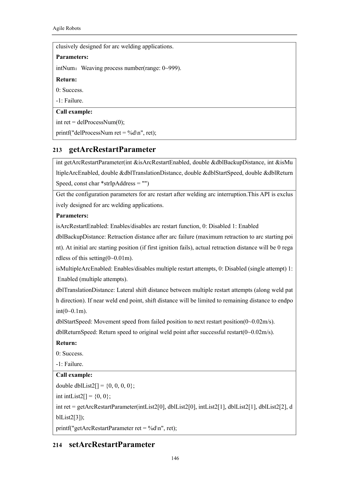



```
Agile Robots 
 146  
clusively designed for arc welding applications. 
Parameters: 
intNum：Weaving process number(range: 0~999). 
Return: 
0: Success. 
-1: Failure. 
Call example: 
int ret = delProcessNum(0); 
printf("delProcessNum ret = %d\n", ret); 
213   getArcRestartParameter 
int getArcRestartParameter(int &isArcRestartEnabled, double &dblBackupDistance, int &isMu
ltipleArcEnabled, double &dblTranslationDistance, double &dblStartSpeed, double &dblReturn
Speed, const char *strIpAddress = "") 
Get the configuration parameters for arc restart after welding arc interruption.This API is exclus
ively designed for arc welding applications. 
Parameters: 
isArcRestartEnabled: Enables/disables arc restart function, 0: Disabled 1: Enabled 
dblBackupDistance: Retraction distance after arc failure (maximum retraction to arc starting poi
nt). At initial arc starting position (if first ignition fails), actual retraction distance will be 0 rega
rdless of this setting(0~0.01m). 
isMultipleArcEnabled: Enables/disables multiple restart attempts, 0: Disabled (single attempt) 1:
 Enabled (multiple attempts). 
dblTranslationDistance: Lateral shift distance between multiple restart attempts (along weld pat
h direction). If near weld end point, shift distance will be limited to remaining distance to endpo
int(0~0.1m). 
dblStartSpeed: Movement speed from failed position to next restart position(0~0.02m/s). 
dblReturnSpeed: Return speed to original weld point after successful restart(0~0.02m/s). 
Return: 
0: Success. 
-1: Failure. 
Call example: 
double dblList2[] = {0, 0, 0, 0}; 
int intList2[] = {0, 0}; 
int ret = getArcRestartParameter(intList2[0], dblList2[0], intList2[1], dblList2[1], dblList2[2], d
blList2[3]); 
printf("getArcRestartParameter ret = %d\n", ret); 
214   setArcRestartParameter
```



## PDF page 156

**Source:** Industrial API Manual (C\&C++ Edition) \_V3.3.0\_EN\_20260605.pdf, original pdf page 156. [Open the corresponding PDF reading-copy page](https://1292444914-files.gitbook.io/~/files/v0/b/gitbook-x-prod.appspot.com/o/spaces%2FtgOfPnscWebs1eh82EKq%2Fuploads%2FTe9EomLTfFiBJ7zB0WdG%2Findustrial-api-manual-c-c-edition-v3-3-0-en-20260605-pp-151-188.pdf?alt=media#page=6).



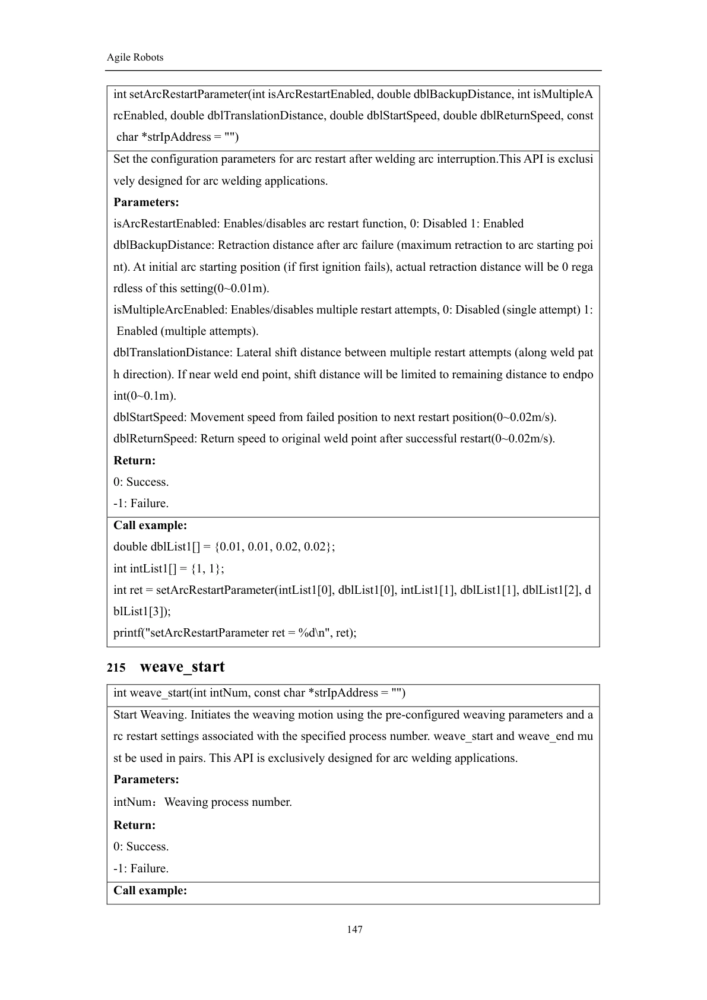



```
Agile Robots 
 147  
int setArcRestartParameter(int isArcRestartEnabled, double dblBackupDistance, int isMultipleA
rcEnabled, double dblTranslationDistance, double dblStartSpeed, double dblReturnSpeed, const
 char *strIpAddress = "") 
Set the configuration parameters for arc restart after welding arc interruption.This API is exclusi
vely designed for arc welding applications. 
Parameters: 
isArcRestartEnabled: Enables/disables arc restart function, 0: Disabled 1: Enabled 
dblBackupDistance: Retraction distance after arc failure (maximum retraction to arc starting poi
nt). At initial arc starting position (if first ignition fails), actual retraction distance will be 0 rega
rdless of this setting(0~0.01m). 
isMultipleArcEnabled: Enables/disables multiple restart attempts, 0: Disabled (single attempt) 1:
 Enabled (multiple attempts). 
dblTranslationDistance: Lateral shift distance between multiple restart attempts (along weld pat
h direction). If near weld end point, shift distance will be limited to remaining distance to endpo
int(0~0.1m). 
dblStartSpeed: Movement speed from failed position to next restart position(0~0.02m/s). 
dblReturnSpeed: Return speed to original weld point after successful restart(0~0.02m/s). 
Return: 
0: Success. 
-1: Failure. 
Call example: 
double dblList1[] = {0.01, 0.01, 0.02, 0.02}; 
int intList1[] = {1, 1}; 
int ret = setArcRestartParameter(intList1[0], dblList1[0], intList1[1], dblList1[1], dblList1[2], d
blList1[3]); 
printf("setArcRestartParameter ret = %d\n", ret); 
215   weave_start 
int weave_start(int intNum, const char *strIpAddress = "") 
Start Weaving. Initiates the weaving motion using the pre-configured weaving parameters and a
rc restart settings associated with the specified process number. weave_start and weave_end mu
st be used in pairs. This API is exclusively designed for arc welding applications. 
Parameters: 
intNum：Weaving process number. 
Return: 
0: Success. 
-1: Failure. 
Call example:
```



## PDF page 157

**Source:** Industrial API Manual (C\&C++ Edition) \_V3.3.0\_EN\_20260605.pdf, original pdf page 157. [Open the corresponding PDF reading-copy page](https://1292444914-files.gitbook.io/~/files/v0/b/gitbook-x-prod.appspot.com/o/spaces%2FtgOfPnscWebs1eh82EKq%2Fuploads%2FTe9EomLTfFiBJ7zB0WdG%2Findustrial-api-manual-c-c-edition-v3-3-0-en-20260605-pp-151-188.pdf?alt=media#page=7).



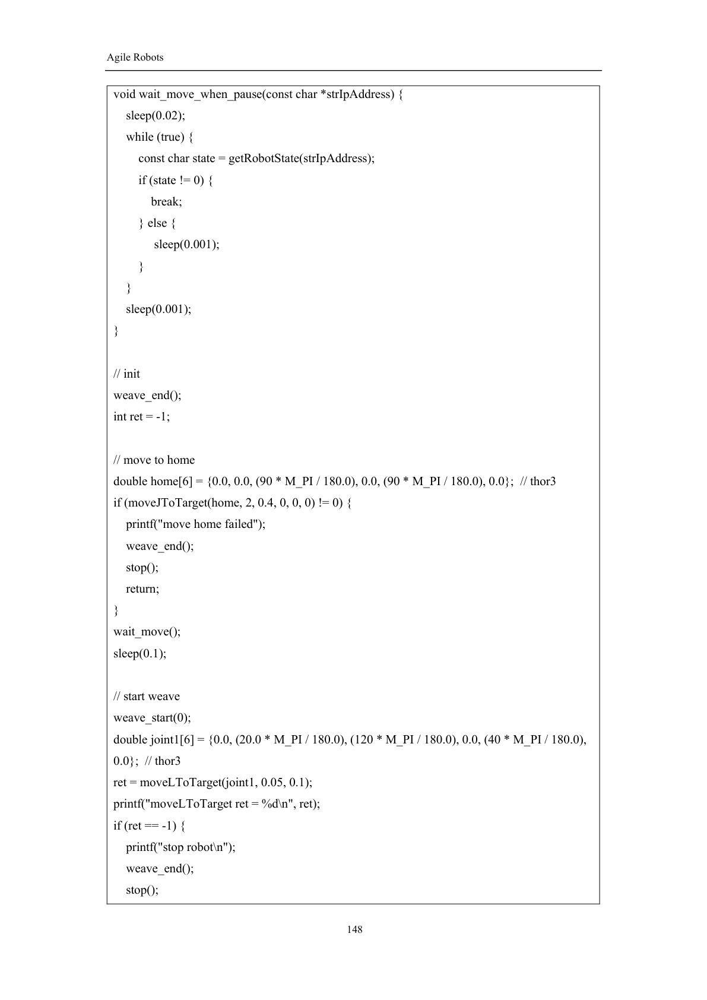



```
Agile Robots 
 148  
void wait_move_when_pause(const char *strIpAddress) { 
    sleep(0.02); 
    while (true) { 
        const char state = getRobotState(strIpAddress); 
        if (state != 0) { 
            break; 
        } else { 
             sleep(0.001); 
        } 
    } 
    sleep(0.001); 
} 
 
// init 
weave_end(); 
int ret = -1; 
 
// move to home 
double home[6] = {0.0, 0.0, (90 * M_PI / 180.0), 0.0, (90 * M_PI / 180.0), 0.0};  // thor3 
if (moveJToTarget(home, 2, 0.4, 0, 0, 0) != 0) { 
    printf("move home failed"); 
    weave_end(); 
    stop(); 
    return; 
} 
wait_move(); 
sleep(0.1); 
 
// start weave 
weave_start(0); 
double joint1[6] = {0.0, (20.0 * M_PI / 180.0), (120 * M_PI / 180.0), 0.0, (40 * M_PI / 180.0), 
0.0};  // thor3 
ret = moveLToTarget(joint1, 0.05, 0.1); 
printf("moveLToTarget ret = %d\n", ret); 
if (ret == -1) { 
    printf("stop robot\n"); 
    weave_end(); 
    stop();
```



## PDF page 158

**Source:** Industrial API Manual (C\&C++ Edition) \_V3.3.0\_EN\_20260605.pdf, original pdf page 158. [Open the corresponding PDF reading-copy page](https://1292444914-files.gitbook.io/~/files/v0/b/gitbook-x-prod.appspot.com/o/spaces%2FtgOfPnscWebs1eh82EKq%2Fuploads%2FTe9EomLTfFiBJ7zB0WdG%2Findustrial-api-manual-c-c-edition-v3-3-0-en-20260605-pp-151-188.pdf?alt=media#page=8).



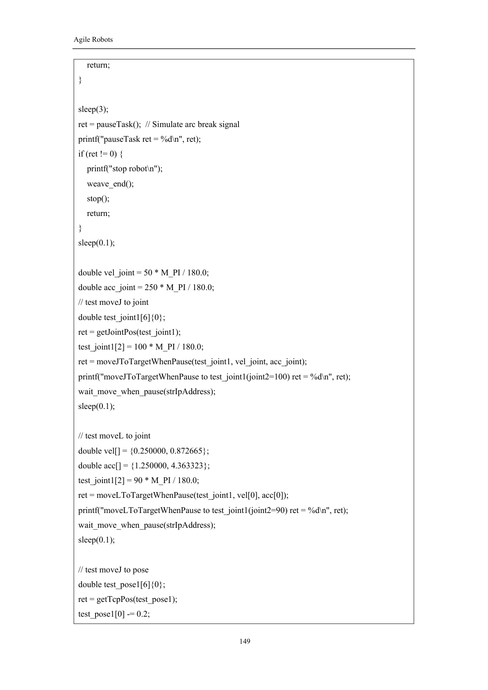



```
Agile Robots 
 149  
    return; 
} 
 
sleep(3); 
ret = pauseTask();  // Simulate arc break signal 
printf("pauseTask ret = %d\n", ret); 
if (ret != 0) { 
    printf("stop robot\n"); 
    weave_end(); 
    stop(); 
    return; 
} 
sleep(0.1); 
 
double vel_joint = 50 * M_PI / 180.0; 
double acc_joint = 250 * M_PI / 180.0; 
// test moveJ to joint 
double test_joint1[6]{0}; 
ret = getJointPos(test_joint1); 
test_joint1[2] = 100 * M_PI / 180.0; 
ret = moveJToTargetWhenPause(test_joint1, vel_joint, acc_joint); 
printf("moveJToTargetWhenPause to test_joint1(joint2=100) ret = %d\n", ret); 
wait_move_when_pause(strIpAddress); 
sleep(0.1); 
 
// test moveL to joint 
double vel[] = {0.250000, 0.872665}; 
double acc[] = {1.250000, 4.363323}; 
test_joint1[2] = 90 * M_PI / 180.0; 
ret = moveLToTargetWhenPause(test_joint1, vel[0], acc[0]); 
printf("moveLToTargetWhenPause to test_joint1(joint2=90) ret = %d\n", ret); 
wait_move_when_pause(strIpAddress); 
sleep(0.1); 
 
// test moveJ to pose 
double test_pose1[6]{0}; 
ret = getTcpPos(test_pose1); 
test_pose1[0] -= 0.2;
```



## PDF page 159

**Source:** Industrial API Manual (C\&C++ Edition) \_V3.3.0\_EN\_20260605.pdf, original pdf page 159. [Open the corresponding PDF reading-copy page](https://1292444914-files.gitbook.io/~/files/v0/b/gitbook-x-prod.appspot.com/o/spaces%2FtgOfPnscWebs1eh82EKq%2Fuploads%2FTe9EomLTfFiBJ7zB0WdG%2Findustrial-api-manual-c-c-edition-v3-3-0-en-20260605-pp-151-188.pdf?alt=media#page=9).



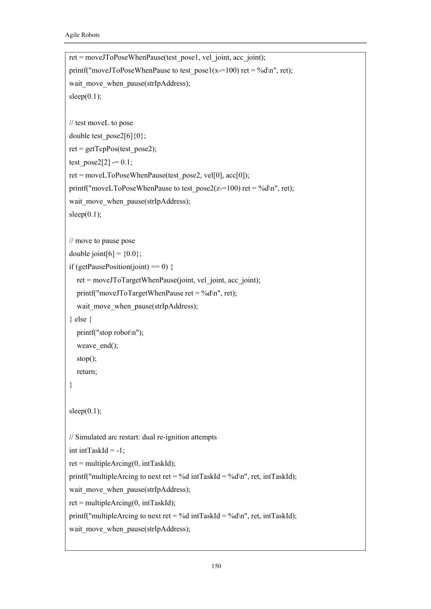



```
Agile Robots 
 150  
ret = moveJToPoseWhenPause(test_pose1, vel_joint, acc_joint); 
printf("moveJToPoseWhenPause to test_pose1(x-=100) ret = %d\n", ret); 
wait_move_when_pause(strIpAddress); 
sleep(0.1); 
 
// test moveL to pose 
double test_pose2[6]{0}; 
ret = getTcpPos(test_pose2); 
test_pose2[2] -= 0.1; 
ret = moveLToPoseWhenPause(test_pose2, vel[0], acc[0]); 
printf("moveLToPoseWhenPause to test_pose2(z-=100) ret = %d\n", ret); 
wait_move_when_pause(strIpAddress); 
sleep(0.1); 
 
// move to pause pose 
double joint[6] = {0.0}; 
if (getPausePosition(joint) == 0) { 
    ret = moveJToTargetWhenPause(joint, vel_joint, acc_joint); 
    printf("moveJToTargetWhenPause ret = %d\n", ret); 
    wait_move_when_pause(strIpAddress); 
} else { 
    printf("stop robot\n"); 
    weave_end(); 
    stop(); 
    return; 
} 
 
sleep(0.1); 
 
// Simulated arc restart: dual re-ignition attempts 
int intTaskId = -1; 
ret = multipleArcing(0, intTaskId); 
printf("multipleArcing to next ret = %d intTaskId = %d\n", ret, intTaskId); 
wait_move_when_pause(strIpAddress); 
ret = multipleArcing(0, intTaskId); 
printf("multipleArcing to next ret = %d intTaskId = %d\n", ret, intTaskId); 
wait_move_when_pause(strIpAddress);
```



## PDF page 160

**Source:** Industrial API Manual (C\&C++ Edition) \_V3.3.0\_EN\_20260605.pdf, original pdf page 160. [Open the corresponding PDF reading-copy page](https://1292444914-files.gitbook.io/~/files/v0/b/gitbook-x-prod.appspot.com/o/spaces%2FtgOfPnscWebs1eh82EKq%2Fuploads%2FTe9EomLTfFiBJ7zB0WdG%2Findustrial-api-manual-c-c-edition-v3-3-0-en-20260605-pp-151-188.pdf?alt=media#page=10).



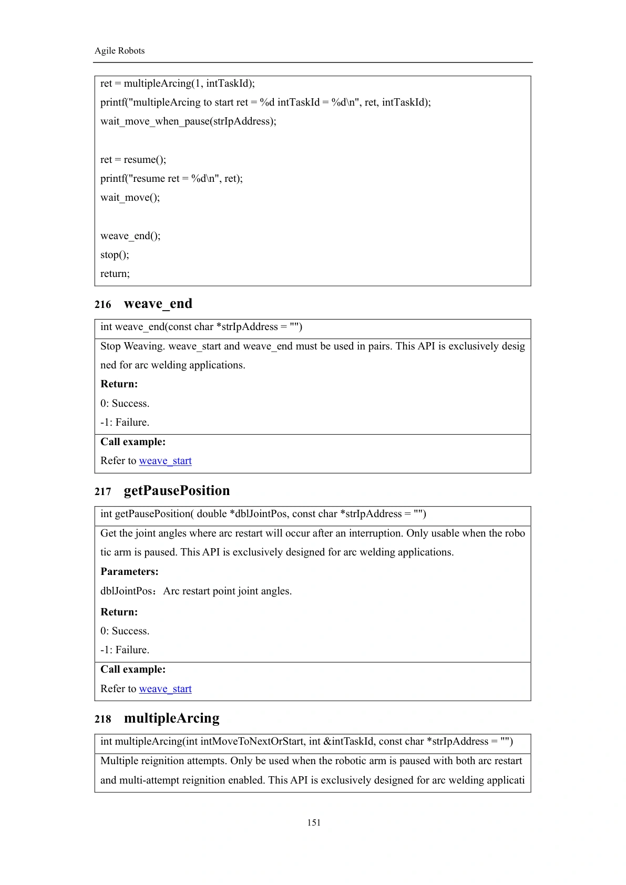



```
Agile Robots 
 151  
ret = multipleArcing(1, intTaskId); 
printf("multipleArcing to start ret = %d intTaskId = %d\n", ret, intTaskId); 
wait_move_when_pause(strIpAddress); 
 
ret = resume(); 
printf("resume ret = %d\n", ret); 
wait_move(); 
 
weave_end(); 
stop(); 
return; 
216   weave_end 
int weave_end(const char *strIpAddress = "") 
Stop Weaving. weave_start and weave_end must be used in pairs. This API is exclusively desig
ned for arc welding applications. 
Return: 
0: Success. 
-1: Failure. 
Call example: 
Refer to weave_start 
217   getPausePosition 
int getPausePosition( double *dblJointPos, const char *strIpAddress = "") 
Get the joint angles where arc restart will occur after an interruption. Only usable when the robo
tic arm is paused. This API is exclusively designed for arc welding applications. 
Parameters: 
dblJointPos：Arc restart point joint angles. 
Return: 
0: Success. 
-1: Failure. 
Call example: 
Refer to weave_start 
218   multipleArcing 
int multipleArcing(int intMoveToNextOrStart, int &intTaskId, const char *strIpAddress = "") 
Multiple reignition attempts. Only be used when the robotic arm is paused with both arc restart 
and multi-attempt reignition enabled. This API is exclusively designed for arc welding applicati
```



**Original document cross-references:** [PDF 156](pages-145-190.md#pdf-page-156)

## PDF page 161

**Source:** Industrial API Manual (C\&C++ Edition) \_V3.3.0\_EN\_20260605.pdf, original pdf page 161. [Open the corresponding PDF reading-copy page](https://1292444914-files.gitbook.io/~/files/v0/b/gitbook-x-prod.appspot.com/o/spaces%2FtgOfPnscWebs1eh82EKq%2Fuploads%2FTe9EomLTfFiBJ7zB0WdG%2Findustrial-api-manual-c-c-edition-v3-3-0-en-20260605-pp-151-188.pdf?alt=media#page=11).



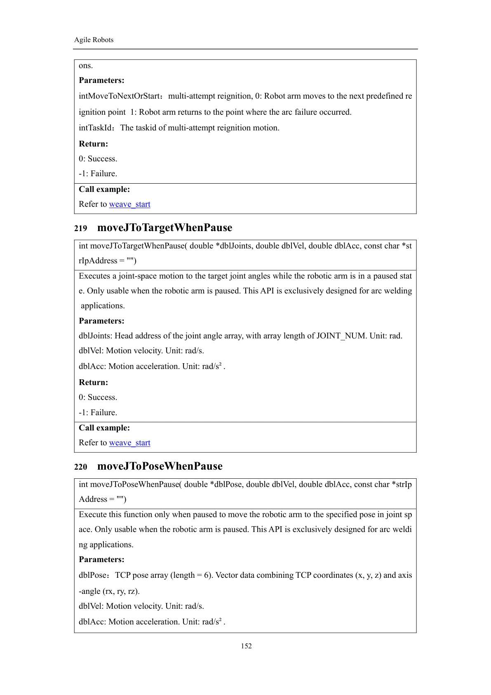



```
Agile Robots 
 152  
ons. 
Parameters: 
intMoveToNextOrStart：multi-attempt reignition, 0: Robot arm moves to the next predefined re
ignition point  1: Robot arm returns to the point where the arc failure occurred. 
intTaskId：The taskid of multi-attempt reignition motion. 
Return: 
0: Success. 
-1: Failure. 
Call example: 
Refer to weave_start 
219   moveJToTargetWhenPause 
int moveJToTargetWhenPause( double *dblJoints, double dblVel, double dblAcc, const char *st
rIpAddress = "") 
Executes a joint-space motion to the target joint angles while the robotic arm is in a paused stat
e. Only usable when the robotic arm is paused. This API is exclusively designed for arc welding
 applications. 
Parameters: 
dblJoints: Head address of the joint angle array, with array length of JOINT_NUM. Unit: rad. 
dblVel: Motion velocity. Unit: rad/s. 
dblAcc: Motion acceleration. Unit: rad/s². 
Return: 
0: Success. 
-1: Failure. 
Call example: 
Refer to weave_start 
220   moveJToPoseWhenPause 
int moveJToPoseWhenPause( double *dblPose, double dblVel, double dblAcc, const char *strIp
Address = "") 
Execute this function only when paused to move the robotic arm to the specified pose in joint sp
ace. Only usable when the robotic arm is paused. This API is exclusively designed for arc weldi
ng applications. 
Parameters: 
dblPose：TCP pose array (length = 6). Vector data combining TCP coordinates (x, y, z) and axis
-angle (rx, ry, rz). 
dblVel: Motion velocity. Unit: rad/s. 
dblAcc: Motion acceleration. Unit: rad/s².
```



**Original document cross-references:** [PDF 156](pages-145-190.md#pdf-page-156)

## PDF page 162

**Source:** Industrial API Manual (C\&C++ Edition) \_V3.3.0\_EN\_20260605.pdf, original pdf page 162. [Open the corresponding PDF reading-copy page](https://1292444914-files.gitbook.io/~/files/v0/b/gitbook-x-prod.appspot.com/o/spaces%2FtgOfPnscWebs1eh82EKq%2Fuploads%2FTe9EomLTfFiBJ7zB0WdG%2Findustrial-api-manual-c-c-edition-v3-3-0-en-20260605-pp-151-188.pdf?alt=media#page=12).



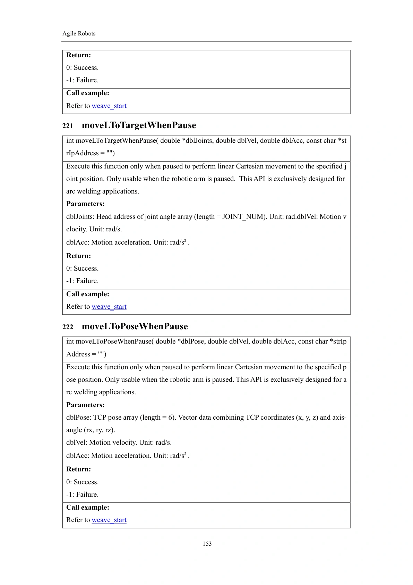



```
Agile Robots 
 153  
Return: 
0: Success. 
-1: Failure. 
Call example: 
Refer to weave_start 
221   moveLToTargetWhenPause 
int moveLToTargetWhenPause( double *dblJoints, double dblVel, double dblAcc, const char *st
rIpAddress = "") 
Execute this function only when paused to perform linear Cartesian movement to the specified j
oint position. Only usable when the robotic arm is paused.  This API is exclusively designed for 
arc welding applications. 
Parameters: 
dblJoints: Head address of joint angle array (length = JOINT_NUM). Unit: rad.dblVel: Motion v
elocity. Unit: rad/s. 
dblAcc: Motion acceleration. Unit: rad/s². 
Return: 
0: Success. 
-1: Failure. 
Call example: 
Refer to weave_start 
222   moveLToPoseWhenPause 
int moveLToPoseWhenPause( double *dblPose, double dblVel, double dblAcc, const char *strIp
Address = "") 
Execute this function only when paused to perform linear Cartesian movement to the specified p
ose position. Only usable when the robotic arm is paused. This API is exclusively designed for a
rc welding applications. 
Parameters: 
dblPose: TCP pose array (length = 6). Vector data combining TCP coordinates (x, y, z) and axis-
angle (rx, ry, rz). 
dblVel: Motion velocity. Unit: rad/s. 
dblAcc: Motion acceleration. Unit: rad/s². 
Return: 
0: Success. 
-1: Failure. 
Call example: 
Refer to weave_start
```



**Original document cross-references:** [PDF 156](pages-145-190.md#pdf-page-156)

## PDF page 163

**Source:** Industrial API Manual (C\&C++ Edition) \_V3.3.0\_EN\_20260605.pdf, original pdf page 163. [Open the corresponding PDF reading-copy page](https://1292444914-files.gitbook.io/~/files/v0/b/gitbook-x-prod.appspot.com/o/spaces%2FtgOfPnscWebs1eh82EKq%2Fuploads%2FTe9EomLTfFiBJ7zB0WdG%2Findustrial-api-manual-c-c-edition-v3-3-0-en-20260605-pp-151-188.pdf?alt=media#page=13).



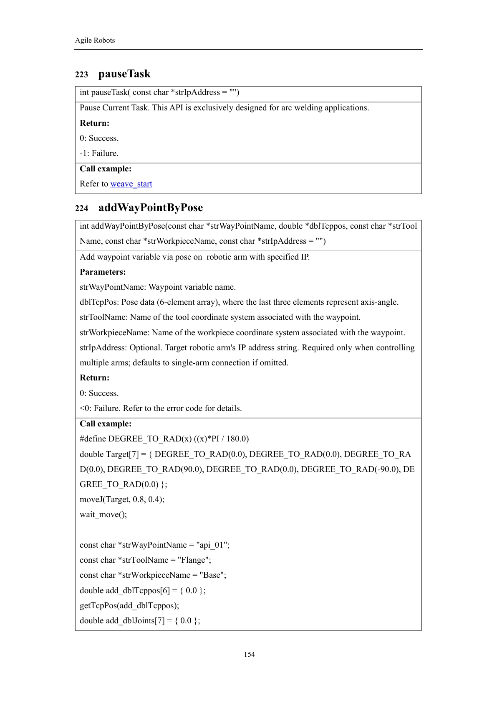



```
Agile Robots 
 154  
223   pauseTask 
int pauseTask( const char *strIpAddress = "") 
Pause Current Task. This API is exclusively designed for arc welding applications. 
Return: 
0: Success. 
-1: Failure. 
Call example: 
Refer to weave_start 
224   addWayPointByPose 
int addWayPointByPose(const char *strWayPointName, double *dblTcppos, const char *strTool
Name, const char *strWorkpieceName, const char *strIpAddress = "") 
Add waypoint variable via pose on  robotic arm with specified IP. 
Parameters: 
strWayPointName: Waypoint variable name. 
dblTcpPos: Pose data (6-element array), where the last three elements represent axis-angle. 
strToolName: Name of the tool coordinate system associated with the waypoint. 
strWorkpieceName: Name of the workpiece coordinate system associated with the waypoint. 
strIpAddress: Optional. Target robotic arm's IP address string. Required only when controlling 
multiple arms; defaults to single-arm connection if omitted. 
Return: 
0: Success. 
<0: Failure. Refer to the error code for details. 
Call example: 
#define DEGREE_TO_RAD(x) ((x)*PI / 180.0) 
double Target[7] = { DEGREE_TO_RAD(0.0), DEGREE_TO_RAD(0.0), DEGREE_TO_RA
D(0.0), DEGREE_TO_RAD(90.0), DEGREE_TO_RAD(0.0), DEGREE_TO_RAD(-90.0), DE
GREE_TO_RAD(0.0) }; 
moveJ(Target, 0.8, 0.4); 
wait_move(); 
 
const char *strWayPointName = "api_01"; 
const char *strToolName = "Flange"; 
const char *strWorkpieceName = "Base"; 
double add_dblTcppos[6] = { 0.0 }; 
getTcpPos(add_dblTcppos); 
double add_dblJoints[7] = { 0.0 };
```



**Original document cross-references:** [PDF 156](pages-145-190.md#pdf-page-156)

## PDF page 164

**Source:** Industrial API Manual (C\&C++ Edition) \_V3.3.0\_EN\_20260605.pdf, original pdf page 164. [Open the corresponding PDF reading-copy page](https://1292444914-files.gitbook.io/~/files/v0/b/gitbook-x-prod.appspot.com/o/spaces%2FtgOfPnscWebs1eh82EKq%2Fuploads%2FTe9EomLTfFiBJ7zB0WdG%2Findustrial-api-manual-c-c-edition-v3-3-0-en-20260605-pp-151-188.pdf?alt=media#page=14).



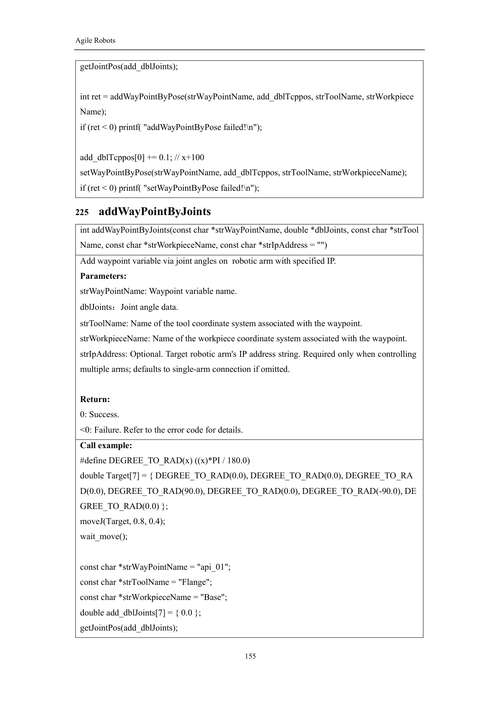



```
Agile Robots 
 155  
getJointPos(add_dblJoints); 
 
int ret = addWayPointByPose(strWayPointName, add_dblTcppos, strToolName, strWorkpiece
Name); 
if (ret < 0) printf( "addWayPointByPose failed!\n"); 
 
add_dblTcppos[0] += 0.1; // x+100 
setWayPointByPose(strWayPointName, add_dblTcppos, strToolName, strWorkpieceName); 
if (ret < 0) printf( "setWayPointByPose failed!\n"); 
225   addWayPointByJoints 
int addWayPointByJoints(const char *strWayPointName, double *dblJoints, const char *strTool
Name, const char *strWorkpieceName, const char *strIpAddress = "") 
Add waypoint variable via joint angles on  robotic arm with specified IP. 
Parameters: 
strWayPointName: Waypoint variable name. 
dblJoints：Joint angle data. 
strToolName: Name of the tool coordinate system associated with the waypoint. 
strWorkpieceName: Name of the workpiece coordinate system associated with the waypoint. 
strIpAddress: Optional. Target robotic arm's IP address string. Required only when controlling 
multiple arms; defaults to single-arm connection if omitted. 
 
Return: 
0: Success. 
<0: Failure. Refer to the error code for details. 
Call example: 
#define DEGREE_TO_RAD(x) ((x)*PI / 180.0) 
double Target[7] = { DEGREE_TO_RAD(0.0), DEGREE_TO_RAD(0.0), DEGREE_TO_RA
D(0.0), DEGREE_TO_RAD(90.0), DEGREE_TO_RAD(0.0), DEGREE_TO_RAD(-90.0), DE
GREE_TO_RAD(0.0) }; 
moveJ(Target, 0.8, 0.4); 
wait_move(); 
 
const char *strWayPointName = "api_01"; 
const char *strToolName = "Flange"; 
const char *strWorkpieceName = "Base"; 
double add_dblJoints[7] = { 0.0 }; 
getJointPos(add_dblJoints);
```



## PDF page 165

**Source:** Industrial API Manual (C\&C++ Edition) \_V3.3.0\_EN\_20260605.pdf, original pdf page 165. [Open the corresponding PDF reading-copy page](https://1292444914-files.gitbook.io/~/files/v0/b/gitbook-x-prod.appspot.com/o/spaces%2FtgOfPnscWebs1eh82EKq%2Fuploads%2FTe9EomLTfFiBJ7zB0WdG%2Findustrial-api-manual-c-c-edition-v3-3-0-en-20260605-pp-151-188.pdf?alt=media#page=15).



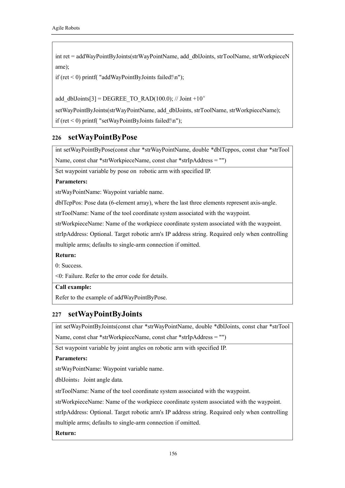



```
Agile Robots 
 156  
 
int ret = addWayPointByJoints(strWayPointName, add_dblJoints, strToolName, strWorkpieceN
ame); 
if (ret < 0) printf( "addWayPointByJoints failed!\n"); 
 
add_dblJoints[3] = DEGREE_TO_RAD(100.0); // Joint +10° 
setWayPointByJoints(strWayPointName, add_dblJoints, strToolName, strWorkpieceName); 
if (ret < 0) printf( "setWayPointByJoints failed!\n"); 
226   setWayPointByPose 
int setWayPointByPose(const char *strWayPointName, double *dblTcppos, const char *strTool
Name, const char *strWorkpieceName, const char *strIpAddress = "") 
Set waypoint variable by pose on  robotic arm with specified IP. 
Parameters: 
strWayPointName: Waypoint variable name. 
dblTcpPos: Pose data (6-element array), where the last three elements represent axis-angle. 
strToolName: Name of the tool coordinate system associated with the waypoint. 
strWorkpieceName: Name of the workpiece coordinate system associated with the waypoint. 
strIpAddress: Optional. Target robotic arm's IP address string. Required only when controlling 
multiple arms; defaults to single-arm connection if omitted. 
Return: 
0: Success. 
<0: Failure. Refer to the error code for details. 
Call example: 
Refer to the example of addWayPointByPose. 
227   setWayPointByJoints 
int setWayPointByJoints(const char *strWayPointName, double *dblJoints, const char *strTool
Name, const char *strWorkpieceName, const char *strIpAddress = "") 
Set waypoint variable by joint angles on robotic arm with specified IP. 
Parameters: 
strWayPointName: Waypoint variable name. 
dblJoints：Joint angle data. 
strToolName: Name of the tool coordinate system associated with the waypoint. 
strWorkpieceName: Name of the workpiece coordinate system associated with the waypoint. 
strIpAddress: Optional. Target robotic arm's IP address string. Required only when controlling 
multiple arms; defaults to single-arm connection if omitted. 
Return:
```



## PDF page 166

**Source:** Industrial API Manual (C\&C++ Edition) \_V3.3.0\_EN\_20260605.pdf, original pdf page 166. [Open the corresponding PDF reading-copy page](https://1292444914-files.gitbook.io/~/files/v0/b/gitbook-x-prod.appspot.com/o/spaces%2FtgOfPnscWebs1eh82EKq%2Fuploads%2FTe9EomLTfFiBJ7zB0WdG%2Findustrial-api-manual-c-c-edition-v3-3-0-en-20260605-pp-151-188.pdf?alt=media#page=16).



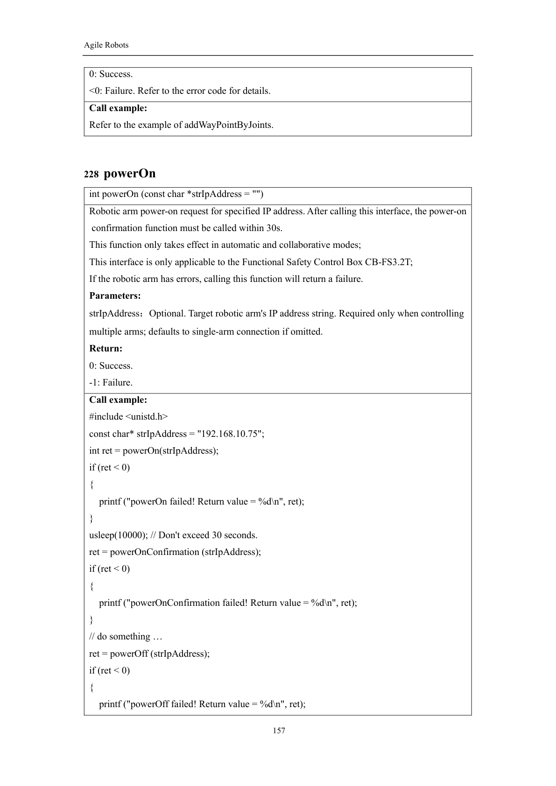



```
Agile Robots 
 157  
0: Success. 
<0: Failure. Refer to the error code for details. 
Call example: 
Refer to the example of addWayPointByJoints. 
 
228 powerOn 
int powerOn (const char *strIpAddress = "") 
Robotic arm power-on request for specified IP address. After calling this interface, the power-on
 confirmation function must be called within 30s. 
This function only takes effect in automatic and collaborative modes; 
This interface is only applicable to the Functional Safety Control Box CB-FS3.2T; 
If the robotic arm has errors, calling this function will return a failure. 
Parameters: 
strIpAddress：Optional. Target robotic arm's IP address string. Required only when controlling 
multiple arms; defaults to single-arm connection if omitted. 
Return: 
0: Success. 
-1: Failure. 
Call example: 
#include <unistd.h> 
const char* strIpAddress = "192.168.10.75"; 
int ret = powerOn(strIpAddress); 
if (ret < 0) 
{ 
    printf ("powerOn failed! Return value = %d\n", ret); 
} 
usleep(10000); // Don't exceed 30 seconds. 
ret = powerOnConfirmation (strIpAddress); 
if (ret < 0) 
{ 
    printf ("powerOnConfirmation failed! Return value = %d\n", ret); 
} 
// do something … 
ret = powerOff (strIpAddress); 
if (ret < 0) 
{ 
    printf ("powerOff failed! Return value = %d\n", ret);
```



## PDF page 167

**Source:** Industrial API Manual (C\&C++ Edition) \_V3.3.0\_EN\_20260605.pdf, original pdf page 167. [Open the corresponding PDF reading-copy page](https://1292444914-files.gitbook.io/~/files/v0/b/gitbook-x-prod.appspot.com/o/spaces%2FtgOfPnscWebs1eh82EKq%2Fuploads%2FTe9EomLTfFiBJ7zB0WdG%2Findustrial-api-manual-c-c-edition-v3-3-0-en-20260605-pp-151-188.pdf?alt=media#page=17).



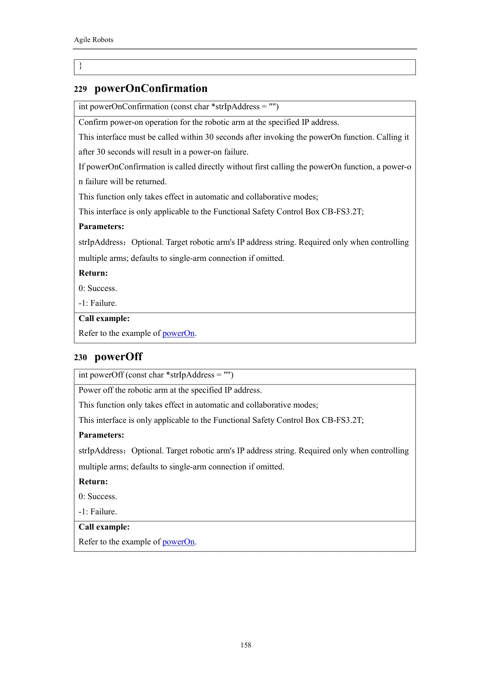



```
Agile Robots 
 158  
} 
229   powerOnConfirmation 
int powerOnConfirmation (const char *strIpAddress = "") 
Confirm power-on operation for the robotic arm at the specified IP address. 
This interface must be called within 30 seconds after invoking the powerOn function. Calling it 
after 30 seconds will result in a power-on failure. 
If powerOnConfirmation is called directly without first calling the powerOn function, a power-o
n failure will be returned. 
This function only takes effect in automatic and collaborative modes; 
This interface is only applicable to the Functional Safety Control Box CB-FS3.2T; 
Parameters: 
strIpAddress：Optional. Target robotic arm's IP address string. Required only when controlling 
multiple arms; defaults to single-arm connection if omitted. 
Return: 
0: Success. 
-1: Failure. 
Call example: 
Refer to the example of powerOn. 
230   powerOff 
int powerOff (const char *strIpAddress = "") 
Power off the robotic arm at the specified IP address. 
This function only takes effect in automatic and collaborative modes; 
This interface is only applicable to the Functional Safety Control Box CB-FS3.2T; 
Parameters: 
strIpAddress：Optional. Target robotic arm's IP address string. Required only when controlling 
multiple arms; defaults to single-arm connection if omitted. 
Return: 
0: Success. 
-1: Failure. 
Call example: 
Refer to the example of powerOn.
```



## PDF page 168

**Source:** Industrial API Manual (C\&C++ Edition) \_V3.3.0\_EN\_20260605.pdf, original pdf page 168. [Open the corresponding PDF reading-copy page](https://1292444914-files.gitbook.io/~/files/v0/b/gitbook-x-prod.appspot.com/o/spaces%2FtgOfPnscWebs1eh82EKq%2Fuploads%2FTe9EomLTfFiBJ7zB0WdG%2Findustrial-api-manual-c-c-edition-v3-3-0-en-20260605-pp-151-188.pdf?alt=media#page=18).



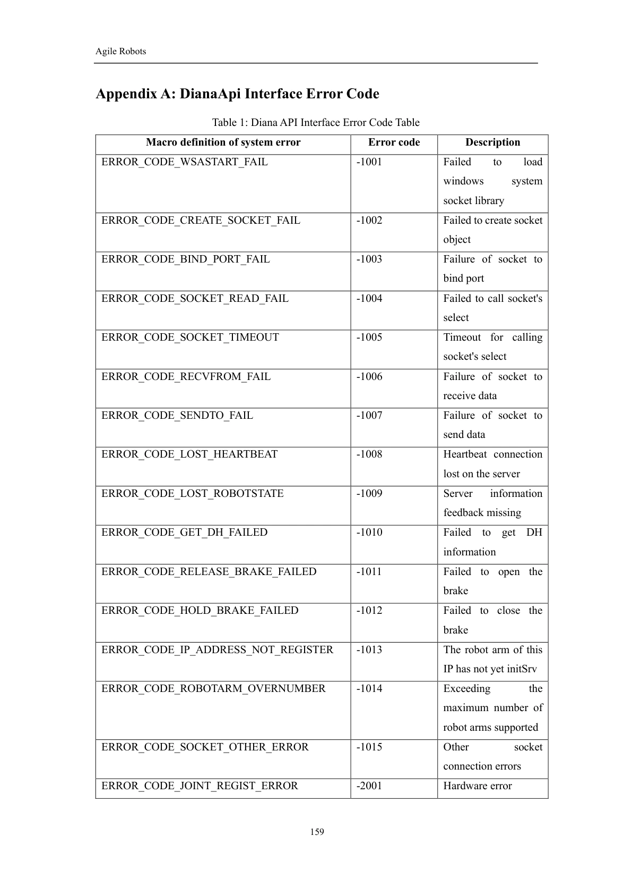



```
Agile Robots 
 159  
Appendix A: DianaApi Interface Error Code  
Table 1: Diana API Interface Error Code Table  
Macro definition of system error  
Error code  
Description  
ERROR_CODE_WSASTART_FAIL  
 
-1001 
Failed 
to 
load 
windows 
system 
socket library  
ERROR_CODE_CREATE_SOCKET_FAIL 
-1002 
Failed to create socket 
object  
ERROR_CODE_BIND_PORT_FAIL 
-1003 
Failure of socket to 
bind port  
ERROR_CODE_SOCKET_READ_FAIL 
-1004 
Failed to call socket's 
select  
ERROR_CODE_SOCKET_TIMEOUT 
-1005 
Timeout for calling 
socket's select  
ERROR_CODE_RECVFROM_FAIL 
-1006 
Failure of socket to 
receive data  
ERROR_CODE_SENDTO_FAIL 
-1007 
Failure of socket to 
send data  
ERROR_CODE_LOST_HEARTBEAT 
-1008 
Heartbeat connection 
lost on the server  
ERROR_CODE_LOST_ROBOTSTATE 
-1009 
Server 
information 
feedback missing  
ERROR_CODE_GET_DH_FAILED 
-1010 
Failed to get DH 
information  
ERROR_CODE_RELEASE_BRAKE_FAILED 
-1011 
Failed to open the 
brake  
ERROR_CODE_HOLD_BRAKE_FAILED 
-1012 
Failed to close the 
brake  
ERROR_CODE_IP_ADDRESS_NOT_REGISTER 
-1013 
The robot arm of this 
IP has not yet initSrv  
ERROR_CODE_ROBOTARM_OVERNUMBER 
-1014 
Exceeding 
the 
maximum number of 
robot arms supported  
ERROR_CODE_SOCKET_OTHER_ERROR 
-1015 
Other 
socket 
connection errors  
ERROR_CODE_JOINT_REGIST_ERROR 
-2001 
Hardware error
```



## PDF page 169

**Source:** Industrial API Manual (C\&C++ Edition) \_V3.3.0\_EN\_20260605.pdf, original pdf page 169. [Open the corresponding PDF reading-copy page](https://1292444914-files.gitbook.io/~/files/v0/b/gitbook-x-prod.appspot.com/o/spaces%2FtgOfPnscWebs1eh82EKq%2Fuploads%2FTe9EomLTfFiBJ7zB0WdG%2Findustrial-api-manual-c-c-edition-v3-3-0-en-20260605-pp-151-188.pdf?alt=media#page=19).



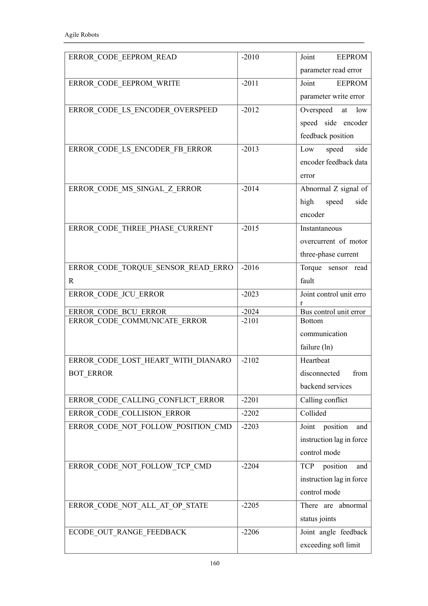



```
Agile Robots 
 160  
ERROR_CODE_EEPROM_READ  
-2010  
Joint 
EEPROM 
parameter read error  
ERROR_CODE_EEPROM_WRITE 
-2011 
Joint 
EEPROM 
parameter write error  
ERROR_CODE_LS_ENCODER_OVERSPEED 
-2012 
Overspeed 
at 
low 
speed side encoder 
feedback position  
ERROR_CODE_LS_ENCODER_FB_ERROR 
-2013 
Low 
speed 
side 
encoder feedback data 
error  
ERROR_CODE_MS_SINGAL_Z_ERROR 
-2014 
Abnormal Z signal of 
high 
speed 
side 
encoder  
ERROR_CODE_THREE_PHASE_CURRENT 
-2015 
Instantaneous 
overcurrent of motor 
three-phase current  
ERROR_CODE_TORQUE_SENSOR_READ_ERRO
R 
-2016 
Torque sensor read 
fault  
ERROR_CODE_JCU_ERROR 
-2023 
Joint control unit erro
r 
ERROR_CODE_BCU_ERROR 
-2024 
Bus control unit error 
ERROR_CODE_COMMUNICATE_ERROR 
-2101 
Bottom 
communication 
failure (ln)  
ERROR_CODE_LOST_HEART_WITH_DIANARO
BOT_ERROR 
-2102 
Heartbeat 
disconnected 
from 
backend services  
ERROR_CODE_CALLING_CONFLICT_ERROR 
-2201 
Calling conflict 
ERROR_CODE_COLLISION_ERROR 
-2202 
Collided  
ERROR_CODE_NOT_FOLLOW_POSITION_CMD 
-2203 
Joint 
position 
and 
instruction lag in force 
control mode  
ERROR_CODE_NOT_FOLLOW_TCP_CMD 
-2204 
TCP 
position 
and 
instruction lag in force 
control mode  
ERROR_CODE_NOT_ALL_AT_OP_STATE 
-2205 
There are abnormal 
status joints  
ECODE_OUT_RANGE_FEEDBACK 
-2206 
Joint angle feedback 
exceeding soft limit
```



## PDF page 170

**Source:** Industrial API Manual (C\&C++ Edition) \_V3.3.0\_EN\_20260605.pdf, original pdf page 170. [Open the corresponding PDF reading-copy page](https://1292444914-files.gitbook.io/~/files/v0/b/gitbook-x-prod.appspot.com/o/spaces%2FtgOfPnscWebs1eh82EKq%2Fuploads%2FTe9EomLTfFiBJ7zB0WdG%2Findustrial-api-manual-c-c-edition-v3-3-0-en-20260605-pp-151-188.pdf?alt=media#page=20).



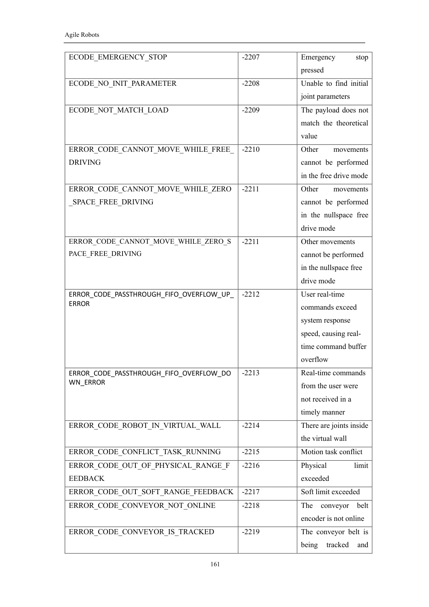



```
Agile Robots 
 161  
ECODE_EMERGENCY_STOP 
-2207 
Emergency 
stop 
pressed  
ECODE_NO_INIT_PARAMETER 
-2208 
Unable to find initial 
joint parameters  
ECODE_NOT_MATCH_LOAD 
-2209 
The payload does not 
match the theoretical 
value  
ERROR_CODE_CANNOT_MOVE_WHILE_FREE_
DRIVING 
-2210 
Other 
movements 
cannot be performed 
in the free drive mode  
ERROR_CODE_CANNOT_MOVE_WHILE_ZERO
_SPACE_FREE_DRIVING 
-2211 
Other 
movements 
cannot be performed 
in the nullspace free 
drive mode  
ERROR_CODE_CANNOT_MOVE_WHILE_ZERO_S
PACE_FREE_DRIVING 
-2211 
Other movements 
cannot be performed 
in the nullspace free 
drive mode  
ERROR_CODE_PASSTHROUGH_FIFO_OVERFLOW_UP_
ERROR 
-2212 
User real-time 
commands exceed 
system response 
speed, causing real-
time command buffer 
overflow 
ERROR_CODE_PASSTHROUGH_FIFO_OVERFLOW_DO
WN_ERROR 
-2213 
Real-time commands 
from the user were 
not received in a 
timely manner 
ERROR_CODE_ROBOT_IN_VIRTUAL_WALL 
-2214 
There are joints inside 
the virtual wall  
ERROR_CODE_CONFLICT_TASK_RUNNING 
-2215 
Motion task conflict  
ERROR_CODE_OUT_OF_PHYSICAL_RANGE_F
EEDBACK 
-2216 
Physical 
limit 
exceeded  
ERROR_CODE_OUT_SOFT_RANGE_FEEDBACK 
-2217 
Soft limit exceeded  
ERROR_CODE_CONVEYOR_NOT_ONLINE 
-2218 
The 
conveyor 
belt 
encoder is not online  
ERROR_CODE_CONVEYOR_IS_TRACKED 
 
-2219 
The conveyor belt is 
being 
tracked 
and
```



## PDF page 171

**Source:** Industrial API Manual (C\&C++ Edition) \_V3.3.0\_EN\_20260605.pdf, original pdf page 171. [Open the corresponding PDF reading-copy page](https://1292444914-files.gitbook.io/~/files/v0/b/gitbook-x-prod.appspot.com/o/spaces%2FtgOfPnscWebs1eh82EKq%2Fuploads%2FTe9EomLTfFiBJ7zB0WdG%2Findustrial-api-manual-c-c-edition-v3-3-0-en-20260605-pp-151-188.pdf?alt=media#page=21).



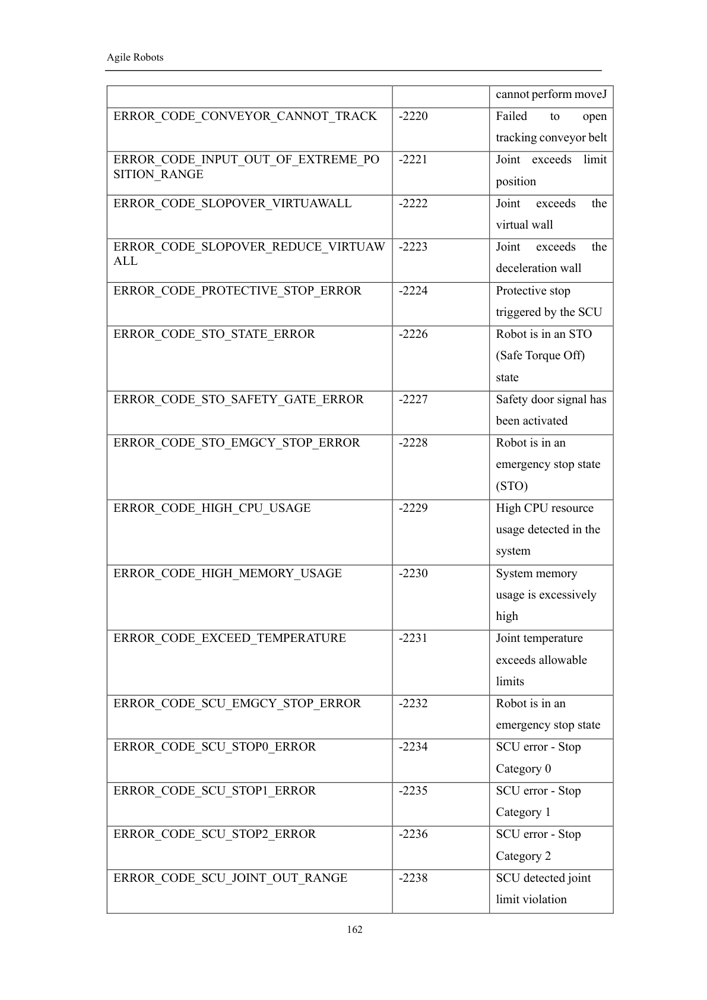



```
Agile Robots 
 162  
cannot perform moveJ  
ERROR_CODE_CONVEYOR_CANNOT_TRACK 
 
-2220 
Failed 
to 
open 
tracking conveyor belt  
ERROR_CODE_INPUT_OUT_OF_EXTREME_PO
SITION_RANGE 
-2221 
Joint exceeds limit 
position 
ERROR_CODE_SLOPOVER_VIRTUAWALL 
-2222 
Joint 
exceeds 
the 
virtual wall 
ERROR_CODE_SLOPOVER_REDUCE_VIRTUAW
ALL 
-2223 
Joint 
exceeds 
the 
deceleration wall 
ERROR_CODE_PROTECTIVE_STOP_ERROR 
-2224 
Protective stop 
triggered by the SCU 
ERROR_CODE_STO_STATE_ERROR 
-2226 
Robot is in an STO 
(Safe Torque Off) 
state 
ERROR_CODE_STO_SAFETY_GATE_ERROR 
-2227 
Safety door signal has 
been activated 
ERROR_CODE_STO_EMGCY_STOP_ERROR 
-2228 
Robot is in an 
emergency stop state 
(STO) 
ERROR_CODE_HIGH_CPU_USAGE 
-2229 
High CPU resource 
usage detected in the 
system 
ERROR_CODE_HIGH_MEMORY_USAGE 
-2230 
System memory 
usage is excessively 
high 
ERROR_CODE_EXCEED_TEMPERATURE 
-2231 
Joint temperature 
exceeds allowable 
limits 
ERROR_CODE_SCU_EMGCY_STOP_ERROR 
-2232 
Robot is in an 
emergency stop state 
ERROR_CODE_SCU_STOP0_ERROR 
-2234 
SCU error - Stop 
Category 0 
ERROR_CODE_SCU_STOP1_ERROR 
-2235 
SCU error - Stop 
Category 1 
ERROR_CODE_SCU_STOP2_ERROR 
-2236 
SCU error - Stop 
Category 2 
ERROR_CODE_SCU_JOINT_OUT_RANGE 
-2238 
SCU detected joint 
limit violation
```



## PDF page 172

**Source:** Industrial API Manual (C\&C++ Edition) \_V3.3.0\_EN\_20260605.pdf, original pdf page 172. [Open the corresponding PDF reading-copy page](https://1292444914-files.gitbook.io/~/files/v0/b/gitbook-x-prod.appspot.com/o/spaces%2FtgOfPnscWebs1eh82EKq%2Fuploads%2FTe9EomLTfFiBJ7zB0WdG%2Findustrial-api-manual-c-c-edition-v3-3-0-en-20260605-pp-151-188.pdf?alt=media#page=22).



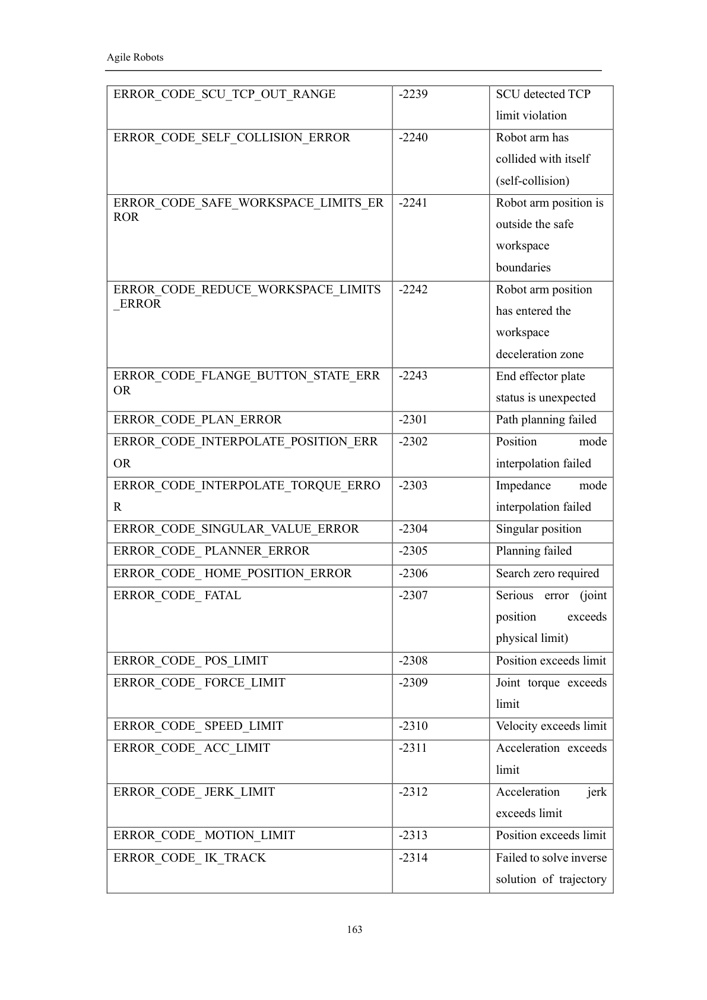



```
Agile Robots 
 163  
ERROR_CODE_SCU_TCP_OUT_RANGE 
-2239 
SCU detected TCP 
limit violation 
ERROR_CODE_SELF_COLLISION_ERROR 
-2240 
Robot arm has 
collided with itself 
(self-collision) 
ERROR_CODE_SAFE_WORKSPACE_LIMITS_ER
ROR 
-2241 
Robot arm position is 
outside the safe 
workspace 
boundaries 
ERROR_CODE_REDUCE_WORKSPACE_LIMITS
_ERROR 
-2242 
Robot arm position 
has entered the 
workspace 
deceleration zone 
ERROR_CODE_FLANGE_BUTTON_STATE_ERR
OR 
-2243 
End effector plate 
status is unexpected 
ERROR_CODE_PLAN_ERROR 
-2301 
Path planning failed  
ERROR_CODE_INTERPOLATE_POSITION_ERR
OR 
-2302 
Position 
mode 
interpolation failed  
ERROR_CODE_INTERPOLATE_TORQUE_ERRO
R 
-2303 
Impedance 
mode 
interpolation failed  
ERROR_CODE_SINGULAR_VALUE_ERROR 
-2304 
Singular position  
ERROR_CODE_ PLANNER_ERROR 
-2305 
Planning failed  
ERROR_CODE_ HOME_POSITION_ERROR 
-2306 
Search zero required  
ERROR_CODE_ FATAL 
-2307 
Serious error (joint 
position 
exceeds 
physical limit)  
ERROR_CODE_ POS_LIMIT 
-2308 
Position exceeds limit  
ERROR_CODE_ FORCE_LIMIT 
-2309 
Joint torque exceeds 
limit  
ERROR_CODE_ SPEED_LIMIT 
-2310 
Velocity exceeds limit  
ERROR_CODE_ ACC_LIMIT 
-2311 
Acceleration exceeds 
limit  
ERROR_CODE_ JERK_LIMIT 
-2312 
Acceleration 
jerk 
exceeds limit  
ERROR_CODE_ MOTION_LIMIT 
-2313 
Position exceeds limit  
ERROR_CODE_ IK_TRACK 
-2314 
Failed to solve inverse 
solution of trajectory
```



## PDF page 173

**Source:** Industrial API Manual (C\&C++ Edition) \_V3.3.0\_EN\_20260605.pdf, original pdf page 173. [Open the corresponding PDF reading-copy page](https://1292444914-files.gitbook.io/~/files/v0/b/gitbook-x-prod.appspot.com/o/spaces%2FtgOfPnscWebs1eh82EKq%2Fuploads%2FTe9EomLTfFiBJ7zB0WdG%2Findustrial-api-manual-c-c-edition-v3-3-0-en-20260605-pp-151-188.pdf?alt=media#page=23).



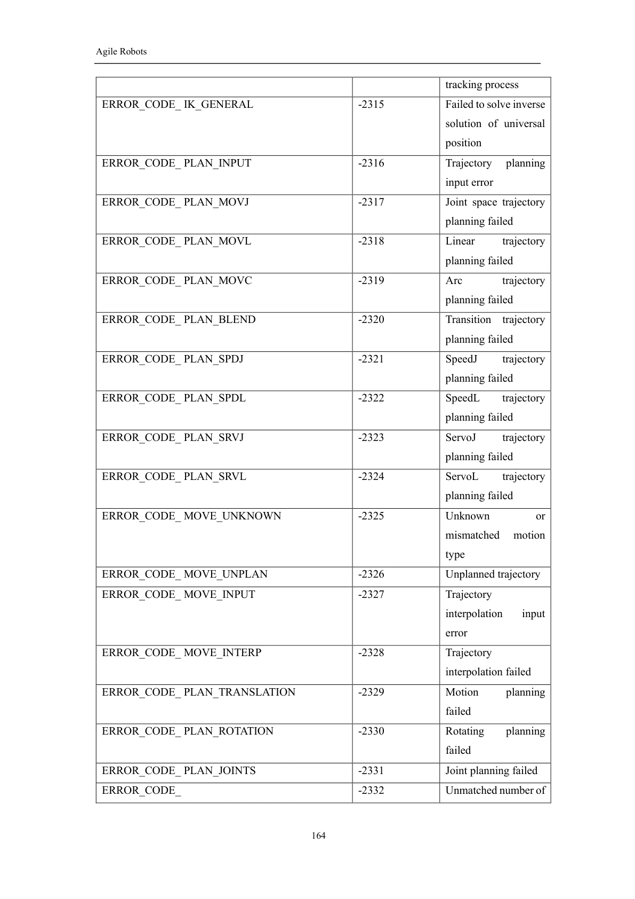



```
Agile Robots 
 164  
tracking process  
ERROR_CODE_ IK_GENERAL 
-2315 
Failed to solve inverse 
solution of universal 
position  
ERROR_CODE_ PLAN_INPUT 
-2316 
Trajectory 
planning 
input error  
ERROR_CODE_ PLAN_MOVJ 
-2317 
Joint space trajectory 
planning failed  
ERROR_CODE_ PLAN_MOVL 
-2318 
Linear 
trajectory 
planning failed  
ERROR_CODE_ PLAN_MOVC 
-2319 
Arc 
trajectory 
planning failed  
ERROR_CODE_ PLAN_BLEND 
-2320 
Transition trajectory 
planning failed  
ERROR_CODE_ PLAN_SPDJ 
-2321 
SpeedJ 
trajectory 
planning failed  
ERROR_CODE_ PLAN_SPDL 
-2322 
SpeedL 
trajectory 
planning failed  
ERROR_CODE_ PLAN_SRVJ 
-2323 
ServoJ 
trajectory 
planning failed  
ERROR_CODE_ PLAN_SRVL 
-2324 
ServoL 
trajectory 
planning failed  
ERROR_CODE_ MOVE_UNKNOWN 
-2325 
Unknown 
or 
mismatched 
motion 
type  
ERROR_CODE_ MOVE_UNPLAN 
-2326 
Unplanned trajectory  
ERROR_CODE_ MOVE_INPUT 
-2327 
Trajectory 
interpolation 
input 
error  
ERROR_CODE_ MOVE_INTERP 
-2328 
Trajectory 
interpolation failed  
ERROR_CODE_ PLAN_TRANSLATION 
-2329 
Motion 
planning 
failed  
ERROR_CODE_ PLAN_ROTATION 
-2330 
Rotating 
planning 
failed  
ERROR_CODE_ PLAN_JOINTS 
-2331 
Joint planning failed  
ERROR_CODE_ 
-2332 
Unmatched number of
```



## PDF page 174

**Source:** Industrial API Manual (C\&C++ Edition) \_V3.3.0\_EN\_20260605.pdf, original pdf page 174. [Open the corresponding PDF reading-copy page](https://1292444914-files.gitbook.io/~/files/v0/b/gitbook-x-prod.appspot.com/o/spaces%2FtgOfPnscWebs1eh82EKq%2Fuploads%2FTe9EomLTfFiBJ7zB0WdG%2Findustrial-api-manual-c-c-edition-v3-3-0-en-20260605-pp-151-188.pdf?alt=media#page=24).



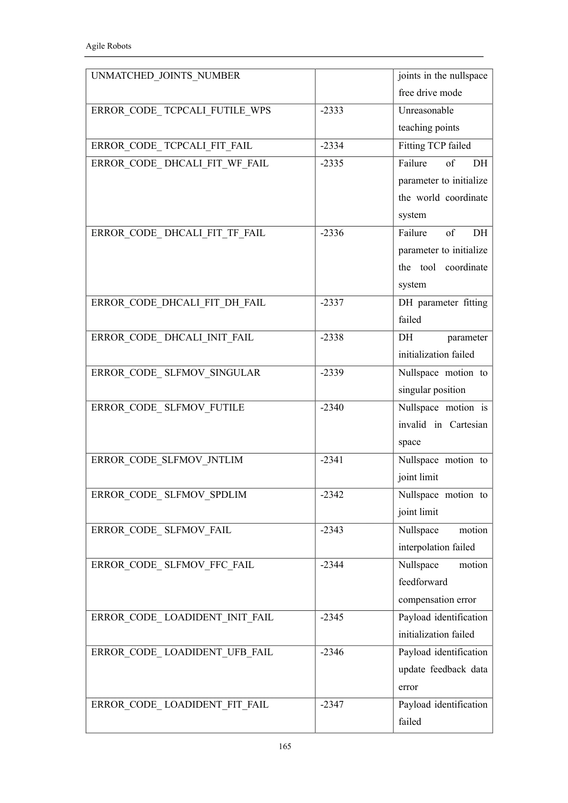



```
Agile Robots 
 165  
UNMATCHED_JOINTS_NUMBER 
joints in the nullspace 
free drive mode  
ERROR_CODE_ TCPCALI_FUTILE_WPS 
-2333 
Unreasonable 
teaching points  
ERROR_CODE_ TCPCALI_FIT_FAIL 
-2334 
Fitting TCP failed  
ERROR_CODE_ DHCALI_FIT_WF_FAIL 
-2335 
Failure 
of 
DH 
parameter to initialize 
the world coordinate 
system  
ERROR_CODE_ DHCALI_FIT_TF_FAIL 
-2336 
Failure 
of 
DH 
parameter to initialize 
the tool coordinate 
system  
ERROR_CODE_DHCALI_FIT_DH_FAIL 
-2337 
DH parameter fitting 
failed  
ERROR_CODE_ DHCALI_INIT_FAIL 
-2338 
DH 
parameter 
initialization failed  
ERROR_CODE_ SLFMOV_SINGULAR 
-2339 
Nullspace motion to 
singular position  
ERROR_CODE_ SLFMOV_FUTILE 
-2340 
Nullspace motion is 
invalid in Cartesian 
space  
ERROR_CODE_SLFMOV_JNTLIM 
-2341 
Nullspace motion to 
joint limit  
ERROR_CODE_ SLFMOV_SPDLIM 
-2342 
Nullspace motion to 
joint limit  
ERROR_CODE_ SLFMOV_FAIL 
-2343 
Nullspace 
motion 
interpolation failed  
ERROR_CODE_ SLFMOV_FFC_FAIL 
-2344 
Nullspace 
motion 
feedforward 
compensation error  
ERROR_CODE_ LOADIDENT_INIT_FAIL 
-2345 
Payload identification 
initialization failed  
ERROR_CODE_ LOADIDENT_UFB_FAIL 
-2346 
Payload identification 
update feedback data 
error  
ERROR_CODE_ LOADIDENT_FIT_FAIL 
-2347 
Payload identification 
failed
```



## PDF page 175

**Source:** Industrial API Manual (C\&C++ Edition) \_V3.3.0\_EN\_20260605.pdf, original pdf page 175. [Open the corresponding PDF reading-copy page](https://1292444914-files.gitbook.io/~/files/v0/b/gitbook-x-prod.appspot.com/o/spaces%2FtgOfPnscWebs1eh82EKq%2Fuploads%2FTe9EomLTfFiBJ7zB0WdG%2Findustrial-api-manual-c-c-edition-v3-3-0-en-20260605-pp-151-188.pdf?alt=media#page=25).



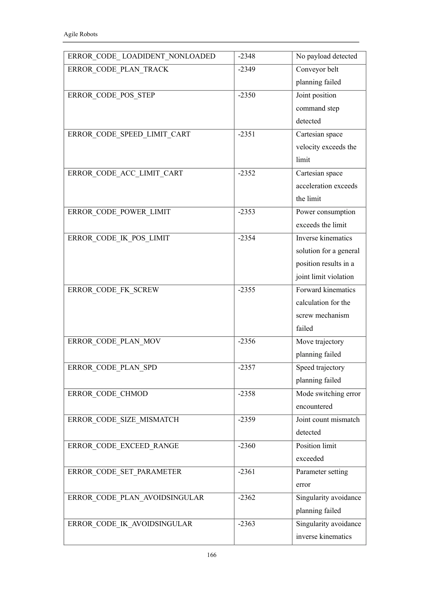



```
Agile Robots 
 166  
ERROR_CODE_ LOADIDENT_NONLOADED 
-2348 
No payload detected  
ERROR_CODE_PLAN_TRACK 
-2349 
Conveyor belt 
planning failed 
ERROR_CODE_POS_STEP 
-2350 
Joint position 
command step 
detected 
ERROR_CODE_SPEED_LIMIT_CART 
-2351 
Cartesian space 
velocity exceeds the 
limit 
ERROR_CODE_ACC_LIMIT_CART 
-2352 
Cartesian space 
acceleration exceeds 
the limit 
ERROR_CODE_POWER_LIMIT 
-2353 
Power consumption 
exceeds the limit 
ERROR_CODE_IK_POS_LIMIT 
-2354 
Inverse kinematics 
solution for a general 
position results in a 
joint limit violation 
ERROR_CODE_FK_SCREW 
-2355 
Forward kinematics 
calculation for the 
screw mechanism 
failed 
ERROR_CODE_PLAN_MOV 
-2356 
Move trajectory 
planning failed 
ERROR_CODE_PLAN_SPD 
-2357 
Speed trajectory 
planning failed 
ERROR_CODE_CHMOD 
-2358 
Mode switching error 
encountered 
ERROR_CODE_SIZE_MISMATCH 
-2359 
Joint count mismatch 
detected 
ERROR_CODE_EXCEED_RANGE 
-2360 
Position limit 
exceeded 
ERROR_CODE_SET_PARAMETER 
-2361 
Parameter setting 
error 
ERROR_CODE_PLAN_AVOIDSINGULAR 
-2362 
Singularity avoidance 
planning failed 
ERROR_CODE_IK_AVOIDSINGULAR 
-2363 
Singularity avoidance 
inverse kinematics
```



## PDF page 176

**Source:** Industrial API Manual (C\&C++ Edition) \_V3.3.0\_EN\_20260605.pdf, original pdf page 176. [Open the corresponding PDF reading-copy page](https://1292444914-files.gitbook.io/~/files/v0/b/gitbook-x-prod.appspot.com/o/spaces%2FtgOfPnscWebs1eh82EKq%2Fuploads%2FTe9EomLTfFiBJ7zB0WdG%2Findustrial-api-manual-c-c-edition-v3-3-0-en-20260605-pp-151-188.pdf?alt=media#page=26).



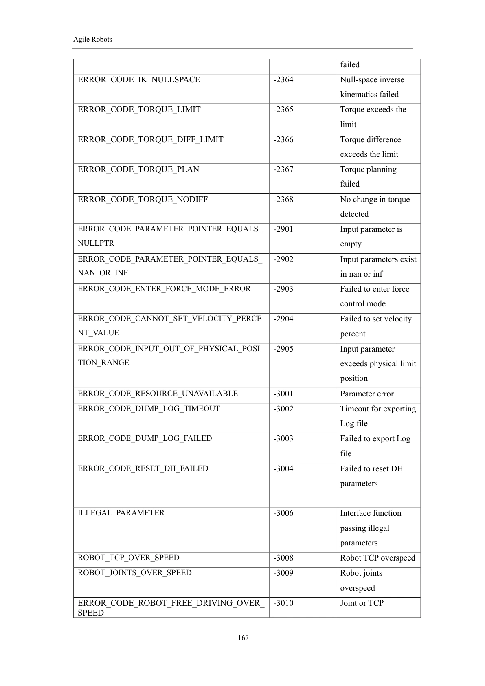



```
Agile Robots 
 167  
failed 
ERROR_CODE_IK_NULLSPACE 
-2364 
Null-space inverse 
kinematics failed 
ERROR_CODE_TORQUE_LIMIT 
-2365 
Torque exceeds the 
limit 
ERROR_CODE_TORQUE_DIFF_LIMIT 
-2366 
Torque difference 
exceeds the limit 
ERROR_CODE_TORQUE_PLAN 
-2367 
Torque planning 
failed 
ERROR_CODE_TORQUE_NODIFF 
-2368 
No change in torque 
detected 
ERROR_CODE_PARAMETER_POINTER_EQUALS_
NULLPTR 
-2901 
Input parameter is 
empty 
ERROR_CODE_PARAMETER_POINTER_EQUALS_
NAN_OR_INF 
-2902 
Input parameters exist 
in nan or inf 
ERROR_CODE_ENTER_FORCE_MODE_ERROR 
-2903 
Failed to enter force 
control mode 
ERROR_CODE_CANNOT_SET_VELOCITY_PERCE
NT_VALUE 
-2904 
Failed to set velocity 
percent 
ERROR_CODE_INPUT_OUT_OF_PHYSICAL_POSI
TION_RANGE 
-2905 
Input parameter 
exceeds physical limit 
position 
ERROR_CODE_RESOURCE_UNAVAILABLE 
-3001 
Parameter error  
ERROR_CODE_DUMP_LOG_TIMEOUT 
-3002 
Timeout for exporting 
Log file  
ERROR_CODE_DUMP_LOG_FAILED 
-3003 
Failed to export Log 
file  
ERROR_CODE_RESET_DH_FAILED 
-3004 
Failed to reset DH 
parameters  
 
ILLEGAL_PARAMETER 
-3006 
Interface function 
passing illegal 
parameters 
ROBOT_TCP_OVER_SPEED 
-3008 
Robot TCP overspeed 
ROBOT_JOINTS_OVER_SPEED 
-3009 
Robot joints 
overspeed 
ERROR_CODE_ROBOT_FREE_DRIVING_OVER_
SPEED 
-3010 
Joint or TCP
```



## PDF page 177

**Source:** Industrial API Manual (C\&C++ Edition) \_V3.3.0\_EN\_20260605.pdf, original pdf page 177. [Open the corresponding PDF reading-copy page](https://1292444914-files.gitbook.io/~/files/v0/b/gitbook-x-prod.appspot.com/o/spaces%2FtgOfPnscWebs1eh82EKq%2Fuploads%2FTe9EomLTfFiBJ7zB0WdG%2Findustrial-api-manual-c-c-edition-v3-3-0-en-20260605-pp-151-188.pdf?alt=media#page=27).



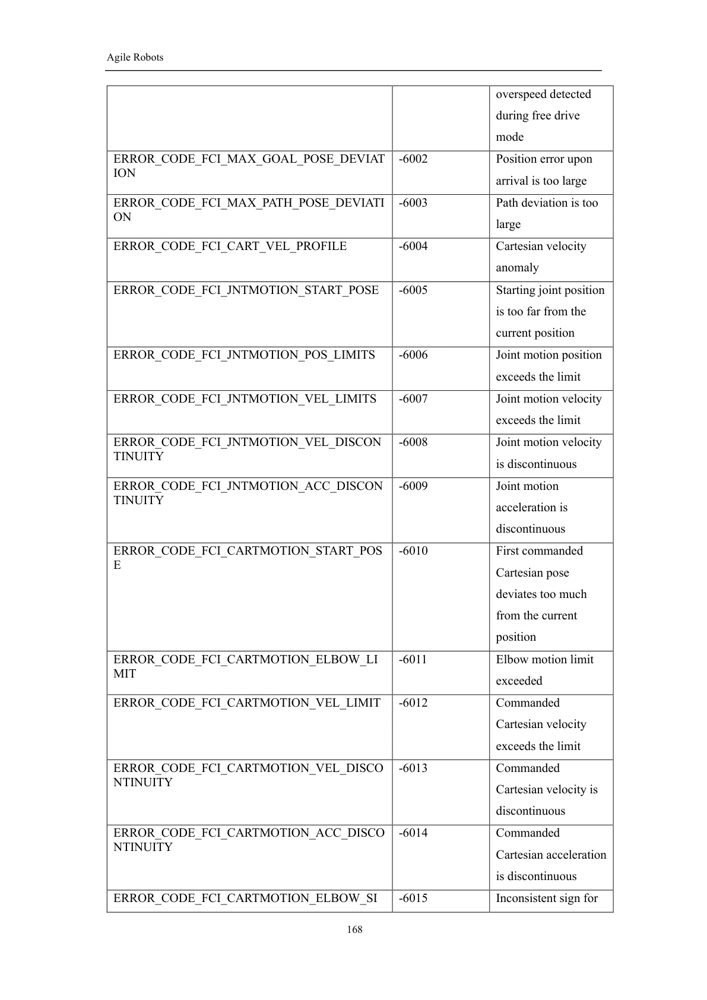



```
Agile Robots 
 168  
overspeed detected 
during free drive 
mode 
ERROR_CODE_FCI_MAX_GOAL_POSE_DEVIAT
ION 
-6002 
Position error upon 
arrival is too large 
ERROR_CODE_FCI_MAX_PATH_POSE_DEVIATI
ON 
-6003 
Path deviation is too 
large 
ERROR_CODE_FCI_CART_VEL_PROFILE 
-6004 
Cartesian velocity 
anomaly 
ERROR_CODE_FCI_JNTMOTION_START_POSE 
-6005 
Starting joint position 
is too far from the 
current position 
ERROR_CODE_FCI_JNTMOTION_POS_LIMITS 
-6006 
Joint motion position 
exceeds the limit 
ERROR_CODE_FCI_JNTMOTION_VEL_LIMITS 
-6007 
Joint motion velocity 
exceeds the limit 
ERROR_CODE_FCI_JNTMOTION_VEL_DISCON
TINUITY 
-6008 
Joint motion velocity 
is discontinuous 
ERROR_CODE_FCI_JNTMOTION_ACC_DISCON
TINUITY 
-6009 
Joint motion 
acceleration is 
discontinuous 
ERROR_CODE_FCI_CARTMOTION_START_POS
E 
-6010 
First commanded 
Cartesian pose 
deviates too much 
from the current 
position 
ERROR_CODE_FCI_CARTMOTION_ELBOW_LI
MIT 
-6011 
Elbow motion limit 
exceeded 
ERROR_CODE_FCI_CARTMOTION_VEL_LIMIT 
-6012 
Commanded 
Cartesian velocity 
exceeds the limit 
ERROR_CODE_FCI_CARTMOTION_VEL_DISCO
NTINUITY 
-6013 
Commanded 
Cartesian velocity is 
discontinuous 
ERROR_CODE_FCI_CARTMOTION_ACC_DISCO
NTINUITY 
-6014 
Commanded 
Cartesian acceleration 
is discontinuous 
ERROR_CODE_FCI_CARTMOTION_ELBOW_SI
-6015 
Inconsistent sign for
```



## PDF page 178

**Source:** Industrial API Manual (C\&C++ Edition) \_V3.3.0\_EN\_20260605.pdf, original pdf page 178. [Open the corresponding PDF reading-copy page](https://1292444914-files.gitbook.io/~/files/v0/b/gitbook-x-prod.appspot.com/o/spaces%2FtgOfPnscWebs1eh82EKq%2Fuploads%2FTe9EomLTfFiBJ7zB0WdG%2Findustrial-api-manual-c-c-edition-v3-3-0-en-20260605-pp-151-188.pdf?alt=media#page=28).



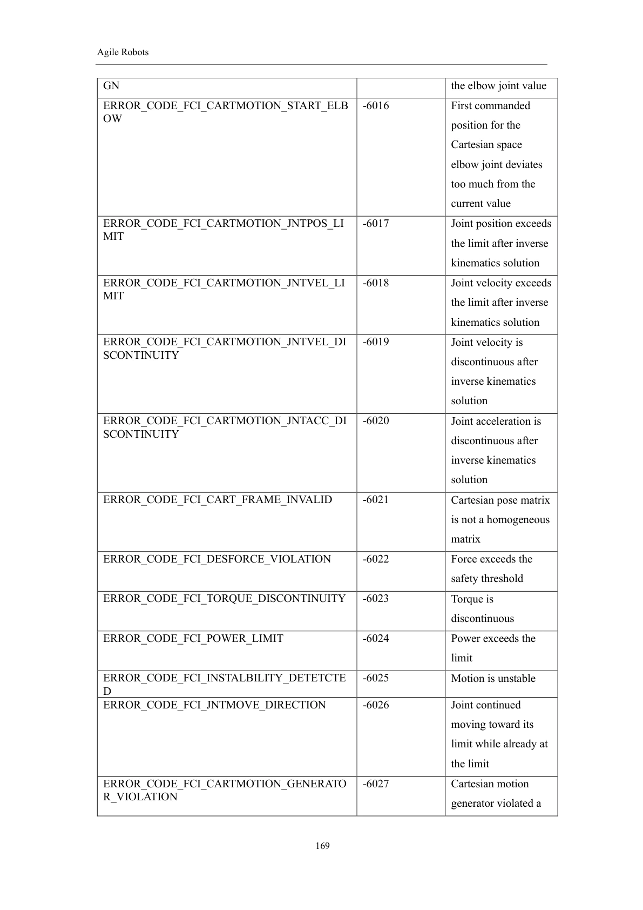



```
Agile Robots 
 169  
GN 
the elbow joint value 
ERROR_CODE_FCI_CARTMOTION_START_ELB
OW 
-6016 
First commanded 
position for the 
Cartesian space 
elbow joint deviates 
too much from the 
current value 
ERROR_CODE_FCI_CARTMOTION_JNTPOS_LI
MIT 
-6017 
Joint position exceeds 
the limit after inverse 
kinematics solution 
ERROR_CODE_FCI_CARTMOTION_JNTVEL_LI
MIT 
-6018 
Joint velocity exceeds 
the limit after inverse 
kinematics solution 
ERROR_CODE_FCI_CARTMOTION_JNTVEL_DI
SCONTINUITY 
-6019 
Joint velocity is 
discontinuous after 
inverse kinematics 
solution 
ERROR_CODE_FCI_CARTMOTION_JNTACC_DI
SCONTINUITY 
-6020 
Joint acceleration is 
discontinuous after 
inverse kinematics 
solution 
ERROR_CODE_FCI_CART_FRAME_INVALID 
-6021 
Cartesian pose matrix 
is not a homogeneous 
matrix 
ERROR_CODE_FCI_DESFORCE_VIOLATION 
-6022 
Force exceeds the 
safety threshold 
ERROR_CODE_FCI_TORQUE_DISCONTINUITY 
-6023 
Torque is 
discontinuous 
ERROR_CODE_FCI_POWER_LIMIT 
-6024 
Power exceeds the 
limit 
ERROR_CODE_FCI_INSTALBILITY_DETETCTE
D 
-6025 
Motion is unstable 
ERROR_CODE_FCI_JNTMOVE_DIRECTION 
-6026 
Joint continued 
moving toward its 
limit while already at 
the limit 
ERROR_CODE_FCI_CARTMOTION_GENERATO
R_VIOLATION 
-6027 
Cartesian motion 
generator violated a
```



## PDF page 179

**Source:** Industrial API Manual (C\&C++ Edition) \_V3.3.0\_EN\_20260605.pdf, original pdf page 179. [Open the corresponding PDF reading-copy page](https://1292444914-files.gitbook.io/~/files/v0/b/gitbook-x-prod.appspot.com/o/spaces%2FtgOfPnscWebs1eh82EKq%2Fuploads%2FTe9EomLTfFiBJ7zB0WdG%2Findustrial-api-manual-c-c-edition-v3-3-0-en-20260605-pp-151-188.pdf?alt=media#page=29).



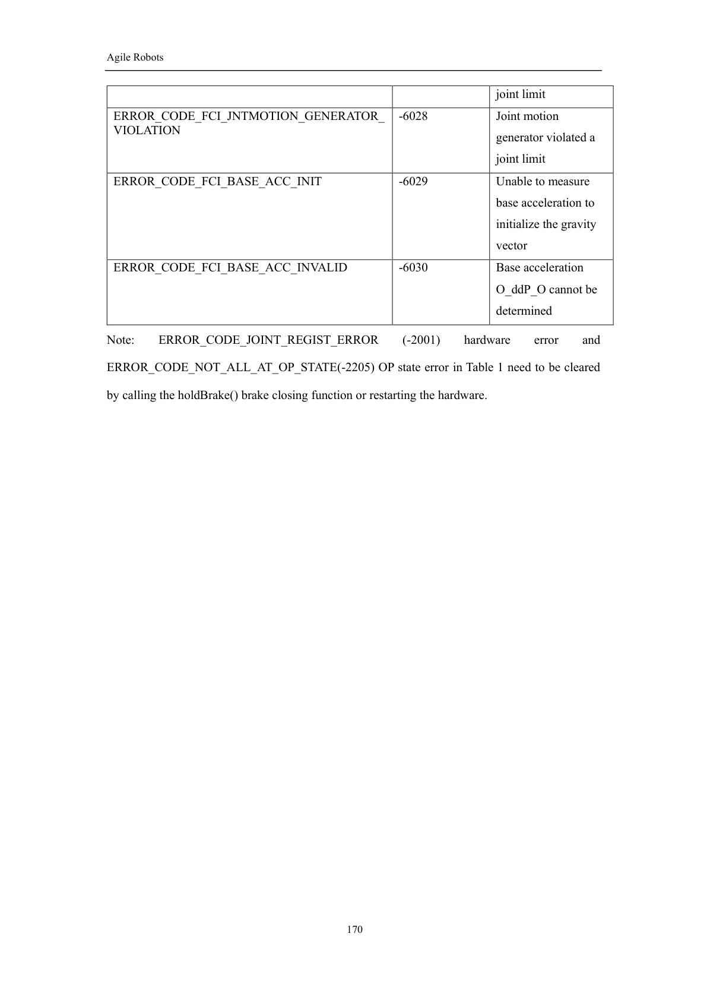



```
Agile Robots 
 170  
joint limit 
ERROR_CODE_FCI_JNTMOTION_GENERATOR_
VIOLATION 
-6028 
Joint motion 
generator violated a 
joint limit 
ERROR_CODE_FCI_BASE_ACC_INIT 
-6029 
Unable to measure 
base acceleration to 
initialize the gravity 
vector 
ERROR_CODE_FCI_BASE_ACC_INVALID 
-6030 
Base acceleration 
O_ddP_O cannot be 
determined 
Note: 
ERROR_CODE_JOINT_REGIST_ERROR 
(-2001) 
hardware 
error 
and 
ERROR_CODE_NOT_ALL_AT_OP_STATE(-2205) OP state error in Table 1 need to be cleared 
by calling the holdBrake() brake closing function or restarting the hardware.
```



## PDF page 180

**Source:** Industrial API Manual (C\&C++ Edition) \_V3.3.0\_EN\_20260605.pdf, original pdf page 180. [Open the corresponding PDF reading-copy page](https://1292444914-files.gitbook.io/~/files/v0/b/gitbook-x-prod.appspot.com/o/spaces%2FtgOfPnscWebs1eh82EKq%2Fuploads%2FTe9EomLTfFiBJ7zB0WdG%2Findustrial-api-manual-c-c-edition-v3-3-0-en-20260605-pp-151-188.pdf?alt=media#page=30).



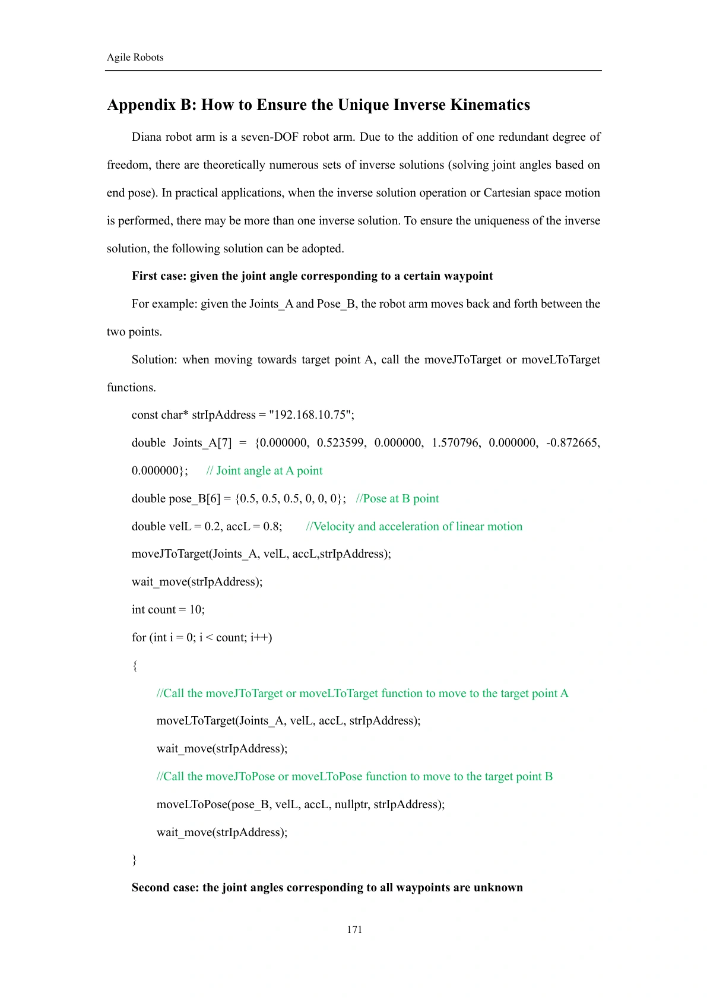



```
Agile Robots 
 171  
Appendix B: How to Ensure the Unique Inverse Kinematics  
Diana robot arm is a seven-DOF robot arm. Due to the addition of one redundant degree of 
freedom, there are theoretically numerous sets of inverse solutions (solving joint angles based on 
end pose). In practical applications, when the inverse solution operation or Cartesian space motion 
is performed, there may be more than one inverse solution. To ensure the uniqueness of the inverse 
solution, the following solution can be adopted.  
First case: given the joint angle corresponding to a certain waypoint  
 
For example: given the Joints_A and Pose_B, the robot arm moves back and forth between the 
two points.  
 
Solution: when moving towards target point A, call the moveJToTarget or moveLToTarget 
functions.  
 
const char* strIpAddress = "192.168.10.75";   
double Joints_A[7] = {0.000000, 0.523599, 0.000000, 1.570796, 0.000000, -0.872665, 
0.000000};  
// Joint angle at A point  
double pose_B[6] = {0.5, 0.5, 0.5, 0, 0, 0};  //Pose at B point  
double velL = 0.2, accL = 0.8;   
//Velocity and acceleration of linear motion  
moveJToTarget(Joints_A, velL, accL,strIpAddress); 
wait_move(strIpAddress); 
int count = 10; 
for (int i = 0; i < count; i++) 
{ 
//Call the moveJToTarget or moveLToTarget function to move to the target point A  
moveLToTarget(Joints_A, velL, accL, strIpAddress); 
wait_move(strIpAddress); 
//Call the moveJToPose or moveLToPose function to move to the target point B  
moveLToPose(pose_B, velL, accL, nullptr, strIpAddress); 
wait_move(strIpAddress); 
}  
Second case: the joint angles corresponding to all waypoints are unknown
```



## PDF page 181

**Source:** Industrial API Manual (C\&C++ Edition) \_V3.3.0\_EN\_20260605.pdf, original pdf page 181. [Open the corresponding PDF reading-copy page](https://1292444914-files.gitbook.io/~/files/v0/b/gitbook-x-prod.appspot.com/o/spaces%2FtgOfPnscWebs1eh82EKq%2Fuploads%2FTe9EomLTfFiBJ7zB0WdG%2Findustrial-api-manual-c-c-edition-v3-3-0-en-20260605-pp-151-188.pdf?alt=media#page=31).



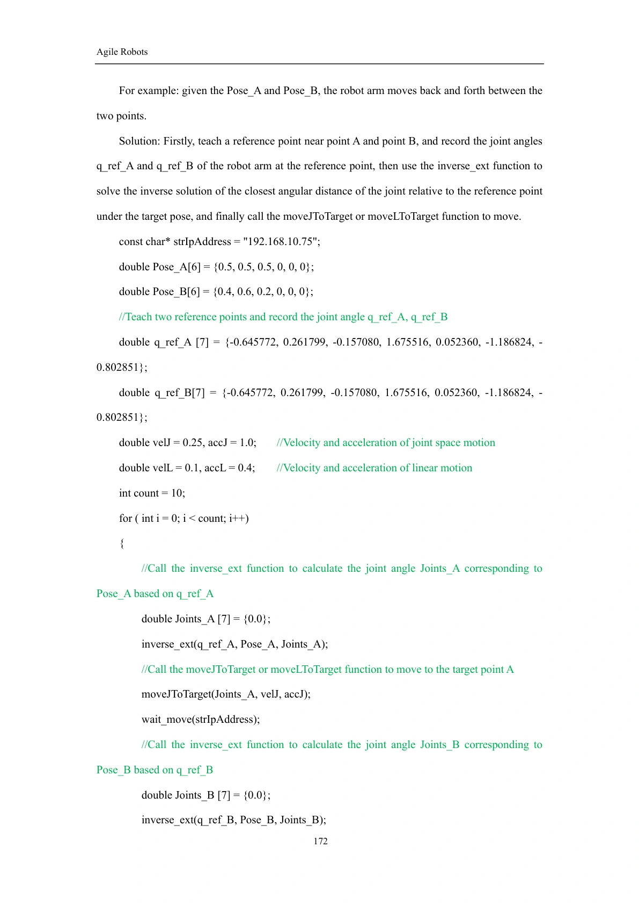



```
Agile Robots 
 172  
For example: given the Pose_A and Pose_B, the robot arm moves back and forth between the 
two points.  
Solution: Firstly, teach a reference point near point A and point B, and record the joint angles 
q_ref_A and q_ref_B of the robot arm at the reference point, then use the inverse_ext function to 
solve the inverse solution of the closest angular distance of the joint relative to the reference point 
under the target pose, and finally call the moveJToTarget or moveLToTarget function to move.  
const char* strIpAddress = "192.168.10.75"; 
double Pose_A[6] = {0.5, 0.5, 0.5, 0, 0, 0}; 
double Pose_B[6] = {0.4, 0.6, 0.2, 0, 0, 0}; 
//Teach two reference points and record the joint angle q_ref_A, q_ref_B  
double q_ref_A [7] = {-0.645772, 0.261799, -0.157080, 1.675516, 0.052360, -1.186824, -
0.802851}; 
double q_ref_B[7] = {-0.645772, 0.261799, -0.157080, 1.675516, 0.052360, -1.186824, -
0.802851}; 
double velJ = 0.25, accJ = 1.0;  
//Velocity and acceleration of joint space motion  
double velL = 0.1, accL = 0.4;   
//Velocity and acceleration of linear motion  
int count = 10; 
for ( int i = 0; i < count; i++) 
{ 
//Call the inverse_ext function to calculate the joint angle Joints_A corresponding to 
Pose_A based on q_ref_A  
double Joints_A [7] = {0.0}; 
inverse_ext(q_ref_A, Pose_A, Joints_A); 
//Call the moveJToTarget or moveLToTarget function to move to the target point A  
moveJToTarget(Joints_A, velJ, accJ); 
wait_move(strIpAddress); 
//Call the inverse_ext function to calculate the joint angle Joints_B corresponding to 
Pose_B based on q_ref_B  
double Joints_B [7] = {0.0}; 
inverse_ext(q_ref_B, Pose_B, Joints_B);
```



## PDF page 182

**Source:** Industrial API Manual (C\&C++ Edition) \_V3.3.0\_EN\_20260605.pdf, original pdf page 182. [Open the corresponding PDF reading-copy page](https://1292444914-files.gitbook.io/~/files/v0/b/gitbook-x-prod.appspot.com/o/spaces%2FtgOfPnscWebs1eh82EKq%2Fuploads%2FTe9EomLTfFiBJ7zB0WdG%2Findustrial-api-manual-c-c-edition-v3-3-0-en-20260605-pp-151-188.pdf?alt=media#page=32).







```
Agile Robots 
 173  
//Call the moveJToTarget or moveLToTarget function to move to the target point B  
moveLToTarget(Joints_B, velL, accL); 
wait_move(strIpAddress); 
}
```



## PDF page 183

**Source:** Industrial API Manual (C\&C++ Edition) \_V3.3.0\_EN\_20260605.pdf, original pdf page 183. [Open the corresponding PDF reading-copy page](https://1292444914-files.gitbook.io/~/files/v0/b/gitbook-x-prod.appspot.com/o/spaces%2FtgOfPnscWebs1eh82EKq%2Fuploads%2FTe9EomLTfFiBJ7zB0WdG%2Findustrial-api-manual-c-c-edition-v3-3-0-en-20260605-pp-151-188.pdf?alt=media#page=33).



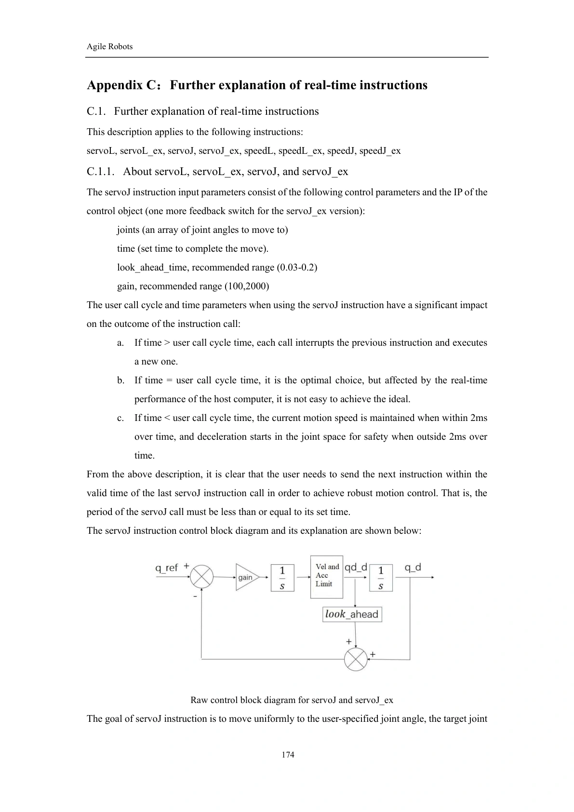



```
Agile Robots 
 174  
Appendix C：Further explanation of real-time instructions 
C.1. Further explanation of real-time instructions 
This description applies to the following instructions:  
servoL, servoL_ex, servoJ, servoJ_ex, speedL, speedL_ex, speedJ, speedJ_ex 
C.1.1.  About servoL, servoL_ex, servoJ, and servoJ_ex 
The servoJ instruction input parameters consist of the following control parameters and the IP of the 
control object (one more feedback switch for the servoJ_ex version): 
joints (an array of joint angles to move to) 
time (set time to complete the move). 
look_ahead_time, recommended range (0.03-0.2) 
gain, recommended range (100,2000) 
The user call cycle and time parameters when using the servoJ instruction have a significant impact 
on the outcome of the instruction call: 
a. If time > user call cycle time, each call interrupts the previous instruction and executes 
a new one. 
b. If time = user call cycle time, it is the optimal choice, but affected by the real-time 
performance of the host computer, it is not easy to achieve the ideal. 
c. If time < user call cycle time, the current motion speed is maintained when within 2ms 
over time, and deceleration starts in the joint space for safety when outside 2ms over 
time. 
From the above description, it is clear that the user needs to send the next instruction within the 
valid time of the last servoJ instruction call in order to achieve robust motion control. That is, the 
period of the servoJ call must be less than or equal to its set time. 
The servoJ instruction control block diagram and its explanation are shown below: 
 
Raw control block diagram for servoJ and servoJ_ex 
The goal of servoJ instruction is to move uniformly to the user-specified joint angle, the target joint
```



## PDF page 184

**Source:** Industrial API Manual (C\&C++ Edition) \_V3.3.0\_EN\_20260605.pdf, original pdf page 184. [Open the corresponding PDF reading-copy page](https://1292444914-files.gitbook.io/~/files/v0/b/gitbook-x-prod.appspot.com/o/spaces%2FtgOfPnscWebs1eh82EKq%2Fuploads%2FTe9EomLTfFiBJ7zB0WdG%2Findustrial-api-manual-c-c-edition-v3-3-0-en-20260605-pp-151-188.pdf?alt=media#page=34).



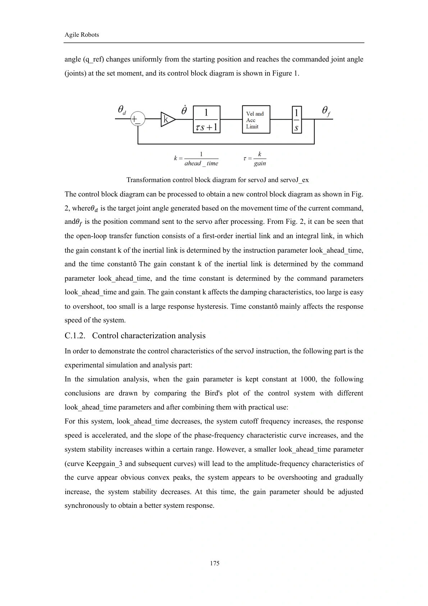



```
Agile Robots 
 175  
angle (q_ref) changes uniformly from the starting position and reaches the commanded joint angle 
(joints) at the set moment, and its control block diagram is shown in Figure 1. 
 
 
Transformation control block diagram for servoJ and servoJ_ex 
The control block diagram can be processed to obtain a new control block diagram as shown in Fig. 
2, where𝜃𝑑 is the target joint angle generated based on the movement time of the current command, 
and𝜃𝑓 is the position command sent to the servo after processing. From Fig. 2, it can be seen that 
the open-loop transfer function consists of a first-order inertial link and an integral link, in which 
the gain constant k of the inertial link is determined by the instruction parameter look_ahead_time, 
and the time constantô The gain constant k of the inertial link is determined by the command 
parameter look_ahead_time, and the time constant is determined by the command parameters 
look_ahead_time and gain. The gain constant k affects the damping characteristics, too large is easy 
to overshoot, too small is a large response hysteresis. Time constantô mainly affects the response 
speed of the system. 
C.1.2.  Control characterization analysis 
In order to demonstrate the control characteristics of the servoJ instruction, the following part is the 
experimental simulation and analysis part: 
In the simulation analysis, when the gain parameter is kept constant at 1000, the following 
conclusions are drawn by comparing the Bird's plot of the control system with different 
look_ahead_time parameters and after combining them with practical use: 
For this system, look_ahead_time decreases, the system cutoff frequency increases, the response 
speed is accelerated, and the slope of the phase-frequency characteristic curve increases, and the 
system stability increases within a certain range. However, a smaller look_ahead_time parameter 
(curve Keepgain_3 and subsequent curves) will lead to the amplitude-frequency characteristics of 
the curve appear obvious convex peaks, the system appears to be overshooting and gradually 
increase, the system stability decreases. At this time, the gain parameter should be adjusted 
synchronously to obtain a better system response.
```



## PDF page 185

**Source:** Industrial API Manual (C\&C++ Edition) \_V3.3.0\_EN\_20260605.pdf, original pdf page 185. [Open the corresponding PDF reading-copy page](https://1292444914-files.gitbook.io/~/files/v0/b/gitbook-x-prod.appspot.com/o/spaces%2FtgOfPnscWebs1eh82EKq%2Fuploads%2FTe9EomLTfFiBJ7zB0WdG%2Findustrial-api-manual-c-c-edition-v3-3-0-en-20260605-pp-151-188.pdf?alt=media#page=35).



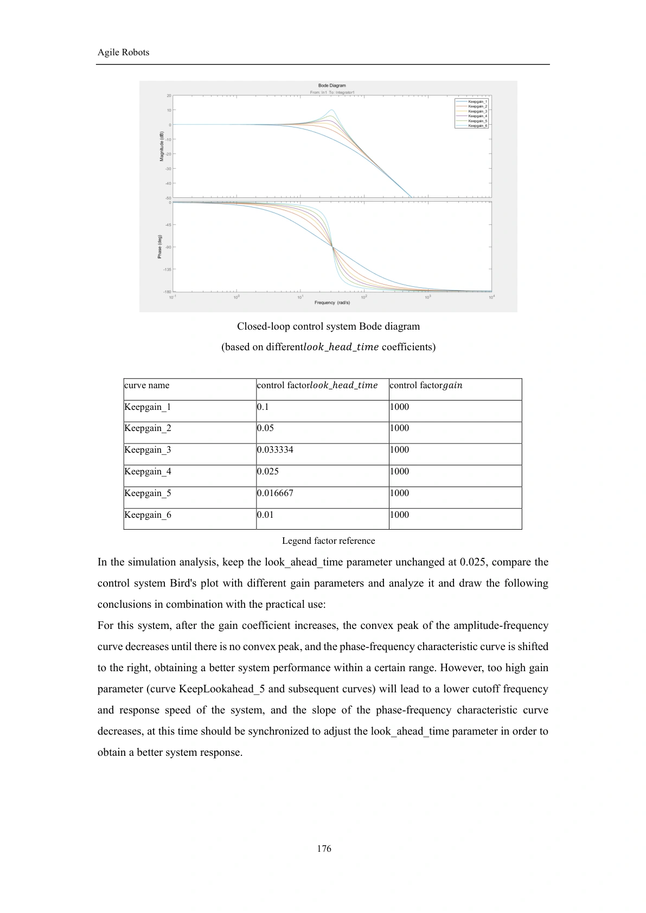



```
Agile Robots 
 176  
 
Closed-loop control system Bode diagram 
(based on different𝑙𝑜𝑜𝑘_ℎ𝑒𝑎𝑑_𝑡𝑖𝑚𝑒 coefficients) 
 
curve name 
control factor𝑙𝑜𝑜𝑘_ℎ𝑒𝑎𝑑_𝑡𝑖𝑚𝑒 
control factor𝑔𝑎𝑖𝑛 
Keepgain_1 
0.1 
1000 
Keepgain_2 
0.05 
1000 
Keepgain_3 
0.033334 
1000 
Keepgain_4 
0.025 
1000 
Keepgain_5 
0.016667 
1000 
Keepgain_6 
0.01 
1000 
Legend factor reference 
In the simulation analysis, keep the look_ahead_time parameter unchanged at 0.025, compare the 
control system Bird's plot with different gain parameters and analyze it and draw the following 
conclusions in combination with the practical use: 
For this system, after the gain coefficient increases, the convex peak of the amplitude-frequency 
curve decreases until there is no convex peak, and the phase-frequency characteristic curve is shifted 
to the right, obtaining a better system performance within a certain range. However, too high gain 
parameter (curve KeepLookahead_5 and subsequent curves) will lead to a lower cutoff frequency 
and response speed of the system, and the slope of the phase-frequency characteristic curve 
decreases, at this time should be synchronized to adjust the look_ahead_time parameter in order to 
obtain a better system response.
```



## PDF page 186

**Source:** Industrial API Manual (C\&C++ Edition) \_V3.3.0\_EN\_20260605.pdf, original pdf page 186. [Open the corresponding PDF reading-copy page](https://1292444914-files.gitbook.io/~/files/v0/b/gitbook-x-prod.appspot.com/o/spaces%2FtgOfPnscWebs1eh82EKq%2Fuploads%2FTe9EomLTfFiBJ7zB0WdG%2Findustrial-api-manual-c-c-edition-v3-3-0-en-20260605-pp-151-188.pdf?alt=media#page=36).



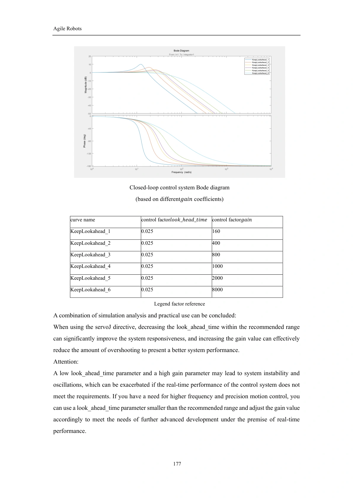



```
Agile Robots 
 177  
 
Closed-loop control system Bode diagram 
(based on different𝑔𝑎𝑖𝑛 coefficients) 
 
curve name 
control factor𝑙𝑜𝑜𝑘_ℎ𝑒𝑎𝑑_𝑡𝑖𝑚𝑒 control factor𝑔𝑎𝑖𝑛 
KeepLookahead_1 
0.025 
160 
KeepLookahead_2 
0.025 
400 
KeepLookahead_3 
0.025 
800 
KeepLookahead_4 
0.025 
1000 
KeepLookahead_5 
0.025 
2000 
KeepLookahead_6 
0.025 
8000 
Legend factor reference 
A combination of simulation analysis and practical use can be concluded: 
When using the servoJ directive, decreasing the look_ahead_time within the recommended range 
can significantly improve the system responsiveness, and increasing the gain value can effectively 
reduce the amount of overshooting to present a better system performance. 
Attention: 
A low look_ahead_time parameter and a high gain parameter may lead to system instability and 
oscillations, which can be exacerbated if the real-time performance of the control system does not 
meet the requirements. If you have a need for higher frequency and precision motion control, you 
can use a look_ahead_time parameter smaller than the recommended range and adjust the gain value 
accordingly to meet the needs of further advanced development under the premise of real-time 
performance.
```



## PDF page 187

**Source:** Industrial API Manual (C\&C++ Edition) \_V3.3.0\_EN\_20260605.pdf, original pdf page 187. [Open the corresponding PDF reading-copy page](https://1292444914-files.gitbook.io/~/files/v0/b/gitbook-x-prod.appspot.com/o/spaces%2FtgOfPnscWebs1eh82EKq%2Fuploads%2FTe9EomLTfFiBJ7zB0WdG%2Findustrial-api-manual-c-c-edition-v3-3-0-en-20260605-pp-151-188.pdf?alt=media#page=37).



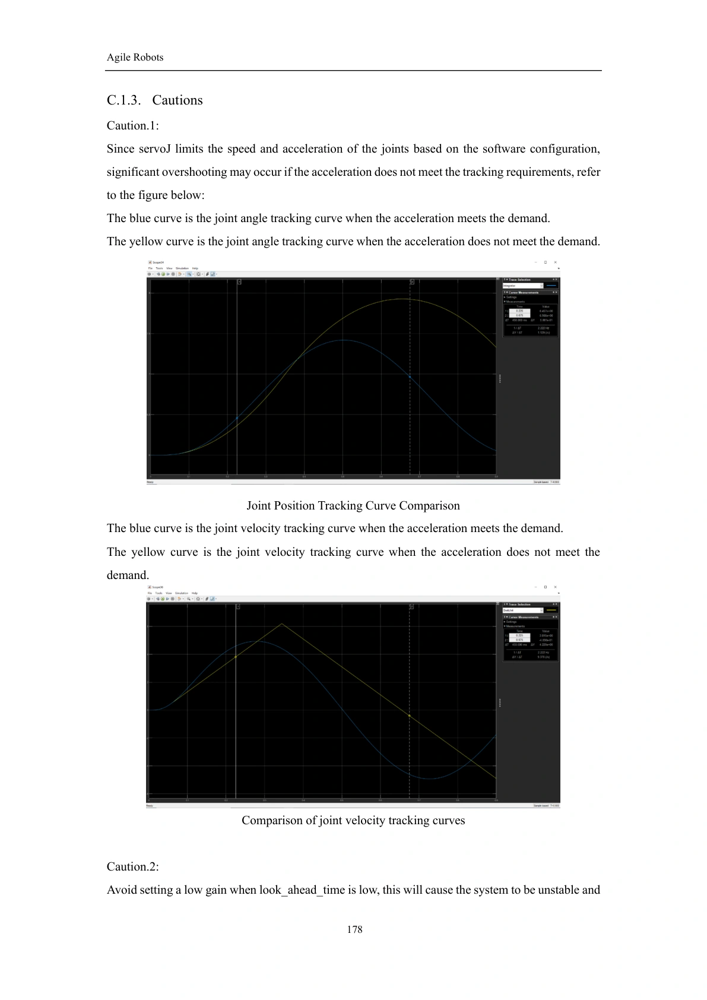



```
Agile Robots 
 178  
C.1.3.  Cautions 
Caution.1: 
Since servoJ limits the speed and acceleration of the joints based on the software configuration, 
significant overshooting may occur if the acceleration does not meet the tracking requirements, refer 
to the figure below: 
The blue curve is the joint angle tracking curve when the acceleration meets the demand. 
The yellow curve is the joint angle tracking curve when the acceleration does not meet the demand. 
 
Joint Position Tracking Curve Comparison 
The blue curve is the joint velocity tracking curve when the acceleration meets the demand. 
The yellow curve is the joint velocity tracking curve when the acceleration does not meet the 
demand. 
 
Comparison of joint velocity tracking curves 
 
Caution.2: 
Avoid setting a low gain when look_ahead_time is low, this will cause the system to be unstable and
```



## PDF page 188

**Source:** Industrial API Manual (C\&C++ Edition) \_V3.3.0\_EN\_20260605.pdf, original pdf page 188. [Open the corresponding PDF reading-copy page](https://1292444914-files.gitbook.io/~/files/v0/b/gitbook-x-prod.appspot.com/o/spaces%2FtgOfPnscWebs1eh82EKq%2Fuploads%2FTe9EomLTfFiBJ7zB0WdG%2Findustrial-api-manual-c-c-edition-v3-3-0-en-20260605-pp-151-188.pdf?alt=media#page=38).



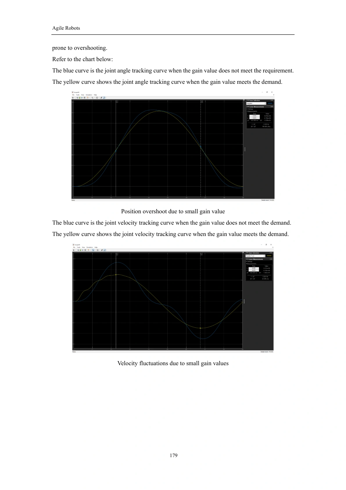



```
Agile Robots 
 179  
prone to overshooting. 
Refer to the chart below: 
The blue curve is the joint angle tracking curve when the gain value does not meet the requirement. 
The yellow curve shows the joint angle tracking curve when the gain value meets the demand. 
 
Position overshoot due to small gain value 
The blue curve is the joint velocity tracking curve when the gain value does not meet the demand. 
The yellow curve shows the joint velocity tracking curve when the gain value meets the demand. 
 
Velocity fluctuations due to small gain values
```



## PDF page 189

**Source:** Industrial API Manual (C\&C++ Edition) \_V3.3.0\_EN\_20260605.pdf, original pdf page 189. [Open the corresponding PDF reading-copy page](https://1292444914-files.gitbook.io/~/files/v0/b/gitbook-x-prod.appspot.com/o/spaces%2FtgOfPnscWebs1eh82EKq%2Fuploads%2Ff7gpWZhgON63NDN71O6o%2Findustrial-api-manual-c-c-edition-v3-3-0-en-20260605-pp-189-190.pdf?alt=media#page=1).



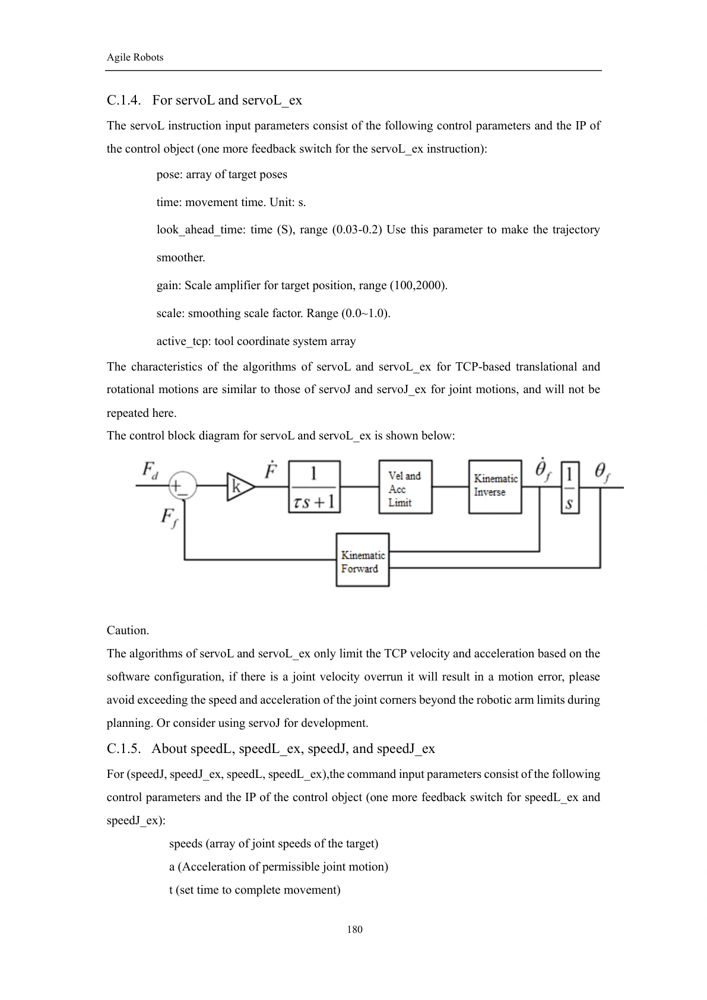



```
Agile Robots 
 180  
C.1.4.  For servoL and servoL_ex 
The servoL instruction input parameters consist of the following control parameters and the IP of 
the control object (one more feedback switch for the servoL_ex instruction): 
pose: array of target poses 
time: movement time. Unit: s. 
look_ahead_time: time (S), range (0.03-0.2) Use this parameter to make the trajectory 
smoother. 
gain: Scale amplifier for target position, range (100,2000). 
scale: smoothing scale factor. Range (0.0~1.0). 
active_tcp: tool coordinate system array 
The characteristics of the algorithms of servoL and servoL_ex for TCP-based translational and 
rotational motions are similar to those of servoJ and servoJ_ex for joint motions, and will not be 
repeated here. 
The control block diagram for servoL and servoL_ex is shown below: 
 
 
Caution. 
The algorithms of servoL and servoL_ex only limit the TCP velocity and acceleration based on the 
software configuration, if there is a joint velocity overrun it will result in a motion error, please 
avoid exceeding the speed and acceleration of the joint corners beyond the robotic arm limits during 
planning. Or consider using servoJ for development. 
C.1.5.  About speedL, speedL_ex, speedJ, and speedJ_ex 
For (speedJ, speedJ_ex, speedL, speedL_ex),the command input parameters consist of the following 
control parameters and the IP of the control object (one more feedback switch for speedL_ex and 
speedJ_ex): 
speeds (array of joint speeds of the target) 
a (Acceleration of permissible joint motion) 
t (set time to complete movement)
```



## PDF page 190

**Source:** Industrial API Manual (C\&C++ Edition) \_V3.3.0\_EN\_20260605.pdf, original pdf page 190. [Open the corresponding PDF reading-copy page](https://1292444914-files.gitbook.io/~/files/v0/b/gitbook-x-prod.appspot.com/o/spaces%2FtgOfPnscWebs1eh82EKq%2Fuploads%2Ff7gpWZhgON63NDN71O6o%2Findustrial-api-manual-c-c-edition-v3-3-0-en-20260605-pp-189-190.pdf?alt=media#page=2).



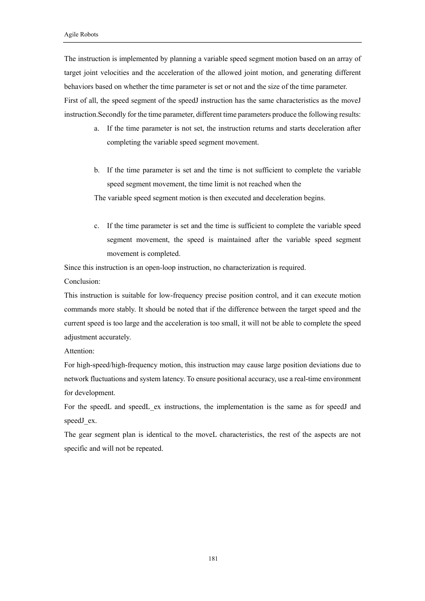



```
Agile Robots 
 181  
The instruction is implemented by planning a variable speed segment motion based on an array of 
target joint velocities and the acceleration of the allowed joint motion, and generating different 
behaviors based on whether the time parameter is set or not and the size of the time parameter. 
First of all, the speed segment of the speedJ instruction has the same characteristics as the moveJ 
instruction.Secondly for the time parameter, different time parameters produce the following results: 
a. If the time parameter is not set, the instruction returns and starts deceleration after 
completing the variable speed segment movement. 
 
b. If the time parameter is set and the time is not sufficient to complete the variable 
speed segment movement, the time limit is not reached when the 
The variable speed segment motion is then executed and deceleration begins. 
 
c. If the time parameter is set and the time is sufficient to complete the variable speed 
segment movement, the speed is maintained after the variable speed segment 
movement is completed. 
Since this instruction is an open-loop instruction, no characterization is required. 
Conclusion: 
This instruction is suitable for low-frequency precise position control, and it can execute motion 
commands more stably. It should be noted that if the difference between the target speed and the 
current speed is too large and the acceleration is too small, it will not be able to complete the speed 
adjustment accurately. 
Attention: 
For high-speed/high-frequency motion, this instruction may cause large position deviations due to 
network fluctuations and system latency. To ensure positional accuracy, use a real-time environment 
for development. 
For the speedL and speedL_ex instructions, the implementation is the same as for speedJ and 
speedJ_ex. 
The gear segment plan is identical to the moveL characteristics, the rest of the aspects are not 
specific and will not be repeated.
```


