# Industrial Python API manual V3.3.0 — PDF pages 1–72


**Complete supplied source:** Industrial API Manual (Python Edition) \_V3.3.0\_EN\_20260205.pdf · **Coverage:** 165 original PDF pages. [Return to the Agile Robots source library](../).


Every source page is retained in the original order. The **Original page** view preserves complete diagrams, photographs, tables, equations, connector orientation, notices and examples. The **Searchable text** view preserves native PDF text or the slide’s native text, embedded links and substantive speaker notes. Text extraction can retain reading-order/character defects; use the original image for exact layout, table columns and code indentation.


This is the supplied Industrial Python API V3.3.0 reference dated 2026-02-05. It is not the pendant embedded-Python API. Preserve the exact delivered module, signatures, units and return conventions; do not infer parity with the later C/C++ manual.


**Attribution:** the manufacturer and contributors identified in the supplied document. Original notices remain visible on every source page. Navigation, revision notes and the linked engineering explanations are OpenELAB editorial additions.

[Full document index](./) · This reading section contains original PDF pages **1–72**.

## Document navigation

| Source section / function   | Original page                          |
| --------------------------- | -------------------------------------- |
| Overview                    | [PDF 9](pages-001-072.md#pdf-page-9)   |
| Compatibility Statement     | [PDF 9](pages-001-072.md#pdf-page-9)   |
| Function Description        | [PDF 9](pages-001-072.md#pdf-page-9)   |
| 1 initSrv                   | [PDF 9](pages-001-072.md#pdf-page-9)   |
| 2 destroySrv                | [PDF 10](pages-001-072.md#pdf-page-10) |
| 3 setPushPeriod             | [PDF 11](pages-001-072.md#pdf-page-11) |
| 4 wait\_move                | [PDF 11](pages-001-072.md#pdf-page-11) |
| 5 moveTCP                   | [PDF 12](pages-001-072.md#pdf-page-12) |
| 6 rotationTCP               | [PDF 13](pages-001-072.md#pdf-page-13) |
| 7 moveJoint                 | [PDF 14](pages-001-072.md#pdf-page-14) |
| 8 moveJToTarget             | [PDF 15](pages-001-072.md#pdf-page-15) |
| 9 moveJToPose               | [PDF 16](pages-001-072.md#pdf-page-16) |
| 10 moveJ                    | [PDF 17](pages-001-072.md#pdf-page-17) |
| 11 moveL                    | [PDF 18](pages-001-072.md#pdf-page-18) |
| 12 moveLToTarget            | [PDF 19](pages-001-072.md#pdf-page-19) |
| 13 moveLToPose              | [PDF 20](pages-001-072.md#pdf-page-20) |
| 14 moveLToPose\_ex          | [PDF 21](pages-001-072.md#pdf-page-21) |
| 15 speedJ                   | [PDF 22](pages-001-072.md#pdf-page-22) |
| 16 speedL                   | [PDF 23](pages-001-072.md#pdf-page-23) |
| 17 freeDriving              | [PDF 24](pages-001-072.md#pdf-page-24) |
| 18 stop                     | [PDF 25](pages-001-072.md#pdf-page-25) |
| 19 forward                  | [PDF 25](pages-001-072.md#pdf-page-25) |
| 20 inverse                  | [PDF 26](pages-001-072.md#pdf-page-26) |
| 21 getJointPos              | [PDF 26](pages-001-072.md#pdf-page-26) |
| 22 getJointAngularVel       | [PDF 27](pages-001-072.md#pdf-page-27) |
| 23 getJointCurrent          | [PDF 27](pages-001-072.md#pdf-page-27) |
| 24 getJointTorque           | [PDF 28](pages-001-072.md#pdf-page-28) |
| 25 getTcpPos                | [PDF 28](pages-001-072.md#pdf-page-28) |
| 26 getTcpExternalForce      | [PDF 29](pages-001-072.md#pdf-page-29) |
| 27 releaseBrake             | [PDF 29](pages-001-072.md#pdf-page-29) |
| 28 holdBrake                | [PDF 30](pages-001-072.md#pdf-page-30) |
| 29 changeControlMode        | [PDF 30](pages-001-072.md#pdf-page-30) |
| 30 getLibraryVersion        | [PDF 30](pages-001-072.md#pdf-page-30) |
| 31 formatError              | [PDF 31](pages-001-072.md#pdf-page-31) |
| 32 getLastError             | [PDF 31](pages-001-072.md#pdf-page-31) |
| 33 setLastError             | [PDF 32](pages-001-072.md#pdf-page-32) |
| 34 setDefaultActiveTcp      | [PDF 32](pages-001-072.md#pdf-page-32) |
| 35 getLinkState             | [PDF 33](pages-001-072.md#pdf-page-33) |
| 36 getTcpForce              | [PDF 33](pages-001-072.md#pdf-page-33) |
| 37 getJointForce            | [PDF 34](pages-001-072.md#pdf-page-34) |
| 38 isCollision              | [PDF 34](pages-001-072.md#pdf-page-34) |
| 39 initDHCali               | [PDF 35](pages-001-072.md#pdf-page-35) |
| 40 getDHCaliResult          | [PDF 35](pages-001-072.md#pdf-page-35) |
| 41 setDH                    | [PDF 36](pages-001-072.md#pdf-page-36) |
| 42 setWrd2BasRT             | [PDF 37](pages-001-072.md#pdf-page-37) |
| 43 setFla2TcpRT             | [PDF 37](pages-001-072.md#pdf-page-37) |
| 44 getRobotState            | [PDF 38](pages-001-072.md#pdf-page-38) |
| 45 resume                   | [PDF 39](pages-001-072.md#pdf-page-39) |
| 46 setJointCollision        | [PDF 40](pages-001-072.md#pdf-page-40) |
| 47 setCartCollision         | [PDF 40](pages-001-072.md#pdf-page-40) |
| 48 enterForceMode           | [PDF 41](pages-001-072.md#pdf-page-41) |
| 49 leaveForceMode           | [PDF 42](pages-001-072.md#pdf-page-42) |
| 50 setDefaultActiveTcpPose  | [PDF 42](pages-001-072.md#pdf-page-42) |
| 51 setResultantCollision    | [PDF 43](pages-001-072.md#pdf-page-43) |
| 52 setJointImpeda           | [PDF 43](pages-001-072.md#pdf-page-43) |
| 53 getJointImpeda           | [PDF 44](pages-001-072.md#pdf-page-44) |
| 54 setCartImpeda            | [PDF 44](pages-001-072.md#pdf-page-44) |
| 55 getCartImpeda            | [PDF 45](pages-001-072.md#pdf-page-45) |
| 56 zeroSpaceFreeDriving     | [PDF 45](pages-001-072.md#pdf-page-45) |
| 57 createPath               | [PDF 46](pages-001-072.md#pdf-page-46) |
| 58 addMoveL                 | [PDF 47](pages-001-072.md#pdf-page-47) |
| 59 addMoveJ                 | [PDF 47](pages-001-072.md#pdf-page-47) |
| 60 runPath                  | [PDF 48](pages-001-072.md#pdf-page-48) |
| 61 destroyPath              | [PDF 49](pages-001-072.md#pdf-page-49) |
| 62 rpy2Axis                 | [PDF 49](pages-001-072.md#pdf-page-49) |
| 63 axis2RPY                 | [PDF 49](pages-001-072.md#pdf-page-49) |
| 64 homogeneous2Pose         | [PDF 50](pages-001-072.md#pdf-page-50) |
| 65 pose2Homogeneous         | [PDF 50](pages-001-072.md#pdf-page-50) |
| 66 enableTorqueReceiver     | [PDF 51](pages-001-072.md#pdf-page-51) |
| 67 sendTorque\_rt           | [PDF 51](pages-001-072.md#pdf-page-51) |
| 68 enableCollisionDetection | [PDF 52](pages-001-072.md#pdf-page-52) |
| 69 setActiveTcpPayload      | [PDF 52](pages-001-072.md#pdf-page-52) |
| 70 servoJ                   | [PDF 52](pages-001-072.md#pdf-page-52) |
| 71 servoL                   | [PDF 53](pages-001-072.md#pdf-page-53) |
| 72 servoJ\_ex               | [PDF 54](pages-001-072.md#pdf-page-54) |
| 73 servoL\_ex               | [PDF 56](pages-001-072.md#pdf-page-56) |
| 74 speedJ\_ex               | [PDF 57](pages-001-072.md#pdf-page-57) |
| 75 speedL\_ex               | [PDF 58](pages-001-072.md#pdf-page-58) |
| 76 dumpToUDisk              | [PDF 59](pages-001-072.md#pdf-page-59) |
| 77 inverse\_ext             | [PDF 59](pages-001-072.md#pdf-page-59) |
| 78 getJointLinkPos          | [PDF 60](pages-001-072.md#pdf-page-60) |
| 79 createComplexPath        | [PDF 60](pages-001-072.md#pdf-page-60) |
| 80 addMoveLSegmentByTarget  | [PDF 61](pages-001-072.md#pdf-page-61) |
| 81 addMoveLSegmentByPose    | [PDF 63](pages-001-072.md#pdf-page-63) |
| 82 addMoveJSegmentByTarget  | [PDF 64](pages-001-072.md#pdf-page-64) |
| 83 addMoveJSegmentByPose    | [PDF 66](pages-001-072.md#pdf-page-66) |
| 84 addMoveCSegmentByTarget  | [PDF 67](pages-001-072.md#pdf-page-67) |
| 85 addMoveCSegmentByPose    | [PDF 69](pages-001-072.md#pdf-page-69) |
| 86 runComplexPath           | [PDF 71](pages-001-072.md#pdf-page-71) |
| 87 destroyComplexPath       | [PDF 71](pages-001-072.md#pdf-page-71) |
| 88 saveEnvironment          | [PDF 71](pages-001-072.md#pdf-page-71) |
| 89 enterForceMode\_ex       | [PDF 72](pages-001-072.md#pdf-page-72) |

## PDF page 1

**Source:** Industrial API Manual (Python Edition) \_V3.3.0\_EN\_20260205.pdf, original pdf page 1. [Open the corresponding PDF reading-copy page](https://1292444914-files.gitbook.io/~/files/v0/b/gitbook-x-prod.appspot.com/o/spaces%2FtgOfPnscWebs1eh82EKq%2Fuploads%2FRuKqP58TGdcORhNDRsIQ%2Findustrial-api-manual-python-edition-v3-3-0-en-20260205-pp-001-139.pdf?alt=media#page=1).



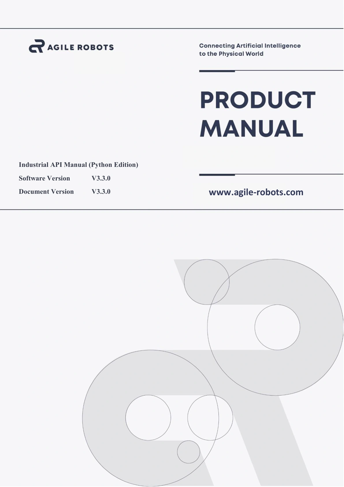



```
Agile Robots • Beijing  
www.agile-robots.com
Industrial API Manual (Python Edition)  
Software Version 
 
V3.3.0  
Document Version  
V3.3.0
```



## PDF page 2

**Source:** Industrial API Manual (Python Edition) \_V3.3.0\_EN\_20260205.pdf, original pdf page 2. [Open the corresponding PDF reading-copy page](https://1292444914-files.gitbook.io/~/files/v0/b/gitbook-x-prod.appspot.com/o/spaces%2FtgOfPnscWebs1eh82EKq%2Fuploads%2FRuKqP58TGdcORhNDRsIQ%2Findustrial-api-manual-python-edition-v3-3-0-en-20260205-pp-001-139.pdf?alt=media#page=2).



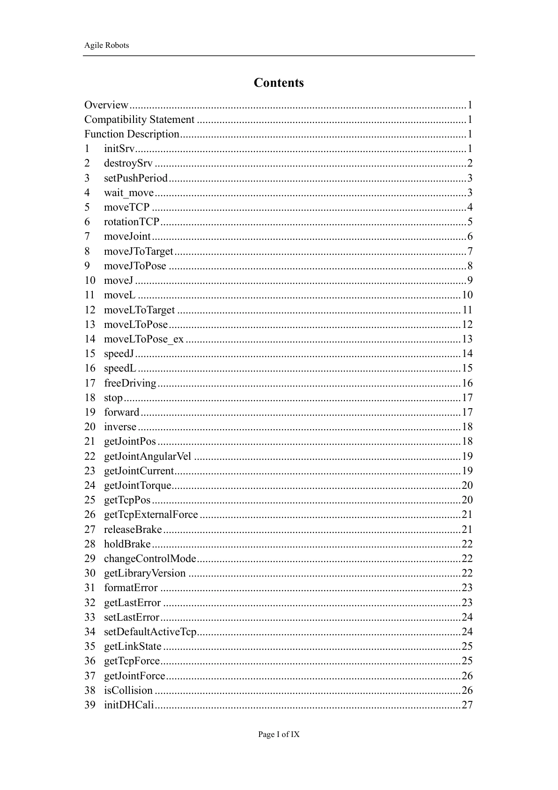



```
Agile Robots  
Page I of IX 
Contents  
Overview ........................................................................................................................ 1 
Compatibility Statement ................................................................................................ 1 
Function Description ...................................................................................................... 1 
1 
initSrv ...................................................................................................................... 1 
2 
destroySrv ............................................................................................................... 2 
3 
setPushPeriod .......................................................................................................... 3 
4 
wait_move ............................................................................................................... 3 
5 
moveTCP ................................................................................................................ 4 
6 
rotationTCP ............................................................................................................. 5 
7 
moveJoint ................................................................................................................ 6 
8 
moveJToTarget ........................................................................................................ 7 
9 
moveJToPose .......................................................................................................... 8 
10 moveJ ...................................................................................................................... 9 
11 moveL ................................................................................................................... 10 
12 moveLToTarget ..................................................................................................... 11 
13 moveLToPose ........................................................................................................ 12 
14 moveLToPose_ex .................................................................................................. 13 
15 speedJ .................................................................................................................... 14 
16 speedL ................................................................................................................... 15 
17 freeDriving ............................................................................................................ 16 
18 stop ........................................................................................................................ 17 
19 forward .................................................................................................................. 17 
20 inverse ................................................................................................................... 18 
21 getJointPos ............................................................................................................ 18 
22 getJointAngularVel ............................................................................................... 19 
23 getJointCurrent ...................................................................................................... 19 
24 getJointTorque ....................................................................................................... 20 
25 getTcpPos .............................................................................................................. 20 
26 getTcpExternalForce ............................................................................................. 21 
27 releaseBrake .......................................................................................................... 21 
28 holdBrake .............................................................................................................. 22 
29 changeControlMode .............................................................................................. 22 
30 getLibraryVersion ................................................................................................. 22 
31 formatError ........................................................................................................... 23 
32 getLastError .......................................................................................................... 23 
33 setLastError ........................................................................................................... 24 
34 setDefaultActiveTcp.............................................................................................. 24 
35 getLinkState .......................................................................................................... 25 
36 getTcpForce ........................................................................................................... 25 
37 getJointForce ......................................................................................................... 26 
38 isCollision ............................................................................................................. 26 
39 initDHCali ............................................................................................................. 27
```



**Original document cross-references:** [PDF 9](pages-001-072.md#pdf-page-9) · [PDF 10](pages-001-072.md#pdf-page-10) · [PDF 11](pages-001-072.md#pdf-page-11) · [PDF 12](pages-001-072.md#pdf-page-12) · [PDF 13](pages-001-072.md#pdf-page-13) · [PDF 14](pages-001-072.md#pdf-page-14) · [PDF 15](pages-001-072.md#pdf-page-15) · [PDF 16](pages-001-072.md#pdf-page-16) · [PDF 17](pages-001-072.md#pdf-page-17) · [PDF 18](pages-001-072.md#pdf-page-18) · [PDF 19](pages-001-072.md#pdf-page-19) · [PDF 20](pages-001-072.md#pdf-page-20) · [PDF 21](pages-001-072.md#pdf-page-21) · [PDF 22](pages-001-072.md#pdf-page-22) · [PDF 23](pages-001-072.md#pdf-page-23) · [PDF 24](pages-001-072.md#pdf-page-24) · [PDF 25](pages-001-072.md#pdf-page-25) · [PDF 26](pages-001-072.md#pdf-page-26) · [PDF 27](pages-001-072.md#pdf-page-27) · [PDF 28](pages-001-072.md#pdf-page-28) · [PDF 29](pages-001-072.md#pdf-page-29) · [PDF 30](pages-001-072.md#pdf-page-30) · [PDF 31](pages-001-072.md#pdf-page-31) · [PDF 32](pages-001-072.md#pdf-page-32) · [PDF 33](pages-001-072.md#pdf-page-33) · [PDF 34](pages-001-072.md#pdf-page-34) · [PDF 35](pages-001-072.md#pdf-page-35)

## PDF page 3

**Source:** Industrial API Manual (Python Edition) \_V3.3.0\_EN\_20260205.pdf, original pdf page 3. [Open the corresponding PDF reading-copy page](https://1292444914-files.gitbook.io/~/files/v0/b/gitbook-x-prod.appspot.com/o/spaces%2FtgOfPnscWebs1eh82EKq%2Fuploads%2FRuKqP58TGdcORhNDRsIQ%2Findustrial-api-manual-python-edition-v3-3-0-en-20260205-pp-001-139.pdf?alt=media#page=3).



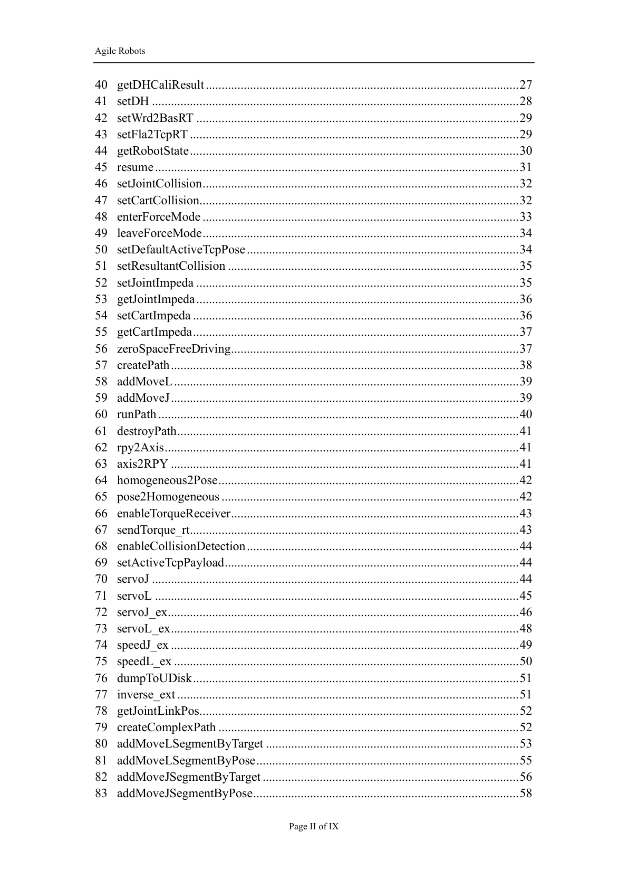



```
Agile Robots  
Page II of IX 
40 getDHCaliResult ................................................................................................... 27 
41 setDH .................................................................................................................... 28 
42 setWrd2BasRT ...................................................................................................... 29 
43 setFla2TcpRT ........................................................................................................ 29 
44 getRobotState ........................................................................................................ 30 
45 resume ................................................................................................................... 31 
46 setJointCollision .................................................................................................... 32 
47 setCartCollision ..................................................................................................... 32 
48 enterForceMode .................................................................................................... 33 
49 leaveForceMode .................................................................................................... 34 
50 setDefaultActiveTcpPose ...................................................................................... 34 
51 setResultantCollision ............................................................................................ 35 
52 setJointImpeda ...................................................................................................... 35 
53 getJointImpeda ...................................................................................................... 36 
54 setCartImpeda ....................................................................................................... 36 
55 getCartImpeda ....................................................................................................... 37 
56 zeroSpaceFreeDriving ........................................................................................... 37 
57 createPath .............................................................................................................. 38 
58 addMoveL ............................................................................................................. 39 
59 addMoveJ .............................................................................................................. 39 
60 runPath .................................................................................................................. 40 
61 destroyPath ............................................................................................................ 41 
62 rpy2Axis ................................................................................................................ 41 
63 axis2RPY .............................................................................................................. 41 
64 homogeneous2Pose ............................................................................................... 42 
65 pose2Homogeneous .............................................................................................. 42 
66 enableTorqueReceiver ........................................................................................... 43 
67 sendTorque_rt........................................................................................................ 43 
68 enableCollisionDetection ...................................................................................... 44 
69 setActiveTcpPayload ............................................................................................. 44 
70 servoJ .................................................................................................................... 44 
71 servoL ................................................................................................................... 45 
72 servoJ_ex ............................................................................................................... 46 
73 servoL_ex .............................................................................................................. 48 
74 speedJ_ex .............................................................................................................. 49 
75 speedL_ex ............................................................................................................. 50 
76 dumpToUDisk ....................................................................................................... 51 
77 inverse_ext ............................................................................................................ 51 
78 getJointLinkPos ..................................................................................................... 52 
79 createComplexPath ............................................................................................... 52 
80 addMoveLSegmentByTarget ................................................................................ 53 
81 addMoveLSegmentByPose ................................................................................... 55 
82 addMoveJSegmentByTarget ................................................................................. 56 
83 addMoveJSegmentByPose .................................................................................... 58
```



**Original document cross-references:** [PDF 35](pages-001-072.md#pdf-page-35) · [PDF 36](pages-001-072.md#pdf-page-36) · [PDF 37](pages-001-072.md#pdf-page-37) · [PDF 38](pages-001-072.md#pdf-page-38) · [PDF 39](pages-001-072.md#pdf-page-39) · [PDF 40](pages-001-072.md#pdf-page-40) · [PDF 41](pages-001-072.md#pdf-page-41) · [PDF 42](pages-001-072.md#pdf-page-42) · [PDF 43](pages-001-072.md#pdf-page-43) · [PDF 44](pages-001-072.md#pdf-page-44) · [PDF 45](pages-001-072.md#pdf-page-45) · [PDF 46](pages-001-072.md#pdf-page-46) · [PDF 47](pages-001-072.md#pdf-page-47) · [PDF 48](pages-001-072.md#pdf-page-48) · [PDF 49](pages-001-072.md#pdf-page-49) · [PDF 50](pages-001-072.md#pdf-page-50) · [PDF 51](pages-001-072.md#pdf-page-51) · [PDF 52](pages-001-072.md#pdf-page-52) · [PDF 53](pages-001-072.md#pdf-page-53) · [PDF 54](pages-001-072.md#pdf-page-54) · [PDF 56](pages-001-072.md#pdf-page-56) · [PDF 57](pages-001-072.md#pdf-page-57) · [PDF 58](pages-001-072.md#pdf-page-58) · [PDF 59](pages-001-072.md#pdf-page-59) · [PDF 60](pages-001-072.md#pdf-page-60) · [PDF 61](pages-001-072.md#pdf-page-61) · [PDF 63](pages-001-072.md#pdf-page-63) · [PDF 64](pages-001-072.md#pdf-page-64) · [PDF 66](pages-001-072.md#pdf-page-66)

## PDF page 4

**Source:** Industrial API Manual (Python Edition) \_V3.3.0\_EN\_20260205.pdf, original pdf page 4. [Open the corresponding PDF reading-copy page](https://1292444914-files.gitbook.io/~/files/v0/b/gitbook-x-prod.appspot.com/o/spaces%2FtgOfPnscWebs1eh82EKq%2Fuploads%2FRuKqP58TGdcORhNDRsIQ%2Findustrial-api-manual-python-edition-v3-3-0-en-20260205-pp-001-139.pdf?alt=media#page=4).



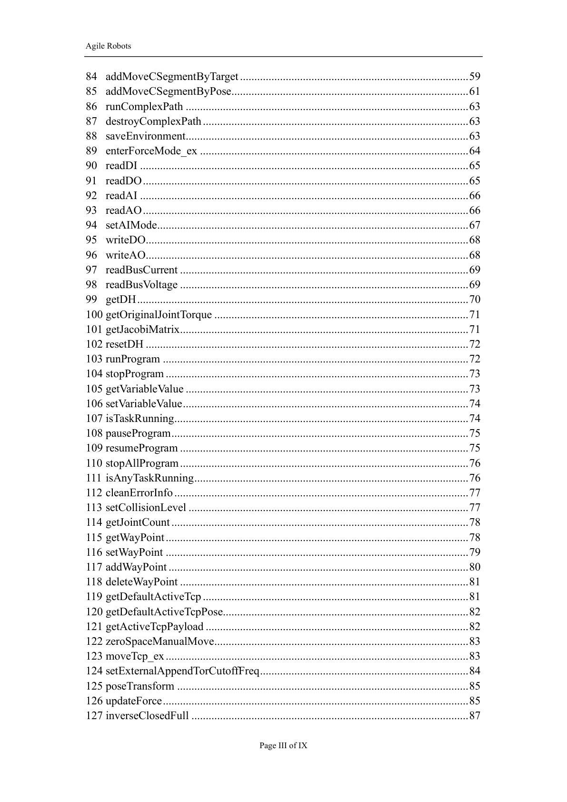



```
Agile Robots  
Page III of IX 
84 addMoveCSegmentByTarget ................................................................................ 59 
85 addMoveCSegmentByPose ................................................................................... 61 
86 runComplexPath ................................................................................................... 63 
87 destroyComplexPath ............................................................................................. 63 
88 saveEnvironment ................................................................................................... 63 
89 enterForceMode_ex .............................................................................................. 64 
90 readDI ................................................................................................................... 65 
91 readDO .................................................................................................................. 65 
92 readAI ................................................................................................................... 66 
93 readAO .................................................................................................................. 66 
94 setAIMode ............................................................................................................. 67 
95 writeDO ................................................................................................................. 68 
96 writeAO ................................................................................................................. 68 
97 readBusCurrent ..................................................................................................... 69 
98 readBusVoltage ..................................................................................................... 69 
99 getDH .................................................................................................................... 70 
100 getOriginalJointTorque ......................................................................................... 71 
101 getJacobiMatrix ..................................................................................................... 71 
102 resetDH ................................................................................................................. 72 
103 runProgram ........................................................................................................... 72 
104 stopProgram .......................................................................................................... 73 
105 getVariableValue ................................................................................................... 73 
106 setVariableValue .................................................................................................... 74 
107 isTaskRunning ....................................................................................................... 74 
108 pauseProgram ........................................................................................................ 75 
109 resumeProgram ..................................................................................................... 75 
110 stopAllProgram ..................................................................................................... 76 
111 isAnyTaskRunning ................................................................................................ 76 
112 cleanErrorInfo ....................................................................................................... 77 
113 setCollisionLevel .................................................................................................. 77 
114 getJointCount ........................................................................................................ 78 
115 getWayPoint .......................................................................................................... 78 
116 setWayPoint .......................................................................................................... 79 
117 addWayPoint ......................................................................................................... 80 
118 deleteWayPoint ..................................................................................................... 81 
119 getDefaultActiveTcp ............................................................................................. 81 
120 getDefaultActiveTcpPose...................................................................................... 82 
121 getActiveTcpPayload ............................................................................................ 82 
122 zeroSpaceManualMove ......................................................................................... 83 
123 moveTcp_ex .......................................................................................................... 83 
124 setExternalAppendTorCutoffFreq ......................................................................... 84 
125 poseTransform ...................................................................................................... 85 
126 updateForce ........................................................................................................... 85 
127 inverseClosedFull ................................................................................................. 87
```



**Original document cross-references:** [PDF 67](pages-001-072.md#pdf-page-67) · [PDF 69](pages-001-072.md#pdf-page-69) · [PDF 71](pages-001-072.md#pdf-page-71) · [PDF 72](pages-001-072.md#pdf-page-72) · [PDF 73](pages-073-144.md#pdf-page-73) · [PDF 74](pages-073-144.md#pdf-page-74) · [PDF 75](pages-073-144.md#pdf-page-75) · [PDF 76](pages-073-144.md#pdf-page-76) · [PDF 77](pages-073-144.md#pdf-page-77) · [PDF 78](pages-073-144.md#pdf-page-78) · [PDF 79](pages-073-144.md#pdf-page-79) · [PDF 80](pages-073-144.md#pdf-page-80) · [PDF 81](pages-073-144.md#pdf-page-81) · [PDF 82](pages-073-144.md#pdf-page-82) · [PDF 83](pages-073-144.md#pdf-page-83) · [PDF 84](pages-073-144.md#pdf-page-84) · [PDF 85](pages-073-144.md#pdf-page-85) · [PDF 86](pages-073-144.md#pdf-page-86) · [PDF 87](pages-073-144.md#pdf-page-87) · [PDF 88](pages-073-144.md#pdf-page-88) · [PDF 89](pages-073-144.md#pdf-page-89) · [PDF 90](pages-073-144.md#pdf-page-90) · [PDF 91](pages-073-144.md#pdf-page-91) · [PDF 92](pages-073-144.md#pdf-page-92) · [PDF 93](pages-073-144.md#pdf-page-93) · [PDF 95](pages-073-144.md#pdf-page-95)

## PDF page 5

**Source:** Industrial API Manual (Python Edition) \_V3.3.0\_EN\_20260205.pdf, original pdf page 5. [Open the corresponding PDF reading-copy page](https://1292444914-files.gitbook.io/~/files/v0/b/gitbook-x-prod.appspot.com/o/spaces%2FtgOfPnscWebs1eh82EKq%2Fuploads%2FRuKqP58TGdcORhNDRsIQ%2Findustrial-api-manual-python-edition-v3-3-0-en-20260205-pp-001-139.pdf?alt=media#page=5).



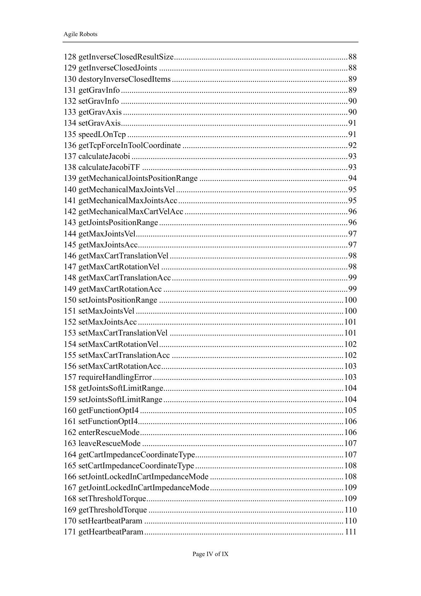



```
Agile Robots  
Page IV of IX 
128 getInverseClosedResultSize .................................................................................. 88 
129 getInverseClosedJoints ......................................................................................... 88 
130 destoryInverseClosedItems ................................................................................... 89 
131 getGravInfo ........................................................................................................... 89 
132 setGravInfo ........................................................................................................... 90 
133 getGravAxis .......................................................................................................... 90 
134 setGravAxis ........................................................................................................... 91 
135 speedLOnTcp ........................................................................................................ 91 
136 getTcpForceInToolCoordinate .............................................................................. 92 
137 calculateJacobi ...................................................................................................... 93 
138 calculateJacobiTF ................................................................................................. 93 
139 getMechanicalJointsPositionRange ...................................................................... 94 
140 getMechanicalMaxJointsVel ................................................................................. 95 
141 getMechanicalMaxJointsAcc ................................................................................ 95 
142 getMechanicalMaxCartVelAcc ............................................................................. 96 
143 getJointsPositionRange ......................................................................................... 96 
144 getMaxJointsVel .................................................................................................... 97 
145 getMaxJointsAcc ................................................................................................... 97 
146 getMaxCartTranslationVel .................................................................................... 98 
147 getMaxCartRotationVel ........................................................................................ 98 
148 getMaxCartTranslationAcc ................................................................................... 99 
149 getMaxCartRotationAcc ....................................................................................... 99 
150 setJointsPositionRange ....................................................................................... 100 
151 setMaxJointsVel .................................................................................................. 100 
152 setMaxJointsAcc ................................................................................................. 101 
153 setMaxCartTranslationVel .................................................................................. 101 
154 setMaxCartRotationVel ....................................................................................... 102 
155 setMaxCartTranslationAcc ................................................................................. 102 
156 setMaxCartRotationAcc ...................................................................................... 103 
157 requireHandlingError .......................................................................................... 103 
158 getJointsSoftLimitRange ..................................................................................... 104 
159 setJointsSoftLimitRange ..................................................................................... 104 
160 getFunctionOptI4 ................................................................................................ 105 
161 setFunctionOptI4 ................................................................................................. 106 
162 enterRescueMode ................................................................................................ 106 
163 leaveRescueMode ............................................................................................... 107 
164 getCartImpedanceCoordinateType...................................................................... 107 
165 setCartImpedanceCoordinateType ...................................................................... 108 
166 setJointLockedInCartImpedanceMode ............................................................... 108 
167 getJointLockedInCartImpedanceMode ............................................................... 109 
168 setThresholdTorque ............................................................................................. 109 
169 getThresholdTorque ............................................................................................ 110 
170 setHeartbeatParam .............................................................................................. 110 
171 getHeartbeatParam .............................................................................................. 111
```



**Original document cross-references:** [PDF 96](pages-073-144.md#pdf-page-96) · [PDF 97](pages-073-144.md#pdf-page-97) · [PDF 98](pages-073-144.md#pdf-page-98) · [PDF 99](pages-073-144.md#pdf-page-99) · [PDF 100](pages-073-144.md#pdf-page-100) · [PDF 101](pages-073-144.md#pdf-page-101) · [PDF 102](pages-073-144.md#pdf-page-102) · [PDF 103](pages-073-144.md#pdf-page-103) · [PDF 104](pages-073-144.md#pdf-page-104) · [PDF 105](pages-073-144.md#pdf-page-105) · [PDF 106](pages-073-144.md#pdf-page-106) · [PDF 107](pages-073-144.md#pdf-page-107) · [PDF 108](pages-073-144.md#pdf-page-108) · [PDF 109](pages-073-144.md#pdf-page-109) · [PDF 110](pages-073-144.md#pdf-page-110) · [PDF 111](pages-073-144.md#pdf-page-111) · [PDF 112](pages-073-144.md#pdf-page-112) · [PDF 113](pages-073-144.md#pdf-page-113) · [PDF 114](pages-073-144.md#pdf-page-114) · [PDF 115](pages-073-144.md#pdf-page-115) · [PDF 116](pages-073-144.md#pdf-page-116) · [PDF 117](pages-073-144.md#pdf-page-117) · [PDF 118](pages-073-144.md#pdf-page-118) · [PDF 119](pages-073-144.md#pdf-page-119)

## PDF page 6

**Source:** Industrial API Manual (Python Edition) \_V3.3.0\_EN\_20260205.pdf, original pdf page 6. [Open the corresponding PDF reading-copy page](https://1292444914-files.gitbook.io/~/files/v0/b/gitbook-x-prod.appspot.com/o/spaces%2FtgOfPnscWebs1eh82EKq%2Fuploads%2FRuKqP58TGdcORhNDRsIQ%2Findustrial-api-manual-python-edition-v3-3-0-en-20260205-pp-001-139.pdf?alt=media#page=6).



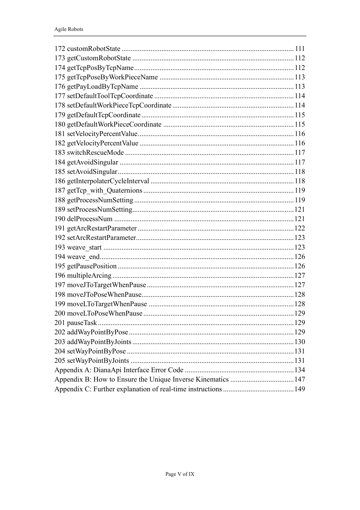



```
Agile Robots  
Page V of IX 
172 customRobotState ............................................................................................... 111 
173 getCustomRobotState ......................................................................................... 112 
174 getTcpPosByTcpName ........................................................................................ 112 
175 getTcpPoseByWorkPieceName .......................................................................... 113 
176 getPayLoadByTcpName ..................................................................................... 113 
177 setDefaultToolTcpCoordinate ............................................................................. 114 
178 setDefaultWorkPieceTcpCoordinate ................................................................... 114 
179 getDefaultTcpCoordinate .................................................................................... 115 
180 getDefaultWorkPieceCoordinate ........................................................................ 115 
181 setVelocityPercentValue ...................................................................................... 116 
182 getVelocityPercentValue ..................................................................................... 116 
183 switchRescueMode ............................................................................................. 117 
184 getAvoidSingular ................................................................................................ 117 
185 setAvoidSingular ................................................................................................. 118 
186 getInterpolaterCycleInterval ............................................................................... 118 
187 getTcp_with_Quaternions ................................................................................... 119 
188 getProcessNumSetting ........................................................................................ 119 
189 setProcessNumSetting ......................................................................................... 121 
190 delProcessNum ................................................................................................... 121 
191 getArcRestartParameter ...................................................................................... 122 
192 setArcRestartParameter ....................................................................................... 123 
193 weave_start ......................................................................................................... 123 
194 weave_end ........................................................................................................... 126 
195 getPausePosition ................................................................................................. 126 
196 multipleArcing .................................................................................................... 127 
197 moveJToTargetWhenPause ................................................................................. 127 
198 moveJToPoseWhenPause.................................................................................... 128 
199 moveLToTargetWhenPause ................................................................................ 128 
200 moveLToPoseWhenPause ................................................................................... 129 
201 pauseTask ............................................................................................................ 129 
202 addWayPointByPose ........................................................................................... 129 
203 addWayPointByJoints ......................................................................................... 130 
204 setWayPointByPose ............................................................................................ 131 
205 setWayPointByJoints .......................................................................................... 131 
Appendix A: DianaApi Interface Error Code ............................................................ 134 
Appendix B: How to Ensure the Unique Inverse Kinematics ................................... 147 
Appendix C: Further explanation of real-time instructions ....................................... 149
```



**Original document cross-references:** [PDF 119](pages-073-144.md#pdf-page-119) · [PDF 120](pages-073-144.md#pdf-page-120) · [PDF 121](pages-073-144.md#pdf-page-121) · [PDF 122](pages-073-144.md#pdf-page-122) · [PDF 123](pages-073-144.md#pdf-page-123) · [PDF 124](pages-073-144.md#pdf-page-124) · [PDF 125](pages-073-144.md#pdf-page-125) · [PDF 126](pages-073-144.md#pdf-page-126) · [PDF 127](pages-073-144.md#pdf-page-127) · [PDF 129](pages-073-144.md#pdf-page-129) · [PDF 130](pages-073-144.md#pdf-page-130) · [PDF 131](pages-073-144.md#pdf-page-131) · [PDF 134](pages-073-144.md#pdf-page-134) · [PDF 135](pages-073-144.md#pdf-page-135) · [PDF 136](pages-073-144.md#pdf-page-136) · [PDF 137](pages-073-144.md#pdf-page-137) · [PDF 138](pages-073-144.md#pdf-page-138) · [PDF 139](pages-073-144.md#pdf-page-139) · [PDF 142](pages-073-144.md#pdf-page-142) · [PDF 155](pages-145-165.md#pdf-page-155) · [PDF 157](pages-145-165.md#pdf-page-157)

## PDF page 7

**Source:** Industrial API Manual (Python Edition) \_V3.3.0\_EN\_20260205.pdf, original pdf page 7. [Open the corresponding PDF reading-copy page](https://1292444914-files.gitbook.io/~/files/v0/b/gitbook-x-prod.appspot.com/o/spaces%2FtgOfPnscWebs1eh82EKq%2Fuploads%2FRuKqP58TGdcORhNDRsIQ%2Findustrial-api-manual-python-edition-v3-3-0-en-20260205-pp-001-139.pdf?alt=media#page=7).



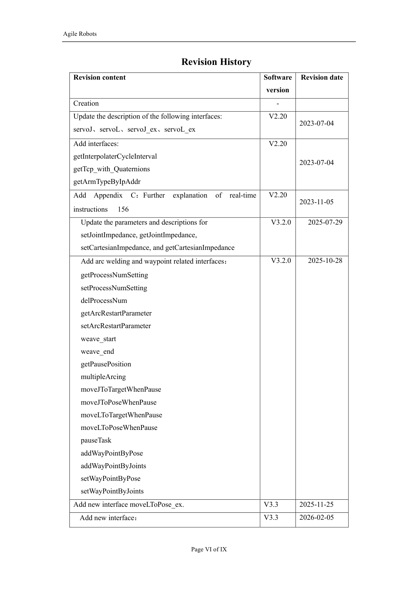



```
Agile Robots  
Page VI of IX 
Revision History  
Revision content  
Software 
version  
Revision date  
Creation  
-  
 
Update the description of the following interfaces: 
servoJ、servoL、servoJ_ex、servoL_ex 
V2.20
 
 
2023-07-04 
Add interfaces:  
getInterpolaterCycleInterval 
getTcp_with_Quaternions 
getArmTypeByIpAddr 
V2.20
 
 
2023-07-04 
Add Appendix 
C：Further 
explanation 
of 
real-time 
instructions 
156 
V2.20 
2023-11-05 
Update the parameters and descriptions for 
setJointImpedance, getJointImpedance, 
setCartesianImpedance, and getCartesianImpedance 
V3.2.0 
2025-07-29 
Add arc welding and waypoint related interfaces： 
getProcessNumSetting 
setProcessNumSetting 
delProcessNum 
getArcRestartParameter 
setArcRestartParameter 
weave_start 
weave_end 
getPausePosition 
multipleArcing 
moveJToTargetWhenPause 
moveJToPoseWhenPause 
moveLToTargetWhenPause 
moveLToPoseWhenPause 
pauseTask 
addWayPointByPose 
addWayPointByJoints 
setWayPointByPose 
setWayPointByJoints 
V3.2.0 
2025-10-28 
Add new interface moveLToPose_ex. 
V3.3 
2025-11-25 
Add new interface： 
V3.3 
2026-02-05
```



## PDF page 8

**Source:** Industrial API Manual (Python Edition) \_V3.3.0\_EN\_20260205.pdf, original pdf page 8. [Open the corresponding PDF reading-copy page](https://1292444914-files.gitbook.io/~/files/v0/b/gitbook-x-prod.appspot.com/o/spaces%2FtgOfPnscWebs1eh82EKq%2Fuploads%2FRuKqP58TGdcORhNDRsIQ%2Findustrial-api-manual-python-edition-v3-3-0-en-20260205-pp-001-139.pdf?alt=media#page=8).







```
Agile Robots  
Page VII of IX 
powerOn、powerOnConfirmation、powerOff
```



## PDF page 9

**Source:** Industrial API Manual (Python Edition) \_V3.3.0\_EN\_20260205.pdf, original pdf page 9. [Open the corresponding PDF reading-copy page](https://1292444914-files.gitbook.io/~/files/v0/b/gitbook-x-prod.appspot.com/o/spaces%2FtgOfPnscWebs1eh82EKq%2Fuploads%2FRuKqP58TGdcORhNDRsIQ%2Findustrial-api-manual-python-edition-v3-3-0-en-20260205-pp-001-139.pdf?alt=media#page=9).



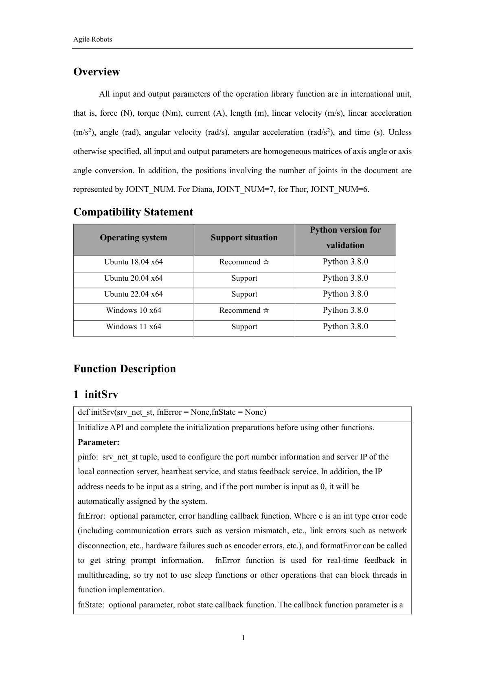



```
Agile Robots  
 1  
Overview  
All input and output parameters of the operation library function are in international unit, 
that is, force (N), torque (Nm), current (A), length (m), linear velocity (m/s), linear acceleration 
(m/s2), angle (rad), angular velocity (rad/s), angular acceleration (rad/s2), and time (s). Unless 
otherwise specified, all input and output parameters are homogeneous matrices of axis angle or axis 
angle conversion. In addition, the positions involving the number of joints in the document are 
represented by JOINT_NUM. For Diana, JOINT_NUM=7, for Thor, JOINT_NUM=6.  
Compatibility Statement  
Operating system  
Support situation  
Python version for 
validation  
Ubuntu 18.04 x64 
Recommend ☆  
Python 3.8.0 
Ubuntu 20.04 x64 
Support  
Python 3.8.0 
Ubuntu 22.04 x64 
Support  
Python 3.8.0 
Windows 10 x64 
Recommend ☆  
Python 3.8.0 
Windows 11 x64 
Support  
Python 3.8.0 
 
Function Description  
1 initSrv 
def initSrv(srv_net_st, fnError = None,fnState = None) 
Initialize API and complete the initialization preparations before using other functions.  
Parameter:  
pinfo:  srv_net_st tuple, used to configure the port number information and server IP of the 
local connection server, heartbeat service, and status feedback service. In addition, the IP 
address needs to be input as a string, and if the port number is input as 0, it will be 
automatically assigned by the system.  
fnError:  optional parameter, error handling callback function. Where e is an int type error code 
(including communication errors such as version mismatch, etc., link errors such as network 
disconnection, etc., hardware failures such as encoder errors, etc.), and formatError can be called 
to get string prompt information.  fnError function is used for real-time feedback in 
multithreading, so try not to use sleep functions or other operations that can block threads in 
function implementation.  
fnState:  optional parameter, robot state callback function. The callback function parameter is a
```



## PDF page 10

**Source:** Industrial API Manual (Python Edition) \_V3.3.0\_EN\_20260205.pdf, original pdf page 10. [Open the corresponding PDF reading-copy page](https://1292444914-files.gitbook.io/~/files/v0/b/gitbook-x-prod.appspot.com/o/spaces%2FtgOfPnscWebs1eh82EKq%2Fuploads%2FRuKqP58TGdcORhNDRsIQ%2Findustrial-api-manual-python-edition-v3-3-0-en-20260205-pp-001-139.pdf?alt=media#page=10).



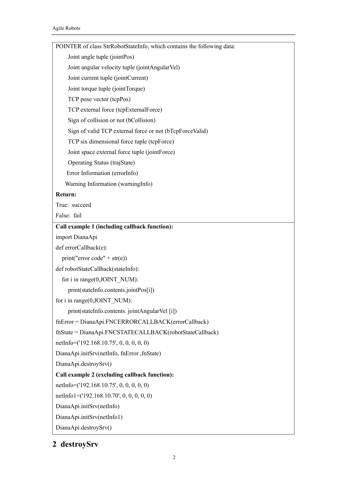



```
Agile Robots  
 2  
POINTER of class StrRobotStateInfo, which contains the following data:  
  Joint angle tuple (jointPos)  
  Joint angular velocity tuple (jointAngularVel)  
  Joint current tuple (jointCurrent)  
  Joint torque tuple (jointTorque)  
  TCP pose vector (tcpPos)  
  TCP external force (tcpExternalForce)  
  Sign of collision or not (bCollision)  
  Sign of valid TCP external force or not (bTcpForceValid)  
  TCP six dimensional force tuple (tcpForce)  
  Joint space external force tuple (jointForce)  
Operating Status (trajState) 
    Error Information (errorInfo) 
   Warning Information (warningInfo) 
Return:  
True:  succeed  
False:  fail  
Call example 1 (including callback function):  
import DianaApi  
def errorCallback(e): 
    print("error code" + str(e)) 
def robotStateCallback(stateInfo): 
    for i in range(0,JOINT_NUM): 
        print(stateInfo.contents.jointPos[i]) 
for i in range(0,JOINT_NUM): 
        print(stateInfo.contents. jointAngularVel [i]) 
fnError = DianaApi.FNCERRORCALLBACK(errorCallback) 
fnState = DianaApi.FNCSTATECALLBACK(robotStateCallback) 
netInfo=('192.168.10.75', 0, 0, 0, 0, 0) 
DianaApi.initSrv(netInfo, fnError ,fnState) 
DianaApi.destroySrv() 
Call example 2 (excluding callback function):  
netInfo=('192.168.10.75', 0, 0, 0, 0, 0) 
netInfo1=('192.168.10.70', 0, 0, 0, 0, 0) 
DianaApi.initSrv(netInfo) 
DianaApi.initSrv(netInfo1) 
DianaApi.destroySrv() 
2 destroySrv
```



## PDF page 11

**Source:** Industrial API Manual (Python Edition) \_V3.3.0\_EN\_20260205.pdf, original pdf page 11. [Open the corresponding PDF reading-copy page](https://1292444914-files.gitbook.io/~/files/v0/b/gitbook-x-prod.appspot.com/o/spaces%2FtgOfPnscWebs1eh82EKq%2Fuploads%2FRuKqP58TGdcORhNDRsIQ%2Findustrial-api-manual-python-edition-v3-3-0-en-20260205-pp-001-139.pdf?alt=media#page=11).



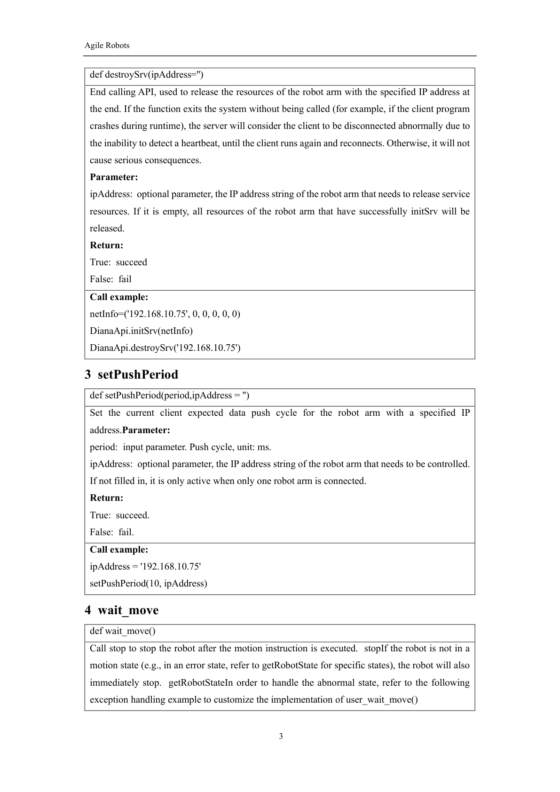



```
Agile Robots  
 3  
def destroySrv(ipAddress='') 
End calling API, used to release the resources of the robot arm with the specified IP address at 
the end. If the function exits the system without being called (for example, if the client program 
crashes during runtime), the server will consider the client to be disconnected abnormally due to 
the inability to detect a heartbeat, until the client runs again and reconnects. Otherwise, it will not 
cause serious consequences.  
Parameter:  
ipAddress:  optional parameter, the IP address string of the robot arm that needs to release service 
resources. If it is empty, all resources of the robot arm that have successfully initSrv will be 
released.  
Return:  
True:  succeed  
False:  fail  
Call example:  
netInfo=('192.168.10.75', 0, 0, 0, 0, 0) 
DianaApi.initSrv(netInfo) 
DianaApi.destroySrv('192.168.10.75') 
3 setPushPeriod 
def setPushPeriod(period,ipAddress = '') 
Set the current client expected data push cycle for the robot arm with a specified IP 
address.Parameter:  
period:  input parameter. Push cycle, unit: ms.  
ipAddress:  optional parameter, the IP address string of the robot arm that needs to be controlled. 
If not filled in, it is only active when only one robot arm is connected.  
Return:  
True:  succeed.  
False:  fail.  
Call example:  
ipAddress = '192.168.10.75' 
setPushPeriod(10, ipAddress) 
4 wait_move 
def wait_move() 
Call stop to stop the robot after the motion instruction is executed.  stopIf the robot is not in a 
motion state (e.g., in an error state, refer to getRobotState for specific states), the robot will also 
immediately stop.  getRobotStateIn order to handle the abnormal state, refer to the following 
exception handling example to customize the implementation of user_wait_move()
```



**Original document cross-references:** [PDF 25](pages-001-072.md#pdf-page-25) · [PDF 38](pages-001-072.md#pdf-page-38)

## PDF page 12

**Source:** Industrial API Manual (Python Edition) \_V3.3.0\_EN\_20260205.pdf, original pdf page 12. [Open the corresponding PDF reading-copy page](https://1292444914-files.gitbook.io/~/files/v0/b/gitbook-x-prod.appspot.com/o/spaces%2FtgOfPnscWebs1eh82EKq%2Fuploads%2FRuKqP58TGdcORhNDRsIQ%2Findustrial-api-manual-python-edition-v3-3-0-en-20260205-pp-001-139.pdf?alt=media#page=12).



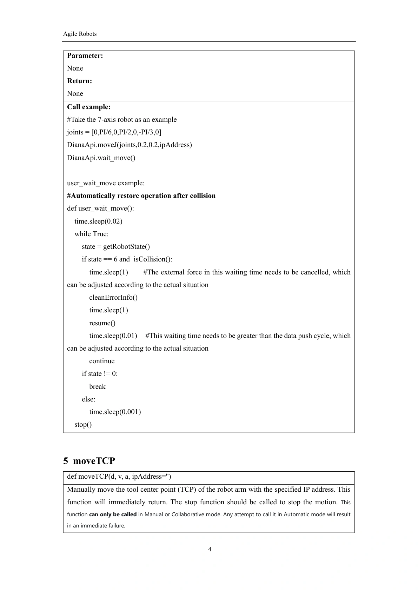



```
Agile Robots  
 4  
Parameter:  
None  
Return:  
None  
Call example:  
#Take the 7-axis robot as an example  
joints = [0,PI/6,0,PI/2,0,-PI/3,0] 
DianaApi.moveJ(joints,0.2,0.2,ipAddress) 
DianaApi.wait_move() 
 
user_wait_move example:  
#Automatically restore operation after collision  
def user_wait_move(): 
    time.sleep(0.02) 
    while True: 
        state = getRobotState() 
        if state == 6 and  isCollision(): 
            time.sleep(1)       #The external force in this waiting time needs to be cancelled, which 
can be adjusted according to the actual situation  
            cleanErrorInfo() 
            time.sleep(1) 
            resume() 
            time.sleep(0.01)     #This waiting time needs to be greater than the data push cycle, which 
can be adjusted according to the actual situation  
            continue 
        if state != 0: 
            break 
        else: 
            time.sleep(0.001) 
    stop() 
 
5 moveTCP 
def moveTCP(d, v, a, ipAddress='') 
Manually move the tool center point (TCP) of the robot arm with the specified IP address. This 
function will immediately return. The stop function should be called to stop the motion. This 
function can only be called in Manual or Collaborative mode. Any attempt to call it in Automatic mode will result 
in an immediate failure.
```



## PDF page 13

**Source:** Industrial API Manual (Python Edition) \_V3.3.0\_EN\_20260205.pdf, original pdf page 13. [Open the corresponding PDF reading-copy page](https://1292444914-files.gitbook.io/~/files/v0/b/gitbook-x-prod.appspot.com/o/spaces%2FtgOfPnscWebs1eh82EKq%2Fuploads%2FRuKqP58TGdcORhNDRsIQ%2Findustrial-api-manual-python-edition-v3-3-0-en-20260205-pp-001-139.pdf?alt=media#page=13).



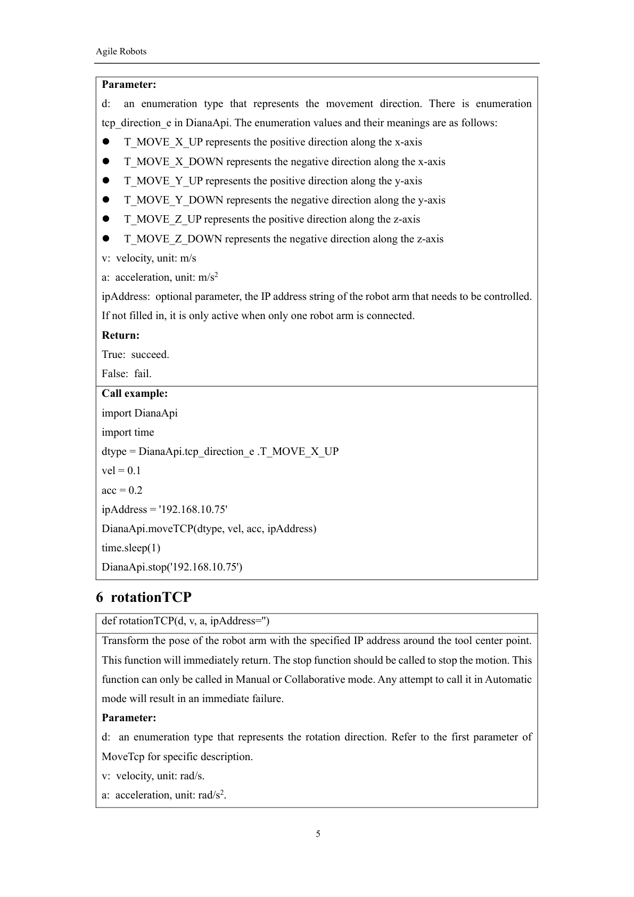



```
Agile Robots  
 5  
Parameter:  
d:  an enumeration type that represents the movement direction. There is enumeration 
tcp_direction_e in DianaApi. The enumeration values and their meanings are as follows:  
⚫ 
T_MOVE_X_UP represents the positive direction along the x-axis  
⚫ 
T_MOVE_X_DOWN represents the negative direction along the x-axis  
⚫ 
T_MOVE_Y_UP represents the positive direction along the y-axis  
⚫ 
T_MOVE_Y_DOWN represents the negative direction along the y-axis  
⚫ 
T_MOVE_Z_UP represents the positive direction along the z-axis  
⚫ 
T_MOVE_Z_DOWN represents the negative direction along the z-axis  
v:  velocity, unit: m/s  
a:  acceleration, unit: m/s2  
ipAddress:  optional parameter, the IP address string of the robot arm that needs to be controlled. 
If not filled in, it is only active when only one robot arm is connected.  
Return:  
True:  succeed.  
False:  fail.  
Call example:  
import DianaApi 
import time 
dtype = DianaApi.tcp_direction_e .T_MOVE_X_UP 
vel = 0.1 
acc = 0.2 
ipAddress = '192.168.10.75' 
DianaApi.moveTCP(dtype, vel, acc, ipAddress) 
time.sleep(1) 
DianaApi.stop('192.168.10.75') 
6 rotationTCP 
def rotationTCP(d, v, a, ipAddress='') 
Transform the pose of the robot arm with the specified IP address around the tool center point. 
This function will immediately return. The stop function should be called to stop the motion. This 
function can only be called in Manual or Collaborative mode. Any attempt to call it in Automatic 
mode will result in an immediate failure. 
Parameter:  
d:  an enumeration type that represents the rotation direction. Refer to the first parameter of 
MoveTcp for specific description.  
v:  velocity, unit: rad/s.  
a:  acceleration, unit: rad/s2.
```



## PDF page 14

**Source:** Industrial API Manual (Python Edition) \_V3.3.0\_EN\_20260205.pdf, original pdf page 14. [Open the corresponding PDF reading-copy page](https://1292444914-files.gitbook.io/~/files/v0/b/gitbook-x-prod.appspot.com/o/spaces%2FtgOfPnscWebs1eh82EKq%2Fuploads%2FRuKqP58TGdcORhNDRsIQ%2Findustrial-api-manual-python-edition-v3-3-0-en-20260205-pp-001-139.pdf?alt=media#page=14).



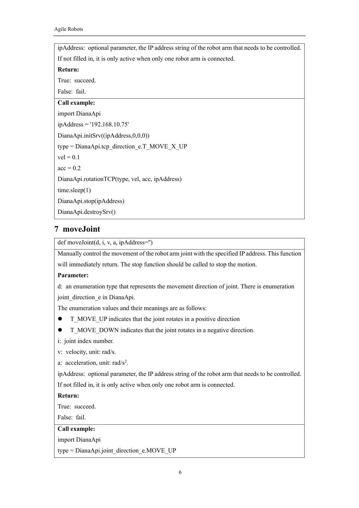



```
Agile Robots  
 6  
ipAddress:  optional parameter, the IP address string of the robot arm that needs to be controlled. 
If not filled in, it is only active when only one robot arm is connected.  
Return:  
True:  succeed.  
False:  fail.  
Call example:  
import DianaApi 
ipAddress = '192.168.10.75' 
DianaApi.initSrv((ipAddress,0,0,0)) 
type = DianaApi.tcp_direction_e.T_MOVE_X_UP 
vel = 0.1 
acc = 0.2 
DianaApi.rotationTCP(type, vel, acc, ipAddress) 
time.sleep(1) 
DianaApi.stop(ipAddress) 
DianaApi.destroySrv() 
7 moveJoint 
def moveJoint(d, i, v, a, ipAddress='') 
Manually control the movement of the robot arm joint with the specified IP address. This function 
will immediately return. The stop function should be called to stop the motion.  
Parameter:  
d:  an enumeration type that represents the movement direction of joint. There is enumeration 
joint_direction_e in DianaApi.  
The enumeration values and their meanings are as follows:  
⚫ 
T_MOVE_UP indicates that the joint rotates in a positive direction  
⚫ 
T_MOVE_DOWN indicates that the joint rotates in a negative direction.  
i:  joint index number.  
v:  velocity, unit: rad/s.  
a:  acceleration, unit: rad/s2.  
ipAddress:  optional parameter, the IP address string of the robot arm that needs to be controlled. 
If not filled in, it is only active when only one robot arm is connected.  
Return:  
True:  succeed.  
False:  fail.  
Call example:  
import DianaApi 
type = DianaApi.joint_direction_e.MOVE_UP
```



## PDF page 15

**Source:** Industrial API Manual (Python Edition) \_V3.3.0\_EN\_20260205.pdf, original pdf page 15. [Open the corresponding PDF reading-copy page](https://1292444914-files.gitbook.io/~/files/v0/b/gitbook-x-prod.appspot.com/o/spaces%2FtgOfPnscWebs1eh82EKq%2Fuploads%2FRuKqP58TGdcORhNDRsIQ%2Findustrial-api-manual-python-edition-v3-3-0-en-20260205-pp-001-139.pdf?alt=media#page=15).



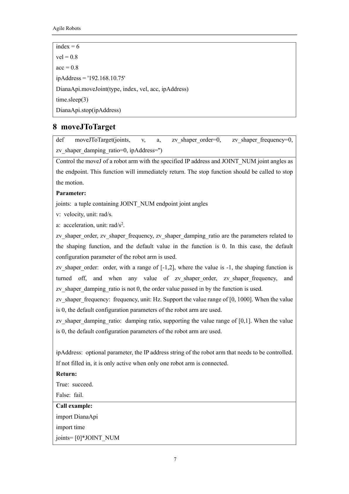



```
Agile Robots  
 7  
index = 6 
vel = 0.8 
acc = 0.8 
ipAddress = '192.168.10.75' 
DianaApi.moveJoint(type, index, vel, acc, ipAddress) 
time.sleep(3) 
DianaApi.stop(ipAddress) 
8 moveJToTarget  
def 
moveJToTarget(joints, 
v, 
a, 
zv_shaper_order=0, 
zv_shaper_frequency=0, 
zv_shaper_damping_ratio=0, ipAddress='')  
Control the moveJ of a robot arm with the specified IP address and JOINT_NUM joint angles as 
the endpoint. This function will immediately return. The stop function should be called to stop 
the motion.  
Parameter:  
joints:  a tuple containing JOINT_NUM endpoint joint angles  
v:  velocity, unit: rad/s.  
a:  acceleration, unit: rad/s2.  
zv_shaper_order, zv_shaper_frequency, zv_shaper_damping_ratio are the parameters related to 
the shaping function, and the default value in the function is 0. In this case, the default 
configuration parameter of the robot arm is used.  
zv_shaper_order:  order, with a range of [-1,2], where the value is -1, the shaping function is 
turned off, and when any value of zv_shaper_order, zv_shaper_frequency, and 
zv_shaper_damping_ratio is not 0, the order value passed in by the function is used.  
zv_shaper_frequency:  frequency, unit: Hz. Support the value range of [0, 1000]. When the value 
is 0, the default configuration parameters of the robot arm are used.  
zv_shaper_damping_ratio:  damping ratio, supporting the value range of [0,1]. When the value 
is 0, the default configuration parameters of the robot arm are used.  
 
ipAddress:  optional parameter, the IP address string of the robot arm that needs to be controlled. 
If not filled in, it is only active when only one robot arm is connected.  
Return:  
True:  succeed.  
False:  fail.  
Call example:  
import DianaApi 
import time 
joints= [0]*JOINT_NUM
```



## PDF page 16

**Source:** Industrial API Manual (Python Edition) \_V3.3.0\_EN\_20260205.pdf, original pdf page 16. [Open the corresponding PDF reading-copy page](https://1292444914-files.gitbook.io/~/files/v0/b/gitbook-x-prod.appspot.com/o/spaces%2FtgOfPnscWebs1eh82EKq%2Fuploads%2FRuKqP58TGdcORhNDRsIQ%2Findustrial-api-manual-python-edition-v3-3-0-en-20260205-pp-001-139.pdf?alt=media#page=16).



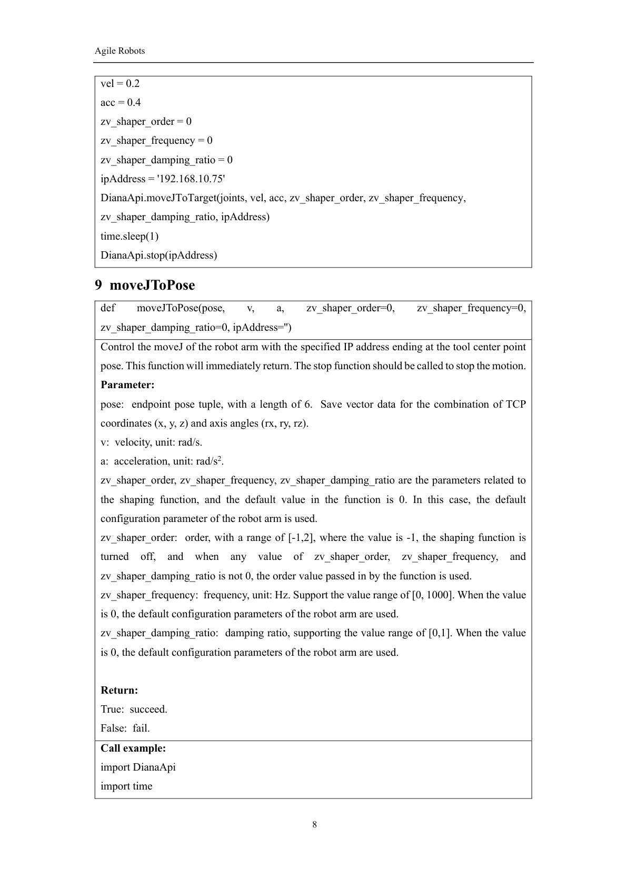



```
Agile Robots  
 8  
vel = 0.2 
acc = 0.4 
zv_shaper_order = 0 
zv_shaper_frequency = 0 
zv_shaper_damping_ratio = 0 
ipAddress = '192.168.10.75' 
DianaApi.moveJToTarget(joints, vel, acc, zv_shaper_order, zv_shaper_frequency, 
zv_shaper_damping_ratio, ipAddress) 
time.sleep(1) 
DianaApi.stop(ipAddress) 
9 moveJToPose 
def 
moveJToPose(pose, 
v, 
a, 
zv_shaper_order=0, 
zv_shaper_frequency=0, 
zv_shaper_damping_ratio=0, ipAddress='') 
Control the moveJ of the robot arm with the specified IP address ending at the tool center point 
pose. This function will immediately return. The stop function should be called to stop the motion.  
Parameter:  
pose:  endpoint pose tuple, with a length of 6.  Save vector data for the combination of TCP 
coordinates (x, y, z) and axis angles (rx, ry, rz).  
v:  velocity, unit: rad/s.  
a:  acceleration, unit: rad/s2.  
zv_shaper_order, zv_shaper_frequency, zv_shaper_damping_ratio are the parameters related to 
the shaping function, and the default value in the function is 0. In this case, the default 
configuration parameter of the robot arm is used.  
zv_shaper_order:  order, with a range of [-1,2], where the value is -1, the shaping function is 
turned off, and when any value of zv_shaper_order, zv_shaper_frequency, and 
zv_shaper_damping_ratio is not 0, the order value passed in by the function is used.  
zv_shaper_frequency:  frequency, unit: Hz. Support the value range of [0, 1000]. When the value 
is 0, the default configuration parameters of the robot arm are used.  
zv_shaper_damping_ratio:  damping ratio, supporting the value range of [0,1]. When the value 
is 0, the default configuration parameters of the robot arm are used.  
 
Return:  
True:  succeed.  
False:  fail.  
Call example:  
import DianaApi 
import time
```



## PDF page 17

**Source:** Industrial API Manual (Python Edition) \_V3.3.0\_EN\_20260205.pdf, original pdf page 17. [Open the corresponding PDF reading-copy page](https://1292444914-files.gitbook.io/~/files/v0/b/gitbook-x-prod.appspot.com/o/spaces%2FtgOfPnscWebs1eh82EKq%2Fuploads%2FRuKqP58TGdcORhNDRsIQ%2Findustrial-api-manual-python-edition-v3-3-0-en-20260205-pp-001-139.pdf?alt=media#page=17).



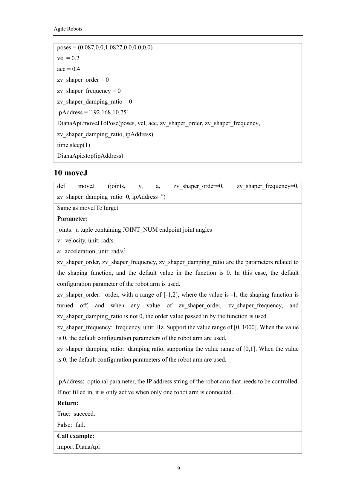



```
Agile Robots  
 9  
poses = (0.087,0.0,1.0827,0.0,0.0,0.0) 
vel = 0.2 
acc = 0.4 
zv_shaper_order = 0 
zv_shaper_frequency = 0 
zv_shaper_damping_ratio = 0 
ipAddress = '192.168.10.75' 
DianaApi.moveJToPose(poses, vel, acc, zv_shaper_order, zv_shaper_frequency, 
zv_shaper_damping_ratio, ipAddress) 
time.sleep(1) 
DianaApi.stop(ipAddress) 
10 moveJ 
def 
moveJ 
(joints, 
v, 
a, 
zv_shaper_order=0, 
zv_shaper_frequency=0, 
zv_shaper_damping_ratio=0, ipAddress='') 
Same as moveJToTarget  
Parameter:  
joints:  a tuple containing JOINT_NUM endpoint joint angles  
v:  velocity, unit: rad/s.  
a:  acceleration, unit: rad/s2.  
zv_shaper_order, zv_shaper_frequency, zv_shaper_damping_ratio are the parameters related to 
the shaping function, and the default value in the function is 0. In this case, the default 
configuration parameter of the robot arm is used.  
zv_shaper_order:  order, with a range of [-1,2], where the value is -1, the shaping function is 
turned off, and when any value of zv_shaper_order, zv_shaper_frequency, and 
zv_shaper_damping_ratio is not 0, the order value passed in by the function is used.  
zv_shaper_frequency:  frequency, unit: Hz. Support the value range of [0, 1000]. When the value 
is 0, the default configuration parameters of the robot arm are used.  
zv_shaper_damping_ratio:  damping ratio, supporting the value range of [0,1]. When the value 
is 0, the default configuration parameters of the robot arm are used.  
 
ipAddress:  optional parameter, the IP address string of the robot arm that needs to be controlled. 
If not filled in, it is only active when only one robot arm is connected.  
Return:  
True:  succeed.  
False:  fail.  
Call example:  
import DianaApi
```



## PDF page 18

**Source:** Industrial API Manual (Python Edition) \_V3.3.0\_EN\_20260205.pdf, original pdf page 18. [Open the corresponding PDF reading-copy page](https://1292444914-files.gitbook.io/~/files/v0/b/gitbook-x-prod.appspot.com/o/spaces%2FtgOfPnscWebs1eh82EKq%2Fuploads%2FRuKqP58TGdcORhNDRsIQ%2Findustrial-api-manual-python-edition-v3-3-0-en-20260205-pp-001-139.pdf?alt=media#page=18).



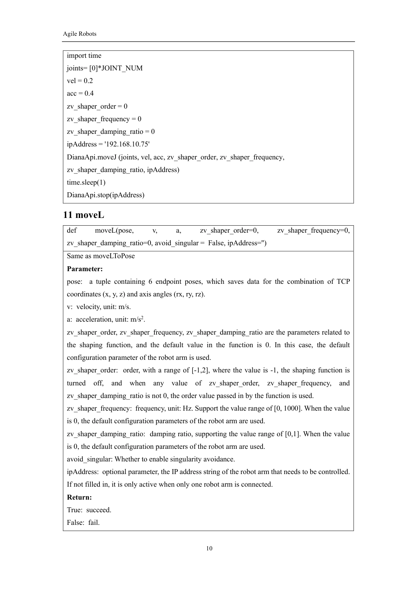



```
Agile Robots  
 10  
import time 
joints= [0]*JOINT_NUM 
vel = 0.2 
acc = 0.4 
zv_shaper_order = 0 
zv_shaper_frequency = 0 
zv_shaper_damping_ratio = 0 
ipAddress = '192.168.10.75' 
DianaApi.moveJ (joints, vel, acc, zv_shaper_order, zv_shaper_frequency, 
zv_shaper_damping_ratio, ipAddress) 
time.sleep(1) 
DianaApi.stop(ipAddress) 
11 moveL 
def 
moveL(pose, 
v, 
a, 
zv_shaper_order=0, 
zv_shaper_frequency=0, 
zv_shaper_damping_ratio=0, avoid_singular =  False, ipAddress='') 
Same as moveLToPose  
Parameter:  
pose:  a tuple containing 6 endpoint poses, which saves data for the combination of TCP 
coordinates (x, y, z) and axis angles (rx, ry, rz).  
v:  velocity, unit: m/s.  
a:  acceleration, unit: m/s2.  
zv_shaper_order, zv_shaper_frequency, zv_shaper_damping_ratio are the parameters related to 
the shaping function, and the default value in the function is 0. In this case, the default 
configuration parameter of the robot arm is used.  
zv_shaper_order:  order, with a range of [-1,2], where the value is -1, the shaping function is 
turned off, and when any value of zv_shaper_order, zv_shaper_frequency, and 
zv_shaper_damping_ratio is not 0, the order value passed in by the function is used.  
zv_shaper_frequency:  frequency, unit: Hz. Support the value range of [0, 1000]. When the value 
is 0, the default configuration parameters of the robot arm are used.  
zv_shaper_damping_ratio:  damping ratio, supporting the value range of [0,1]. When the value 
is 0, the default configuration parameters of the robot arm are used.  
avoid_singular: Whether to enable singularity avoidance. 
ipAddress:  optional parameter, the IP address string of the robot arm that needs to be controlled. 
If not filled in, it is only active when only one robot arm is connected.  
Return:  
True:  succeed.  
False:  fail.
```



## PDF page 19

**Source:** Industrial API Manual (Python Edition) \_V3.3.0\_EN\_20260205.pdf, original pdf page 19. [Open the corresponding PDF reading-copy page](https://1292444914-files.gitbook.io/~/files/v0/b/gitbook-x-prod.appspot.com/o/spaces%2FtgOfPnscWebs1eh82EKq%2Fuploads%2FRuKqP58TGdcORhNDRsIQ%2Findustrial-api-manual-python-edition-v3-3-0-en-20260205-pp-001-139.pdf?alt=media#page=19).



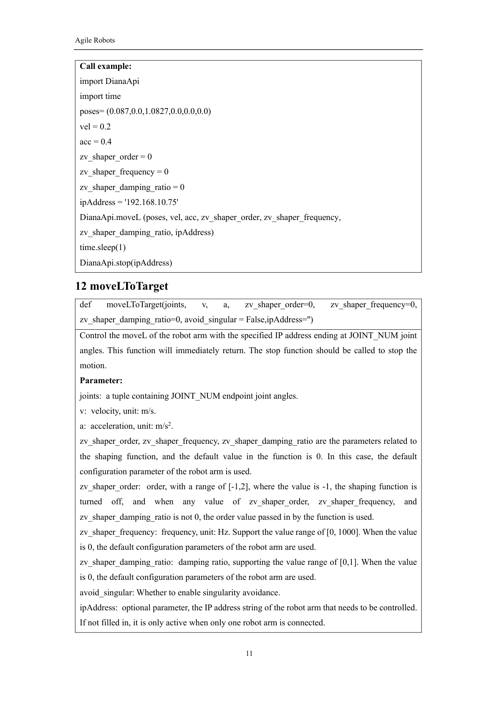



```
Agile Robots  
 11  
Call example:  
import DianaApi 
import time 
poses= (0.087,0.0,1.0827,0.0,0.0,0.0) 
vel = 0.2 
acc = 0.4 
zv_shaper_order = 0 
zv_shaper_frequency = 0 
zv_shaper_damping_ratio = 0 
ipAddress = '192.168.10.75' 
DianaApi.moveL (poses, vel, acc, zv_shaper_order, zv_shaper_frequency, 
zv_shaper_damping_ratio, ipAddress) 
time.sleep(1) 
DianaApi.stop(ipAddress) 
12 moveLToTarget  
def 
moveLToTarget(joints, 
v, 
a, 
zv_shaper_order=0, 
zv_shaper_frequency=0, 
zv_shaper_damping_ratio=0, avoid_singular = False,ipAddress='') 
Control the moveL of the robot arm with the specified IP address ending at JOINT_NUM joint 
angles. This function will immediately return. The stop function should be called to stop the 
motion.  
Parameter:  
joints:  a tuple containing JOINT_NUM endpoint joint angles.  
v:  velocity, unit: m/s.  
a:  acceleration, unit: m/s2.  
zv_shaper_order, zv_shaper_frequency, zv_shaper_damping_ratio are the parameters related to 
the shaping function, and the default value in the function is 0. In this case, the default 
configuration parameter of the robot arm is used.  
zv_shaper_order:  order, with a range of [-1,2], where the value is -1, the shaping function is 
turned off, and when any value of zv_shaper_order, zv_shaper_frequency, and 
zv_shaper_damping_ratio is not 0, the order value passed in by the function is used.  
zv_shaper_frequency:  frequency, unit: Hz. Support the value range of [0, 1000]. When the value 
is 0, the default configuration parameters of the robot arm are used.  
zv_shaper_damping_ratio:  damping ratio, supporting the value range of [0,1]. When the value 
is 0, the default configuration parameters of the robot arm are used.  
avoid_singular: Whether to enable singularity avoidance. 
ipAddress:  optional parameter, the IP address string of the robot arm that needs to be controlled. 
If not filled in, it is only active when only one robot arm is connected.
```



## PDF page 20

**Source:** Industrial API Manual (Python Edition) \_V3.3.0\_EN\_20260205.pdf, original pdf page 20. [Open the corresponding PDF reading-copy page](https://1292444914-files.gitbook.io/~/files/v0/b/gitbook-x-prod.appspot.com/o/spaces%2FtgOfPnscWebs1eh82EKq%2Fuploads%2FRuKqP58TGdcORhNDRsIQ%2Findustrial-api-manual-python-edition-v3-3-0-en-20260205-pp-001-139.pdf?alt=media#page=20).



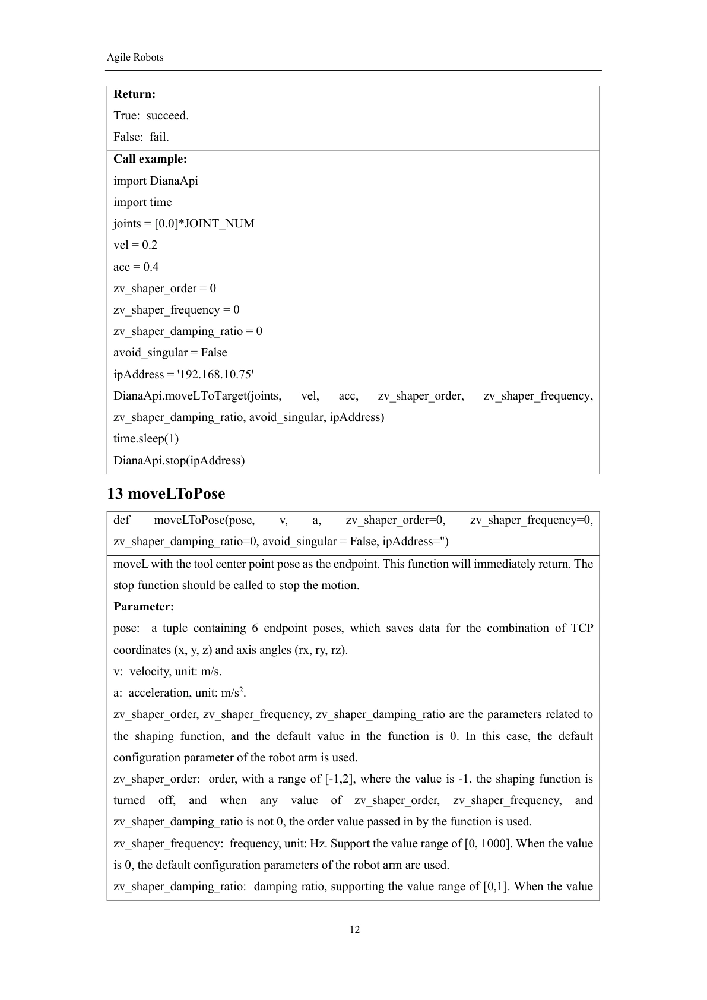



```
Agile Robots  
 12  
Return:  
True:  succeed.  
False:  fail.  
Call example:  
import DianaApi 
import time 
joints = [0.0]*JOINT_NUM 
vel = 0.2 
acc = 0.4 
zv_shaper_order = 0 
zv_shaper_frequency = 0 
zv_shaper_damping_ratio = 0 
avoid_singular = False 
ipAddress = '192.168.10.75' 
DianaApi.moveLToTarget(joints, 
vel, 
acc, 
zv_shaper_order, 
zv_shaper_frequency, 
zv_shaper_damping_ratio, avoid_singular, ipAddress) 
time.sleep(1) 
DianaApi.stop(ipAddress) 
13 moveLToPose 
def 
moveLToPose(pose, 
v, 
a, 
zv_shaper_order=0, 
zv_shaper_frequency=0, 
zv_shaper_damping_ratio=0, avoid_singular = False, ipAddress='') 
moveL with the tool center point pose as the endpoint. This function will immediately return. The 
stop function should be called to stop the motion.  
Parameter:  
pose:  a tuple containing 6 endpoint poses, which saves data for the combination of TCP 
coordinates (x, y, z) and axis angles (rx, ry, rz).  
v:  velocity, unit: m/s.  
a:  acceleration, unit: m/s2.  
zv_shaper_order, zv_shaper_frequency, zv_shaper_damping_ratio are the parameters related to 
the shaping function, and the default value in the function is 0. In this case, the default 
configuration parameter of the robot arm is used.  
zv_shaper_order:  order, with a range of [-1,2], where the value is -1, the shaping function is 
turned off, and when any value of zv_shaper_order, zv_shaper_frequency, and 
zv_shaper_damping_ratio is not 0, the order value passed in by the function is used.  
zv_shaper_frequency:  frequency, unit: Hz. Support the value range of [0, 1000]. When the value 
is 0, the default configuration parameters of the robot arm are used.  
zv_shaper_damping_ratio:  damping ratio, supporting the value range of [0,1]. When the value
```



## PDF page 21

**Source:** Industrial API Manual (Python Edition) \_V3.3.0\_EN\_20260205.pdf, original pdf page 21. [Open the corresponding PDF reading-copy page](https://1292444914-files.gitbook.io/~/files/v0/b/gitbook-x-prod.appspot.com/o/spaces%2FtgOfPnscWebs1eh82EKq%2Fuploads%2FRuKqP58TGdcORhNDRsIQ%2Findustrial-api-manual-python-edition-v3-3-0-en-20260205-pp-001-139.pdf?alt=media#page=21).



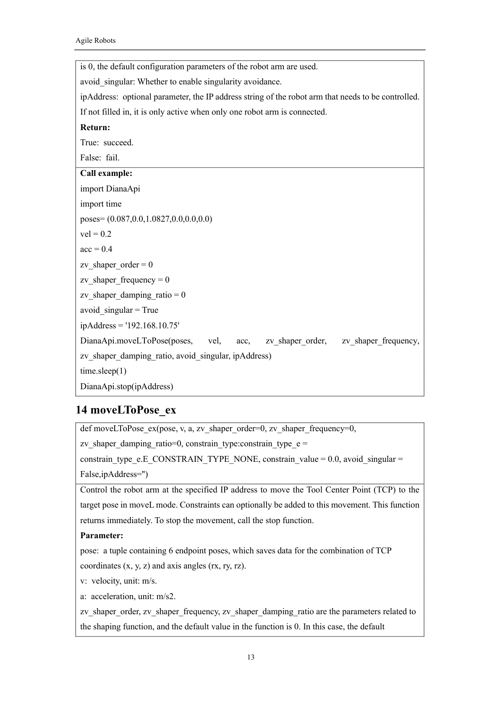



```
Agile Robots  
 13  
is 0, the default configuration parameters of the robot arm are used.  
avoid_singular: Whether to enable singularity avoidance. 
ipAddress:  optional parameter, the IP address string of the robot arm that needs to be controlled. 
If not filled in, it is only active when only one robot arm is connected.  
Return:  
True:  succeed.  
False:  fail.  
Call example:  
import DianaApi 
import time 
poses= (0.087,0.0,1.0827,0.0,0.0,0.0) 
vel = 0.2 
acc = 0.4 
zv_shaper_order = 0 
zv_shaper_frequency = 0 
zv_shaper_damping_ratio = 0 
avoid_singular = True 
ipAddress = '192.168.10.75' 
DianaApi.moveLToPose(poses, 
vel, 
acc, 
zv_shaper_order, 
zv_shaper_frequency, 
zv_shaper_damping_ratio, avoid_singular, ipAddress) 
time.sleep(1) 
DianaApi.stop(ipAddress) 
14 moveLToPose_ex 
def moveLToPose_ex(pose, v, a, zv_shaper_order=0, zv_shaper_frequency=0, 
zv_shaper_damping_ratio=0, constrain_type:constrain_type_e = 
constrain_type_e.E_CONSTRAIN_TYPE_NONE, constrain_value = 0.0, avoid_singular = 
False,ipAddress='') 
Control the robot arm at the specified IP address to move the Tool Center Point (TCP) to the 
target pose in moveL mode. Constraints can optionally be added to this movement. This function 
returns immediately. To stop the movement, call the stop function. 
Parameter:  
pose:  a tuple containing 6 endpoint poses, which saves data for the combination of TCP 
coordinates (x, y, z) and axis angles (rx, ry, rz).  
v:  velocity, unit: m/s.  
a:  acceleration, unit: m/s2.  
zv_shaper_order, zv_shaper_frequency, zv_shaper_damping_ratio are the parameters related to 
the shaping function, and the default value in the function is 0. In this case, the default
```



## PDF page 22

**Source:** Industrial API Manual (Python Edition) \_V3.3.0\_EN\_20260205.pdf, original pdf page 22. [Open the corresponding PDF reading-copy page](https://1292444914-files.gitbook.io/~/files/v0/b/gitbook-x-prod.appspot.com/o/spaces%2FtgOfPnscWebs1eh82EKq%2Fuploads%2FRuKqP58TGdcORhNDRsIQ%2Findustrial-api-manual-python-edition-v3-3-0-en-20260205-pp-001-139.pdf?alt=media#page=22).



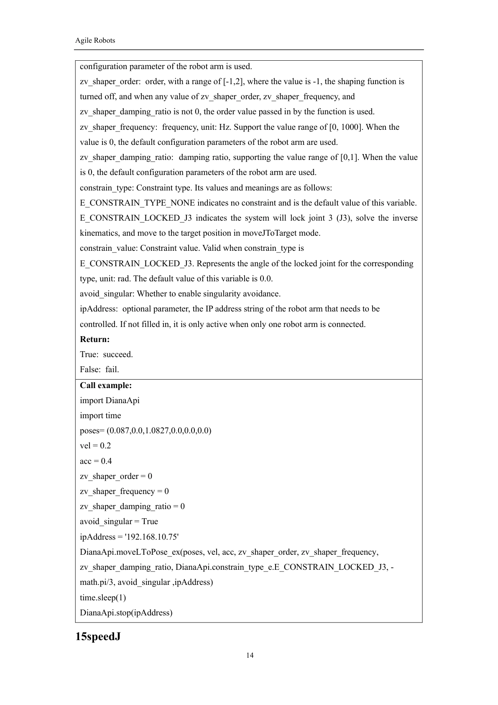



```
Agile Robots  
 14  
configuration parameter of the robot arm is used.  
zv_shaper_order:  order, with a range of [-1,2], where the value is -1, the shaping function is 
turned off, and when any value of zv_shaper_order, zv_shaper_frequency, and 
zv_shaper_damping_ratio is not 0, the order value passed in by the function is used.  
zv_shaper_frequency:  frequency, unit: Hz. Support the value range of [0, 1000]. When the 
value is 0, the default configuration parameters of the robot arm are used.  
zv_shaper_damping_ratio:  damping ratio, supporting the value range of [0,1]. When the value 
is 0, the default configuration parameters of the robot arm are used.  
constrain_type: Constraint type. Its values and meanings are as follows: 
E_CONSTRAIN_TYPE_NONE indicates no constraint and is the default value of this variable. 
E_CONSTRAIN_LOCKED_J3 indicates the system will lock joint 3 (J3), solve the inverse 
kinematics, and move to the target position in moveJToTarget mode. 
constrain_value: Constraint value. Valid when constrain_type is 
E_CONSTRAIN_LOCKED_J3. Represents the angle of the locked joint for the corresponding 
type, unit: rad. The default value of this variable is 0.0. 
avoid_singular: Whether to enable singularity avoidance. 
ipAddress:  optional parameter, the IP address string of the robot arm that needs to be 
controlled. If not filled in, it is only active when only one robot arm is connected. 
Return:  
True:  succeed.  
False:  fail. 
Call example:  
import DianaApi 
import time 
poses= (0.087,0.0,1.0827,0.0,0.0,0.0) 
vel = 0.2 
acc = 0.4 
zv_shaper_order = 0 
zv_shaper_frequency = 0 
zv_shaper_damping_ratio = 0 
avoid_singular = True 
ipAddress = '192.168.10.75' 
DianaApi.moveLToPose_ex(poses, vel, acc, zv_shaper_order, zv_shaper_frequency, 
zv_shaper_damping_ratio, DianaApi.constrain_type_e.E_CONSTRAIN_LOCKED_J3, -
math.pi/3, avoid_singular ,ipAddress) 
time.sleep(1) 
DianaApi.stop(ipAddress) 
15 speedJ
```



## PDF page 23

**Source:** Industrial API Manual (Python Edition) \_V3.3.0\_EN\_20260205.pdf, original pdf page 23. [Open the corresponding PDF reading-copy page](https://1292444914-files.gitbook.io/~/files/v0/b/gitbook-x-prod.appspot.com/o/spaces%2FtgOfPnscWebs1eh82EKq%2Fuploads%2FRuKqP58TGdcORhNDRsIQ%2Findustrial-api-manual-python-edition-v3-3-0-en-20260205-pp-001-139.pdf?alt=media#page=23).



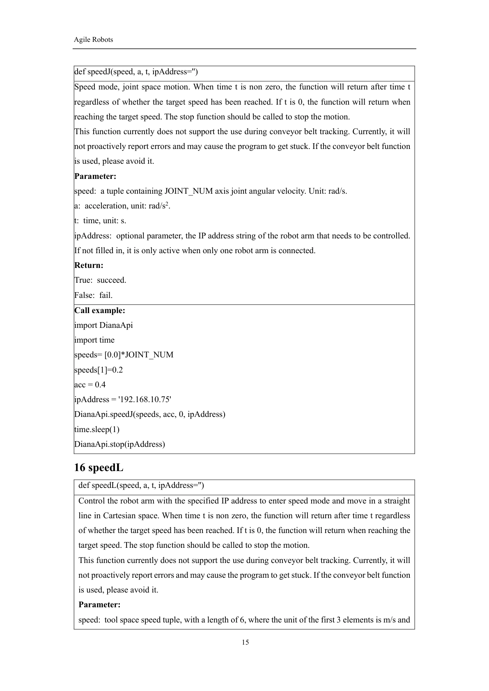



```
Agile Robots  
 15  
16 speedL 
def speedL(speed, a, t, ipAddress='') 
Control the robot arm with the specified IP address to enter speed mode and move in a straight 
line in Cartesian space. When time t is non zero, the function will return after time t regardless 
of whether the target speed has been reached. If t is 0, the function will return when reaching the 
target speed. The stop function should be called to stop the motion.  
This function currently does not support the use during conveyor belt tracking. Currently, it will 
not proactively report errors and may cause the program to get stuck. If the conveyor belt function 
is used, please avoid it.  
Parameter:  
speed:  tool space speed tuple, with a length of 6, where the unit of the first 3 elements is m/s and 
def speedJ(speed, a, t, ipAddress='') 
Speed mode, joint space motion. When time t is non zero, the function will return after time t 
regardless of whether the target speed has been reached. If t is 0, the function will return when 
reaching the target speed. The stop function should be called to stop the motion.  
This function currently does not support the use during conveyor belt tracking. Currently, it will 
not proactively report errors and may cause the program to get stuck. If the conveyor belt function 
is used, please avoid it.  
Parameter:  
speed:  a tuple containing JOINT_NUM axis joint angular velocity. Unit: rad/s.  
a:  acceleration, unit: rad/s2.  
t:  time, unit: s.  
ipAddress:  optional parameter, the IP address string of the robot arm that needs to be controlled. 
If not filled in, it is only active when only one robot arm is connected.  
Return:  
True:  succeed.  
False:  fail.  
Call example:  
import DianaApi 
import time 
speeds= [0.0]*JOINT_NUM 
speeds[1]=0.2 
acc = 0.4 
ipAddress = '192.168.10.75' 
DianaApi.speedJ(speeds, acc, 0, ipAddress) 
time.sleep(1) 
DianaApi.stop(ipAddress)
```



## PDF page 24

**Source:** Industrial API Manual (Python Edition) \_V3.3.0\_EN\_20260205.pdf, original pdf page 24. [Open the corresponding PDF reading-copy page](https://1292444914-files.gitbook.io/~/files/v0/b/gitbook-x-prod.appspot.com/o/spaces%2FtgOfPnscWebs1eh82EKq%2Fuploads%2FRuKqP58TGdcORhNDRsIQ%2Findustrial-api-manual-python-edition-v3-3-0-en-20260205-pp-001-139.pdf?alt=media#page=24).



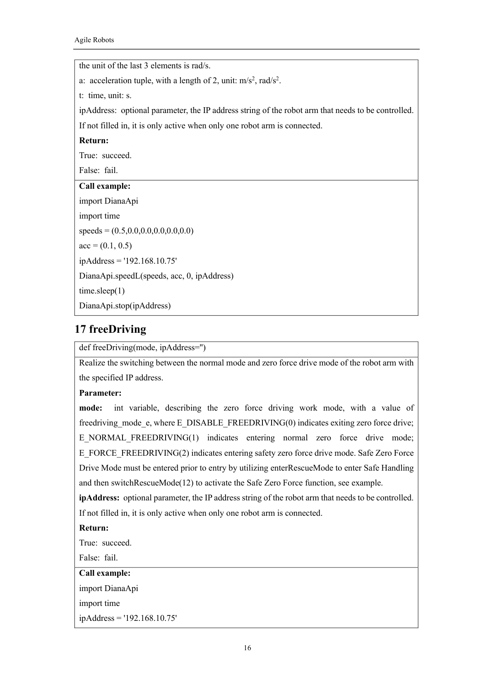



```
Agile Robots  
 16  
the unit of the last 3 elements is rad/s.  
a:  acceleration tuple, with a length of 2, unit: m/s2, rad/s2.  
t:  time, unit: s.  
ipAddress:  optional parameter, the IP address string of the robot arm that needs to be controlled. 
If not filled in, it is only active when only one robot arm is connected.  
Return:  
True:  succeed.  
False:  fail.  
Call example:  
import DianaApi 
import time 
speeds = (0.5,0.0,0.0,0.0,0.0,0.0) 
acc = (0.1, 0.5) 
ipAddress = '192.168.10.75' 
DianaApi.speedL(speeds, acc, 0, ipAddress) 
time.sleep(1) 
DianaApi.stop(ipAddress) 
17 freeDriving 
def freeDriving(mode, ipAddress='') 
Realize the switching between the normal mode and zero force drive mode of the robot arm with 
the specified IP address.  
Parameter:  
mode:  int variable, describing the zero force driving work mode, with a value of 
freedriving_mode_e, where E_DISABLE_FREEDRIVING(0) indicates exiting zero force drive; 
E_NORMAL_FREEDRIVING(1) indicates entering normal zero force drive mode; 
E_FORCE_FREEDRIVING(2) indicates entering safety zero force drive mode. Safe Zero Force 
Drive Mode must be entered prior to entry by utilizing enterRescueMode to enter Safe Handling 
and then switchRescueMode(12) to activate the Safe Zero Force function, see example. 
ipAddress:  optional parameter, the IP address string of the robot arm that needs to be controlled. 
If not filled in, it is only active when only one robot arm is connected.  
Return:  
True:  succeed.  
False:  fail.  
Call example:  
import DianaApi 
import time 
ipAddress = '192.168.10.75'
```



## PDF page 25

**Source:** Industrial API Manual (Python Edition) \_V3.3.0\_EN\_20260205.pdf, original pdf page 25. [Open the corresponding PDF reading-copy page](https://1292444914-files.gitbook.io/~/files/v0/b/gitbook-x-prod.appspot.com/o/spaces%2FtgOfPnscWebs1eh82EKq%2Fuploads%2FRuKqP58TGdcORhNDRsIQ%2Findustrial-api-manual-python-edition-v3-3-0-en-20260205-pp-001-139.pdf?alt=media#page=25).



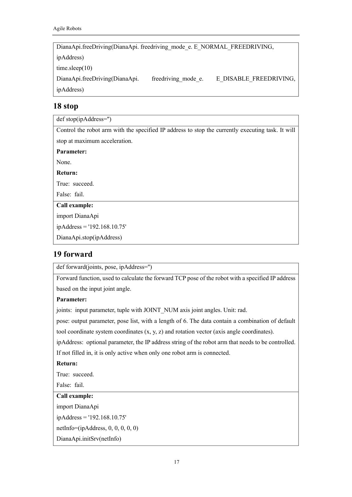



```
Agile Robots  
 17  
DianaApi.freeDriving(DianaApi. freedriving_mode_e. E_NORMAL_FREEDRIVING, 
ipAddress) 
time.sleep(10) 
DianaApi.freeDriving(DianaApi. 
freedriving_mode_e. 
E_DISABLE_FREEDRIVING, 
ipAddress) 
18 stop 
def stop(ipAddress='') 
Control the robot arm with the specified IP address to stop the currently executing task. It will 
stop at maximum acceleration.  
Parameter:  
None.  
Return:  
True:  succeed.  
False:  fail.  
Call example:  
import DianaApi 
ipAddress = '192.168.10.75' 
DianaApi.stop(ipAddress) 
19 forward 
def forward(joints, pose, ipAddress='') 
Forward function, used to calculate the forward TCP pose of the robot with a specified IP address 
based on the input joint angle.  
Parameter:  
joints:  input parameter, tuple with JOINT_NUM axis joint angles. Unit: rad.  
pose: output parameter, pose list, with a length of 6. The data contain a combination of default 
tool coordinate system coordinates (x, y, z) and rotation vector (axis angle coordinates).  
ipAddress:  optional parameter, the IP address string of the robot arm that needs to be controlled. 
If not filled in, it is only active when only one robot arm is connected.  
Return:  
True:  succeed.  
False:  fail.  
Call example:  
import DianaApi 
ipAddress = '192.168.10.75' 
netInfo=(ipAddress, 0, 0, 0, 0, 0) 
DianaApi.initSrv(netInfo)
```



## PDF page 26

**Source:** Industrial API Manual (Python Edition) \_V3.3.0\_EN\_20260205.pdf, original pdf page 26. [Open the corresponding PDF reading-copy page](https://1292444914-files.gitbook.io/~/files/v0/b/gitbook-x-prod.appspot.com/o/spaces%2FtgOfPnscWebs1eh82EKq%2Fuploads%2FRuKqP58TGdcORhNDRsIQ%2Findustrial-api-manual-python-edition-v3-3-0-en-20260205-pp-001-139.pdf?alt=media#page=26).



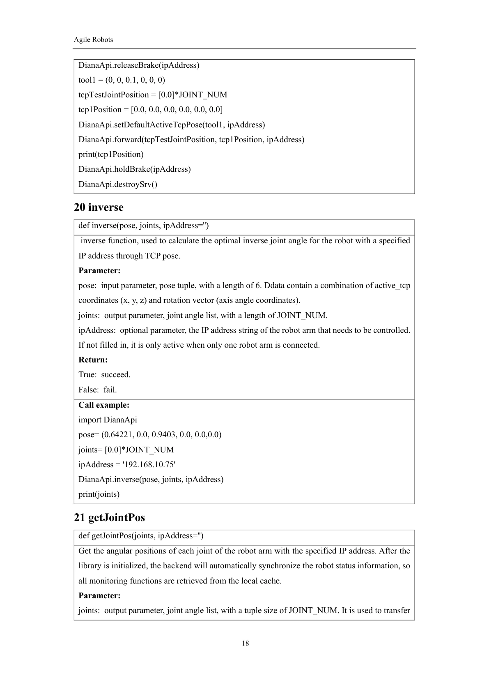



```
Agile Robots  
 18  
DianaApi.releaseBrake(ipAddress) 
tool1 = (0, 0, 0.1, 0, 0, 0) 
tcpTestJointPosition = [0.0]*JOINT_NUM 
tcp1Position = [0.0, 0.0, 0.0, 0.0, 0.0, 0.0] 
DianaApi.setDefaultActiveTcpPose(tool1, ipAddress) 
DianaApi.forward(tcpTestJointPosition, tcp1Position, ipAddress) 
print(tcp1Position) 
DianaApi.holdBrake(ipAddress) 
DianaApi.destroySrv() 
20 inverse 
def inverse(pose, joints, ipAddress='') 
 inverse function, used to calculate the optimal inverse joint angle for the robot with a specified 
IP address through TCP pose.  
Parameter:  
pose:  input parameter, pose tuple, with a length of 6. Ddata contain a combination of active_tcp 
coordinates (x, y, z) and rotation vector (axis angle coordinates).  
joints:  output parameter, joint angle list, with a length of JOINT_NUM.  
ipAddress:  optional parameter, the IP address string of the robot arm that needs to be controlled. 
If not filled in, it is only active when only one robot arm is connected.  
Return:  
True:  succeed.  
False:  fail.  
Call example:  
import DianaApi 
pose= (0.64221, 0.0, 0.9403, 0.0, 0.0,0.0) 
joints= [0.0]*JOINT_NUM 
ipAddress = '192.168.10.75' 
DianaApi.inverse(pose, joints, ipAddress) 
print(joints) 
21 getJointPos 
def getJointPos(joints, ipAddress='') 
Get the angular positions of each joint of the robot arm with the specified IP address. After the 
library is initialized, the backend will automatically synchronize the robot status information, so 
all monitoring functions are retrieved from the local cache.  
Parameter:  
joints:  output parameter, joint angle list, with a tuple size of JOINT_NUM. It is used to transfer
```



## PDF page 27

**Source:** Industrial API Manual (Python Edition) \_V3.3.0\_EN\_20260205.pdf, original pdf page 27. [Open the corresponding PDF reading-copy page](https://1292444914-files.gitbook.io/~/files/v0/b/gitbook-x-prod.appspot.com/o/spaces%2FtgOfPnscWebs1eh82EKq%2Fuploads%2FRuKqP58TGdcORhNDRsIQ%2Findustrial-api-manual-python-edition-v3-3-0-en-20260205-pp-001-139.pdf?alt=media#page=27).



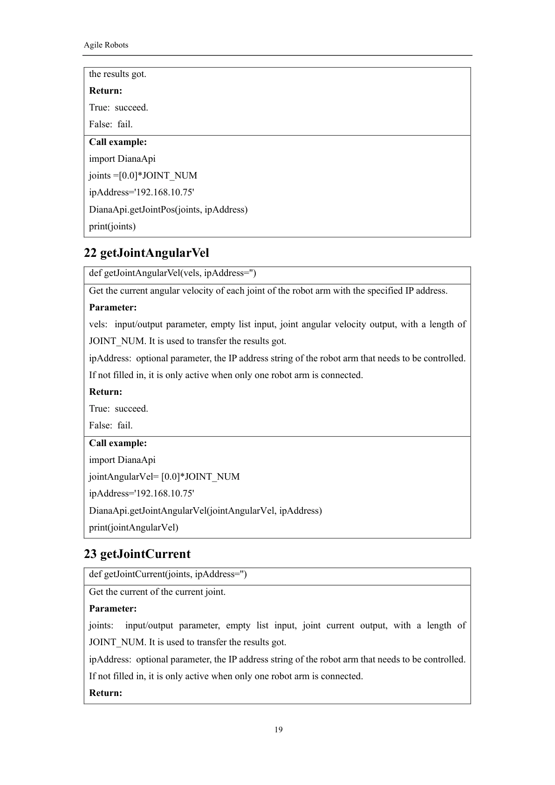



```
Agile Robots  
 19  
the results got.  
Return:  
True:  succeed.  
False:  fail.  
Call example:  
import DianaApi 
joints =[0.0]*JOINT_NUM 
ipAddress='192.168.10.75' 
DianaApi.getJointPos(joints, ipAddress) 
print(joints) 
22 getJointAngularVel 
def getJointAngularVel(vels, ipAddress='') 
Get the current angular velocity of each joint of the robot arm with the specified IP address.  
Parameter:  
vels:  input/output parameter, empty list input, joint angular velocity output, with a length of 
JOINT_NUM. It is used to transfer the results got.  
ipAddress:  optional parameter, the IP address string of the robot arm that needs to be controlled. 
If not filled in, it is only active when only one robot arm is connected.  
Return:  
True:  succeed.  
False:  fail.  
Call example:  
import DianaApi 
jointAngularVel= [0.0]*JOINT_NUM 
ipAddress='192.168.10.75' 
DianaApi.getJointAngularVel(jointAngularVel, ipAddress) 
print(jointAngularVel) 
23 getJointCurrent 
def getJointCurrent(joints, ipAddress='') 
Get the current of the current joint.  
Parameter:  
joints:  input/output parameter, empty list input, joint current output, with a length of 
JOINT_NUM. It is used to transfer the results got.  
ipAddress:  optional parameter, the IP address string of the robot arm that needs to be controlled. 
If not filled in, it is only active when only one robot arm is connected.  
Return:
```



## PDF page 28

**Source:** Industrial API Manual (Python Edition) \_V3.3.0\_EN\_20260205.pdf, original pdf page 28. [Open the corresponding PDF reading-copy page](https://1292444914-files.gitbook.io/~/files/v0/b/gitbook-x-prod.appspot.com/o/spaces%2FtgOfPnscWebs1eh82EKq%2Fuploads%2FRuKqP58TGdcORhNDRsIQ%2Findustrial-api-manual-python-edition-v3-3-0-en-20260205-pp-001-139.pdf?alt=media#page=28).



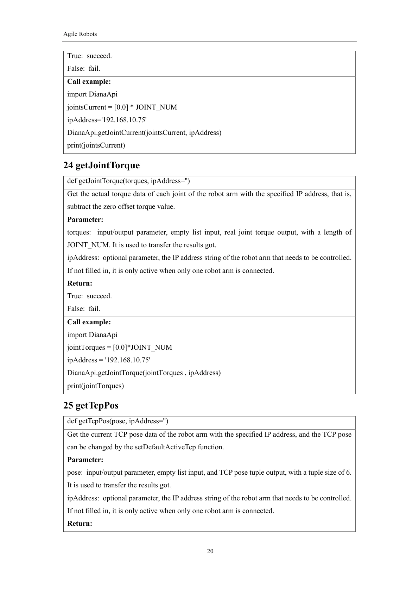



```
Agile Robots  
 20  
True:  succeed.  
False:  fail.  
Call example:  
import DianaApi 
jointsCurrent = [0.0] * JOINT_NUM 
ipAddress='192.168.10.75' 
DianaApi.getJointCurrent(jointsCurrent, ipAddress) 
print(jointsCurrent) 
24 getJointTorque 
def getJointTorque(torques, ipAddress='') 
Get the actual torque data of each joint of the robot arm with the specified IP address, that is, 
subtract the zero offset torque value.  
Parameter:  
torques:  input/output parameter, empty list input, real joint torque output, with a length of 
JOINT_NUM. It is used to transfer the results got.  
ipAddress:  optional parameter, the IP address string of the robot arm that needs to be controlled. 
If not filled in, it is only active when only one robot arm is connected.  
Return:  
True:  succeed.  
False:  fail.  
Call example:  
import DianaApi 
jointTorques = [0.0]*JOINT_NUM 
ipAddress = '192.168.10.75' 
DianaApi.getJointTorque(jointTorques , ipAddress) 
print(jointTorques) 
25 getTcpPos 
def getTcpPos(pose, ipAddress='') 
Get the current TCP pose data of the robot arm with the specified IP address, and the TCP pose 
can be changed by the setDefaultActiveTcp function.  
Parameter:  
pose:  input/output parameter, empty list input, and TCP pose tuple output, with a tuple size of 6. 
It is used to transfer the results got.  
ipAddress:  optional parameter, the IP address string of the robot arm that needs to be controlled. 
If not filled in, it is only active when only one robot arm is connected.  
Return:
```



## PDF page 29

**Source:** Industrial API Manual (Python Edition) \_V3.3.0\_EN\_20260205.pdf, original pdf page 29. [Open the corresponding PDF reading-copy page](https://1292444914-files.gitbook.io/~/files/v0/b/gitbook-x-prod.appspot.com/o/spaces%2FtgOfPnscWebs1eh82EKq%2Fuploads%2FRuKqP58TGdcORhNDRsIQ%2Findustrial-api-manual-python-edition-v3-3-0-en-20260205-pp-001-139.pdf?alt=media#page=29).



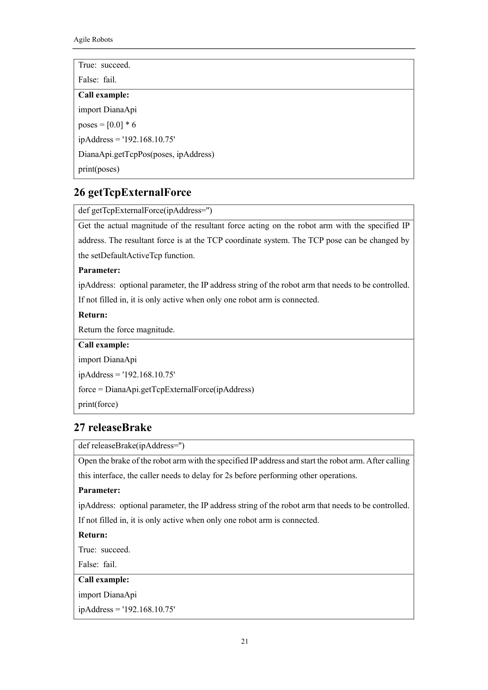



```
Agile Robots  
 21  
True:  succeed.  
False:  fail.  
Call example:  
import DianaApi 
poses = [0.0] * 6 
ipAddress = '192.168.10.75' 
DianaApi.getTcpPos(poses, ipAddress) 
print(poses) 
26 getTcpExternalForce 
def getTcpExternalForce(ipAddress='') 
Get the actual magnitude of the resultant force acting on the robot arm with the specified IP 
address. The resultant force is at the TCP coordinate system. The TCP pose can be changed by 
the setDefaultActiveTcp function.  
Parameter:  
ipAddress:  optional parameter, the IP address string of the robot arm that needs to be controlled. 
If not filled in, it is only active when only one robot arm is connected.  
Return:  
Return the force magnitude.  
Call example:  
import DianaApi 
ipAddress = '192.168.10.75' 
force = DianaApi.getTcpExternalForce(ipAddress) 
print(force) 
27 releaseBrake 
def releaseBrake(ipAddress='') 
Open the brake of the robot arm with the specified IP address and start the robot arm. After calling 
this interface, the caller needs to delay for 2s before performing other operations.  
Parameter:  
ipAddress:  optional parameter, the IP address string of the robot arm that needs to be controlled. 
If not filled in, it is only active when only one robot arm is connected.  
Return:  
True:  succeed.  
False:  fail.  
Call example:  
import DianaApi 
ipAddress = '192.168.10.75'
```



## PDF page 30

**Source:** Industrial API Manual (Python Edition) \_V3.3.0\_EN\_20260205.pdf, original pdf page 30. [Open the corresponding PDF reading-copy page](https://1292444914-files.gitbook.io/~/files/v0/b/gitbook-x-prod.appspot.com/o/spaces%2FtgOfPnscWebs1eh82EKq%2Fuploads%2FRuKqP58TGdcORhNDRsIQ%2Findustrial-api-manual-python-edition-v3-3-0-en-20260205-pp-001-139.pdf?alt=media#page=30).



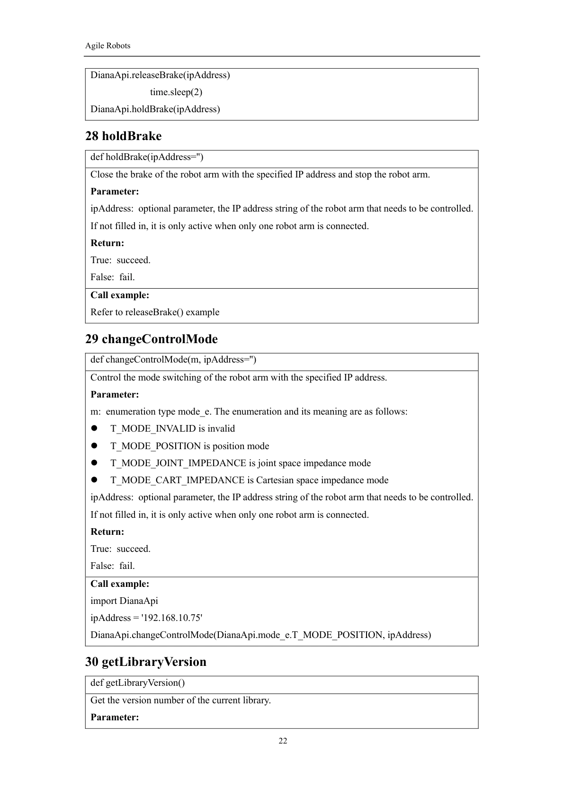



```
Agile Robots  
 22  
DianaApi.releaseBrake(ipAddress) 
time.sleep(2) 
DianaApi.holdBrake(ipAddress) 
28 holdBrake 
def holdBrake(ipAddress='') 
Close the brake of the robot arm with the specified IP address and stop the robot arm.  
Parameter:  
ipAddress:  optional parameter, the IP address string of the robot arm that needs to be controlled. 
If not filled in, it is only active when only one robot arm is connected.  
Return:  
True:  succeed.  
False:  fail.  
Call example:  
Refer to releaseBrake() example  
29 changeControlMode 
def changeControlMode(m, ipAddress='') 
Control the mode switching of the robot arm with the specified IP address.  
Parameter:  
m:  enumeration type mode_e. The enumeration and its meaning are as follows:  
⚫ 
T_MODE_INVALID is invalid  
⚫ 
T_MODE_POSITION is position mode  
⚫ 
T_MODE_JOINT_IMPEDANCE is joint space impedance mode  
⚫ 
T_MODE_CART_IMPEDANCE is Cartesian space impedance mode  
ipAddress:  optional parameter, the IP address string of the robot arm that needs to be controlled. 
If not filled in, it is only active when only one robot arm is connected.  
Return:  
True:  succeed.  
False:  fail.  
Call example:  
import DianaApi 
ipAddress = '192.168.10.75' 
DianaApi.changeControlMode(DianaApi.mode_e.T_MODE_POSITION, ipAddress) 
30 getLibraryVersion 
def getLibraryVersion() 
Get the version number of the current library.  
Parameter:
```



## PDF page 31

**Source:** Industrial API Manual (Python Edition) \_V3.3.0\_EN\_20260205.pdf, original pdf page 31. [Open the corresponding PDF reading-copy page](https://1292444914-files.gitbook.io/~/files/v0/b/gitbook-x-prod.appspot.com/o/spaces%2FtgOfPnscWebs1eh82EKq%2Fuploads%2FRuKqP58TGdcORhNDRsIQ%2Findustrial-api-manual-python-edition-v3-3-0-en-20260205-pp-001-139.pdf?alt=media#page=31).



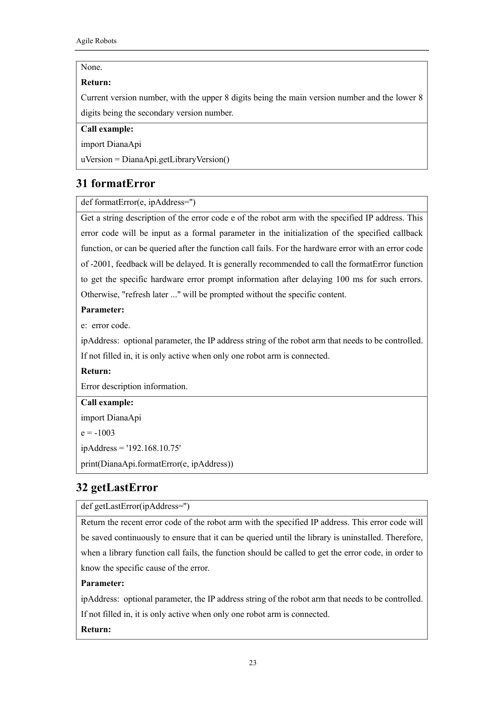



```
Agile Robots  
 23  
None.  
Return:  
Current version number, with the upper 8 digits being the main version number and the lower 8 
digits being the secondary version number.  
Call example:  
import DianaApi 
uVersion = DianaApi.getLibraryVersion() 
31 formatError 
def formatError(e, ipAddress='') 
Get a string description of the error code e of the robot arm with the specified IP address. This 
error code will be input as a formal parameter in the initialization of the specified callback 
function, or can be queried after the function call fails. For the hardware error with an error code 
of -2001, feedback will be delayed. It is generally recommended to call the formatError function 
to get the specific hardware error prompt information after delaying 100 ms for such errors. 
Otherwise, "refresh later ..." will be prompted without the specific content.  
Parameter:  
e:  error code.  
ipAddress:  optional parameter, the IP address string of the robot arm that needs to be controlled. 
If not filled in, it is only active when only one robot arm is connected.  
Return:  
Error description information.  
Call example:  
import DianaApi 
e = -1003 
ipAddress = '192.168.10.75' 
print(DianaApi.formatError(e, ipAddress)) 
32 getLastError  
def getLastError(ipAddress='')  
Return the recent error code of the robot arm with the specified IP address. This error code will 
be saved continuously to ensure that it can be queried until the library is uninstalled. Therefore, 
when a library function call fails, the function should be called to get the error code, in order to 
know the specific cause of the error.  
Parameter:  
ipAddress:  optional parameter, the IP address string of the robot arm that needs to be controlled. 
If not filled in, it is only active when only one robot arm is connected.  
Return:
```



## PDF page 32

**Source:** Industrial API Manual (Python Edition) \_V3.3.0\_EN\_20260205.pdf, original pdf page 32. [Open the corresponding PDF reading-copy page](https://1292444914-files.gitbook.io/~/files/v0/b/gitbook-x-prod.appspot.com/o/spaces%2FtgOfPnscWebs1eh82EKq%2Fuploads%2FRuKqP58TGdcORhNDRsIQ%2Findustrial-api-manual-python-edition-v3-3-0-en-20260205-pp-001-139.pdf?alt=media#page=32).



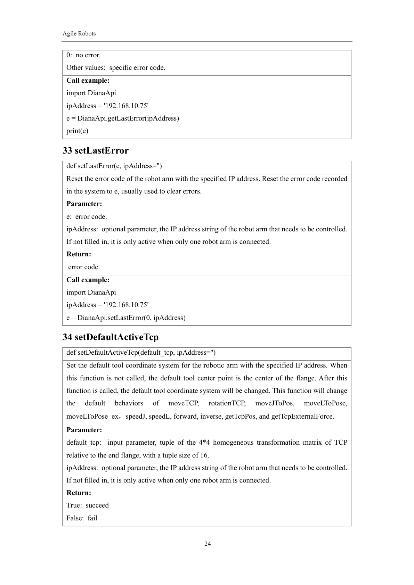



```
Agile Robots  
 24  
0:  no error.  
Other values:  specific error code.  
Call example:  
import DianaApi 
ipAddress = '192.168.10.75' 
e = DianaApi.getLastError(ipAddress) 
print(e) 
33 setLastError 
def setLastError(e, ipAddress='') 
Reset the error code of the robot arm with the specified IP address. Reset the error code recorded 
in the system to e, usually used to clear errors.  
Parameter:  
e:  error code.  
ipAddress:  optional parameter, the IP address string of the robot arm that needs to be controlled. 
If not filled in, it is only active when only one robot arm is connected.  
Return:  
 error code.  
Call example:  
import DianaApi 
ipAddress = '192.168.10.75' 
e = DianaApi.setLastError(0, ipAddress) 
34 setDefaultActiveTcp 
def setDefaultActiveTcp(default_tcp, ipAddress='') 
Set the default tool coordinate system for the robotic arm with the specified IP address. When 
this function is not called, the default tool center point is the center of the flange. After this 
function is called, the default tool coordinate system will be changed. This function will change 
the 
default 
behaviors 
of 
moveTCP, 
rotationTCP, 
moveJToPos, 
moveLToPose, 
moveLToPose_ex，speedJ, speedL, forward, inverse, getTcpPos, and getTcpExternalForce.  
Parameter:  
default_tcp:  input parameter, tuple of the 4*4 homogeneous transformation matrix of TCP 
relative to the end flange, with a tuple size of 16.  
ipAddress:  optional parameter, the IP address string of the robot arm that needs to be controlled. 
If not filled in, it is only active when only one robot arm is connected.  
Return:  
True:  succeed  
False:  fail
```



## PDF page 33

**Source:** Industrial API Manual (Python Edition) \_V3.3.0\_EN\_20260205.pdf, original pdf page 33. [Open the corresponding PDF reading-copy page](https://1292444914-files.gitbook.io/~/files/v0/b/gitbook-x-prod.appspot.com/o/spaces%2FtgOfPnscWebs1eh82EKq%2Fuploads%2FRuKqP58TGdcORhNDRsIQ%2Findustrial-api-manual-python-edition-v3-3-0-en-20260205-pp-001-139.pdf?alt=media#page=33).



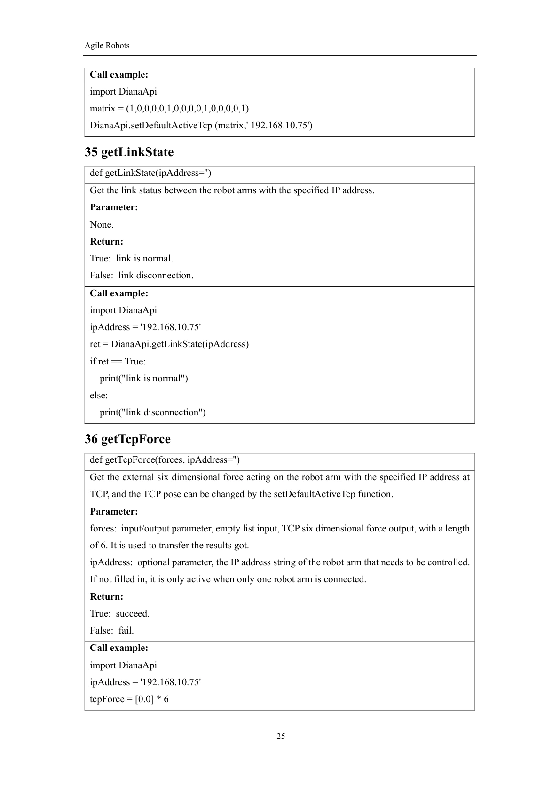



```
Agile Robots  
 25  
Call example:  
import DianaApi 
matrix = (1,0,0,0,0,1,0,0,0,0,1,0,0,0,0,1) 
DianaApi.setDefaultActiveTcp (matrix,' 192.168.10.75') 
35 getLinkState  
def getLinkState(ipAddress='')  
Get the link status between the robot arms with the specified IP address.  
Parameter:  
None.  
Return:  
True:  link is normal.  
False:  link disconnection.  
Call example:  
import DianaApi  
ipAddress = '192.168.10.75'  
ret = DianaApi.getLinkState(ipAddress)  
if ret == True:  
    print("link is normal")  
else:  
    print("link disconnection")  
36 getTcpForce 
def getTcpForce(forces, ipAddress='') 
Get the external six dimensional force acting on the robot arm with the specified IP address at 
TCP, and the TCP pose can be changed by the setDefaultActiveTcp function.  
Parameter:  
forces:  input/output parameter, empty list input, TCP six dimensional force output, with a length 
of 6. It is used to transfer the results got.  
ipAddress:  optional parameter, the IP address string of the robot arm that needs to be controlled. 
If not filled in, it is only active when only one robot arm is connected.  
Return:  
True:  succeed.  
False:  fail.  
Call example:  
import DianaApi 
ipAddress = '192.168.10.75' 
tcpForce = [0.0] * 6
```



## PDF page 34

**Source:** Industrial API Manual (Python Edition) \_V3.3.0\_EN\_20260205.pdf, original pdf page 34. [Open the corresponding PDF reading-copy page](https://1292444914-files.gitbook.io/~/files/v0/b/gitbook-x-prod.appspot.com/o/spaces%2FtgOfPnscWebs1eh82EKq%2Fuploads%2FRuKqP58TGdcORhNDRsIQ%2Findustrial-api-manual-python-edition-v3-3-0-en-20260205-pp-001-139.pdf?alt=media#page=34).



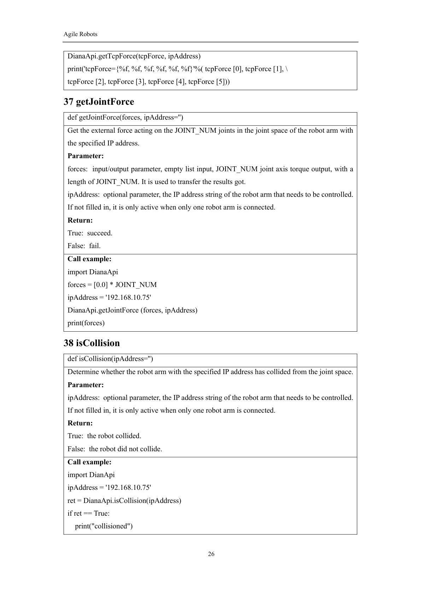



```
Agile Robots  
 26  
DianaApi.getTcpForce(tcpForce, ipAddress) 
print('tcpForce={%f, %f, %f, %f, %f, %f}'%( tcpForce [0], tcpForce [1], \ 
tcpForce [2], tcpForce [3], tcpForce [4], tcpForce [5])) 
37 getJointForce 
def getJointForce(forces, ipAddress='') 
Get the external force acting on the JOINT_NUM joints in the joint space of the robot arm with 
the specified IP address.  
Parameter:  
forces:  input/output parameter, empty list input, JOINT_NUM joint axis torque output, with a 
length of JOINT_NUM. It is used to transfer the results got.  
ipAddress:  optional parameter, the IP address string of the robot arm that needs to be controlled. 
If not filled in, it is only active when only one robot arm is connected.  
Return:  
True:  succeed.  
False:  fail.  
Call example:  
import DianaApi 
forces = [0.0] * JOINT_NUM 
ipAddress = '192.168.10.75' 
DianaApi.getJointForce (forces, ipAddress) 
print(forces) 
38 isCollision 
def isCollision(ipAddress='') 
Determine whether the robot arm with the specified IP address has collided from the joint space.  
Parameter:  
ipAddress:  optional parameter, the IP address string of the robot arm that needs to be controlled. 
If not filled in, it is only active when only one robot arm is connected.  
Return:  
True:  the robot collided.  
False:  the robot did not collide.  
Call example:  
import DianApi 
ipAddress = '192.168.10.75' 
ret = DianaApi.isCollision(ipAddress) 
if ret == True: 
    print("collisioned")
```



## PDF page 35

**Source:** Industrial API Manual (Python Edition) \_V3.3.0\_EN\_20260205.pdf, original pdf page 35. [Open the corresponding PDF reading-copy page](https://1292444914-files.gitbook.io/~/files/v0/b/gitbook-x-prod.appspot.com/o/spaces%2FtgOfPnscWebs1eh82EKq%2Fuploads%2FRuKqP58TGdcORhNDRsIQ%2Findustrial-api-manual-python-edition-v3-3-0-en-20260205-pp-001-139.pdf?alt=media#page=35).



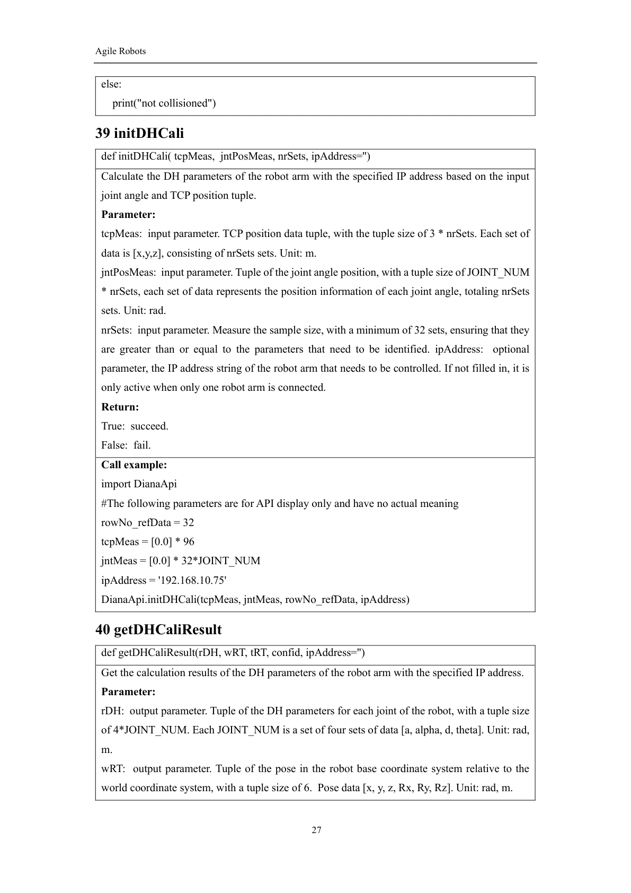



```
Agile Robots  
 27  
else: 
    print("not collisioned") 
39 initDHCali 
def initDHCali( tcpMeas,  jntPosMeas, nrSets, ipAddress='') 
Calculate the DH parameters of the robot arm with the specified IP address based on the input 
joint angle and TCP position tuple.  
Parameter:  
tcpMeas:  input parameter. TCP position data tuple, with the tuple size of 3 * nrSets. Each set of 
data is [x,y,z], consisting of nrSets sets. Unit: m.  
jntPosMeas:  input parameter. Tuple of the joint angle position, with a tuple size of JOINT_NUM 
* nrSets, each set of data represents the position information of each joint angle, totaling nrSets 
sets. Unit: rad.  
nrSets:  input parameter. Measure the sample size, with a minimum of 32 sets, ensuring that they 
are greater than or equal to the parameters that need to be identified. ipAddress:  optional 
parameter, the IP address string of the robot arm that needs to be controlled. If not filled in, it is 
only active when only one robot arm is connected.  
Return:  
True:  succeed.  
False:  fail.  
Call example:  
import DianaApi  
#The following parameters are for API display only and have no actual meaning  
rowNo_refData = 32 
tcpMeas = [0.0] * 96 
jntMeas = [0.0] * 32*JOINT_NUM  
ipAddress = '192.168.10.75' 
DianaApi.initDHCali(tcpMeas, jntMeas, rowNo_refData, ipAddress) 
40 getDHCaliResult 
def getDHCaliResult(rDH, wRT, tRT, confid, ipAddress='') 
Get the calculation results of the DH parameters of the robot arm with the specified IP address.  
Parameter:  
rDH:  output parameter. Tuple of the DH parameters for each joint of the robot, with a tuple size 
of 4*JOINT_NUM. Each JOINT_NUM is a set of four sets of data [a, alpha, d, theta]. Unit: rad, 
m.  
wRT:  output parameter. Tuple of the pose in the robot base coordinate system relative to the 
world coordinate system, with a tuple size of 6.  Pose data [x, y, z, Rx, Ry, Rz]. Unit: rad, m.
```



## PDF page 36

**Source:** Industrial API Manual (Python Edition) \_V3.3.0\_EN\_20260205.pdf, original pdf page 36. [Open the corresponding PDF reading-copy page](https://1292444914-files.gitbook.io/~/files/v0/b/gitbook-x-prod.appspot.com/o/spaces%2FtgOfPnscWebs1eh82EKq%2Fuploads%2FRuKqP58TGdcORhNDRsIQ%2Findustrial-api-manual-python-edition-v3-3-0-en-20260205-pp-001-139.pdf?alt=media#page=36).



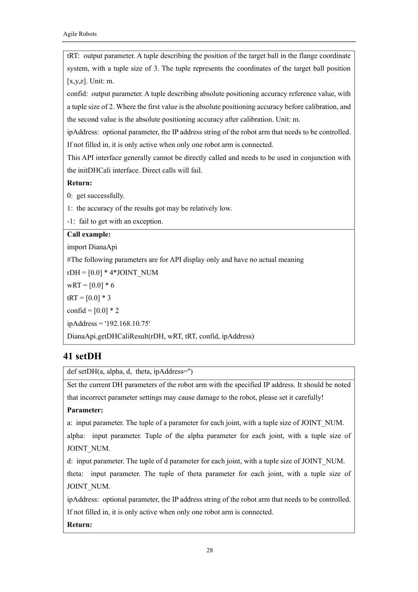



```
Agile Robots  
 28  
tRT:  output parameter. A tuple describing the position of the target ball in the flange coordinate 
system, with a tuple size of 3. The tuple represents the coordinates of the target ball position 
[x,y,z]. Unit: m.  
confid:  output parameter. A tuple describing absolute positioning accuracy reference value, with 
a tuple size of 2. Where the first value is the absolute positioning accuracy before calibration, and 
the second value is the absolute positioning accuracy after calibration. Unit: m.  
ipAddress:  optional parameter, the IP address string of the robot arm that needs to be controlled. 
If not filled in, it is only active when only one robot arm is connected.  
This API interface generally cannot be directly called and needs to be used in conjunction with 
the initDHCali interface. Direct calls will fail.  
Return:  
0:  get successfully.  
1:  the accuracy of the results got may be relatively low.  
-1:  fail to get with an exception.  
Call example:  
import DianaApi  
#The following parameters are for API display only and have no actual meaning  
rDH = [0.0] * 4*JOINT_NUM 
wRT = [0.0] * 6 
tRT = [0.0] * 3 
confid = [0.0] * 2 
ipAddress = '192.168.10.75' 
DianaApi.getDHCaliResult(rDH, wRT, tRT, confid, ipAddress) 
41 setDH 
def setDH(a, alpha, d,  theta, ipAddress='') 
Set the current DH parameters of the robot arm with the specified IP address. It should be noted 
that incorrect parameter settings may cause damage to the robot, please set it carefully!  
Parameter:  
a:  input parameter. The tuple of a parameter for each joint, with a tuple size of JOINT_NUM.  
alpha:  input parameter. Tuple of the alpha parameter for each joint, with a tuple size of 
JOINT_NUM.  
d:  input parameter. The tuple of d parameter for each joint, with a tuple size of JOINT_NUM.  
theta:  input parameter. The tuple of theta parameter for each joint, with a tuple size of 
JOINT_NUM.  
ipAddress:  optional parameter, the IP address string of the robot arm that needs to be controlled. 
If not filled in, it is only active when only one robot arm is connected.  
Return:
```



## PDF page 37

**Source:** Industrial API Manual (Python Edition) \_V3.3.0\_EN\_20260205.pdf, original pdf page 37. [Open the corresponding PDF reading-copy page](https://1292444914-files.gitbook.io/~/files/v0/b/gitbook-x-prod.appspot.com/o/spaces%2FtgOfPnscWebs1eh82EKq%2Fuploads%2FRuKqP58TGdcORhNDRsIQ%2Findustrial-api-manual-python-edition-v3-3-0-en-20260205-pp-001-139.pdf?alt=media#page=37).



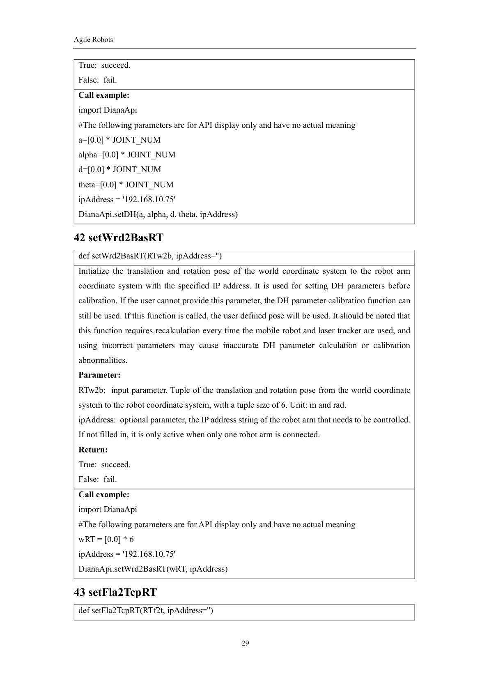



```
Agile Robots  
 29  
True:  succeed.  
 
False:  fail.  
Call example:  
import DianaApi  
#The following parameters are for API display only and have no actual meaning  
a=[0.0] * JOINT_NUM 
alpha=[0.0] * JOINT_NUM 
d=[0.0] * JOINT_NUM 
theta=[0.0] * JOINT_NUM 
ipAddress = '192.168.10.75' 
DianaApi.setDH(a, alpha, d, theta, ipAddress) 
42 setWrd2BasRT 
def setWrd2BasRT(RTw2b, ipAddress='') 
Initialize the translation and rotation pose of the world coordinate system to the robot arm 
coordinate system with the specified IP address. It is used for setting DH parameters before 
calibration. If the user cannot provide this parameter, the DH parameter calibration function can 
still be used. If this function is called, the user defined pose will be used. It should be noted that 
this function requires recalculation every time the mobile robot and laser tracker are used, and 
using incorrect parameters may cause inaccurate DH parameter calculation or calibration 
abnormalities.  
Parameter:  
RTw2b:  input parameter. Tuple of the translation and rotation pose from the world coordinate 
system to the robot coordinate system, with a tuple size of 6. Unit: m and rad.  
ipAddress:  optional parameter, the IP address string of the robot arm that needs to be controlled. 
If not filled in, it is only active when only one robot arm is connected.  
Return:  
True:  succeed.  
 
False:  fail.  
Call example:  
import DianaApi  
#The following parameters are for API display only and have no actual meaning  
wRT = [0.0] * 6  
ipAddress = '192.168.10.75'  
DianaApi.setWrd2BasRT(wRT, ipAddress)  
43 setFla2TcpRT 
def setFla2TcpRT(RTf2t, ipAddress='')
```



## PDF page 38

**Source:** Industrial API Manual (Python Edition) \_V3.3.0\_EN\_20260205.pdf, original pdf page 38. [Open the corresponding PDF reading-copy page](https://1292444914-files.gitbook.io/~/files/v0/b/gitbook-x-prod.appspot.com/o/spaces%2FtgOfPnscWebs1eh82EKq%2Fuploads%2FRuKqP58TGdcORhNDRsIQ%2Findustrial-api-manual-python-edition-v3-3-0-en-20260205-pp-001-139.pdf?alt=media#page=38).



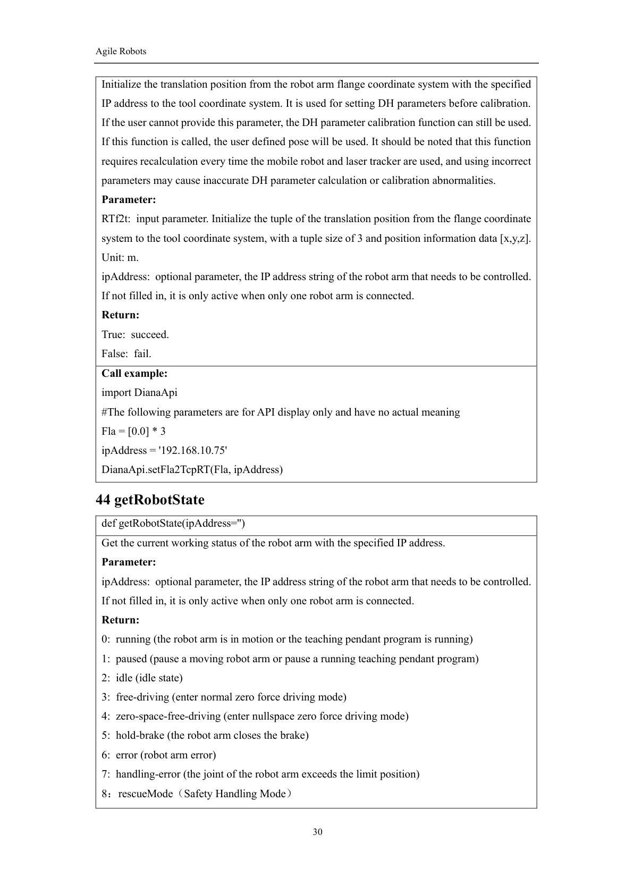



```
Agile Robots  
 30  
Initialize the translation position from the robot arm flange coordinate system with the specified 
IP address to the tool coordinate system. It is used for setting DH parameters before calibration. 
If the user cannot provide this parameter, the DH parameter calibration function can still be used. 
If this function is called, the user defined pose will be used. It should be noted that this function 
requires recalculation every time the mobile robot and laser tracker are used, and using incorrect 
parameters may cause inaccurate DH parameter calculation or calibration abnormalities.  
Parameter:  
RTf2t:  input parameter. Initialize the tuple of the translation position from the flange coordinate 
system to the tool coordinate system, with a tuple size of 3 and position information data [x,y,z]. 
Unit: m.  
ipAddress:  optional parameter, the IP address string of the robot arm that needs to be controlled. 
If not filled in, it is only active when only one robot arm is connected.  
Return:  
True:  succeed.  
 
False:  fail.  
Call example:  
import DianaApi  
#The following parameters are for API display only and have no actual meaning  
Fla = [0.0] * 3 
ipAddress = '192.168.10.75' 
DianaApi.setFla2TcpRT(Fla, ipAddress)  
44 getRobotState 
def getRobotState(ipAddress='') 
Get the current working status of the robot arm with the specified IP address.  
Parameter:  
ipAddress:  optional parameter, the IP address string of the robot arm that needs to be controlled. 
If not filled in, it is only active when only one robot arm is connected.  
Return:  
0:  running (the robot arm is in motion or the teaching pendant program is running)  
1:  paused (pause a moving robot arm or pause a running teaching pendant program)  
2:  idle (idle state)  
3:  free-driving (enter normal zero force driving mode)  
4:  zero-space-free-driving (enter nullspace zero force driving mode)  
5:  hold-brake (the robot arm closes the brake)  
6:  error (robot arm error)  
7:  handling-error (the joint of the robot arm exceeds the limit position)  
8：rescueMode（Safety Handling Mode）
```



## PDF page 39

**Source:** Industrial API Manual (Python Edition) \_V3.3.0\_EN\_20260205.pdf, original pdf page 39. [Open the corresponding PDF reading-copy page](https://1292444914-files.gitbook.io/~/files/v0/b/gitbook-x-prod.appspot.com/o/spaces%2FtgOfPnscWebs1eh82EKq%2Fuploads%2FRuKqP58TGdcORhNDRsIQ%2Findustrial-api-manual-python-edition-v3-3-0-en-20260205-pp-001-139.pdf?alt=media#page=39).



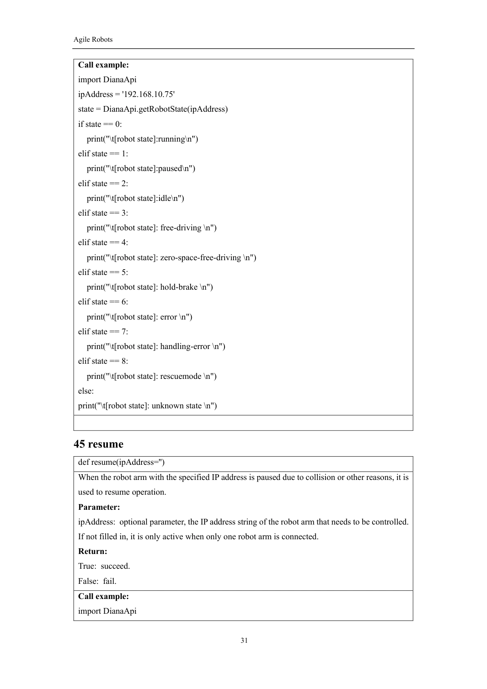



```
Agile Robots  
 31  
Call example:  
import DianaApi 
ipAddress = '192.168.10.75' 
state = DianaApi.getRobotState(ipAddress) 
if state == 0: 
    print("\t[robot state]:running\n") 
elif state == 1: 
print("\t[robot state]:paused\n") 
elif state == 2: 
print("\t[robot state]:idle\n") 
elif state == 3: 
print("\t[robot state]: free-driving \n") 
elif state == 4: 
print("\t[robot state]: zero-space-free-driving \n") 
elif state == 5: 
print("\t[robot state]: hold-brake \n") 
elif state == 6: 
print("\t[robot state]: error \n") 
elif state == 7: 
print("\t[robot state]: handling-error \n") 
elif state == 8: 
    print("\t[robot state]: rescuemode \n") 
else: 
print("\t[robot state]: unknown state \n") 
 
45 resume 
def resume(ipAddress='') 
When the robot arm with the specified IP address is paused due to collision or other reasons, it is 
used to resume operation.  
Parameter:  
ipAddress:  optional parameter, the IP address string of the robot arm that needs to be controlled. 
If not filled in, it is only active when only one robot arm is connected.  
Return:  
True:  succeed.  
False:  fail.  
Call example:  
import DianaApi
```



## PDF page 40

**Source:** Industrial API Manual (Python Edition) \_V3.3.0\_EN\_20260205.pdf, original pdf page 40. [Open the corresponding PDF reading-copy page](https://1292444914-files.gitbook.io/~/files/v0/b/gitbook-x-prod.appspot.com/o/spaces%2FtgOfPnscWebs1eh82EKq%2Fuploads%2FRuKqP58TGdcORhNDRsIQ%2Findustrial-api-manual-python-edition-v3-3-0-en-20260205-pp-001-139.pdf?alt=media#page=40).



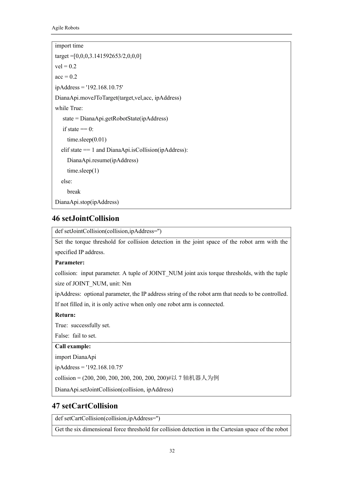



```
Agile Robots  
 32  
import time 
target =[0,0,0,3.141592653/2,0,0,0] 
vel = 0.2 
acc = 0.2 
ipAddress = '192.168.10.75' 
DianaApi.moveJToTarget(target,vel,acc, ipAddress) 
while True: 
     state = DianaApi.getRobotState(ipAddress) 
     if state == 0: 
        time.sleep(0.01) 
    elif state == 1 and DianaApi.isCollision(ipAddress): 
        DianaApi.resume(ipAddress) 
        time.sleep(1) 
    else: 
        break 
DianaApi.stop(ipAddress) 
46 setJointCollision 
def setJointCollision(collision,ipAddress='') 
Set the torque threshold for collision detection in the joint space of the robot arm with the 
specified IP address.  
Parameter:  
collision:  input parameter. A tuple of JOINT_NUM joint axis torque thresholds, with the tuple 
size of JOINT_NUM, unit: Nm  
ipAddress:  optional parameter, the IP address string of the robot arm that needs to be controlled. 
If not filled in, it is only active when only one robot arm is connected.  
Return:  
True:  successfully set.  
False:  fail to set.  
Call example:  
import DianaApi 
ipAddress = '192.168.10.75' 
collision = (200, 200, 200, 200, 200, 200, 200)#以7 轴机器人为例 
DianaApi.setJointCollision(collision, ipAddress) 
47 setCartCollision 
def setCartCollision(collision,ipAddress='') 
Get the six dimensional force threshold for collision detection in the Cartesian space of the robot
```



## PDF page 41

**Source:** Industrial API Manual (Python Edition) \_V3.3.0\_EN\_20260205.pdf, original pdf page 41. [Open the corresponding PDF reading-copy page](https://1292444914-files.gitbook.io/~/files/v0/b/gitbook-x-prod.appspot.com/o/spaces%2FtgOfPnscWebs1eh82EKq%2Fuploads%2FRuKqP58TGdcORhNDRsIQ%2Findustrial-api-manual-python-edition-v3-3-0-en-20260205-pp-001-139.pdf?alt=media#page=41).



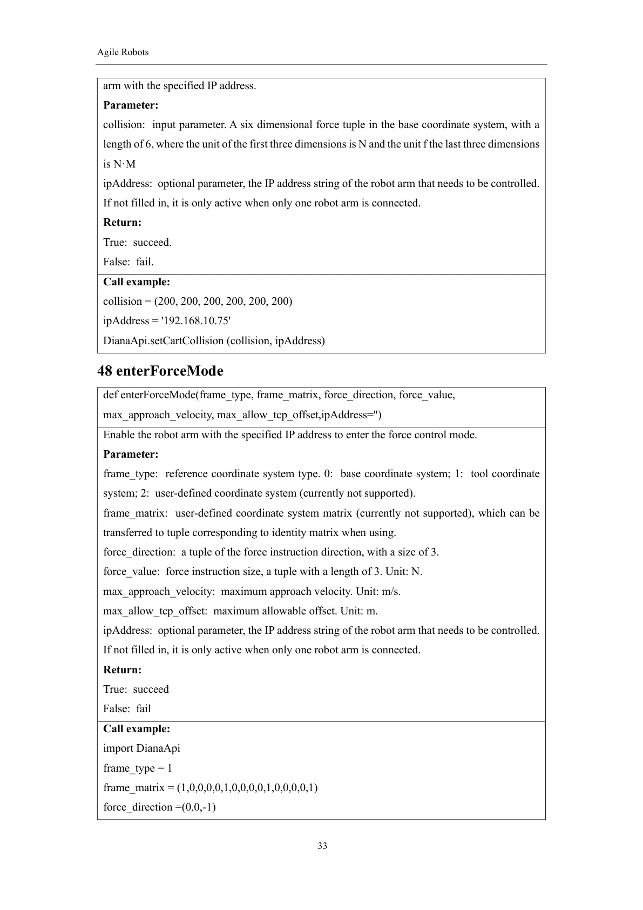



```
Agile Robots  
 33  
arm with the specified IP address.  
Parameter:  
collision:  input parameter. A six dimensional force tuple in the base coordinate system, with a 
length of 6, where the unit of the first three dimensions is N and the unit f the last three dimensions 
is N·M  
ipAddress:  optional parameter, the IP address string of the robot arm that needs to be controlled. 
If not filled in, it is only active when only one robot arm is connected.  
Return:  
True:  succeed.  
False:  fail.  
Call example:  
collision = (200, 200, 200, 200, 200, 200) 
ipAddress = '192.168.10.75' 
DianaApi.setCartCollision (collision, ipAddress) 
48 enterForceMode 
def enterForceMode(frame_type, frame_matrix, force_direction, force_value,  
max_approach_velocity, max_allow_tcp_offset,ipAddress='') 
Enable the robot arm with the specified IP address to enter the force control mode.  
Parameter:  
frame_type:  reference coordinate system type. 0:  base coordinate system; 1:  tool coordinate 
system; 2:  user-defined coordinate system (currently not supported).  
frame_matrix:  user-defined coordinate system matrix (currently not supported), which can be 
transferred to tuple corresponding to identity matrix when using.  
force_direction:  a tuple of the force instruction direction, with a size of 3.  
force_value:  force instruction size, a tuple with a length of 3. Unit: N.  
max_approach_velocity:  maximum approach velocity. Unit: m/s.  
max_allow_tcp_offset:  maximum allowable offset. Unit: m.  
ipAddress:  optional parameter, the IP address string of the robot arm that needs to be controlled. 
If not filled in, it is only active when only one robot arm is connected.  
Return:  
True:  succeed  
False:  fail  
Call example:  
import DianaApi 
frame_type = 1 
frame_matrix = (1,0,0,0,0,1,0,0,0,0,1,0,0,0,0,1) 
force_direction =(0,0,-1)
```



## PDF page 42

**Source:** Industrial API Manual (Python Edition) \_V3.3.0\_EN\_20260205.pdf, original pdf page 42. [Open the corresponding PDF reading-copy page](https://1292444914-files.gitbook.io/~/files/v0/b/gitbook-x-prod.appspot.com/o/spaces%2FtgOfPnscWebs1eh82EKq%2Fuploads%2FRuKqP58TGdcORhNDRsIQ%2Findustrial-api-manual-python-edition-v3-3-0-en-20260205-pp-001-139.pdf?alt=media#page=42).



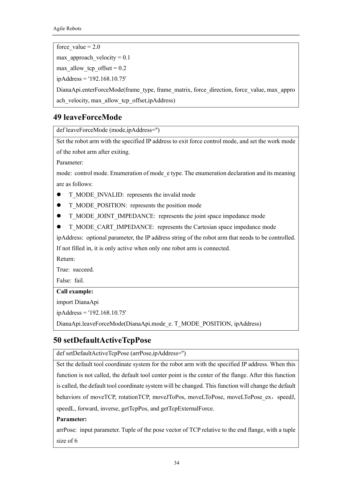



```
Agile Robots  
 34  
force_value = 2.0 
max_approach_velocity = 0.1 
max_allow_tcp_offset = 0.2 
ipAddress = '192.168.10.75' 
DianaApi.enterForceMode(frame_type, frame_matrix, force_direction, force_value, max_appro
ach_velocity, max_allow_tcp_offset,ipAddress) 
49 leaveForceMode 
def leaveForceMode (mode,ipAddress='') 
Set the robot arm with the specified IP address to exit force control mode, and set the work mode 
of the robot arm after exiting.  
Parameter:  
mode:  control mode. Enumeration of mode_e type. The enumeration declaration and its meaning 
are as follows:  
⚫ 
T_MODE_INVALID:  represents the invalid mode  
⚫ 
T_MODE_POSITION:  represents the position mode  
⚫ 
T_MODE_JOINT_IMPEDANCE:  represents the joint space impedance mode  
⚫ 
T_MODE_CART_IMPEDANCE:  represents the Cartesian space impedance mode  
ipAddress:  optional parameter, the IP address string of the robot arm that needs to be controlled. 
If not filled in, it is only active when only one robot arm is connected.  
Return:  
True:  succeed.  
False:  fail.  
Call example:  
import DianaApi 
ipAddress = '192.168.10.75' 
DianaApi.leaveForceMode(DianaApi.mode_e. T_MODE_POSITION, ipAddress) 
50 setDefaultActiveTcpPose 
def setDefaultActiveTcpPose (arrPose,ipAddress='') 
Set the default tool coordinate system for the robot arm with the specified IP address. When this 
function is not called, the default tool center point is the center of the flange. After this function 
is called, the default tool coordinate system will be changed. This function will change the default 
behaviors of moveTCP, rotationTCP, moveJToPos, moveLToPose, moveLToPose_ex，speedJ, 
speedL, forward, inverse, getTcpPos, and getTcpExternalForce.  
Parameter:  
arrPose:  input parameter. Tuple of the pose vector of TCP relative to the end flange, with a tuple 
size of 6
```



## PDF page 43

**Source:** Industrial API Manual (Python Edition) \_V3.3.0\_EN\_20260205.pdf, original pdf page 43. [Open the corresponding PDF reading-copy page](https://1292444914-files.gitbook.io/~/files/v0/b/gitbook-x-prod.appspot.com/o/spaces%2FtgOfPnscWebs1eh82EKq%2Fuploads%2FRuKqP58TGdcORhNDRsIQ%2Findustrial-api-manual-python-edition-v3-3-0-en-20260205-pp-001-139.pdf?alt=media#page=43).



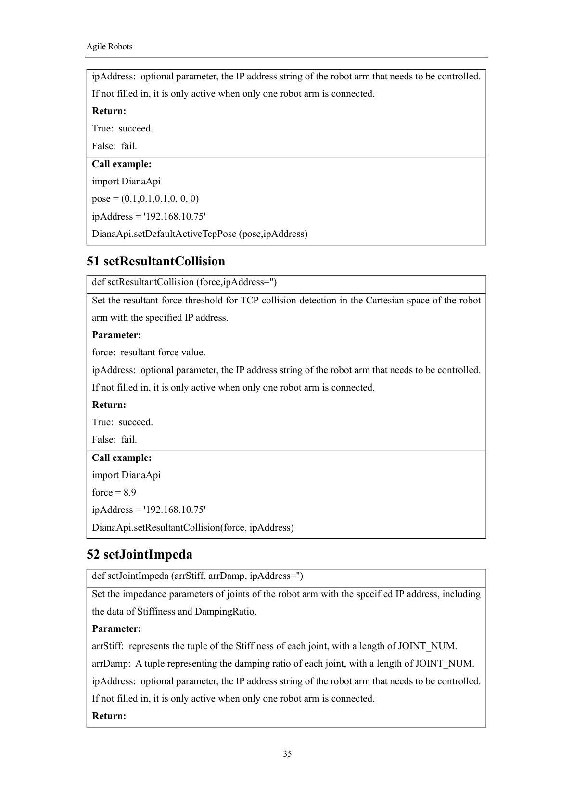



```
Agile Robots  
 35  
ipAddress:  optional parameter, the IP address string of the robot arm that needs to be controlled. 
If not filled in, it is only active when only one robot arm is connected.  
Return:  
True:  succeed.  
False:  fail.  
Call example:  
import DianaApi 
pose = (0.1,0.1,0.1,0, 0, 0) 
ipAddress = '192.168.10.75' 
DianaApi.setDefaultActiveTcpPose (pose,ipAddress) 
51 setResultantCollision 
def setResultantCollision (force,ipAddress='') 
Set the resultant force threshold for TCP collision detection in the Cartesian space of the robot 
arm with the specified IP address.  
Parameter:  
force:  resultant force value.  
ipAddress:  optional parameter, the IP address string of the robot arm that needs to be controlled. 
If not filled in, it is only active when only one robot arm is connected.  
Return:  
True:  succeed.  
False:  fail.  
Call example:  
import DianaApi 
force = 8.9 
ipAddress = '192.168.10.75' 
DianaApi.setResultantCollision(force, ipAddress) 
52 setJointImpeda 
def setJointImpeda (arrStiff, arrDamp, ipAddress='') 
Set the impedance parameters of joints of the robot arm with the specified IP address, including 
the data of Stiffiness and DampingRatio.  
Parameter:  
arrStiff:  represents the tuple of the Stiffiness of each joint, with a length of JOINT_NUM.  
arrDamp:  A tuple representing the damping ratio of each joint, with a length of JOINT_NUM. 
ipAddress:  optional parameter, the IP address string of the robot arm that needs to be controlled. 
If not filled in, it is only active when only one robot arm is connected.  
Return:
```



## PDF page 44

**Source:** Industrial API Manual (Python Edition) \_V3.3.0\_EN\_20260205.pdf, original pdf page 44. [Open the corresponding PDF reading-copy page](https://1292444914-files.gitbook.io/~/files/v0/b/gitbook-x-prod.appspot.com/o/spaces%2FtgOfPnscWebs1eh82EKq%2Fuploads%2FRuKqP58TGdcORhNDRsIQ%2Findustrial-api-manual-python-edition-v3-3-0-en-20260205-pp-001-139.pdf?alt=media#page=44).



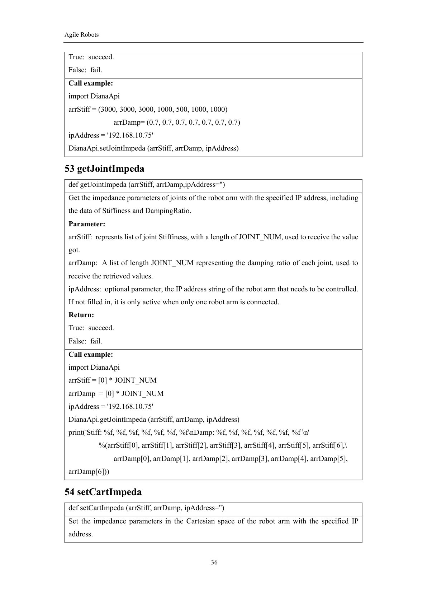



```
Agile Robots  
 36  
True:  succeed.  
False:  fail.  
Call example:  
import DianaApi  
arrStiff = (3000, 3000, 3000, 1000, 500, 1000, 1000)  
arrDamp= (0.7, 0.7, 0.7, 0.7, 0.7, 0.7, 0.7) 
ipAddress = '192.168.10.75'  
DianaApi.setJointImpeda (arrStiff, arrDamp, ipAddress)  
53 getJointImpeda  
def getJointImpeda (arrStiff, arrDamp,ipAddress='')  
Get the impedance parameters of joints of the robot arm with the specified IP address, including 
the data of Stiffiness and DampingRatio.  
Parameter:  
arrStiff:  represnts list of joint Stiffiness, with a length of JOINT_NUM, used to receive the value 
got.  
arrDamp:  A list of length JOINT_NUM representing the damping ratio of each joint, used to 
receive the retrieved values.  
ipAddress:  optional parameter, the IP address string of the robot arm that needs to be controlled. 
If not filled in, it is only active when only one robot arm is connected.  
Return:  
True:  succeed.  
False:  fail.  
Call example:  
import DianaApi 
arrStiff = [0] * JOINT_NUM 
arrDamp  = [0] * JOINT_NUM 
ipAddress = '192.168.10.75' 
DianaApi.getJointImpeda (arrStiff, arrDamp, ipAddress) 
print('Stiff: %f, %f, %f, %f, %f, %f, %f\nDamp: %f, %f, %f, %f, %f, %f, %f \n' 
                %(arrStiff[0], arrStiff[1], arrStiff[2], arrStiff[3], arrStiff[4], arrStiff[5], arrStiff[6],\ 
                        arrDamp[0], arrDamp[1], arrDamp[2], arrDamp[3], arrDamp[4], arrDamp[5],  
arrDamp[6])) 
54 setCartImpeda 
def setCartImpeda (arrStiff, arrDamp, ipAddress='') 
Set the impedance parameters in the Cartesian space of the robot arm with the specified IP 
address.
```



## PDF page 45

**Source:** Industrial API Manual (Python Edition) \_V3.3.0\_EN\_20260205.pdf, original pdf page 45. [Open the corresponding PDF reading-copy page](https://1292444914-files.gitbook.io/~/files/v0/b/gitbook-x-prod.appspot.com/o/spaces%2FtgOfPnscWebs1eh82EKq%2Fuploads%2FRuKqP58TGdcORhNDRsIQ%2Findustrial-api-manual-python-edition-v3-3-0-en-20260205-pp-001-139.pdf?alt=media#page=45).



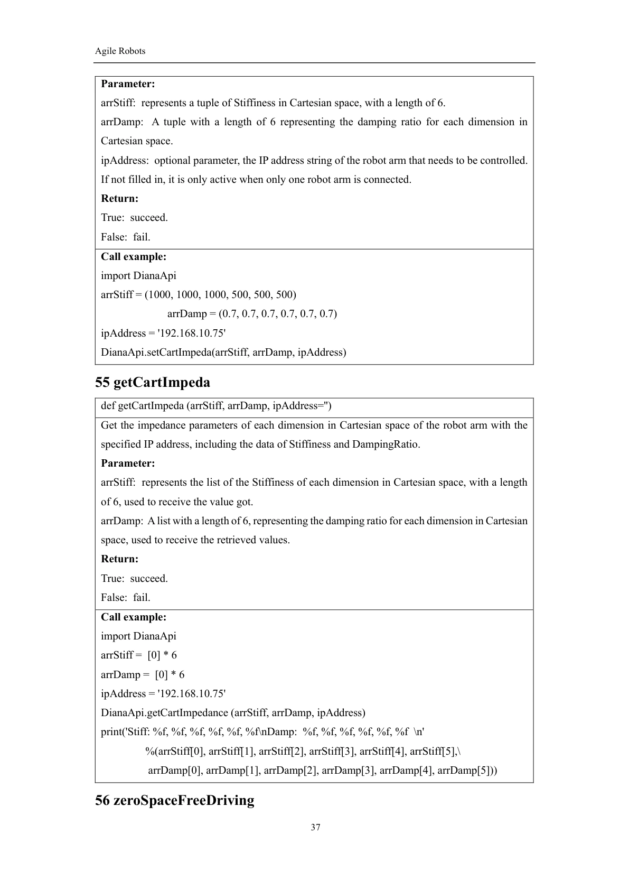



```
Agile Robots  
 37  
Parameter:  
arrStiff:  represents a tuple of Stiffiness in Cartesian space, with a length of 6.  
arrDamp:  A tuple with a length of 6 representing the damping ratio for each dimension in 
Cartesian space. 
ipAddress:  optional parameter, the IP address string of the robot arm that needs to be controlled. 
If not filled in, it is only active when only one robot arm is connected.  
Return:  
True:  succeed.  
False:  fail.  
Call example:  
import DianaApi 
arrStiff = (1000, 1000, 1000, 500, 500, 500) 
arrDamp = (0.7, 0.7, 0.7, 0.7, 0.7, 0.7) 
ipAddress = '192.168.10.75' 
DianaApi.setCartImpeda(arrStiff, arrDamp, ipAddress) 
55 getCartImpeda 
def getCartImpeda (arrStiff, arrDamp, ipAddress='') 
Get the impedance parameters of each dimension in Cartesian space of the robot arm with the 
specified IP address, including the data of Stiffiness and DampingRatio.  
Parameter:  
arrStiff:  represents the list of the Stiffiness of each dimension in Cartesian space, with a length 
of 6, used to receive the value got.  
arrDamp:  A list with a length of 6, representing the damping ratio for each dimension in Cartesian 
space, used to receive the retrieved values.  
Return:  
True:  succeed.  
False:  fail.  
Call example:  
import DianaApi 
arrStiff =  [0] * 6 
arrDamp =  [0] * 6 
ipAddress = '192.168.10.75' 
DianaApi.getCartImpedance (arrStiff, arrDamp, ipAddress) 
print('Stiff: %f, %f, %f, %f, %f, %f\nDamp:  %f, %f, %f, %f, %f, %f  \n' 
                %(arrStiff[0], arrStiff[1], arrStiff[2], arrStiff[3], arrStiff[4], arrStiff[5],\ 
                 arrDamp[0], arrDamp[1], arrDamp[2], arrDamp[3], arrDamp[4], arrDamp[5])) 
56 zeroSpaceFreeDriving
```



## PDF page 46

**Source:** Industrial API Manual (Python Edition) \_V3.3.0\_EN\_20260205.pdf, original pdf page 46. [Open the corresponding PDF reading-copy page](https://1292444914-files.gitbook.io/~/files/v0/b/gitbook-x-prod.appspot.com/o/spaces%2FtgOfPnscWebs1eh82EKq%2Fuploads%2FRuKqP58TGdcORhNDRsIQ%2Findustrial-api-manual-python-edition-v3-3-0-en-20260205-pp-001-139.pdf?alt=media#page=46).



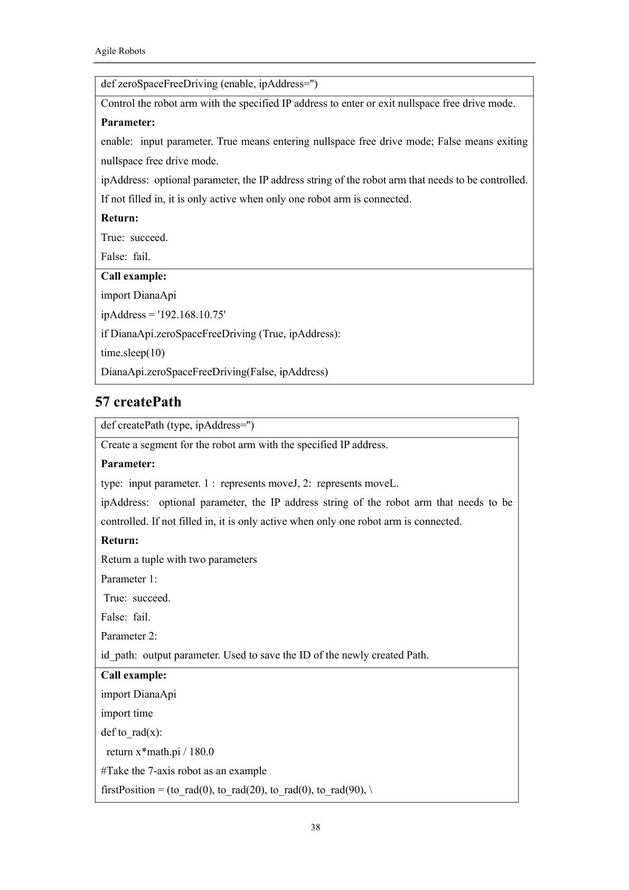



```
Agile Robots  
 38  
def zeroSpaceFreeDriving (enable, ipAddress='') 
Control the robot arm with the specified IP address to enter or exit nullspace free drive mode.  
Parameter:  
enable:  input parameter. True means entering nullspace free drive mode; False means exiting 
nullspace free drive mode.  
ipAddress:  optional parameter, the IP address string of the robot arm that needs to be controlled. 
If not filled in, it is only active when only one robot arm is connected.  
Return:  
True:  succeed.  
False:  fail.  
Call example:  
import DianaApi 
ipAddress = '192.168.10.75' 
if DianaApi.zeroSpaceFreeDriving (True, ipAddress): 
time.sleep(10) 
DianaApi.zeroSpaceFreeDriving(False, ipAddress) 
57 createPath 
def createPath (type, ipAddress='') 
Create a segment for the robot arm with the specified IP address.  
Parameter:  
type:  input parameter. 1 :  represents moveJ, 2:  represents moveL.  
ipAddress:  optional parameter, the IP address string of the robot arm that needs to be 
controlled. If not filled in, it is only active when only one robot arm is connected.  
Return:  
Return a tuple with two parameters  
Parameter 1:  
 True:  succeed.  
False:  fail.  
Parameter 2:  
id_path:  output parameter. Used to save the ID of the newly created Path.  
Call example:  
import DianaApi  
import time  
def to_rad(x):  
  return x*math.pi / 180.0  
#Take the 7-axis robot as an example  
firstPosition = (to_rad(0), to_rad(20), to_rad(0), to_rad(90), \
```



## PDF page 47

**Source:** Industrial API Manual (Python Edition) \_V3.3.0\_EN\_20260205.pdf, original pdf page 47. [Open the corresponding PDF reading-copy page](https://1292444914-files.gitbook.io/~/files/v0/b/gitbook-x-prod.appspot.com/o/spaces%2FtgOfPnscWebs1eh82EKq%2Fuploads%2FRuKqP58TGdcORhNDRsIQ%2Findustrial-api-manual-python-edition-v3-3-0-en-20260205-pp-001-139.pdf?alt=media#page=47).



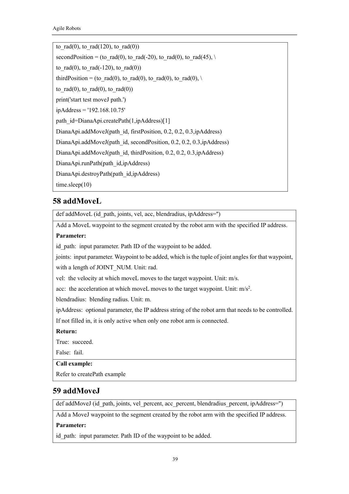



```
Agile Robots  
 39  
to_rad(0), to_rad(120), to_rad(0)) 
secondPosition = (to_rad(0), to_rad(-20), to_rad(0), to_rad(45), \ 
to_rad(0), to_rad(-120), to_rad(0)) 
thirdPosition = (to_rad(0), to_rad(0), to_rad(0), to_rad(0), \ 
to_rad(0), to_rad(0), to_rad(0)) 
print('start test moveJ path.') 
ipAddress = '192.168.10.75' 
path_id=DianaApi.createPath(1,ipAddress)[1] 
DianaApi.addMoveJ(path_id, firstPosition, 0.2, 0.2, 0.3,ipAddress) 
DianaApi.addMoveJ(path_id, secondPosition, 0.2, 0.2, 0.3,ipAddress) 
DianaApi.addMoveJ(path_id, thirdPosition, 0.2, 0.2, 0.3,ipAddress) 
DianaApi.runPath(path_id,ipAddress) 
DianaApi.destroyPath(path_id,ipAddress) 
time.sleep(10) 
58 addMoveL 
def addMoveL (id_path, joints, vel, acc, blendradius, ipAddress='') 
Add a MoveL waypoint to the segment created by the robot arm with the specified IP address.  
Parameter:  
id_path:  input parameter. Path ID of the waypoint to be added.  
joints:  input parameter. Waypoint to be added, which is the tuple of joint angles for that waypoint, 
with a length of JOINT_NUM. Unit: rad.  
vel:  the velocity at which moveL moves to the target waypoint. Unit: m/s.  
acc:  the acceleration at which moveL moves to the target waypoint. Unit: m/s2.  
blendradius:  blending radius. Unit: m.  
ipAddress:  optional parameter, the IP address string of the robot arm that needs to be controlled. 
If not filled in, it is only active when only one robot arm is connected.  
Return:  
True:  succeed.  
False:  fail.  
Call example:  
Refer to createPath example  
59 addMoveJ 
def addMoveJ (id_path, joints, vel_percent, acc_percent, blendradius_percent, ipAddress='') 
Add a MoveJ waypoint to the segment created by the robot arm with the specified IP address.  
Parameter:  
id_path:  input parameter. Path ID of the waypoint to be added.
```



## PDF page 48

**Source:** Industrial API Manual (Python Edition) \_V3.3.0\_EN\_20260205.pdf, original pdf page 48. [Open the corresponding PDF reading-copy page](https://1292444914-files.gitbook.io/~/files/v0/b/gitbook-x-prod.appspot.com/o/spaces%2FtgOfPnscWebs1eh82EKq%2Fuploads%2FRuKqP58TGdcORhNDRsIQ%2Findustrial-api-manual-python-edition-v3-3-0-en-20260205-pp-001-139.pdf?alt=media#page=48).



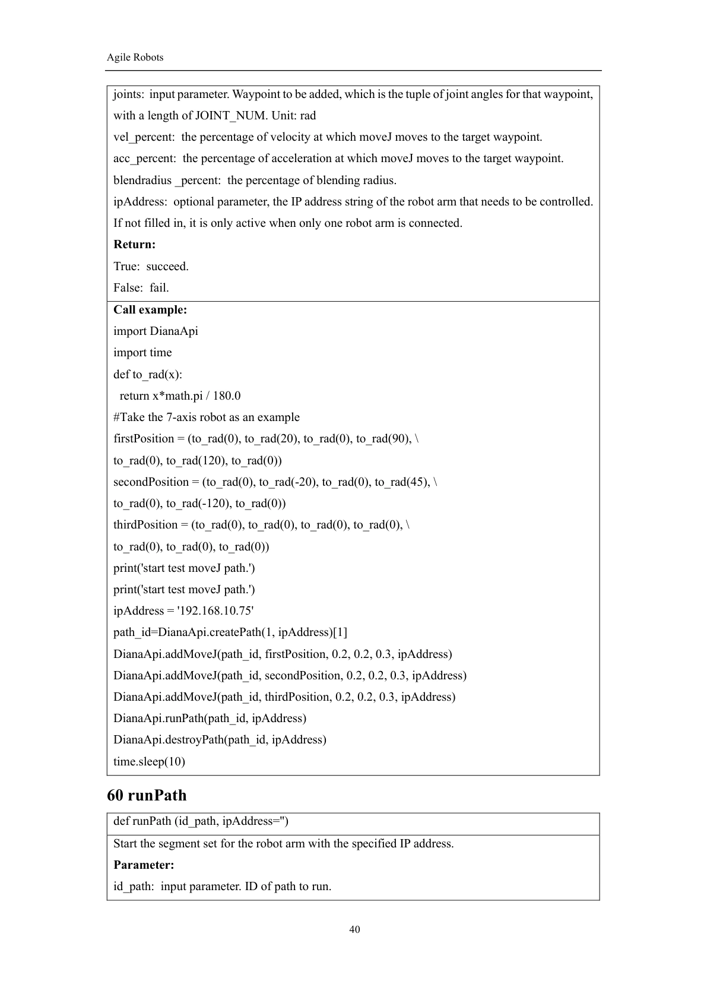



```
Agile Robots  
 40  
joints:  input parameter. Waypoint to be added, which is the tuple of joint angles for that waypoint, 
with a length of JOINT_NUM. Unit: rad  
vel_percent:  the percentage of velocity at which moveJ moves to the target waypoint.  
acc_percent:  the percentage of acceleration at which moveJ moves to the target waypoint.  
blendradius _percent:  the percentage of blending radius.  
ipAddress:  optional parameter, the IP address string of the robot arm that needs to be controlled. 
If not filled in, it is only active when only one robot arm is connected.  
Return:  
True:  succeed.  
False:  fail.  
Call example:  
import DianaApi 
import time 
def to_rad(x): 
  return x*math.pi / 180.0 
#Take the 7-axis robot as an example  
firstPosition = (to_rad(0), to_rad(20), to_rad(0), to_rad(90), \ 
to_rad(0), to_rad(120), to_rad(0)) 
secondPosition = (to_rad(0), to_rad(-20), to_rad(0), to_rad(45), \ 
to_rad(0), to_rad(-120), to_rad(0)) 
thirdPosition = (to_rad(0), to_rad(0), to_rad(0), to_rad(0), \ 
to_rad(0), to_rad(0), to_rad(0)) 
print('start test moveJ path.') 
print('start test moveJ path.') 
ipAddress = '192.168.10.75' 
path_id=DianaApi.createPath(1, ipAddress)[1] 
DianaApi.addMoveJ(path_id, firstPosition, 0.2, 0.2, 0.3, ipAddress) 
DianaApi.addMoveJ(path_id, secondPosition, 0.2, 0.2, 0.3, ipAddress) 
DianaApi.addMoveJ(path_id, thirdPosition, 0.2, 0.2, 0.3, ipAddress) 
DianaApi.runPath(path_id, ipAddress) 
DianaApi.destroyPath(path_id, ipAddress) 
time.sleep(10) 
60 runPath 
def runPath (id_path, ipAddress='') 
Start the segment set for the robot arm with the specified IP address.  
Parameter:  
id_path:  input parameter. ID of path to run.
```



## PDF page 49

**Source:** Industrial API Manual (Python Edition) \_V3.3.0\_EN\_20260205.pdf, original pdf page 49. [Open the corresponding PDF reading-copy page](https://1292444914-files.gitbook.io/~/files/v0/b/gitbook-x-prod.appspot.com/o/spaces%2FtgOfPnscWebs1eh82EKq%2Fuploads%2FRuKqP58TGdcORhNDRsIQ%2Findustrial-api-manual-python-edition-v3-3-0-en-20260205-pp-001-139.pdf?alt=media#page=49).



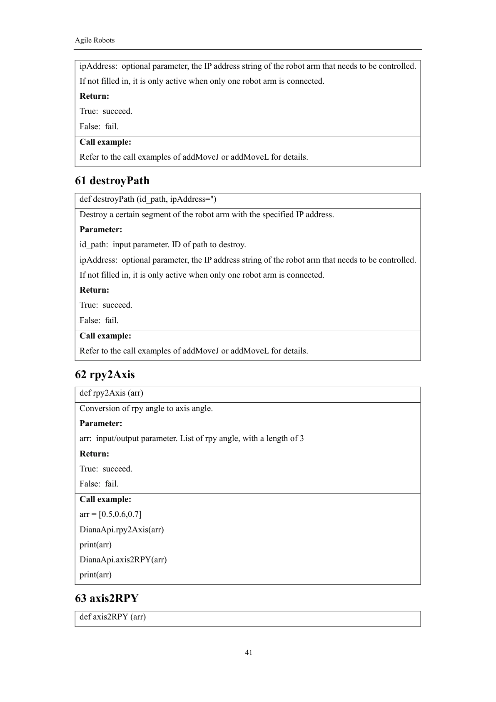



```
Agile Robots  
 41  
ipAddress:  optional parameter, the IP address string of the robot arm that needs to be controlled. 
If not filled in, it is only active when only one robot arm is connected.  
Return:  
True:  succeed.  
False:  fail.  
Call example:  
Refer to the call examples of addMoveJ or addMoveL for details.  
61 destroyPath 
def destroyPath (id_path, ipAddress='') 
Destroy a certain segment of the robot arm with the specified IP address.  
Parameter:  
id_path:  input parameter. ID of path to destroy.  
ipAddress:  optional parameter, the IP address string of the robot arm that needs to be controlled. 
If not filled in, it is only active when only one robot arm is connected.  
Return:  
True:  succeed.  
False:  fail.  
Call example:  
Refer to the call examples of addMoveJ or addMoveL for details.  
62 rpy2Axis  
def rpy2Axis (arr)  
Conversion of rpy angle to axis angle.  
Parameter:  
arr:  input/output parameter. List of rpy angle, with a length of 3  
Return:  
True:  succeed.  
False:  fail.  
Call example:  
arr = [0.5,0.6,0.7] 
DianaApi.rpy2Axis(arr) 
print(arr) 
DianaApi.axis2RPY(arr) 
print(arr) 
63 axis2RPY 
def axis2RPY (arr)
```



## PDF page 50

**Source:** Industrial API Manual (Python Edition) \_V3.3.0\_EN\_20260205.pdf, original pdf page 50. [Open the corresponding PDF reading-copy page](https://1292444914-files.gitbook.io/~/files/v0/b/gitbook-x-prod.appspot.com/o/spaces%2FtgOfPnscWebs1eh82EKq%2Fuploads%2FRuKqP58TGdcORhNDRsIQ%2Findustrial-api-manual-python-edition-v3-3-0-en-20260205-pp-001-139.pdf?alt=media#page=50).



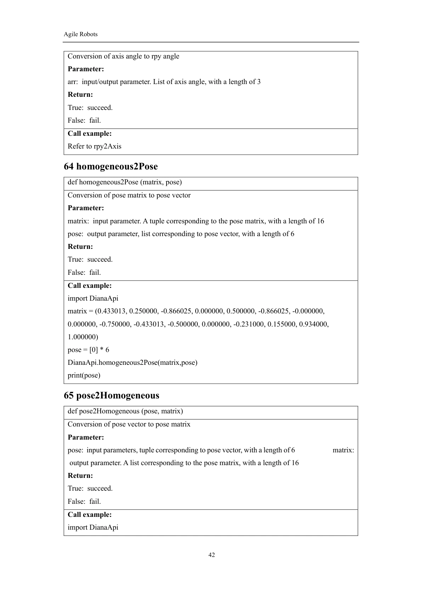



```
Agile Robots  
 42  
Conversion of axis angle to rpy angle  
Parameter:  
arr:  input/output parameter. List of axis angle, with a length of 3  
Return:  
True:  succeed.  
False:  fail.  
Call example:  
Refer to rpy2Axis  
64 homogeneous2Pose 
def homogeneous2Pose (matrix, pose) 
Conversion of pose matrix to pose vector  
Parameter:  
matrix:  input parameter. A tuple corresponding to the pose matrix, with a length of 16  
pose:  output parameter, list corresponding to pose vector, with a length of 6  
Return:  
True:  succeed.  
False:  fail.  
Call example:  
import DianaApi 
matrix = (0.433013, 0.250000, -0.866025, 0.000000, 0.500000, -0.866025, -0.000000, 
0.000000, -0.750000, -0.433013, -0.500000, 0.000000, -0.231000, 0.155000, 0.934000, 
1.000000) 
pose = [0] * 6 
DianaApi.homogeneous2Pose(matrix,pose) 
print(pose) 
65 pose2Homogeneous 
def pose2Homogeneous (pose, matrix) 
Conversion of pose vector to pose matrix  
Parameter:  
pose:  input parameters, tuple corresponding to pose vector, with a length of 6                         matrix:  
 output parameter. A list corresponding to the pose matrix, with a length of 16  
Return:  
True:  succeed.  
False:  fail.  
Call example:  
import DianaApi
```



## PDF page 51

**Source:** Industrial API Manual (Python Edition) \_V3.3.0\_EN\_20260205.pdf, original pdf page 51. [Open the corresponding PDF reading-copy page](https://1292444914-files.gitbook.io/~/files/v0/b/gitbook-x-prod.appspot.com/o/spaces%2FtgOfPnscWebs1eh82EKq%2Fuploads%2FRuKqP58TGdcORhNDRsIQ%2Findustrial-api-manual-python-edition-v3-3-0-en-20260205-pp-001-139.pdf?alt=media#page=51).



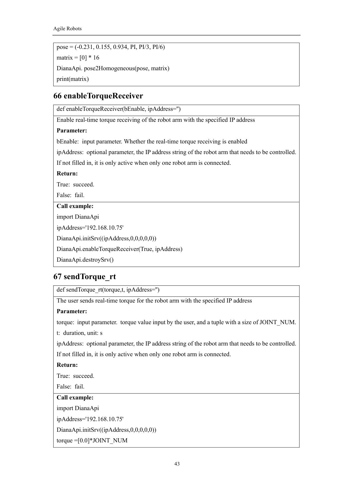



```
Agile Robots  
 43  
pose = (-0.231, 0.155, 0.934, PI, PI/3, PI/6) 
matrix = [0] * 16 
DianaApi. pose2Homogeneous(pose, matrix) 
print(matrix) 
66 enableTorqueReceiver 
def enableTorqueReceiver(bEnable, ipAddress='') 
Enable real-time torque receiving of the robot arm with the specified IP address  
Parameter:  
bEnable:  input parameter. Whether the real-time torque receiving is enabled  
ipAddress:  optional parameter, the IP address string of the robot arm that needs to be controlled. 
If not filled in, it is only active when only one robot arm is connected.  
Return:  
True:  succeed.  
 
False:  fail.  
Call example:  
import DianaApi 
ipAddress='192.168.10.75' 
DianaApi.initSrv((ipAddress,0,0,0,0,0)) 
DianaApi.enableTorqueReceiver(True, ipAddress) 
DianaApi.destroySrv() 
67 sendTorque_rt 
def sendTorque_rt(torque,t, ipAddress='') 
The user sends real-time torque for the robot arm with the specified IP address  
Parameter:  
torque:  input parameter.  torque value input by the user, and a tuple with a size of JOINT_NUM.  
t:  duration, unit: s  
ipAddress:  optional parameter, the IP address string of the robot arm that needs to be controlled. 
If not filled in, it is only active when only one robot arm is connected.  
Return:  
True:  succeed.  
 
False:  fail.  
Call example:  
import DianaApi 
ipAddress='192.168.10.75' 
DianaApi.initSrv((ipAddress,0,0,0,0,0)) 
torque =[0.0]*JOINT_NUM
```



## PDF page 52

**Source:** Industrial API Manual (Python Edition) \_V3.3.0\_EN\_20260205.pdf, original pdf page 52. [Open the corresponding PDF reading-copy page](https://1292444914-files.gitbook.io/~/files/v0/b/gitbook-x-prod.appspot.com/o/spaces%2FtgOfPnscWebs1eh82EKq%2Fuploads%2FRuKqP58TGdcORhNDRsIQ%2Findustrial-api-manual-python-edition-v3-3-0-en-20260205-pp-001-139.pdf?alt=media#page=52).







```
Agile Robots  
 44  
t = 1000 
DianaApi.sendTorque_rt(torque,t, ipAddress) 
DianaApi.destroySrv() 
68 enableCollisionDetection 
def enableCollisionDetection (enable, ipAddress='') 
Enable collision detection of the robot arm with the specified IP address  
Parameter:  
enable:  bool variable, used to enable collision detection mode. True indicates enabling the 
collision detection, and False indicates that disenabling the collision detection.  
ipAddress:  optional parameter, the IP address string of the robot arm that needs to be controlled. 
If not filled in, it is only active when only one robot arm is connected.  
Return:  
True:  succeed.  
False:  fail.  
Call example:  
import DianaApi  
ipAddress='192.168.10.75'  
DianaApi.enableCollisionDetection (True, ipAddress)  
69 setActiveTcpPayload  
def setActiveTcpPayload(payload,ipAddress = '')  
Set the payload information of the robot arm with the specified IP address  
Parameter:  
payload:  payload information, with an array length of 10, where the first bit is mass; the 2-4 bits 
are centroids; the 5-10 bits are tensors  
ipAddress:  optional parameter, the IP address string of the robot arm that needs to be controlled. 
If not filled in, it is only active when only one robot arm is connected.  
Return:  
True:  succeed.  
False:  fail.  
Call example:  
ipAddress = '192.168.10.75' 
payload = [0] * 10 
ret = DianaApi.setActiveTcpPayload (payload, ipAddress) 
if ret == False: 
    print('setActiveTcpPayload failed! Return value = %d'  %(ret)) 
70 servoJ
```



## PDF page 53

**Source:** Industrial API Manual (Python Edition) \_V3.3.0\_EN\_20260205.pdf, original pdf page 53. [Open the corresponding PDF reading-copy page](https://1292444914-files.gitbook.io/~/files/v0/b/gitbook-x-prod.appspot.com/o/spaces%2FtgOfPnscWebs1eh82EKq%2Fuploads%2FRuKqP58TGdcORhNDRsIQ%2Findustrial-api-manual-python-edition-v3-3-0-en-20260205-pp-001-139.pdf?alt=media#page=53).







```
Agile Robots  
 45  
def servoJ(joints_pos, t=0.01, ah_t=0.03, gain=300, ipAddress='') 
In the joint space, servo the robot arm with the specified IP address to the specified joint angle 
position.  servoJ function is used to control the robot online, and ah_t and gain can adjust whether 
the trajectory is smooth or sharp. Note: Too high gain or too short ah_t time may lead to 
instability. Since this function is mainly used for multiple frequent calls with a short displacement 
as the target point, it is recommended to use it in a real-time system environment.  
This function currently does not support the use during conveyor belt tracking. Currently, it will 
not proactively report errors and may cause the program to get stuck. If the conveyor belt function 
is used, please avoid it.  
Parameter:  
joints_pos:  target joint angle position tuple, with a size of JOINT_NUM  
t:  motion time, Unit: s. Notice: The movement time should not be less than the control cycle.  
ah_t:  time (s), range (0.03-0.2) Use this parameter to make the trajectory smoother  
gain:  proportional amplifier for target position, with a range of (100,2000)  
Return:  
True:  succeed.  
False:  fail.  
Call example:  
import DianaApi 
import time 
ipAddress='192.168.10.75' 
DianaApi.initSrv((ipAddress,0,0,0,0,0)) 
DianaApi.releaseBrake(ipAddress) 
PI=3.141592653  
#Take the 7-axis robot as an example  
target=[0, PI/6, 0, PI/2, 0, -PI/2, 0] 
for i in range(10): 
  target[3] = target[3]+PI/20 
  ret = DianaApi.servoJ(target, 0.01, 0.1, 300,ipAddress) 
  if ret == False: 
      break 
  time.sleep(0.1) 
DianaApi.stop(ipAddress) 
DianaApi.holdBrake(ipAddress) 
DianaApi.destroySrv() 
71 servoL 
def servoL(tcp_pose, t=0.01, ah_t=0.03, gain=300, scale=1, ipAddress='')
```



## PDF page 54

**Source:** Industrial API Manual (Python Edition) \_V3.3.0\_EN\_20260205.pdf, original pdf page 54. [Open the corresponding PDF reading-copy page](https://1292444914-files.gitbook.io/~/files/v0/b/gitbook-x-prod.appspot.com/o/spaces%2FtgOfPnscWebs1eh82EKq%2Fuploads%2FRuKqP58TGdcORhNDRsIQ%2Findustrial-api-manual-python-edition-v3-3-0-en-20260205-pp-001-139.pdf?alt=media#page=54).







```
Agile Robots  
 46  
In the Cartesian space, servo the robot arm with the specified IP address to the specified pose. 
Since this function is mainly used for multiple frequent calls with a short displacement as the 
target point, it is recommended to use it in a real-time system environment.  
This function currently does not support the use during conveyor belt tracking. Currently, it will 
not proactively report errors and may cause the program to get stuck. If the conveyor belt function 
is used, please avoid it.  
Parameter:  
tcp_pose:  target pose list, with a tuple size of 6.  The unit of the first three elements is: m;  the 
unit of the last three elements is: rad. Note that the angle needs to be represented by the axis angle  
t:  motion time. Unit: s.  
time:  motion time. Unit: s. Notice: The movement time should not be less than the control cycle. 
ah_t:  time (s), range (0.03-0.2) . Use this parameter to make the trajectory smoother  
gain:  proportional amplifier for target position, with a range of (100,2000).  
scale:  smooth scale coefficient. Range (0.0~1.0).  
ipAddress:  optional parameter, the IP address string of the robot arm that needs to be controlled. 
If not filled in, it is only active when only one robot arm is connected.  
Return:  
True:  succeed.  
False:  fail.  
Call example:  
import DianaApi 
import time 
ipAddress='192.168.10.75' 
DianaApi.initSrv((ipAddress,0,0,0,0,0)) 
DianaApi.releaseBrake(ipAddress) 
pi=3.141592653 
target = [0.319912,0,0.867999,0,pi/4,0] 
for i in range(10): 
  target[3] = target[3]+0.005 
  ret = DianaApi.servoL(target, ipAddress) 
  if ret < 0: 
      break 
  time.sleep(0.1) 
DianaApi.stop(ipAddress) 
DianaApi.holdBrake(ipAddress) 
DianaApi.destroySrv(ipAddress) 
72 servoJ_ex
```



## PDF page 55

**Source:** Industrial API Manual (Python Edition) \_V3.3.0\_EN\_20260205.pdf, original pdf page 55. [Open the corresponding PDF reading-copy page](https://1292444914-files.gitbook.io/~/files/v0/b/gitbook-x-prod.appspot.com/o/spaces%2FtgOfPnscWebs1eh82EKq%2Fuploads%2FRuKqP58TGdcORhNDRsIQ%2Findustrial-api-manual-python-edition-v3-3-0-en-20260205-pp-001-139.pdf?alt=media#page=55).







```
Agile Robots  
 47  
def servoJ_ex (joints_pos, t=0.01, ah_t=0.03, gain=300, realiable = False, ipAddress='') 
In the joint space, servo the robot arm with the specified IP address to the optimized version of 
the specified joint angle position.  servoJ_ex function is used to control the robot online, and ah_t 
time and gain can adjust whether the trajectory is smooth or sharp. Note: Too high gain or too 
short ah_t time may lead to instability. Since this function is mainly used for multiple frequent 
calls with a short displacement as the target point, it is recommended to use it in a real-time 
system environment.  
This function currently does not support the use during conveyor belt tracking. Currently, it will 
not proactively report errors and may cause the program to get stuck. If the conveyor belt function 
is used, please avoid it.  
Parameter:  
joints:  target joint angle list, with a length of JOINT_NUM. Unit: rad.  
t:  motion time. Unit: s. Notice: The movement time should not be less than the control cycle. 
ah_t:  time, range (0.03-0.2) . Use this parameter to make the trajectory smoother. Unit: s.  
gain:  proportional amplifier for target position, with a range of (100,2000)  
realiable:  bool type variable. If the value is True, the socket needs to provide feedback on 
communication status, with behavior equivalent to servoJ; if the value is False, it will return 
directly without feedback.  
ipAddress:  optional parameter, the IP address string of the robot arm that needs to be controlled. 
If not filled in, it is only active when only one robot arm is connected.  
Return:  
True:  succeed.  
False:  fail.  
Call example:  
import DianaApi 
import time 
ipAddress = '192.168.10.75' 
DianaApi.initSrv((ipAddress,0,0,0,0,0)) 
DianaApi.releaseBrake(ipAddress) 
PI=3.141592653  
#Take the 7-axis robot as an example  
target=[0, PI/6, 0, PI/2, 0, -PI/2, 0] 
for i in range(10): 
  target[3] = target[3]+PI/20 
  ret = DianaApi.servoJ_ex(target, ipAddress) 
  if ret == False: 
      break 
  time.sleep(0.1)
```



## PDF page 56

**Source:** Industrial API Manual (Python Edition) \_V3.3.0\_EN\_20260205.pdf, original pdf page 56. [Open the corresponding PDF reading-copy page](https://1292444914-files.gitbook.io/~/files/v0/b/gitbook-x-prod.appspot.com/o/spaces%2FtgOfPnscWebs1eh82EKq%2Fuploads%2FRuKqP58TGdcORhNDRsIQ%2Findustrial-api-manual-python-edition-v3-3-0-en-20260205-pp-001-139.pdf?alt=media#page=56).







```
Agile Robots  
 48  
DianaApi.stop(ipAddress) 
DianaApi.holdBrake(ipAddress) 
DianaApi.destroySrv() 
73 servoL_ex 
def servoL_ex(tcp_pose, t=0.01, ah_t=0.01, gain=300, scale = 1000, realiable = False, 
ipAddress='') 
In the Cartesian space, servo the robot arm with the specified IP address to the optimized version 
of the specified pose. Since this function is mainly used for multiple frequent calls with a short 
displacement as the target point, it is recommended to use it in a real-time system environment.  
This function currently does not support the use during conveyor belt tracking. Currently, it will 
not proactively report errors and may cause the program to get stuck. If the conveyor belt function 
is used, please avoid it.  
Parameter:  
pose:  target pose list, with a length of 6.  The unit of the first three elements is: m;  the unit of 
the last three elements is: rad. Note that the angle needs to be represented by the axis angle  
t:  motion time. Unit: s. Notice: The movement time should not be less than the control cycle.  
ah_t:  range (0.01-0.2).  Use this parameter to make the trajectory smoother. Unit: s.  
gain:  proportional amplifier for target position, with a range of (100,2000).  
scale:  smooth scale coefficient. Range (0.0~1000).  
realiable:  bool type variable. If the value is True, the socket needs to provide feedback on 
communication status, with behavior equivalent to servoJ; if the value is False, it will return 
directly without feedback.  
ipAddress:  optional parameter, the IP address string of the robot arm that needs to be controlled. 
If not filled in, it is only active when only one robot arm is connected.  
Return:  
True:  succeed.  
False:  fail.  
Call example:  
import DianaApi 
import time 
ipAddress = '192.168.10.75' 
DianaApi.initSrv((ipAddress,0,0,0,0,0)) 
DianaApi.releaseBrake(ipAddress) 
pi=3.141592653 
target = [0.319912,0,0.867999,0,pi/4,0] 
for i in range(10): 
  target[3] = target[3]+0.005
```



## PDF page 57

**Source:** Industrial API Manual (Python Edition) \_V3.3.0\_EN\_20260205.pdf, original pdf page 57. [Open the corresponding PDF reading-copy page](https://1292444914-files.gitbook.io/~/files/v0/b/gitbook-x-prod.appspot.com/o/spaces%2FtgOfPnscWebs1eh82EKq%2Fuploads%2FRuKqP58TGdcORhNDRsIQ%2Findustrial-api-manual-python-edition-v3-3-0-en-20260205-pp-001-139.pdf?alt=media#page=57).







```
Agile Robots  
 49  
  ret = DianaApi.servoL_ex(target,ipAddress) 
  if ret == False: 
      break 
  time.sleep(0.1) 
DianaApi.stop(ipAddress) 
DianaApi.holdBrake(ipAddress) 
DianaApi.destroySrv(ipAddress) 
74 speedJ_ex 
def speedJ_ex(speed, acc, t=0.0, realiable=False, ipAddress='') 
The optimized version of the speed mode enables the robot arm with the specified IP address to 
move in the joint space. When time t is not zero, the robot will decelerate after time t. If t is 0, 
the robot will decelerate when reaching the target speed. This function will immediately return 
after being called. The stop function should be called to stop the motion.  
This function currently does not support the use during conveyor belt tracking. Currently, it will 
not proactively report errors and may cause the program to get stuck. If the conveyor belt function 
is used, please avoid it.  
Parameter:  
speed:  joint angular velocity list, with a length of JOINT_NUM. Unit: rad/s.  
a:  acceleration, unit: rad/s2.  
t:  time, unit: s.  
realiable:  bool type variable. If the value is True, the socket needs to provide feedback on 
communication status, with behavior equivalent to speedJ; if the value is False, it will return 
directly without feedback.  
Return:  
True:  succeed.  
False:  fail.  
Call example:  
import DianaApi 
import time 
DianaApi.initSrv(('192.168.10.75',0,0,0,0,0)) 
DianaApi.releaseBrake() 
speeds = [0.0]*JOINT_NUM 
speeds[1]=0.2 
acc = 0.40 
ret = DianaApi.speedJ_ex(speeds, acc, 0, True) 
if ret == False: 
    print('speedJ_ex failed! Return value =' + str(ret))
```



## PDF page 58

**Source:** Industrial API Manual (Python Edition) \_V3.3.0\_EN\_20260205.pdf, original pdf page 58. [Open the corresponding PDF reading-copy page](https://1292444914-files.gitbook.io/~/files/v0/b/gitbook-x-prod.appspot.com/o/spaces%2FtgOfPnscWebs1eh82EKq%2Fuploads%2FRuKqP58TGdcORhNDRsIQ%2Findustrial-api-manual-python-edition-v3-3-0-en-20260205-pp-001-139.pdf?alt=media#page=58).







```
Agile Robots  
 50  
time.sleep(2) 
DianaApi.holdBrake() 
DianaApi.destroySrv() 
75 speedL_ex 
def speedL_ex(speed, acc, t=0.0, realiable=False, ipAddress='') 
The optimized version of the speed mode enables the robot arm with the specified IP address to 
move in a straight line in Cartesian space. When time t is not zero, the robot will decelerate after 
time t. If t is 0, the robot will decelerate when reaching the target speed. This function will 
immediately return after being called. The stop function should be called to stop the motion.  
This function currently does not support the use during conveyor belt tracking. Currently, it will 
not proactively report errors and may cause the program to get stuck. If the conveyor belt function 
is used, please avoid it.  
Parameter:  
speed:  tool space speed, with a tuple size of 6, where the unit of the first 3 elements is m/s and 
the unit of the last 3 elements is rad/s.  
a:  acceleration tuple, with a length of 2, unit: m/s2, rad/s2.  
t:  time, unit: s.  
realiable:  bool type variable. If the value is true, the socket needs to provide feedback on 
communication status, with behavior equivalent to speedL; if the value is false, it will return 
directly without feedback.  
ipAddress:  optional parameter, the IP address string of the robot arm that needs to be controlled. 
If not filled in, it is only active when only one robot arm is connected.  
Return:  
True:  succeed.  
False:  fail.  
Call example:  
import DianaApi 
import time 
ipAddress = '192.168.10.75' 
DianaApi.initSrv((ipAddress,0,0,0,0,0)) 
DianaApi.releaseBrake(ipAddress) 
speeds = [0.1,0.0,0.0,0.0,0.0,0.0] 
acc = [0.30, 0.50] 
DianaApi.speedL_ex(speeds, acc, 0, True, ipAddress) 
time.sleep(2) 
DianaApi.holdBrake(ipAddress) 
DianaApi.destroySrv()
```



## PDF page 59

**Source:** Industrial API Manual (Python Edition) \_V3.3.0\_EN\_20260205.pdf, original pdf page 59. [Open the corresponding PDF reading-copy page](https://1292444914-files.gitbook.io/~/files/v0/b/gitbook-x-prod.appspot.com/o/spaces%2FtgOfPnscWebs1eh82EKq%2Fuploads%2FRuKqP58TGdcORhNDRsIQ%2Findustrial-api-manual-python-edition-v3-3-0-en-20260205-pp-001-139.pdf?alt=media#page=59).







```
Agile Robots  
 51  
76 dumpToUDisk 
def dumpToUDisk(time_out, ipAddress='') 
Export the log file of the robot arm with the specified IP address to the USB disk. The system log 
files in the control box (mainly including ControllerLog.txt and DianaServerLog.txt) will be 
automatically copied to the USB disk. It should be noted that the current control box only supports 
FAT32 format USB disk. Before calling the dumpToUDisk function, the USB disk must be 
inserted first. If the system log copy fails, there will be no prompt.  
Parameter:  
time_out: The unit is seconds. Set the timeout, which generally needs to be greater than 3 seconds. 
-1 means setting the timeout to infinity. 
ipAddress:  optional parameter, the IP address string of the robot arm that needs to be controlled. 
If not filled in, it is only active when only one robot arm is connected.  
Return:  
True:  succeed.  
 
False:  fail.  
Call example:  
System start-up  
Insert the USB disk into the control box  
Call the Api function dumpToUDisk (-1, '192.168.10.75')  
Unplug the USB disk to view  
77 inverse_ext 
def inverse_ext(ref_joints, pose,joints, ipAddress = '') 
For the robot with the specified IP address, the inverse function is used to calculate the inverse 
solution with the closest Euclidean distance based on a reference joint angle.  
Parameter:  
ref_joints:  reference joint angle, with a list size of JOINT_NUM  
pose:  input parameter, pose list. The data consist of a combination of coordinates (x, y, z) and 
rotation vectors (axis angle coordinates).  
joints:  output parameter, joint angle list.  
ipAddress:  optional parameter, the IP address string of the robot arm that needs to be controlled. 
If not filled in, it is only active when only one robot arm is connected.  
Return:  
True:  succeed.  
False:  fail.  
Call example:  
import DianaApi
```



## PDF page 60

**Source:** Industrial API Manual (Python Edition) \_V3.3.0\_EN\_20260205.pdf, original pdf page 60. [Open the corresponding PDF reading-copy page](https://1292444914-files.gitbook.io/~/files/v0/b/gitbook-x-prod.appspot.com/o/spaces%2FtgOfPnscWebs1eh82EKq%2Fuploads%2FRuKqP58TGdcORhNDRsIQ%2Findustrial-api-manual-python-edition-v3-3-0-en-20260205-pp-001-139.pdf?alt=media#page=60).







```
Agile Robots  
 52  
ref_joints = [0.0] * JOINT_NUM 
pose = [0.4221, 0.0, 0.9403, 0.0, 0.0, 0.0] 
joints = [0.0] * JOINT_NUM 
ipAddress = "192.168.10.75" 
ret = DianaApi.inverse_ext(ref_joints,pose, joints, ipAddress) 
if ret < 0: 
    print("inverse_ext failed! Return value = %d\n"  %(ret)) 
78 getJointLinkPos 
def getJointLinkPos(joints, ipAddress='') 
Get the current low speed side joint angle of the robot arm with the specified IP address  
Parameter:  
joints:  output parameter. Low speed side joint angle, with a list of JOINT_NUM  
ipAddress:  optional parameter, the IP address string of the robot arm that needs to be controlled. 
If not filled in, it is only active when only one robot arm is connected.  
Return:  
True:  succeed.  
False:  fail.  
Call example:  
import DianaApi 
ipAddress='192.168.10.75' 
DianaApi.initSrv((ipAddress,0,0,0,0,0)) 
DianaApi.releaseBrake(ipAddress) 
joints = [0.0]*JOINT_NUM 
DianaApi.getJointLinkPos(joints, ipAddress) 
print(joints) 
DianaApi.holdBrake(ipAddress) 
DianaApi.destroySrv() 
79 createComplexPath 
def createComplexPath (path_type, ipAddress='') 
Create a complex segment on the robot arm with the specified IP address, including MoveL, 
MoveJ, MoveC, and MoveP types.  
Parameter:  
path_type:  enumeration type complex_path_type. The enumeration and its meaning are as 
follows:  
⚫ 
NORMAL_JOINT_PATH:  create MoveJ, MoveL and MoveC segments, and input joint 
angles
```



## PDF page 61

**Source:** Industrial API Manual (Python Edition) \_V3.3.0\_EN\_20260205.pdf, original pdf page 61. [Open the corresponding PDF reading-copy page](https://1292444914-files.gitbook.io/~/files/v0/b/gitbook-x-prod.appspot.com/o/spaces%2FtgOfPnscWebs1eh82EKq%2Fuploads%2FRuKqP58TGdcORhNDRsIQ%2Findustrial-api-manual-python-edition-v3-3-0-en-20260205-pp-001-139.pdf?alt=media#page=61).







```
Agile Robots  
 53  
⚫ 
MOVEP_JOINT_PATH:  create a MoveP segment and input joint angles  
⚫ 
NORMAL_POSE_PATH:  create MoveJ, MoveL and MoveC segments, and input TCP 
pose  
⚫ 
MOVEP_POSE_PATH:  create a MoveP segment, and input TCP pose  
ipAddress:  optional parameter, the IP address string of the robot arm that needs to be controlled. 
If not filled in, it is only active when only one robot arm is connected.  
Return:  
Return a tuple with two parameters  
Parameter 0:  
 True:  succeed.  
False:  fail.  
Parameter 1:  
id_path:  output parameter. Used to save the ID of the newly created Path.  
Call example: (MoveP rectilinear motion)  
import DianaApi 
import time 
ipAddress = '192.168.10.75' 
DianaApi.initSrv((ipAddress,0,0,0,0,0)) 
DianaApi.releaseBrake() 
time.sleep(2) 
ret = DianaApi.createComplexPath(DianaApi.complex_path_type.MOVEP_POSE_PATH, 
ipAddress) 
if ret[0] == 0: 
    pose1 = [0.402863,0,0.871044,0,0,0] 
    pose2 = [0.402863,0,0.571044,0,0,0] 
    DianaApi.addMoveLSegmentByPose(ret[1],pose1,0.2,0.2,0.1, ipAddress) 
    DianaApi.addMoveLSegmentByPose(ret[1],pose2,0.2,0.2,0.1, ipAddress) 
    DianaApi.runComplexPath(ret[1] , ipAddress) 
    time.sleep(15) 
    DianaApi.destroyComplexPath(ret[1] , ipAddress) 
DianaApi.holdBrake(ipAddress) 
DianaApi.destroySrv() 
80 addMoveLSegmentByTarget 
def 
addMoveLSegmentByTarget(complex_path_id, joints, vel, acc, blendradius, 
zv_shaper_order=0, zv_shaper_frequency=0, zv_shaper_damping_ratio=0, avoid_singular = 
False, ipAddress='') 
Insert a straight line into the created path on the robot arm with the specified IP address,
```



## PDF page 62

**Source:** Industrial API Manual (Python Edition) \_V3.3.0\_EN\_20260205.pdf, original pdf page 62. [Open the corresponding PDF reading-copy page](https://1292444914-files.gitbook.io/~/files/v0/b/gitbook-x-prod.appspot.com/o/spaces%2FtgOfPnscWebs1eh82EKq%2Fuploads%2FRuKqP58TGdcORhNDRsIQ%2Findustrial-api-manual-python-edition-v3-3-0-en-20260205-pp-001-139.pdf?alt=media#page=62).







```
Agile Robots  
 54  
supporting MoveL or MoveP, and input the joint angle of the point  
Parameter:  
id_path:  input parameter. To add the segment ID of the waypoint, input the 
NORMAL_JOINT_PATH enumeration through createComplexPath to generate the MOVEL 
type id, and input the MOVEP_JOINT_PATH enumeration to generate the MOVEP type id  
joints:  input parameter. Waypoint to be added, which is the list of joint angles for that waypoint, 
with a length of JOINT_NUM  
vel:  velocity of moving to the target waypoint  
acc:  acceleration of moving to the target waypoint  
blendradius:  blending radius  
zv_shaper_order, zv_shaper_frequency, zv_shaper_damping_ratio are the parameters related to 
the shaping function, and the default value in the function is 0. In this case, the default 
configuration parameter of the robot arm is used.  
zv_shaper_order:  order, with a range of [-1,2], where the value is -1, the shaping function is 
turned off, and when any value of zv_shaper_order, zv_shaper_frequency, and 
zv_shaper_damping_ratio is not 0, the order value passed in by the function is used.  
zv_shaper_frequency:  frequency, unit: Hz. Support the value range of [0, 1000]. When the value 
is 0, the default configuration parameters of the robot arm are used.  
zv_shaper_damping_ratio:  damping ratio, supporting the value range of [0,1]. When the value 
is 0, the default configuration parameters of the robot arm are used.  
avoid_singular: Whether to enable singularity avoidance. 
ipAddress:  optional parameter, the IP address string of the robot arm that needs to be controlled. 
If not filled in, it is only active when only one robot arm is connected.  
Return:  
True:  succeed.  
False:  fail.  
Call example:  
import DianaApi 
import time 
pi = 3.141592653 
def to_rad(deg): 
return deg/180*pi 
zv_shaper_order = 0 
zv_shaper_frequency = 0 
zv_shaper_damping_ratio = 0 
avoid_singular = False 
ipAddress = '192.168.10.75' 
DianaApi.initSrv((ipAddress,0,0,0,0,0))
```



## PDF page 63

**Source:** Industrial API Manual (Python Edition) \_V3.3.0\_EN\_20260205.pdf, original pdf page 63. [Open the corresponding PDF reading-copy page](https://1292444914-files.gitbook.io/~/files/v0/b/gitbook-x-prod.appspot.com/o/spaces%2FtgOfPnscWebs1eh82EKq%2Fuploads%2FRuKqP58TGdcORhNDRsIQ%2Findustrial-api-manual-python-edition-v3-3-0-en-20260205-pp-001-139.pdf?alt=media#page=63).







```
Agile Robots  
 55  
DianaApi.releaseBrake(ipAddress) 
time.sleep(2) 
#Take the 7-axis robot as an example  
ret = DianaApi.createComplexPath(DianaApi.complex_path_type.NORMAL_JOINT_PATH, 
ipAddress) 
if ret[0] == 0: 
    joint1 = [0,to_rad(-17.193),0,to_rad(83.132),0,to_rad(65.939),0] 
    joint2 = [0,to_rad(-25.992),0,to_rad(128.898),0,to_rad(-102.906),0] 
    DianaApi.addMoveLSegmentByTarget(ret[1],joint1,0.2,0.2,0.1, 
zv_shaper_order, 
zv_shaper_frequency, zv_shaper_damping_ratio, avoid_singular,ipAddress) 
DianaApi.addMoveLSegmentByTarget(ret[1],joint2,0.2,0.2,0.1, zv_shaper_order, 
zv_shaper_frequency, zv_shaper_damping_ratio,  
avoid_singular,ipAddress) 
    DianaApi.runComplexPath(ret[1] , ipAddress) 
    time.sleep(15) 
    DianaApi.destroyComplexPath(ret[1] , ipAddress) 
DianaApi.holdBrake(ipAddress) 
DianaApi.destroySrv() 
81 addMoveLSegmentByPose 
def 
addMoveLSegmentByPose(complex_path_id, pose, vel, acc, blendradius, 
zv_shaper_order=0,zv_shaper_frequency=0,zv_shaper_damping_ratio=0, 
avoid_singular 
= 
False , ipAddress='') 
Insert a straight line segment into the path on the robot arm with the specified IP address, 
supporting MoveL or MoveP, and input the TCP pose.  
Parameter:  
id_path:  input parameter. To add the segment ID of the waypoint, input the 
NORMAL_POSE_PATH enumeration through createComplexPath to generate the MOVEL type 
id, and input the MOVEP_POSE_PATH enumeration to generate the MOVEP type id  
pose:  input parameter. Waypoint to be added, which is the list of TCP pose for that waypoint, 
with a length of 6.  
vel:  velocity of moving to the target waypoint  
acc:  acceleration of moving to the target waypoint  
blendradius:  blending radius  
zv_shaper_order, zv_shaper_frequency, zv_shaper_damping_ratio are the parameters related to 
the shaping function, and the default value in the function is 0. In this case, the default 
configuration parameter of the robot arm is used.  
zv_shaper_order:  order, with a range of [-1,2], where the value is -1, the shaping function is
```



## PDF page 64

**Source:** Industrial API Manual (Python Edition) \_V3.3.0\_EN\_20260205.pdf, original pdf page 64. [Open the corresponding PDF reading-copy page](https://1292444914-files.gitbook.io/~/files/v0/b/gitbook-x-prod.appspot.com/o/spaces%2FtgOfPnscWebs1eh82EKq%2Fuploads%2FRuKqP58TGdcORhNDRsIQ%2Findustrial-api-manual-python-edition-v3-3-0-en-20260205-pp-001-139.pdf?alt=media#page=64).







```
Agile Robots  
 56  
turned off, and when any value of zv_shaper_order, zv_shaper_frequency, and 
zv_shaper_damping_ratio is not 0, the order value passed in by the function is used.  
zv_shaper_frequency:  frequency, unit: Hz. Support the value range of [0, 1000]. When the value 
is 0, the default configuration parameters of the robot arm are used.  
zv_shaper_damping_ratio:  damping ratio, supporting the value range of [0,1]. When the value 
is 0, the default configuration parameters of the robot arm are used.  
avoid_singular: Whether to enable singularity avoidance. 
ipAddress:  optional parameter, the IP address string of the robot arm that needs to be controlled. 
If not filled in, it is only active when only one robot arm is connected.  
Return:  
True:  succeed.  
False:  fail.  
Call example: (MoveL rectilinear motion)  
import DianaApi 
import time 
zv_shaper_order = 0 
zv_shaper_frequency = 0 
zv_shaper_damping_ratio = 0 
avoid_singular = False 
ipAddress = '192.168.10.75' 
DianaApi.initSrv((ipAddress,0,0,0,0,0)) 
DianaApi.releaseBrake(ipAddress) 
time.sleep(2) 
ret = DianaApi.createComplexPath(DianaApi.complex_path_type.NORMAL_POSE_PATH, 
ipAddress) 
if ret[0] == 0: 
    pose1 = [0.402863,0,0.871044,0,0,0] 
    pose2 = [0.402863,0,0.571044,0,0,0] 
    DianaApi.addMoveLSegmentByPose(ret[1],pose1,0.2,0.2,0.1, 
zv_shaper_order, 
zv_shaper_frequency, zv_shaper_damping_ratio, avoid_singular ,ipAddress) 
    DianaApi.addMoveLSegmentByPose(ret[1],pose2,0.2,0.2,0.1, 
zv_shaper_order, 
zv_shaper_frequency, zv_shaper_damping_ratio, avoid_singular ,ipAddress) 
    DianaApi.runComplexPath(ret[1] , ipAddress) 
    time.sleep(15) 
    DianaApi.destroyComplexPath(ret[1] , ipAddress) 
DianaApi.holdBrake(ipAddress) 
DianaApi.destroySrv() 
82 addMoveJSegmentByTarget
```



## PDF page 65

**Source:** Industrial API Manual (Python Edition) \_V3.3.0\_EN\_20260205.pdf, original pdf page 65. [Open the corresponding PDF reading-copy page](https://1292444914-files.gitbook.io/~/files/v0/b/gitbook-x-prod.appspot.com/o/spaces%2FtgOfPnscWebs1eh82EKq%2Fuploads%2FRuKqP58TGdcORhNDRsIQ%2Findustrial-api-manual-python-edition-v3-3-0-en-20260205-pp-001-139.pdf?alt=media#page=65).







```
Agile Robots  
 57  
def addMoveJSegmentByTarget(complex_path_id, joints, vel_percent, acc_percent 
,blendradius_percent,zv_shaper_order=0,zv_shaper_frequency=0,zv_shaper_damping_ratio=0, 
ipAddress='') 
Insert a straight line into the created path on the robot arm with the specified IP address, 
supporting MoveJ, and input the joint angle of the point  
Parameter:  
id_path:  input parameter. Segment ID of the waypoint to be added.  
joints:  input parameter. Waypoint to be added, which is the list of joint angles for that waypoint, 
with a length of JOINT_NUM  
vel_percent:  percentage of velocity moving to the target waypoint  
acc_percent:  percentage of acceleration moving to the target waypoint  
blendradius_percent:  the percentage of blending radius  
zv_shaper_order, zv_shaper_frequency, zv_shaper_damping_ratio are the parameters related to 
the shaping function, and the default value in the function is 0. In this case, the default 
configuration parameter of the robot arm is used.  
zv_shaper_order:  order, with a range of [-1,2], where the value is -1, the shaping function is 
turned off, and when any value of zv_shaper_order, zv_shaper_frequency, and 
zv_shaper_damping_ratio is not 0, the order value passed in by the function is used.  
zv_shaper_frequency:  frequency, unit: Hz. Support the value range of [0, 1000]. When the value 
is 0, the default configuration parameters of the robot arm are used.  
zv_shaper_damping_ratio:  damping ratio, supporting the value range of [0,1]. When the value 
is 0, the default configuration parameters of the robot arm are used.  
 
ipAddress:  optional parameter, the IP address string of the robot arm that needs to be controlled. 
If not filled in, it is only active when only one robot arm is connected.  
Return:  
True:  succeed.  
False:  fail.  
Call example:  
import DianaApi 
import time 
zv_shaper_order = 0 
zv_shaper_frequency = 0 
zv_shaper_damping_ratio = 0 
pi = 3.141592653 
def to_rad(degree): 
  return degree/180 * pi 
ret=[False,-1]
```



## PDF page 66

**Source:** Industrial API Manual (Python Edition) \_V3.3.0\_EN\_20260205.pdf, original pdf page 66. [Open the corresponding PDF reading-copy page](https://1292444914-files.gitbook.io/~/files/v0/b/gitbook-x-prod.appspot.com/o/spaces%2FtgOfPnscWebs1eh82EKq%2Fuploads%2FRuKqP58TGdcORhNDRsIQ%2Findustrial-api-manual-python-edition-v3-3-0-en-20260205-pp-001-139.pdf?alt=media#page=66).







```
Agile Robots  
 58  
ipAddress = '192.168.10.75' 
#Take the 7-axis robot as an example  
ret=DianaApi.createComplexPath(DianaApi.complex_path_type.NORMAL_JOINT_PATH, 
ipAddress) 
if ret[0] == 0: 
    joint1 = [0,0,0,to_rad(90),0,0,0] 
    joint2 = [0,0,0,to_rad(120),0,0,0] 
    DianaApi. 
addMoveJSegmentByTarget(ret[1],joint1,0.2,0.2,0.1,zv_shaper_order, 
zv_shaper_frequency,zv_shaper_damping_ratio,ipAddress) 
    DianaApi. 
addMoveJSegmentByTarget(ret[1],joint2,0.2,0.2,0.1,zv_shaper_order, 
zv_shaper_frequency,zv_shaper_damping_ratio,ipAddress) 
DianaApi.runComplexPath(ret[1] , ipAddress) 
time.sleep(15) 
DianaApi.destroyComplexPath(ret[1] , ipAddress) 
83 addMoveJSegmentByPose 
def addMoveJSegmentByPose(complex_path_id, pose, vel_percent, acc_percent, blendradius, 
zv_shaper_order=0,zv_shaper_frequency=0,zv_shaper_damping_ratio=0, ipAddress='') 
Insert a straight line segment into the path on the robot arm with the specified IP address, 
supporting MoveJ, and input the TCP pose.  
Parameter:  
id_path:  input parameter. To add the segment ID of the waypoint, input the 
NORMAL_POSE_PATH enumeration through createComplexPath to generate the MOVEL type 
id  
joints:  input parameter. Waypoint to be added, which is the list of joint angles for that waypoint, 
with a length of JOINT_NUM. Unit: rad.  
vel_percent:  velocity percent of moving to the target waypoint.  
acc_percent:  acceleration percent of moving to the target waypoint.  
blendradius:  blending radius percent.  
zv_shaper_order, zv_shaper_frequency, zv_shaper_damping_ratio are the parameters related to 
the shaping function, and the default value in the function is 0. In this case, the default 
configuration parameter of the robot arm is used.  
zv_shaper_order:  order, with a range of [-1,2], where the value is -1, the shaping function is 
turned off, and when any value of zv_shaper_order, zv_shaper_frequency, and 
zv_shaper_damping_ratio is not 0, the order value passed in by the function is used.  
zv_shaper_frequency:  frequency, unit: Hz. Support the value range of [0, 1000]. When the value 
is 0, the default configuration parameters of the robot arm are used.  
zv_shaper_damping_ratio:  damping ratio, supporting the value range of [0,1]. When the value
```



## PDF page 67

**Source:** Industrial API Manual (Python Edition) \_V3.3.0\_EN\_20260205.pdf, original pdf page 67. [Open the corresponding PDF reading-copy page](https://1292444914-files.gitbook.io/~/files/v0/b/gitbook-x-prod.appspot.com/o/spaces%2FtgOfPnscWebs1eh82EKq%2Fuploads%2FRuKqP58TGdcORhNDRsIQ%2Findustrial-api-manual-python-edition-v3-3-0-en-20260205-pp-001-139.pdf?alt=media#page=67).







```
Agile Robots  
 59  
is 0, the default configuration parameters of the robot arm are used.  
 
ipAddress:  optional parameter, the IP address string of the robot arm that needs to be controlled. 
If not filled in, it is only active when only one robot arm is connected.  
Return:  
True:  succeed.  
False:  fail.  
Call example:  
import DianaApi 
import time 
zv_shaper_order = 0 
zv_shaper_frequency = 0 
zv_shaper_damping_ratio = 0 
pi = 3.141592653 
def to_rad(deg): 
return deg/180*pi 
ipAddress = '192.168.10.75' 
DianaApi.initSrv((ipAddress,0,0,0,0,0)) 
DianaApi.releaseBrake(ipAddress) 
time.sleep(2) 
ret = DianaApi.createComplexPath(DianaApi.complex_path_type.NORMAL_POSE_PATH, 
ipAddress) 
if ret[0] == 0: 
    pose1 = [0.40286,0,0.871044,0,0,0] 
    pose2 = [0.40286,0,0.571044,0,0,0] 
    DianaApi.addMoveJSegmentByPose(ret[1],pose1,0.2,0.2,0.1, zv_shaper_order, 
zv_shaper_frequency,zv_shaper_damping_ratio,ipAddress) 
    DianaApi.addMoveJSegmentByPose(ret[1],pose2,0.2,0.2,0.1, zv_shaper_order, 
zv_shaper_frequency,zv_shaper_damping_ratio,ipAddress) 
    DianaApi.runComplexPath(ret[1] , ipAddress) 
    time.sleep(15) 
    DianaApi.destroyComplexPath(ret[1],ipAddress) 
DianaApi.holdBrake(ipAddress) 
DianaApi.destroySrv() 
84 addMoveCSegmentByTarget 
def 
addMoveCSegmentByPose(complex_path_id,pass_joints,target_joints,vel,acc, blendradius,igno
```



## PDF page 68

**Source:** Industrial API Manual (Python Edition) \_V3.3.0\_EN\_20260205.pdf, original pdf page 68. [Open the corresponding PDF reading-copy page](https://1292444914-files.gitbook.io/~/files/v0/b/gitbook-x-prod.appspot.com/o/spaces%2FtgOfPnscWebs1eh82EKq%2Fuploads%2FRuKqP58TGdcORhNDRsIQ%2Findustrial-api-manual-python-edition-v3-3-0-en-20260205-pp-001-139.pdf?alt=media#page=68).







```
Agile Robots  
 60  
re_rotation,zv_shaper_order=0,zv_shaper_frequency=0,zv_shaper_damping_ratio=0, 
avoid_singular = False, ipAddress='') 
Insert an arc into the path on the robot arm with the specified IP address, supporting MoveC, and 
input the joint angle.  
Parameter:  
id_path: Segment ID of the waypoint to be added. Input the NORMAL_POSE_PATH 
enumeration through createComplexPath to generate the MOVEL type, and input the 
MOVEP_POSE_PATH enumeration to generate the MOVEC type  
pass_joints:  input parameter. The waypoint through which the arc passes. Input the list of joint 
angles at that point  
target_joints:  input parameter. Endpoint of arc. Input the list of joint angles at that point  
vel:  velocity of moving to the target waypoint  
acc:  acceleration of moving to the target waypoint  
blendradius:  blending radius  
ignore_rotation:  whether it is a fixed pose  
zv_shaper_order, zv_shaper_frequency, zv_shaper_damping_ratio are the parameters related to 
the shaping function, and the default value in the function is 0. In this case, the default 
configuration parameter of the robot arm is used.  
zv_shaper_order:  order, with a range of [-1,2], where the value is -1, the shaping function is 
turned off, and when any value of zv_shaper_order, zv_shaper_frequency, and 
zv_shaper_damping_ratio is not 0, the order value passed in by the function is used.  
zv_shaper_frequency:  frequency, unit: Hz. Support the value range of [0, 1000]. When the value 
is 0, the default configuration parameters of the robot arm are used.  
zv_shaper_damping_ratio:  damping ratio, supporting the value range of [0,1]. When the value is 
0, the default configuration parameters of the robot arm are used.  
avoid_singular: Whether to enable singularity avoidance. 
ipAddress:  optional parameter, the IP address string of the robot arm that needs to be controlled. 
If not filled in, it is only active when only one robot arm is connected.  
Return:  
True:  succeed.  
False:  fail.  
Call example:  
import DianaApi 
import time 
zv_shaper_order = 0 
zv_shaper_frequency = 0 
zv_shaper_damping_ratio = 0 
avoid_singular = False
```



## PDF page 69

**Source:** Industrial API Manual (Python Edition) \_V3.3.0\_EN\_20260205.pdf, original pdf page 69. [Open the corresponding PDF reading-copy page](https://1292444914-files.gitbook.io/~/files/v0/b/gitbook-x-prod.appspot.com/o/spaces%2FtgOfPnscWebs1eh82EKq%2Fuploads%2FRuKqP58TGdcORhNDRsIQ%2Findustrial-api-manual-python-edition-v3-3-0-en-20260205-pp-001-139.pdf?alt=media#page=69).







```
Agile Robots  
 61  
pi = 3.141592653 
def to_rad(deg): 
return deg/180*pi 
ipAddress = '192.168.10.75' 
DianaApi.initSrv((ipAddress,0,0,0,0,0)) 
DianaApi.releaseBrake(ipAddress) 
#Take the 7-axis robot as an example  
ret = DianaApi.createComplexPath(DianaApi.complex_path_type.MOVEP_JOINT_PATH, 
ipAddress) 
if ret[0] == 0: 
    joint0 = [to_rad(0),to_rad(0),to_rad(0),to_rad(120),to_rad(0),to_rad(-60),to_rad(0)] 
    joint1 = [to_rad(30),to_rad(0),to_rad(0),to_rad(120),to_rad(0),to_rad(-60),to_rad(0)] 
    joint2 = [to_rad(60),to_rad(0),to_rad(0),to_rad(120),to_rad(0),to_rad(-60),to_rad(0)] 
    DianaApi.addMoveLSegmentByTarget(ret[1],joint0,0.2,0.2,0.1,zv_shaper_order, 
zv_shaper_frequency,zv_shaper_damping_ratio, avoid_singular, ipAddress) 
    DianaApi.addMoveCSegmentByTarget(ret[1],joint1,joint2,0.2,0.4,0,True, zv_shaper_order, 
zv_shaper_frequency,zv_shaper_damping_ratio, avoid_singular,ipAddress) 
    DianaApi.runComplexPath(ret[1]  ipAddress) 
    time.sleep(15) 
    DianaApi.destroyComplexPath(ret[1] , ipAddress) 
DianaApi.holdBrake(ipAddress) 
DianaApi.destroySrv() 
85 addMoveCSegmentByPose 
def addMoveCSegmentByPose(complex_path_id, pass_pose, target_pose,vel, acc, blendradius, 
ignore_rotation, zv_shaper_order=0,zv_shaper_frequency=0,zv_shaper_damping_ratio=0, 
avoid_singular =False, ipAddress='') 
Insert an arc into the path on the robot arm with the specified IP address, supporting MoveC or 
MoveP, and input the TCP pose.  
Parameter:  
id_path: Segment ID of the waypoint to be added. Input the NORMAL_POSE_PATH 
enumeration through createComplexPath to generate the MOVEL type, and input the 
MOVEP_POSE_PATH enumeration to generate the MOVEC type  
pass_pose:  input parameter. The waypoint through which the arc passes. Input the list of TCP 
pose at that point  
target_pose:  input parameter. Endpoint of arc. Input the list of TCP pose at that point  
vel:  velocity of moving to the target waypoint  
acc:  acceleration of moving to the target waypoint
```



## PDF page 70

**Source:** Industrial API Manual (Python Edition) \_V3.3.0\_EN\_20260205.pdf, original pdf page 70. [Open the corresponding PDF reading-copy page](https://1292444914-files.gitbook.io/~/files/v0/b/gitbook-x-prod.appspot.com/o/spaces%2FtgOfPnscWebs1eh82EKq%2Fuploads%2FRuKqP58TGdcORhNDRsIQ%2Findustrial-api-manual-python-edition-v3-3-0-en-20260205-pp-001-139.pdf?alt=media#page=70).







```
Agile Robots  
 62  
blendradius:  blending radius  
ignore_rotation:  whether it is a fixed pose  
zv_shaper_order, zv_shaper_frequency, zv_shaper_damping_ratio are the parameters related to 
the shaping function, and the default value in the function is 0. In this case, the default 
configuration parameter of the robot arm is used.  
zv_shaper_order:  order, with a range of [-1,2], where the value is -1, the shaping function is 
turned off, and when any value of zv_shaper_order, zv_shaper_frequency, and 
zv_shaper_damping_ratio is not 0, the order value passed in by the function is used.  
zv_shaper_frequency:  frequency, unit: Hz. Support the value range of [0, 1000]. When the value 
is 0, the default configuration parameters of the robot arm are used.  
zv_shaper_damping_ratio:  damping ratio, supporting the value range of [0,1]. When the value 
is 0, the default configuration parameters of the robot arm are used.  
avoid_singular: Whether to enable singularity avoidance. 
ipAddress:  optional parameter, the IP address string of the robot arm that needs to be controlled. 
If not filled in, it is only active when only one robot arm is connected.  
Return:  
True:  succeed.  
False:  fail.  
Call example:  
import DianaApi 
import time 
zv_shaper_order = 0 
zv_shaper_frequency = 0 
zv_shaper_damping_ratio = 0 
pi = 3.141592653 
def to_rad(deg): 
return deg/180*pi 
ipAddress = '192.168.10.75' 
DianaApi.initSrv((ipAddress,0,0,0,0,0)) 
DianaApi.releaseBrake() 
ret = DianaApi.createComplexPath(DianaApi.complex_path_type.MOVEP_POSE_PATH, 
ipAddress) 
if ret[0] == 0: 
    pose0 = [0.285369,0.088991,0.633264,to_rad(20.379),to_rad(9.576),to_rad(28.775)] 
    pose1 = [0.20282,-0.227599,0.423234,to_rad(-0.282),to_rad(59.506),to_rad(-0.952)] 
    pose2 = [0.267353,0.241704,0.399786,to_rad(1.057),to_rad(54.307),to_rad(0.907)] 
     
avoid_singular = False
```



## PDF page 71

**Source:** Industrial API Manual (Python Edition) \_V3.3.0\_EN\_20260205.pdf, original pdf page 71. [Open the corresponding PDF reading-copy page](https://1292444914-files.gitbook.io/~/files/v0/b/gitbook-x-prod.appspot.com/o/spaces%2FtgOfPnscWebs1eh82EKq%2Fuploads%2FRuKqP58TGdcORhNDRsIQ%2Findustrial-api-manual-python-edition-v3-3-0-en-20260205-pp-001-139.pdf?alt=media#page=71).







```
Agile Robots  
 63  
DianaApi.addMoveLSegmentByPose(ret[1],pose0,0.2,0.2,0.1,zv_shaper_order, 
zv_shaper_frequency, zv_shaper_damping_ratio, avoid_singular, ipAddress) 
    DianaApi.addMoveCSegmentByPose(ret[1],pose1,pose2,0.05,0.05,0,False,zv_shaper_order, 
zv_shaper_frequency, zv_shaper_damping_ratio, avoid_singular,ipAddress) 
    DianaApi.runComplexPath(ret[1],ipAddress) 
    print(DianaApi.getLastError(ipAddress)) 
    time.sleep(10) 
    DianaApi.destroyComplexPath(ret[1] , ipAddress) 
DianaApi.holdBrake(ipAddress) 
DianaApi.destroySrv() 
86 runComplexPath  
def runComplexPath(complex_path_id, ipAddress='')  
Run id segment on the robot arm with the specified IP address  
Parameter:  
id_path:  input parameter. ID of segment to run.  
ipAddress:  optional parameter, the IP address string of the robot arm that needs to be controlled. 
If not filled in, it is only active when only one robot arm is connected.  
Return:  
True:  succeed.  
False:  fail.  
Call example:  
Refer to createComplexPath example  
87 destroyComplexPath 
def destroyComplexPath(complex_path_id, ipAddress='') 
Destroy id segment on the robot arm with the specified IP address.  
Parameter:  
id_path:  input parameter. ID of the segment to be destroyed.  
ipAddress:  optional parameter, the IP address string of the robot arm that needs to be controlled. 
If not filled in, it is only active when only one robot arm is connected.  
Return:  
True:  succeed.  
False:  fail.  
Call example:  
Refer to createComplexPath example  
88 saveEnvironment 
def saveEnvironment(ipAddress='')
```



## PDF page 72

**Source:** Industrial API Manual (Python Edition) \_V3.3.0\_EN\_20260205.pdf, original pdf page 72. [Open the corresponding PDF reading-copy page](https://1292444914-files.gitbook.io/~/files/v0/b/gitbook-x-prod.appspot.com/o/spaces%2FtgOfPnscWebs1eh82EKq%2Fuploads%2FRuKqP58TGdcORhNDRsIQ%2Findustrial-api-manual-python-edition-v3-3-0-en-20260205-pp-001-139.pdf?alt=media#page=72).







```
Agile Robots  
 64  
Write the current parameter data of the controller of the robot arm with the specified IP address 
into the configuration file, which is used to initialize and set various parameters when restarting 
the robot, including collision detection threshold, impedance parameters, DH parameters and 
other parameter data that can be set through API.  
Parameter:  
ipAddress:  optional parameter, the IP address string of the robot arm that needs to be controlled. 
If not filled in, it is only active when only one robot arm is connected.  
Return:  
True:  succeed.  
False:  fail.  
Call example:  
import DianaApi 
ipAddress = '192.168.10.75' 
DianaApi.saveEnvironment(ipAddress) 
89 enterForceMode_ex 
def enterForceMode_ex(forceDirection,forceValue,maxApproachVelocity,maxAllowTcpOffset, 
active_tcp, ipAddress='') 
Enable the robot arm with the specified IP address to enter the force control mode, supporting 
user-defined coordinate systems  
Parameter:  
forceDirection:  a tuple of the force instruction direction, with a size of 3.  
forceValue:  force instruction size, a tuple with a length of 3. Unit: N.  
maxApproachVelocity:  maximum approach velocity. Unit: m/s.  
maxAllowTcpOffset:  maximum allowable offset. Unit: m.  
active_tcp:  tuple of the coordinate system set by the user, with a size of 6.  
ipAddress:  optional parameter, the IP address string of the robot arm that needs to be controlled. 
If not filled in, it is only active when only one robot arm is connected.  
Return:  
True:  succeed.  
 
False:  fail.  
Call example:  
import DianaApi 
force_direction =(0,0,-1) 
force_value = 2.0 
max_approach_velocity = 0.1 
max_allow_tcp_offset = 0.2 
active_tcp=[0,0,0,0,0,0]
```


