# Industrial Python API manual V3.3.0 — PDF pages 73–144


**Complete supplied source:** Industrial API Manual (Python Edition) \_V3.3.0\_EN\_20260205.pdf · **Coverage:** 165 original PDF pages. [Return to the Agile Robots source library](../).


Every source page is retained in the original order. The **Original page** view preserves complete diagrams, photographs, tables, equations, connector orientation, notices and examples. The **Searchable text** view preserves native PDF text or the slide’s native text, embedded links and substantive speaker notes. Text extraction can retain reading-order/character defects; use the original image for exact layout, table columns and code indentation.


This is the supplied Industrial Python API V3.3.0 reference dated 2026-02-05. It is not the pendant embedded-Python API. Preserve the exact delivered module, signatures, units and return conventions; do not infer parity with the later C/C++ manual.


**Attribution:** the manufacturer and contributors identified in the supplied document. Original notices remain visible on every source page. Navigation, revision notes and the linked engineering explanations are OpenELAB editorial additions.

[Full document index](./) · This reading section contains original PDF pages **73–144**.

## Document navigation

| Source section / function                 | Original page                            |
| ----------------------------------------- | ---------------------------------------- |
| 90 readDI                                 | [PDF 73](pages-073-144.md#pdf-page-73)   |
| 91 readDO                                 | [PDF 73](pages-073-144.md#pdf-page-73)   |
| 92 readAI                                 | [PDF 74](pages-073-144.md#pdf-page-74)   |
| 93 readAO                                 | [PDF 74](pages-073-144.md#pdf-page-74)   |
| 94 setAIMode                              | [PDF 75](pages-073-144.md#pdf-page-75)   |
| 95 writeDO                                | [PDF 76](pages-073-144.md#pdf-page-76)   |
| 96 writeAO                                | [PDF 76](pages-073-144.md#pdf-page-76)   |
| 97 readBusCurrent                         | [PDF 77](pages-073-144.md#pdf-page-77)   |
| 98 readBusVoltage                         | [PDF 77](pages-073-144.md#pdf-page-77)   |
| 99 getDH                                  | [PDF 78](pages-073-144.md#pdf-page-78)   |
| 100 getOriginalJointTorque                | [PDF 79](pages-073-144.md#pdf-page-79)   |
| 101 getJacobiMatrix                       | [PDF 79](pages-073-144.md#pdf-page-79)   |
| 102 resetDH                               | [PDF 80](pages-073-144.md#pdf-page-80)   |
| 103 runProgram                            | [PDF 80](pages-073-144.md#pdf-page-80)   |
| 104 stopProgram                           | [PDF 81](pages-073-144.md#pdf-page-81)   |
| 105 getVariableValue                      | [PDF 81](pages-073-144.md#pdf-page-81)   |
| 106 setVariableValue                      | [PDF 82](pages-073-144.md#pdf-page-82)   |
| 107 isTaskRunning                         | [PDF 82](pages-073-144.md#pdf-page-82)   |
| 108 pauseProgram                          | [PDF 83](pages-073-144.md#pdf-page-83)   |
| 109 resumeProgram                         | [PDF 83](pages-073-144.md#pdf-page-83)   |
| 110 stopAllProgram                        | [PDF 84](pages-073-144.md#pdf-page-84)   |
| 111 isAnyTaskRunning                      | [PDF 84](pages-073-144.md#pdf-page-84)   |
| 112 cleanErrorInfo                        | [PDF 85](pages-073-144.md#pdf-page-85)   |
| 113 setCollisionLevel                     | [PDF 85](pages-073-144.md#pdf-page-85)   |
| 114 getJointCount                         | [PDF 86](pages-073-144.md#pdf-page-86)   |
| 115 getWayPoint                           | [PDF 86](pages-073-144.md#pdf-page-86)   |
| 116 setWayPoint                           | [PDF 87](pages-073-144.md#pdf-page-87)   |
| 117 addWayPoint                           | [PDF 88](pages-073-144.md#pdf-page-88)   |
| 118 deleteWayPoint                        | [PDF 89](pages-073-144.md#pdf-page-89)   |
| 119 getDefaultActiveTcp                   | [PDF 89](pages-073-144.md#pdf-page-89)   |
| 120 getDefaultActiveTcpPose               | [PDF 90](pages-073-144.md#pdf-page-90)   |
| 121 getActiveTcpPayload                   | [PDF 90](pages-073-144.md#pdf-page-90)   |
| 122 zeroSpaceManualMove                   | [PDF 91](pages-073-144.md#pdf-page-91)   |
| 123 moveTcp\_ex                           | [PDF 91](pages-073-144.md#pdf-page-91)   |
| 124 setExternalAppendTorCutoffFreq        | [PDF 92](pages-073-144.md#pdf-page-92)   |
| 125 poseTransform                         | [PDF 93](pages-073-144.md#pdf-page-93)   |
| 126 updateForce                           | [PDF 93](pages-073-144.md#pdf-page-93)   |
| 127 inverseClosedFull                     | [PDF 95](pages-073-144.md#pdf-page-95)   |
| 128 getInverseClosedResultSize            | [PDF 96](pages-073-144.md#pdf-page-96)   |
| 129 getInverseClosedJoints                | [PDF 96](pages-073-144.md#pdf-page-96)   |
| 130 destoryInverseClosedItems             | [PDF 97](pages-073-144.md#pdf-page-97)   |
| 131 getGravInfo                           | [PDF 97](pages-073-144.md#pdf-page-97)   |
| 132 setGravInfo                           | [PDF 98](pages-073-144.md#pdf-page-98)   |
| 133 getGravAxis                           | [PDF 98](pages-073-144.md#pdf-page-98)   |
| 134 setGravAxis                           | [PDF 99](pages-073-144.md#pdf-page-99)   |
| 135 speedLOnTcp                           | [PDF 99](pages-073-144.md#pdf-page-99)   |
| 136 getTcpForceInToolCoordinate           | [PDF 100](pages-073-144.md#pdf-page-100) |
| 137 calculateJacobi                       | [PDF 101](pages-073-144.md#pdf-page-101) |
| 138 calculateJacobiTF                     | [PDF 101](pages-073-144.md#pdf-page-101) |
| 139 getMechanicalJointsPositionRange      | [PDF 102](pages-073-144.md#pdf-page-102) |
| 140 getMechanicalMaxJointsVel             | [PDF 103](pages-073-144.md#pdf-page-103) |
| 141 getMechanicalMaxJointsAcc             | [PDF 103](pages-073-144.md#pdf-page-103) |
| 142 getMechanicalMaxCartVelAcc            | [PDF 104](pages-073-144.md#pdf-page-104) |
| 143 getJointsPositionRange                | [PDF 104](pages-073-144.md#pdf-page-104) |
| 144 getMaxJointsVel                       | [PDF 105](pages-073-144.md#pdf-page-105) |
| 145 getMaxJointsAcc                       | [PDF 105](pages-073-144.md#pdf-page-105) |
| 146 getMaxCartTranslationVel              | [PDF 106](pages-073-144.md#pdf-page-106) |
| 147 getMaxCartRotationVel                 | [PDF 106](pages-073-144.md#pdf-page-106) |
| 148 getMaxCartTranslationAcc              | [PDF 107](pages-073-144.md#pdf-page-107) |
| 149 getMaxCartRotationAcc                 | [PDF 107](pages-073-144.md#pdf-page-107) |
| 150 setJointsPositionRange                | [PDF 108](pages-073-144.md#pdf-page-108) |
| 151 setMaxJointsVel                       | [PDF 108](pages-073-144.md#pdf-page-108) |
| 152 setMaxJointsAcc                       | [PDF 109](pages-073-144.md#pdf-page-109) |
| 153 setMaxCartTranslationVel              | [PDF 109](pages-073-144.md#pdf-page-109) |
| 154 setMaxCartRotationVel                 | [PDF 110](pages-073-144.md#pdf-page-110) |
| 155 setMaxCartTranslationAcc              | [PDF 110](pages-073-144.md#pdf-page-110) |
| 156 setMaxCartRotationAcc                 | [PDF 111](pages-073-144.md#pdf-page-111) |
| 157 requireHandlingError                  | [PDF 111](pages-073-144.md#pdf-page-111) |
| 158 getJointsSoftLimitRange               | [PDF 112](pages-073-144.md#pdf-page-112) |
| 159 setJointsSoftLimitRange               | [PDF 112](pages-073-144.md#pdf-page-112) |
| 160 getFunctionOptI4                      | [PDF 113](pages-073-144.md#pdf-page-113) |
| 161 setFunctionOptI4                      | [PDF 114](pages-073-144.md#pdf-page-114) |
| 162 enterRescueMode                       | [PDF 114](pages-073-144.md#pdf-page-114) |
| 163 leaveRescueMode                       | [PDF 115](pages-073-144.md#pdf-page-115) |
| 164 getCartImpedanceCoordinateType        | [PDF 115](pages-073-144.md#pdf-page-115) |
| 165 setCartImpedanceCoordinateType        | [PDF 116](pages-073-144.md#pdf-page-116) |
| 166 setJointLockedInCartImpedanceMode     | [PDF 116](pages-073-144.md#pdf-page-116) |
| 167 getJointLockedInCartImpedanceMode     | [PDF 117](pages-073-144.md#pdf-page-117) |
| 168 setThresholdTorque                    | [PDF 117](pages-073-144.md#pdf-page-117) |
| 169 getThresholdTorque                    | [PDF 118](pages-073-144.md#pdf-page-118) |
| 170 setHeartbeatParam                     | [PDF 118](pages-073-144.md#pdf-page-118) |
| 171 getHeartbeatParam                     | [PDF 119](pages-073-144.md#pdf-page-119) |
| 172 customRobotState                      | [PDF 119](pages-073-144.md#pdf-page-119) |
| 173 getCustomRobotState                   | [PDF 120](pages-073-144.md#pdf-page-120) |
| 174 getTcpPosByTcpName                    | [PDF 120](pages-073-144.md#pdf-page-120) |
| 175 getTcpPoseByWorkPieceName             | [PDF 121](pages-073-144.md#pdf-page-121) |
| 176 getPayLoadByTcpName                   | [PDF 121](pages-073-144.md#pdf-page-121) |
| 177 setDefaultToolTcpCoordinate           | [PDF 122](pages-073-144.md#pdf-page-122) |
| 178 setDefaultWorkPieceTcpCoordinate      | [PDF 122](pages-073-144.md#pdf-page-122) |
| 179 getDefaultTcpCoordinate               | [PDF 123](pages-073-144.md#pdf-page-123) |
| 180 getDefaultWorkPieceCoordinate         | [PDF 123](pages-073-144.md#pdf-page-123) |
| 181 setVelocityPercentValue               | [PDF 124](pages-073-144.md#pdf-page-124) |
| 182 getVelocityPercentValue               | [PDF 124](pages-073-144.md#pdf-page-124) |
| 183 switchRescueMode                      | [PDF 125](pages-073-144.md#pdf-page-125) |
| 184 getAvoidSingular                      | [PDF 125](pages-073-144.md#pdf-page-125) |
| 185 setAvoidSingular                      | [PDF 126](pages-073-144.md#pdf-page-126) |
| 186 getInterpolaterCycleInterval          | [PDF 126](pages-073-144.md#pdf-page-126) |
| 187 getTcp\_with\_Quaternions             | [PDF 127](pages-073-144.md#pdf-page-127) |
| 188 getProcessNumSetting                  | [PDF 127](pages-073-144.md#pdf-page-127) |
| 189 setProcessNumSetting                  | [PDF 129](pages-073-144.md#pdf-page-129) |
| 190 delProcessNum                         | [PDF 129](pages-073-144.md#pdf-page-129) |
| 191 getArcRestartParameter                | [PDF 130](pages-073-144.md#pdf-page-130) |
| 192 setArcRestartParameter                | [PDF 131](pages-073-144.md#pdf-page-131) |
| 193 weave\_start                          | [PDF 131](pages-073-144.md#pdf-page-131) |
| 194 weave\_end                            | [PDF 134](pages-073-144.md#pdf-page-134) |
| 195 getPausePosition                      | [PDF 134](pages-073-144.md#pdf-page-134) |
| 196 multipleArcing                        | [PDF 135](pages-073-144.md#pdf-page-135) |
| 197 moveJToTargetWhenPause                | [PDF 135](pages-073-144.md#pdf-page-135) |
| 198 moveJToPoseWhenPause                  | [PDF 136](pages-073-144.md#pdf-page-136) |
| 199 moveLToTargetWhenPause                | [PDF 136](pages-073-144.md#pdf-page-136) |
| 200 moveLToPoseWhenPause                  | [PDF 137](pages-073-144.md#pdf-page-137) |
| 201 pauseTask                             | [PDF 137](pages-073-144.md#pdf-page-137) |
| 202 addWayPointByPose                     | [PDF 137](pages-073-144.md#pdf-page-137) |
| 203 addWayPointByJoints                   | [PDF 138](pages-073-144.md#pdf-page-138) |
| 204 setWayPointByPose                     | [PDF 139](pages-073-144.md#pdf-page-139) |
| 205 setWayPointByJoints                   | [PDF 139](pages-073-144.md#pdf-page-139) |
| 206 powerOn                               | [PDF 140](pages-073-144.md#pdf-page-140) |
| 207 powerOnConfirmation                   | [PDF 141](pages-073-144.md#pdf-page-141) |
| 208 powerOff                              | [PDF 141](pages-073-144.md#pdf-page-141) |
| Appendix A: DianaApi Interface Error Code | [PDF 142](pages-073-144.md#pdf-page-142) |

## PDF page 73

**Source:** Industrial API Manual (Python Edition) \_V3.3.0\_EN\_20260205.pdf, original pdf page 73. [Open the corresponding PDF reading-copy page](https://1292444914-files.gitbook.io/~/files/v0/b/gitbook-x-prod.appspot.com/o/spaces%2FtgOfPnscWebs1eh82EKq%2Fuploads%2FRuKqP58TGdcORhNDRsIQ%2Findustrial-api-manual-python-edition-v3-3-0-en-20260205-pp-001-139.pdf?alt=media#page=73).



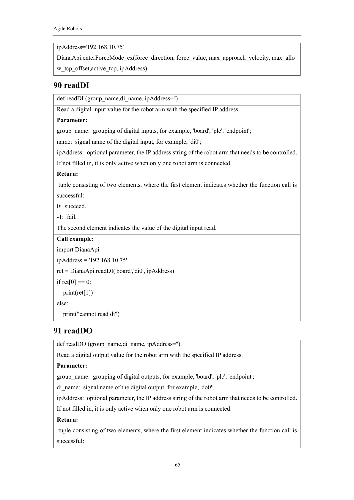



```
Agile Robots  
 65  
ipAddress='192.168.10.75' 
DianaApi.enterForceMode_ex(force_direction, force_value, max_approach_velocity, max_allo
w_tcp_offset,active_tcp, ipAddress) 
90 readDI 
def readDI (group_name,di_name, ipAddress='') 
Read a digital input value for the robot arm with the specified IP address.  
Parameter:  
group_name:  grouping of digital inputs, for example, 'board', 'plc', 'endpoint';  
name:  signal name of the digital input, for example, 'di0';  
ipAddress:  optional parameter, the IP address string of the robot arm that needs to be controlled. 
If not filled in, it is only active when only one robot arm is connected.  
Return:  
 tuple consisting of two elements, where the first element indicates whether the function call is 
successful:  
0:  succeed.  
-1:  fail.  
The second element indicates the value of the digital input read.  
Call example:  
import DianaApi 
ipAddress = '192.168.10.75' 
ret = DianaApi.readDI('board','di0', ipAddress) 
if ret[0] == 0: 
    print(ret[1]) 
else: 
    print("cannot read di") 
91 readDO 
def readDO (group_name,di_name, ipAddress='') 
Read a digital output value for the robot arm with the specified IP address.  
Parameter:  
group_name:  grouping of digital outputs, for example, 'board', 'plc', 'endpoint';  
di_name:  signal name of the digital output, for example, 'do0';  
ipAddress:  optional parameter, the IP address string of the robot arm that needs to be controlled. 
If not filled in, it is only active when only one robot arm is connected.  
Return:  
 tuple consisting of two elements, where the first element indicates whether the function call is 
successful:
```



## PDF page 74

**Source:** Industrial API Manual (Python Edition) \_V3.3.0\_EN\_20260205.pdf, original pdf page 74. [Open the corresponding PDF reading-copy page](https://1292444914-files.gitbook.io/~/files/v0/b/gitbook-x-prod.appspot.com/o/spaces%2FtgOfPnscWebs1eh82EKq%2Fuploads%2FRuKqP58TGdcORhNDRsIQ%2Findustrial-api-manual-python-edition-v3-3-0-en-20260205-pp-001-139.pdf?alt=media#page=74).



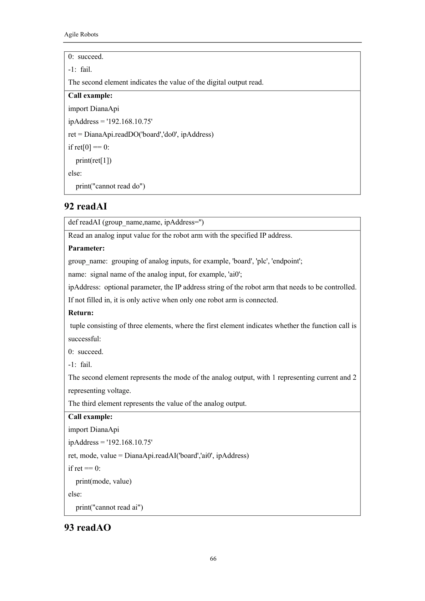



```
Agile Robots  
 66  
0:  succeed.  
-1:  fail.  
The second element indicates the value of the digital output read.  
Call example:  
import DianaApi 
ipAddress = '192.168.10.75' 
ret = DianaApi.readDO('board','do0', ipAddress) 
if ret[0] == 0: 
    print(ret[1]) 
else: 
    print("cannot read do") 
92 readAI 
def readAI (group_name,name, ipAddress='') 
Read an analog input value for the robot arm with the specified IP address.  
Parameter:  
group_name:  grouping of analog inputs, for example, 'board', 'plc', 'endpoint';  
name:  signal name of the analog input, for example, 'ai0';  
ipAddress:  optional parameter, the IP address string of the robot arm that needs to be controlled. 
If not filled in, it is only active when only one robot arm is connected.  
Return:  
 tuple consisting of three elements, where the first element indicates whether the function call is 
successful:  
0:  succeed.  
-1:  fail.  
The second element represents the mode of the analog output, with 1 representing current and 2 
representing voltage.  
The third element represents the value of the analog output.  
Call example:  
import DianaApi 
ipAddress = '192.168.10.75' 
ret, mode, value = DianaApi.readAI('board','ai0', ipAddress) 
if ret == 0: 
    print(mode, value) 
else: 
    print("cannot read ai") 
93 readAO
```



## PDF page 75

**Source:** Industrial API Manual (Python Edition) \_V3.3.0\_EN\_20260205.pdf, original pdf page 75. [Open the corresponding PDF reading-copy page](https://1292444914-files.gitbook.io/~/files/v0/b/gitbook-x-prod.appspot.com/o/spaces%2FtgOfPnscWebs1eh82EKq%2Fuploads%2FRuKqP58TGdcORhNDRsIQ%2Findustrial-api-manual-python-edition-v3-3-0-en-20260205-pp-001-139.pdf?alt=media#page=75).



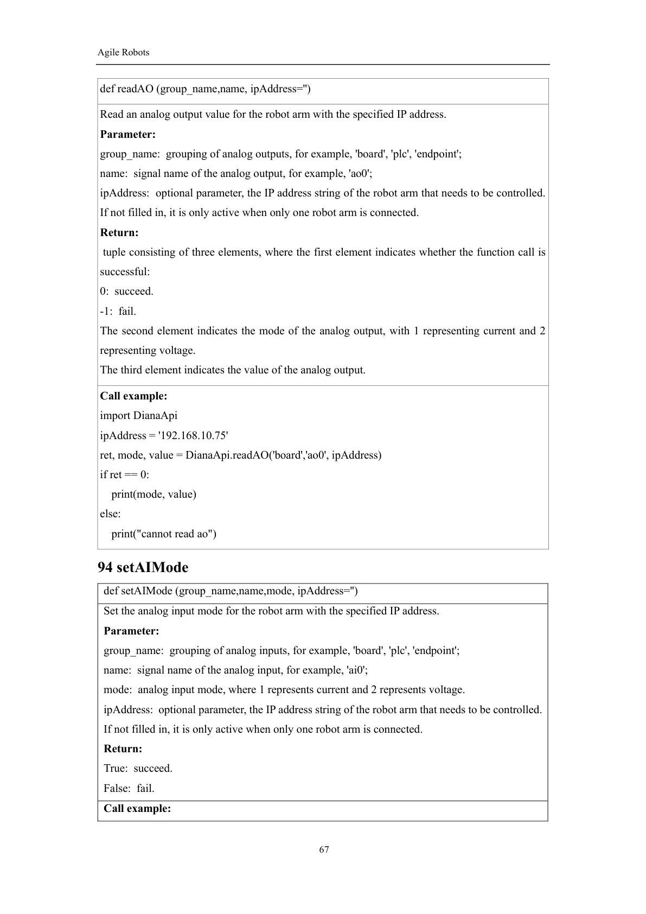



```
Agile Robots  
 67  
def readAO (group_name,name, ipAddress='') 
Read an analog output value for the robot arm with the specified IP address.  
Parameter:  
group_name:  grouping of analog outputs, for example, 'board', 'plc', 'endpoint';  
name:  signal name of the analog output, for example, 'ao0';  
ipAddress:  optional parameter, the IP address string of the robot arm that needs to be controlled. 
If not filled in, it is only active when only one robot arm is connected.  
Return:  
 tuple consisting of three elements, where the first element indicates whether the function call is 
successful:  
0:  succeed.  
-1:  fail.  
The second element indicates the mode of the analog output, with 1 representing current and 2 
representing voltage.  
The third element indicates the value of the analog output.  
Call example:  
import DianaApi 
ipAddress = '192.168.10.75' 
ret, mode, value = DianaApi.readAO('board','ao0', ipAddress) 
if ret == 0: 
    print(mode, value) 
else: 
    print("cannot read ao") 
94 setAIMode 
def setAIMode (group_name,name,mode, ipAddress='') 
Set the analog input mode for the robot arm with the specified IP address.  
Parameter:  
group_name:  grouping of analog inputs, for example, 'board', 'plc', 'endpoint';  
name:  signal name of the analog input, for example, 'ai0';  
mode:  analog input mode, where 1 represents current and 2 represents voltage.  
ipAddress:  optional parameter, the IP address string of the robot arm that needs to be controlled. 
If not filled in, it is only active when only one robot arm is connected.  
Return:  
True:  succeed.  
False:  fail.  
Call example:
```



## PDF page 76

**Source:** Industrial API Manual (Python Edition) \_V3.3.0\_EN\_20260205.pdf, original pdf page 76. [Open the corresponding PDF reading-copy page](https://1292444914-files.gitbook.io/~/files/v0/b/gitbook-x-prod.appspot.com/o/spaces%2FtgOfPnscWebs1eh82EKq%2Fuploads%2FRuKqP58TGdcORhNDRsIQ%2Findustrial-api-manual-python-edition-v3-3-0-en-20260205-pp-001-139.pdf?alt=media#page=76).



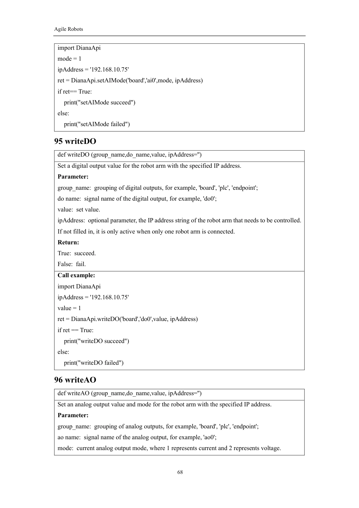



```
Agile Robots  
 68  
import DianaApi 
mode = 1 
ipAddress = '192.168.10.75' 
ret = DianaApi.setAIMode('board','ai0',mode, ipAddress) 
if ret== True: 
    print("setAIMode succeed") 
else: 
    print("setAIMode failed") 
95 writeDO 
def writeDO (group_name,do_name,value, ipAddress='') 
Set a digital output value for the robot arm with the specified IP address.  
Parameter:  
group_name:  grouping of digital outputs, for example, 'board', 'plc', 'endpoint';  
do name:  signal name of the digital output, for example, 'do0';  
value:  set value.  
ipAddress:  optional parameter, the IP address string of the robot arm that needs to be controlled. 
If not filled in, it is only active when only one robot arm is connected.  
Return:  
True:  succeed.  
False:  fail.  
Call example:  
import DianaApi 
ipAddress = '192.168.10.75' 
value = 1 
ret = DianaApi.writeDO('board','do0',value, ipAddress) 
if ret == True: 
    print("writeDO succeed") 
else: 
    print("writeDO failed") 
96 writeAO 
def writeAO (group_name,do_name,value, ipAddress='') 
Set an analog output value and mode for the robot arm with the specified IP address.  
Parameter:  
group_name:  grouping of analog outputs, for example, 'board', 'plc', 'endpoint';  
ao name:  signal name of the analog output, for example, 'ao0';  
mode:  current analog output mode, where 1 represents current and 2 represents voltage.
```



## PDF page 77

**Source:** Industrial API Manual (Python Edition) \_V3.3.0\_EN\_20260205.pdf, original pdf page 77. [Open the corresponding PDF reading-copy page](https://1292444914-files.gitbook.io/~/files/v0/b/gitbook-x-prod.appspot.com/o/spaces%2FtgOfPnscWebs1eh82EKq%2Fuploads%2FRuKqP58TGdcORhNDRsIQ%2Findustrial-api-manual-python-edition-v3-3-0-en-20260205-pp-001-139.pdf?alt=media#page=77).



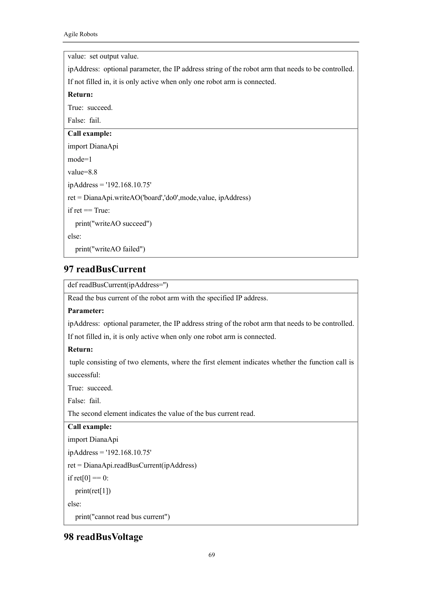



```
Agile Robots  
 69  
value:  set output value.  
ipAddress:  optional parameter, the IP address string of the robot arm that needs to be controlled. 
If not filled in, it is only active when only one robot arm is connected.  
Return:  
True:  succeed.  
False:  fail.  
Call example:  
import DianaApi 
mode=1 
value=8.8 
ipAddress = '192.168.10.75' 
ret = DianaApi.writeAO('board','do0',mode,value, ipAddress) 
if ret == True: 
    print("writeAO succeed") 
else: 
    print("writeAO failed") 
97 readBusCurrent 
def readBusCurrent(ipAddress='') 
Read the bus current of the robot arm with the specified IP address.  
Parameter:  
ipAddress:  optional parameter, the IP address string of the robot arm that needs to be controlled. 
If not filled in, it is only active when only one robot arm is connected.  
Return:  
 tuple consisting of two elements, where the first element indicates whether the function call is 
successful:  
True:  succeed.  
False:  fail.  
The second element indicates the value of the bus current read.  
Call example:  
import DianaApi 
ipAddress = '192.168.10.75' 
ret = DianaApi.readBusCurrent(ipAddress) 
if ret[0] == 0: 
    print(ret[1]) 
else: 
    print("cannot read bus current") 
98 readBusVoltage
```



## PDF page 78

**Source:** Industrial API Manual (Python Edition) \_V3.3.0\_EN\_20260205.pdf, original pdf page 78. [Open the corresponding PDF reading-copy page](https://1292444914-files.gitbook.io/~/files/v0/b/gitbook-x-prod.appspot.com/o/spaces%2FtgOfPnscWebs1eh82EKq%2Fuploads%2FRuKqP58TGdcORhNDRsIQ%2Findustrial-api-manual-python-edition-v3-3-0-en-20260205-pp-001-139.pdf?alt=media#page=78).



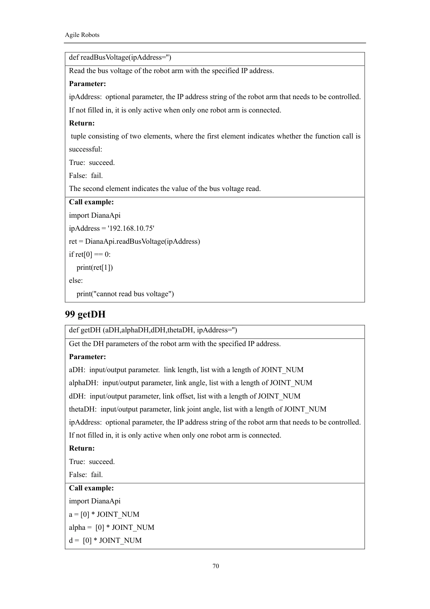



```
Agile Robots  
 70  
def readBusVoltage(ipAddress='') 
Read the bus voltage of the robot arm with the specified IP address.  
Parameter:  
ipAddress:  optional parameter, the IP address string of the robot arm that needs to be controlled. 
If not filled in, it is only active when only one robot arm is connected.  
Return:  
 tuple consisting of two elements, where the first element indicates whether the function call is 
successful:  
True:  succeed.  
False:  fail.  
The second element indicates the value of the bus voltage read.  
Call example:  
import DianaApi 
ipAddress = '192.168.10.75' 
ret = DianaApi.readBusVoltage(ipAddress) 
if ret[0] == 0: 
    print(ret[1]) 
else: 
    print("cannot read bus voltage") 
99 getDH 
def getDH (aDH,alphaDH,dDH,thetaDH, ipAddress='') 
Get the DH parameters of the robot arm with the specified IP address.  
Parameter:  
aDH:  input/output parameter.  link length, list with a length of JOINT_NUM  
alphaDH:  input/output parameter, link angle, list with a length of JOINT_NUM  
dDH:  input/output parameter, link offset, list with a length of JOINT_NUM  
thetaDH:  input/output parameter, link joint angle, list with a length of JOINT_NUM  
ipAddress:  optional parameter, the IP address string of the robot arm that needs to be controlled. 
If not filled in, it is only active when only one robot arm is connected.  
Return:  
True:  succeed.  
False:  fail.  
Call example:  
import DianaApi 
a = [0] * JOINT_NUM 
alpha =  [0] * JOINT_NUM 
d =  [0] * JOINT_NUM
```



## PDF page 79

**Source:** Industrial API Manual (Python Edition) \_V3.3.0\_EN\_20260205.pdf, original pdf page 79. [Open the corresponding PDF reading-copy page](https://1292444914-files.gitbook.io/~/files/v0/b/gitbook-x-prod.appspot.com/o/spaces%2FtgOfPnscWebs1eh82EKq%2Fuploads%2FRuKqP58TGdcORhNDRsIQ%2Findustrial-api-manual-python-edition-v3-3-0-en-20260205-pp-001-139.pdf?alt=media#page=79).



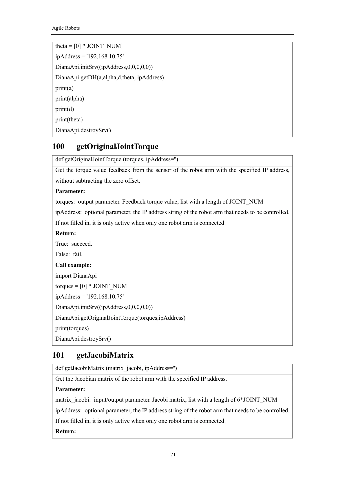



```
Agile Robots  
 71  
theta = [0] * JOINT_NUM 
ipAddress = '192.168.10.75' 
DianaApi.initSrv((ipAddress,0,0,0,0,0)) 
DianaApi.getDH(a,alpha,d,theta, ipAddress) 
print(a) 
print(alpha) 
print(d) 
print(theta) 
DianaApi.destroySrv() 
100 
getOriginalJointTorque 
def getOriginalJointTorque (torques, ipAddress='') 
Get the torque value feedback from the sensor of the robot arm with the specified IP address, 
without subtracting the zero offset.  
Parameter:  
torques:  output parameter. Feedback torque value, list with a length of JOINT_NUM  
ipAddress:  optional parameter, the IP address string of the robot arm that needs to be controlled. 
If not filled in, it is only active when only one robot arm is connected.  
Return:  
True:  succeed.  
False:  fail.  
Call example:  
import DianaApi 
torques = [0] * JOINT_NUM 
ipAddress = '192.168.10.75' 
DianaApi.initSrv((ipAddress,0,0,0,0,0)) 
DianaApi.getOriginalJointTorque(torques,ipAddress) 
print(torques) 
DianaApi.destroySrv() 
101 
getJacobiMatrix 
def getJacobiMatrix (matrix_jacobi, ipAddress='') 
Get the Jacobian matrix of the robot arm with the specified IP address.  
Parameter:  
matrix_jacobi:  input/output parameter. Jacobi matrix, list with a length of 6*JOINT_NUM  
ipAddress:  optional parameter, the IP address string of the robot arm that needs to be controlled. 
If not filled in, it is only active when only one robot arm is connected.  
Return:
```



## PDF page 80

**Source:** Industrial API Manual (Python Edition) \_V3.3.0\_EN\_20260205.pdf, original pdf page 80. [Open the corresponding PDF reading-copy page](https://1292444914-files.gitbook.io/~/files/v0/b/gitbook-x-prod.appspot.com/o/spaces%2FtgOfPnscWebs1eh82EKq%2Fuploads%2FRuKqP58TGdcORhNDRsIQ%2Findustrial-api-manual-python-edition-v3-3-0-en-20260205-pp-001-139.pdf?alt=media#page=80).



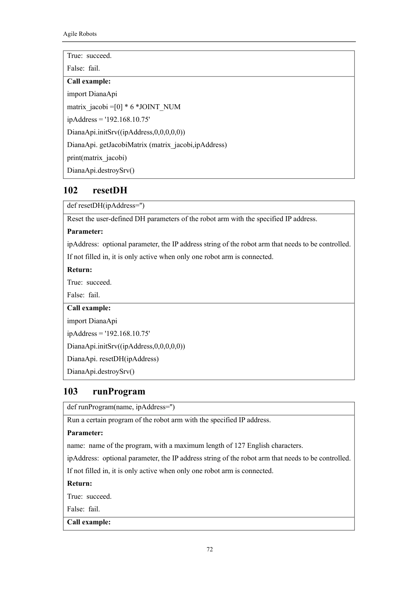



```
Agile Robots  
 72  
True:  succeed.  
False:  fail.  
Call example:  
import DianaApi 
matrix_jacobi =[0] * 6 *JOINT_NUM 
ipAddress = '192.168.10.75' 
DianaApi.initSrv((ipAddress,0,0,0,0,0)) 
DianaApi. getJacobiMatrix (matrix_jacobi,ipAddress) 
print(matrix_jacobi) 
DianaApi.destroySrv() 
102 
resetDH 
def resetDH(ipAddress='') 
Reset the user-defined DH parameters of the robot arm with the specified IP address.  
Parameter:  
ipAddress:  optional parameter, the IP address string of the robot arm that needs to be controlled. 
If not filled in, it is only active when only one robot arm is connected.  
Return:  
True:  succeed.  
False:  fail.  
Call example:  
import DianaApi 
ipAddress = '192.168.10.75' 
DianaApi.initSrv((ipAddress,0,0,0,0,0)) 
DianaApi. resetDH(ipAddress) 
DianaApi.destroySrv() 
103 
runProgram 
def runProgram(name, ipAddress='') 
Run a certain program of the robot arm with the specified IP address.  
Parameter:  
name:  name of the program, with a maximum length of 127 English characters.  
ipAddress:  optional parameter, the IP address string of the robot arm that needs to be controlled. 
If not filled in, it is only active when only one robot arm is connected.  
Return:  
True:  succeed.  
False:  fail.  
Call example:
```



## PDF page 81

**Source:** Industrial API Manual (Python Edition) \_V3.3.0\_EN\_20260205.pdf, original pdf page 81. [Open the corresponding PDF reading-copy page](https://1292444914-files.gitbook.io/~/files/v0/b/gitbook-x-prod.appspot.com/o/spaces%2FtgOfPnscWebs1eh82EKq%2Fuploads%2FRuKqP58TGdcORhNDRsIQ%2Findustrial-api-manual-python-edition-v3-3-0-en-20260205-pp-001-139.pdf?alt=media#page=81).



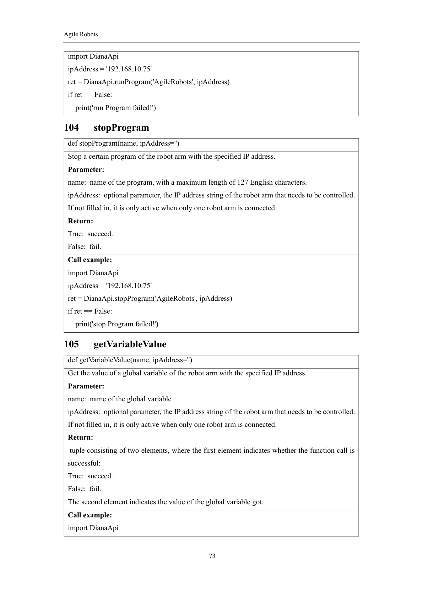



```
Agile Robots  
 73  
import DianaApi 
ipAddress = '192.168.10.75' 
ret = DianaApi.runProgram('AgileRobots', ipAddress) 
if ret == False: 
    print('run Program failed!') 
104 
stopProgram 
def stopProgram(name, ipAddress='') 
Stop a certain program of the robot arm with the specified IP address.  
Parameter:  
name:  name of the program, with a maximum length of 127 English characters.  
ipAddress:  optional parameter, the IP address string of the robot arm that needs to be controlled. 
If not filled in, it is only active when only one robot arm is connected.  
Return:  
True:  succeed.  
False:  fail.  
Call example:  
import DianaApi 
ipAddress = '192.168.10.75' 
ret = DianaApi.stopProgram('AgileRobots', ipAddress) 
if ret == False: 
    print('stop Program failed!') 
105 
getVariableValue  
def getVariableValue(name, ipAddress='')  
Get the value of a global variable of the robot arm with the specified IP address.  
Parameter:  
name:  name of the global variable  
ipAddress:  optional parameter, the IP address string of the robot arm that needs to be controlled. 
If not filled in, it is only active when only one robot arm is connected.  
Return:  
 tuple consisting of two elements, where the first element indicates whether the function call is 
successful:  
True:  succeed.  
False:  fail.  
The second element indicates the value of the global variable got.  
Call example:  
import DianaApi
```



## PDF page 82

**Source:** Industrial API Manual (Python Edition) \_V3.3.0\_EN\_20260205.pdf, original pdf page 82. [Open the corresponding PDF reading-copy page](https://1292444914-files.gitbook.io/~/files/v0/b/gitbook-x-prod.appspot.com/o/spaces%2FtgOfPnscWebs1eh82EKq%2Fuploads%2FRuKqP58TGdcORhNDRsIQ%2Findustrial-api-manual-python-edition-v3-3-0-en-20260205-pp-001-139.pdf?alt=media#page=82).



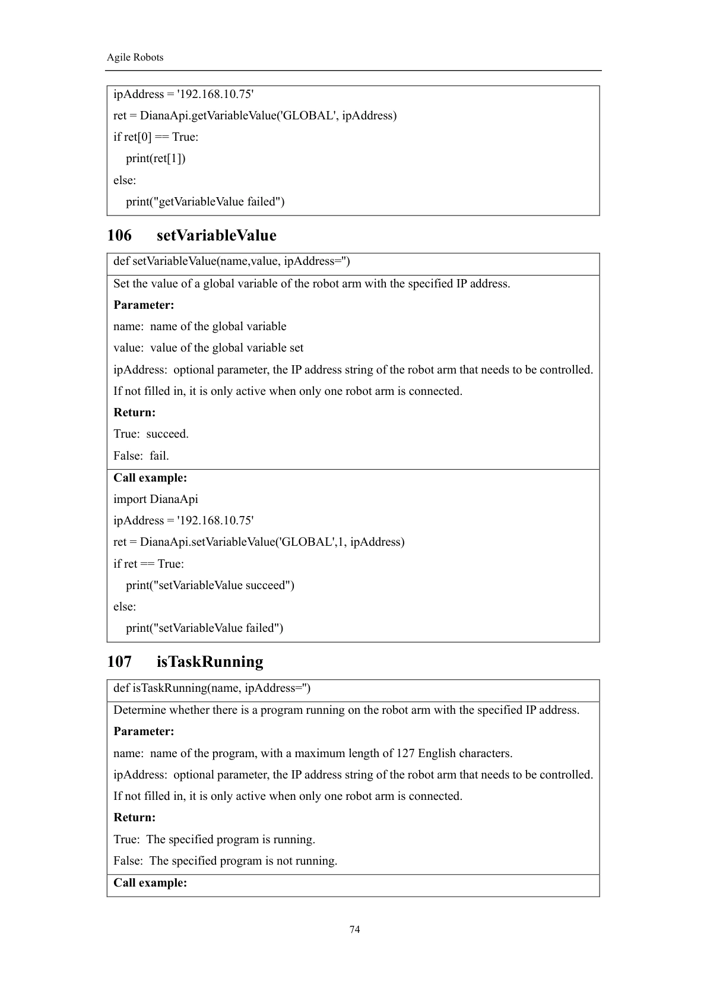



```
Agile Robots  
 74  
ipAddress = '192.168.10.75' 
ret = DianaApi.getVariableValue('GLOBAL', ipAddress) 
if ret[0] == True: 
    print(ret[1]) 
else: 
    print("getVariableValue failed") 
106 
setVariableValue  
def setVariableValue(name,value, ipAddress='')  
Set the value of a global variable of the robot arm with the specified IP address.  
Parameter:  
name:  name of the global variable  
value:  value of the global variable set  
ipAddress:  optional parameter, the IP address string of the robot arm that needs to be controlled. 
If not filled in, it is only active when only one robot arm is connected.  
Return:  
True:  succeed.  
False:  fail.  
Call example:  
import DianaApi 
ipAddress = '192.168.10.75' 
ret = DianaApi.setVariableValue('GLOBAL',1, ipAddress) 
if ret == True: 
    print("setVariableValue succeed") 
else: 
    print("setVariableValue failed") 
107 
isTaskRunning 
def isTaskRunning(name, ipAddress='') 
Determine whether there is a program running on the robot arm with the specified IP address.  
Parameter:  
name:  name of the program, with a maximum length of 127 English characters.  
ipAddress:  optional parameter, the IP address string of the robot arm that needs to be controlled. 
If not filled in, it is only active when only one robot arm is connected.  
Return:  
True:  The specified program is running. 
False:  The specified program is not running. 
Call example:
```



## PDF page 83

**Source:** Industrial API Manual (Python Edition) \_V3.3.0\_EN\_20260205.pdf, original pdf page 83. [Open the corresponding PDF reading-copy page](https://1292444914-files.gitbook.io/~/files/v0/b/gitbook-x-prod.appspot.com/o/spaces%2FtgOfPnscWebs1eh82EKq%2Fuploads%2FRuKqP58TGdcORhNDRsIQ%2Findustrial-api-manual-python-edition-v3-3-0-en-20260205-pp-001-139.pdf?alt=media#page=83).



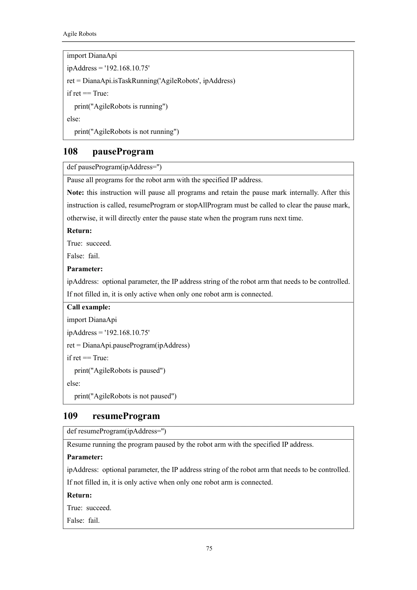



```
Agile Robots  
 75  
import DianaApi 
ipAddress = '192.168.10.75' 
ret = DianaApi.isTaskRunning('AgileRobots', ipAddress) 
if ret == True: 
    print("AgileRobots is running") 
else: 
    print("AgileRobots is not running") 
108 
pauseProgram 
def pauseProgram(ipAddress='') 
Pause all programs for the robot arm with the specified IP address.  
Note: this instruction will pause all programs and retain the pause mark internally. After this 
instruction is called, resumeProgram or stopAllProgram must be called to clear the pause mark, 
otherwise, it will directly enter the pause state when the program runs next time.  
Return:  
True:  succeed.  
False:  fail.  
Parameter:  
ipAddress:  optional parameter, the IP address string of the robot arm that needs to be controlled. 
If not filled in, it is only active when only one robot arm is connected.  
Call example:  
import DianaApi 
ipAddress = '192.168.10.75' 
ret = DianaApi.pauseProgram(ipAddress) 
if ret == True: 
    print("AgileRobots is paused") 
else: 
    print("AgileRobots is not paused") 
109 
resumeProgram 
def resumeProgram(ipAddress='') 
Resume running the program paused by the robot arm with the specified IP address.  
Parameter:  
ipAddress:  optional parameter, the IP address string of the robot arm that needs to be controlled. 
If not filled in, it is only active when only one robot arm is connected.  
Return:  
True:  succeed.  
False:  fail.
```



## PDF page 84

**Source:** Industrial API Manual (Python Edition) \_V3.3.0\_EN\_20260205.pdf, original pdf page 84. [Open the corresponding PDF reading-copy page](https://1292444914-files.gitbook.io/~/files/v0/b/gitbook-x-prod.appspot.com/o/spaces%2FtgOfPnscWebs1eh82EKq%2Fuploads%2FRuKqP58TGdcORhNDRsIQ%2Findustrial-api-manual-python-edition-v3-3-0-en-20260205-pp-001-139.pdf?alt=media#page=84).



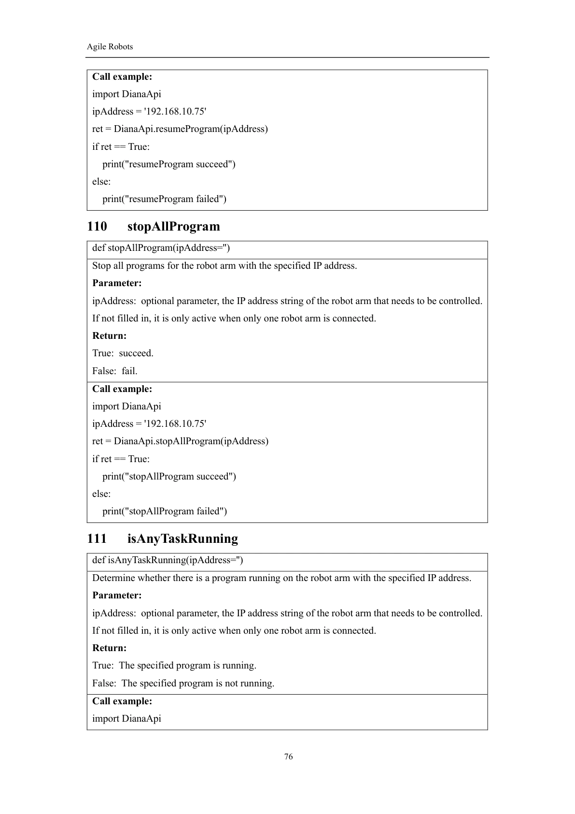



```
Agile Robots  
 76  
Call example:  
import DianaApi 
ipAddress = '192.168.10.75' 
ret = DianaApi.resumeProgram(ipAddress) 
if ret == True: 
    print("resumeProgram succeed") 
else: 
    print("resumeProgram failed") 
110 
stopAllProgram 
def stopAllProgram(ipAddress='')  
Stop all programs for the robot arm with the specified IP address.  
Parameter:  
ipAddress:  optional parameter, the IP address string of the robot arm that needs to be controlled. 
If not filled in, it is only active when only one robot arm is connected.  
Return:  
True:  succeed.  
False:  fail.  
Call example:  
import DianaApi 
ipAddress = '192.168.10.75' 
ret = DianaApi.stopAllProgram(ipAddress) 
if ret == True: 
    print("stopAllProgram succeed") 
else: 
    print("stopAllProgram failed") 
111 
isAnyTaskRunning 
def isAnyTaskRunning(ipAddress='') 
Determine whether there is a program running on the robot arm with the specified IP address.  
Parameter:  
ipAddress:  optional parameter, the IP address string of the robot arm that needs to be controlled. 
If not filled in, it is only active when only one robot arm is connected.  
Return:  
True:  The specified program is running. 
False:  The specified program is not running. 
Call example:  
import DianaApi
```



## PDF page 85

**Source:** Industrial API Manual (Python Edition) \_V3.3.0\_EN\_20260205.pdf, original pdf page 85. [Open the corresponding PDF reading-copy page](https://1292444914-files.gitbook.io/~/files/v0/b/gitbook-x-prod.appspot.com/o/spaces%2FtgOfPnscWebs1eh82EKq%2Fuploads%2FRuKqP58TGdcORhNDRsIQ%2Findustrial-api-manual-python-edition-v3-3-0-en-20260205-pp-001-139.pdf?alt=media#page=85).



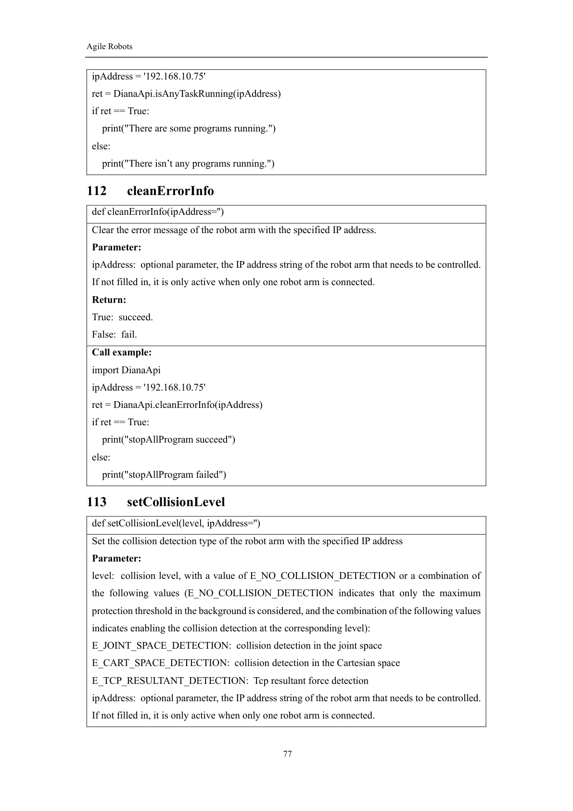



```
Agile Robots  
 77  
ipAddress = '192.168.10.75' 
ret = DianaApi.isAnyTaskRunning(ipAddress) 
if ret == True: 
    print("There are some programs running.") 
else: 
    print("There isn’t any programs running.") 
112 
cleanErrorInfo 
def cleanErrorInfo(ipAddress='') 
Clear the error message of the robot arm with the specified IP address.  
Parameter:  
ipAddress:  optional parameter, the IP address string of the robot arm that needs to be controlled. 
If not filled in, it is only active when only one robot arm is connected.  
Return:  
True:  succeed.  
False:  fail.  
Call example:  
import DianaApi 
ipAddress = '192.168.10.75' 
ret = DianaApi.cleanErrorInfo(ipAddress) 
if ret == True: 
    print("stopAllProgram succeed") 
else: 
    print("stopAllProgram failed") 
113 
setCollisionLevel 
def setCollisionLevel(level, ipAddress='') 
Set the collision detection type of the robot arm with the specified IP address  
Parameter:  
level:  collision level, with a value of E_NO_COLLISION_DETECTION or a combination of 
the following values (E_NO_COLLISION_DETECTION indicates that only the maximum 
protection threshold in the background is considered, and the combination of the following values 
indicates enabling the collision detection at the corresponding level):  
E_JOINT_SPACE_DETECTION:  collision detection in the joint space  
E_CART_SPACE_DETECTION:  collision detection in the Cartesian space  
E_TCP_RESULTANT_DETECTION:  Tcp resultant force detection  
ipAddress:  optional parameter, the IP address string of the robot arm that needs to be controlled. 
If not filled in, it is only active when only one robot arm is connected.
```



## PDF page 86

**Source:** Industrial API Manual (Python Edition) \_V3.3.0\_EN\_20260205.pdf, original pdf page 86. [Open the corresponding PDF reading-copy page](https://1292444914-files.gitbook.io/~/files/v0/b/gitbook-x-prod.appspot.com/o/spaces%2FtgOfPnscWebs1eh82EKq%2Fuploads%2FRuKqP58TGdcORhNDRsIQ%2Findustrial-api-manual-python-edition-v3-3-0-en-20260205-pp-001-139.pdf?alt=media#page=86).



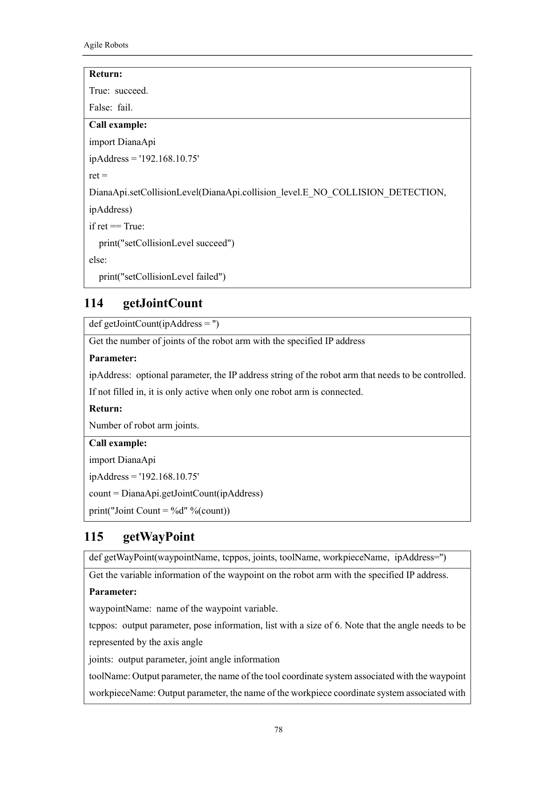



```
Agile Robots  
 78  
Return:  
True:  succeed.  
False:  fail.  
Call example:  
import DianaApi 
ipAddress = '192.168.10.75' 
ret = 
DianaApi.setCollisionLevel(DianaApi.collision_level.E_NO_COLLISION_DETECTION, 
ipAddress) 
if ret == True: 
    print("setCollisionLevel succeed") 
else: 
    print("setCollisionLevel failed") 
114 
getJointCount 
def getJointCount(ipAddress = '') 
Get the number of joints of the robot arm with the specified IP address  
Parameter:  
ipAddress:  optional parameter, the IP address string of the robot arm that needs to be controlled. 
If not filled in, it is only active when only one robot arm is connected.  
Return:  
Number of robot arm joints.  
Call example:  
import DianaApi 
ipAddress = '192.168.10.75' 
count = DianaApi.getJointCount(ipAddress) 
print("Joint Count = %d" %(count)) 
115 
getWayPoint 
def getWayPoint(waypointName, tcppos, joints, toolName, workpieceName,  ipAddress='') 
Get the variable information of the waypoint on the robot arm with the specified IP address.  
Parameter:  
waypointName:  name of the waypoint variable.  
tcppos:  output parameter, pose information, list with a size of 6. Note that the angle needs to be 
represented by the axis angle  
joints:  output parameter, joint angle information  
toolName: Output parameter, the name of the tool coordinate system associated with the waypoint  
workpieceName: Output parameter, the name of the workpiece coordinate system associated with
```



## PDF page 87

**Source:** Industrial API Manual (Python Edition) \_V3.3.0\_EN\_20260205.pdf, original pdf page 87. [Open the corresponding PDF reading-copy page](https://1292444914-files.gitbook.io/~/files/v0/b/gitbook-x-prod.appspot.com/o/spaces%2FtgOfPnscWebs1eh82EKq%2Fuploads%2FRuKqP58TGdcORhNDRsIQ%2Findustrial-api-manual-python-edition-v3-3-0-en-20260205-pp-001-139.pdf?alt=media#page=87).



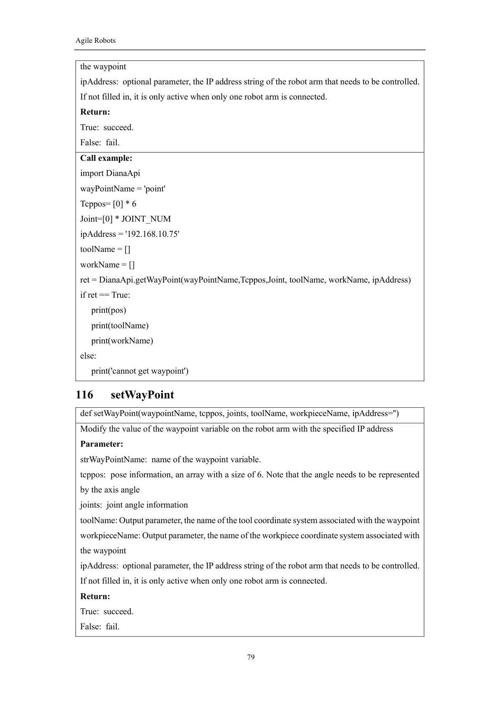



```
Agile Robots  
 79  
the waypoint  
ipAddress:  optional parameter, the IP address string of the robot arm that needs to be controlled. 
If not filled in, it is only active when only one robot arm is connected.  
Return:  
True:  succeed.  
False:  fail.  
Call example:  
import DianaApi 
wayPointName = 'point' 
Tcppos= [0] * 6 
Joint=[0] * JOINT_NUM 
ipAddress = '192.168.10.75' 
toolName = [] 
workName = [] 
ret = DianaApi.getWayPoint(wayPointName,Tcppos,Joint, toolName, workName, ipAddress) 
if ret == True: 
     print(pos) 
     print(toolName) 
     print(workName) 
else: 
     print('cannot get waypoint') 
116 
setWayPoint 
def setWayPoint(waypointName, tcppos, joints, toolName, workpieceName, ipAddress='') 
Modify the value of the waypoint variable on the robot arm with the specified IP address  
Parameter:  
strWayPointName:  name of the waypoint variable.  
tcppos:  pose information, an array with a size of 6. Note that the angle needs to be represented 
by the axis angle  
joints:  joint angle information  
toolName: Output parameter, the name of the tool coordinate system associated with the waypoint  
workpieceName: Output parameter, the name of the workpiece coordinate system associated with 
the waypoint  
ipAddress:  optional parameter, the IP address string of the robot arm that needs to be controlled. 
If not filled in, it is only active when only one robot arm is connected.  
Return:  
True:  succeed.  
False:  fail.
```



## PDF page 88

**Source:** Industrial API Manual (Python Edition) \_V3.3.0\_EN\_20260205.pdf, original pdf page 88. [Open the corresponding PDF reading-copy page](https://1292444914-files.gitbook.io/~/files/v0/b/gitbook-x-prod.appspot.com/o/spaces%2FtgOfPnscWebs1eh82EKq%2Fuploads%2FRuKqP58TGdcORhNDRsIQ%2Findustrial-api-manual-python-edition-v3-3-0-en-20260205-pp-001-139.pdf?alt=media#page=88).



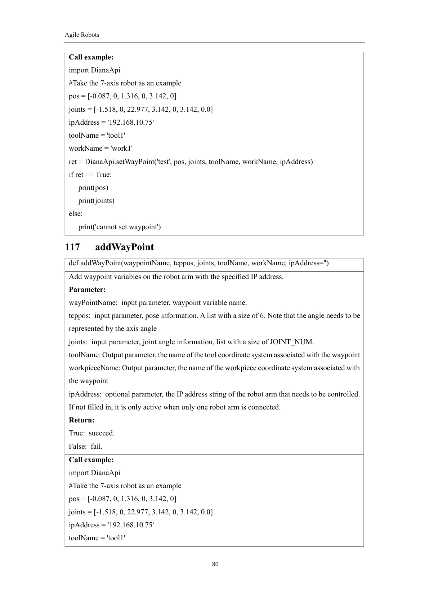



```
Agile Robots  
 80  
Call example:  
import DianaApi 
#Take the 7-axis robot as an example  
pos = [-0.087, 0, 1.316, 0, 3.142, 0] 
joints = [-1.518, 0, 22.977, 3.142, 0, 3.142, 0.0] 
ipAddress = '192.168.10.75' 
toolName = 'tool1' 
workName = 'work1' 
ret = DianaApi.setWayPoint('test', pos, joints, toolName, workName, ipAddress) 
if ret == True: 
     print(pos) 
     print(joints) 
else: 
     print('cannot set waypoint') 
117 
addWayPoint 
def addWayPoint(waypointName, tcppos, joints, toolName, workName, ipAddress='') 
Add waypoint variables on the robot arm with the specified IP address.  
Parameter:  
wayPointName:  input parameter, waypoint variable name.  
tcppos:  input parameter, pose information. A list with a size of 6. Note that the angle needs to be 
represented by the axis angle  
joints:  input parameter, joint angle information, list with a size of JOINT_NUM.  
toolName: Output parameter, the name of the tool coordinate system associated with the waypoint  
workpieceName: Output parameter, the name of the workpiece coordinate system associated with 
the waypoint  
ipAddress:  optional parameter, the IP address string of the robot arm that needs to be controlled. 
If not filled in, it is only active when only one robot arm is connected.  
Return:  
True:  succeed.  
False:  fail.  
Call example:  
import DianaApi  
#Take the 7-axis robot as an example  
pos = [-0.087, 0, 1.316, 0, 3.142, 0] 
joints = [-1.518, 0, 22.977, 3.142, 0, 3.142, 0.0] 
ipAddress = '192.168.10.75' 
toolName = 'tool1'
```



## PDF page 89

**Source:** Industrial API Manual (Python Edition) \_V3.3.0\_EN\_20260205.pdf, original pdf page 89. [Open the corresponding PDF reading-copy page](https://1292444914-files.gitbook.io/~/files/v0/b/gitbook-x-prod.appspot.com/o/spaces%2FtgOfPnscWebs1eh82EKq%2Fuploads%2FRuKqP58TGdcORhNDRsIQ%2Findustrial-api-manual-python-edition-v3-3-0-en-20260205-pp-001-139.pdf?alt=media#page=89).



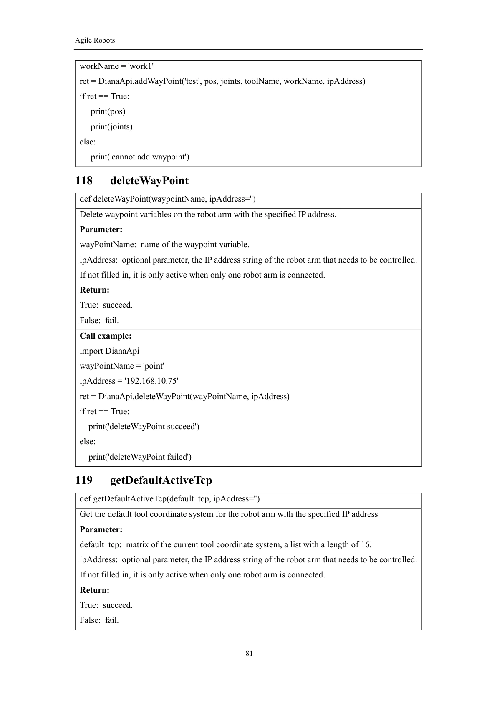



```
Agile Robots  
 81  
workName = 'work1' 
ret = DianaApi.addWayPoint('test', pos, joints, toolName, workName, ipAddress) 
if ret == True: 
     print(pos) 
     print(joints) 
else: 
     print('cannot add waypoint') 
118 
deleteWayPoint 
def deleteWayPoint(waypointName, ipAddress='') 
Delete waypoint variables on the robot arm with the specified IP address.  
Parameter:  
wayPointName:  name of the waypoint variable.  
ipAddress:  optional parameter, the IP address string of the robot arm that needs to be controlled. 
If not filled in, it is only active when only one robot arm is connected.  
Return:  
True:  succeed.  
False:  fail.  
Call example:  
import DianaApi 
wayPointName = 'point' 
ipAddress = '192.168.10.75' 
ret = DianaApi.deleteWayPoint(wayPointName, ipAddress) 
if ret == True: 
    print('deleteWayPoint succeed') 
else: 
    print('deleteWayPoint failed') 
119 
getDefaultActiveTcp 
def getDefaultActiveTcp(default_tcp, ipAddress='') 
Get the default tool coordinate system for the robot arm with the specified IP address  
Parameter:  
default_tcp:  matrix of the current tool coordinate system, a list with a length of 16.  
ipAddress:  optional parameter, the IP address string of the robot arm that needs to be controlled. 
If not filled in, it is only active when only one robot arm is connected.  
Return:  
True:  succeed.  
False:  fail.
```



## PDF page 90

**Source:** Industrial API Manual (Python Edition) \_V3.3.0\_EN\_20260205.pdf, original pdf page 90. [Open the corresponding PDF reading-copy page](https://1292444914-files.gitbook.io/~/files/v0/b/gitbook-x-prod.appspot.com/o/spaces%2FtgOfPnscWebs1eh82EKq%2Fuploads%2FRuKqP58TGdcORhNDRsIQ%2Findustrial-api-manual-python-edition-v3-3-0-en-20260205-pp-001-139.pdf?alt=media#page=90).



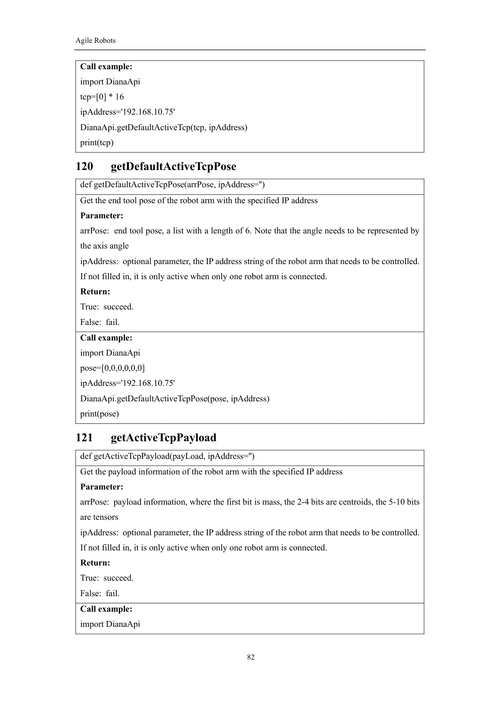



```
Agile Robots  
 82  
Call example:  
import DianaApi  
tcp=[0] * 16  
ipAddress='192.168.10.75' 
DianaApi.getDefaultActiveTcp(tcp, ipAddress) 
print(tcp) 
120 
getDefaultActiveTcpPose 
def getDefaultActiveTcpPose(arrPose, ipAddress='') 
Get the end tool pose of the robot arm with the specified IP address  
Parameter:  
arrPose:  end tool pose, a list with a length of 6. Note that the angle needs to be represented by 
the axis angle  
ipAddress:  optional parameter, the IP address string of the robot arm that needs to be controlled. 
If not filled in, it is only active when only one robot arm is connected.  
Return:  
True:  succeed.  
False:  fail.  
Call example:  
import DianaApi 
pose=[0,0,0,0,0,0] 
ipAddress='192.168.10.75' 
DianaApi.getDefaultActiveTcpPose(pose, ipAddress) 
print(pose) 
121 
getActiveTcpPayload 
def getActiveTcpPayload(payLoad, ipAddress='') 
Get the payload information of the robot arm with the specified IP address  
Parameter:  
arrPose:  payload information, where the first bit is mass, the 2-4 bits are centroids, the 5-10 bits 
are tensors  
ipAddress:  optional parameter, the IP address string of the robot arm that needs to be controlled. 
If not filled in, it is only active when only one robot arm is connected.  
Return:  
True:  succeed.  
False:  fail.  
Call example:  
import DianaApi
```



## PDF page 91

**Source:** Industrial API Manual (Python Edition) \_V3.3.0\_EN\_20260205.pdf, original pdf page 91. [Open the corresponding PDF reading-copy page](https://1292444914-files.gitbook.io/~/files/v0/b/gitbook-x-prod.appspot.com/o/spaces%2FtgOfPnscWebs1eh82EKq%2Fuploads%2FRuKqP58TGdcORhNDRsIQ%2Findustrial-api-manual-python-edition-v3-3-0-en-20260205-pp-001-139.pdf?alt=media#page=91).



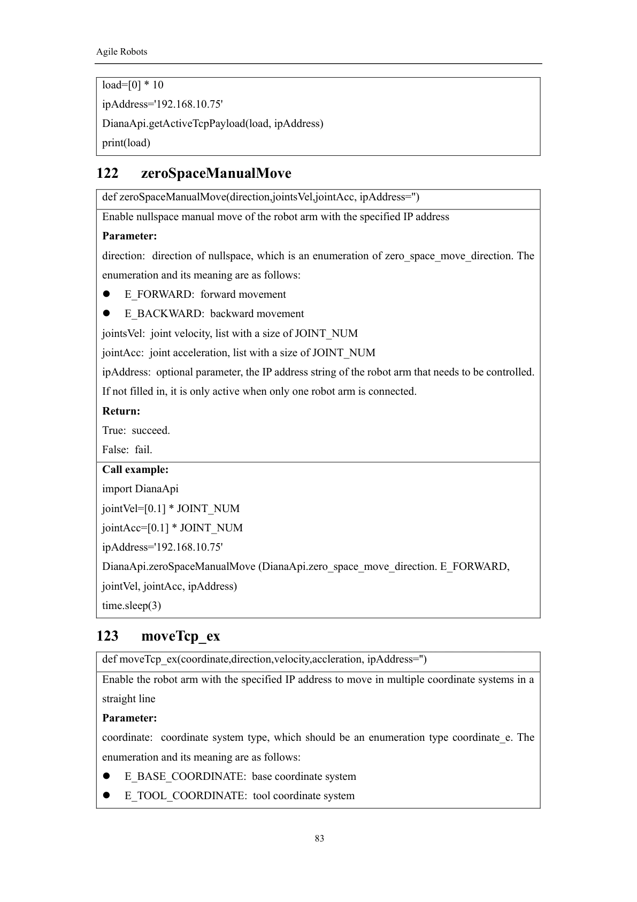



```
Agile Robots  
 83  
load=[0] * 10 
ipAddress='192.168.10.75' 
DianaApi.getActiveTcpPayload(load, ipAddress) 
print(load) 
122 
zeroSpaceManualMove  
def zeroSpaceManualMove(direction,jointsVel,jointAcc, ipAddress='')  
Enable nullspace manual move of the robot arm with the specified IP address  
Parameter:  
direction:  direction of nullspace, which is an enumeration of zero_space_move_direction. The 
enumeration and its meaning are as follows:  
⚫ 
E_FORWARD:  forward movement  
⚫ 
E_BACKWARD:  backward movement  
jointsVel:  joint velocity, list with a size of JOINT_NUM  
jointAcc:  joint acceleration, list with a size of JOINT_NUM  
ipAddress:  optional parameter, the IP address string of the robot arm that needs to be controlled. 
If not filled in, it is only active when only one robot arm is connected.  
Return:  
True:  succeed.  
False:  fail.  
Call example:  
import DianaApi 
jointVel=[0.1] * JOINT_NUM 
jointAcc=[0.1] * JOINT_NUM 
ipAddress='192.168.10.75' 
DianaApi.zeroSpaceManualMove (DianaApi.zero_space_move_direction. E_FORWARD, 
jointVel, jointAcc, ipAddress) 
time.sleep(3) 
123 
moveTcp_ex 
def moveTcp_ex(coordinate,direction,velocity,accleration, ipAddress='') 
Enable the robot arm with the specified IP address to move in multiple coordinate systems in a 
straight line  
Parameter:  
coordinate:  coordinate system type, which should be an enumeration type coordinate_e. The 
enumeration and its meaning are as follows:  
⚫ 
E_BASE_COORDINATE:  base coordinate system  
⚫ 
E_TOOL_COORDINATE:  tool coordinate system
```



## PDF page 92

**Source:** Industrial API Manual (Python Edition) \_V3.3.0\_EN\_20260205.pdf, original pdf page 92. [Open the corresponding PDF reading-copy page](https://1292444914-files.gitbook.io/~/files/v0/b/gitbook-x-prod.appspot.com/o/spaces%2FtgOfPnscWebs1eh82EKq%2Fuploads%2FRuKqP58TGdcORhNDRsIQ%2Findustrial-api-manual-python-edition-v3-3-0-en-20260205-pp-001-139.pdf?alt=media#page=92).



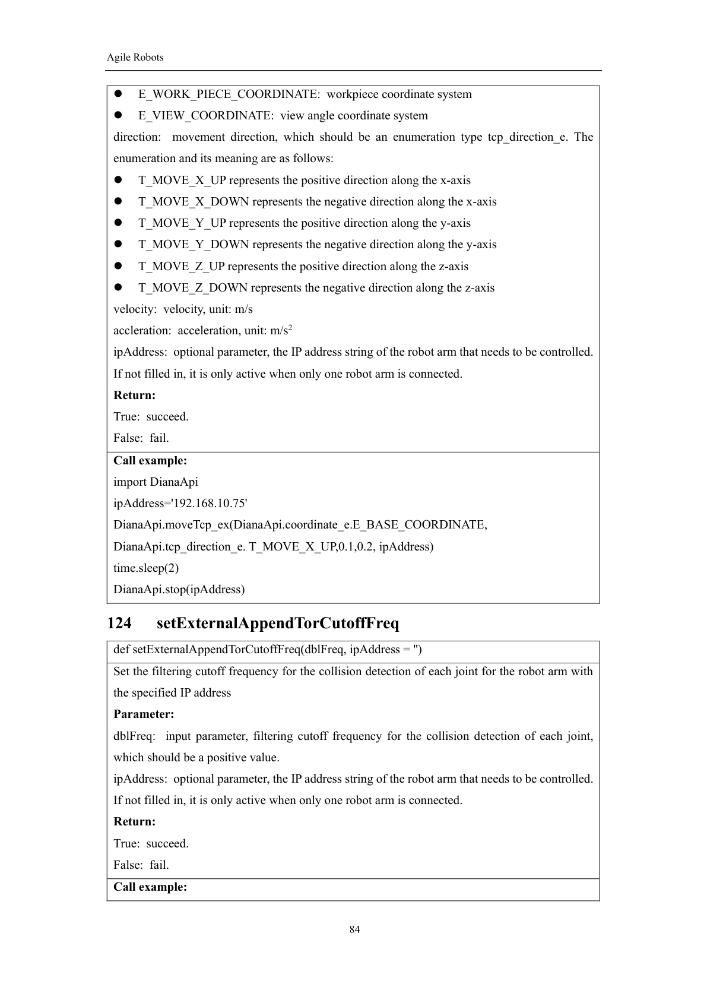



```
Agile Robots  
 84  
⚫ 
E_WORK_PIECE_COORDINATE:  workpiece coordinate system  
⚫ 
E_VIEW_COORDINATE:  view angle coordinate system  
direction:  movement direction, which should be an enumeration type tcp_direction_e. The 
enumeration and its meaning are as follows:  
⚫ 
T_MOVE_X_UP represents the positive direction along the x-axis  
⚫ 
T_MOVE_X_DOWN represents the negative direction along the x-axis  
⚫ 
T_MOVE_Y_UP represents the positive direction along the y-axis  
⚫ 
T_MOVE_Y_DOWN represents the negative direction along the y-axis  
⚫ 
T_MOVE_Z_UP represents the positive direction along the z-axis  
⚫ 
T_MOVE_Z_DOWN represents the negative direction along the z-axis  
velocity:  velocity, unit: m/s  
accleration:  acceleration, unit: m/s2  
ipAddress:  optional parameter, the IP address string of the robot arm that needs to be controlled. 
If not filled in, it is only active when only one robot arm is connected.  
Return:  
True:  succeed.  
False:  fail.  
Call example:  
import DianaApi 
ipAddress='192.168.10.75' 
DianaApi.moveTcp_ex(DianaApi.coordinate_e.E_BASE_COORDINATE, 
DianaApi.tcp_direction_e. T_MOVE_X_UP,0.1,0.2, ipAddress) 
time.sleep(2) 
DianaApi.stop(ipAddress) 
124 
setExternalAppendTorCutoffFreq 
def setExternalAppendTorCutoffFreq(dblFreq, ipAddress = '') 
Set the filtering cutoff frequency for the collision detection of each joint for the robot arm with 
the specified IP address  
Parameter:  
dblFreq:  input parameter, filtering cutoff frequency for the collision detection of each joint, 
which should be a positive value.  
ipAddress:  optional parameter, the IP address string of the robot arm that needs to be controlled. 
If not filled in, it is only active when only one robot arm is connected.  
Return:  
True:  succeed.  
False:  fail.  
Call example:
```



## PDF page 93

**Source:** Industrial API Manual (Python Edition) \_V3.3.0\_EN\_20260205.pdf, original pdf page 93. [Open the corresponding PDF reading-copy page](https://1292444914-files.gitbook.io/~/files/v0/b/gitbook-x-prod.appspot.com/o/spaces%2FtgOfPnscWebs1eh82EKq%2Fuploads%2FRuKqP58TGdcORhNDRsIQ%2Findustrial-api-manual-python-edition-v3-3-0-en-20260205-pp-001-139.pdf?alt=media#page=93).



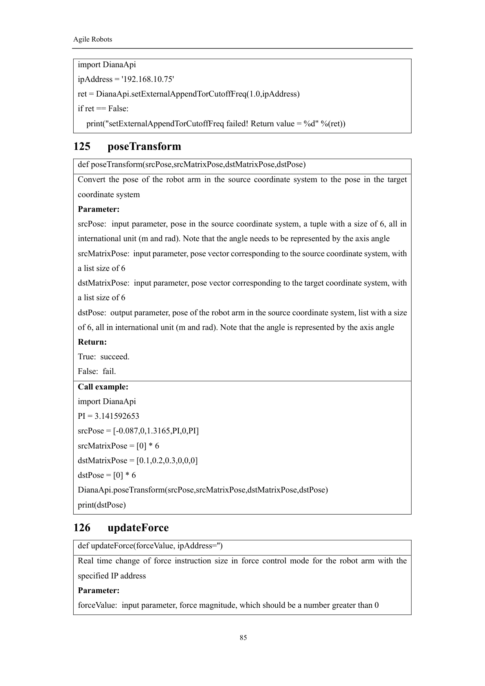



```
Agile Robots  
 85  
import DianaApi 
ipAddress = '192.168.10.75' 
ret = DianaApi.setExternalAppendTorCutoffFreq(1.0,ipAddress) 
if ret == False: 
    print("setExternalAppendTorCutoffFreq failed! Return value = %d" %(ret)) 
125 
poseTransform 
def poseTransform(srcPose,srcMatrixPose,dstMatrixPose,dstPose) 
Convert the pose of the robot arm in the source coordinate system to the pose in the target 
coordinate system  
Parameter:  
srcPose:  input parameter, pose in the source coordinate system, a tuple with a size of 6, all in 
international unit (m and rad). Note that the angle needs to be represented by the axis angle  
srcMatrixPose:  input parameter, pose vector corresponding to the source coordinate system, with 
a list size of 6  
dstMatrixPose:  input parameter, pose vector corresponding to the target coordinate system, with 
a list size of 6  
dstPose:  output parameter, pose of the robot arm in the source coordinate system, list with a size 
of 6, all in international unit (m and rad). Note that the angle is represented by the axis angle  
Return:  
True:  succeed.  
False:  fail.  
Call example:  
import DianaApi 
PI = 3.141592653 
srcPose = [-0.087,0,1.3165,PI,0,PI] 
srcMatrixPose = [0] * 6 
dstMatrixPose = [0.1,0.2,0.3,0,0,0] 
dstPose = [0] * 6 
DianaApi.poseTransform(srcPose,srcMatrixPose,dstMatrixPose,dstPose) 
print(dstPose) 
126 
updateForce 
def updateForce(forceValue, ipAddress='') 
Real time change of force instruction size in force control mode for the robot arm with the 
specified IP address  
Parameter:  
forceValue:  input parameter, force magnitude, which should be a number greater than 0
```



## PDF page 94

**Source:** Industrial API Manual (Python Edition) \_V3.3.0\_EN\_20260205.pdf, original pdf page 94. [Open the corresponding PDF reading-copy page](https://1292444914-files.gitbook.io/~/files/v0/b/gitbook-x-prod.appspot.com/o/spaces%2FtgOfPnscWebs1eh82EKq%2Fuploads%2FRuKqP58TGdcORhNDRsIQ%2Findustrial-api-manual-python-edition-v3-3-0-en-20260205-pp-001-139.pdf?alt=media#page=94).



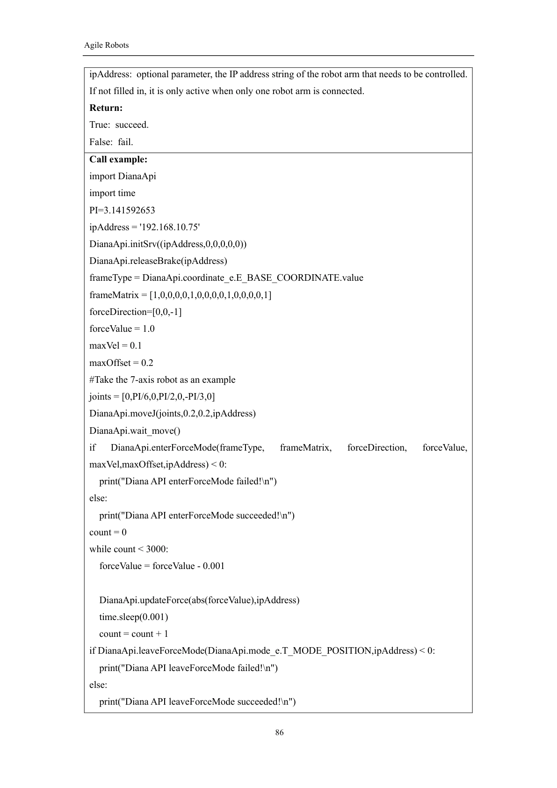



```
Agile Robots  
 86  
ipAddress:  optional parameter, the IP address string of the robot arm that needs to be controlled. 
If not filled in, it is only active when only one robot arm is connected.  
Return:  
True:  succeed.  
False:  fail.  
Call example:  
import DianaApi 
import time 
PI=3.141592653 
ipAddress = '192.168.10.75' 
DianaApi.initSrv((ipAddress,0,0,0,0,0)) 
DianaApi.releaseBrake(ipAddress) 
frameType = DianaApi.coordinate_e.E_BASE_COORDINATE.value 
frameMatrix = [1,0,0,0,0,1,0,0,0,0,1,0,0,0,0,1] 
forceDirection=[0,0,-1] 
forceValue = 1.0 
maxVel = 0.1 
maxOffset = 0.2 
#Take the 7-axis robot as an example  
joints = [0,PI/6,0,PI/2,0,-PI/3,0] 
DianaApi.moveJ(joints,0.2,0.2,ipAddress) 
DianaApi.wait_move() 
if 
DianaApi.enterForceMode(frameType, 
frameMatrix, 
forceDirection, 
forceValue, 
maxVel,maxOffset,ipAddress) < 0: 
    print("Diana API enterForceMode failed!\n") 
else: 
    print("Diana API enterForceMode succeeded!\n") 
count = 0 
while count < 3000: 
    forceValue = forceValue - 0.001 
    
    DianaApi.updateForce(abs(forceValue),ipAddress) 
    time.sleep(0.001) 
    count = count + 1 
if DianaApi.leaveForceMode(DianaApi.mode_e.T_MODE_POSITION,ipAddress) < 0: 
    print("Diana API leaveForceMode failed!\n") 
else: 
    print("Diana API leaveForceMode succeeded!\n")
```



## PDF page 95

**Source:** Industrial API Manual (Python Edition) \_V3.3.0\_EN\_20260205.pdf, original pdf page 95. [Open the corresponding PDF reading-copy page](https://1292444914-files.gitbook.io/~/files/v0/b/gitbook-x-prod.appspot.com/o/spaces%2FtgOfPnscWebs1eh82EKq%2Fuploads%2FRuKqP58TGdcORhNDRsIQ%2Findustrial-api-manual-python-edition-v3-3-0-en-20260205-pp-001-139.pdf?alt=media#page=95).



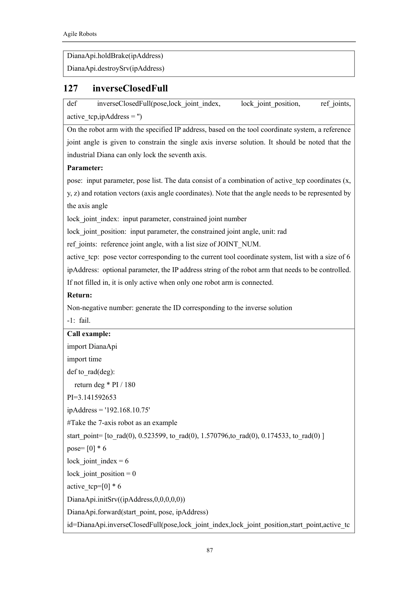



```
Agile Robots  
 87  
DianaApi.holdBrake(ipAddress) 
DianaApi.destroySrv(ipAddress) 
127 
inverseClosedFull 
def 
inverseClosedFull(pose,lock_joint_index, 
lock_joint_position, 
ref_joints, 
active_tcp,ipAddress = '')  
On the robot arm with the specified IP address, based on the tool coordinate system, a reference 
joint angle is given to constrain the single axis inverse solution. It should be noted that the 
industrial Diana can only lock the seventh axis.  
Parameter:  
pose:  input parameter, pose list. The data consist of a combination of active_tcp coordinates (x, 
y, z) and rotation vectors (axis angle coordinates). Note that the angle needs to be represented by 
the axis angle  
lock_joint_index:  input parameter, constrained joint number  
lock_joint_position:  input parameter, the constrained joint angle, unit: rad  
ref_joints:  reference joint angle, with a list size of JOINT_NUM.  
active_tcp:  pose vector corresponding to the current tool coordinate system, list with a size of 6  
ipAddress:  optional parameter, the IP address string of the robot arm that needs to be controlled. 
If not filled in, it is only active when only one robot arm is connected.  
Return:  
Non-negative number: generate the ID corresponding to the inverse solution  
-1:  fail.  
Call example:  
import DianaApi 
import time 
def to_rad(deg): 
    return deg * PI / 180 
PI=3.141592653 
ipAddress = '192.168.10.75' 
#Take the 7-axis robot as an example  
start_point= [to_rad(0), 0.523599, to_rad(0), 1.570796,to_rad(0), 0.174533, to_rad(0) ] 
pose= [0] * 6 
lock_joint_index = 6 
lock_joint_position = 0 
active_tcp=[0] * 6 
DianaApi.initSrv((ipAddress,0,0,0,0,0)) 
DianaApi.forward(start_point, pose, ipAddress) 
id=DianaApi.inverseClosedFull(pose,lock_joint_index,lock_joint_position,start_point,active_tc
```



## PDF page 96

**Source:** Industrial API Manual (Python Edition) \_V3.3.0\_EN\_20260205.pdf, original pdf page 96. [Open the corresponding PDF reading-copy page](https://1292444914-files.gitbook.io/~/files/v0/b/gitbook-x-prod.appspot.com/o/spaces%2FtgOfPnscWebs1eh82EKq%2Fuploads%2FRuKqP58TGdcORhNDRsIQ%2Findustrial-api-manual-python-edition-v3-3-0-en-20260205-pp-001-139.pdf?alt=media#page=96).



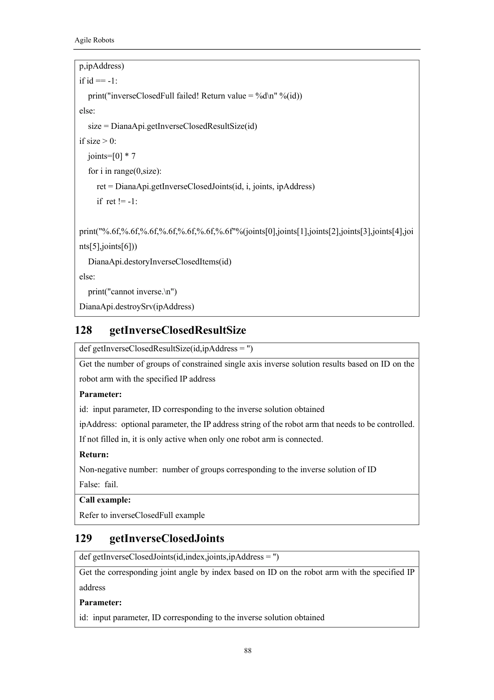



```
Agile Robots  
 88  
p,ipAddress) 
if id == -1: 
    print("inverseClosedFull failed! Return value = %d\n" %(id)) 
else: 
    size = DianaApi.getInverseClosedResultSize(id) 
if size > 0: 
    joints=[0] * 7 
    for i in range(0,size): 
        ret = DianaApi.getInverseClosedJoints(id, i, joints, ipAddress) 
        if  ret != -1: 
            
print("%.6f,%.6f,%.6f,%.6f,%.6f,%.6f,%.6f"%(joints[0],joints[1],joints[2],joints[3],joints[4],joi
nts[5],joints[6])) 
    DianaApi.destoryInverseClosedItems(id) 
else: 
    print("cannot inverse.\n") 
DianaApi.destroySrv(ipAddress) 
128 
getInverseClosedResultSize  
def getInverseClosedResultSize(id,ipAddress = '')  
Get the number of groups of constrained single axis inverse solution results based on ID on the 
robot arm with the specified IP address  
Parameter:  
id:  input parameter, ID corresponding to the inverse solution obtained  
ipAddress:  optional parameter, the IP address string of the robot arm that needs to be controlled. 
If not filled in, it is only active when only one robot arm is connected.  
Return:  
Non-negative number:  number of groups corresponding to the inverse solution of ID  
False:  fail.  
Call example:  
Refer to inverseClosedFull example  
129 
getInverseClosedJoints 
def getInverseClosedJoints(id,index,joints,ipAddress = '') 
Get the corresponding joint angle by index based on ID on the robot arm with the specified IP 
address  
Parameter:  
id:  input parameter, ID corresponding to the inverse solution obtained
```



## PDF page 97

**Source:** Industrial API Manual (Python Edition) \_V3.3.0\_EN\_20260205.pdf, original pdf page 97. [Open the corresponding PDF reading-copy page](https://1292444914-files.gitbook.io/~/files/v0/b/gitbook-x-prod.appspot.com/o/spaces%2FtgOfPnscWebs1eh82EKq%2Fuploads%2FRuKqP58TGdcORhNDRsIQ%2Findustrial-api-manual-python-edition-v3-3-0-en-20260205-pp-001-139.pdf?alt=media#page=97).



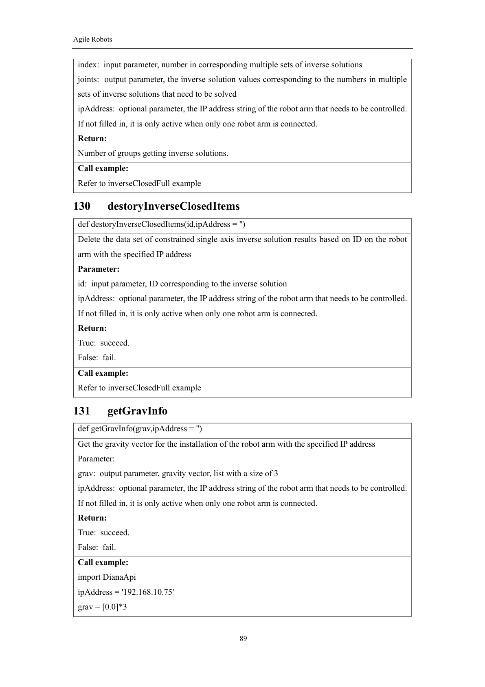



```
Agile Robots  
 89  
index:  input parameter, number in corresponding multiple sets of inverse solutions  
joints:  output parameter, the inverse solution values corresponding to the numbers in multiple 
sets of inverse solutions that need to be solved  
ipAddress:  optional parameter, the IP address string of the robot arm that needs to be controlled. 
If not filled in, it is only active when only one robot arm is connected.  
Return:  
Number of groups getting inverse solutions.  
Call example:  
Refer to inverseClosedFull example  
130 
destoryInverseClosedItems 
def destoryInverseClosedItems(id,ipAddress = '') 
Delete the data set of constrained single axis inverse solution results based on ID on the robot 
arm with the specified IP address  
Parameter:  
id:  input parameter, ID corresponding to the inverse solution  
ipAddress:  optional parameter, the IP address string of the robot arm that needs to be controlled. 
If not filled in, it is only active when only one robot arm is connected.  
Return:  
True:  succeed.  
False:  fail.  
Call example:  
Refer to inverseClosedFull example  
131 
getGravInfo 
def getGravInfo(grav,ipAddress = '') 
Get the gravity vector for the installation of the robot arm with the specified IP address  
Parameter:  
grav:  output parameter, gravity vector, list with a size of 3  
ipAddress:  optional parameter, the IP address string of the robot arm that needs to be controlled. 
If not filled in, it is only active when only one robot arm is connected.  
Return:  
True:  succeed.  
False:  fail.  
Call example:  
import DianaApi 
ipAddress = '192.168.10.75' 
grav = [0.0]*3
```



## PDF page 98

**Source:** Industrial API Manual (Python Edition) \_V3.3.0\_EN\_20260205.pdf, original pdf page 98. [Open the corresponding PDF reading-copy page](https://1292444914-files.gitbook.io/~/files/v0/b/gitbook-x-prod.appspot.com/o/spaces%2FtgOfPnscWebs1eh82EKq%2Fuploads%2FRuKqP58TGdcORhNDRsIQ%2Findustrial-api-manual-python-edition-v3-3-0-en-20260205-pp-001-139.pdf?alt=media#page=98).



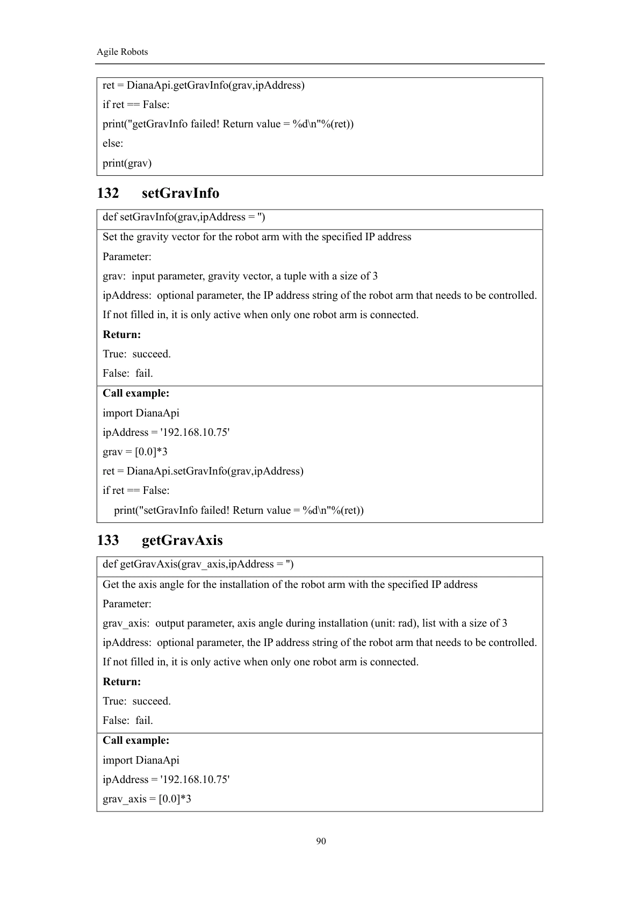



```
Agile Robots  
 90  
ret = DianaApi.getGravInfo(grav,ipAddress) 
if ret == False: 
print("getGravInfo failed! Return value = %d\n"%(ret)) 
else: 
print(grav) 
132 
setGravInfo 
def setGravInfo(grav,ipAddress = '') 
Set the gravity vector for the robot arm with the specified IP address  
Parameter:  
grav:  input parameter, gravity vector, a tuple with a size of 3  
ipAddress:  optional parameter, the IP address string of the robot arm that needs to be controlled. 
If not filled in, it is only active when only one robot arm is connected.  
Return:  
True:  succeed.  
False:  fail.  
Call example:  
import DianaApi 
ipAddress = '192.168.10.75' 
grav = [0.0]*3 
ret = DianaApi.setGravInfo(grav,ipAddress) 
if ret == False: 
    print("setGravInfo failed! Return value = %d\n"%(ret)) 
133 
getGravAxis 
def getGravAxis(grav_axis,ipAddress = '') 
Get the axis angle for the installation of the robot arm with the specified IP address  
Parameter:  
grav_axis:  output parameter, axis angle during installation (unit: rad), list with a size of 3  
ipAddress:  optional parameter, the IP address string of the robot arm that needs to be controlled. 
If not filled in, it is only active when only one robot arm is connected.  
Return:  
True:  succeed.  
False:  fail.  
Call example:  
import DianaApi 
ipAddress = '192.168.10.75' 
grav_axis = [0.0]*3
```



## PDF page 99

**Source:** Industrial API Manual (Python Edition) \_V3.3.0\_EN\_20260205.pdf, original pdf page 99. [Open the corresponding PDF reading-copy page](https://1292444914-files.gitbook.io/~/files/v0/b/gitbook-x-prod.appspot.com/o/spaces%2FtgOfPnscWebs1eh82EKq%2Fuploads%2FRuKqP58TGdcORhNDRsIQ%2Findustrial-api-manual-python-edition-v3-3-0-en-20260205-pp-001-139.pdf?alt=media#page=99).



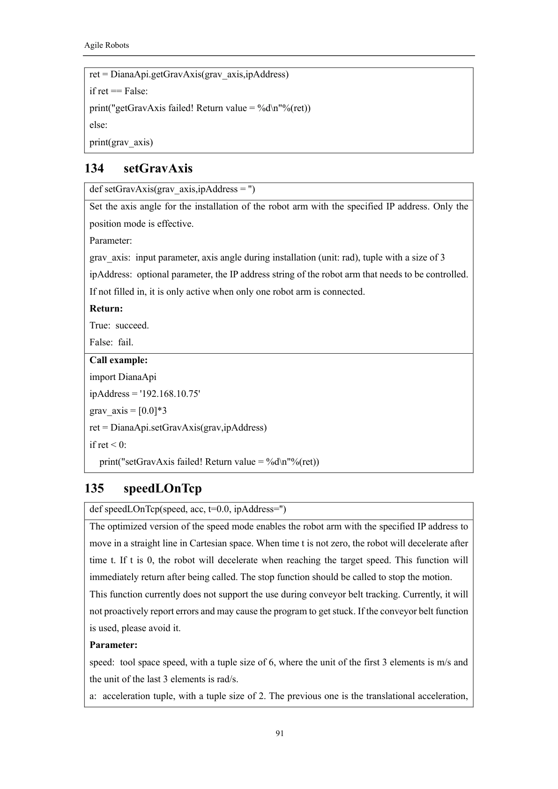



```
Agile Robots  
 91  
ret = DianaApi.getGravAxis(grav_axis,ipAddress) 
if ret == False: 
print("getGravAxis failed! Return value = %d\n"%(ret)) 
else: 
print(grav_axis) 
134 
setGravAxis  
def setGravAxis(grav_axis,ipAddress = '')  
Set the axis angle for the installation of the robot arm with the specified IP address. Only the 
position mode is effective.   
Parameter:  
grav_axis:  input parameter, axis angle during installation (unit: rad), tuple with a size of 3  
ipAddress:  optional parameter, the IP address string of the robot arm that needs to be controlled. 
If not filled in, it is only active when only one robot arm is connected.  
Return:  
True:  succeed.  
False:  fail.  
Call example:  
import DianaApi 
ipAddress = '192.168.10.75' 
grav_axis = [0.0]*3 
ret = DianaApi.setGravAxis(grav,ipAddress) 
if ret < 0: 
    print("setGravAxis failed! Return value = %d\n"%(ret)) 
135 
speedLOnTcp 
def speedLOnTcp(speed, acc, t=0.0, ipAddress='') 
The optimized version of the speed mode enables the robot arm with the specified IP address to 
move in a straight line in Cartesian space. When time t is not zero, the robot will decelerate after 
time t. If t is 0, the robot will decelerate when reaching the target speed. This function will 
immediately return after being called. The stop function should be called to stop the motion.  
This function currently does not support the use during conveyor belt tracking. Currently, it will 
not proactively report errors and may cause the program to get stuck. If the conveyor belt function 
is used, please avoid it.  
Parameter:  
speed:  tool space speed, with a tuple size of 6, where the unit of the first 3 elements is m/s and 
the unit of the last 3 elements is rad/s.  
a:  acceleration tuple, with a tuple size of 2. The previous one is the translational acceleration,
```



## PDF page 100

**Source:** Industrial API Manual (Python Edition) \_V3.3.0\_EN\_20260205.pdf, original pdf page 100. [Open the corresponding PDF reading-copy page](https://1292444914-files.gitbook.io/~/files/v0/b/gitbook-x-prod.appspot.com/o/spaces%2FtgOfPnscWebs1eh82EKq%2Fuploads%2FRuKqP58TGdcORhNDRsIQ%2Findustrial-api-manual-python-edition-v3-3-0-en-20260205-pp-001-139.pdf?alt=media#page=100).



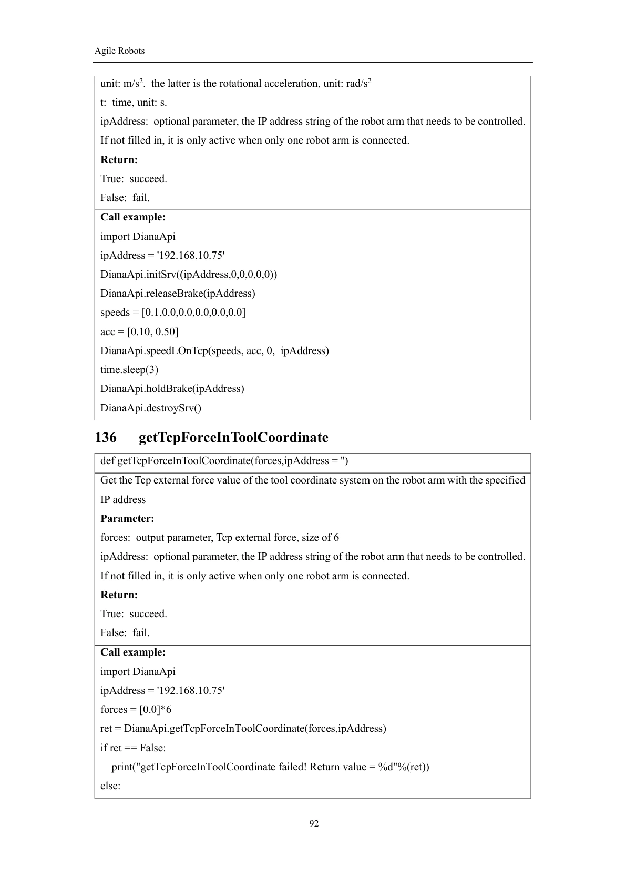



```
Agile Robots  
 92  
unit: m/s2.  the latter is the rotational acceleration, unit: rad/s2  
t:  time, unit: s.  
ipAddress:  optional parameter, the IP address string of the robot arm that needs to be controlled. 
If not filled in, it is only active when only one robot arm is connected.  
Return:  
True:  succeed.  
False:  fail.  
Call example:  
import DianaApi 
ipAddress = '192.168.10.75' 
DianaApi.initSrv((ipAddress,0,0,0,0,0)) 
DianaApi.releaseBrake(ipAddress) 
speeds = [0.1,0.0,0.0,0.0,0.0,0.0] 
acc = [0.10, 0.50] 
DianaApi.speedLOnTcp(speeds, acc, 0,  ipAddress) 
time.sleep(3) 
DianaApi.holdBrake(ipAddress) 
DianaApi.destroySrv() 
136 
getTcpForceInToolCoordinate 
def getTcpForceInToolCoordinate(forces,ipAddress = '') 
Get the Tcp external force value of the tool coordinate system on the robot arm with the specified 
IP address  
Parameter:  
forces:  output parameter, Tcp external force, size of 6  
ipAddress:  optional parameter, the IP address string of the robot arm that needs to be controlled. 
If not filled in, it is only active when only one robot arm is connected.  
Return:  
True:  succeed.  
False:  fail.  
Call example:  
import DianaApi 
ipAddress = '192.168.10.75' 
forces = [0.0]*6 
ret = DianaApi.getTcpForceInToolCoordinate(forces,ipAddress) 
if ret == False: 
    print("getTcpForceInToolCoordinate failed! Return value = %d"%(ret)) 
else:
```



## PDF page 101

**Source:** Industrial API Manual (Python Edition) \_V3.3.0\_EN\_20260205.pdf, original pdf page 101. [Open the corresponding PDF reading-copy page](https://1292444914-files.gitbook.io/~/files/v0/b/gitbook-x-prod.appspot.com/o/spaces%2FtgOfPnscWebs1eh82EKq%2Fuploads%2FRuKqP58TGdcORhNDRsIQ%2Findustrial-api-manual-python-edition-v3-3-0-en-20260205-pp-001-139.pdf?alt=media#page=101).



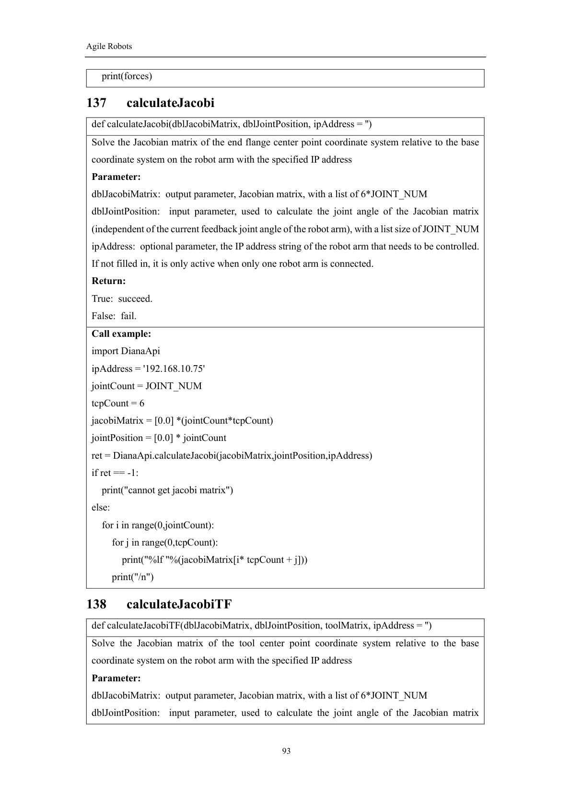



```
Agile Robots  
 93  
    print(forces) 
137 
calculateJacobi 
def calculateJacobi(dblJacobiMatrix, dblJointPosition, ipAddress = '') 
Solve the Jacobian matrix of the end flange center point coordinate system relative to the base 
coordinate system on the robot arm with the specified IP address  
Parameter:  
dblJacobiMatrix:  output parameter, Jacobian matrix, with a list of 6*JOINT_NUM  
dblJointPosition:  input parameter, used to calculate the joint angle of the Jacobian matrix 
(independent of the current feedback joint angle of the robot arm), with a list size of JOINT_NUM  
ipAddress:  optional parameter, the IP address string of the robot arm that needs to be controlled. 
If not filled in, it is only active when only one robot arm is connected.  
Return:  
True:  succeed.  
False:  fail.  
Call example:  
import DianaApi 
ipAddress = '192.168.10.75' 
jointCount = JOINT_NUM 
tcpCount = 6 
jacobiMatrix = [0.0] *(jointCount*tcpCount) 
jointPosition = [0.0] * jointCount 
ret = DianaApi.calculateJacobi(jacobiMatrix,jointPosition,ipAddress) 
if ret == -1: 
    print("cannot get jacobi matrix") 
else: 
    for i in range(0,jointCount): 
        for j in range(0,tcpCount): 
            print("%lf "%(jacobiMatrix[i* tcpCount + j])) 
        print("/n") 
138 
calculateJacobiTF 
def calculateJacobiTF(dblJacobiMatrix, dblJointPosition, toolMatrix, ipAddress = '') 
Solve the Jacobian matrix of the tool center point coordinate system relative to the base 
coordinate system on the robot arm with the specified IP address  
Parameter:  
dblJacobiMatrix:  output parameter, Jacobian matrix, with a list of 6*JOINT_NUM  
dblJointPosition:  input parameter, used to calculate the joint angle of the Jacobian matrix
```



## PDF page 102

**Source:** Industrial API Manual (Python Edition) \_V3.3.0\_EN\_20260205.pdf, original pdf page 102. [Open the corresponding PDF reading-copy page](https://1292444914-files.gitbook.io/~/files/v0/b/gitbook-x-prod.appspot.com/o/spaces%2FtgOfPnscWebs1eh82EKq%2Fuploads%2FRuKqP58TGdcORhNDRsIQ%2Findustrial-api-manual-python-edition-v3-3-0-en-20260205-pp-001-139.pdf?alt=media#page=102).



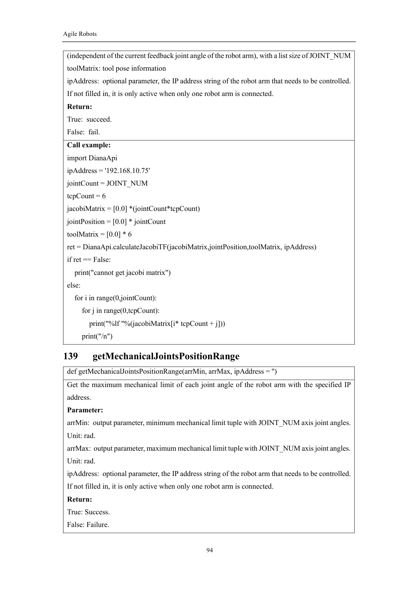



```
Agile Robots  
 94  
(independent of the current feedback joint angle of the robot arm), with a list size of JOINT_NUM  
toolMatrix: tool pose information 
ipAddress:  optional parameter, the IP address string of the robot arm that needs to be controlled. 
If not filled in, it is only active when only one robot arm is connected.  
Return:  
True:  succeed.  
False:  fail.  
Call example:  
import DianaApi 
ipAddress = '192.168.10.75' 
jointCount = JOINT_NUM 
tcpCount = 6 
jacobiMatrix = [0.0] *(jointCount*tcpCount) 
jointPosition = [0.0] * jointCount 
toolMatrix = [0.0] * 6 
ret = DianaApi.calculateJacobiTF(jacobiMatrix,jointPosition,toolMatrix, ipAddress) 
if ret == False: 
    print("cannot get jacobi matrix") 
else: 
    for i in range(0,jointCount): 
        for j in range(0,tcpCount): 
            print("%lf "%(jacobiMatrix[i* tcpCount + j])) 
        print("/n") 
139 
getMechanicalJointsPositionRange 
def getMechanicalJointsPositionRange(arrMin, arrMax, ipAddress = '') 
Get the maximum mechanical limit of each joint angle of the robot arm with the specified IP 
address.  
Parameter:  
arrMin:  output parameter, minimum mechanical limit tuple with JOINT_NUM axis joint angles. 
Unit: rad.  
arrMax:  output parameter, maximum mechanical limit tuple with JOINT_NUM axis joint angles. 
Unit: rad.  
ipAddress:  optional parameter, the IP address string of the robot arm that needs to be controlled. 
If not filled in, it is only active when only one robot arm is connected.  
Return:  
True: Success. 
False: Failure.
```



## PDF page 103

**Source:** Industrial API Manual (Python Edition) \_V3.3.0\_EN\_20260205.pdf, original pdf page 103. [Open the corresponding PDF reading-copy page](https://1292444914-files.gitbook.io/~/files/v0/b/gitbook-x-prod.appspot.com/o/spaces%2FtgOfPnscWebs1eh82EKq%2Fuploads%2FRuKqP58TGdcORhNDRsIQ%2Findustrial-api-manual-python-edition-v3-3-0-en-20260205-pp-001-139.pdf?alt=media#page=103).



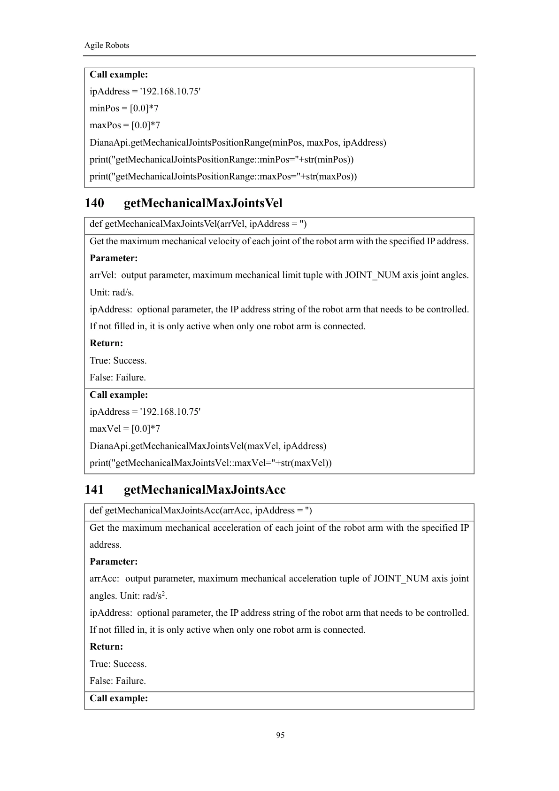



```
Agile Robots  
 95  
Call example:  
ipAddress = '192.168.10.75' 
minPos = [0.0]*7 
maxPos = [0.0]*7 
DianaApi.getMechanicalJointsPositionRange(minPos, maxPos, ipAddress) 
print("getMechanicalJointsPositionRange::minPos="+str(minPos)) 
print("getMechanicalJointsPositionRange::maxPos="+str(maxPos)) 
140 
getMechanicalMaxJointsVel 
def getMechanicalMaxJointsVel(arrVel, ipAddress = '') 
Get the maximum mechanical velocity of each joint of the robot arm with the specified IP address.  
Parameter:  
arrVel:  output parameter, maximum mechanical limit tuple with JOINT_NUM axis joint angles. 
Unit: rad/s.  
ipAddress:  optional parameter, the IP address string of the robot arm that needs to be controlled. 
If not filled in, it is only active when only one robot arm is connected.  
Return:  
True: Success. 
False: Failure. 
Call example:  
ipAddress = '192.168.10.75' 
maxVel = [0.0]*7 
DianaApi.getMechanicalMaxJointsVel(maxVel, ipAddress) 
print("getMechanicalMaxJointsVel::maxVel="+str(maxVel)) 
141 
getMechanicalMaxJointsAcc 
def getMechanicalMaxJointsAcc(arrAcc, ipAddress = '') 
Get the maximum mechanical acceleration of each joint of the robot arm with the specified IP 
address.  
Parameter:  
arrAcc:  output parameter, maximum mechanical acceleration tuple of JOINT_NUM axis joint 
angles. Unit: rad/s2.  
ipAddress:  optional parameter, the IP address string of the robot arm that needs to be controlled. 
If not filled in, it is only active when only one robot arm is connected.  
Return:  
True: Success. 
False: Failure. 
Call example:
```



## PDF page 104

**Source:** Industrial API Manual (Python Edition) \_V3.3.0\_EN\_20260205.pdf, original pdf page 104. [Open the corresponding PDF reading-copy page](https://1292444914-files.gitbook.io/~/files/v0/b/gitbook-x-prod.appspot.com/o/spaces%2FtgOfPnscWebs1eh82EKq%2Fuploads%2FRuKqP58TGdcORhNDRsIQ%2Findustrial-api-manual-python-edition-v3-3-0-en-20260205-pp-001-139.pdf?alt=media#page=104).



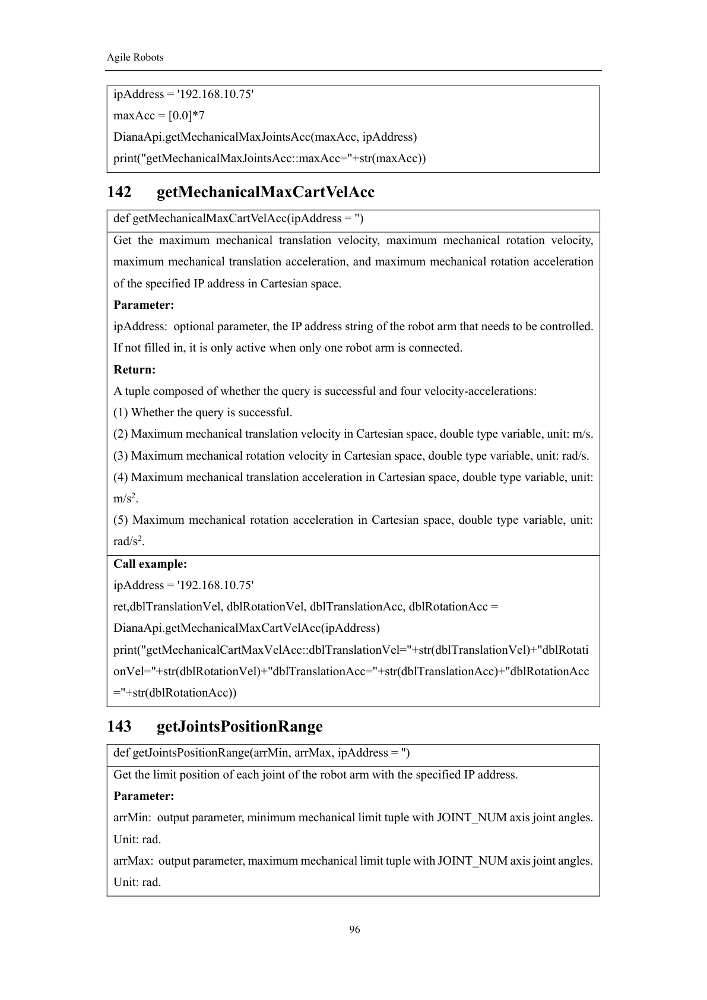



```
Agile Robots  
 96  
ipAddress = '192.168.10.75' 
maxAcc = [0.0]*7 
DianaApi.getMechanicalMaxJointsAcc(maxAcc, ipAddress) 
print("getMechanicalMaxJointsAcc::maxAcc="+str(maxAcc)) 
142 
getMechanicalMaxCartVelAcc 
def getMechanicalMaxCartVelAcc(ipAddress = '') 
Get the maximum mechanical translation velocity, maximum mechanical rotation velocity, 
maximum mechanical translation acceleration, and maximum mechanical rotation acceleration 
of the specified IP address in Cartesian space.  
Parameter:  
ipAddress:  optional parameter, the IP address string of the robot arm that needs to be controlled. 
If not filled in, it is only active when only one robot arm is connected.  
Return:  
A tuple composed of whether the query is successful and four velocity-accelerations:  
(1) Whether the query is successful.  
(2) Maximum mechanical translation velocity in Cartesian space, double type variable, unit: m/s.  
(3) Maximum mechanical rotation velocity in Cartesian space, double type variable, unit: rad/s.  
(4) Maximum mechanical translation acceleration in Cartesian space, double type variable, unit: 
m/s2.  
(5) Maximum mechanical rotation acceleration in Cartesian space, double type variable, unit: 
rad/s2.  
Call example:  
ipAddress = '192.168.10.75' 
ret,dblTranslationVel, dblRotationVel, dblTranslationAcc, dblRotationAcc = 
DianaApi.getMechanicalMaxCartVelAcc(ipAddress) 
print("getMechanicalCartMaxVelAcc::dblTranslationVel="+str(dblTranslationVel)+"dblRotati
onVel="+str(dblRotationVel)+"dblTranslationAcc="+str(dblTranslationAcc)+"dblRotationAcc
="+str(dblRotationAcc)) 
143 
getJointsPositionRange  
def getJointsPositionRange(arrMin, arrMax, ipAddress = '')  
Get the limit position of each joint of the robot arm with the specified IP address.  
Parameter:  
arrMin:  output parameter, minimum mechanical limit tuple with JOINT_NUM axis joint angles. 
Unit: rad.  
arrMax:  output parameter, maximum mechanical limit tuple with JOINT_NUM axis joint angles. 
Unit: rad.
```



## PDF page 105

**Source:** Industrial API Manual (Python Edition) \_V3.3.0\_EN\_20260205.pdf, original pdf page 105. [Open the corresponding PDF reading-copy page](https://1292444914-files.gitbook.io/~/files/v0/b/gitbook-x-prod.appspot.com/o/spaces%2FtgOfPnscWebs1eh82EKq%2Fuploads%2FRuKqP58TGdcORhNDRsIQ%2Findustrial-api-manual-python-edition-v3-3-0-en-20260205-pp-001-139.pdf?alt=media#page=105).



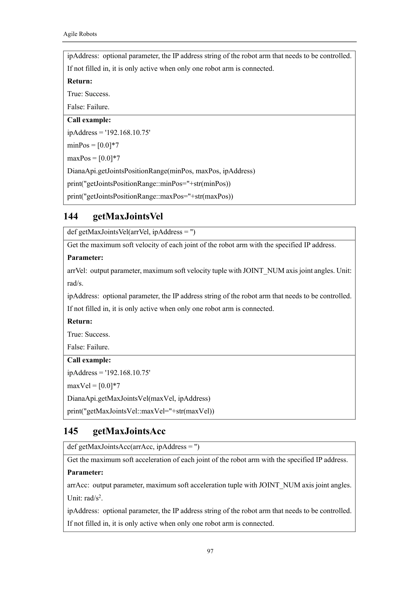



```
Agile Robots  
 97  
ipAddress:  optional parameter, the IP address string of the robot arm that needs to be controlled. 
If not filled in, it is only active when only one robot arm is connected.  
Return:  
True: Success. 
False: Failure. 
Call example:  
ipAddress = '192.168.10.75' 
minPos = [0.0]*7 
maxPos = [0.0]*7 
DianaApi.getJointsPositionRange(minPos, maxPos, ipAddress) 
print("getJointsPositionRange::minPos="+str(minPos)) 
print("getJointsPositionRange::maxPos="+str(maxPos)) 
144 
getMaxJointsVel 
def getMaxJointsVel(arrVel, ipAddress = '') 
Get the maximum soft velocity of each joint of the robot arm with the specified IP address.  
Parameter:  
arrVel:  output parameter, maximum soft velocity tuple with JOINT_NUM axis joint angles. Unit: 
rad/s.  
ipAddress:  optional parameter, the IP address string of the robot arm that needs to be controlled. 
If not filled in, it is only active when only one robot arm is connected.  
Return:  
True: Success. 
False: Failure. 
Call example:  
ipAddress = '192.168.10.75' 
maxVel = [0.0]*7 
DianaApi.getMaxJointsVel(maxVel, ipAddress) 
print("getMaxJointsVel::maxVel="+str(maxVel)) 
145 
getMaxJointsAcc 
def getMaxJointsAcc(arrAcc, ipAddress = '') 
Get the maximum soft acceleration of each joint of the robot arm with the specified IP address.  
Parameter:  
arrAcc:  output parameter, maximum soft acceleration tuple with JOINT_NUM axis joint angles. 
Unit: rad/s2.  
ipAddress:  optional parameter, the IP address string of the robot arm that needs to be controlled. 
If not filled in, it is only active when only one robot arm is connected.
```



## PDF page 106

**Source:** Industrial API Manual (Python Edition) \_V3.3.0\_EN\_20260205.pdf, original pdf page 106. [Open the corresponding PDF reading-copy page](https://1292444914-files.gitbook.io/~/files/v0/b/gitbook-x-prod.appspot.com/o/spaces%2FtgOfPnscWebs1eh82EKq%2Fuploads%2FRuKqP58TGdcORhNDRsIQ%2Findustrial-api-manual-python-edition-v3-3-0-en-20260205-pp-001-139.pdf?alt=media#page=106).



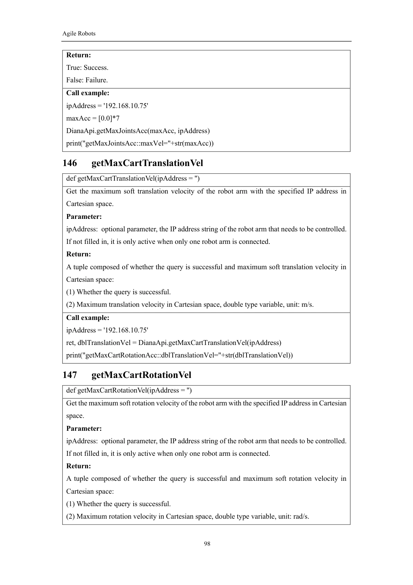



```
Agile Robots  
 98  
Return:  
True: Success. 
False: Failure. 
Call example:  
ipAddress = '192.168.10.75' 
maxAcc = [0.0]*7 
DianaApi.getMaxJointsAcc(maxAcc, ipAddress) 
print("getMaxJointsAcc::maxVel="+str(maxAcc)) 
146 
getMaxCartTranslationVel 
def getMaxCartTranslationVel(ipAddress = '') 
Get the maximum soft translation velocity of the robot arm with the specified IP address in 
Cartesian space.  
Parameter:  
ipAddress:  optional parameter, the IP address string of the robot arm that needs to be controlled. 
If not filled in, it is only active when only one robot arm is connected.  
Return:  
A tuple composed of whether the query is successful and maximum soft translation velocity in 
Cartesian space:  
(1) Whether the query is successful.  
(2) Maximum translation velocity in Cartesian space, double type variable, unit: m/s.  
Call example:  
ipAddress = '192.168.10.75' 
ret, dblTranslationVel = DianaApi.getMaxCartTranslationVel(ipAddress) 
print("getMaxCartRotationAcc::dblTranslationVel="+str(dblTranslationVel)) 
147 
getMaxCartRotationVel 
def getMaxCartRotationVel(ipAddress = '') 
Get the maximum soft rotation velocity of the robot arm with the specified IP address in Cartesian 
space.  
Parameter:  
ipAddress:  optional parameter, the IP address string of the robot arm that needs to be controlled. 
If not filled in, it is only active when only one robot arm is connected.  
Return:  
A tuple composed of whether the query is successful and maximum soft rotation velocity in 
Cartesian space:  
(1) Whether the query is successful.  
(2) Maximum rotation velocity in Cartesian space, double type variable, unit: rad/s.
```



## PDF page 107

**Source:** Industrial API Manual (Python Edition) \_V3.3.0\_EN\_20260205.pdf, original pdf page 107. [Open the corresponding PDF reading-copy page](https://1292444914-files.gitbook.io/~/files/v0/b/gitbook-x-prod.appspot.com/o/spaces%2FtgOfPnscWebs1eh82EKq%2Fuploads%2FRuKqP58TGdcORhNDRsIQ%2Findustrial-api-manual-python-edition-v3-3-0-en-20260205-pp-001-139.pdf?alt=media#page=107).



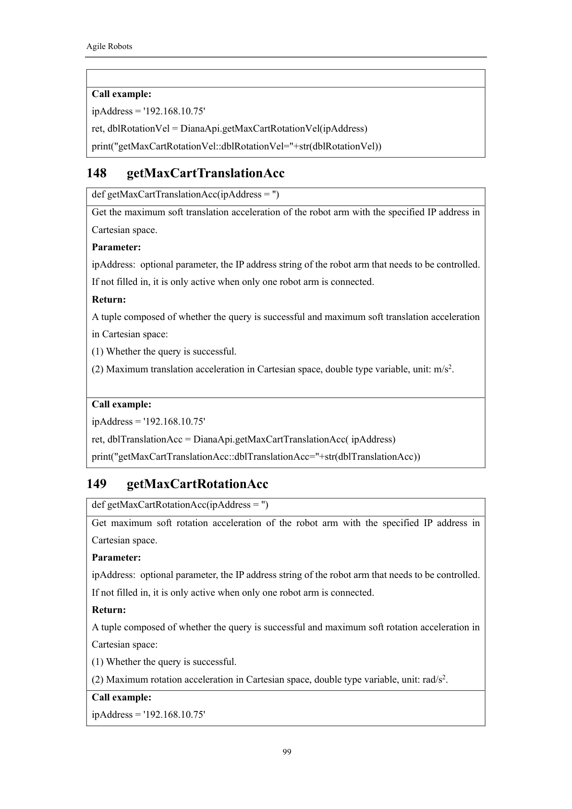



```
Agile Robots  
 99  
 
Call example:  
ipAddress = '192.168.10.75' 
ret, dblRotationVel = DianaApi.getMaxCartRotationVel(ipAddress) 
print("getMaxCartRotationVel::dblRotationVel="+str(dblRotationVel)) 
148 
getMaxCartTranslationAcc 
def getMaxCartTranslationAcc(ipAddress = '') 
Get the maximum soft translation acceleration of the robot arm with the specified IP address in 
Cartesian space.  
Parameter:  
ipAddress:  optional parameter, the IP address string of the robot arm that needs to be controlled. 
If not filled in, it is only active when only one robot arm is connected.  
Return:  
A tuple composed of whether the query is successful and maximum soft translation acceleration 
in Cartesian space:  
(1) Whether the query is successful.  
(2) Maximum translation acceleration in Cartesian space, double type variable, unit: m/s2.  
 
Call example:  
ipAddress = '192.168.10.75' 
ret, dblTranslationAcc = DianaApi.getMaxCartTranslationAcc( ipAddress) 
print("getMaxCartTranslationAcc::dblTranslationAcc="+str(dblTranslationAcc)) 
149 
getMaxCartRotationAcc 
def getMaxCartRotationAcc(ipAddress = '') 
Get maximum soft rotation acceleration of the robot arm with the specified IP address in 
Cartesian space.  
Parameter:  
ipAddress:  optional parameter, the IP address string of the robot arm that needs to be controlled. 
If not filled in, it is only active when only one robot arm is connected.  
Return:  
A tuple composed of whether the query is successful and maximum soft rotation acceleration in 
Cartesian space:  
(1) Whether the query is successful.  
(2) Maximum rotation acceleration in Cartesian space, double type variable, unit: rad/s2.  
Call example:  
ipAddress = '192.168.10.75'
```



## PDF page 108

**Source:** Industrial API Manual (Python Edition) \_V3.3.0\_EN\_20260205.pdf, original pdf page 108. [Open the corresponding PDF reading-copy page](https://1292444914-files.gitbook.io/~/files/v0/b/gitbook-x-prod.appspot.com/o/spaces%2FtgOfPnscWebs1eh82EKq%2Fuploads%2FRuKqP58TGdcORhNDRsIQ%2Findustrial-api-manual-python-edition-v3-3-0-en-20260205-pp-001-139.pdf?alt=media#page=108).



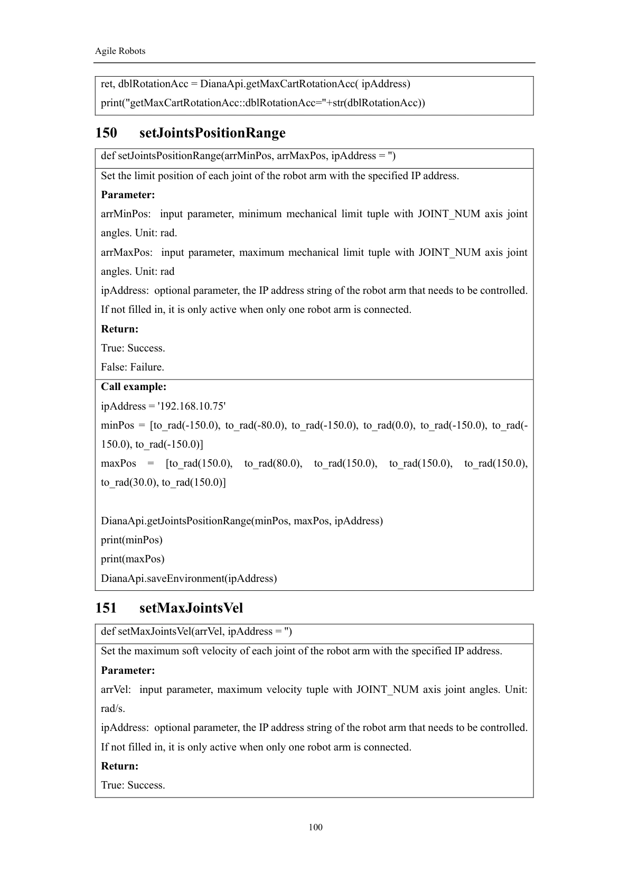



```
Agile Robots  
 100  
ret, dblRotationAcc = DianaApi.getMaxCartRotationAcc( ipAddress) 
print("getMaxCartRotationAcc::dblRotationAcc="+str(dblRotationAcc)) 
150 
setJointsPositionRange 
def setJointsPositionRange(arrMinPos, arrMaxPos, ipAddress = '') 
Set the limit position of each joint of the robot arm with the specified IP address.  
Parameter:  
arrMinPos:  input parameter, minimum mechanical limit tuple with JOINT_NUM axis joint 
angles. Unit: rad.  
arrMaxPos:  input parameter, maximum mechanical limit tuple with JOINT_NUM axis joint 
angles. Unit: rad  
ipAddress:  optional parameter, the IP address string of the robot arm that needs to be controlled. 
If not filled in, it is only active when only one robot arm is connected.  
Return:  
True: Success. 
False: Failure. 
Call example:  
ipAddress = '192.168.10.75' 
minPos = [to_rad(-150.0), to_rad(-80.0), to_rad(-150.0), to_rad(0.0), to_rad(-150.0), to_rad(-
150.0), to_rad(-150.0)] 
maxPos = [to_rad(150.0), to_rad(80.0), to_rad(150.0), to_rad(150.0), to_rad(150.0), 
to_rad(30.0), to_rad(150.0)] 
 
DianaApi.getJointsPositionRange(minPos, maxPos, ipAddress) 
print(minPos) 
print(maxPos) 
DianaApi.saveEnvironment(ipAddress) 
151 
setMaxJointsVel 
def setMaxJointsVel(arrVel, ipAddress = '') 
Set the maximum soft velocity of each joint of the robot arm with the specified IP address.  
Parameter:  
arrVel:  input parameter, maximum velocity tuple with JOINT_NUM axis joint angles. Unit: 
rad/s.  
ipAddress:  optional parameter, the IP address string of the robot arm that needs to be controlled. 
If not filled in, it is only active when only one robot arm is connected.  
Return:  
True: Success.
```



## PDF page 109

**Source:** Industrial API Manual (Python Edition) \_V3.3.0\_EN\_20260205.pdf, original pdf page 109. [Open the corresponding PDF reading-copy page](https://1292444914-files.gitbook.io/~/files/v0/b/gitbook-x-prod.appspot.com/o/spaces%2FtgOfPnscWebs1eh82EKq%2Fuploads%2FRuKqP58TGdcORhNDRsIQ%2Findustrial-api-manual-python-edition-v3-3-0-en-20260205-pp-001-139.pdf?alt=media#page=109).



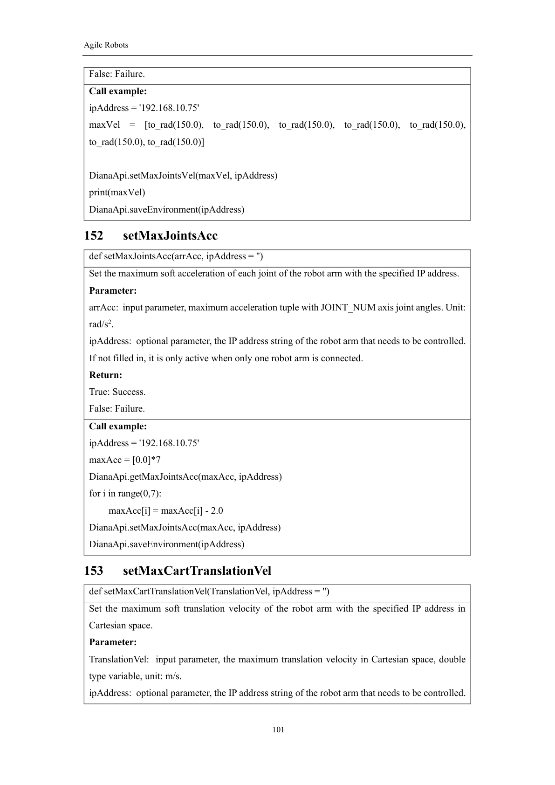



```
Agile Robots  
 101  
False: Failure. 
Call example:  
ipAddress = '192.168.10.75' 
maxVel = [to_rad(150.0), to_rad(150.0), to_rad(150.0), to_rad(150.0), to_rad(150.0), 
to_rad(150.0), to_rad(150.0)] 
 
DianaApi.setMaxJointsVel(maxVel, ipAddress) 
print(maxVel) 
DianaApi.saveEnvironment(ipAddress) 
152 
setMaxJointsAcc 
def setMaxJointsAcc(arrAcc, ipAddress = '') 
Set the maximum soft acceleration of each joint of the robot arm with the specified IP address.  
Parameter:  
arrAcc:  input parameter, maximum acceleration tuple with JOINT_NUM axis joint angles. Unit: 
rad/s2.  
ipAddress:  optional parameter, the IP address string of the robot arm that needs to be controlled. 
If not filled in, it is only active when only one robot arm is connected.  
Return:  
True: Success. 
False: Failure. 
Call example:  
ipAddress = '192.168.10.75' 
maxAcc = [0.0]*7 
DianaApi.getMaxJointsAcc(maxAcc, ipAddress) 
for i in range(0,7): 
 
maxAcc[i] = maxAcc[i] - 2.0 
DianaApi.setMaxJointsAcc(maxAcc, ipAddress) 
DianaApi.saveEnvironment(ipAddress) 
153 
setMaxCartTranslationVel 
def setMaxCartTranslationVel(TranslationVel, ipAddress = '') 
Set the maximum soft translation velocity of the robot arm with the specified IP address in 
Cartesian space.  
Parameter:  
TranslationVel:  input parameter, the maximum translation velocity in Cartesian space, double 
type variable, unit: m/s.  
ipAddress:  optional parameter, the IP address string of the robot arm that needs to be controlled.
```



## PDF page 110

**Source:** Industrial API Manual (Python Edition) \_V3.3.0\_EN\_20260205.pdf, original pdf page 110. [Open the corresponding PDF reading-copy page](https://1292444914-files.gitbook.io/~/files/v0/b/gitbook-x-prod.appspot.com/o/spaces%2FtgOfPnscWebs1eh82EKq%2Fuploads%2FRuKqP58TGdcORhNDRsIQ%2Findustrial-api-manual-python-edition-v3-3-0-en-20260205-pp-001-139.pdf?alt=media#page=110).



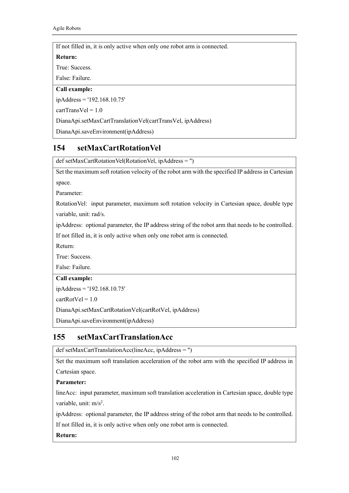



```
Agile Robots  
 102  
If not filled in, it is only active when only one robot arm is connected.  
Return:  
True: Success. 
False: Failure. 
Call example:  
ipAddress = '192.168.10.75' 
cartTransVel = 1.0 
DianaApi.setMaxCartTranslationVel(cartTransVel, ipAddress) 
DianaApi.saveEnvironment(ipAddress) 
154 
setMaxCartRotationVel  
def setMaxCartRotationVel(RotationVel, ipAddress = '') 
Set the maximum soft rotation velocity of the robot arm with the specified IP address in Cartesian 
space.  
Parameter:  
RotationVel:  input parameter, maximum soft rotation velocity in Cartesian space, double type 
variable, unit: rad/s.  
ipAddress:  optional parameter, the IP address string of the robot arm that needs to be controlled. 
If not filled in, it is only active when only one robot arm is connected.  
Return:  
True: Success. 
False: Failure. 
Call example:  
ipAddress = '192.168.10.75' 
cartRotVel = 1.0 
DianaApi.setMaxCartRotationVel(cartRotVel, ipAddress) 
DianaApi.saveEnvironment(ipAddress) 
155 
setMaxCartTranslationAcc 
def setMaxCartTranslationAcc(lineAcc, ipAddress = '') 
Set the maximum soft translation acceleration of the robot arm with the specified IP address in 
Cartesian space.  
Parameter:  
lineAcc:  input parameter, maximum soft translation acceleration in Cartesian space, double type 
variable, unit: m/s2.  
ipAddress:  optional parameter, the IP address string of the robot arm that needs to be controlled. 
If not filled in, it is only active when only one robot arm is connected.  
Return:
```



## PDF page 111

**Source:** Industrial API Manual (Python Edition) \_V3.3.0\_EN\_20260205.pdf, original pdf page 111. [Open the corresponding PDF reading-copy page](https://1292444914-files.gitbook.io/~/files/v0/b/gitbook-x-prod.appspot.com/o/spaces%2FtgOfPnscWebs1eh82EKq%2Fuploads%2FRuKqP58TGdcORhNDRsIQ%2Findustrial-api-manual-python-edition-v3-3-0-en-20260205-pp-001-139.pdf?alt=media#page=111).



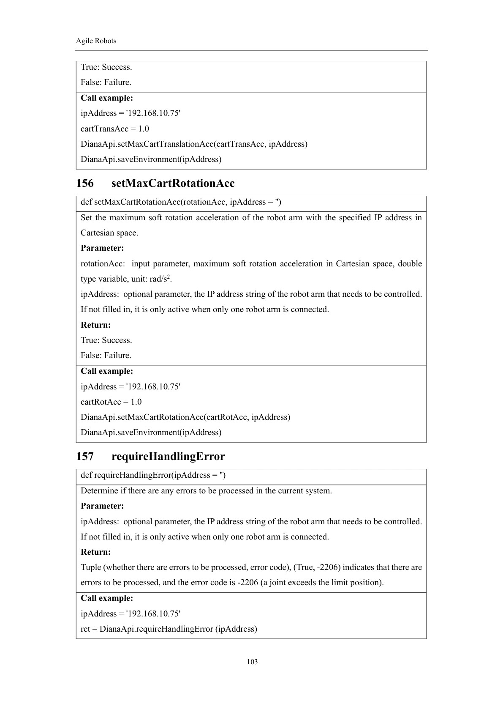



```
Agile Robots  
 103  
True: Success. 
False: Failure. 
Call example:  
ipAddress = '192.168.10.75' 
cartTransAcc = 1.0 
DianaApi.setMaxCartTranslationAcc(cartTransAcc, ipAddress) 
DianaApi.saveEnvironment(ipAddress) 
156 
setMaxCartRotationAcc 
def setMaxCartRotationAcc(rotationAcc, ipAddress = '') 
Set the maximum soft rotation acceleration of the robot arm with the specified IP address in 
Cartesian space.  
Parameter:  
rotationAcc:  input parameter, maximum soft rotation acceleration in Cartesian space, double 
type variable, unit: rad/s2.  
ipAddress:  optional parameter, the IP address string of the robot arm that needs to be controlled. 
If not filled in, it is only active when only one robot arm is connected.  
Return:  
True: Success. 
False: Failure. 
Call example:  
ipAddress = '192.168.10.75' 
cartRotAcc = 1.0 
DianaApi.setMaxCartRotationAcc(cartRotAcc, ipAddress) 
DianaApi.saveEnvironment(ipAddress) 
157 
requireHandlingError 
def requireHandlingError(ipAddress = '') 
Determine if there are any errors to be processed in the current system.  
Parameter:  
ipAddress:  optional parameter, the IP address string of the robot arm that needs to be controlled. 
If not filled in, it is only active when only one robot arm is connected.  
Return:  
Tuple (whether there are errors to be processed, error code), (True, -2206) indicates that there are 
errors to be processed, and the error code is -2206 (a joint exceeds the limit position).  
Call example:  
ipAddress = '192.168.10.75' 
ret = DianaApi.requireHandlingError (ipAddress)
```



## PDF page 112

**Source:** Industrial API Manual (Python Edition) \_V3.3.0\_EN\_20260205.pdf, original pdf page 112. [Open the corresponding PDF reading-copy page](https://1292444914-files.gitbook.io/~/files/v0/b/gitbook-x-prod.appspot.com/o/spaces%2FtgOfPnscWebs1eh82EKq%2Fuploads%2FRuKqP58TGdcORhNDRsIQ%2Findustrial-api-manual-python-edition-v3-3-0-en-20260205-pp-001-139.pdf?alt=media#page=112).



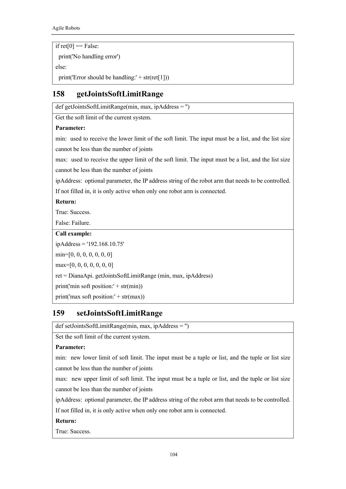



```
Agile Robots  
 104  
if ret[0] == False: 
  print('No handling error') 
else: 
  print('Error should be handling:' + str(ret[1])) 
158 
getJointsSoftLimitRange 
def getJointsSoftLimitRange(min, max, ipAddress = '') 
Get the soft limit of the current system.  
Parameter:  
min:  used to receive the lower limit of the soft limit. The input must be a list, and the list size 
cannot be less than the number of joints  
max:  used to receive the upper limit of the soft limit. The input must be a list, and the list size 
cannot be less than the number of joints  
ipAddress:  optional parameter, the IP address string of the robot arm that needs to be controlled. 
If not filled in, it is only active when only one robot arm is connected.  
Return:  
True: Success. 
False: Failure. 
Call example:  
ipAddress = '192.168.10.75' 
min=[0, 0, 0, 0, 0, 0, 0] 
max=[0, 0, 0, 0, 0, 0, 0] 
ret = DianaApi. getJointsSoftLimitRange (min, max, ipAddress) 
print('min soft position:' + str(min)) 
print('max soft position:' + str(max)) 
159 
setJointsSoftLimitRange 
def setJointsSoftLimitRange(min, max, ipAddress = '') 
Set the soft limit of the current system.  
Parameter:  
min:  new lower limit of soft limit. The input must be a tuple or list, and the tuple or list size 
cannot be less than the number of joints  
max:  new upper limit of soft limit. The input must be a tuple or list, and the tuple or list size 
cannot be less than the number of joints  
ipAddress:  optional parameter, the IP address string of the robot arm that needs to be controlled. 
If not filled in, it is only active when only one robot arm is connected.  
Return:  
True: Success.
```



## PDF page 113

**Source:** Industrial API Manual (Python Edition) \_V3.3.0\_EN\_20260205.pdf, original pdf page 113. [Open the corresponding PDF reading-copy page](https://1292444914-files.gitbook.io/~/files/v0/b/gitbook-x-prod.appspot.com/o/spaces%2FtgOfPnscWebs1eh82EKq%2Fuploads%2FRuKqP58TGdcORhNDRsIQ%2Findustrial-api-manual-python-edition-v3-3-0-en-20260205-pp-001-139.pdf?alt=media#page=113).



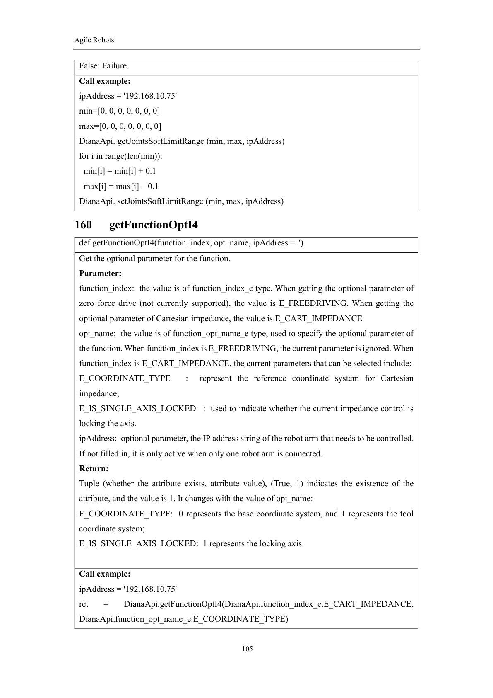



```
Agile Robots  
 105  
False: Failure. 
Call example:  
ipAddress = '192.168.10.75' 
min=[0, 0, 0, 0, 0, 0, 0] 
max=[0, 0, 0, 0, 0, 0, 0] 
DianaApi. getJointsSoftLimitRange (min, max, ipAddress) 
for i in range(len(min)): 
  min[i] = min[i] + 0.1 
  max[i] = max[i] – 0.1 
DianaApi. setJointsSoftLimitRange (min, max, ipAddress) 
160 
getFunctionOptI4 
def getFunctionOptI4(function_index, opt_name, ipAddress = '') 
Get the optional parameter for the function.  
Parameter:  
function_index:  the value is of function_index_e type. When getting the optional parameter of 
zero force drive (not currently supported), the value is E_FREEDRIVING. When getting the 
optional parameter of Cartesian impedance, the value is E_CART_IMPEDANCE  
opt_name:  the value is of function_opt_name_e type, used to specify the optional parameter of 
the function. When function_index is E_FREEDRIVING, the current parameter is ignored. When 
function_index is E_CART_IMPEDANCE, the current parameters that can be selected include:  
E_COORDINATE_TYPE 
 :  represent the reference coordinate system for Cartesian 
impedance;  
E_IS_SINGLE_AXIS_LOCKED  :  used to indicate whether the current impedance control is 
locking the axis.  
ipAddress:  optional parameter, the IP address string of the robot arm that needs to be controlled. 
If not filled in, it is only active when only one robot arm is connected.  
Return:  
Tuple (whether the attribute exists, attribute value), (True, 1) indicates the existence of the 
attribute, and the value is 1. It changes with the value of opt_name:  
E_COORDINATE_TYPE:  0 represents the base coordinate system, and 1 represents the tool 
coordinate system;  
E_IS_SINGLE_AXIS_LOCKED:  1 represents the locking axis.  
 
Call example:  
ipAddress = '192.168.10.75' 
ret 
= 
DianaApi.getFunctionOptI4(DianaApi.function_index_e.E_CART_IMPEDANCE, 
DianaApi.function_opt_name_e.E_COORDINATE_TYPE)
```



## PDF page 114

**Source:** Industrial API Manual (Python Edition) \_V3.3.0\_EN\_20260205.pdf, original pdf page 114. [Open the corresponding PDF reading-copy page](https://1292444914-files.gitbook.io/~/files/v0/b/gitbook-x-prod.appspot.com/o/spaces%2FtgOfPnscWebs1eh82EKq%2Fuploads%2FRuKqP58TGdcORhNDRsIQ%2Findustrial-api-manual-python-edition-v3-3-0-en-20260205-pp-001-139.pdf?alt=media#page=114).



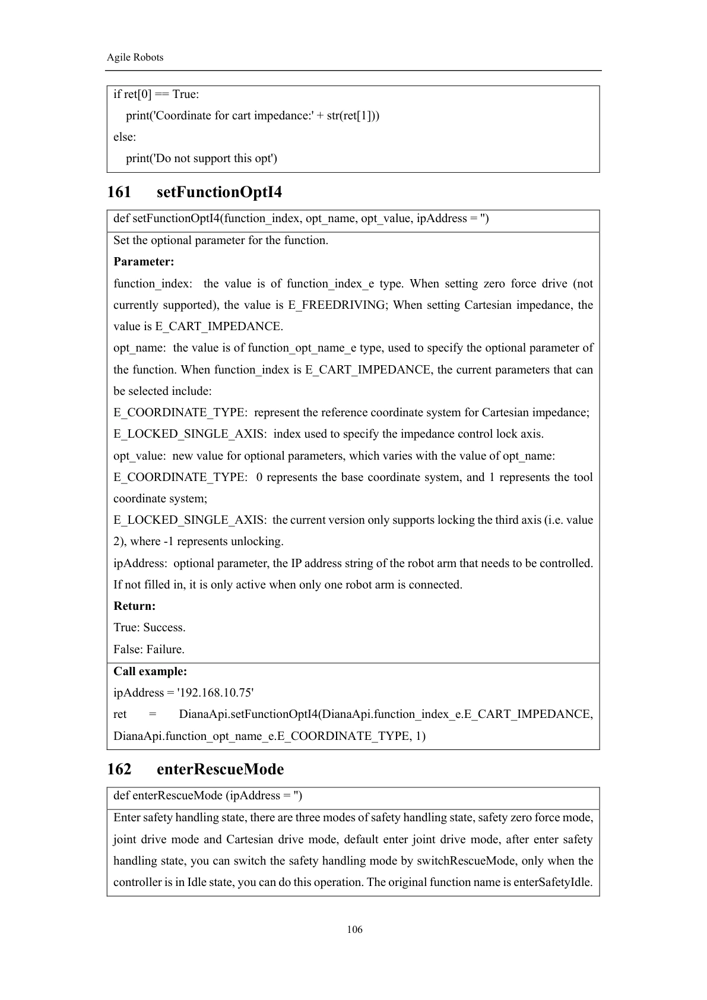



```
Agile Robots  
 106  
if ret[0] == True: 
    print('Coordinate for cart impedance:' + str(ret[1])) 
else: 
    print('Do not support this opt') 
161 
setFunctionOptI4 
def setFunctionOptI4(function_index, opt_name, opt_value, ipAddress = '') 
Set the optional parameter for the function.  
Parameter:  
function_index:  the value is of function_index_e type. When setting zero force drive (not 
currently supported), the value is E_FREEDRIVING; When setting Cartesian impedance, the 
value is E_CART_IMPEDANCE.  
opt_name:  the value is of function_opt_name_e type, used to specify the optional parameter of 
the function. When function_index is E_CART_IMPEDANCE, the current parameters that can 
be selected include:  
E_COORDINATE_TYPE:  represent the reference coordinate system for Cartesian impedance;  
E_LOCKED_SINGLE_AXIS:  index used to specify the impedance control lock axis.  
opt_value:  new value for optional parameters, which varies with the value of opt_name:  
E_COORDINATE_TYPE:  0 represents the base coordinate system, and 1 represents the tool 
coordinate system;  
E_LOCKED_SINGLE_AXIS:  the current version only supports locking the third axis (i.e. value 
2), where -1 represents unlocking.  
ipAddress:  optional parameter, the IP address string of the robot arm that needs to be controlled. 
If not filled in, it is only active when only one robot arm is connected.  
Return:  
True: Success. 
False: Failure. 
Call example:  
ipAddress = '192.168.10.75' 
ret 
= 
DianaApi.setFunctionOptI4(DianaApi.function_index_e.E_CART_IMPEDANCE, 
DianaApi.function_opt_name_e.E_COORDINATE_TYPE, 1) 
162 
enterRescueMode 
def enterRescueMode (ipAddress = '') 
Enter safety handling state, there are three modes of safety handling state, safety zero force mode, 
joint drive mode and Cartesian drive mode, default enter joint drive mode, after enter safety 
handling state, you can switch the safety handling mode by switchRescueMode, only when the 
controller is in Idle state, you can do this operation. The original function name is enterSafetyIdle.
```



## PDF page 115

**Source:** Industrial API Manual (Python Edition) \_V3.3.0\_EN\_20260205.pdf, original pdf page 115. [Open the corresponding PDF reading-copy page](https://1292444914-files.gitbook.io/~/files/v0/b/gitbook-x-prod.appspot.com/o/spaces%2FtgOfPnscWebs1eh82EKq%2Fuploads%2FRuKqP58TGdcORhNDRsIQ%2Findustrial-api-manual-python-edition-v3-3-0-en-20260205-pp-001-139.pdf?alt=media#page=115).



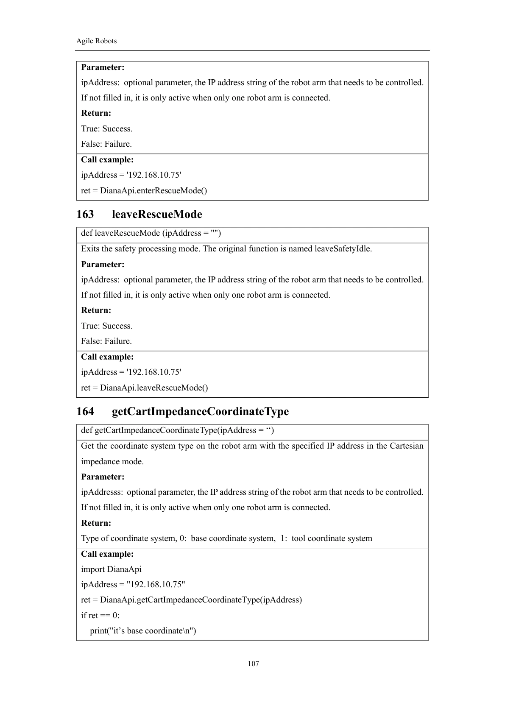



```
Agile Robots  
 107  
Parameter:  
ipAddress:  optional parameter, the IP address string of the robot arm that needs to be controlled. 
If not filled in, it is only active when only one robot arm is connected.  
Return:  
True: Success. 
False: Failure. 
Call example:  
ipAddress = '192.168.10.75' 
ret = DianaApi.enterRescueMode() 
163 
leaveRescueMode 
def leaveRescueMode (ipAddress = "") 
Exits the safety processing mode. The original function is named leaveSafetyIdle. 
Parameter:  
ipAddress:  optional parameter, the IP address string of the robot arm that needs to be controlled. 
If not filled in, it is only active when only one robot arm is connected.  
Return:  
True: Success. 
False: Failure. 
Call example:  
ipAddress = '192.168.10.75' 
ret = DianaApi.leaveRescueMode() 
164 
getCartImpedanceCoordinateType 
def getCartImpedanceCoordinateType(ipAddress = ‘‘) 
Get the coordinate system type on the robot arm with the specified IP address in the Cartesian 
impedance mode.  
Parameter:  
ipAddresss:  optional parameter, the IP address string of the robot arm that needs to be controlled. 
If not filled in, it is only active when only one robot arm is connected.  
Return:  
Type of coordinate system, 0:  base coordinate system,  1:  tool coordinate system  
Call example:  
import DianaApi 
ipAddress = "192.168.10.75" 
ret = DianaApi.getCartImpedanceCoordinateType(ipAddress) 
if ret == 0: 
    print("it’s base coordinate\n")
```



## PDF page 116

**Source:** Industrial API Manual (Python Edition) \_V3.3.0\_EN\_20260205.pdf, original pdf page 116. [Open the corresponding PDF reading-copy page](https://1292444914-files.gitbook.io/~/files/v0/b/gitbook-x-prod.appspot.com/o/spaces%2FtgOfPnscWebs1eh82EKq%2Fuploads%2FRuKqP58TGdcORhNDRsIQ%2Findustrial-api-manual-python-edition-v3-3-0-en-20260205-pp-001-139.pdf?alt=media#page=116).



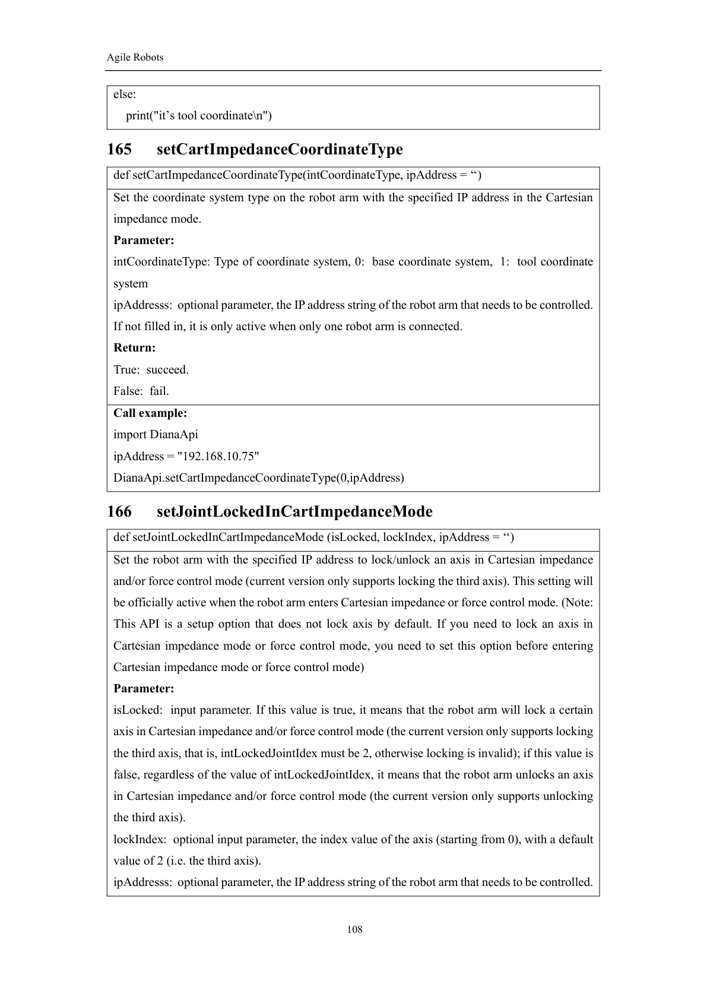



```
Agile Robots  
 108  
else: 
    print("it’s tool coordinate\n") 
165 
setCartImpedanceCoordinateType 
def setCartImpedanceCoordinateType(intCoordinateType, ipAddress = ‘‘) 
Set the coordinate system type on the robot arm with the specified IP address in the Cartesian 
impedance mode.  
Parameter:  
intCoordinateType: Type of coordinate system, 0:  base coordinate system,  1:  tool coordinate 
system  
ipAddresss:  optional parameter, the IP address string of the robot arm that needs to be controlled. 
If not filled in, it is only active when only one robot arm is connected.  
Return:  
True:  succeed.  
False:  fail.  
Call example:  
import DianaApi 
ipAddress = "192.168.10.75" 
DianaApi.setCartImpedanceCoordinateType(0,ipAddress) 
166 
setJointLockedInCartImpedanceMode 
def setJointLockedInCartImpedanceMode (isLocked, lockIndex, ipAddress = ‘‘) 
Set the robot arm with the specified IP address to lock/unlock an axis in Cartesian impedance 
and/or force control mode (current version only supports locking the third axis). This setting will 
be officially active when the robot arm enters Cartesian impedance or force control mode. (Note: 
This API is a setup option that does not lock axis by default. If you need to lock an axis in 
Cartesian impedance mode or force control mode, you need to set this option before entering 
Cartesian impedance mode or force control mode) 
Parameter:  
isLocked:  input parameter. If this value is true, it means that the robot arm will lock a certain 
axis in Cartesian impedance and/or force control mode (the current version only supports locking 
the third axis, that is, intLockedJointIdex must be 2, otherwise locking is invalid); if this value is 
false, regardless of the value of intLockedJointIdex, it means that the robot arm unlocks an axis 
in Cartesian impedance and/or force control mode (the current version only supports unlocking 
the third axis).  
lockIndex:  optional input parameter, the index value of the axis (starting from 0), with a default 
value of 2 (i.e. the third axis).  
ipAddresss:  optional parameter, the IP address string of the robot arm that needs to be controlled.
```



## PDF page 117

**Source:** Industrial API Manual (Python Edition) \_V3.3.0\_EN\_20260205.pdf, original pdf page 117. [Open the corresponding PDF reading-copy page](https://1292444914-files.gitbook.io/~/files/v0/b/gitbook-x-prod.appspot.com/o/spaces%2FtgOfPnscWebs1eh82EKq%2Fuploads%2FRuKqP58TGdcORhNDRsIQ%2Findustrial-api-manual-python-edition-v3-3-0-en-20260205-pp-001-139.pdf?alt=media#page=117).



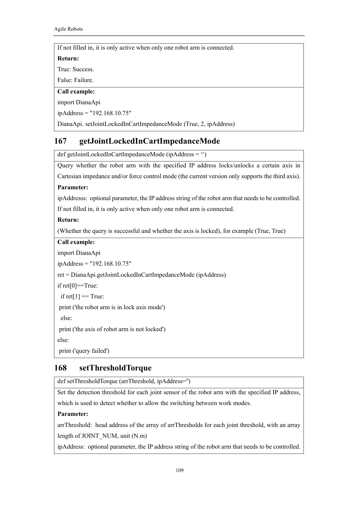



```
Agile Robots  
 109  
If not filled in, it is only active when only one robot arm is connected.  
Return:  
True: Success. 
False: Failure. 
Call example:  
import DianaApi 
ipAddress = "192.168.10.75" 
DianaApi. setJointLockedInCartImpedanceMode (True, 2, ipAddress) 
167 
getJointLockedInCartImpedanceMode 
def getJointLockedInCartImpedanceMode (ipAddress = ‘‘) 
Query whether the robot arm with the specified IP address locks/unlocks a certain axis in 
Cartesian impedance and/or force control mode (the current version only supports the third axis).  
Parameter:  
ipAddresss:  optional parameter, the IP address string of the robot arm that needs to be controlled. 
If not filled in, it is only active when only one robot arm is connected.  
Return:  
(Whether the query is successful and whether the axis is locked), for example (True, True)  
Call example:  
import DianaApi 
ipAddress = "192.168.10.75" 
ret = DianaApi.getJointLockedInCartImpedanceMode (ipAddress) 
if ret[0]==True: 
  if ret[1] == True: 
 print ('the robot arm is in lock axis mode')  
  else:  
 print ('the axis of robot arm is not locked')  
else:  
 print ('query failed')  
168 
setThresholdTorque 
def setThresholdTorque (arrThreshold, ipAddress='') 
Set the detection threshold for each joint sensor of the robot arm with the specified IP address, 
which is used to detect whether to allow the switching between work modes.  
Parameter:  
arrThreshold:  head address of the array of arrThresholds for each joint threshold, with an array 
length of JOINT_NUM, unit (N.m)  
ipAddress:  optional parameter, the IP address string of the robot arm that needs to be controlled.
```



## PDF page 118

**Source:** Industrial API Manual (Python Edition) \_V3.3.0\_EN\_20260205.pdf, original pdf page 118. [Open the corresponding PDF reading-copy page](https://1292444914-files.gitbook.io/~/files/v0/b/gitbook-x-prod.appspot.com/o/spaces%2FtgOfPnscWebs1eh82EKq%2Fuploads%2FRuKqP58TGdcORhNDRsIQ%2Findustrial-api-manual-python-edition-v3-3-0-en-20260205-pp-001-139.pdf?alt=media#page=118).



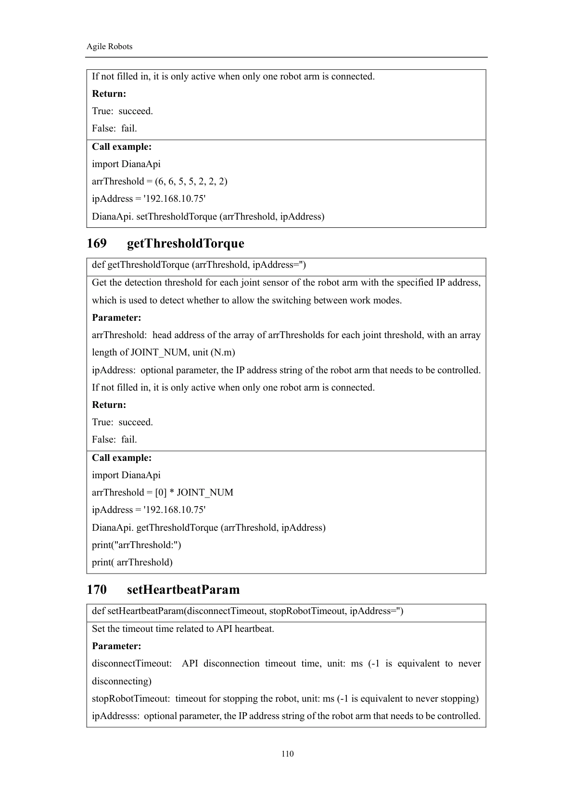



```
Agile Robots  
 110  
If not filled in, it is only active when only one robot arm is connected.  
Return:  
True:  succeed.  
False:  fail.  
Call example:  
import DianaApi 
arrThreshold = (6, 6, 5, 5, 2, 2, 2) 
ipAddress = '192.168.10.75' 
DianaApi. setThresholdTorque (arrThreshold, ipAddress) 
169 
getThresholdTorque 
def getThresholdTorque (arrThreshold, ipAddress='') 
Get the detection threshold for each joint sensor of the robot arm with the specified IP address, 
which is used to detect whether to allow the switching between work modes.  
Parameter:  
arrThreshold:  head address of the array of arrThresholds for each joint threshold, with an array 
length of JOINT_NUM, unit (N.m)  
ipAddress:  optional parameter, the IP address string of the robot arm that needs to be controlled. 
If not filled in, it is only active when only one robot arm is connected.  
Return:  
True:  succeed.  
False:  fail.  
Call example:  
import DianaApi  
arrThreshold = [0] * JOINT_NUM  
ipAddress = '192.168.10.75'  
DianaApi. getThresholdTorque (arrThreshold, ipAddress)  
print("arrThreshold:")  
print( arrThreshold)  
170 
setHeartbeatParam 
def setHeartbeatParam(disconnectTimeout, stopRobotTimeout, ipAddress='') 
Set the timeout time related to API heartbeat.  
Parameter:  
disconnectTimeout:  API disconnection timeout time, unit: ms (-1 is equivalent to never 
disconnecting)  
stopRobotTimeout:  timeout for stopping the robot, unit: ms (-1 is equivalent to never stopping)  
ipAddresss:  optional parameter, the IP address string of the robot arm that needs to be controlled.
```



## PDF page 119

**Source:** Industrial API Manual (Python Edition) \_V3.3.0\_EN\_20260205.pdf, original pdf page 119. [Open the corresponding PDF reading-copy page](https://1292444914-files.gitbook.io/~/files/v0/b/gitbook-x-prod.appspot.com/o/spaces%2FtgOfPnscWebs1eh82EKq%2Fuploads%2FRuKqP58TGdcORhNDRsIQ%2Findustrial-api-manual-python-edition-v3-3-0-en-20260205-pp-001-139.pdf?alt=media#page=119).



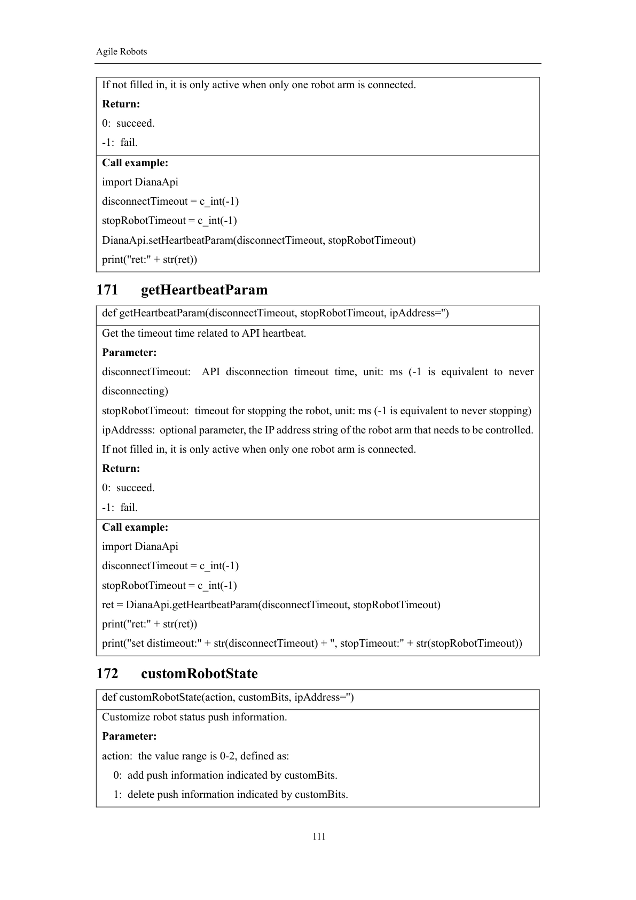



```
Agile Robots  
 111  
If not filled in, it is only active when only one robot arm is connected.  
Return:  
0:  succeed.  
-1:  fail.  
Call example:  
import DianaApi 
disconnectTimeout = c_int(-1) 
stopRobotTimeout = c_int(-1) 
DianaApi.setHeartbeatParam(disconnectTimeout, stopRobotTimeout) 
print("ret:" + str(ret)) 
171 
getHeartbeatParam 
def getHeartbeatParam(disconnectTimeout, stopRobotTimeout, ipAddress='') 
Get the timeout time related to API heartbeat.  
Parameter:  
disconnectTimeout:  API disconnection timeout time, unit: ms (-1 is equivalent to never 
disconnecting)  
stopRobotTimeout:  timeout for stopping the robot, unit: ms (-1 is equivalent to never stopping)  
ipAddresss:  optional parameter, the IP address string of the robot arm that needs to be controlled. 
If not filled in, it is only active when only one robot arm is connected.  
Return:  
0:  succeed.  
-1:  fail.  
Call example:  
import DianaApi 
disconnectTimeout = c_int(-1) 
stopRobotTimeout = c_int(-1) 
ret = DianaApi.getHeartbeatParam(disconnectTimeout, stopRobotTimeout) 
print("ret:" + str(ret)) 
print("set distimeout:" + str(disconnectTimeout) + ", stopTimeout:" + str(stopRobotTimeout)) 
172 
customRobotState 
def customRobotState(action, customBits, ipAddress='') 
Customize robot status push information.  
Parameter:  
action:  the value range is 0-2, defined as:  
    0:  add push information indicated by customBits.  
    1:  delete push information indicated by customBits.
```



## PDF page 120

**Source:** Industrial API Manual (Python Edition) \_V3.3.0\_EN\_20260205.pdf, original pdf page 120. [Open the corresponding PDF reading-copy page](https://1292444914-files.gitbook.io/~/files/v0/b/gitbook-x-prod.appspot.com/o/spaces%2FtgOfPnscWebs1eh82EKq%2Fuploads%2FRuKqP58TGdcORhNDRsIQ%2Findustrial-api-manual-python-edition-v3-3-0-en-20260205-pp-001-139.pdf?alt=media#page=120).



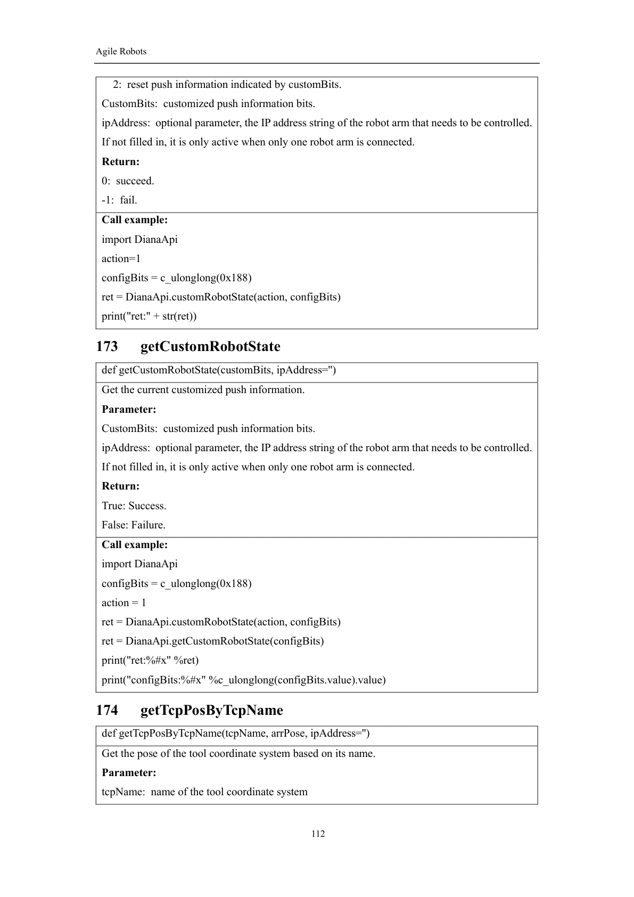



```
Agile Robots  
 112  
    2:  reset push information indicated by customBits.  
CustomBits:  customized push information bits.  
ipAddress:  optional parameter, the IP address string of the robot arm that needs to be controlled. 
If not filled in, it is only active when only one robot arm is connected.  
Return:  
0:  succeed.  
-1:  fail.  
Call example:  
import DianaApi 
action=1 
configBits = c_ulonglong(0x188) 
ret = DianaApi.customRobotState(action, configBits) 
print("ret:" + str(ret)) 
173 
getCustomRobotState 
def getCustomRobotState(customBits, ipAddress='') 
Get the current customized push information.  
Parameter:  
CustomBits:  customized push information bits.  
ipAddress:  optional parameter, the IP address string of the robot arm that needs to be controlled. 
If not filled in, it is only active when only one robot arm is connected.  
Return:  
True: Success. 
False: Failure. 
Call example:  
import DianaApi 
configBits = c_ulonglong(0x188) 
action = 1 
ret = DianaApi.customRobotState(action, configBits) 
ret = DianaApi.getCustomRobotState(configBits) 
print("ret:%#x" %ret) 
print("configBits:%#x" %c_ulonglong(configBits.value).value) 
174 
getTcpPosByTcpName  
def getTcpPosByTcpName(tcpName, arrPose, ipAddress='')  
Get the pose of the tool coordinate system based on its name.  
Parameter:  
tcpName:  name of the tool coordinate system
```



## PDF page 121

**Source:** Industrial API Manual (Python Edition) \_V3.3.0\_EN\_20260205.pdf, original pdf page 121. [Open the corresponding PDF reading-copy page](https://1292444914-files.gitbook.io/~/files/v0/b/gitbook-x-prod.appspot.com/o/spaces%2FtgOfPnscWebs1eh82EKq%2Fuploads%2FRuKqP58TGdcORhNDRsIQ%2Findustrial-api-manual-python-edition-v3-3-0-en-20260205-pp-001-139.pdf?alt=media#page=121).



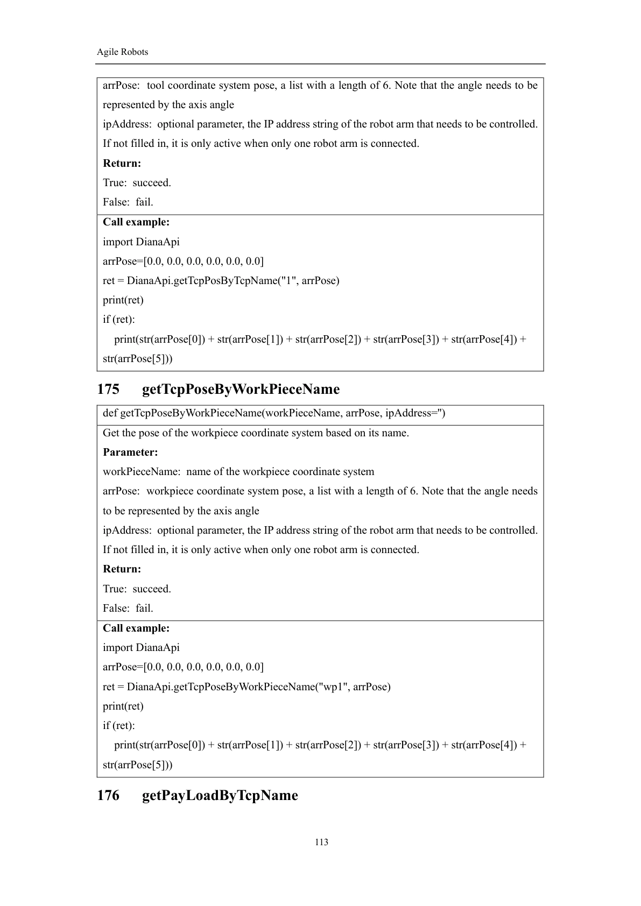



```
Agile Robots  
 113  
arrPose:  tool coordinate system pose, a list with a length of 6. Note that the angle needs to be 
represented by the axis angle  
ipAddress:  optional parameter, the IP address string of the robot arm that needs to be controlled. 
If not filled in, it is only active when only one robot arm is connected.  
Return:  
True:  succeed.  
False:  fail.  
Call example:  
import DianaApi 
arrPose=[0.0, 0.0, 0.0, 0.0, 0.0, 0.0] 
ret = DianaApi.getTcpPosByTcpName("1", arrPose) 
print(ret) 
if (ret): 
    print(str(arrPose[0]) + str(arrPose[1]) + str(arrPose[2]) + str(arrPose[3]) + str(arrPose[4]) + 
str(arrPose[5])) 
175 
getTcpPoseByWorkPieceName 
def getTcpPoseByWorkPieceName(workPieceName, arrPose, ipAddress='') 
Get the pose of the workpiece coordinate system based on its name.  
Parameter:  
workPieceName:  name of the workpiece coordinate system  
arrPose:  workpiece coordinate system pose, a list with a length of 6. Note that the angle needs 
to be represented by the axis angle  
ipAddress:  optional parameter, the IP address string of the robot arm that needs to be controlled. 
If not filled in, it is only active when only one robot arm is connected.  
Return:  
True:  succeed.  
False:  fail.  
Call example:  
import DianaApi 
arrPose=[0.0, 0.0, 0.0, 0.0, 0.0, 0.0] 
ret = DianaApi.getTcpPoseByWorkPieceName("wp1", arrPose) 
print(ret) 
if (ret): 
    print(str(arrPose[0]) + str(arrPose[1]) + str(arrPose[2]) + str(arrPose[3]) + str(arrPose[4]) + 
str(arrPose[5])) 
176 
getPayLoadByTcpName
```



## PDF page 122

**Source:** Industrial API Manual (Python Edition) \_V3.3.0\_EN\_20260205.pdf, original pdf page 122. [Open the corresponding PDF reading-copy page](https://1292444914-files.gitbook.io/~/files/v0/b/gitbook-x-prod.appspot.com/o/spaces%2FtgOfPnscWebs1eh82EKq%2Fuploads%2FRuKqP58TGdcORhNDRsIQ%2Findustrial-api-manual-python-edition-v3-3-0-en-20260205-pp-001-139.pdf?alt=media#page=122).



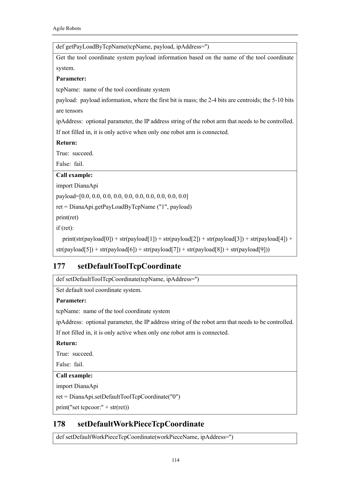



```
Agile Robots  
 114  
def getPayLoadByTcpName(tcpName, payload, ipAddress='') 
Get the tool coordinate system payload information based on the name of the tool coordinate 
system.  
Parameter:  
tcpName:  name of the tool coordinate system  
payload:  payload information, where the first bit is mass; the 2-4 bits are centroids; the 5-10 bits 
are tensors  
ipAddress:  optional parameter, the IP address string of the robot arm that needs to be controlled. 
If not filled in, it is only active when only one robot arm is connected.  
Return:  
True:  succeed.  
False:  fail.  
Call example:  
import DianaApi 
payload=[0.0, 0.0, 0.0, 0.0, 0.0, 0.0, 0.0, 0.0, 0.0, 0.0] 
ret = DianaApi.getPayLoadByTcpName ("1", payload) 
print(ret) 
if (ret): 
    print(str(payload[0]) + str(payload[1]) + str(payload[2]) + str(payload[3]) + str(payload[4]) + 
str(payload[5]) + str(payload[6]) + str(payload[7]) + str(payload[8]) + str(payload[9])) 
177 
setDefaultToolTcpCoordinate 
def setDefaultToolTcpCoordinate(tcpName, ipAddress='') 
Set default tool coordinate system.  
Parameter:  
tcpName:  name of the tool coordinate system  
ipAddress:  optional parameter, the IP address string of the robot arm that needs to be controlled. 
If not filled in, it is only active when only one robot arm is connected.  
Return:  
True:  succeed.  
False:  fail.  
Call example:  
import DianaApi 
ret = DianaApi.setDefaultToolTcpCoordinate("0") 
print("set tcpcoor:" + str(ret)) 
178 
setDefaultWorkPieceTcpCoordinate 
def setDefaultWorkPieceTcpCoordinate(workPieceName, ipAddress='')
```



## PDF page 123

**Source:** Industrial API Manual (Python Edition) \_V3.3.0\_EN\_20260205.pdf, original pdf page 123. [Open the corresponding PDF reading-copy page](https://1292444914-files.gitbook.io/~/files/v0/b/gitbook-x-prod.appspot.com/o/spaces%2FtgOfPnscWebs1eh82EKq%2Fuploads%2FRuKqP58TGdcORhNDRsIQ%2Findustrial-api-manual-python-edition-v3-3-0-en-20260205-pp-001-139.pdf?alt=media#page=123).







```
Agile Robots  
 115  
Set default workpiece coordinate system.  
Parameter:  
workPieceName:  name of the workpiece coordinate system  
ipAddress:  optional parameter, the IP address string of the robot arm that needs to be controlled. 
If not filled in, it is only active when only one robot arm is connected.  
Return:  
True:  succeed.  
False:  fail.  
Call example:  
import DianaApi 
ret = DianaApi.setDefaultWorkPieceTcpCoordinate("workpiececoor") 
print("set wpcoor:" + str(ret)) 
179 
getDefaultTcpCoordinate 
def getDefaultTcpCoordinate(ipAddress='') 
Get the default tool coordinate system name.  
Parameter:  
ipAddress:  optional parameter, the IP address string of the robot arm that needs to be controlled. 
If not filled in, it is only active when only one robot arm is connected.  
Return:  
 tuple consisting of two elements, where the first element indicates whether the function call is 
successful:  
True:  succeed.  
False:  fail.  
The second element indicates the name of the default tool coordinate system got.  
Call example:  
import DianaApi 
ret, coorName = DianaApi.getDefaultTcpCoordinate()  
print("tcp, ret:" + str(ret) + ":" + coorName) 
180 
getDefaultWorkPieceCoordinate 
def getDefaultWorkPieceCoordinate(ipAddress='') 
Get the default workpiece coordinate system name.  
Parameter:  
ipAddress:  optional parameter, the IP address string of the robot arm that needs to be controlled. 
If not filled in, it is only active when only one robot arm is connected.  
Return:  
 tuple consisting of two elements, where the first element indicates whether the function call is
```



## PDF page 124

**Source:** Industrial API Manual (Python Edition) \_V3.3.0\_EN\_20260205.pdf, original pdf page 124. [Open the corresponding PDF reading-copy page](https://1292444914-files.gitbook.io/~/files/v0/b/gitbook-x-prod.appspot.com/o/spaces%2FtgOfPnscWebs1eh82EKq%2Fuploads%2FRuKqP58TGdcORhNDRsIQ%2Findustrial-api-manual-python-edition-v3-3-0-en-20260205-pp-001-139.pdf?alt=media#page=124).







```
Agile Robots  
 116  
successful:  
True:  succeed.  
False:  fail.  
The second element indicates the name of the default workpiece coordinate system got.  
Call example:  
import DianaApi 
ret, coorName = DianaApi.getDefaultWorkPieceCoordinate () 
print("tcp, ret:" + str(ret) + ":" + coorName) 
181 
setVelocityPercentValue 
def setVelocityPercentValue(value, ipAddress='') 
Set the velocity percentage.  
Parameter:  
value:  set percentage of velocity value.  
ipAddress:  optional parameter, the IP address string of the robot arm that needs to be controlled. 
If not filled in, it is only active when only one robot arm is connected.  
Return:  
0:  succeed.  
-1:  fail.  
Call example:  
import DianaApi 
value = 20 
ret = setVelocityPercentValue(value) 
print("ret:" + str(ret)) 
 
182 
getVelocityPercentValue 
def getVelocityPercentValue(value, ipAddress='') 
Get the speed percentage. 
Parameters: 
Value: Output parameters, shaping, percentage values. 
ipAddress: Optional parameter, requires controlling the IP address string of the robotic arm, if not 
filled in, it takes effect when only one robot arm is connected. 
Return: 
0: success. 
-1: Failure. 
Call example:
```



## PDF page 125

**Source:** Industrial API Manual (Python Edition) \_V3.3.0\_EN\_20260205.pdf, original pdf page 125. [Open the corresponding PDF reading-copy page](https://1292444914-files.gitbook.io/~/files/v0/b/gitbook-x-prod.appspot.com/o/spaces%2FtgOfPnscWebs1eh82EKq%2Fuploads%2FRuKqP58TGdcORhNDRsIQ%2Findustrial-api-manual-python-edition-v3-3-0-en-20260205-pp-001-139.pdf?alt=media#page=125).







```
Agile Robots  
 117  
import DianaApi 
value = 0 
ret = getVelocityPercentValue(value) 
print("ret:" + str(ret) + " value:" + str(value)) 
183 
switchRescueMode 
def switchRescueMode(scuWorkMode, ipAddress='') 
Toggles the safety handling mode, which can only be done in the safety handling mode. 
For robotic arms with an SCU: After entering safety handling, it is necessary to switch to the 
corresponding mode before performing related motions. 
For example: 
After calling switchRescueMode(12), freeDriving(2) can be executed. 
After calling switchRescueMode(13), moveJoint can be executed. 
After calling switchRescueMode(14), moveTcp can be executed. 
For robotic arms without an SCU: There is no concept of motion mode switching. After entering 
safety handling, freeDriving(2), moveJoint, and moveTcp can be executed directly without 
calling switchRescueMode. 
Parameters: 
scuWorkMode: safety handling mode, the values are: 12-safe zero force mode, 13-joint drive 
mode, 14-Cartesian drive mode. 
ipAddresss: optional parameter, need to control the IP address string of the robotic arm, unfilled 
only takes effect when only one robotic arm is connected. 
Return: 
True: success. 
False: fail. 
Call example: 
import DianaApi 
ipAddress = '192.168.10.75' 
DianaApi.enterRescueMode (12) 
ret = DianaApi. switchRescueMode(14) 
184 
getAvoidSingular 
def getAvoidSingular( ipAddress = "") 
Gets whether singularity avoidance is enabled in the manual operator interface. 
Parameters: 
ipAddress: optional parameter, need to control the IP address string of the robotic arm, unfilled only 
takes effect when only one robotic arm is connected. 
Return:
```



## PDF page 126

**Source:** Industrial API Manual (Python Edition) \_V3.3.0\_EN\_20260205.pdf, original pdf page 126. [Open the corresponding PDF reading-copy page](https://1292444914-files.gitbook.io/~/files/v0/b/gitbook-x-prod.appspot.com/o/spaces%2FtgOfPnscWebs1eh82EKq%2Fuploads%2FRuKqP58TGdcORhNDRsIQ%2Findustrial-api-manual-python-edition-v3-3-0-en-20260205-pp-001-139.pdf?alt=media#page=126).







```
Agile Robots  
 118  
Ture: success. 
False: Failure. 
Call example:  
import DianaApi 
ipAddress = '192.168.10.75' 
bool enable 
bool ret 
Ret, enable = DianaApi.getAvoidSingular (enable) 
185 
setAvoidSingular 
def setAvoidSingular(ipAddress = "") 
Sets whether singularity avoidance is turned on for the manual operator interface. 
Parameters: 
enable: Enable Singularity Avoidance for Manual Operation. 
ipAddress: optional parameter, need to control the IP address string of the robotic arm, unfilled only 
takes effect when only one robotic arm is connected. 
Return: 
Ture: success. 
False: Failure. 
Call example:  
import DianaApi 
ipAddress = '192.168.10.75' 
bool enable = True 
ret = DianaApi.setAvoidSingular (enable) 
186 
getInterpolaterCycleInterval 
int getInterpolaterCycleInterval(double &dblInterval, const char *ipAddresss) 
Get control Interpolater cycle. 
Parameters: 
interval: Output parameter, obtained control period, the unit is seconds (s). 
ipAddress: Optional parameter, requires controlling the IP address string of the robotic arm, if 
not filled in, it takes effect when only one robot arm is connected. 
Return: 
0: success. 
-1: Failure. 
Call example:  
import DianaApi 
ipAddress = '192.168.10.75'
```



## PDF page 127

**Source:** Industrial API Manual (Python Edition) \_V3.3.0\_EN\_20260205.pdf, original pdf page 127. [Open the corresponding PDF reading-copy page](https://1292444914-files.gitbook.io/~/files/v0/b/gitbook-x-prod.appspot.com/o/spaces%2FtgOfPnscWebs1eh82EKq%2Fuploads%2FRuKqP58TGdcORhNDRsIQ%2Findustrial-api-manual-python-edition-v3-3-0-en-20260205-pp-001-139.pdf?alt=media#page=127).







```
Agile Robots  
 119  
double interval 
ret = DianaApi.getInterpolaterCycleInterval(interval, ipAddress) 
print("ret:" + str(ret) + " interval:" + str(interval)) 
187 
getTcp_with_Quaternions 
int getTcp_with_Quaternions(pose, ipAddresss = "") 
Get the current TCP pose data based quaternion of the robotic arm with a specified IP address. 
The TCP pose can be changed by the setDefaultActiveTcp and setDefaultActiveTcpPose 
functions. 
Parameters: 
tcpQuaternions: Input/output parameters, pass in an empty list. Output a TCP pose tuple based 
on quaternions, with a tuple size of 7. Used to transmit the obtained results. 
ipAddress: Optional parameter, requires controlling the IP address string of the robotic arm, if 
not filled in, it takes effect when only one robot arm is connected. 
Return: 
0: success. 
-1: Failure. 
Call example:  
import DianaApi 
poses = [0.0] * 7 
ipAddress = '192.168.10.75' 
DianaApi.getTcp_with_Quaternions(poses, ipAddress) 
print(poses) 
188 
getProcessNumSetting 
def getProcessNumSetting(intNum, ipAddress='') 
Get the configuration corresponding to the specified weaving process number. This API is exclu
sively designed for arc welding applications. 
Parameters: 
intNum: Weaving process number (range: 0~999). 
ipAddress: Optional parameter, requires controlling the IP address string of the robotic arm, if 
not filled in, it takes effect when only one robot arm is connected. 
Return: 
Returns two parameters: 
The first parameter indicates whether the call was successful: 
True: Success. 
False: Failure. 
The second parameter is an array composed of the following values (10 parameters):
```



## PDF page 128

**Source:** Industrial API Manual (Python Edition) \_V3.3.0\_EN\_20260205.pdf, original pdf page 128. [Open the corresponding PDF reading-copy page](https://1292444914-files.gitbook.io/~/files/v0/b/gitbook-x-prod.appspot.com/o/spaces%2FtgOfPnscWebs1eh82EKq%2Fuploads%2FRuKqP58TGdcORhNDRsIQ%2Findustrial-api-manual-python-edition-v3-3-0-en-20260205-pp-001-139.pdf?alt=media#page=128).







```
Agile Robots  
 120  
strProcessName: Process name, a description of the weaving process, supports up to 20 characte
rs. 
intWaveWay: Weaving pattern, sets the method of weaving. Sawtooth pattern: 1. 
dblWaveFrequency: Weaving frequency, sets the number of weaving cycles per second, range: 0
–5 Hz. 
dblWaveLeftAmplitude: Left weaving amplitude, sets the left amplitude of the torch's sawtooth 
weaving, range: 0–0.03 m. 
dblWaveRightAmplitude: Right weaving amplitude, sets the right amplitude of the torch's sawto
oth weaving, range: 0–0.03 m. 
dblLeftDwellTime: Left dwell time, sets the dwell time at the left peak of the weave, range: 0–
3 s. 
dblInterDwellTime: Intermediate dwell time, sets the dwell time at the midpoint of the weaving 
path, range: 0–3 s. 
dblRightDwellTime: Right dwell time, sets the dwell time at the right peak of the weave, range:
 0–3 s. 
intEndPointTreatment: Endpoint treatment, sets the behavior at the weave endpoints: move (=0)
 or wait (=1). 
Move: The torch travels along the primary direction at the set welding speed and left/right/inter
mediate dwell times. 
Wait: The torch remains stationary at the endpoints and midpoint for the duration of the dwell ti
me. 
If the dwell time is set to zero, this parameter is ignored. 
intIsLockPosture: Whether the travel angle is locked. Unlocked: 0, Locked: 1. 
Call example: 
# ProcessNum 
valus = [0, "12345", 1, 3, 0.01, 0.01, 0, 0, 0, 1, 1] 
ret = setProcessNumSetting(valus) 
print("setProcessNumSetting ret =", ret,"valus = ",valus) 
ret, valus = getProcessNumSetting(0) 
print("getProcessNumSetting ret =", ret,"valus = ",valus) 
ret= delProcessNum(0) 
print("delProcessNum ret =", ret,"\n") 
 
# ArcRestart 
valus = [1, 0.01, 1, 0.01, 0.02, 0.02] 
ret = setArcRestartParameter(valus) 
print("setArcRestartParameter ret =", ret,"valus = ",valus)
```



## PDF page 129

**Source:** Industrial API Manual (Python Edition) \_V3.3.0\_EN\_20260205.pdf, original pdf page 129. [Open the corresponding PDF reading-copy page](https://1292444914-files.gitbook.io/~/files/v0/b/gitbook-x-prod.appspot.com/o/spaces%2FtgOfPnscWebs1eh82EKq%2Fuploads%2FRuKqP58TGdcORhNDRsIQ%2Findustrial-api-manual-python-edition-v3-3-0-en-20260205-pp-001-139.pdf?alt=media#page=129).







```
Agile Robots  
 121  
ret, valus = getArcRestartParameter() 
print("getArcRestartParameter ret =", ret,"valus = ",valus,"\n") 
189 
  setProcessNumSetting 
def setProcessNumSetting(values, ipAddress='') 
Set the configuration corresponding to the specified weaving process number. This API is exclu
sively designed for arc welding applications. 
Parameters: 
ipAddress: Optional parameter, requires controlling the IP address string of the robotic arm, if 
not filled in, it takes effect when only one robot arm is connected. 
values: A list composed of the following values (11 parameters): 
intNum: Weaving process number (range: 0~999). 
strProcessName: Process name (description of the weaving process, supports up to 20 
characters). 
intWaveWay: Weaving pattern (e.g., zigzag = 1). 
dblWaveFrequency: Weaving frequency (oscillations per second, range: 0~5 Hz). 
dblWaveLeftAmplitude: Left amplitude of weaving (torch oscillation left limit, range: 
0~0.03 m). 
dblWaveRightAmplitude: Right amplitude of weaving (torch oscillation right limit, range: 
0~0.03 m). 
dblLeftDwellTime: Left dwell time (pause duration at left peak, range: 0~3 s). 
dblInterDwellTime: Intermediate dwell time (pause duration at center position, range: 0~3 
s). 
dblRightDwellTime: Right dwell time (pause duration at right peak, range: 0~3 s). 
intEndPointTreatment: Endpoint handling method. 
0 means motion. The torch moves along the primary welding direction at the set speed for 
maintaining dwell times. 
1 means wait. The torch pauses at endpoints and center for the specified dwell times. 
Note: If dwell time is zero, this parameter is ignored. 
intIsLockPosture: Whether lock travel angle. 
0 means unlocked 
1 means Locked. 
Return: 
0: Success. 
-1: Failure. 
Call example: 
Refer to getProcessNumSetting. 
190 
  delProcessNum
```



## PDF page 130

**Source:** Industrial API Manual (Python Edition) \_V3.3.0\_EN\_20260205.pdf, original pdf page 130. [Open the corresponding PDF reading-copy page](https://1292444914-files.gitbook.io/~/files/v0/b/gitbook-x-prod.appspot.com/o/spaces%2FtgOfPnscWebs1eh82EKq%2Fuploads%2FRuKqP58TGdcORhNDRsIQ%2Findustrial-api-manual-python-edition-v3-3-0-en-20260205-pp-001-139.pdf?alt=media#page=130).







```
Agile Robots  
 122  
def delProcessNum(intNum, ipAddress='') 
Delete the configuration corresponding to the specified weaving process number. This API is ex
clusively designed for arc welding applications. 
Parameters: 
intNum：Weaving process number(range: 0~999). 
ipAddress: Optional parameter, requires controlling the IP address string of the robotic arm, if 
not filled in, it takes effect when only one robot arm is connected. 
Return: 
0: Success. 
-1: Failure. 
Call example: 
Refer to getProcessNumSetting. 
191 
  getArcRestartParameter 
def getArcRestartParameter(ipAddress='') 
Get the configuration parameters for arc restart after welding arc interruption.This API is exclus
ively designed for arc welding applications. 
Parameters: 
ipAddress: Optional parameter, requires controlling the IP address string of the robotic arm, if 
not filled in, it takes effect when only one robot arm is connected. 
Return: 
Returns two parameters: 
The first parameter indicates whether the call was successful: 
True: Success. 
False: Failure. 
The second parameter is an array composed of the following values (6 parameters): 
isArcRestartEnabled: Enables/disables arc restart function, 0: Disabled 1: Enabled 
dblBackupDistance: Retraction distance after arc failure (maximum retraction to arc starting poi
nt). At initial arc starting position (if first ignition fails), actual retraction distance will be 0 rega
rdless of this setting(0~0.01m). 
isMultipleArcEnabled: Enables/disables multiple restart attempts, 0: Disabled (single attempt) 1:
 Enabled (multiple attempts). 
dblTranslationDistance: Lateral shift distance between multiple restart attempts (along weld pat
h direction). If near weld end point, shift distance will be limited to remaining distance to endpo
int(0~0.1m). 
dblStartSpeed: Movement speed from failed position to next restart position(0~0.02m/s). 
dblReturnSpeed: Return speed to original weld point after successful restart(0~0.02m/s).
```



## PDF page 131

**Source:** Industrial API Manual (Python Edition) \_V3.3.0\_EN\_20260205.pdf, original pdf page 131. [Open the corresponding PDF reading-copy page](https://1292444914-files.gitbook.io/~/files/v0/b/gitbook-x-prod.appspot.com/o/spaces%2FtgOfPnscWebs1eh82EKq%2Fuploads%2FRuKqP58TGdcORhNDRsIQ%2Findustrial-api-manual-python-edition-v3-3-0-en-20260205-pp-001-139.pdf?alt=media#page=131).







```
Agile Robots  
 123  
Call example: 
Refer to getProcessNumSetting. 
192 
  setArcRestartParameter 
def setArcRestartParameter(values, ipAddress='') 
Set the configuration parameters for arc restart after welding arc interruption.This API is exclusi
vely designed for arc welding applications. 
Parameters: 
ipAddress: Optional parameter, requires controlling the IP address string of the robotic arm, if 
not filled in, it takes effect when only one robot arm is connected. 
values: A list composed of the following values (6 parameters): 
isArcRestartEnabled: Enables/disables arc restart function, 0: Disabled 1: Enabled 
dblBackupDistance: Retraction distance after arc failure (maximum retraction to arc startin
g point). At initial arc starting position (if first ignition fails), actual retraction distance will be 0
 regardless of this setting(0~0.01m). 
isMultipleArcEnabled: Enables/disables multiple restart attempts, 0: Disabled (single attem
pt) 1: Enabled (multiple attempts). 
dblTranslationDistance: Lateral shift distance between multiple restart attempts (along wel
d path direction). If near weld end point, shift distance will be limited to remaining distance to e
ndpoint(0~0.1m). 
dblStartSpeed: Movement speed from failed position to next restart position(0~0.02m/s). 
dblReturnSpeed: Return speed to original weld point after successful restart(0~0.02m/s). 
Return: 
0: Success. 
-1: Failure. 
Call example: 
Refer to getProcessNumSetting. 
193 
  weave_start 
def weave_start(intNum, ipAddress='') 
Start Weaving. Initiates the weaving motion using the pre-configured weaving parameters assoc
iated with the specified process number. Weave_start and weave_end must be used in pairs. This
 API is exclusively designed for arc welding applications. 
Parameters: 
intNum：Weaving process number (range: 0~999). 
ipAddress: Optional parameter, requires controlling the IP address string of the robotic arm, if 
not filled in, it takes effect when only one robot arm is connected. 
Return:
```



## PDF page 132

**Source:** Industrial API Manual (Python Edition) \_V3.3.0\_EN\_20260205.pdf, original pdf page 132. [Open the corresponding PDF reading-copy page](https://1292444914-files.gitbook.io/~/files/v0/b/gitbook-x-prod.appspot.com/o/spaces%2FtgOfPnscWebs1eh82EKq%2Fuploads%2FRuKqP58TGdcORhNDRsIQ%2Findustrial-api-manual-python-edition-v3-3-0-en-20260205-pp-001-139.pdf?alt=media#page=132).







```
Agile Robots  
 124  
0: Success. 
-1: Failure. 
Call example: 
import time 
def wait_move_when_pause(): 
    time.sleep(0.02) 
    while True: 
        state = getRobotState() 
        if state != 0: 
            break 
        else: 
            time.sleep(0.001) 
    time.sleep(0.001) 
 
weave_end() 
 
# move to home 
PI = 3.14159265358979323846 
moveJToTarget([0, 0, PI/2, 0, PI/2, 0], 0.8727, 4.3633) 
wait_move() 
time.sleep(1) 
 
weave_start(0) 
moveLToTarget([0.0, (20.0 * PI / 180.0), (120 * PI / 180.0), 0.0, (40 * PI / 180.0), 0.0],  0.05, 
0.1) 
time.sleep(4) 
 
ret = pauseTask() 
print("pauseTask ret =", ret) 
time.sleep(1) 
 
# test moveL by target 
joints = [0, 0, 0, 0, 0, 0, 0] 
getJointPos(joints) 
print("getJointPos ret =", ret ,"joints",joints) 
 
joints[2] = 100 * PI / 180 
ret = moveLToTargetWhenPause(joints, 0.25, 1.25)
```



## PDF page 133

**Source:** Industrial API Manual (Python Edition) \_V3.3.0\_EN\_20260205.pdf, original pdf page 133. [Open the corresponding PDF reading-copy page](https://1292444914-files.gitbook.io/~/files/v0/b/gitbook-x-prod.appspot.com/o/spaces%2FtgOfPnscWebs1eh82EKq%2Fuploads%2FRuKqP58TGdcORhNDRsIQ%2Findustrial-api-manual-python-edition-v3-3-0-en-20260205-pp-001-139.pdf?alt=media#page=133).







```
Agile Robots  
 125  
print("moveLToTargetWhenPause ret =", ret) 
wait_move_when_pause() 
 
# test moveJ by target 
joints[2] = 90 * PI / 180 
ret = moveJToTargetWhenPause(joints, 0.8727, 4.3633) 
print("moveJToTargetWhenPause ret =", ret) 
wait_move_when_pause() 
 
# test moveL by pose 
pose = [0, 0, 0, 0, 0, 0] 
getTcpPos(pose) 
pose[0] = pose[0] - 0.2 
ret = moveLToPoseWhenPause(pose, 0.25, 1.25) 
print("moveLToPoseWhenPause ret =", ret) 
wait_move_when_pause() 
 
# test moveJ by pose 
pose[2] = pose[2] - 0.1 
ret = moveJToPoseWhenPause(pose, 0.8727, 4.3633) 
print("moveJToPoseWhenPause ret =", ret) 
wait_move_when_pause() 
 
# move to pause pose 
ret, joints = getPausePosition() 
print("getPausePosition ret =", ret) 
if ret : 
    ret = moveJToTargetWhenPause(joints, 0.8727, 4.3633) 
    print("moveJToTargetWhenPause ret =", ret) 
    wait_move_when_pause() 
 
# Simulate Arc Restart: Multiple Ignitions (Twice) 
intTaskId = -1 
ret, intTaskId = multipleArcing(0) 
print("multipleArcing to next ret =", ret, "intTaskId", intTaskId) 
wait_move_when_pause() 
ret, intTaskId = multipleArcing(0) 
print("multipleArcing to next ret =", ret, "intTaskId", intTaskId)
```



## PDF page 134

**Source:** Industrial API Manual (Python Edition) \_V3.3.0\_EN\_20260205.pdf, original pdf page 134. [Open the corresponding PDF reading-copy page](https://1292444914-files.gitbook.io/~/files/v0/b/gitbook-x-prod.appspot.com/o/spaces%2FtgOfPnscWebs1eh82EKq%2Fuploads%2FRuKqP58TGdcORhNDRsIQ%2Findustrial-api-manual-python-edition-v3-3-0-en-20260205-pp-001-139.pdf?alt=media#page=134).







```
Agile Robots  
 126  
wait_move_when_pause() 
 
ret, intTaskId = multipleArcing(1) 
print("multipleArcing to start ret =", ret, "intTaskId", intTaskId) 
wait_move_when_pause() 
 
ret = resume() 
print("resume ret =", ret) 
wait_move() 
 
weave_end() 
stop() 
194 
  weave_end 
def weave_end(ipAddress='') 
Stop Weaving. weave_start and weave_end must be used in pairs. This API is exclusively desig
ned for arc welding applications. 
Parameters: 
ipAddress: Optional parameter, requires controlling the IP address string of the robotic arm, if 
not filled in, it takes effect when only one robot arm is connected. 
Return: 
0: Success. 
-1: Failure. 
Call example: 
Refer to weave_start 
195 
  getPausePosition 
def getPausePosition(ipAddress='') 
Get the joint angles where arc restart will occur after an interruption. Only usable when the robo
tic arm is paused. This API is exclusively designed for arc welding applications. 
Parameters: 
ipAddress: Optional parameter, requires controlling the IP address string of the robotic arm, if 
not filled in, it takes effect when only one robot arm is connected. 
Return: 
Returns two parameters: 
The first parameter indicates whether the call was successful: 
True: Success 
False: Failure
```



**Original document cross-references:** [PDF 131](pages-073-144.md#pdf-page-131)

## PDF page 135

**Source:** Industrial API Manual (Python Edition) \_V3.3.0\_EN\_20260205.pdf, original pdf page 135. [Open the corresponding PDF reading-copy page](https://1292444914-files.gitbook.io/~/files/v0/b/gitbook-x-prod.appspot.com/o/spaces%2FtgOfPnscWebs1eh82EKq%2Fuploads%2FRuKqP58TGdcORhNDRsIQ%2Findustrial-api-manual-python-edition-v3-3-0-en-20260205-pp-001-139.pdf?alt=media#page=135).







```
Agile Robots  
 127  
 
The second parameter is the joint angles of the arc restart point. 
Call example: 
Refer to weave_start 
196 
  multipleArcing 
def multipleArcing(intMoveToNextOrStart, ipAddress='') 
Multiple reignition attempts. Only be used when the robotic arm is paused with both arc restart 
and multi-attempt reignition enabled. This API is exclusively designed for arc welding applicati
ons. 
Parameters: 
intMoveToNextOrStart：multi-attempt reignition, 0: Robot arm moves to the next predefined re
ignition point  1: Robot arm returns to the point where the arc failure occurred. 
ipAddress: Optional parameter, requires controlling the IP address string of the robotic arm, if 
not filled in, it takes effect when only one robot arm is connected. 
Return: 
Returns two parameters: 
The first parameter indicates whether the call was successful: 
True: Success 
False: Failure 
 
The second parameter is the task ID of the multiple ignition motion. 
Call example: 
Refer to weave_start 
197 
  moveJToTargetWhenPause 
def moveJToTargetWhenPause(joints, v, a, ipAddress='') 
Executes a joint-space motion to the target joint angles while the robotic arm is in a paused stat
e. Only usable when the robotic arm is paused. This API is exclusively designed for arc welding
 applications. 
Parameters: 
joints: Head address of the joint angle array, with array length of JOINT_NUM. Unit: rad. 
v: Motion velocity. Unit: rad/s. 
a: Motion acceleration. Unit: rad/s². 
ipAddress: Optional parameter, requires controlling the IP address string of the robotic arm, if 
not filled in, it takes effect when only one robot arm is connected. 
Return: 
0: Success.
```



**Original document cross-references:** [PDF 131](pages-073-144.md#pdf-page-131)

## PDF page 136

**Source:** Industrial API Manual (Python Edition) \_V3.3.0\_EN\_20260205.pdf, original pdf page 136. [Open the corresponding PDF reading-copy page](https://1292444914-files.gitbook.io/~/files/v0/b/gitbook-x-prod.appspot.com/o/spaces%2FtgOfPnscWebs1eh82EKq%2Fuploads%2FRuKqP58TGdcORhNDRsIQ%2Findustrial-api-manual-python-edition-v3-3-0-en-20260205-pp-001-139.pdf?alt=media#page=136).







```
Agile Robots  
 128  
-1: Failure. 
Call example: 
Refer to weave_start 
198 
  moveJToPoseWhenPause 
def moveJToPoseWhenPause(pose, v, a, ipAddress='') 
Execute this function only when paused to move the robotic arm to the specified pose in joint sp
ace. Only usable when the robotic arm is paused. This API is exclusively designed for arc weldi
ng applications. 
Parameters: 
pose：TCP pose array (length = 6). Vector data combining TCP coordinates (x, y, z) and axis-an
gle (rx, ry, rz). 
v: Motion velocity. Unit: rad/s. 
a: Motion acceleration. Unit: rad/s². 
ipAddress: Optional parameter, requires controlling the IP address string of the robotic arm, if 
not filled in, it takes effect when only one robot arm is connected. 
Return: 
0: Success. 
-1: Failure. 
Call example: 
Refer to weave_start 
199 
  moveLToTargetWhenPause 
def moveLToTargetWhenPause(joints, v, a, ipAddress='') 
Execute this function only when paused to perform linear Cartesian movement to the specified j
oint position. Only usable when the robotic arm is paused.  This API is exclusively designed for 
arc welding applications. 
Parameters: 
joints: Head address of joint angle array (length = JOINT_NUM). Unit: rad. 
v: Motion velocity. Unit: rad/s. 
a: Motion acceleration. Unit: rad/s². 
ipAddress: Optional parameter, requires controlling the IP address string of the robotic arm, if 
not filled in, it takes effect when only one robot arm is connected. 
Return: 
0: Success. 
-1: Failure. 
Call example: 
Refer to weave_start
```



**Original document cross-references:** [PDF 131](pages-073-144.md#pdf-page-131)

## PDF page 137

**Source:** Industrial API Manual (Python Edition) \_V3.3.0\_EN\_20260205.pdf, original pdf page 137. [Open the corresponding PDF reading-copy page](https://1292444914-files.gitbook.io/~/files/v0/b/gitbook-x-prod.appspot.com/o/spaces%2FtgOfPnscWebs1eh82EKq%2Fuploads%2FRuKqP58TGdcORhNDRsIQ%2Findustrial-api-manual-python-edition-v3-3-0-en-20260205-pp-001-139.pdf?alt=media#page=137).







```
Agile Robots  
 129  
200 
  moveLToPoseWhenPause 
def moveLToPoseWhenPause(pose, v, a, ipAddress='') 
Execute this function only when paused to perform linear Cartesian movement to the specified p
ose position. Only usable when the robotic arm is paused. This API is exclusively designed for a
rc welding applications. 
Parameters: 
pose: TCP pose array (length = 6). Vector data combining TCP coordinates (x, y, z) and axis-ang
le (rx, ry, rz). 
v: Motion velocity. Unit: rad/s. 
a: Motion acceleration. Unit: rad/s². 
ipAddress: Optional parameter, requires controlling the IP address string of the robotic arm, if 
not filled in, it takes effect when only one robot arm is connected. 
Return: 
0: Success. 
-1: Failure. 
Call example: 
Refer to weave_start 
201 
  pauseTask 
def pauseTask(ipAddress='') 
Pause Current Task. This API is exclusively designed for arc welding applications. 
Parameters: 
ipAddress: Optional parameter, requires controlling the IP address string of the robotic arm, if 
not filled in, it takes effect when only one robot arm is connected. 
Return: 
0: Success. 
-1: Failure. 
Call example: 
Refer to weave_start 
202 
  addWayPointByPose 
def addWayPointByPose(waypointName, tcppos, toolName, workpieceName, ipAddress='') 
Add waypoint variable via pose on  robotic arm with specified IP. 
Parameters: 
wayPointName: Waypoint variable name. 
tcppos: Pose data (6-element array), where the last three elements represent axis-angle. 
toolName: Name of the tool coordinate system associated with the waypoint.
```



**Original document cross-references:** [PDF 131](pages-073-144.md#pdf-page-131)

## PDF page 138

**Source:** Industrial API Manual (Python Edition) \_V3.3.0\_EN\_20260205.pdf, original pdf page 138. [Open the corresponding PDF reading-copy page](https://1292444914-files.gitbook.io/~/files/v0/b/gitbook-x-prod.appspot.com/o/spaces%2FtgOfPnscWebs1eh82EKq%2Fuploads%2FRuKqP58TGdcORhNDRsIQ%2Findustrial-api-manual-python-edition-v3-3-0-en-20260205-pp-001-139.pdf?alt=media#page=138).







```
Agile Robots  
 130  
workpieceNamee: Name of the workpiece coordinate system associated with the waypoint. 
ipAddress: Optional. Target robotic arm's IP address string. Required only when controlling mul
tiple arms; defaults to single-arm connection if omitted. 
Return: 
True：Success. 
False：Failure.  
Call example: 
import DianaApi 
# Taking a 7-axis robot as an example 
pos = [-0.087, 0, 1.316, 0, 3.142, 0] 
ipAddress = '192.168.10.75' 
toolName = 'Flange' 
workName = 'Base' 
ret = DianaApi.addWayPointByPose('test', pos, toolName, workName ,ipAddress) 
if ret == True: 
     print(pos) 
else: 
     print('cannot add WayPoint By Pose') 
203 
  addWayPointByJoints 
def addWayPointByJoints(waypointName, joints, toolName, workpieceName, ipAddress='') 
Add waypoint variable via joint angles on  robotic arm with specified IP. 
Parameters: 
waypointName: Waypoint variable name. 
 joints：Joint angle data. 
toolName: Name of the tool coordinate system associated with the waypoint. 
workpieceName: Name of the workpiece coordinate system associated with the waypoint. 
ipAddress: Optional. Target robotic arm's IP address string. Required only when controlling mul
tiple arms; defaults to single-arm connection if omitted. 
 
Return: 
True：Success. 
False：Failure.  
Call example: 
import DianaApi 
# Taking a 7-axis robot as an example 
joints = [-1.518, 0, 22.977, 3.142, 0, 3.142, 0.0]
```



## PDF page 139

**Source:** Industrial API Manual (Python Edition) \_V3.3.0\_EN\_20260205.pdf, original pdf page 139. [Open the corresponding PDF reading-copy page](https://1292444914-files.gitbook.io/~/files/v0/b/gitbook-x-prod.appspot.com/o/spaces%2FtgOfPnscWebs1eh82EKq%2Fuploads%2FRuKqP58TGdcORhNDRsIQ%2Findustrial-api-manual-python-edition-v3-3-0-en-20260205-pp-001-139.pdf?alt=media#page=139).







```
Agile Robots  
 131  
ipAddress = '192.168.10.75' 
toolName = 'Flange' 
workName = 'Base' 
ret = DianaApi.addWayPointByJoints('test', joints, toolName, workName ,ipAddress) 
if ret == True: 
     print(joints) 
else: 
     print('cannot add WayPoint By Joints') 
204 
  setWayPointByPose 
def setWayPointByPose(waypointName, tcppos, toolName, workpieceName, ipAddress='') 
Set waypoint variable by pose on  robotic arm with specified IP. 
Parameters: 
waypointName: Waypoint variable name. 
tcppos: Pose data (6-element array), where the last three elements represent axis-angle. 
toolName: Name of the tool coordinate system associated with the waypoint. 
workpieceName: Name of the workpiece coordinate system associated with the waypoint. 
ipAddress: Optional. Target robotic arm's IP address string. Required only when controlling mul
tiple arms; defaults to single-arm connection if omitted. 
Return: 
True：Success. 
False：Failure.  
Call example: 
import DianaApi 
# Taking a 7-axis robot as an example 
pos = [-0.087, 0, 1.316, 0, 3.142, 0] 
ipAddress = '192.168.10.75' 
toolName = 'Flange' 
workName = 'Base' 
ret = DianaApi.setWayPointByPose('test', pos, toolName, workName ,ipAddress) 
if ret == True: 
     print(pos) 
else: 
     print('cannot set WayPoint By Pose') 
205 
  setWayPointByJoints 
def setWayPointByJoints(waypointName, joints, toolName, workpieceName, ipAddress='') 
Set waypoint variable by joint angles on robotic arm with specified IP.
```



## PDF page 140

**Source:** Industrial API Manual (Python Edition) \_V3.3.0\_EN\_20260205.pdf, original pdf page 140. [Open the corresponding PDF reading-copy page](https://1292444914-files.gitbook.io/~/files/v0/b/gitbook-x-prod.appspot.com/o/spaces%2FtgOfPnscWebs1eh82EKq%2Fuploads%2FSvSj9qv8oTGMDxWxhsjy%2Findustrial-api-manual-python-edition-v3-3-0-en-20260205-pp-140-165.pdf?alt=media#page=1).







```
Agile Robots  
 132  
Parameters: 
waypointName: Waypoint variable name. 
joints：Joint angle data. 
toolName: Name of the tool coordinate system associated with the waypoint. 
workpieceName: Name of the workpiece coordinate system associated with the waypoint. 
ipAddresss: Optional. Target robotic arm's IP address string. Required only when controlling mu
ltiple arms; defaults to single-arm connection if omitted. 
Return: 
True：Success. 
False：Failure.  
Call example: 
import DianaApi 
# Taking a 7-axis robot as an example 
joints = [-1.518, 0, 22.977, 3.142, 0, 3.142, 0.0] 
ipAddress = '192.168.10.75' 
toolName = 'Flange' 
workName = 'Base' 
ret = DianaApi.setWayPointByJoints('test', joints, toolName, workName ,ipAddress) 
if ret == True: 
     print(joints) 
else: 
     print('cannot set WayPoint By Joints') 
206 
powerOn 
def powerOn (ipAddress='') 
Robotic arm power-on request for specified IP address. After calling this interface, the power-on
 confirmation function must be called within 30s. 
This function only takes effect in automatic and collaborative modes; 
This interface is only applicable to the Functional Safety Control Box CB-FS3.2T; 
If the robotic arm has errors, calling this function will return a failure. 
Parameters: 
ipAddress：Optional. Target robotic arm's IP address string. Required only when controlling m
ultiple arms; defaults to single-arm connection if omitted. 
Return: 
0: Success. 
-1: Failure. 
Call example: 
import DianaApi
```



## PDF page 141

**Source:** Industrial API Manual (Python Edition) \_V3.3.0\_EN\_20260205.pdf, original pdf page 141. [Open the corresponding PDF reading-copy page](https://1292444914-files.gitbook.io/~/files/v0/b/gitbook-x-prod.appspot.com/o/spaces%2FtgOfPnscWebs1eh82EKq%2Fuploads%2FSvSj9qv8oTGMDxWxhsjy%2Findustrial-api-manual-python-edition-v3-3-0-en-20260205-pp-140-165.pdf?alt=media#page=2).







```
Agile Robots  
 133  
ipAddress = '192.168.10.75' 
DianaApi.powerOn (ipAddress) 
DianaApi.powerOnConfirmation (ipAddress) 
// do something … 
DianaApi.powerOff (ipAddress) 
207 
  powerOnConfirmation 
def powerOnConfirmation (ipAddress='') 
Confirm power-on operation for the robotic arm at the specified IP address. 
This interface must be called within 30 seconds after invoking the powerOn function. Calling it 
after 30 seconds will result in a power-on failure. 
If powerOnConfirmation is called directly without first calling the powerOn function, a power-o
n failure will be returned. 
This function only takes effect in automatic and collaborative modes; 
This interface is only applicable to the Functional Safety Control Box CB-FS3.2T; 
Parameters: 
ipAddress：Optional. Target robotic arm's IP address string. Required only when controlling m
ultiple arms; defaults to single-arm connection if omitted. 
Return: 
0: Success. 
-1: Failure. 
Call example: 
Refer to the example of powerOn. 
208 
  powerOff 
def powerOff (ipAddress='') 
Power off the robotic arm at the specified IP address. 
This function only takes effect in automatic and collaborative modes; 
This interface is only applicable to the Functional Safety Control Box CB-FS3.2T; 
Parameters: 
ipAddress：Optional. Target robotic arm's IP address string. Required only when controlling m
ultiple arms; defaults to single-arm connection if omitted. 
Return: 
0: Success. 
-1: Failure. 
Call example: 
Refer to the example of powerOn.
```



## PDF page 142

**Source:** Industrial API Manual (Python Edition) \_V3.3.0\_EN\_20260205.pdf, original pdf page 142. [Open the corresponding PDF reading-copy page](https://1292444914-files.gitbook.io/~/files/v0/b/gitbook-x-prod.appspot.com/o/spaces%2FtgOfPnscWebs1eh82EKq%2Fuploads%2FSvSj9qv8oTGMDxWxhsjy%2Findustrial-api-manual-python-edition-v3-3-0-en-20260205-pp-140-165.pdf?alt=media#page=3).







```
Agile Robots  
 134  
Appendix A: DianaApi Interface Error Code  
Table 1: Diana API Interface Error Code Table  
Macro definition of system error  
Error code  
Description  
ERROR_CODE_WSASTART_FAIL 
 
 
-1001 
Failed to load 
windows system 
socket library  
ERROR_CODE_CREATE_SOCKET_FAIL 
-1002 
Failed to create 
socket object  
ERROR_CODE_BIND_PORT_FAIL 
-1003 
Failure of socket to 
bind port  
ERROR_CODE_SOCKET_READ_FAIL 
-1004 
Failed to call socket's 
select  
ERROR_CODE_SOCKET_TIMEOUT 
-1005 
Timeout for calling 
socket's select  
ERROR_CODE_RECVFROM_FAIL 
-1006 
Failure of socket to 
receive data  
ERROR_CODE_SENDTO_FAIL 
-1007 
Failure of socket to 
send data  
ERROR_CODE_LOST_HEARTBEAT 
-1008 
Heartbeat connection 
lost on the server  
ERROR_CODE_LOST_ROBOTSTATE 
-1009 
Server information 
feedback missing  
ERROR_CODE_GET_DH_FAILED 
-1010 
Failed to get DH 
information  
ERROR_CODE_RELEASE_BRAKE_FAILED 
-1011 
Failed to open the 
brake  
ERROR_CODE_HOLD_BRAKE_FAILED 
-1012 
Failed to close the 
brake  
ERROR_CODE_IP_ADDRESS_NOT_REGISTER 
-1013 
The robot arm of this 
IP has not yet initSrv  
ERROR_CODE_ROBOTARM_OVERNUMBER 
-1014 
Exceeding the 
maximum number of 
robot arms supported  
ERROR_CODE_SOCKET_OTHER_ERROR 
-1015 
Other socket 
connection errors  
ERROR_CODE_JOINT_REGIST_ERROR 
-2001 
Hardware error
```



## PDF page 143

**Source:** Industrial API Manual (Python Edition) \_V3.3.0\_EN\_20260205.pdf, original pdf page 143. [Open the corresponding PDF reading-copy page](https://1292444914-files.gitbook.io/~/files/v0/b/gitbook-x-prod.appspot.com/o/spaces%2FtgOfPnscWebs1eh82EKq%2Fuploads%2FSvSj9qv8oTGMDxWxhsjy%2Findustrial-api-manual-python-edition-v3-3-0-en-20260205-pp-140-165.pdf?alt=media#page=4).







```
Agile Robots  
 135  
ERROR_CODE_CURRENT_OFFSET_ERROR 
-2002 
Current bias error  
ERROR_CODE_EQEP_ENCODER 
-2003 
Quadrature encoding 
signal error of high 
speed side encoder  
ERROR_CODE_SPIENCODER 
-2004 
Disconnection of 
communication with 
low speed side 
encoder  
ERROR_CODE_HALL_SENSOR 
-2005 
Switch Hall phase 
sequence error  
ERROR_CODE_CURRENT_BUS_OVERTIME 
-2006 
Long term overload 
of busbar current  
ERROR_CODE_CURRENT_IQ_OVERTIME 
-2007 
Long term overload 
of motor three-phase 
current  
ERROR_CODE_POSITION_CMD_STEP 
-2008 
Position instruction 
step error  
ERROR_CODE_TORQUE_SENSOR 
-2009 
Torque sensor signal 
fault 1  
ERROR_CODE_EEPROM_READ 
-2010 
Joint EEPROM 
parameter read error  
ERROR_CODE_EEPROM_WRITE 
-2011 
Joint EEPROM 
parameter write error  
ERROR_CODE_LS_ENCODER_OVERSPEED 
-2012 
Overspeed at low 
speed side encoder 
feedback position  
ERROR_CODE_LS_ENCODER_FB_ERROR 
-2013 
Low speed side 
encoder feedback 
data error  
ERROR_CODE_MS_SINGAL_Z_ERROR 
-2014 
Abnormal Z signal 
of high speed side 
encoder  
ERROR_CODE_THREE_PHASE_CURRENT 
-2015 
Instantaneous 
overcurrent of motor 
three-phase current  
ERROR_CODE_TORQUE_SENSOR_READ_ERROR 
-2016 
Torque sensor read 
fault  
ERROR_CODE_JCU_ERROR 
-2023 
Joint control unit err
```



## PDF page 144

**Source:** Industrial API Manual (Python Edition) \_V3.3.0\_EN\_20260205.pdf, original pdf page 144. [Open the corresponding PDF reading-copy page](https://1292444914-files.gitbook.io/~/files/v0/b/gitbook-x-prod.appspot.com/o/spaces%2FtgOfPnscWebs1eh82EKq%2Fuploads%2FSvSj9qv8oTGMDxWxhsjy%2Findustrial-api-manual-python-edition-v3-3-0-en-20260205-pp-140-165.pdf?alt=media#page=5).







```
Agile Robots  
 136  
or 
ERROR_CODE_BCU_ERROR 
-2024 
Bus control unit erro
r 
ERROR_CODE_COMMUNICATE_ERROR 
-2101 
Bottom 
communication 
failure 
ERROR_CODE_LOST_HEART_WITH_DIANAROBOT_
ERROR 
-2102 
Heartbeat 
disconnected from 
backend services  
ERROR_CODE_CALLING_CONFLICT_ERROR 
-2201 
Calling conflict 
ERROR_CODE_COLLISION_ERROR 
-2202 
Collided  
ERROR_CODE_NOT_FOLLOW_POSITION_CMD 
-2203 
Joint position and 
instruction lag in 
force control mode  
ERROR_CODE_NOT_FOLLOW_TCP_CMD 
-2204 
TCP position and 
instruction lag in 
force control mode  
ERROR_CODE_NOT_ALL_AT_OP_STATE 
-2205 
There are abnormal 
status joints  
ECODE_OUT_RANGE_FEEDBACK 
-2206 
Joint angle feedback 
exceeding soft limit  
ECODE_EMERGENCY_STOP 
-2207 
Emergency stop 
pressed  
ECODE_NO_INIT_PARAMETER 
-2208 
Unable to find initial 
joint parameters  
ECODE_NOT_MATCH_LOAD 
-2209 
The payload does not 
match the theoretical 
value  
ERROR_CODE_CANNOT_MOVE_WHILE_FREE_DRIV
ING 
-2210 
Other movements 
cannot be performed 
in the free drive 
mode  
ERROR_CODE_CANNOT_MOVE_WHILE_ZERO_SPAC
E_FREE_DRIVING 
-2211 
Other movements 
cannot be performed 
in the nullspace free 
drive mode  
ERROR_CODE_PASSTHROUGH_FIFO_OVERFLOW_UP_ER
ROR 
-2212 
User real-time 
commands exceed 
system response
```


