# Industrial Python API manual V3.3.0 — PDF pages 145–165


**Complete supplied source:** Industrial API Manual (Python Edition) \_V3.3.0\_EN\_20260205.pdf · **Coverage:** 165 original PDF pages. [Return to the Agile Robots source library](../).


Every source page is retained in the original order. The **Original page** view preserves complete diagrams, photographs, tables, equations, connector orientation, notices and examples. The **Searchable text** view preserves native PDF text or the slide’s native text, embedded links and substantive speaker notes. Text extraction can retain reading-order/character defects; use the original image for exact layout, table columns and code indentation.


This is the supplied Industrial Python API V3.3.0 reference dated 2026-02-05. It is not the pendant embedded-Python API. Preserve the exact delivered module, signatures, units and return conventions; do not infer parity with the later C/C++ manual.


**Attribution:** the manufacturer and contributors identified in the supplied document. Original notices remain visible on every source page. Navigation, revision notes and the linked engineering explanations are OpenELAB editorial additions.

[Full document index](./) · This reading section contains original PDF pages **145–165**.

## Document navigation

| Source section / function                                 | Original page                            |
| --------------------------------------------------------- | ---------------------------------------- |
| Appendix B: How to Ensure the Unique Inverse Kinematics   | [PDF 155](pages-145-165.md#pdf-page-155) |
| Appendix C: Further explanation of real-time instructions | [PDF 157](pages-145-165.md#pdf-page-157) |

## PDF page 145

**Source:** Industrial API Manual (Python Edition) \_V3.3.0\_EN\_20260205.pdf, original pdf page 145. [Open the corresponding PDF reading-copy page](https://1292444914-files.gitbook.io/~/files/v0/b/gitbook-x-prod.appspot.com/o/spaces%2FtgOfPnscWebs1eh82EKq%2Fuploads%2FSvSj9qv8oTGMDxWxhsjy%2Findustrial-api-manual-python-edition-v3-3-0-en-20260205-pp-140-165.pdf?alt=media#page=6).



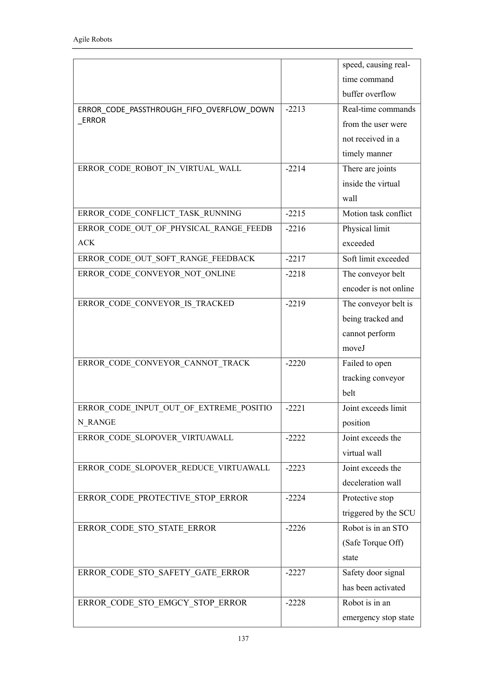



```
Agile Robots  
 137  
speed, causing real-
time command 
buffer overflow 
ERROR_CODE_PASSTHROUGH_FIFO_OVERFLOW_DOWN
_ERROR 
-2213 
Real-time commands 
from the user were 
not received in a 
timely manner 
ERROR_CODE_ROBOT_IN_VIRTUAL_WALL 
-2214 
There are joints 
inside the virtual 
wall  
ERROR_CODE_CONFLICT_TASK_RUNNING 
-2215 
Motion task conflict  
ERROR_CODE_OUT_OF_PHYSICAL_RANGE_FEEDB
ACK 
-2216 
Physical limit 
exceeded  
ERROR_CODE_OUT_SOFT_RANGE_FEEDBACK 
-2217 
Soft limit exceeded  
ERROR_CODE_CONVEYOR_NOT_ONLINE 
-2218 
The conveyor belt 
encoder is not online  
ERROR_CODE_CONVEYOR_IS_TRACKED 
 
-2219 
The conveyor belt is 
being tracked and 
cannot perform 
moveJ  
ERROR_CODE_CONVEYOR_CANNOT_TRACK 
 
-2220 
Failed to open 
tracking conveyor 
belt  
ERROR_CODE_INPUT_OUT_OF_EXTREME_POSITIO
N_RANGE 
-2221 
Joint exceeds limit 
position 
ERROR_CODE_SLOPOVER_VIRTUAWALL 
-2222 
Joint exceeds the 
virtual wall 
ERROR_CODE_SLOPOVER_REDUCE_VIRTUAWALL 
-2223 
Joint exceeds the 
deceleration wall 
ERROR_CODE_PROTECTIVE_STOP_ERROR 
-2224 
Protective stop 
triggered by the SCU 
ERROR_CODE_STO_STATE_ERROR 
-2226 
Robot is in an STO 
(Safe Torque Off) 
state 
ERROR_CODE_STO_SAFETY_GATE_ERROR 
-2227 
Safety door signal 
has been activated 
ERROR_CODE_STO_EMGCY_STOP_ERROR 
-2228 
Robot is in an 
emergency stop state
```



## PDF page 146

**Source:** Industrial API Manual (Python Edition) \_V3.3.0\_EN\_20260205.pdf, original pdf page 146. [Open the corresponding PDF reading-copy page](https://1292444914-files.gitbook.io/~/files/v0/b/gitbook-x-prod.appspot.com/o/spaces%2FtgOfPnscWebs1eh82EKq%2Fuploads%2FSvSj9qv8oTGMDxWxhsjy%2Findustrial-api-manual-python-edition-v3-3-0-en-20260205-pp-140-165.pdf?alt=media#page=7).



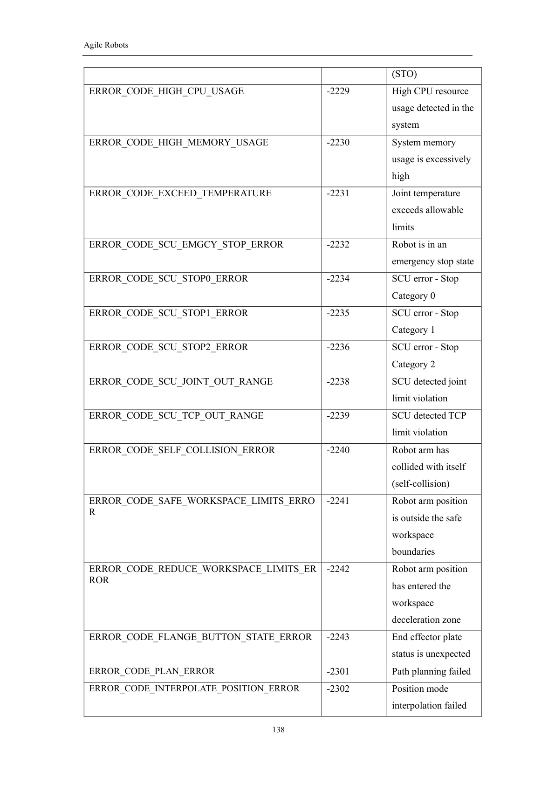



```
Agile Robots  
 138  
(STO) 
ERROR_CODE_HIGH_CPU_USAGE 
-2229 
High CPU resource 
usage detected in the 
system 
ERROR_CODE_HIGH_MEMORY_USAGE 
-2230 
System memory 
usage is excessively 
high 
ERROR_CODE_EXCEED_TEMPERATURE 
-2231 
Joint temperature 
exceeds allowable 
limits 
ERROR_CODE_SCU_EMGCY_STOP_ERROR 
-2232 
Robot is in an 
emergency stop state 
ERROR_CODE_SCU_STOP0_ERROR 
-2234 
SCU error - Stop 
Category 0 
ERROR_CODE_SCU_STOP1_ERROR 
-2235 
SCU error - Stop 
Category 1 
ERROR_CODE_SCU_STOP2_ERROR 
-2236 
SCU error - Stop 
Category 2 
ERROR_CODE_SCU_JOINT_OUT_RANGE 
-2238 
SCU detected joint 
limit violation 
ERROR_CODE_SCU_TCP_OUT_RANGE 
-2239 
SCU detected TCP 
limit violation 
ERROR_CODE_SELF_COLLISION_ERROR 
-2240 
Robot arm has 
collided with itself 
(self-collision) 
ERROR_CODE_SAFE_WORKSPACE_LIMITS_ERRO
R 
-2241 
Robot arm position 
is outside the safe 
workspace 
boundaries 
ERROR_CODE_REDUCE_WORKSPACE_LIMITS_ER
ROR 
-2242 
Robot arm position 
has entered the 
workspace 
deceleration zone 
ERROR_CODE_FLANGE_BUTTON_STATE_ERROR 
-2243 
End effector plate 
status is unexpected 
ERROR_CODE_PLAN_ERROR 
-2301 
Path planning failed  
ERROR_CODE_INTERPOLATE_POSITION_ERROR 
-2302 
Position mode 
interpolation failed
```



## PDF page 147

**Source:** Industrial API Manual (Python Edition) \_V3.3.0\_EN\_20260205.pdf, original pdf page 147. [Open the corresponding PDF reading-copy page](https://1292444914-files.gitbook.io/~/files/v0/b/gitbook-x-prod.appspot.com/o/spaces%2FtgOfPnscWebs1eh82EKq%2Fuploads%2FSvSj9qv8oTGMDxWxhsjy%2Findustrial-api-manual-python-edition-v3-3-0-en-20260205-pp-140-165.pdf?alt=media#page=8).



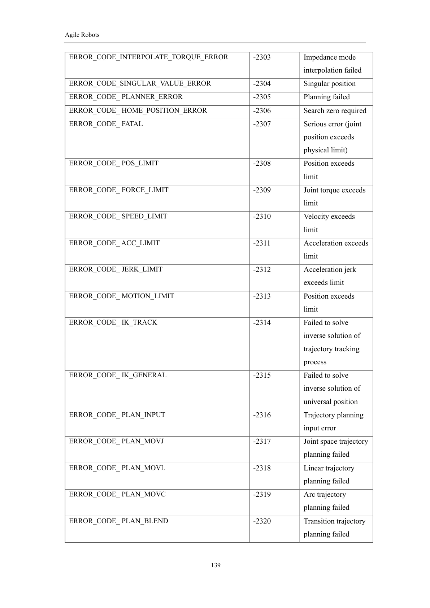



```
Agile Robots  
 139  
ERROR_CODE_INTERPOLATE_TORQUE_ERROR 
-2303 
Impedance mode 
interpolation failed  
ERROR_CODE_SINGULAR_VALUE_ERROR 
-2304 
Singular position  
ERROR_CODE_ PLANNER_ERROR 
-2305 
Planning failed  
ERROR_CODE_ HOME_POSITION_ERROR 
-2306 
Search zero required  
ERROR_CODE_ FATAL 
-2307 
Serious error (joint 
position exceeds 
physical limit)  
ERROR_CODE_ POS_LIMIT 
-2308 
Position exceeds 
limit  
ERROR_CODE_ FORCE_LIMIT 
-2309 
Joint torque exceeds 
limit  
ERROR_CODE_ SPEED_LIMIT 
-2310 
Velocity exceeds 
limit  
ERROR_CODE_ ACC_LIMIT 
-2311 
Acceleration exceeds 
limit  
ERROR_CODE_ JERK_LIMIT 
-2312 
Acceleration jerk 
exceeds limit  
ERROR_CODE_ MOTION_LIMIT 
-2313 
Position exceeds 
limit  
ERROR_CODE_ IK_TRACK 
-2314 
Failed to solve 
inverse solution of 
trajectory tracking 
process  
ERROR_CODE_ IK_GENERAL 
-2315 
Failed to solve 
inverse solution of 
universal position  
ERROR_CODE_ PLAN_INPUT 
-2316 
Trajectory planning 
input error  
ERROR_CODE_ PLAN_MOVJ 
-2317 
Joint space trajectory 
planning failed  
ERROR_CODE_ PLAN_MOVL 
-2318 
Linear trajectory 
planning failed  
ERROR_CODE_ PLAN_MOVC 
-2319 
Arc trajectory 
planning failed  
ERROR_CODE_ PLAN_BLEND 
-2320 
Transition trajectory 
planning failed
```



## PDF page 148

**Source:** Industrial API Manual (Python Edition) \_V3.3.0\_EN\_20260205.pdf, original pdf page 148. [Open the corresponding PDF reading-copy page](https://1292444914-files.gitbook.io/~/files/v0/b/gitbook-x-prod.appspot.com/o/spaces%2FtgOfPnscWebs1eh82EKq%2Fuploads%2FSvSj9qv8oTGMDxWxhsjy%2Findustrial-api-manual-python-edition-v3-3-0-en-20260205-pp-140-165.pdf?alt=media#page=9).



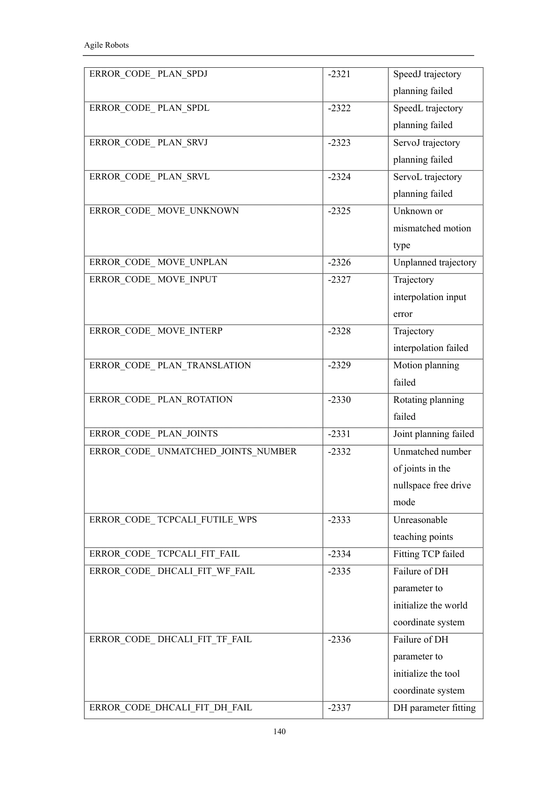



```
Agile Robots  
 140  
ERROR_CODE_ PLAN_SPDJ 
-2321 
SpeedJ trajectory 
planning failed  
ERROR_CODE_ PLAN_SPDL 
-2322 
SpeedL trajectory 
planning failed  
ERROR_CODE_ PLAN_SRVJ 
-2323 
ServoJ trajectory 
planning failed  
ERROR_CODE_ PLAN_SRVL 
-2324 
ServoL trajectory 
planning failed  
ERROR_CODE_ MOVE_UNKNOWN 
-2325 
Unknown or 
mismatched motion 
type  
ERROR_CODE_ MOVE_UNPLAN 
-2326 
Unplanned trajectory  
ERROR_CODE_ MOVE_INPUT 
-2327 
Trajectory 
interpolation input 
error  
ERROR_CODE_ MOVE_INTERP 
-2328 
Trajectory 
interpolation failed  
ERROR_CODE_ PLAN_TRANSLATION 
-2329 
Motion planning 
failed  
ERROR_CODE_ PLAN_ROTATION 
-2330 
Rotating planning 
failed  
ERROR_CODE_ PLAN_JOINTS 
-2331 
Joint planning failed  
ERROR_CODE_ UNMATCHED_JOINTS_NUMBER 
-2332 
Unmatched number 
of joints in the 
nullspace free drive 
mode  
ERROR_CODE_ TCPCALI_FUTILE_WPS 
-2333 
Unreasonable 
teaching points  
ERROR_CODE_ TCPCALI_FIT_FAIL 
-2334 
Fitting TCP failed  
ERROR_CODE_ DHCALI_FIT_WF_FAIL 
-2335 
Failure of DH 
parameter to 
initialize the world 
coordinate system  
ERROR_CODE_ DHCALI_FIT_TF_FAIL 
-2336 
Failure of DH 
parameter to 
initialize the tool 
coordinate system  
ERROR_CODE_DHCALI_FIT_DH_FAIL 
-2337 
DH parameter fitting
```



## PDF page 149

**Source:** Industrial API Manual (Python Edition) \_V3.3.0\_EN\_20260205.pdf, original pdf page 149. [Open the corresponding PDF reading-copy page](https://1292444914-files.gitbook.io/~/files/v0/b/gitbook-x-prod.appspot.com/o/spaces%2FtgOfPnscWebs1eh82EKq%2Fuploads%2FSvSj9qv8oTGMDxWxhsjy%2Findustrial-api-manual-python-edition-v3-3-0-en-20260205-pp-140-165.pdf?alt=media#page=10).



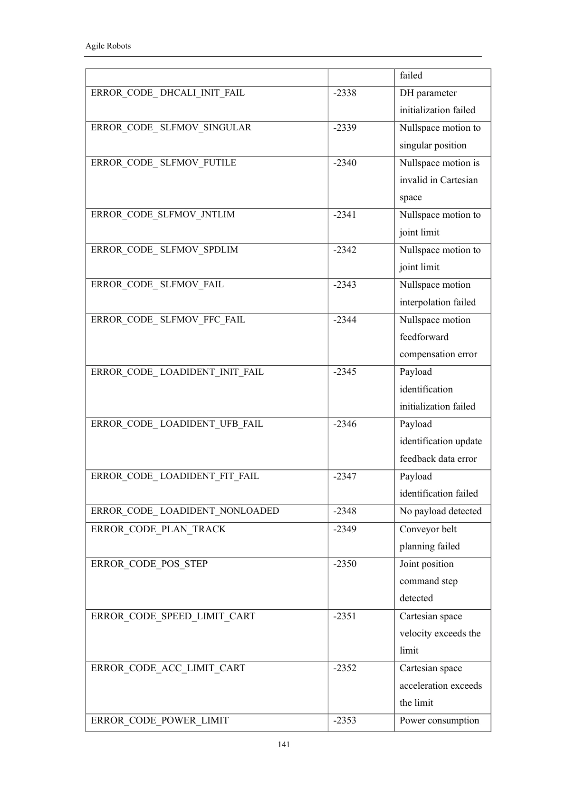



```
Agile Robots  
 141  
failed  
ERROR_CODE_ DHCALI_INIT_FAIL 
-2338 
DH parameter 
initialization failed  
ERROR_CODE_ SLFMOV_SINGULAR 
-2339 
Nullspace motion to 
singular position  
ERROR_CODE_ SLFMOV_FUTILE 
-2340 
Nullspace motion is 
invalid in Cartesian 
space  
ERROR_CODE_SLFMOV_JNTLIM 
-2341 
Nullspace motion to 
joint limit  
ERROR_CODE_ SLFMOV_SPDLIM 
-2342 
Nullspace motion to 
joint limit  
ERROR_CODE_ SLFMOV_FAIL 
-2343 
Nullspace motion 
interpolation failed  
ERROR_CODE_ SLFMOV_FFC_FAIL 
-2344 
Nullspace motion 
feedforward 
compensation error  
ERROR_CODE_ LOADIDENT_INIT_FAIL 
-2345 
Payload 
identification 
initialization failed  
ERROR_CODE_ LOADIDENT_UFB_FAIL 
-2346 
Payload 
identification update 
feedback data error  
ERROR_CODE_ LOADIDENT_FIT_FAIL 
-2347 
Payload 
identification failed  
ERROR_CODE_ LOADIDENT_NONLOADED 
-2348 
No payload detected  
ERROR_CODE_PLAN_TRACK 
-2349 
Conveyor belt 
planning failed 
ERROR_CODE_POS_STEP 
-2350 
Joint position 
command step 
detected 
ERROR_CODE_SPEED_LIMIT_CART 
-2351 
Cartesian space 
velocity exceeds the 
limit 
ERROR_CODE_ACC_LIMIT_CART 
-2352 
Cartesian space 
acceleration exceeds 
the limit 
ERROR_CODE_POWER_LIMIT 
-2353 
Power consumption
```



## PDF page 150

**Source:** Industrial API Manual (Python Edition) \_V3.3.0\_EN\_20260205.pdf, original pdf page 150. [Open the corresponding PDF reading-copy page](https://1292444914-files.gitbook.io/~/files/v0/b/gitbook-x-prod.appspot.com/o/spaces%2FtgOfPnscWebs1eh82EKq%2Fuploads%2FSvSj9qv8oTGMDxWxhsjy%2Findustrial-api-manual-python-edition-v3-3-0-en-20260205-pp-140-165.pdf?alt=media#page=11).



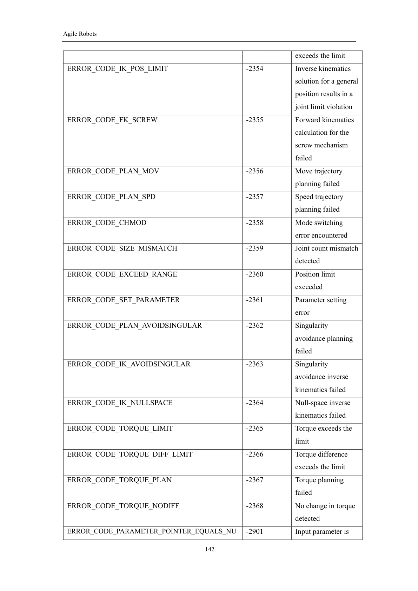



```
Agile Robots  
 142  
exceeds the limit 
ERROR_CODE_IK_POS_LIMIT 
-2354 
Inverse kinematics 
solution for a general 
position results in a 
joint limit violation 
ERROR_CODE_FK_SCREW 
-2355 
Forward kinematics 
calculation for the 
screw mechanism 
failed 
ERROR_CODE_PLAN_MOV 
-2356 
Move trajectory 
planning failed 
ERROR_CODE_PLAN_SPD 
-2357 
Speed trajectory 
planning failed 
ERROR_CODE_CHMOD 
-2358 
Mode switching 
error encountered 
ERROR_CODE_SIZE_MISMATCH 
-2359 
Joint count mismatch 
detected 
ERROR_CODE_EXCEED_RANGE 
-2360 
Position limit 
exceeded 
ERROR_CODE_SET_PARAMETER 
-2361 
Parameter setting 
error 
ERROR_CODE_PLAN_AVOIDSINGULAR 
-2362 
Singularity 
avoidance planning 
failed 
ERROR_CODE_IK_AVOIDSINGULAR 
-2363 
Singularity 
avoidance inverse 
kinematics failed 
ERROR_CODE_IK_NULLSPACE 
-2364 
Null-space inverse 
kinematics failed 
ERROR_CODE_TORQUE_LIMIT 
-2365 
Torque exceeds the 
limit 
ERROR_CODE_TORQUE_DIFF_LIMIT 
-2366 
Torque difference 
exceeds the limit 
ERROR_CODE_TORQUE_PLAN 
-2367 
Torque planning 
failed 
ERROR_CODE_TORQUE_NODIFF 
-2368 
No change in torque 
detected 
ERROR_CODE_PARAMETER_POINTER_EQUALS_NU
-2901 
Input parameter is
```



## PDF page 151

**Source:** Industrial API Manual (Python Edition) \_V3.3.0\_EN\_20260205.pdf, original pdf page 151. [Open the corresponding PDF reading-copy page](https://1292444914-files.gitbook.io/~/files/v0/b/gitbook-x-prod.appspot.com/o/spaces%2FtgOfPnscWebs1eh82EKq%2Fuploads%2FSvSj9qv8oTGMDxWxhsjy%2Findustrial-api-manual-python-edition-v3-3-0-en-20260205-pp-140-165.pdf?alt=media#page=12).



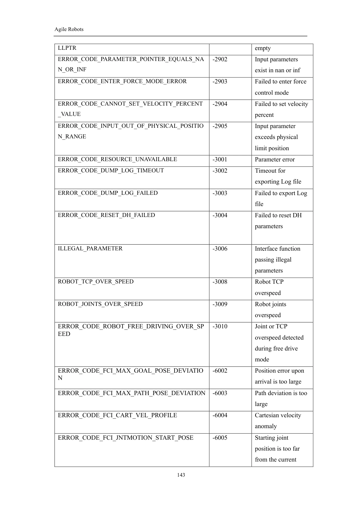



```
Agile Robots  
 143  
LLPTR 
empty 
ERROR_CODE_PARAMETER_POINTER_EQUALS_NA
N_OR_INF 
-2902 
Input parameters 
exist in nan or inf 
ERROR_CODE_ENTER_FORCE_MODE_ERROR 
-2903 
Failed to enter force 
control mode 
ERROR_CODE_CANNOT_SET_VELOCITY_PERCENT
_VALUE 
-2904 
Failed to set velocity 
percent 
ERROR_CODE_INPUT_OUT_OF_PHYSICAL_POSITIO
N_RANGE 
-2905 
Input parameter 
exceeds physical 
limit position 
ERROR_CODE_RESOURCE_UNAVAILABLE 
-3001 
Parameter error  
ERROR_CODE_DUMP_LOG_TIMEOUT 
-3002 
Timeout for 
exporting Log file  
ERROR_CODE_DUMP_LOG_FAILED 
-3003 
Failed to export Log 
file  
ERROR_CODE_RESET_DH_FAILED 
-3004 
Failed to reset DH 
parameters  
 
ILLEGAL_PARAMETER 
-3006 
Interface function 
passing illegal 
parameters 
ROBOT_TCP_OVER_SPEED 
-3008 
Robot TCP 
overspeed 
ROBOT_JOINTS_OVER_SPEED 
-3009 
Robot joints 
overspeed 
ERROR_CODE_ROBOT_FREE_DRIVING_OVER_SP
EED 
-3010 
Joint or TCP 
overspeed detected 
during free drive 
mode 
ERROR_CODE_FCI_MAX_GOAL_POSE_DEVIATIO
N 
-6002 
Position error upon 
arrival is too large 
ERROR_CODE_FCI_MAX_PATH_POSE_DEVIATION 
-6003 
Path deviation is too 
large 
ERROR_CODE_FCI_CART_VEL_PROFILE 
-6004 
Cartesian velocity 
anomaly 
ERROR_CODE_FCI_JNTMOTION_START_POSE 
-6005 
Starting joint 
position is too far 
from the current
```



## PDF page 152

**Source:** Industrial API Manual (Python Edition) \_V3.3.0\_EN\_20260205.pdf, original pdf page 152. [Open the corresponding PDF reading-copy page](https://1292444914-files.gitbook.io/~/files/v0/b/gitbook-x-prod.appspot.com/o/spaces%2FtgOfPnscWebs1eh82EKq%2Fuploads%2FSvSj9qv8oTGMDxWxhsjy%2Findustrial-api-manual-python-edition-v3-3-0-en-20260205-pp-140-165.pdf?alt=media#page=13).



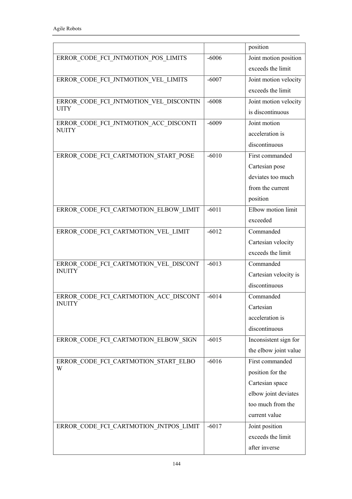



```
Agile Robots  
 144  
position 
ERROR_CODE_FCI_JNTMOTION_POS_LIMITS 
-6006 
Joint motion position 
exceeds the limit 
ERROR_CODE_FCI_JNTMOTION_VEL_LIMITS 
-6007 
Joint motion velocity 
exceeds the limit 
ERROR_CODE_FCI_JNTMOTION_VEL_DISCONTIN
UITY 
-6008 
Joint motion velocity 
is discontinuous 
ERROR_CODE_FCI_JNTMOTION_ACC_DISCONTI
NUITY 
-6009 
Joint motion 
acceleration is 
discontinuous 
ERROR_CODE_FCI_CARTMOTION_START_POSE 
-6010 
First commanded 
Cartesian pose 
deviates too much 
from the current 
position 
ERROR_CODE_FCI_CARTMOTION_ELBOW_LIMIT 
-6011 
Elbow motion limit 
exceeded 
ERROR_CODE_FCI_CARTMOTION_VEL_LIMIT 
-6012 
Commanded 
Cartesian velocity 
exceeds the limit 
ERROR_CODE_FCI_CARTMOTION_VEL_DISCONT
INUITY 
-6013 
Commanded 
Cartesian velocity is 
discontinuous 
ERROR_CODE_FCI_CARTMOTION_ACC_DISCONT
INUITY 
-6014 
Commanded 
Cartesian 
acceleration is 
discontinuous 
ERROR_CODE_FCI_CARTMOTION_ELBOW_SIGN 
-6015 
Inconsistent sign for 
the elbow joint value 
ERROR_CODE_FCI_CARTMOTION_START_ELBO
W 
-6016 
First commanded 
position for the 
Cartesian space 
elbow joint deviates 
too much from the 
current value 
ERROR_CODE_FCI_CARTMOTION_JNTPOS_LIMIT 
-6017 
Joint position 
exceeds the limit 
after inverse
```



## PDF page 153

**Source:** Industrial API Manual (Python Edition) \_V3.3.0\_EN\_20260205.pdf, original pdf page 153. [Open the corresponding PDF reading-copy page](https://1292444914-files.gitbook.io/~/files/v0/b/gitbook-x-prod.appspot.com/o/spaces%2FtgOfPnscWebs1eh82EKq%2Fuploads%2FSvSj9qv8oTGMDxWxhsjy%2Findustrial-api-manual-python-edition-v3-3-0-en-20260205-pp-140-165.pdf?alt=media#page=14).



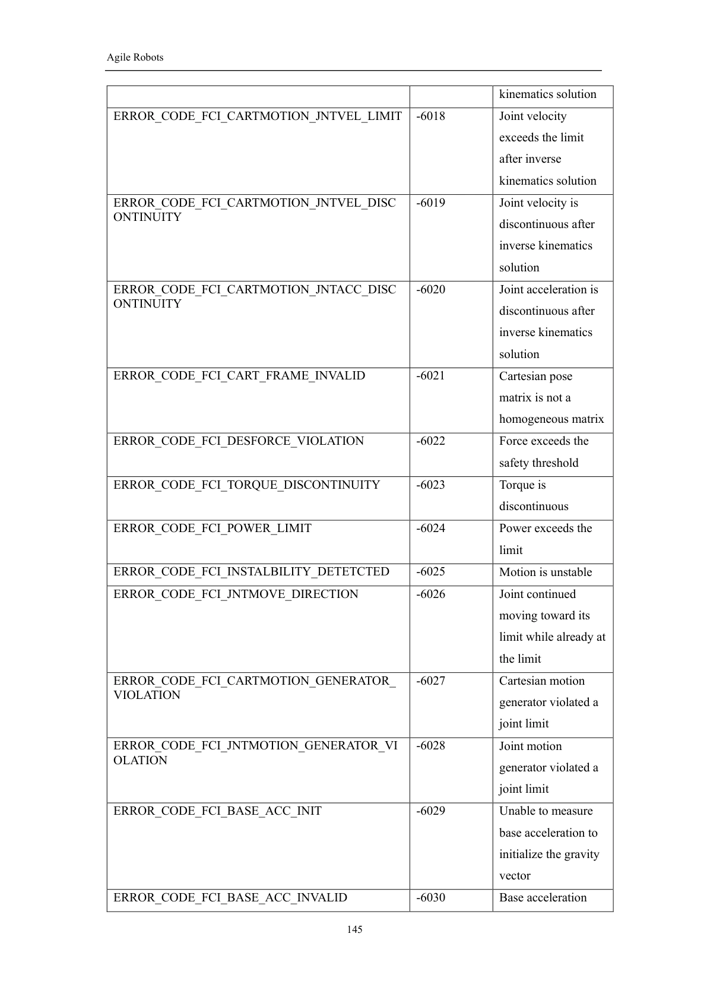



```
Agile Robots  
 145  
kinematics solution 
ERROR_CODE_FCI_CARTMOTION_JNTVEL_LIMIT 
-6018 
Joint velocity 
exceeds the limit 
after inverse 
kinematics solution 
ERROR_CODE_FCI_CARTMOTION_JNTVEL_DISC
ONTINUITY 
-6019 
Joint velocity is 
discontinuous after 
inverse kinematics 
solution 
ERROR_CODE_FCI_CARTMOTION_JNTACC_DISC
ONTINUITY 
-6020 
Joint acceleration is 
discontinuous after 
inverse kinematics 
solution 
ERROR_CODE_FCI_CART_FRAME_INVALID 
-6021 
Cartesian pose 
matrix is not a 
homogeneous matrix 
ERROR_CODE_FCI_DESFORCE_VIOLATION 
-6022 
Force exceeds the 
safety threshold 
ERROR_CODE_FCI_TORQUE_DISCONTINUITY 
-6023 
Torque is 
discontinuous 
ERROR_CODE_FCI_POWER_LIMIT 
-6024 
Power exceeds the 
limit 
ERROR_CODE_FCI_INSTALBILITY_DETETCTED 
-6025 
Motion is unstable 
ERROR_CODE_FCI_JNTMOVE_DIRECTION 
-6026 
Joint continued 
moving toward its 
limit while already at 
the limit 
ERROR_CODE_FCI_CARTMOTION_GENERATOR_
VIOLATION 
-6027 
Cartesian motion 
generator violated a 
joint limit 
ERROR_CODE_FCI_JNTMOTION_GENERATOR_VI
OLATION 
-6028 
Joint motion 
generator violated a 
joint limit 
ERROR_CODE_FCI_BASE_ACC_INIT 
-6029 
Unable to measure 
base acceleration to 
initialize the gravity 
vector 
ERROR_CODE_FCI_BASE_ACC_INVALID 
-6030 
Base acceleration
```



## PDF page 154

**Source:** Industrial API Manual (Python Edition) \_V3.3.0\_EN\_20260205.pdf, original pdf page 154. [Open the corresponding PDF reading-copy page](https://1292444914-files.gitbook.io/~/files/v0/b/gitbook-x-prod.appspot.com/o/spaces%2FtgOfPnscWebs1eh82EKq%2Fuploads%2FSvSj9qv8oTGMDxWxhsjy%2Findustrial-api-manual-python-edition-v3-3-0-en-20260205-pp-140-165.pdf?alt=media#page=15).



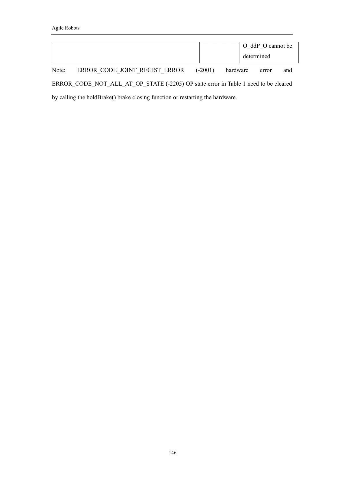



```
Agile Robots  
 146  
O_ddP_O cannot be 
determined 
Note: 
ERROR_CODE_JOINT_REGIST_ERROR 
(-2001) 
hardware 
error 
and 
ERROR_CODE_NOT_ALL_AT_OP_STATE (-2205) OP state error in Table 1 need to be cleared 
by calling the holdBrake() brake closing function or restarting the hardware.
```



## PDF page 155

**Source:** Industrial API Manual (Python Edition) \_V3.3.0\_EN\_20260205.pdf, original pdf page 155. [Open the corresponding PDF reading-copy page](https://1292444914-files.gitbook.io/~/files/v0/b/gitbook-x-prod.appspot.com/o/spaces%2FtgOfPnscWebs1eh82EKq%2Fuploads%2FSvSj9qv8oTGMDxWxhsjy%2Findustrial-api-manual-python-edition-v3-3-0-en-20260205-pp-140-165.pdf?alt=media#page=16).



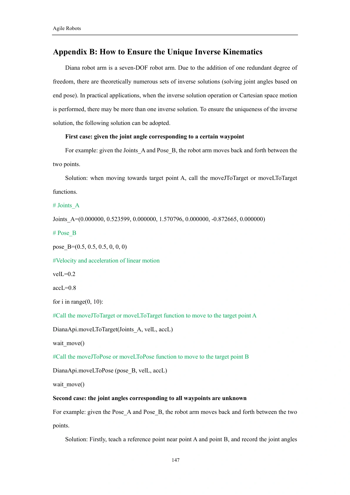



```
Agile Robots  
 147  
Appendix B: How to Ensure the Unique Inverse Kinematics  
Diana robot arm is a seven-DOF robot arm. Due to the addition of one redundant degree of 
freedom, there are theoretically numerous sets of inverse solutions (solving joint angles based on 
end pose). In practical applications, when the inverse solution operation or Cartesian space motion 
is performed, there may be more than one inverse solution. To ensure the uniqueness of the inverse 
solution, the following solution can be adopted.  
First case: given the joint angle corresponding to a certain waypoint  
 
For example: given the Joints_A and Pose_B, the robot arm moves back and forth between the 
two points.  
 
Solution: when moving towards target point A, call the moveJToTarget or moveLToTarget 
functions.  
# Joints_A  
Joints_A=(0.000000, 0.523599, 0.000000, 1.570796, 0.000000, -0.872665, 0.000000)  
# Pose_B  
pose_B=(0.5, 0.5, 0.5, 0, 0, 0)  
#Velocity and acceleration of linear motion  
velL=0.2 
accL=0.8 
for i in range(0, 10): 
#Call the moveJToTarget or moveLToTarget function to move to the target point A  
DianaApi.moveLToTarget(Joints_A, velL, accL)  
wait_move()  
#Call the moveJToPose or moveLToPose function to move to the target point B  
DianaApi.moveLToPose (pose_B, velL, accL)  
wait_move()  
Second case: the joint angles corresponding to all waypoints are unknown  
For example: given the Pose_A and Pose_B, the robot arm moves back and forth between the two 
points.  
Solution: Firstly, teach a reference point near point A and point B, and record the joint angles
```



## PDF page 156

**Source:** Industrial API Manual (Python Edition) \_V3.3.0\_EN\_20260205.pdf, original pdf page 156. [Open the corresponding PDF reading-copy page](https://1292444914-files.gitbook.io/~/files/v0/b/gitbook-x-prod.appspot.com/o/spaces%2FtgOfPnscWebs1eh82EKq%2Fuploads%2FSvSj9qv8oTGMDxWxhsjy%2Findustrial-api-manual-python-edition-v3-3-0-en-20260205-pp-140-165.pdf?alt=media#page=17).



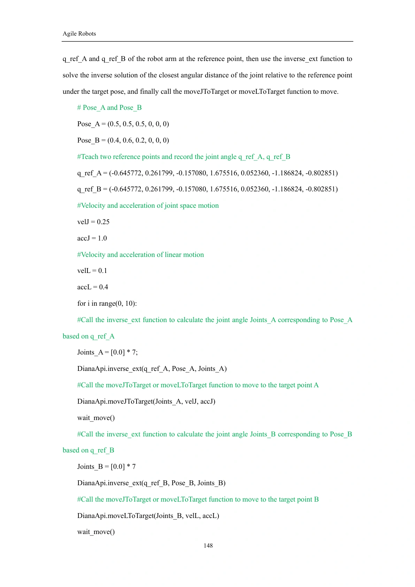



```
Agile Robots  
 148  
q_ref_A and q_ref_B of the robot arm at the reference point, then use the inverse_ext function to 
solve the inverse solution of the closest angular distance of the joint relative to the reference point 
under the target pose, and finally call the moveJToTarget or moveLToTarget function to move.  
# Pose_A and Pose_B  
Pose_A = (0.5, 0.5, 0.5, 0, 0, 0) 
Pose_B = (0.4, 0.6, 0.2, 0, 0, 0) 
#Teach two reference points and record the joint angle q_ref_A, q_ref_B  
q_ref_A = (-0.645772, 0.261799, -0.157080, 1.675516, 0.052360, -1.186824, -0.802851) 
q_ref_B = (-0.645772, 0.261799, -0.157080, 1.675516, 0.052360, -1.186824, -0.802851) 
#Velocity and acceleration of joint space motion  
velJ = 0.25 
accJ = 1.0 
 
#Velocity and acceleration of linear motion  
velL = 0.1 
accL = 0.4 
 
for i in range(0, 10): 
#Call the inverse_ext function to calculate the joint angle Joints_A corresponding to Pose_A 
based on q_ref_A  
Joints_A = [0.0] * 7; 
DianaApi.inverse_ext(q_ref_A, Pose_A, Joints_A) 
#Call the moveJToTarget or moveLToTarget function to move to the target point A  
DianaApi.moveJToTarget(Joints_A, velJ, accJ) 
wait_move() 
#Call the inverse_ext function to calculate the joint angle Joints_B corresponding to Pose_B 
based on q_ref_B  
Joints_B = [0.0] * 7 
DianaApi.inverse_ext(q_ref_B, Pose_B, Joints_B) 
#Call the moveJToTarget or moveLToTarget function to move to the target point B  
DianaApi.moveLToTarget(Joints_B, velL, accL) 
wait_move()
```



## PDF page 157

**Source:** Industrial API Manual (Python Edition) \_V3.3.0\_EN\_20260205.pdf, original pdf page 157. [Open the corresponding PDF reading-copy page](https://1292444914-files.gitbook.io/~/files/v0/b/gitbook-x-prod.appspot.com/o/spaces%2FtgOfPnscWebs1eh82EKq%2Fuploads%2FSvSj9qv8oTGMDxWxhsjy%2Findustrial-api-manual-python-edition-v3-3-0-en-20260205-pp-140-165.pdf?alt=media#page=18).



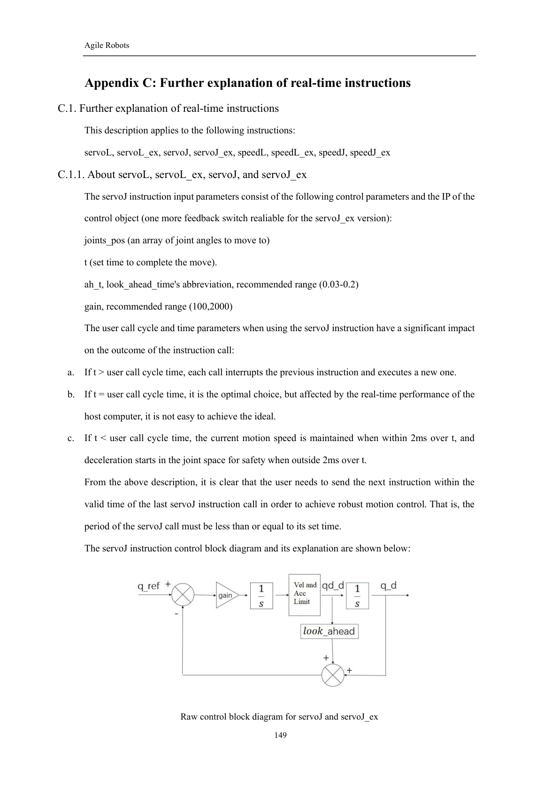



```
Agile Robots  
 149  
Appendix C: Further explanation of real-time instructions 
C.1. Further explanation of real-time instructions 
This description applies to the following instructions:  
servoL, servoL_ex, servoJ, servoJ_ex, speedL, speedL_ex, speedJ, speedJ_ex 
C.1.1. About servoL, servoL_ex, servoJ, and servoJ_ex 
The servoJ instruction input parameters consist of the following control parameters and the IP of the 
control object (one more feedback switch realiable for the servoJ_ex version): 
joints_pos (an array of joint angles to move to) 
t (set time to complete the move). 
ah_t, look_ahead_time's abbreviation, recommended range (0.03-0.2) 
gain, recommended range (100,2000) 
The user call cycle and time parameters when using the servoJ instruction have a significant impact 
on the outcome of the instruction call: 
a. If t > user call cycle time, each call interrupts the previous instruction and executes a new one. 
b. If t = user call cycle time, it is the optimal choice, but affected by the real-time performance of the 
host computer, it is not easy to achieve the ideal. 
c. If t < user call cycle time, the current motion speed is maintained when within 2ms over t, and 
deceleration starts in the joint space for safety when outside 2ms over t. 
From the above description, it is clear that the user needs to send the next instruction within the 
valid time of the last servoJ instruction call in order to achieve robust motion control. That is, the 
period of the servoJ call must be less than or equal to its set time. 
The servoJ instruction control block diagram and its explanation are shown below: 
 
Raw control block diagram for servoJ and servoJ_ex
```



## PDF page 158

**Source:** Industrial API Manual (Python Edition) \_V3.3.0\_EN\_20260205.pdf, original pdf page 158. [Open the corresponding PDF reading-copy page](https://1292444914-files.gitbook.io/~/files/v0/b/gitbook-x-prod.appspot.com/o/spaces%2FtgOfPnscWebs1eh82EKq%2Fuploads%2FSvSj9qv8oTGMDxWxhsjy%2Findustrial-api-manual-python-edition-v3-3-0-en-20260205-pp-140-165.pdf?alt=media#page=19).



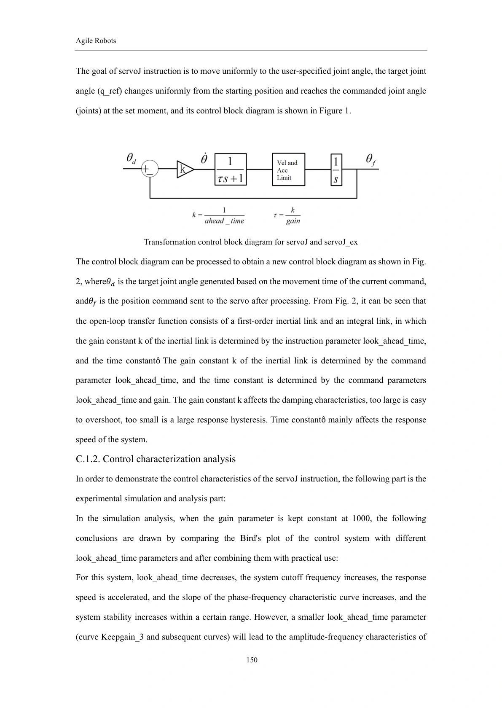



```
Agile Robots  
 150  
The goal of servoJ instruction is to move uniformly to the user-specified joint angle, the target joint 
angle (q_ref) changes uniformly from the starting position and reaches the commanded joint angle 
(joints) at the set moment, and its control block diagram is shown in Figure 1. 
 
 
Transformation control block diagram for servoJ and servoJ_ex 
The control block diagram can be processed to obtain a new control block diagram as shown in Fig. 
2, where𝜃𝑑 is the target joint angle generated based on the movement time of the current command, 
and𝜃𝑓 is the position command sent to the servo after processing. From Fig. 2, it can be seen that 
the open-loop transfer function consists of a first-order inertial link and an integral link, in which 
the gain constant k of the inertial link is determined by the instruction parameter look_ahead_time, 
and the time constantô The gain constant k of the inertial link is determined by the command 
parameter look_ahead_time, and the time constant is determined by the command parameters 
look_ahead_time and gain. The gain constant k affects the damping characteristics, too large is easy 
to overshoot, too small is a large response hysteresis. Time constantô mainly affects the response 
speed of the system. 
C.1.2. Control characterization analysis 
In order to demonstrate the control characteristics of the servoJ instruction, the following part is the 
experimental simulation and analysis part: 
In the simulation analysis, when the gain parameter is kept constant at 1000, the following 
conclusions are drawn by comparing the Bird's plot of the control system with different 
look_ahead_time parameters and after combining them with practical use: 
For this system, look_ahead_time decreases, the system cutoff frequency increases, the response 
speed is accelerated, and the slope of the phase-frequency characteristic curve increases, and the 
system stability increases within a certain range. However, a smaller look_ahead_time parameter 
(curve Keepgain_3 and subsequent curves) will lead to the amplitude-frequency characteristics of
```



## PDF page 159

**Source:** Industrial API Manual (Python Edition) \_V3.3.0\_EN\_20260205.pdf, original pdf page 159. [Open the corresponding PDF reading-copy page](https://1292444914-files.gitbook.io/~/files/v0/b/gitbook-x-prod.appspot.com/o/spaces%2FtgOfPnscWebs1eh82EKq%2Fuploads%2FSvSj9qv8oTGMDxWxhsjy%2Findustrial-api-manual-python-edition-v3-3-0-en-20260205-pp-140-165.pdf?alt=media#page=20).



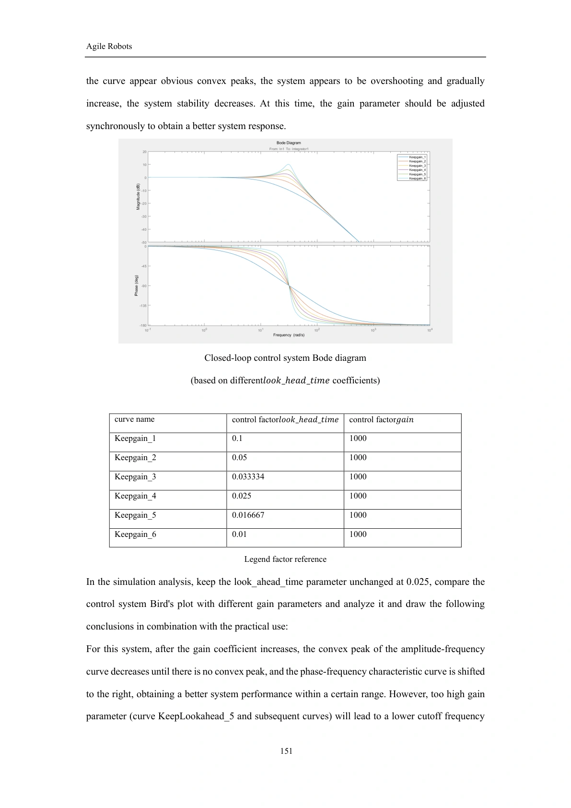



```
Agile Robots  
 151  
the curve appear obvious convex peaks, the system appears to be overshooting and gradually 
increase, the system stability decreases. At this time, the gain parameter should be adjusted 
synchronously to obtain a better system response. 
 
Closed-loop control system Bode diagram 
(based on different𝑙𝑜𝑜𝑘_ℎ𝑒𝑎𝑑_𝑡𝑖𝑚𝑒 coefficients) 
 
curve name 
control factor𝑙𝑜𝑜𝑘_ℎ𝑒𝑎𝑑_𝑡𝑖𝑚𝑒 
control factor𝑔𝑎𝑖𝑛 
Keepgain_1 
0.1 
1000 
Keepgain_2 
0.05 
1000 
Keepgain_3 
0.033334 
1000 
Keepgain_4 
0.025 
1000 
Keepgain_5 
0.016667 
1000 
Keepgain_6 
0.01 
1000 
Legend factor reference 
In the simulation analysis, keep the look_ahead_time parameter unchanged at 0.025, compare the 
control system Bird's plot with different gain parameters and analyze it and draw the following 
conclusions in combination with the practical use: 
For this system, after the gain coefficient increases, the convex peak of the amplitude-frequency 
curve decreases until there is no convex peak, and the phase-frequency characteristic curve is shifted 
to the right, obtaining a better system performance within a certain range. However, too high gain 
parameter (curve KeepLookahead_5 and subsequent curves) will lead to a lower cutoff frequency
```



## PDF page 160

**Source:** Industrial API Manual (Python Edition) \_V3.3.0\_EN\_20260205.pdf, original pdf page 160. [Open the corresponding PDF reading-copy page](https://1292444914-files.gitbook.io/~/files/v0/b/gitbook-x-prod.appspot.com/o/spaces%2FtgOfPnscWebs1eh82EKq%2Fuploads%2FSvSj9qv8oTGMDxWxhsjy%2Findustrial-api-manual-python-edition-v3-3-0-en-20260205-pp-140-165.pdf?alt=media#page=21).



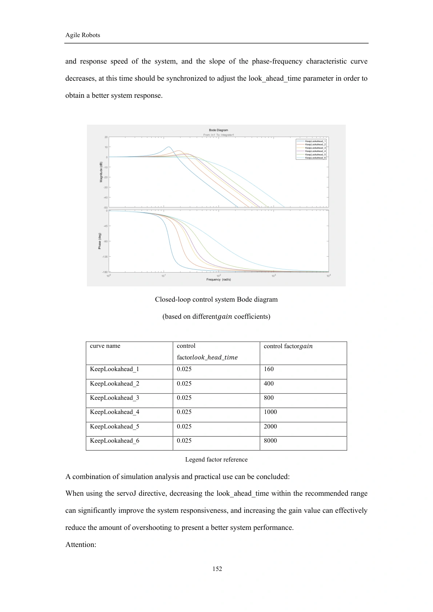



```
Agile Robots  
 152  
and response speed of the system, and the slope of the phase-frequency characteristic curve 
decreases, at this time should be synchronized to adjust the look_ahead_time parameter in order to 
obtain a better system response. 
 
 
Closed-loop control system Bode diagram 
(based on different𝑔𝑎𝑖𝑛 coefficients) 
 
curve name 
control 
factor𝑙𝑜𝑜𝑘_ℎ𝑒𝑎𝑑_𝑡𝑖𝑚𝑒 
control factor𝑔𝑎𝑖𝑛 
KeepLookahead_1 
0.025 
160 
KeepLookahead_2 
0.025 
400 
KeepLookahead_3 
0.025 
800 
KeepLookahead_4 
0.025 
1000 
KeepLookahead_5 
0.025 
2000 
KeepLookahead_6 
0.025 
8000 
Legend factor reference 
A combination of simulation analysis and practical use can be concluded: 
When using the servoJ directive, decreasing the look_ahead_time within the recommended range 
can significantly improve the system responsiveness, and increasing the gain value can effectively 
reduce the amount of overshooting to present a better system performance. 
Attention:
```



## PDF page 161

**Source:** Industrial API Manual (Python Edition) \_V3.3.0\_EN\_20260205.pdf, original pdf page 161. [Open the corresponding PDF reading-copy page](https://1292444914-files.gitbook.io/~/files/v0/b/gitbook-x-prod.appspot.com/o/spaces%2FtgOfPnscWebs1eh82EKq%2Fuploads%2FSvSj9qv8oTGMDxWxhsjy%2Findustrial-api-manual-python-edition-v3-3-0-en-20260205-pp-140-165.pdf?alt=media#page=22).



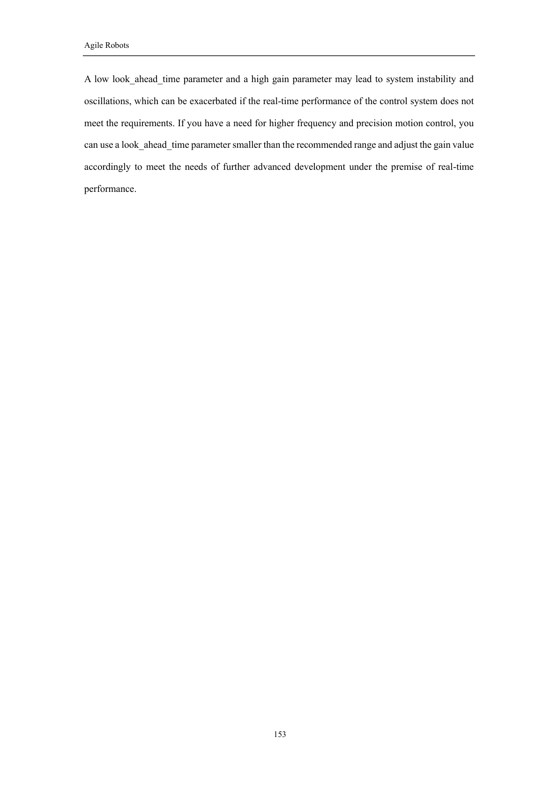



```
Agile Robots  
 153  
A low look_ahead_time parameter and a high gain parameter may lead to system instability and 
oscillations, which can be exacerbated if the real-time performance of the control system does not 
meet the requirements. If you have a need for higher frequency and precision motion control, you 
can use a look_ahead_time parameter smaller than the recommended range and adjust the gain value 
accordingly to meet the needs of further advanced development under the premise of real-time 
performance.
```



## PDF page 162

**Source:** Industrial API Manual (Python Edition) \_V3.3.0\_EN\_20260205.pdf, original pdf page 162. [Open the corresponding PDF reading-copy page](https://1292444914-files.gitbook.io/~/files/v0/b/gitbook-x-prod.appspot.com/o/spaces%2FtgOfPnscWebs1eh82EKq%2Fuploads%2FSvSj9qv8oTGMDxWxhsjy%2Findustrial-api-manual-python-edition-v3-3-0-en-20260205-pp-140-165.pdf?alt=media#page=23).



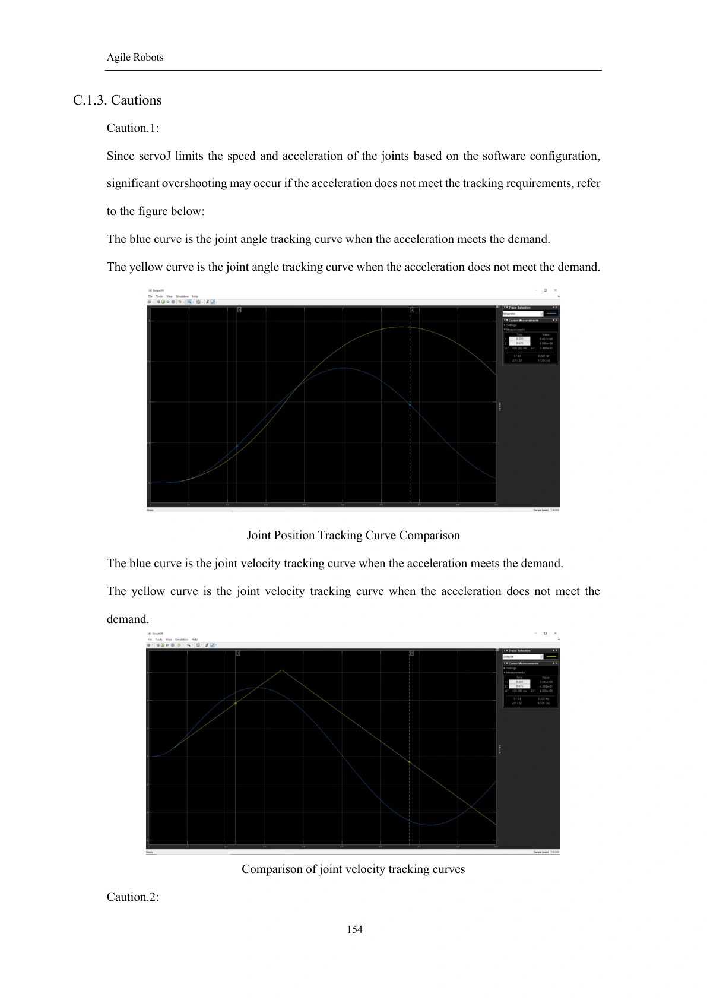



```
Agile Robots  
 154  
C.1.3. Cautions 
Caution.1: 
Since servoJ limits the speed and acceleration of the joints based on the software configuration, 
significant overshooting may occur if the acceleration does not meet the tracking requirements, refer 
to the figure below: 
The blue curve is the joint angle tracking curve when the acceleration meets the demand. 
The yellow curve is the joint angle tracking curve when the acceleration does not meet the demand. 
 
Joint Position Tracking Curve Comparison 
The blue curve is the joint velocity tracking curve when the acceleration meets the demand. 
The yellow curve is the joint velocity tracking curve when the acceleration does not meet the 
demand. 
 
Comparison of joint velocity tracking curves 
Caution.2:
```



## PDF page 163

**Source:** Industrial API Manual (Python Edition) \_V3.3.0\_EN\_20260205.pdf, original pdf page 163. [Open the corresponding PDF reading-copy page](https://1292444914-files.gitbook.io/~/files/v0/b/gitbook-x-prod.appspot.com/o/spaces%2FtgOfPnscWebs1eh82EKq%2Fuploads%2FSvSj9qv8oTGMDxWxhsjy%2Findustrial-api-manual-python-edition-v3-3-0-en-20260205-pp-140-165.pdf?alt=media#page=24).



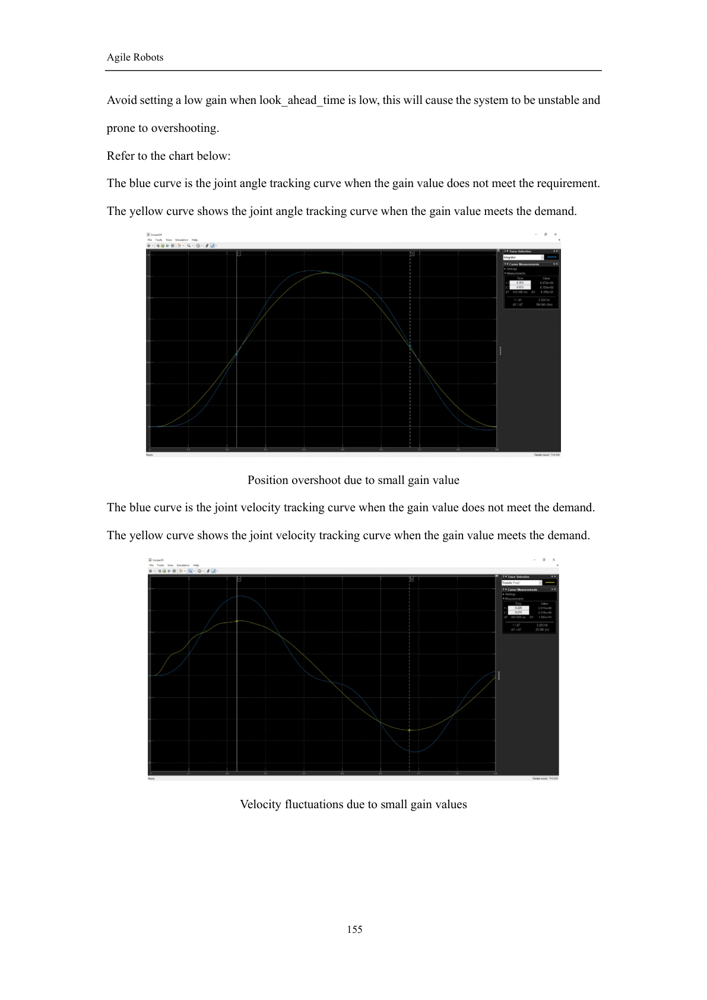



```
Agile Robots  
 155  
Avoid setting a low gain when look_ahead_time is low, this will cause the system to be unstable and 
prone to overshooting. 
Refer to the chart below: 
The blue curve is the joint angle tracking curve when the gain value does not meet the requirement. 
The yellow curve shows the joint angle tracking curve when the gain value meets the demand. 
 
Position overshoot due to small gain value 
The blue curve is the joint velocity tracking curve when the gain value does not meet the demand. 
The yellow curve shows the joint velocity tracking curve when the gain value meets the demand. 
 
Velocity fluctuations due to small gain values
```



## PDF page 164

**Source:** Industrial API Manual (Python Edition) \_V3.3.0\_EN\_20260205.pdf, original pdf page 164. [Open the corresponding PDF reading-copy page](https://1292444914-files.gitbook.io/~/files/v0/b/gitbook-x-prod.appspot.com/o/spaces%2FtgOfPnscWebs1eh82EKq%2Fuploads%2FSvSj9qv8oTGMDxWxhsjy%2Findustrial-api-manual-python-edition-v3-3-0-en-20260205-pp-140-165.pdf?alt=media#page=25).



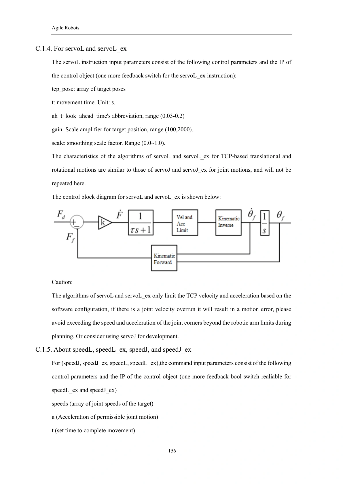



```
Agile Robots  
 156  
C.1.4. For servoL and servoL_ex 
The servoL instruction input parameters consist of the following control parameters and the IP of 
the control object (one more feedback switch for the servoL_ex instruction): 
tcp_pose: array of target poses 
t: movement time. Unit: s. 
ah_t: look_ahead_time's abbreviation, range (0.03-0.2) 
gain: Scale amplifier for target position, range (100,2000). 
scale: smoothing scale factor. Range (0.0~1.0). 
The characteristics of the algorithms of servoL and servoL_ex for TCP-based translational and 
rotational motions are similar to those of servoJ and servoJ_ex for joint motions, and will not be 
repeated here. 
The control block diagram for servoL and servoL_ex is shown below: 
 
Caution: 
The algorithms of servoL and servoL_ex only limit the TCP velocity and acceleration based on the 
software configuration, if there is a joint velocity overrun it will result in a motion error, please 
avoid exceeding the speed and acceleration of the joint corners beyond the robotic arm limits during 
planning. Or consider using servoJ for development. 
C.1.5. About speedL, speedL_ex, speedJ, and speedJ_ex 
For (speedJ, speedJ_ex, speedL, speedL_ex),the command input parameters consist of the following 
control parameters and the IP of the control object (one more feedback bool switch realiable for 
speedL_ex and speedJ_ex) 
speeds (array of joint speeds of the target) 
a (Acceleration of permissible joint motion) 
t (set time to complete movement)
```



## PDF page 165

**Source:** Industrial API Manual (Python Edition) \_V3.3.0\_EN\_20260205.pdf, original pdf page 165. [Open the corresponding PDF reading-copy page](https://1292444914-files.gitbook.io/~/files/v0/b/gitbook-x-prod.appspot.com/o/spaces%2FtgOfPnscWebs1eh82EKq%2Fuploads%2FSvSj9qv8oTGMDxWxhsjy%2Findustrial-api-manual-python-edition-v3-3-0-en-20260205-pp-140-165.pdf?alt=media#page=26).



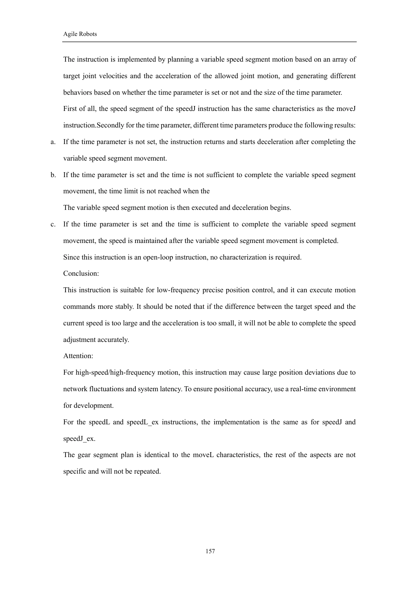



```
Agile Robots  
 157  
The instruction is implemented by planning a variable speed segment motion based on an array of 
target joint velocities and the acceleration of the allowed joint motion, and generating different 
behaviors based on whether the time parameter is set or not and the size of the time parameter. 
First of all, the speed segment of the speedJ instruction has the same characteristics as the moveJ 
instruction.Secondly for the time parameter, different time parameters produce the following results: 
a. If the time parameter is not set, the instruction returns and starts deceleration after completing the 
variable speed segment movement. 
b. If the time parameter is set and the time is not sufficient to complete the variable speed segment 
movement, the time limit is not reached when the 
The variable speed segment motion is then executed and deceleration begins. 
c. If the time parameter is set and the time is sufficient to complete the variable speed segment 
movement, the speed is maintained after the variable speed segment movement is completed. 
Since this instruction is an open-loop instruction, no characterization is required. 
Conclusion: 
This instruction is suitable for low-frequency precise position control, and it can execute motion 
commands more stably. It should be noted that if the difference between the target speed and the 
current speed is too large and the acceleration is too small, it will not be able to complete the speed 
adjustment accurately. 
Attention: 
For high-speed/high-frequency motion, this instruction may cause large position deviations due to 
network fluctuations and system latency. To ensure positional accuracy, use a real-time environment 
for development. 
For the speedL and speedL_ex instructions, the implementation is the same as for speedJ and 
speedJ_ex. 
The gear segment plan is identical to the moveL characteristics, the rest of the aspects are not 
specific and will not be repeated.
```


