# Industrial Lua programming manual V3.3.0 — PDF pages 1–72


**Complete supplied source:** Industrial Lua Programming Manual\_V3.3.0\_EN\_20260117.pdf · **Coverage:** 192 original PDF pages. [Return to the Agile Robots source library](../).


Every source page is retained in the original order. The **Original page** view preserves complete diagrams, photographs, tables, equations, connector orientation, notices and examples. The **Searchable text** view preserves native PDF text or the slide’s native text, embedded links and substantive speaker notes. Text extraction can retain reading-order/character defects; use the original image for exact layout, table columns and code indentation.


Pendant Lua and external C/C++ or Python APIs use different contexts and units. Preserve every function-specific unit, argument and execution rule. A program, callback, fieldbus write or log example can affect equipment; reference examples are not a first-run motion authorization.


**Attribution:** the manufacturer and contributors identified in the supplied document. Original notices remain visible on every source page. Navigation, revision notes and the linked engineering explanations are OpenELAB editorial additions.

[Full document index](./) · This reading section contains original PDF pages **1–72**.

## Document navigation

| Source section / function                                     | Original page                          |
| ------------------------------------------------------------- | -------------------------------------- |
| 1 System call                                                 | [PDF 4](pages-001-072.md#pdf-page-4)   |
| 1.1 List of system call functions                             | [PDF 4](pages-001-072.md#pdf-page-4)   |
| 1.2 Description and call examples of system call functions    | [PDF 5](pages-001-072.md#pdf-page-5)   |
| 2 Robot control                                               | [PDF 18](pages-001-072.md#pdf-page-18) |
| 2.1 Computation functions                                     | [PDF 18](pages-001-072.md#pdf-page-18) |
| 2.1.1 List of computation functions                           | [PDF 18](pages-001-072.md#pdf-page-18) |
| 2.1.2 Description and call examples of computation functions  | [PDF 18](pages-001-072.md#pdf-page-18) |
| 2.2 Tool functions                                            | [PDF 21](pages-001-072.md#pdf-page-21) |
| 2.2.1 List of tool functions                                  | [PDF 21](pages-001-072.md#pdf-page-21) |
| 2.2.2 Description and call examples of tool functions         | [PDF 22](pages-001-072.md#pdf-page-22) |
| 2.3 Control functions                                         | [PDF 22](pages-001-072.md#pdf-page-22) |
| 2.3.1 List of control functions                               | [PDF 22](pages-001-072.md#pdf-page-22) |
| 2.3.2 Description and call examples of control functions      | [PDF 22](pages-001-072.md#pdf-page-22) |
| 2.4 Robot system functions                                    | [PDF 25](pages-001-072.md#pdf-page-25) |
| 2.4.1 List of robot system functions                          | [PDF 25](pages-001-072.md#pdf-page-25) |
| 2.4.2 Description and call examples of robot system functions | [PDF 28](pages-001-072.md#pdf-page-28) |
| 2.5 Robot state functions                                     | [PDF 65](pages-001-072.md#pdf-page-65) |
| 2.5.1 List of robot state functions                           | [PDF 65](pages-001-072.md#pdf-page-65) |
| 2.5.2 Description and call examples of robot state functions  | [PDF 68](pages-001-072.md#pdf-page-68) |

## PDF page 1

**Source:** Industrial Lua Programming Manual\_V3.3.0\_EN\_20260117.pdf, original pdf page 1. [Open the corresponding PDF reading-copy page](https://1292444914-files.gitbook.io/~/files/v0/b/gitbook-x-prod.appspot.com/o/spaces%2FtgOfPnscWebs1eh82EKq%2Fuploads%2FU0JYOssuma2RW4Gd2PqT%2Findustrial-lua-programming-manual-v3-3-0-en-20260117-pp-001-184.pdf?alt=media#page=1).



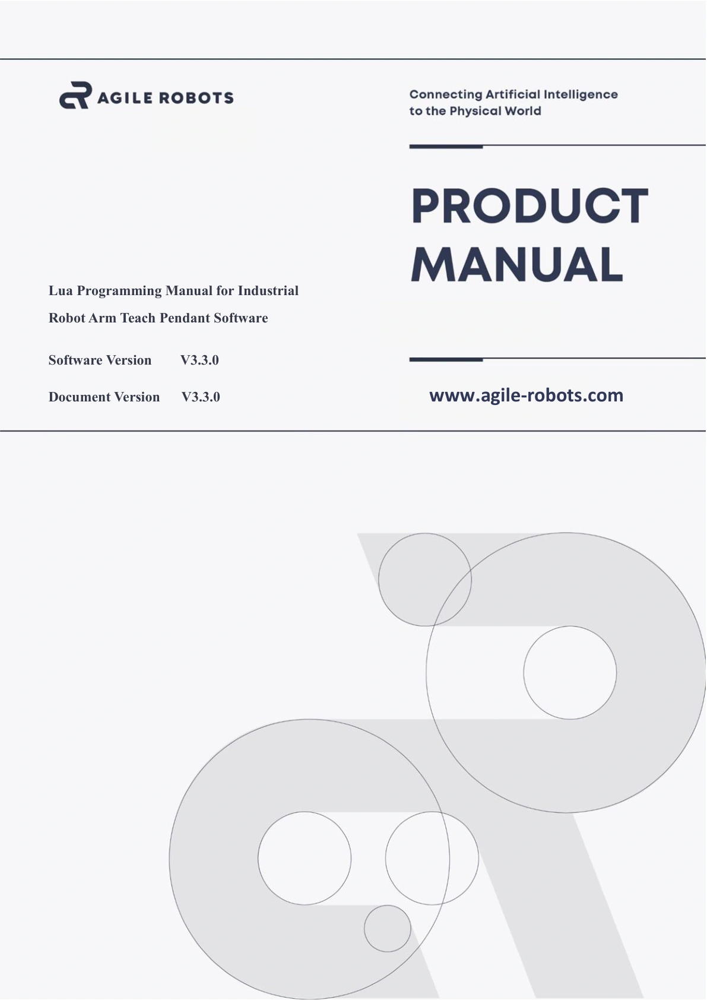



```
Agile Robots 
 
www.agile-robots.com
Lua Programming Manual for Industrial 
Robot Arm Teach Pendant Software 
 
Software Version        V3.3.0 
 
Document Version      V3.3.0
```



## PDF page 2

**Source:** Industrial Lua Programming Manual\_V3.3.0\_EN\_20260117.pdf, original pdf page 2. [Open the corresponding PDF reading-copy page](https://1292444914-files.gitbook.io/~/files/v0/b/gitbook-x-prod.appspot.com/o/spaces%2FtgOfPnscWebs1eh82EKq%2Fuploads%2FU0JYOssuma2RW4Gd2PqT%2Findustrial-lua-programming-manual-v3-3-0-en-20260117-pp-001-184.pdf?alt=media#page=2).



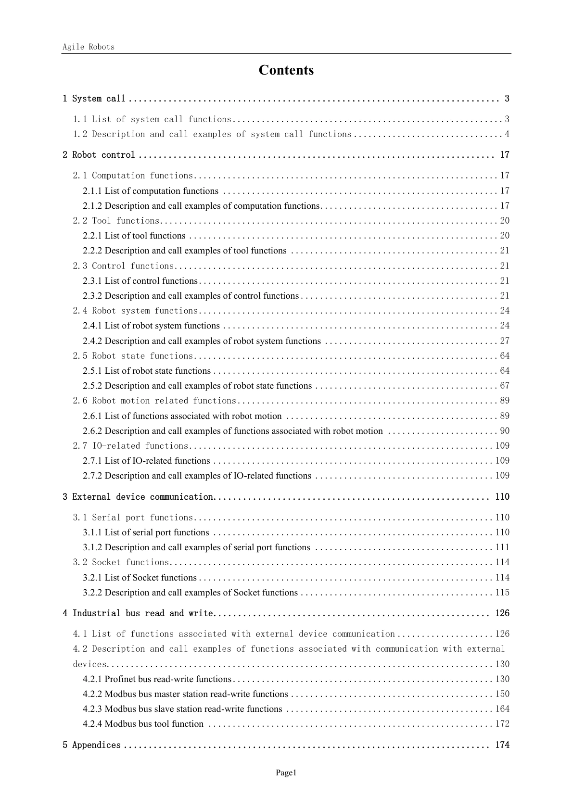



```
Agile Robots 
Page1 
Contents 
1 System call ........................................................................... 3 
1.1 List of system call functions ........................................................ 3 
1.2 Description and call examples of system call functions ............................... 4 
2 Robot control ........................................................................ 17 
2.1 Computation functions ............................................................... 17 
2.1.1 List of computation functions ......................................................... 17 
2.1.2 Description and call examples of computation functions ..................................... 17 
2.2 Tool functions ...................................................................... 20 
2.2.1 List of tool functions ................................................................ 20 
2.2.2 Description and call examples of tool functions ........................................... 21 
2.3 Control functions ................................................................... 21 
2.3.1 List of control functions .............................................................. 21 
2.3.2 Description and call examples of control functions ......................................... 21 
2.4 Robot system functions .............................................................. 24 
2.4.1 List of robot system functions ......................................................... 24 
2.4.2 Description and call examples of robot system functions .................................... 27 
2.5 Robot state functions ............................................................... 64 
2.5.1 List of robot state functions ........................................................... 64 
2.5.2 Description and call examples of robot state functions ...................................... 67 
2.6 Robot motion related functions ...................................................... 89 
2.6.1 List of functions associated with robot motion ............................................ 89 
2.6.2 Description and call examples of functions associated with robot motion ....................... 90 
2.7 IO-related functions ............................................................... 109 
2.7.1 List of IO-related functions .......................................................... 109 
2.7.2 Description and call examples of IO-related functions ..................................... 109 
3 External device communication ........................................................ 110 
3.1 Serial port functions .............................................................. 110 
3.1.1 List of serial port functions .......................................................... 110 
3.1.2 Description and call examples of serial port functions ..................................... 111 
3.2 Socket functions ................................................................... 114 
3.2.1 List of Socket functions ............................................................. 114 
3.2.2 Description and call examples of Socket functions ........................................ 115 
4 Industrial bus read and write ........................................................ 126 
4.1 List of functions associated with external device communication .................... 126 
4.2 Description and call examples of functions associated with communication with external 
devices ................................................................................ 130 
4.2.1 Profinet bus read-write functions ...................................................... 130 
4.2.2 Modbus bus master station read-write functions .......................................... 150 
4.2.3 Modbus bus slave station read-write functions ........................................... 164 
4.2.4 Modbus bus tool function ........................................................... 172 
5 Appendices .......................................................................... 174
```



**Original document cross-references:** [PDF 4](pages-001-072.md#pdf-page-4) · [PDF 5](pages-001-072.md#pdf-page-5) · [PDF 18](pages-001-072.md#pdf-page-18) · [PDF 21](pages-001-072.md#pdf-page-21) · [PDF 22](pages-001-072.md#pdf-page-22) · [PDF 25](pages-001-072.md#pdf-page-25) · [PDF 28](pages-001-072.md#pdf-page-28) · [PDF 65](pages-001-072.md#pdf-page-65) · [PDF 68](pages-001-072.md#pdf-page-68) · [PDF 90](pages-073-144.md#pdf-page-90) · [PDF 91](pages-073-144.md#pdf-page-91) · [PDF 110](pages-073-144.md#pdf-page-110) · [PDF 111](pages-073-144.md#pdf-page-111) · [PDF 112](pages-073-144.md#pdf-page-112) · [PDF 115](pages-073-144.md#pdf-page-115) · [PDF 116](pages-073-144.md#pdf-page-116) · [PDF 127](pages-073-144.md#pdf-page-127) · [PDF 131](pages-073-144.md#pdf-page-131) · [PDF 151](pages-145-192.md#pdf-page-151) · [PDF 165](pages-145-192.md#pdf-page-165) · [PDF 173](pages-145-192.md#pdf-page-173) · [PDF 175](pages-145-192.md#pdf-page-175)

## PDF page 3

**Source:** Industrial Lua Programming Manual\_V3.3.0\_EN\_20260117.pdf, original pdf page 3. [Open the corresponding PDF reading-copy page](https://1292444914-files.gitbook.io/~/files/v0/b/gitbook-x-prod.appspot.com/o/spaces%2FtgOfPnscWebs1eh82EKq%2Fuploads%2FU0JYOssuma2RW4Gd2PqT%2Findustrial-lua-programming-manual-v3-3-0-en-20260117-pp-001-184.pdf?alt=media#page=3).



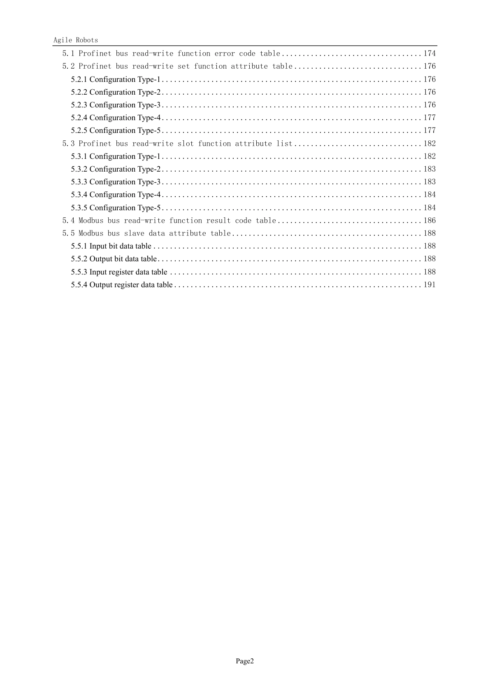



```
Agile Robots 
Page2 
5.1 Profinet bus read-write function error code table .................................. 174 
5.2 Profinet bus read-write set function attribute table ............................... 176 
5.2.1 Configuration Type-1 ............................................................... 176 
5.2.2 Configuration Type-2 ............................................................... 176 
5.2.3 Configuration Type-3 ............................................................... 176 
5.2.4 Configuration Type-4 ............................................................... 177 
5.2.5 Configuration Type-5 ............................................................... 177 
5.3 Profinet bus read-write slot function attribute list ............................... 182 
5.3.1 Configuration Type-1 ............................................................... 182 
5.3.2 Configuration Type-2 ............................................................... 183 
5.3.3 Configuration Type-3 ............................................................... 183 
5.3.4 Configuration Type-4 ............................................................... 184 
5.3.5 Configuration Type-5 ............................................................... 184 
5.4 Modbus bus read-write function result code table ................................... 186 
5.5 Modbus bus slave data attribute table .............................................. 188 
5.5.1 Input bit data table ................................................................. 188 
5.5.2 Output bit data table ................................................................ 188 
5.5.3 Input register data table ............................................................. 188 
5.5.4 Output register data table ............................................................ 191
```



**Original document cross-references:** [PDF 175](pages-145-192.md#pdf-page-175) · [PDF 177](pages-145-192.md#pdf-page-177) · [PDF 178](pages-145-192.md#pdf-page-178) · [PDF 183](pages-145-192.md#pdf-page-183) · [PDF 184](pages-145-192.md#pdf-page-184) · [PDF 185](pages-145-192.md#pdf-page-185) · [PDF 187](pages-145-192.md#pdf-page-187) · [PDF 189](pages-145-192.md#pdf-page-189) · [PDF 192](pages-145-192.md#pdf-page-192)

## PDF page 4

**Source:** Industrial Lua Programming Manual\_V3.3.0\_EN\_20260117.pdf, original pdf page 4. [Open the corresponding PDF reading-copy page](https://1292444914-files.gitbook.io/~/files/v0/b/gitbook-x-prod.appspot.com/o/spaces%2FtgOfPnscWebs1eh82EKq%2Fuploads%2FU0JYOssuma2RW4Gd2PqT%2Findustrial-lua-programming-manual-v3-3-0-en-20260117-pp-001-184.pdf?alt=media#page=4).



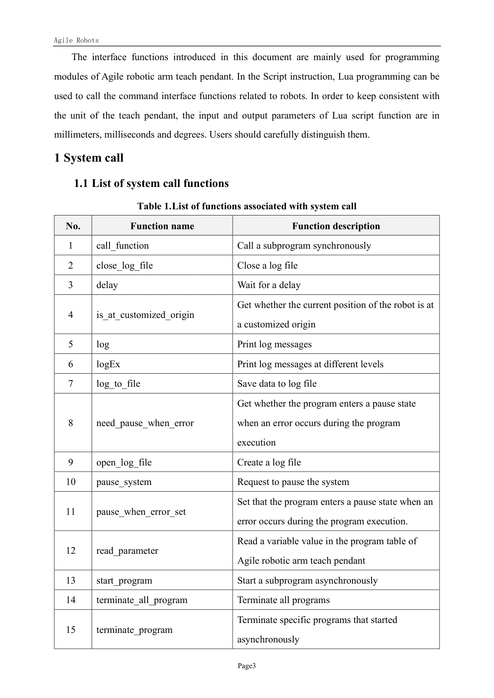



```
Agile Robots 
Page3 
The interface functions introduced in this document are mainly used for programming 
modules of Agile robotic arm teach pendant. In the Script instruction, Lua programming can be 
used to call the command interface functions related to robots. In order to keep consistent with 
the unit of the teach pendant, the input and output parameters of Lua script function are in 
millimeters, milliseconds and degrees. Users should carefully distinguish them. 
1 System call 
1.1 List of system call functions 
Table 1. List of functions associated with system call 
No. 
Function name 
Function description 
1  
call_function 
Call a subprogram synchronously 
2  
close_log_file  
Close a log file 
3  
delay 
Wait for a delay 
4  
is_at_customized_origin 
Get whether the current position of the robot is at 
a customized origin 
5  
log 
Print log messages 
6  
logEx 
Print log messages at different levels 
7  
log_to_file  
Save data to log file 
8  
need_pause_when_error 
Get whether the program enters a pause state 
when an error occurs during the program 
execution 
9  
open_log_file  
Create a log file 
10 
pause_system 
Request to pause the system 
11 
pause_when_error_set 
Set that the program enters a pause state when an 
error occurs during the program execution. 
12 
read_parameter 
Read a variable value in the program table of 
Agile robotic arm teach pendant 
13 
start_program 
Start a subprogram asynchronously 
14 
terminate_all_program 
Terminate all programs 
15 
terminate_program 
Terminate specific programs that started 
asynchronously
```



**Original document cross-references:** [PDF 5](pages-001-072.md#pdf-page-5) · [PDF 6](pages-001-072.md#pdf-page-6) · [PDF 7](pages-001-072.md#pdf-page-7) · [PDF 8](pages-001-072.md#pdf-page-8) · [PDF 18](pages-001-072.md#pdf-page-18) · [PDF 9](pages-001-072.md#pdf-page-9) · [PDF 10](pages-001-072.md#pdf-page-10) · [PDF 11](pages-001-072.md#pdf-page-11) · [PDF 14](pages-001-072.md#pdf-page-14)

## PDF page 5

**Source:** Industrial Lua Programming Manual\_V3.3.0\_EN\_20260117.pdf, original pdf page 5. [Open the corresponding PDF reading-copy page](https://1292444914-files.gitbook.io/~/files/v0/b/gitbook-x-prod.appspot.com/o/spaces%2FtgOfPnscWebs1eh82EKq%2Fuploads%2FU0JYOssuma2RW4Gd2PqT%2Findustrial-lua-programming-manual-v3-3-0-en-20260117-pp-001-184.pdf?alt=media#page=5).



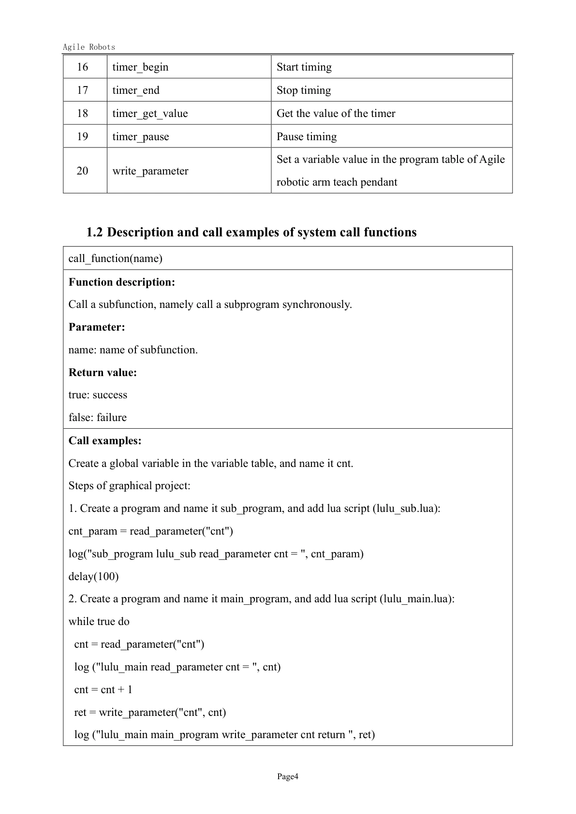



```
Agile Robots 
Page4 
16 
timer_begin 
Start timing 
17 
timer_end 
Stop timing 
18 
timer_get_value 
Get the value of the timer 
19 
timer_pause 
Pause timing 
20 
write_parameter 
Set a variable value in the program table of Agile 
robotic arm teach pendant 
 
1.2 Description and call examples of system call functions 
call_function(name) 
Function description: 
Call a subfunction, namely call a subprogram synchronously. 
Parameter: 
name: name of subfunction. 
Return value: 
true: success 
false: failure 
Call examples: 
Create a global variable in the variable table, and name it cnt. 
Steps of graphical project: 
1. Create a program and name it sub_program, and add lua script (lulu_sub.lua): 
cnt_param = read_parameter("cnt") 
log("sub_program lulu_sub read_parameter cnt = ", cnt_param) 
delay(100) 
2. Create a program and name it main_program, and add lua script (lulu_main.lua): 
while true do 
  cnt = read_parameter("cnt") 
  log ("lulu_main read_parameter cnt = ", cnt) 
  cnt = cnt + 1 
  ret = write_parameter("cnt", cnt) 
  log ("lulu_main main_program write_parameter cnt return ", ret)
```



**Original document cross-references:** [PDF 18](pages-001-072.md#pdf-page-18) · [PDF 17](pages-001-072.md#pdf-page-17)

## PDF page 6

**Source:** Industrial Lua Programming Manual\_V3.3.0\_EN\_20260117.pdf, original pdf page 6. [Open the corresponding PDF reading-copy page](https://1292444914-files.gitbook.io/~/files/v0/b/gitbook-x-prod.appspot.com/o/spaces%2FtgOfPnscWebs1eh82EKq%2Fuploads%2FU0JYOssuma2RW4Gd2PqT%2Findustrial-lua-programming-manual-v3-3-0-en-20260117-pp-001-184.pdf?alt=media#page=6).



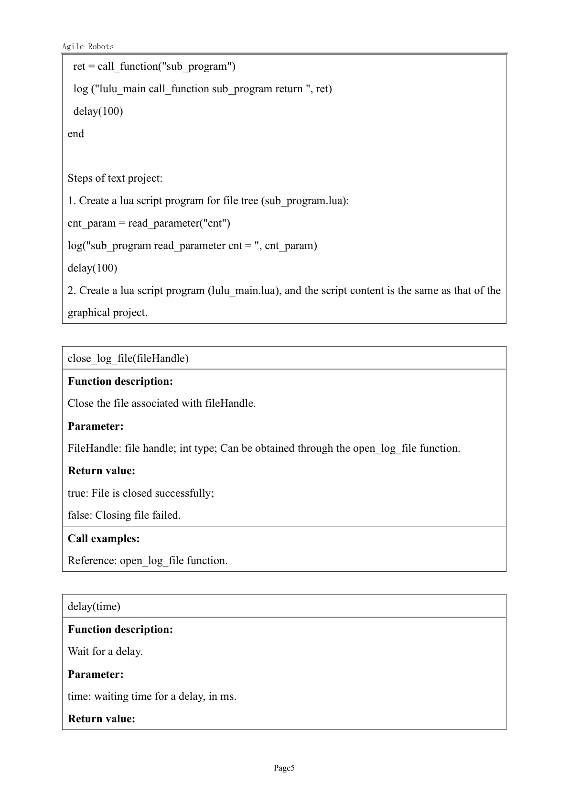



```
Agile Robots 
Page5 
  ret = call_function("sub_program") 
  log ("lulu_main call_function sub_program return ", ret) 
  delay(100) 
end 
 
Steps of text project: 
1. Create a lua script program for file tree (sub_program.lua): 
cnt_param = read_parameter("cnt") 
log("sub_program read_parameter cnt = ", cnt_param) 
delay(100) 
2. Create a lua script program (lulu_main.lua), and the script content is the same as that of the 
graphical project. 
 
close_log_file(fileHandle) 
Function description: 
Close the file associated with fileHandle. 
Parameter: 
FileHandle: file handle; int type; Can be obtained through the open_log_file function. 
Return value: 
true: File is closed successfully; 
false: Closing file failed. 
Call examples: 
Reference: open_log_file function. 
 
delay(time) 
Function description: 
Wait for a delay. 
Parameter: 
time: waiting time for a delay, in ms. 
Return value:
```



## PDF page 7

**Source:** Industrial Lua Programming Manual\_V3.3.0\_EN\_20260117.pdf, original pdf page 7. [Open the corresponding PDF reading-copy page](https://1292444914-files.gitbook.io/~/files/v0/b/gitbook-x-prod.appspot.com/o/spaces%2FtgOfPnscWebs1eh82EKq%2Fuploads%2FU0JYOssuma2RW4Gd2PqT%2Findustrial-lua-programming-manual-v3-3-0-en-20260117-pp-001-184.pdf?alt=media#page=7).



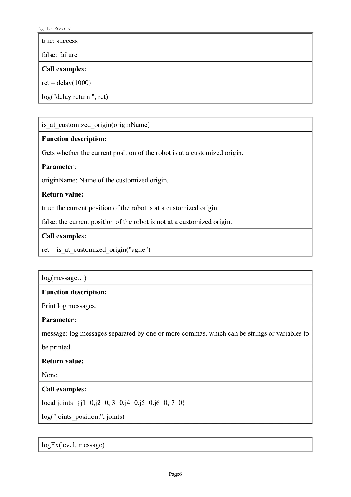



```
Agile Robots 
Page6 
true: success 
false: failure 
Call examples: 
ret = delay(1000) 
log("delay return ", ret) 
 
is_at_customized_origin(originName) 
Function description: 
Gets whether the current position of the robot is at a customized origin. 
Parameter: 
originName: Name of the customized origin. 
Return value: 
true: the current position of the robot is at a customized origin. 
false: the current position of the robot is not at a customized origin. 
Call examples: 
ret = is_at_customized_origin("agile") 
 
log(message…) 
Function description: 
Print log messages. 
Parameter: 
message: log messages separated by one or more commas, which can be strings or variables to 
be printed. 
Return value: 
None. 
Call examples: 
local joints={j1=0,j2=0,j3=0,j4=0,j5=0,j6=0,j7=0} 
log("joints_position:", joints) 
 
logEx(level, message)
```



## PDF page 8

**Source:** Industrial Lua Programming Manual\_V3.3.0\_EN\_20260117.pdf, original pdf page 8. [Open the corresponding PDF reading-copy page](https://1292444914-files.gitbook.io/~/files/v0/b/gitbook-x-prod.appspot.com/o/spaces%2FtgOfPnscWebs1eh82EKq%2Fuploads%2FU0JYOssuma2RW4Gd2PqT%2Findustrial-lua-programming-manual-v3-3-0-en-20260117-pp-001-184.pdf?alt=media#page=8).



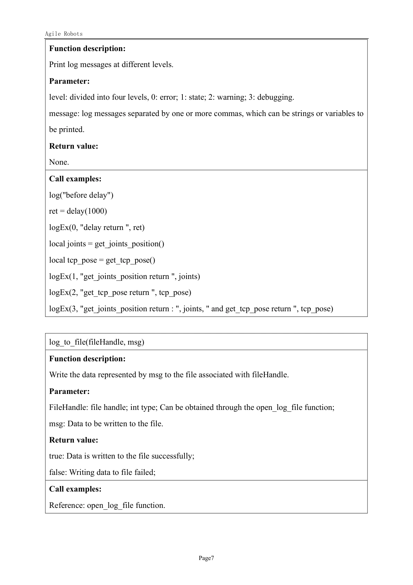



```
Agile Robots 
Page7 
Function description: 
Print log messages at different levels. 
Parameter: 
level: divided into four levels, 0: error; 1: state; 2: warning; 3: debugging. 
message: log messages separated by one or more commas, which can be strings or variables to 
be printed. 
Return value: 
None. 
Call examples: 
log("before delay") 
ret = delay(1000) 
logEx(0, "delay return ", ret) 
local joints = get_joints_position() 
local tcp_pose = get_tcp_pose() 
logEx(1, "get_joints_position return ", joints) 
logEx(2, "get_tcp_pose return ", tcp_pose) 
logEx(3, "get_joints_position return : ", joints, " and get_tcp_pose return ", tcp_pose) 
 
log_to_file(fileHandle, msg) 
Function description: 
Write the data represented by msg to the file associated with fileHandle. 
Parameter: 
FileHandle: file handle; int type; Can be obtained through the open_log_file function; 
msg: Data to be written to the file. 
Return value: 
true: Data is written to the file successfully; 
false: Writing data to file failed; 
Call examples: 
Reference: open_log_file function.
```



## PDF page 9

**Source:** Industrial Lua Programming Manual\_V3.3.0\_EN\_20260117.pdf, original pdf page 9. [Open the corresponding PDF reading-copy page](https://1292444914-files.gitbook.io/~/files/v0/b/gitbook-x-prod.appspot.com/o/spaces%2FtgOfPnscWebs1eh82EKq%2Fuploads%2FU0JYOssuma2RW4Gd2PqT%2Findustrial-lua-programming-manual-v3-3-0-en-20260117-pp-001-184.pdf?alt=media#page=9).



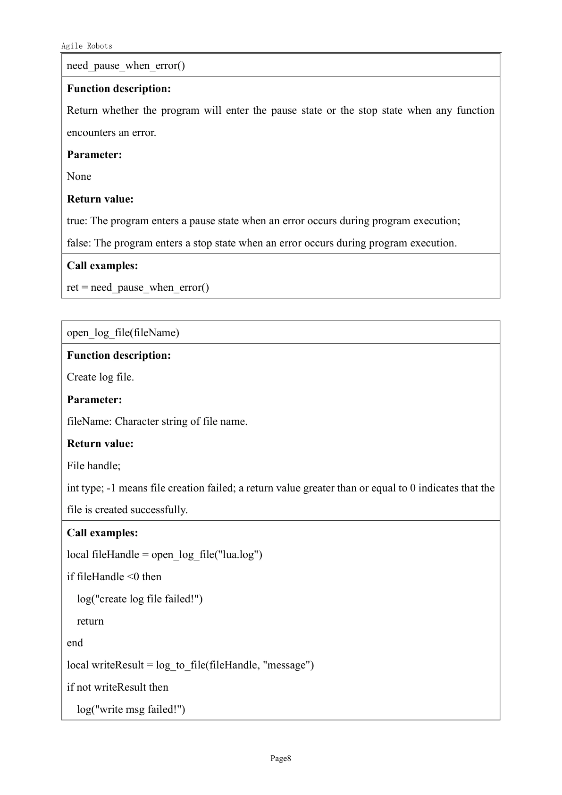



```
Agile Robots 
Page8 
need_pause_when_error() 
Function description: 
Return whether the program will enter the pause state or the stop state when any function 
encounters an error. 
Parameter: 
None 
Return value: 
true: The program enters a pause state when an error occurs during program execution; 
false: The program enters a stop state when an error occurs during program execution. 
Call examples: 
ret = need_pause_when_error() 
 
open_log_file(fileName) 
Function description: 
Create log file. 
Parameter: 
fileName: Character string of file name. 
Return value: 
File handle; 
int type; -1 means file creation failed; a return value greater than or equal to 0 indicates that the 
file is created successfully. 
Call examples: 
local fileHandle = open_log_file("lua.log") 
if fileHandle <0 then 
log("create log file failed!") 
return 
end 
local writeResult = log_to_file(fileHandle, "message") 
if not writeResult then 
log("write msg failed!")
```



## PDF page 10

**Source:** Industrial Lua Programming Manual\_V3.3.0\_EN\_20260117.pdf, original pdf page 10. [Open the corresponding PDF reading-copy page](https://1292444914-files.gitbook.io/~/files/v0/b/gitbook-x-prod.appspot.com/o/spaces%2FtgOfPnscWebs1eh82EKq%2Fuploads%2FU0JYOssuma2RW4Gd2PqT%2Findustrial-lua-programming-manual-v3-3-0-en-20260117-pp-001-184.pdf?alt=media#page=10).



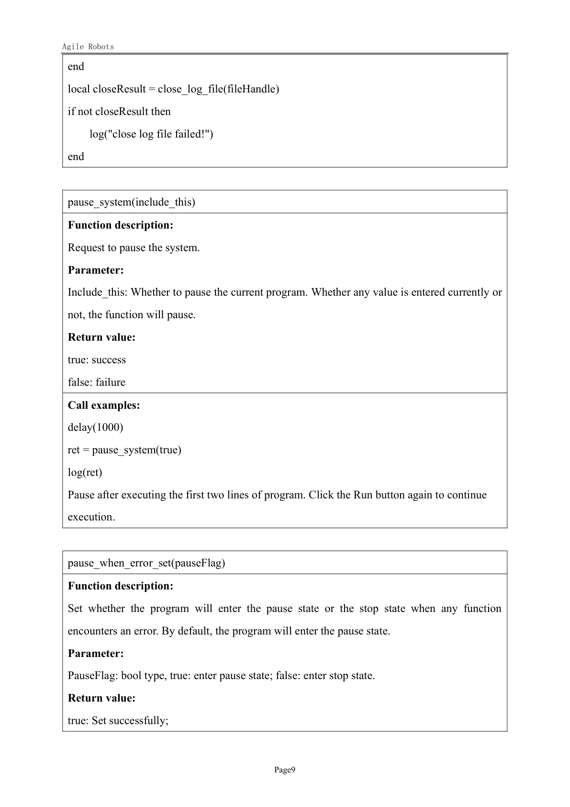



```
Agile Robots 
Page9 
end 
local closeResult = close_log_file(fileHandle) 
if not closeResult then 
    log("close log file failed!") 
end 
 
pause_system(include_this) 
Function description: 
Request to pause the system. 
Parameter: 
Include_this: Whether to pause the current program. Whether any value is entered currently or 
not, the function will pause. 
Return value: 
true: success 
false: failure 
Call examples: 
delay(1000) 
ret = pause_system(true) 
log(ret) 
Pause after executing the first two lines of program. Click the Run button again to continue 
execution. 
 
pause_when_error_set(pauseFlag) 
Function description: 
Set whether the program will enter the pause state or the stop state when any function 
encounters an error. By default, the program will enter the pause state. 
Parameter: 
PauseFlag: bool type, true: enter pause state; false: enter stop state. 
Return value: 
true: Set successfully;
```



## PDF page 11

**Source:** Industrial Lua Programming Manual\_V3.3.0\_EN\_20260117.pdf, original pdf page 11. [Open the corresponding PDF reading-copy page](https://1292444914-files.gitbook.io/~/files/v0/b/gitbook-x-prod.appspot.com/o/spaces%2FtgOfPnscWebs1eh82EKq%2Fuploads%2FU0JYOssuma2RW4Gd2PqT%2Findustrial-lua-programming-manual-v3-3-0-en-20260117-pp-001-184.pdf?alt=media#page=11).



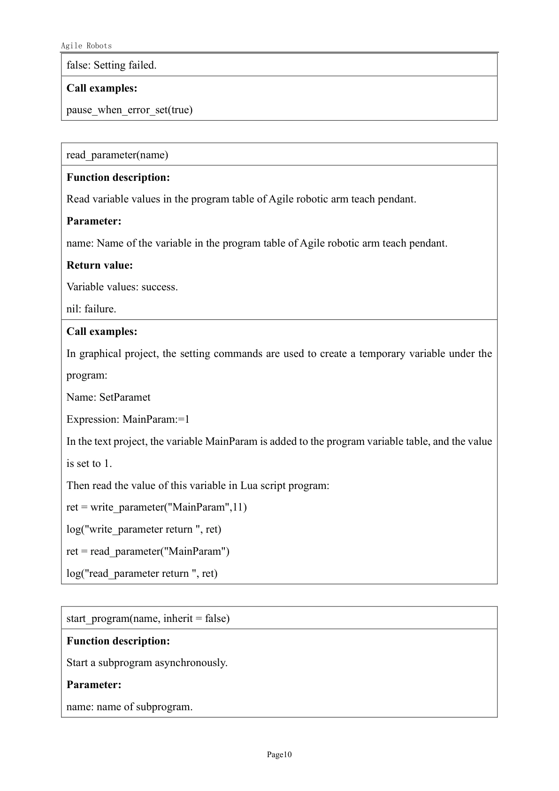



```
Agile Robots 
Page10 
false: Setting failed. 
Call examples: 
pause_when_error_set(true) 
 
read_parameter(name) 
Function description: 
Read variable values in the program table of Agile robotic arm teach pendant. 
Parameter: 
name: Name of the variable in the program table of Agile robotic arm teach pendant. 
Return value: 
Variable values: success. 
nil: failure. 
Call examples: 
In graphical project, the setting commands are used to create a temporary variable under the 
program: 
Name: SetParamet 
Expression: MainParam:=1 
In the text project, the variable MainParam is added to the program variable table, and the value 
is set to 1. 
Then read the value of this variable in Lua script program: 
ret = write_parameter("MainParam",11) 
log("write_parameter return ", ret) 
ret = read_parameter("MainParam") 
log("read_parameter return ", ret) 
 
start_program(name, inherit = false) 
Function description: 
Start a subprogram asynchronously. 
Parameter: 
name: name of subprogram.
```



## PDF page 12

**Source:** Industrial Lua Programming Manual\_V3.3.0\_EN\_20260117.pdf, original pdf page 12. [Open the corresponding PDF reading-copy page](https://1292444914-files.gitbook.io/~/files/v0/b/gitbook-x-prod.appspot.com/o/spaces%2FtgOfPnscWebs1eh82EKq%2Fuploads%2FU0JYOssuma2RW4Gd2PqT%2Findustrial-lua-programming-manual-v3-3-0-en-20260117-pp-001-184.pdf?alt=media#page=12).



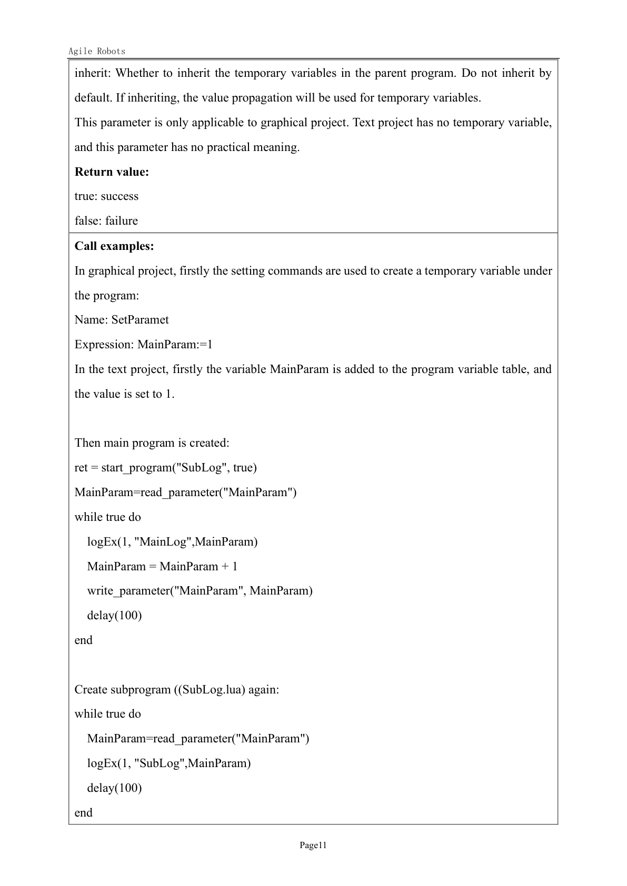



```
Agile Robots 
Page11 
inherit: Whether to inherit the temporary variables in the parent program. Do not inherit by 
default. If inheriting, the value propagation will be used for temporary variables. 
This parameter is only applicable to graphical project. Text project has no temporary variable, 
and this parameter has no practical meaning. 
Return value: 
true: success 
false: failure 
Call examples: 
In graphical project, firstly the setting commands are used to create a temporary variable under 
the program: 
Name: SetParamet 
Expression: MainParam:=1 
In the text project, firstly the variable MainParam is added to the program variable table, and 
the value is set to 1. 
 
Then main program is created: 
ret = start_program("SubLog", true) 
MainParam=read_parameter("MainParam") 
while true do 
    logEx(1, "MainLog",MainParam) 
    MainParam = MainParam + 1 
    write_parameter("MainParam", MainParam) 
delay(100) 
end 
 
Create subprogram ((SubLog.lua) again: 
while true do 
    MainParam=read_parameter("MainParam") 
    logEx(1, "SubLog",MainParam) 
delay(100) 
end
```



## PDF page 13

**Source:** Industrial Lua Programming Manual\_V3.3.0\_EN\_20260117.pdf, original pdf page 13. [Open the corresponding PDF reading-copy page](https://1292444914-files.gitbook.io/~/files/v0/b/gitbook-x-prod.appspot.com/o/spaces%2FtgOfPnscWebs1eh82EKq%2Fuploads%2FU0JYOssuma2RW4Gd2PqT%2Findustrial-lua-programming-manual-v3-3-0-en-20260117-pp-001-184.pdf?alt=media#page=13).



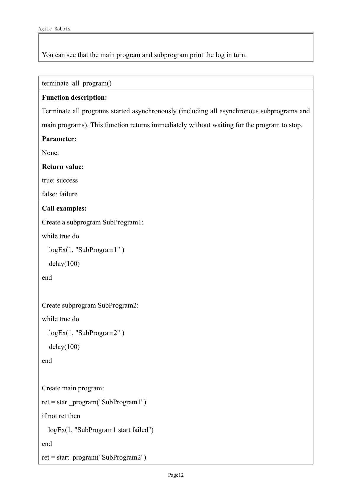



```
Agile Robots 
Page12 
 
You can see that the main program and subprogram print the log in turn. 
 
terminate_all_program() 
Function description: 
Terminate all programs started asynchronously (including all asynchronous subprograms and 
main programs). This function returns immediately without waiting for the program to stop. 
Parameter: 
None. 
Return value: 
true: success 
false: failure 
Call examples: 
Create a subprogram SubProgram1: 
while true do 
    logEx(1, "SubProgram1" ) 
    delay(100) 
end 
 
Create subprogram SubProgram2: 
while true do 
    logEx(1, "SubProgram2" ) 
    delay(100) 
end 
 
Create main program: 
ret = start_program("SubProgram1") 
if not ret then 
logEx(1, "SubProgram1 start failed") 
end 
ret = start_program("SubProgram2")
```



## PDF page 14

**Source:** Industrial Lua Programming Manual\_V3.3.0\_EN\_20260117.pdf, original pdf page 14. [Open the corresponding PDF reading-copy page](https://1292444914-files.gitbook.io/~/files/v0/b/gitbook-x-prod.appspot.com/o/spaces%2FtgOfPnscWebs1eh82EKq%2Fuploads%2FU0JYOssuma2RW4Gd2PqT%2Findustrial-lua-programming-manual-v3-3-0-en-20260117-pp-001-184.pdf?alt=media#page=14).



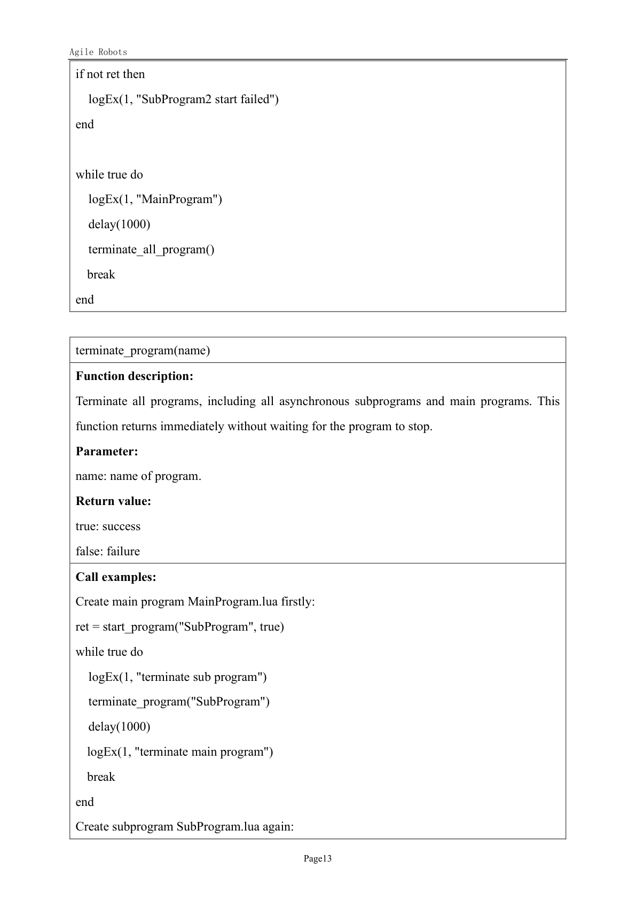



```
Agile Robots 
Page13 
if not ret then 
    logEx(1, "SubProgram2 start failed") 
end 
 
while true do 
    logEx(1, "MainProgram") 
    delay(1000) 
    terminate_all_program() 
break 
end 
 
terminate_program(name) 
Function description: 
Terminate all programs, including all asynchronous subprograms and main programs. This 
function returns immediately without waiting for the program to stop. 
Parameter: 
name: name of program. 
Return value: 
true: success 
false: failure 
Call examples: 
Create main program MainProgram.lua firstly: 
ret = start_program("SubProgram", true) 
while true do 
    logEx(1, "terminate sub program") 
    terminate_program("SubProgram") 
    delay(1000) 
logEx(1, "terminate main program") 
break 
end 
Create subprogram SubProgram.lua again:
```



## PDF page 15

**Source:** Industrial Lua Programming Manual\_V3.3.0\_EN\_20260117.pdf, original pdf page 15. [Open the corresponding PDF reading-copy page](https://1292444914-files.gitbook.io/~/files/v0/b/gitbook-x-prod.appspot.com/o/spaces%2FtgOfPnscWebs1eh82EKq%2Fuploads%2FU0JYOssuma2RW4Gd2PqT%2Findustrial-lua-programming-manual-v3-3-0-en-20260117-pp-001-184.pdf?alt=media#page=15).



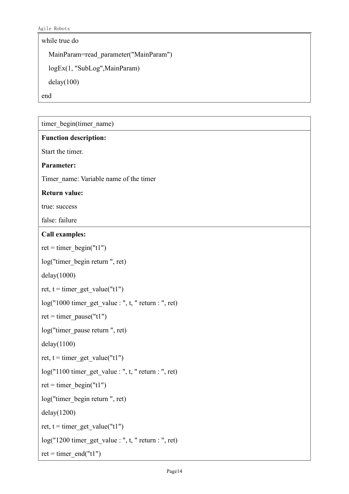



```
Agile Robots 
Page14 
while true do 
    MainParam=read_parameter("MainParam") 
    logEx(1, "SubLog",MainParam) 
    delay(100) 
end 
 
timer_begin(timer_name) 
Function description: 
Start the timer. 
Parameter: 
Timer_name: Variable name of the timer 
Return value: 
true: success 
false: failure 
Call examples: 
ret = timer_begin("t1") 
log("timer_begin return ", ret) 
delay(1000) 
ret, t = timer_get_value("t1") 
log("1000 timer_get_value : ", t, " return : ", ret) 
ret = timer_pause("t1") 
log("timer_pause return ", ret) 
delay(1100) 
ret, t = timer_get_value("t1") 
log("1100 timer_get_value : ", t, " return : ", ret) 
ret = timer_begin("t1") 
log("timer_begin return ", ret) 
delay(1200) 
ret, t = timer_get_value("t1") 
log("1200 timer_get_value : ", t, " return : ", ret) 
ret = timer_end("t1")
```



## PDF page 16

**Source:** Industrial Lua Programming Manual\_V3.3.0\_EN\_20260117.pdf, original pdf page 16. [Open the corresponding PDF reading-copy page](https://1292444914-files.gitbook.io/~/files/v0/b/gitbook-x-prod.appspot.com/o/spaces%2FtgOfPnscWebs1eh82EKq%2Fuploads%2FU0JYOssuma2RW4Gd2PqT%2Findustrial-lua-programming-manual-v3-3-0-en-20260117-pp-001-184.pdf?alt=media#page=16).



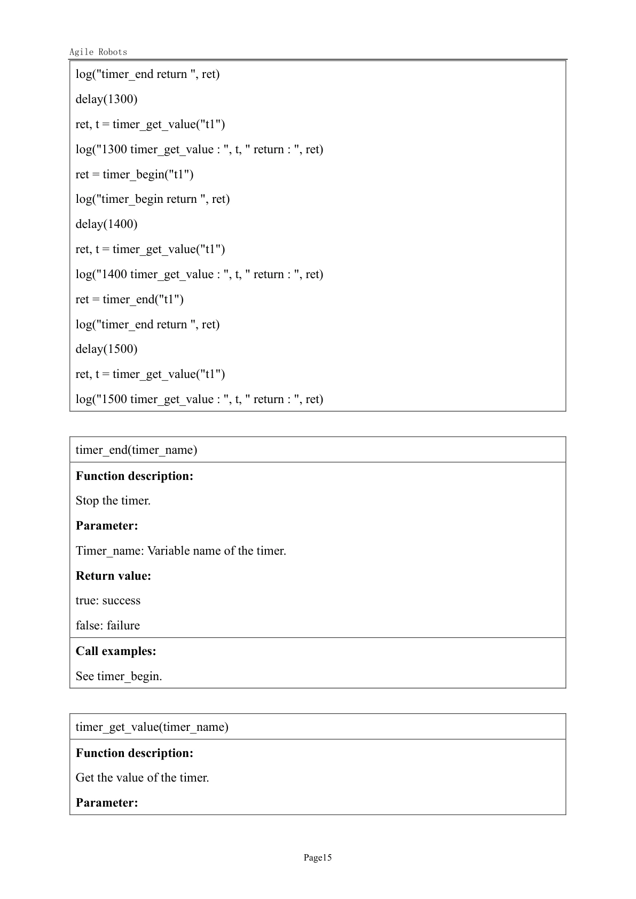



```
Agile Robots 
Page15 
log("timer_end return ", ret) 
delay(1300) 
ret, t = timer_get_value("t1") 
log("1300 timer_get_value : ", t, " return : ", ret) 
ret = timer_begin("t1") 
log("timer_begin return ", ret) 
delay(1400) 
ret, t = timer_get_value("t1") 
log("1400 timer_get_value : ", t, " return : ", ret) 
ret = timer_end("t1") 
log("timer_end return ", ret) 
delay(1500) 
ret, t = timer_get_value("t1") 
log("1500 timer_get_value : ", t, " return : ", ret) 
 
timer_end(timer_name) 
Function description: 
Stop the timer. 
Parameter: 
Timer_name: Variable name of the timer. 
Return value: 
true: success 
false: failure 
Call examples: 
See timer_begin. 
 
timer_get_value(timer_name) 
Function description: 
Get the value of the timer. 
Parameter:
```



**Original document cross-references:** [PDF 18](pages-001-072.md#pdf-page-18)

## PDF page 17

**Source:** Industrial Lua Programming Manual\_V3.3.0\_EN\_20260117.pdf, original pdf page 17. [Open the corresponding PDF reading-copy page](https://1292444914-files.gitbook.io/~/files/v0/b/gitbook-x-prod.appspot.com/o/spaces%2FtgOfPnscWebs1eh82EKq%2Fuploads%2FU0JYOssuma2RW4Gd2PqT%2Findustrial-lua-programming-manual-v3-3-0-en-20260117-pp-001-184.pdf?alt=media#page=17).



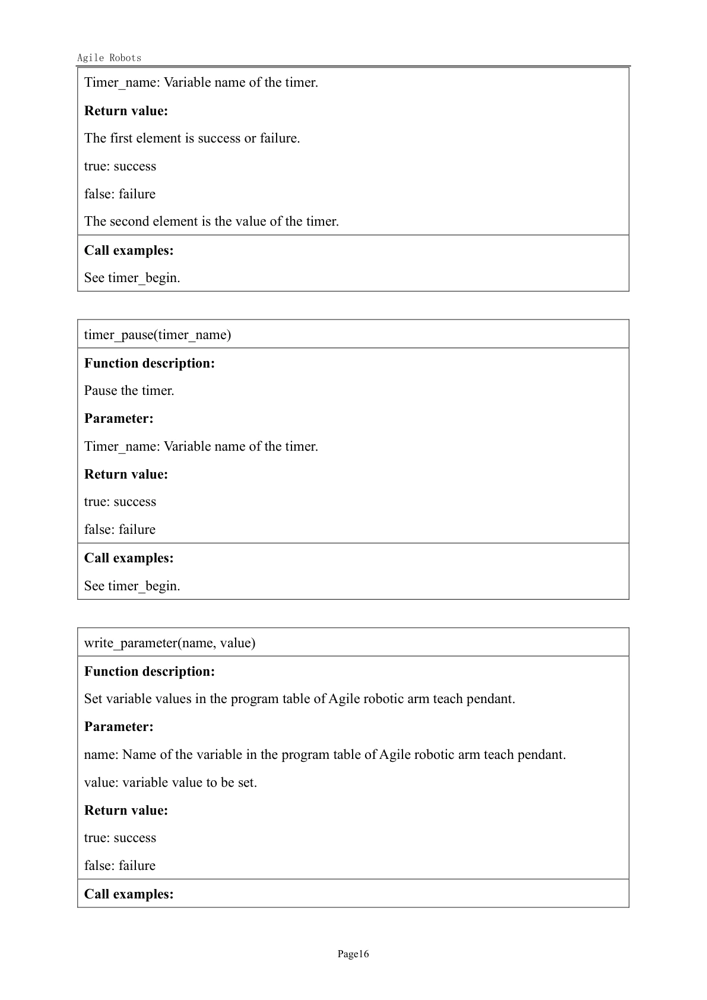



```
Agile Robots 
Page16 
Timer_name: Variable name of the timer. 
Return value: 
The first element is success or failure. 
true: success 
false: failure 
The second element is the value of the timer. 
Call examples: 
See timer_begin. 
 
timer_pause(timer_name) 
Function description: 
Pause the timer. 
Parameter: 
Timer_name: Variable name of the timer. 
Return value: 
true: success 
false: failure 
Call examples: 
See timer_begin. 
 
write_parameter(name, value) 
Function description: 
Set variable values in the program table of Agile robotic arm teach pendant. 
Parameter: 
name: Name of the variable in the program table of Agile robotic arm teach pendant. 
value: variable value to be set. 
Return value: 
true: success 
false: failure 
Call examples:
```



**Original document cross-references:** [PDF 18](pages-001-072.md#pdf-page-18)

## PDF page 18

**Source:** Industrial Lua Programming Manual\_V3.3.0\_EN\_20260117.pdf, original pdf page 18. [Open the corresponding PDF reading-copy page](https://1292444914-files.gitbook.io/~/files/v0/b/gitbook-x-prod.appspot.com/o/spaces%2FtgOfPnscWebs1eh82EKq%2Fuploads%2FU0JYOssuma2RW4Gd2PqT%2Findustrial-lua-programming-manual-v3-3-0-en-20260117-pp-001-184.pdf?alt=media#page=18).



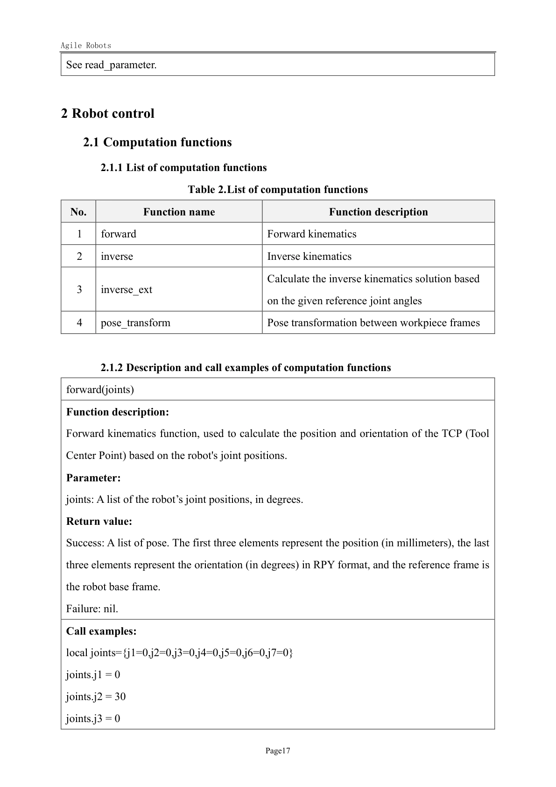



```
Agile Robots 
Page17 
See read_parameter. 
 
2 Robot control 
2.1 Computation functions 
2.1.1 List of computation functions 
Table 2. List of computation functions 
No. 
Function name 
Function description 
1  
forward 
Forward kinematics 
2  
inverse 
Inverse kinematics 
3  
inverse_ext 
Calculate the inverse kinematics solution based 
on the given reference joint angles 
4  
pose_transform 
Pose transformation between workpiece frames 
 
2.1.2 Description and call examples of computation functions 
forward(joints) 
Function description: 
Forward kinematics function, used to calculate the position and orientation of the TCP (Tool 
Center Point) based on the robot's joint positions. 
Parameter: 
joints: A list of the robot’s joint positions, in degrees. 
Return value: 
Success: A list of pose. The first three elements represent the position (in millimeters), the last 
three elements represent the orientation (in degrees) in RPY format, and the reference frame is 
the robot base frame. 
Failure: nil. 
Call examples: 
local joints={j1=0,j2=0,j3=0,j4=0,j5=0,j6=0,j7=0} 
joints.j1 = 0 
joints.j2 = 30 
joints.j3 = 0
```



**Original document cross-references:** [PDF 11](pages-001-072.md#pdf-page-11) · [PDF 18](pages-001-072.md#pdf-page-18) · [PDF 19](pages-001-072.md#pdf-page-19) · [PDF 20](pages-001-072.md#pdf-page-20)

## PDF page 19

**Source:** Industrial Lua Programming Manual\_V3.3.0\_EN\_20260117.pdf, original pdf page 19. [Open the corresponding PDF reading-copy page](https://1292444914-files.gitbook.io/~/files/v0/b/gitbook-x-prod.appspot.com/o/spaces%2FtgOfPnscWebs1eh82EKq%2Fuploads%2FU0JYOssuma2RW4Gd2PqT%2Findustrial-lua-programming-manual-v3-3-0-en-20260117-pp-001-184.pdf?alt=media#page=19).



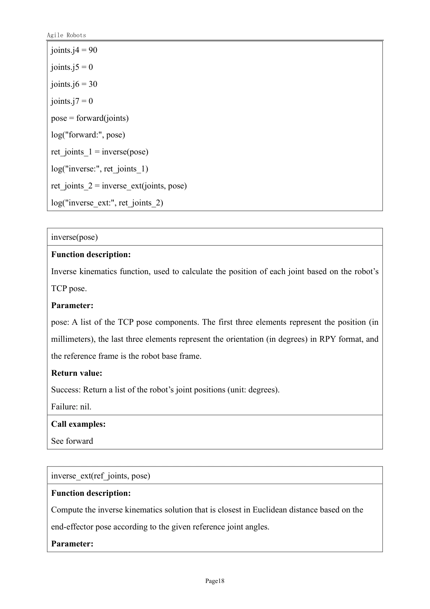



```
Agile Robots 
Page18 
joints.j4 = 90 
joints.j5 = 0 
joints.j6 = 30 
joints.j7 = 0 
pose = forward(joints) 
log("forward:", pose) 
ret_joints_1 = inverse(pose) 
log("inverse:", ret_joints_1) 
ret_joints_2 = inverse_ext(joints, pose) 
log("inverse_ext:", ret_joints_2) 
 
inverse(pose) 
Function description: 
Inverse kinematics function, used to calculate the position of each joint based on the robot’s 
TCP pose. 
Parameter: 
pose: A list of the TCP pose components. The first three elements represent the position (in 
millimeters), the last three elements represent the orientation (in degrees) in RPY format, and 
the reference frame is the robot base frame. 
Return value: 
Success: Return a list of the robot’s joint positions (unit: degrees). 
Failure: nil. 
Call examples: 
See forward 
 
inverse_ext(ref_joints, pose) 
Function description: 
Compute the inverse kinematics solution that is closest in Euclidean distance based on the 
end-effector pose according to the given reference joint angles. 
Parameter:
```



**Original document cross-references:** [PDF 18](pages-001-072.md#pdf-page-18)

## PDF page 20

**Source:** Industrial Lua Programming Manual\_V3.3.0\_EN\_20260117.pdf, original pdf page 20. [Open the corresponding PDF reading-copy page](https://1292444914-files.gitbook.io/~/files/v0/b/gitbook-x-prod.appspot.com/o/spaces%2FtgOfPnscWebs1eh82EKq%2Fuploads%2FU0JYOssuma2RW4Gd2PqT%2Findustrial-lua-programming-manual-v3-3-0-en-20260117-pp-001-184.pdf?alt=media#page=20).



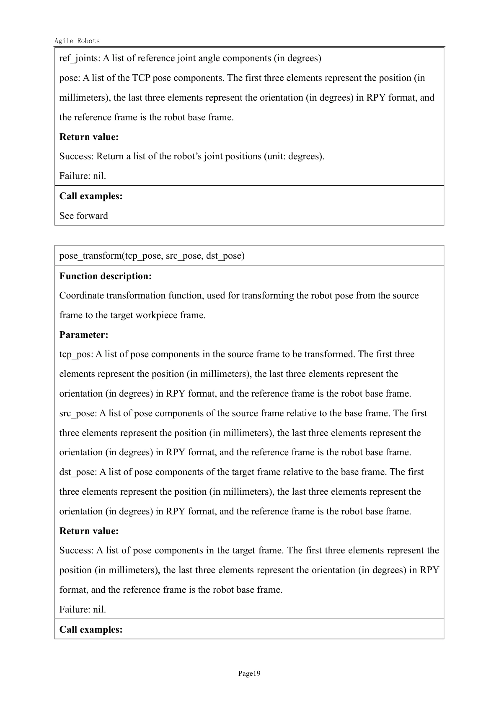



```
Agile Robots 
Page19 
ref_joints: A list of reference joint angle components (in degrees) 
pose: A list of the TCP pose components. The first three elements represent the position (in 
millimeters), the last three elements represent the orientation (in degrees) in RPY format, and 
the reference frame is the robot base frame. 
Return value: 
Success: Return a list of the robot’s joint positions (unit: degrees). 
Failure: nil. 
Call examples: 
See forward 
 
pose_transform(tcp_pose, src_pose, dst_pose) 
Function description: 
Coordinate transformation function, used for transforming the robot pose from the source 
frame to the target workpiece frame. 
Parameter: 
tcp_pos: A list of pose components in the source frame to be transformed. The first three 
elements represent the position (in millimeters), the last three elements represent the 
orientation (in degrees) in RPY format, and the reference frame is the robot base frame. 
src_pose: A list of pose components of the source frame relative to the base frame. The first 
three elements represent the position (in millimeters), the last three elements represent the 
orientation (in degrees) in RPY format, and the reference frame is the robot base frame. 
dst_pose: A list of pose components of the target frame relative to the base frame. The first 
three elements represent the position (in millimeters), the last three elements represent the 
orientation (in degrees) in RPY format, and the reference frame is the robot base frame. 
Return value: 
Success: A list of pose components in the target frame. The first three elements represent the 
position (in millimeters), the last three elements represent the orientation (in degrees) in RPY 
format, and the reference frame is the robot base frame. 
Failure: nil. 
Call examples:
```



**Original document cross-references:** [PDF 18](pages-001-072.md#pdf-page-18)

## PDF page 21

**Source:** Industrial Lua Programming Manual\_V3.3.0\_EN\_20260117.pdf, original pdf page 21. [Open the corresponding PDF reading-copy page](https://1292444914-files.gitbook.io/~/files/v0/b/gitbook-x-prod.appspot.com/o/spaces%2FtgOfPnscWebs1eh82EKq%2Fuploads%2FU0JYOssuma2RW4Gd2PqT%2Findustrial-lua-programming-manual-v3-3-0-en-20260117-pp-001-184.pdf?alt=media#page=21).



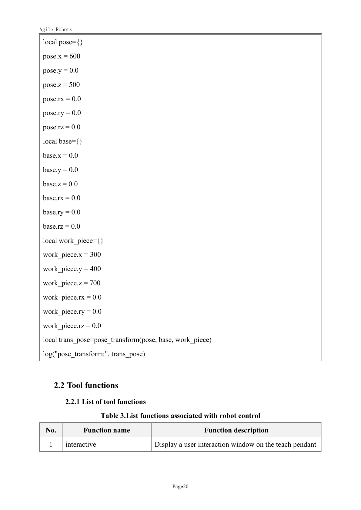



```
Agile Robots 
Page20 
local pose={} 
pose.x = 600 
pose.y = 0.0 
pose.z = 500 
pose.rx = 0.0 
pose.ry = 0.0 
pose.rz = 0.0 
local base={} 
base.x = 0.0 
base.y = 0.0 
base.z = 0.0 
base.rx = 0.0 
base.ry = 0.0 
base.rz = 0.0 
local work_piece={} 
work_piece.x = 300 
work_piece.y = 400 
work_piece.z = 700 
work_piece.rx = 0.0 
work_piece.ry = 0.0 
work_piece.rz = 0.0 
local trans_pose=pose_transform(pose, base, work_piece) 
log("pose_transform:", trans_pose) 
 
2.2 Tool functions 
2.2.1 List of tool functions 
Table 3. List functions associated with robot control 
No. 
Function name 
Function description 
1 
interactive 
Display a user interaction window on the teach pendant
```



**Original document cross-references:** [PDF 22](pages-001-072.md#pdf-page-22)

## PDF page 22

**Source:** Industrial Lua Programming Manual\_V3.3.0\_EN\_20260117.pdf, original pdf page 22. [Open the corresponding PDF reading-copy page](https://1292444914-files.gitbook.io/~/files/v0/b/gitbook-x-prod.appspot.com/o/spaces%2FtgOfPnscWebs1eh82EKq%2Fuploads%2FU0JYOssuma2RW4Gd2PqT%2Findustrial-lua-programming-manual-v3-3-0-en-20260117-pp-001-184.pdf?alt=media#page=22).



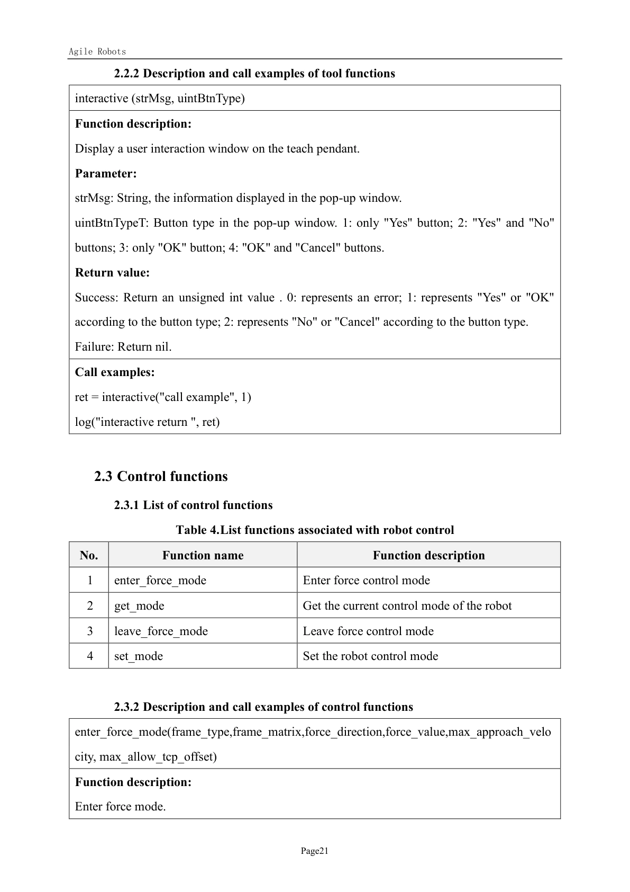



```
Agile Robots 
Page21 
2.2.2 Description and call examples of tool functions 
interactive (strMsg, uintBtnType) 
Function description: 
Display a user interaction window on the teach pendant. 
Parameter: 
strMsg: String, the information displayed in the pop-up window. 
uintBtnTypeT: Button type in the pop-up window. 1: only "Yes" button; 2: "Yes" and "No" 
buttons; 3: only "OK" button; 4: "OK" and "Cancel" buttons. 
Return value: 
Success: Return an unsigned int value . 0: represents an error; 1: represents "Yes" or "OK" 
according to the button type; 2: represents "No" or "Cancel" according to the button type. 
Failure: Return nil. 
Call examples: 
ret = interactive("call example", 1) 
log("interactive return ", ret) 
 
2.3 Control functions 
2.3.1 List of control functions 
Table 4. List functions associated with robot control 
No. 
Function name 
Function description 
1  
enter_force_mode 
Enter force control mode 
2  
get_mode 
Get the current control mode of the robot 
3  
leave_force_mode 
Leave force control mode 
4  
set_mode 
Set the robot control mode 
 
2.3.2 Description and call examples of control functions 
enter_force_mode(frame_type,frame_matrix,force_direction,force_value,max_approach_velo
city, max_allow_tcp_offset) 
Function description: 
Enter force mode.
```



**Original document cross-references:** [PDF 22](pages-001-072.md#pdf-page-22) · [PDF 23](pages-001-072.md#pdf-page-23) · [PDF 24](pages-001-072.md#pdf-page-24)

## PDF page 23

**Source:** Industrial Lua Programming Manual\_V3.3.0\_EN\_20260117.pdf, original pdf page 23. [Open the corresponding PDF reading-copy page](https://1292444914-files.gitbook.io/~/files/v0/b/gitbook-x-prod.appspot.com/o/spaces%2FtgOfPnscWebs1eh82EKq%2Fuploads%2FU0JYOssuma2RW4Gd2PqT%2Findustrial-lua-programming-manual-v3-3-0-en-20260117-pp-001-184.pdf?alt=media#page=23).



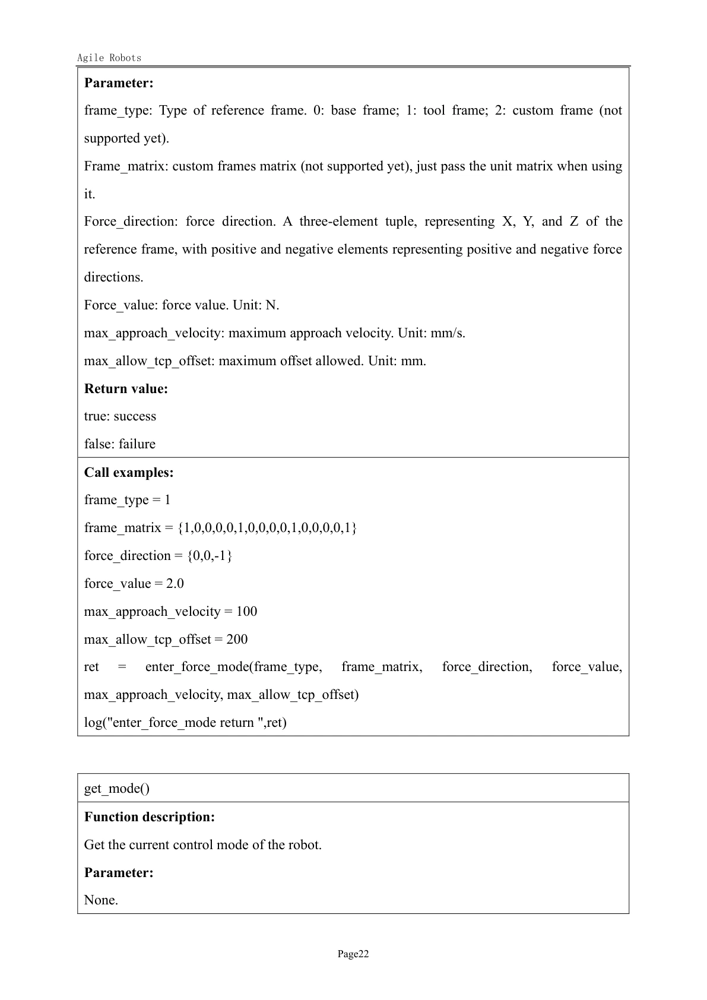



```
Agile Robots 
Page22 
Parameter: 
frame_type: Type of reference frame. 0: base frame; 1: tool frame; 2: custom frame (not 
supported yet). 
Frame_matrix: custom frames matrix (not supported yet), just pass the unit matrix when using 
it. 
Force_direction: force direction. A three-element tuple, representing X, Y, and Z of the 
reference frame, with positive and negative elements representing positive and negative force 
directions. 
Force_value: force value. Unit: N. 
max_approach_velocity: maximum approach velocity. Unit: mm/s. 
max_allow_tcp_offset: maximum offset allowed. Unit: mm. 
Return value: 
true: success 
false: failure 
Call examples: 
frame_type = 1 
frame_matrix = {1,0,0,0,0,1,0,0,0,0,1,0,0,0,0,1} 
force_direction = {0,0,-1} 
force_value = 2.0 
max_approach_velocity = 100 
max_allow_tcp_offset = 200 
ret 
= 
enter_force_mode(frame_type, 
frame_matrix, 
force_direction, 
force_value, 
max_approach_velocity, max_allow_tcp_offset) 
log("enter_force_mode return ",ret) 
 
 
get_mode() 
Function description: 
Get the current control mode of the robot. 
Parameter: 
None.
```



## PDF page 24

**Source:** Industrial Lua Programming Manual\_V3.3.0\_EN\_20260117.pdf, original pdf page 24. [Open the corresponding PDF reading-copy page](https://1292444914-files.gitbook.io/~/files/v0/b/gitbook-x-prod.appspot.com/o/spaces%2FtgOfPnscWebs1eh82EKq%2Fuploads%2FU0JYOssuma2RW4Gd2PqT%2Findustrial-lua-programming-manual-v3-3-0-en-20260117-pp-001-184.pdf?alt=media#page=24).



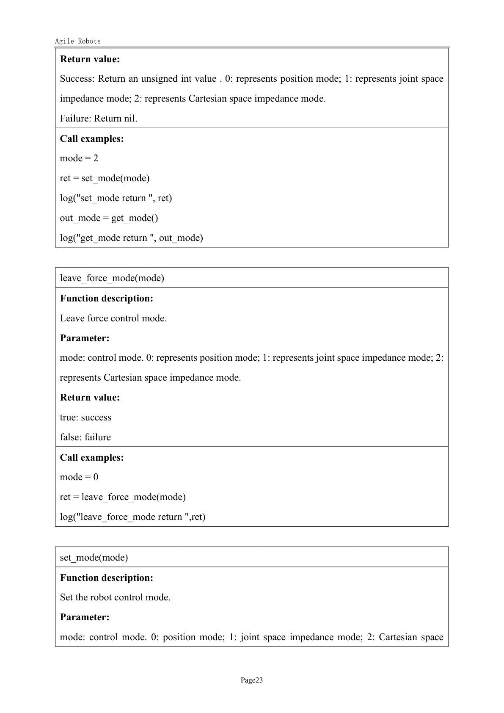



```
Agile Robots 
Page23 
Return value: 
Success: Return an unsigned int value . 0: represents position mode; 1: represents joint space 
impedance mode; 2: represents Cartesian space impedance mode. 
Failure: Return nil. 
Call examples: 
mode = 2 
ret = set_mode(mode) 
log("set_mode return ", ret) 
out_mode = get_mode() 
log("get_mode return ", out_mode) 
 
leave_force_mode(mode) 
Function description: 
Leave force control mode. 
Parameter: 
mode: control mode. 0: represents position mode; 1: represents joint space impedance mode; 2: 
represents Cartesian space impedance mode. 
Return value: 
true: success 
false: failure 
Call examples: 
mode = 0 
ret = leave_force_mode(mode) 
log("leave_force_mode return ",ret) 
 
set_mode(mode) 
Function description: 
Set the robot control mode. 
Parameter: 
mode: control mode. 0: position mode; 1: joint space impedance mode; 2: Cartesian space
```



## PDF page 25

**Source:** Industrial Lua Programming Manual\_V3.3.0\_EN\_20260117.pdf, original pdf page 25. [Open the corresponding PDF reading-copy page](https://1292444914-files.gitbook.io/~/files/v0/b/gitbook-x-prod.appspot.com/o/spaces%2FtgOfPnscWebs1eh82EKq%2Fuploads%2FU0JYOssuma2RW4Gd2PqT%2Findustrial-lua-programming-manual-v3-3-0-en-20260117-pp-001-184.pdf?alt=media#page=25).



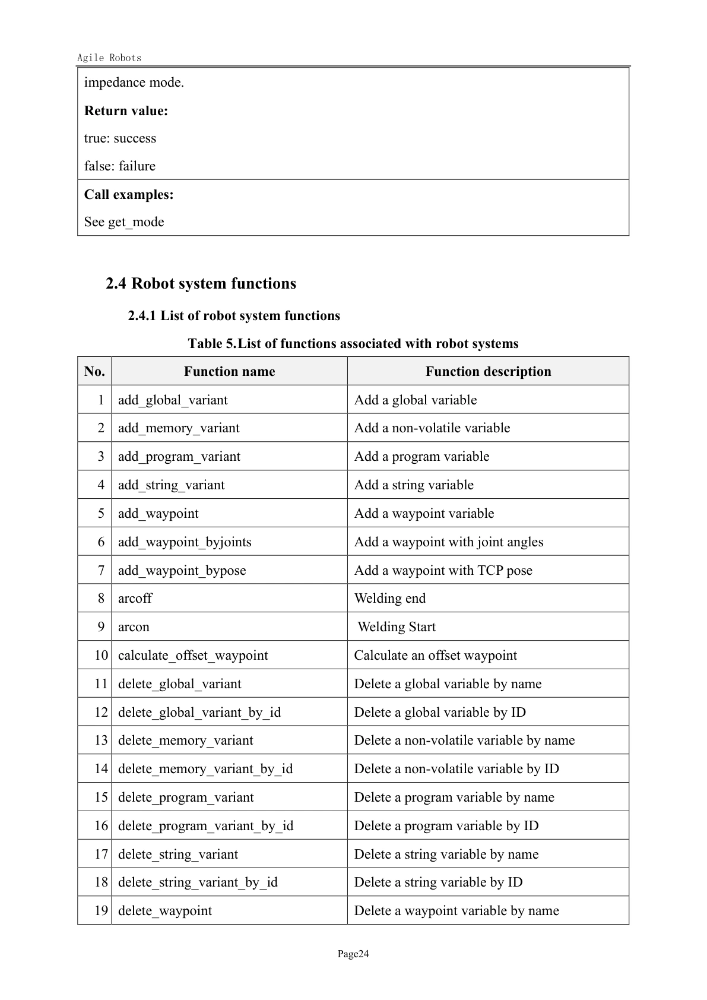



```
Agile Robots 
Page24 
impedance mode. 
Return value: 
true: success 
false: failure 
Call examples: 
See get_mode 
 
2.4 Robot system functions 
2.4.1 List of robot system functions 
Table 5. List of functions associated with robot systems 
No. 
Function name 
Function description 
1  add_global_variant 
Add a global variable 
2  add_memory_variant 
Add a non-volatile variable 
3  add_program_variant 
Add a program variable 
4  add_string_variant 
Add a string variable 
5  add_waypoint 
Add a waypoint variable 
6  add_waypoint_byjoints 
Add a waypoint with joint angles 
7  add_waypoint_bypose 
Add a waypoint with TCP pose 
8  arcoff 
Welding end 
9  arcon 
 Welding Start 
10 calculate_offset_waypoint 
Calculate an offset waypoint 
11 delete_global_variant 
Delete a global variable by name 
12 delete_global_variant_by_id 
Delete a global variable by ID 
13 delete_memory_variant 
Delete a non-volatile variable by name 
14 delete_memory_variant_by_id 
Delete a non-volatile variable by ID 
15 delete_program_variant 
Delete a program variable by name 
16 delete_program_variant_by_id 
Delete a program variable by ID 
17 delete_string_variant 
Delete a string variable by name 
18 delete_string_variant_by_id 
Delete a string variable by ID 
19 delete_waypoint 
Delete a waypoint variable by name
```



**Original document cross-references:** [PDF 23](pages-001-072.md#pdf-page-23) · [PDF 32](pages-001-072.md#pdf-page-32) · [PDF 34](pages-001-072.md#pdf-page-34) · [PDF 36](pages-001-072.md#pdf-page-36) · [PDF 37](pages-001-072.md#pdf-page-37) · [PDF 38](pages-001-072.md#pdf-page-38) · [PDF 39](pages-001-072.md#pdf-page-39) · [PDF 40](pages-001-072.md#pdf-page-40) · [PDF 41](pages-001-072.md#pdf-page-41)

## PDF page 26

**Source:** Industrial Lua Programming Manual\_V3.3.0\_EN\_20260117.pdf, original pdf page 26. [Open the corresponding PDF reading-copy page](https://1292444914-files.gitbook.io/~/files/v0/b/gitbook-x-prod.appspot.com/o/spaces%2FtgOfPnscWebs1eh82EKq%2Fuploads%2FU0JYOssuma2RW4Gd2PqT%2Findustrial-lua-programming-manual-v3-3-0-en-20260117-pp-001-184.pdf?alt=media#page=26).



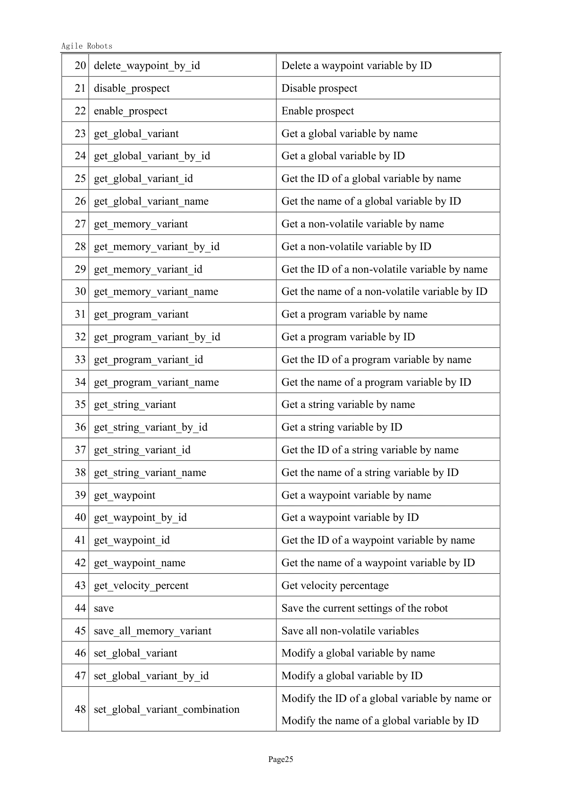



```
Agile Robots 
Page25 
20 delete_waypoint_by_id 
Delete a waypoint variable by ID 
21 disable_prospect 
Disable prospect 
22 enable_prospect 
Enable prospect 
23 get_global_variant 
Get a global variable by name 
24 get_global_variant_by_id 
Get a global variable by ID 
25 get_global_variant_id 
Get the ID of a global variable by name 
26 get_global_variant_name 
Get the name of a global variable by ID 
27 get_memory_variant 
Get a non-volatile variable by name 
28 get_memory_variant_by_id 
Get a non-volatile variable by ID 
29 get_memory_variant_id 
Get the ID of a non-volatile variable by name 
30 get_memory_variant_name 
Get the name of a non-volatile variable by ID 
31 get_program_variant 
Get a program variable by name 
32 get_program_variant_by_id 
Get a program variable by ID 
33 get_program_variant_id 
Get the ID of a program variable by name 
34 get_program_variant_name 
Get the name of a program variable by ID 
35 get_string_variant 
Get a string variable by name 
36 get_string_variant_by_id 
Get a string variable by ID 
37 get_string_variant_id 
Get the ID of a string variable by name 
38 get_string_variant_name 
Get the name of a string variable by ID 
39 get_waypoint 
Get a waypoint variable by name 
40 get_waypoint_by_id 
Get a waypoint variable by ID 
41 get_waypoint_id 
Get the ID of a waypoint variable by name 
42 get_waypoint_name 
Get the name of a waypoint variable by ID 
43 get_velocity_percent 
Get velocity percentage 
44 save 
Save the current settings of the robot 
45 save_all_memory_variant 
Save all non-volatile variables 
46 set_global_variant 
Modify a global variable by name 
47 set_global_variant_by_id 
Modify a global variable by ID 
48 set_global_variant_combination 
Modify the ID of a global variable by name or 
Modify the name of a global variable by ID
```



**Original document cross-references:** [PDF 42](pages-001-072.md#pdf-page-42) · [PDF 44](pages-001-072.md#pdf-page-44) · [PDF 45](pages-001-072.md#pdf-page-45) · [PDF 46](pages-001-072.md#pdf-page-46) · [PDF 47](pages-001-072.md#pdf-page-47) · [PDF 48](pages-001-072.md#pdf-page-48) · [PDF 49](pages-001-072.md#pdf-page-49) · [PDF 50](pages-001-072.md#pdf-page-50) · [PDF 51](pages-001-072.md#pdf-page-51) · [PDF 52](pages-001-072.md#pdf-page-52) · [PDF 53](pages-001-072.md#pdf-page-53) · [PDF 54](pages-001-072.md#pdf-page-54) · [PDF 55](pages-001-072.md#pdf-page-55)

## PDF page 27

**Source:** Industrial Lua Programming Manual\_V3.3.0\_EN\_20260117.pdf, original pdf page 27. [Open the corresponding PDF reading-copy page](https://1292444914-files.gitbook.io/~/files/v0/b/gitbook-x-prod.appspot.com/o/spaces%2FtgOfPnscWebs1eh82EKq%2Fuploads%2FU0JYOssuma2RW4Gd2PqT%2Findustrial-lua-programming-manual-v3-3-0-en-20260117-pp-001-184.pdf?alt=media#page=27).



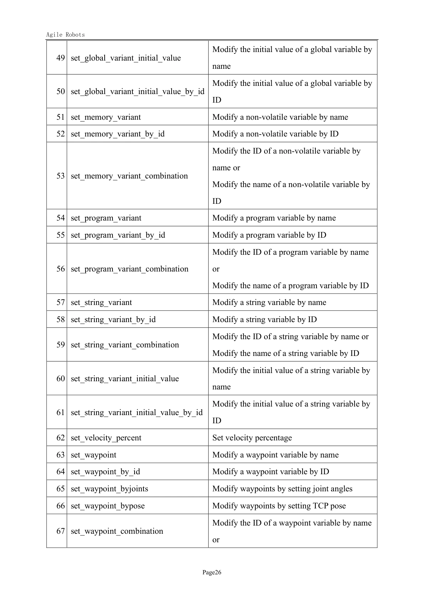



```
Agile Robots 
Page26 
49 set_global_variant_initial_value 
Modify the initial value of a global variable by 
name 
50 set_global_variant_initial_value_by_id 
Modify the initial value of a global variable by 
ID 
51 set_memory_variant 
Modify a non-volatile variable by name 
52 set_memory_variant_by_id 
Modify a non-volatile variable by ID 
53 set_memory_variant_combination 
Modify the ID of a non-volatile variable by 
name or 
Modify the name of a non-volatile variable by 
ID 
54 set_program_variant 
Modify a program variable by name 
55 set_program_variant_by_id 
Modify a program variable by ID 
56 set_program_variant_combination 
Modify the ID of a program variable by name 
or 
Modify the name of a program variable by ID 
57 set_string_variant 
Modify a string variable by name 
58 set_string_variant_by_id 
Modify a string variable by ID 
59 set_string_variant_combination 
Modify the ID of a string variable by name or 
Modify the name of a string variable by ID 
60 set_string_variant_initial_value 
Modify the initial value of a string variable by 
name 
61 set_string_variant_initial_value_by_id 
Modify the initial value of a string variable by 
ID 
62 set_velocity_percent 
Set velocity percentage 
63 set_waypoint 
Modify a waypoint variable by name 
64 set_waypoint_by_id 
Modify a waypoint variable by ID 
65 set_waypoint_byjoints 
Modify waypoints by setting joint angles 
66 set_waypoint_bypose 
Modify waypoints by setting TCP pose 
67 set_waypoint_combination 
Modify the ID of a waypoint variable by name 
or
```



**Original document cross-references:** [PDF 56](pages-001-072.md#pdf-page-56) · [PDF 57](pages-001-072.md#pdf-page-57) · [PDF 58](pages-001-072.md#pdf-page-58) · [PDF 59](pages-001-072.md#pdf-page-59) · [PDF 60](pages-001-072.md#pdf-page-60) · [PDF 61](pages-001-072.md#pdf-page-61) · [PDF 63](pages-001-072.md#pdf-page-63) · [PDF 65](pages-001-072.md#pdf-page-65)

## PDF page 28

**Source:** Industrial Lua Programming Manual\_V3.3.0\_EN\_20260117.pdf, original pdf page 28. [Open the corresponding PDF reading-copy page](https://1292444914-files.gitbook.io/~/files/v0/b/gitbook-x-prod.appspot.com/o/spaces%2FtgOfPnscWebs1eh82EKq%2Fuploads%2FU0JYOssuma2RW4Gd2PqT%2Findustrial-lua-programming-manual-v3-3-0-en-20260117-pp-001-184.pdf?alt=media#page=28).



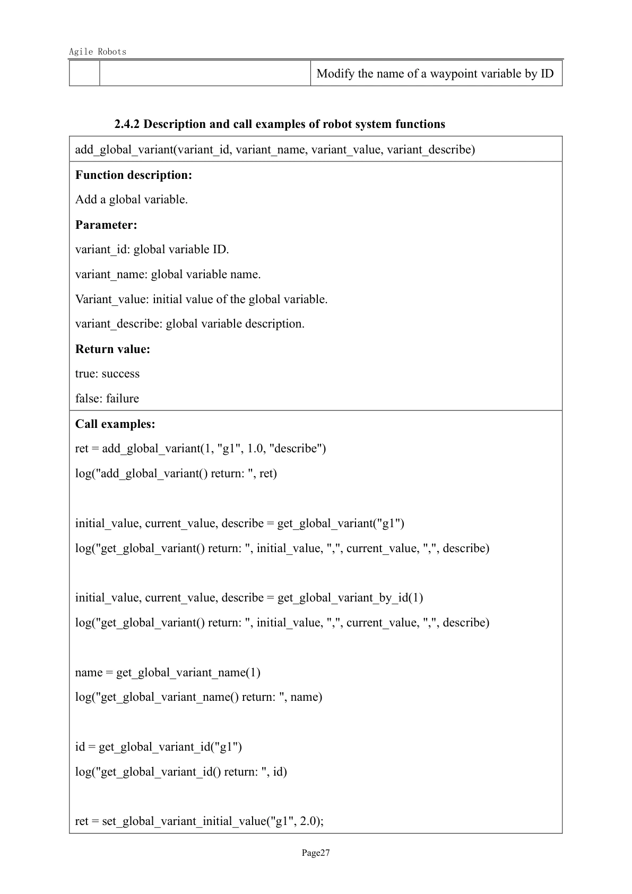



```
Agile Robots 
Page27 
Modify the name of a waypoint variable by ID 
 
2.4.2 Description and call examples of robot system functions 
add_global_variant(variant_id, variant_name, variant_value, variant_describe) 
Function description: 
Add a global variable. 
Parameter: 
variant_id: global variable ID. 
variant_name: global variable name. 
Variant_value: initial value of the global variable. 
variant_describe: global variable description. 
Return value: 
true: success 
false: failure 
Call examples: 
ret = add_global_variant(1, "g1", 1.0, "describe") 
log("add_global_variant() return: ", ret) 
 
initial_value, current_value, describe = get_global_variant("g1") 
log("get_global_variant() return: ", initial_value, ",", current_value, ",", describe) 
 
initial_value, current_value, describe = get_global_variant_by_id(1) 
log("get_global_variant() return: ", initial_value, ",", current_value, ",", describe) 
 
name = get_global_variant_name(1) 
log("get_global_variant_name() return: ", name) 
 
id = get_global_variant_id("g1") 
log("get_global_variant_id() return: ", id) 
 
ret = set_global_variant_initial_value("g1", 2.0);
```



## PDF page 29

**Source:** Industrial Lua Programming Manual\_V3.3.0\_EN\_20260117.pdf, original pdf page 29. [Open the corresponding PDF reading-copy page](https://1292444914-files.gitbook.io/~/files/v0/b/gitbook-x-prod.appspot.com/o/spaces%2FtgOfPnscWebs1eh82EKq%2Fuploads%2FU0JYOssuma2RW4Gd2PqT%2Findustrial-lua-programming-manual-v3-3-0-en-20260117-pp-001-184.pdf?alt=media#page=29).



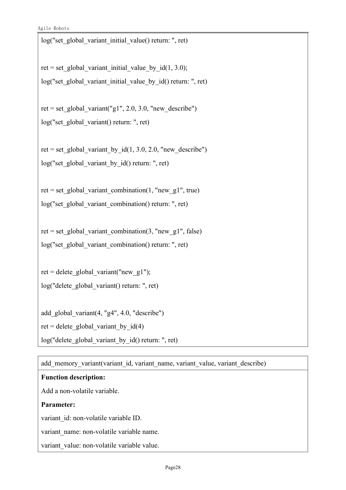



```
Agile Robots 
Page28 
log("set_global_variant_initial_value() return: ", ret) 
 
ret = set_global_variant_initial_value_by_id(1, 3.0); 
log("set_global_variant_initial_value_by_id() return: ", ret) 
 
ret = set_global_variant("g1", 2.0, 3.0, "new_describe") 
log("set_global_variant() return: ", ret) 
 
ret = set_global_variant_by_id(1, 3.0, 2.0, "new_describe") 
log("set_global_variant_by_id() return: ", ret) 
 
ret = set_global_variant_combination(1, "new_g1", true) 
log("set_global_variant_combination() return: ", ret) 
 
ret = set_global_variant_combination(3, "new_g1", false) 
log("set_global_variant_combination() return: ", ret) 
 
ret = delete_global_variant("new_g1"); 
log("delete_global_variant() return: ", ret) 
 
add_global_variant(4, "g4", 4.0, "describe") 
ret = delete_global_variant_by_id(4) 
log("delete_global_variant_by_id() return: ", ret) 
 
add_memory_variant(variant_id, variant_name, variant_value, variant_describe) 
Function description: 
Add a non-volatile variable. 
Parameter: 
variant_id: non-volatile variable ID. 
variant_name: non-volatile variable name. 
variant_value: non-volatile variable value.
```



## PDF page 30

**Source:** Industrial Lua Programming Manual\_V3.3.0\_EN\_20260117.pdf, original pdf page 30. [Open the corresponding PDF reading-copy page](https://1292444914-files.gitbook.io/~/files/v0/b/gitbook-x-prod.appspot.com/o/spaces%2FtgOfPnscWebs1eh82EKq%2Fuploads%2FU0JYOssuma2RW4Gd2PqT%2Findustrial-lua-programming-manual-v3-3-0-en-20260117-pp-001-184.pdf?alt=media#page=30).



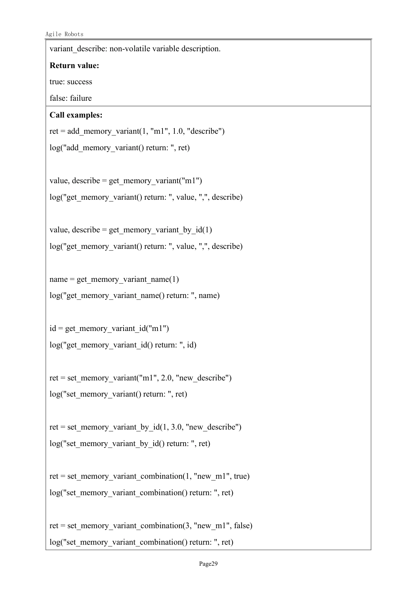



```
Agile Robots 
Page29 
variant_describe: non-volatile variable description. 
Return value: 
true: success 
false: failure 
Call examples: 
ret = add_memory_variant(1, "m1", 1.0, "describe") 
log("add_memory_variant() return: ", ret) 
 
value, describe = get_memory_variant("m1") 
log("get_memory_variant() return: ", value, ",", describe) 
 
value, describe = get_memory_variant_by_id(1) 
log("get_memory_variant() return: ", value, ",", describe) 
 
name = get_memory_variant_name(1) 
log("get_memory_variant_name() return: ", name) 
 
id = get_memory_variant_id("m1") 
log("get_memory_variant_id() return: ", id) 
 
ret = set_memory_variant("m1", 2.0, "new_describe") 
log("set_memory_variant() return: ", ret) 
 
ret = set_memory_variant_by_id(1, 3.0, "new_describe") 
log("set_memory_variant_by_id() return: ", ret) 
 
ret = set_memory_variant_combination(1, "new_m1", true) 
log("set_memory_variant_combination() return: ", ret) 
 
ret = set_memory_variant_combination(3, "new_m1", false) 
log("set_memory_variant_combination() return: ", ret)
```



## PDF page 31

**Source:** Industrial Lua Programming Manual\_V3.3.0\_EN\_20260117.pdf, original pdf page 31. [Open the corresponding PDF reading-copy page](https://1292444914-files.gitbook.io/~/files/v0/b/gitbook-x-prod.appspot.com/o/spaces%2FtgOfPnscWebs1eh82EKq%2Fuploads%2FU0JYOssuma2RW4Gd2PqT%2Findustrial-lua-programming-manual-v3-3-0-en-20260117-pp-001-184.pdf?alt=media#page=31).



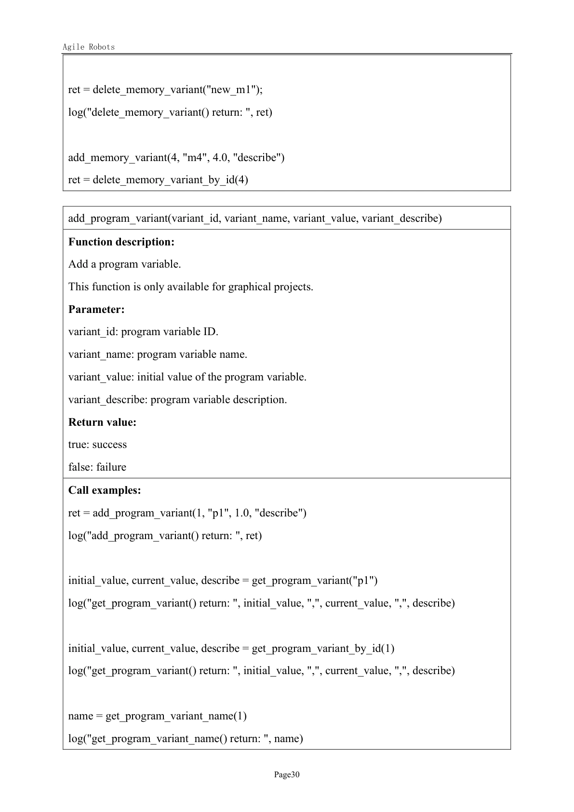



```
Agile Robots 
Page30 
 
ret = delete_memory_variant("new_m1"); 
log("delete_memory_variant() return: ", ret) 
 
add_memory_variant(4, "m4", 4.0, "describe") 
ret = delete_memory_variant_by_id(4) 
 
add_program_variant(variant_id, variant_name, variant_value, variant_describe) 
Function description: 
Add a program variable. 
This function is only available for graphical projects. 
Parameter: 
variant_id: program variable ID. 
variant_name: program variable name. 
variant_value: initial value of the program variable. 
variant_describe: program variable description. 
Return value: 
true: success 
false: failure 
Call examples: 
ret = add_program_variant(1, "p1", 1.0, "describe") 
log("add_program_variant() return: ", ret) 
 
initial_value, current_value, describe = get_program_variant("p1") 
log("get_program_variant() return: ", initial_value, ",", current_value, ",", describe) 
 
initial_value, current_value, describe = get_program_variant_by_id(1) 
log("get_program_variant() return: ", initial_value, ",", current_value, ",", describe) 
 
name = get_program_variant_name(1) 
log("get_program_variant_name() return: ", name)
```



## PDF page 32

**Source:** Industrial Lua Programming Manual\_V3.3.0\_EN\_20260117.pdf, original pdf page 32. [Open the corresponding PDF reading-copy page](https://1292444914-files.gitbook.io/~/files/v0/b/gitbook-x-prod.appspot.com/o/spaces%2FtgOfPnscWebs1eh82EKq%2Fuploads%2FU0JYOssuma2RW4Gd2PqT%2Findustrial-lua-programming-manual-v3-3-0-en-20260117-pp-001-184.pdf?alt=media#page=32).



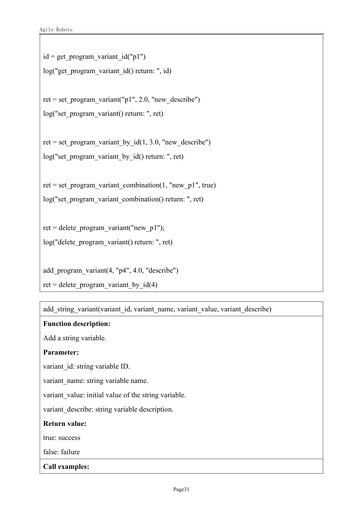



```
Agile Robots 
Page31 
 
id = get_program_variant_id("p1") 
log("get_program_variant_id() return: ", id) 
 
ret = set_program_variant("p1", 2.0, "new_describe") 
log("set_program_variant() return: ", ret) 
 
ret = set_program_variant_by_id(1, 3.0, "new_describe") 
log("set_program_variant_by_id() return: ", ret) 
 
ret = set_program_variant_combination(1, "new_p1", true) 
log("set_program_variant_combination() return: ", ret) 
 
ret = delete_program_variant("new_p1"); 
log("delete_program_variant() return: ", ret) 
 
add_program_variant(4, "p4", 4.0, "describe") 
ret = delete_program_variant_by_id(4) 
 
add_string_variant(variant_id, variant_name, variant_value, variant_describe) 
Function description: 
Add a string variable. 
Parameter: 
variant_id: string variable ID. 
variant_name: string variable name. 
variant_value: initial value of the string variable. 
variant_describe: string variable description. 
Return value: 
true: success 
false: failure 
Call examples:
```



## PDF page 33

**Source:** Industrial Lua Programming Manual\_V3.3.0\_EN\_20260117.pdf, original pdf page 33. [Open the corresponding PDF reading-copy page](https://1292444914-files.gitbook.io/~/files/v0/b/gitbook-x-prod.appspot.com/o/spaces%2FtgOfPnscWebs1eh82EKq%2Fuploads%2FU0JYOssuma2RW4Gd2PqT%2Findustrial-lua-programming-manual-v3-3-0-en-20260117-pp-001-184.pdf?alt=media#page=33).



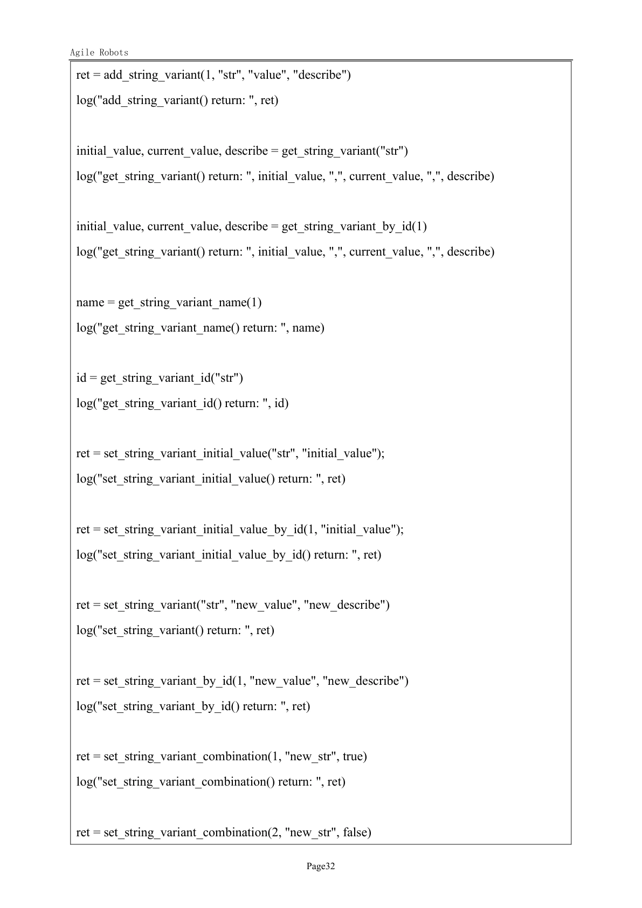



```
Agile Robots 
Page32 
ret = add_string_variant(1, "str", "value", "describe") 
log("add_string_variant() return: ", ret) 
 
initial_value, current_value, describe = get_string_variant("str") 
log("get_string_variant() return: ", initial_value, ",", current_value, ",", describe) 
 
initial_value, current_value, describe = get_string_variant_by_id(1) 
log("get_string_variant() return: ", initial_value, ",", current_value, ",", describe) 
 
name = get_string_variant_name(1) 
log("get_string_variant_name() return: ", name) 
 
id = get_string_variant_id("str") 
log("get_string_variant_id() return: ", id) 
 
ret = set_string_variant_initial_value("str", "initial_value"); 
log("set_string_variant_initial_value() return: ", ret) 
 
ret = set_string_variant_initial_value_by_id(1, "initial_value"); 
log("set_string_variant_initial_value_by_id() return: ", ret) 
 
ret = set_string_variant("str", "new_value", "new_describe") 
log("set_string_variant() return: ", ret) 
 
ret = set_string_variant_by_id(1, "new_value", "new_describe") 
log("set_string_variant_by_id() return: ", ret) 
 
ret = set_string_variant_combination(1, "new_str", true) 
log("set_string_variant_combination() return: ", ret) 
 
ret = set_string_variant_combination(2, "new_str", false)
```



## PDF page 34

**Source:** Industrial Lua Programming Manual\_V3.3.0\_EN\_20260117.pdf, original pdf page 34. [Open the corresponding PDF reading-copy page](https://1292444914-files.gitbook.io/~/files/v0/b/gitbook-x-prod.appspot.com/o/spaces%2FtgOfPnscWebs1eh82EKq%2Fuploads%2FU0JYOssuma2RW4Gd2PqT%2Findustrial-lua-programming-manual-v3-3-0-en-20260117-pp-001-184.pdf?alt=media#page=34).



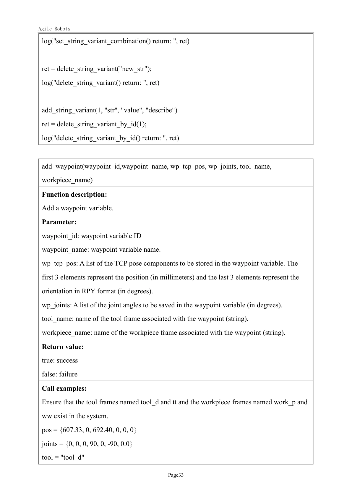



```
Agile Robots 
Page33 
log("set_string_variant_combination() return: ", ret) 
 
ret = delete_string_variant("new_str"); 
log("delete_string_variant() return: ", ret) 
 
add_string_variant(1, "str", "value", "describe") 
ret = delete_string_variant_by_id(1); 
log("delete_string_variant_by_id() return: ", ret) 
 
add_waypoint(waypoint_id,waypoint_name, wp_tcp_pos, wp_joints, tool_name, 
workpiece_name) 
Function description: 
Add a waypoint variable. 
Parameter: 
waypoint_id: waypoint variable ID 
waypoint_name: waypoint variable name. 
wp_tcp_pos: A list of the TCP pose components to be stored in the waypoint variable. The 
first 3 elements represent the position (in millimeters) and the last 3 elements represent the 
orientation in RPY format (in degrees). 
wp_joints: A list of the joint angles to be saved in the waypoint variable (in degrees). 
tool_name: name of the tool frame associated with the waypoint (string). 
workpiece_name: name of the workpiece frame associated with the waypoint (string). 
Return value: 
true: success 
false: failure 
Call examples: 
Ensure that the tool frames named tool_d and tt and the workpiece frames named work_p and 
ww exist in the system. 
pos = {607.33, 0, 692.40, 0, 0, 0} 
joints = {0, 0, 0, 90, 0, -90, 0.0} 
tool = "tool_d"
```



## PDF page 35

**Source:** Industrial Lua Programming Manual\_V3.3.0\_EN\_20260117.pdf, original pdf page 35. [Open the corresponding PDF reading-copy page](https://1292444914-files.gitbook.io/~/files/v0/b/gitbook-x-prod.appspot.com/o/spaces%2FtgOfPnscWebs1eh82EKq%2Fuploads%2FU0JYOssuma2RW4Gd2PqT%2Findustrial-lua-programming-manual-v3-3-0-en-20260117-pp-001-184.pdf?alt=media#page=35).



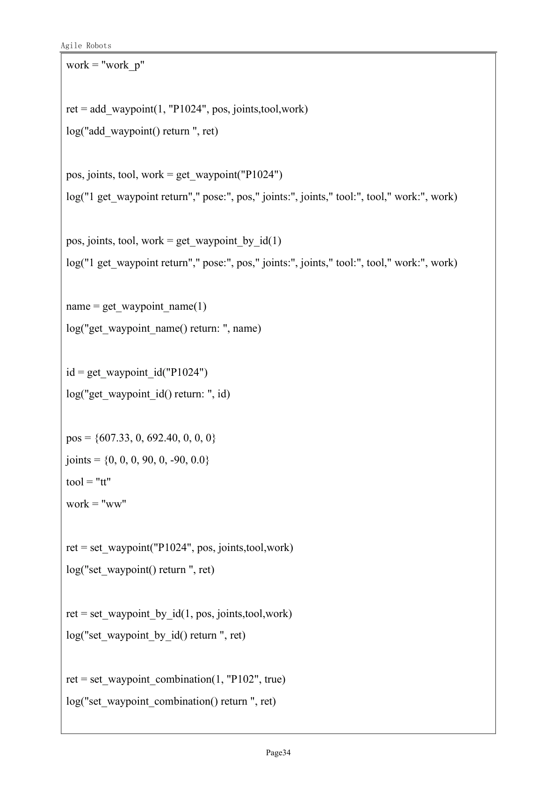



```
Agile Robots 
Page34 
work = "work_p" 
 
ret = add_waypoint(1, "P1024", pos, joints,tool,work) 
log("add_waypoint() return ", ret) 
 
pos, joints, tool, work = get_waypoint("P1024") 
log("1 get_waypoint return"," pose:", pos," joints:", joints," tool:", tool," work:", work) 
 
pos, joints, tool, work = get_waypoint_by_id(1) 
log("1 get_waypoint return"," pose:", pos," joints:", joints," tool:", tool," work:", work) 
 
name = get_waypoint_name(1) 
log("get_waypoint_name() return: ", name) 
 
id = get_waypoint_id("P1024") 
log("get_waypoint_id() return: ", id) 
 
pos = {607.33, 0, 692.40, 0, 0, 0} 
joints = {0, 0, 0, 90, 0, -90, 0.0} 
tool = "tt" 
work = "ww" 
 
ret = set_waypoint("P1024", pos, joints,tool,work) 
log("set_waypoint() return ", ret) 
 
ret = set_waypoint_by_id(1, pos, joints,tool,work) 
log("set_waypoint_by_id() return ", ret) 
 
ret = set_waypoint_combination(1, "P102", true) 
log("set_waypoint_combination() return ", ret)
```



## PDF page 36

**Source:** Industrial Lua Programming Manual\_V3.3.0\_EN\_20260117.pdf, original pdf page 36. [Open the corresponding PDF reading-copy page](https://1292444914-files.gitbook.io/~/files/v0/b/gitbook-x-prod.appspot.com/o/spaces%2FtgOfPnscWebs1eh82EKq%2Fuploads%2FU0JYOssuma2RW4Gd2PqT%2Findustrial-lua-programming-manual-v3-3-0-en-20260117-pp-001-184.pdf?alt=media#page=36).



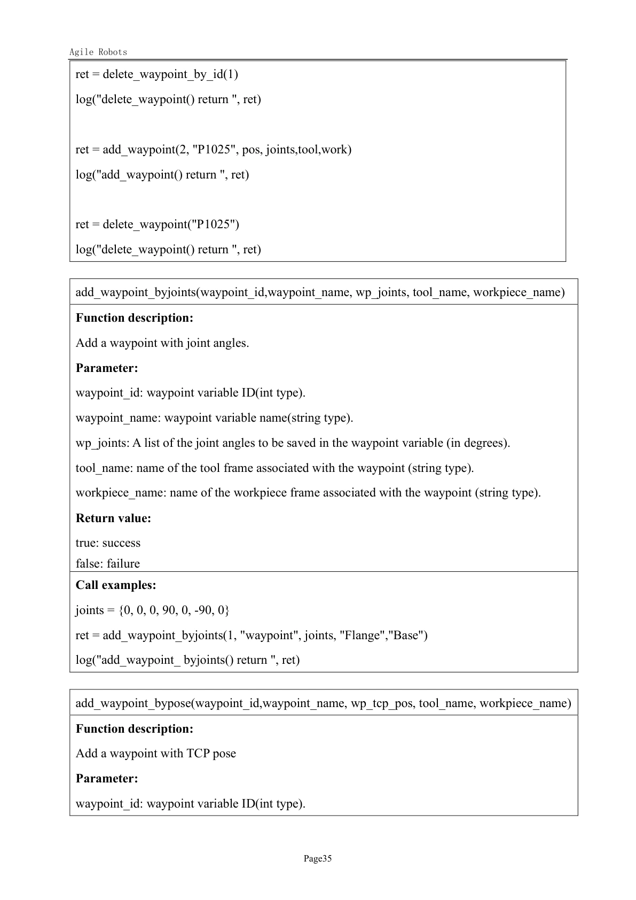



```
Agile Robots 
Page35 
ret = delete_waypoint_by_id(1) 
log("delete_waypoint() return ", ret) 
 
ret = add_waypoint(2, "P1025", pos, joints,tool,work) 
log("add_waypoint() return ", ret) 
 
ret = delete_waypoint("P1025") 
log("delete_waypoint() return ", ret) 
 
add_waypoint_byjoints(waypoint_id,waypoint_name, wp_joints, tool_name, workpiece_name) 
Function description: 
Add a waypoint with joint angles. 
Parameter: 
waypoint_id: waypoint variable ID(int type). 
waypoint_name: waypoint variable name(string type). 
wp_joints: A list of the joint angles to be saved in the waypoint variable (in degrees). 
tool_name: name of the tool frame associated with the waypoint (string type). 
workpiece_name: name of the workpiece frame associated with the waypoint (string type). 
Return value: 
true: success 
false: failure 
Call examples: 
joints = {0, 0, 0, 90, 0, -90, 0} 
ret = add_waypoint_byjoints(1, "waypoint", joints, "Flange","Base") 
log("add_waypoint_ byjoints() return ", ret) 
 
add_waypoint_bypose(waypoint_id,waypoint_name, wp_tcp_pos, tool_name, workpiece_name) 
Function description: 
Add a waypoint with TCP pose 
Parameter: 
waypoint_id: waypoint variable ID(int type).
```



## PDF page 37

**Source:** Industrial Lua Programming Manual\_V3.3.0\_EN\_20260117.pdf, original pdf page 37. [Open the corresponding PDF reading-copy page](https://1292444914-files.gitbook.io/~/files/v0/b/gitbook-x-prod.appspot.com/o/spaces%2FtgOfPnscWebs1eh82EKq%2Fuploads%2FU0JYOssuma2RW4Gd2PqT%2Findustrial-lua-programming-manual-v3-3-0-en-20260117-pp-001-184.pdf?alt=media#page=37).



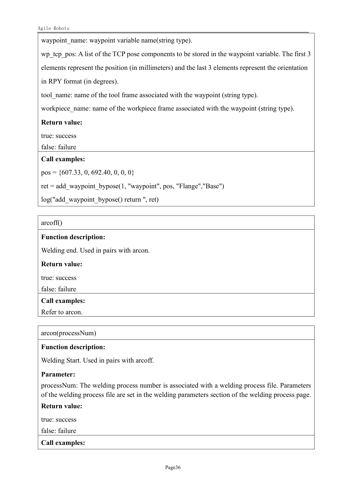



```
Agile Robots 
Page36 
waypoint_name: waypoint variable name(string type). 
wp_tcp_pos: A list of the TCP pose components to be stored in the waypoint variable. The first 3 
elements represent the position (in millimeters) and the last 3 elements represent the orientation 
in RPY format (in degrees). 
tool_name: name of the tool frame associated with the waypoint (string type). 
workpiece_name: name of the workpiece frame associated with the waypoint (string type). 
Return value: 
true: success 
false: failure 
Call examples: 
pos = {607.33, 0, 692.40, 0, 0, 0} 
ret = add_waypoint_bypose(1, "waypoint", pos, "Flange","Base") 
log("add_waypoint_bypose() return ", ret) 
 
arcoff() 
Function description: 
Welding end. Used in pairs with arcon. 
Return value: 
true: success 
false: failure 
Call examples: 
Refer to arcon. 
 
arcon(processNum) 
Function description: 
Welding Start. Used in pairs with arcoff. 
Parameter: 
processNum: The welding process number is associated with a welding process file. Parameters 
of the welding process file are set in the welding parameters section of the welding process page. 
Return value: 
true: success 
false: failure 
Call examples:
```



## PDF page 38

**Source:** Industrial Lua Programming Manual\_V3.3.0\_EN\_20260117.pdf, original pdf page 38. [Open the corresponding PDF reading-copy page](https://1292444914-files.gitbook.io/~/files/v0/b/gitbook-x-prod.appspot.com/o/spaces%2FtgOfPnscWebs1eh82EKq%2Fuploads%2FU0JYOssuma2RW4Gd2PqT%2Findustrial-lua-programming-manual-v3-3-0-en-20260117-pp-001-184.pdf?alt=media#page=38).



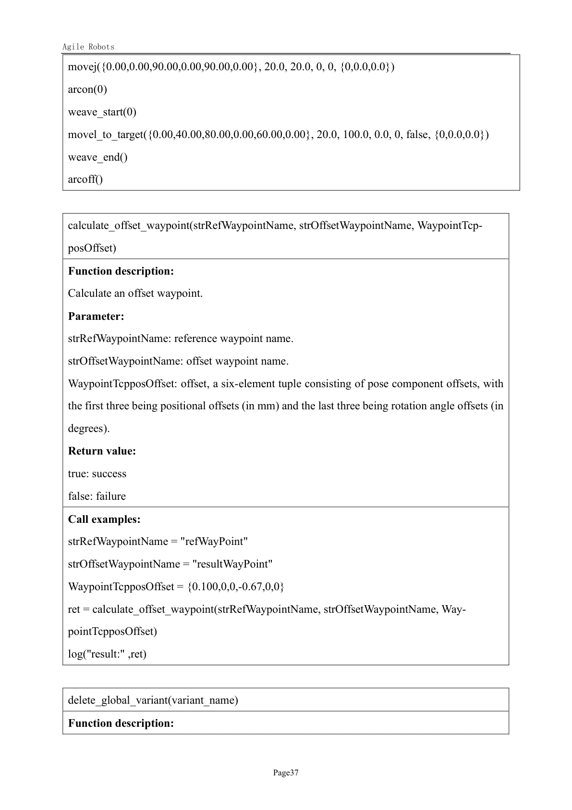



```
Agile Robots 
Page37 
movej({0.00,0.00,90.00,0.00,90.00,0.00}, 20.0, 20.0, 0, 0, {0,0.0,0.0}) 
arcon(0) 
weave_start(0) 
movel_to_target({0.00,40.00,80.00,0.00,60.00,0.00}, 20.0, 100.0, 0.0, 0, false, {0,0.0,0.0}) 
weave_end() 
arcoff() 
 
calculate_offset_waypoint(strRefWaypointName, strOffsetWaypointName, WaypointTcp-
posOffset) 
Function description: 
Calculate an offset waypoint. 
Parameter: 
strRefWaypointName: reference waypoint name. 
strOffsetWaypointName: offset waypoint name. 
WaypointTcpposOffset: offset, a six-element tuple consisting of pose component offsets, with 
the first three being positional offsets (in mm) and the last three being rotation angle offsets (in 
degrees). 
Return value: 
true: success 
false: failure 
Call examples: 
strRefWaypointName = "refWayPoint" 
strOffsetWaypointName = "resultWayPoint" 
WaypointTcpposOffset = {0.100,0,0,-0.67,0,0} 
ret = calculate_offset_waypoint(strRefWaypointName, strOffsetWaypointName, Way-
pointTcpposOffset) 
log("result:" ,ret) 
 
delete_global_variant(variant_name) 
Function description:
```



## PDF page 39

**Source:** Industrial Lua Programming Manual\_V3.3.0\_EN\_20260117.pdf, original pdf page 39. [Open the corresponding PDF reading-copy page](https://1292444914-files.gitbook.io/~/files/v0/b/gitbook-x-prod.appspot.com/o/spaces%2FtgOfPnscWebs1eh82EKq%2Fuploads%2FU0JYOssuma2RW4Gd2PqT%2Findustrial-lua-programming-manual-v3-3-0-en-20260117-pp-001-184.pdf?alt=media#page=39).



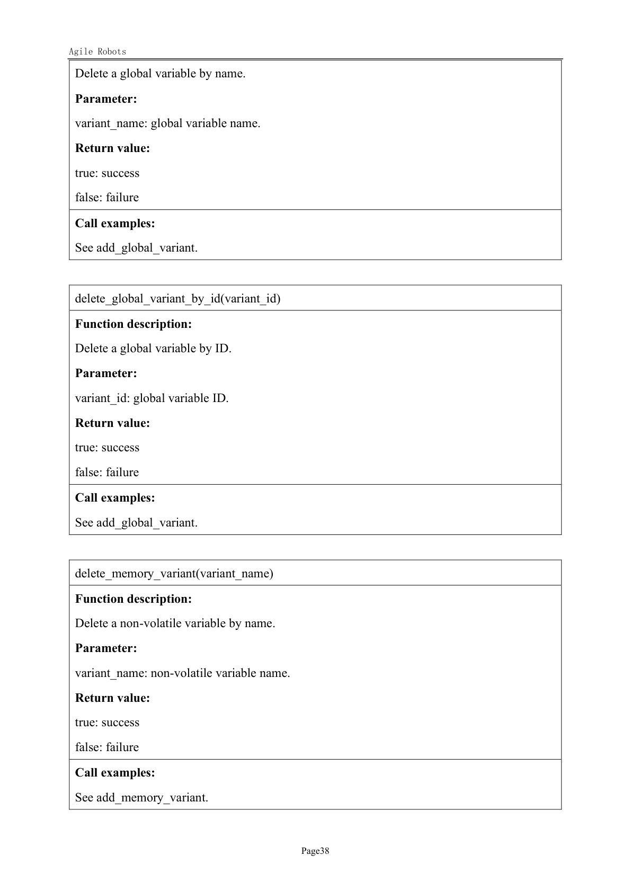



```
Agile Robots 
Page38 
Delete a global variable by name. 
Parameter: 
variant_name: global variable name. 
Return value: 
true: success 
false: failure 
Call examples: 
See add_global_variant. 
 
delete_global_variant_by_id(variant_id) 
Function description: 
Delete a global variable by ID. 
Parameter: 
variant_id: global variable ID. 
Return value: 
true: success 
false: failure 
Call examples: 
See add_global_variant. 
 
delete_memory_variant(variant_name) 
Function description: 
Delete a non-volatile variable by name. 
Parameter: 
variant_name: non-volatile variable name. 
Return value: 
true: success 
false: failure 
Call examples: 
See add_memory_variant.
```



## PDF page 40

**Source:** Industrial Lua Programming Manual\_V3.3.0\_EN\_20260117.pdf, original pdf page 40. [Open the corresponding PDF reading-copy page](https://1292444914-files.gitbook.io/~/files/v0/b/gitbook-x-prod.appspot.com/o/spaces%2FtgOfPnscWebs1eh82EKq%2Fuploads%2FU0JYOssuma2RW4Gd2PqT%2Findustrial-lua-programming-manual-v3-3-0-en-20260117-pp-001-184.pdf?alt=media#page=40).



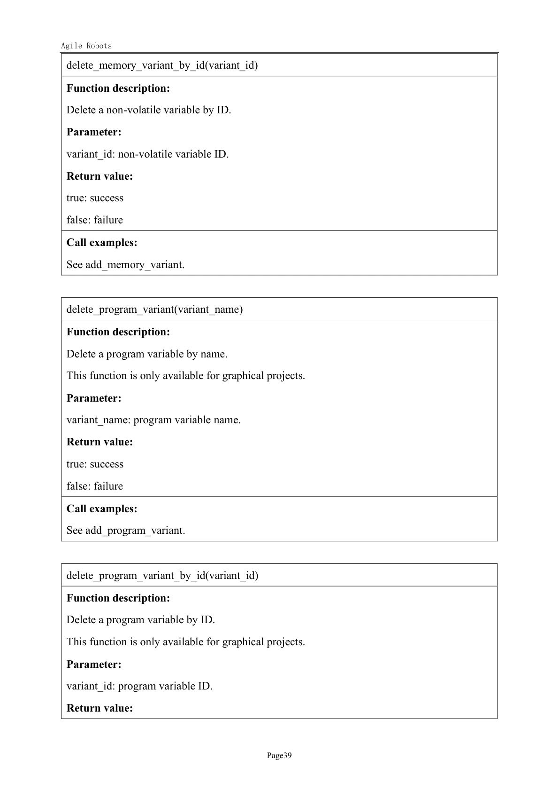



```
Agile Robots 
Page39 
delete_memory_variant_by_id(variant_id) 
Function description: 
Delete a non-volatile variable by ID. 
Parameter: 
variant_id: non-volatile variable ID. 
Return value: 
true: success 
false: failure 
Call examples: 
See add_memory_variant. 
 
delete_program_variant(variant_name) 
Function description: 
Delete a program variable by name. 
This function is only available for graphical projects. 
Parameter: 
variant_name: program variable name. 
Return value: 
true: success 
false: failure 
Call examples: 
See add_program_variant. 
 
delete_program_variant_by_id(variant_id) 
Function description: 
Delete a program variable by ID. 
This function is only available for graphical projects. 
Parameter: 
variant_id: program variable ID. 
Return value:
```



## PDF page 41

**Source:** Industrial Lua Programming Manual\_V3.3.0\_EN\_20260117.pdf, original pdf page 41. [Open the corresponding PDF reading-copy page](https://1292444914-files.gitbook.io/~/files/v0/b/gitbook-x-prod.appspot.com/o/spaces%2FtgOfPnscWebs1eh82EKq%2Fuploads%2FU0JYOssuma2RW4Gd2PqT%2Findustrial-lua-programming-manual-v3-3-0-en-20260117-pp-001-184.pdf?alt=media#page=41).



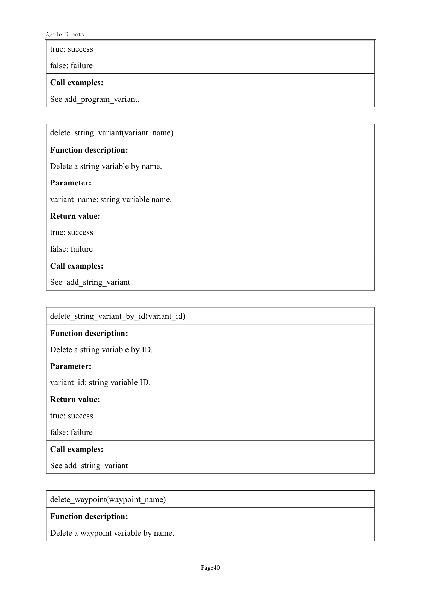



```
Agile Robots 
Page40 
true: success 
false: failure 
Call examples: 
See add_program_variant. 
 
delete_string_variant(variant_name) 
Function description: 
Delete a string variable by name. 
Parameter: 
variant_name: string variable name. 
Return value: 
true: success 
false: failure 
Call examples: 
See  add_string_variant 
 
delete_string_variant_by_id(variant_id) 
Function description: 
Delete a string variable by ID. 
Parameter: 
variant_id: string variable ID. 
Return value: 
true: success 
false: failure 
Call examples: 
See add_string_variant 
 
delete_waypoint(waypoint_name) 
Function description: 
Delete a waypoint variable by name.
```



**Original document cross-references:** [PDF 32](pages-001-072.md#pdf-page-32)

## PDF page 42

**Source:** Industrial Lua Programming Manual\_V3.3.0\_EN\_20260117.pdf, original pdf page 42. [Open the corresponding PDF reading-copy page](https://1292444914-files.gitbook.io/~/files/v0/b/gitbook-x-prod.appspot.com/o/spaces%2FtgOfPnscWebs1eh82EKq%2Fuploads%2FU0JYOssuma2RW4Gd2PqT%2Findustrial-lua-programming-manual-v3-3-0-en-20260117-pp-001-184.pdf?alt=media#page=42).



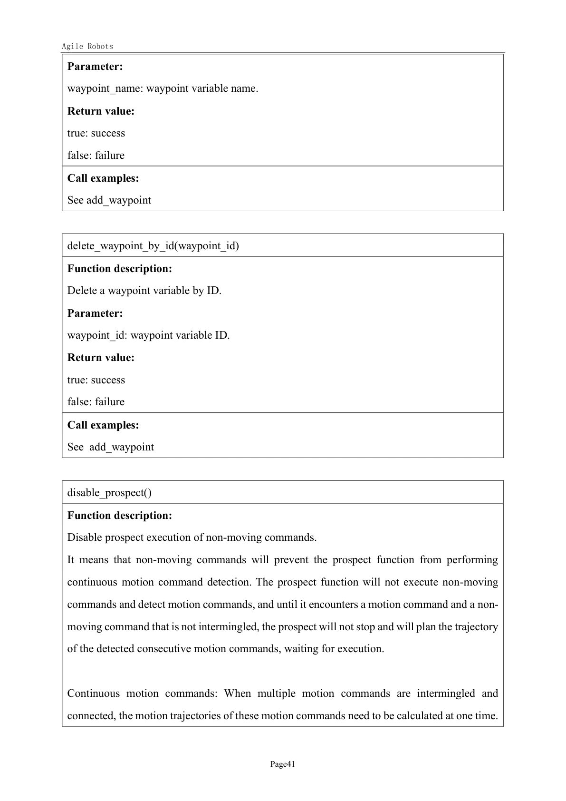



```
Agile Robots 
Page41 
Parameter: 
waypoint_name: waypoint variable name. 
Return value: 
true: success 
false: failure 
Call examples: 
See add_waypoint 
 
delete_waypoint_by_id(waypoint_id) 
Function description: 
Delete a waypoint variable by ID. 
Parameter: 
waypoint_id: waypoint variable ID. 
Return value: 
true: success 
false: failure 
Call examples: 
See  add_waypoint 
 
disable_prospect() 
Function description: 
Disable prospect execution of non-moving commands. 
It means that non-moving commands will prevent the prospect function from performing 
continuous motion command detection. The prospect function will not execute non-moving 
commands and detect motion commands, and until it encounters a motion command and a non-
moving command that is not intermingled, the prospect will not stop and will plan the trajectory 
of the detected consecutive motion commands, waiting for execution. 
 
Continuous motion commands: When multiple motion commands are intermingled and 
connected, the motion trajectories of these motion commands need to be calculated at one time.
```



**Original document cross-references:** [PDF 34](pages-001-072.md#pdf-page-34)

## PDF page 43

**Source:** Industrial Lua Programming Manual\_V3.3.0\_EN\_20260117.pdf, original pdf page 43. [Open the corresponding PDF reading-copy page](https://1292444914-files.gitbook.io/~/files/v0/b/gitbook-x-prod.appspot.com/o/spaces%2FtgOfPnscWebs1eh82EKq%2Fuploads%2FU0JYOssuma2RW4Gd2PqT%2Findustrial-lua-programming-manual-v3-3-0-en-20260117-pp-001-184.pdf?alt=media#page=43).



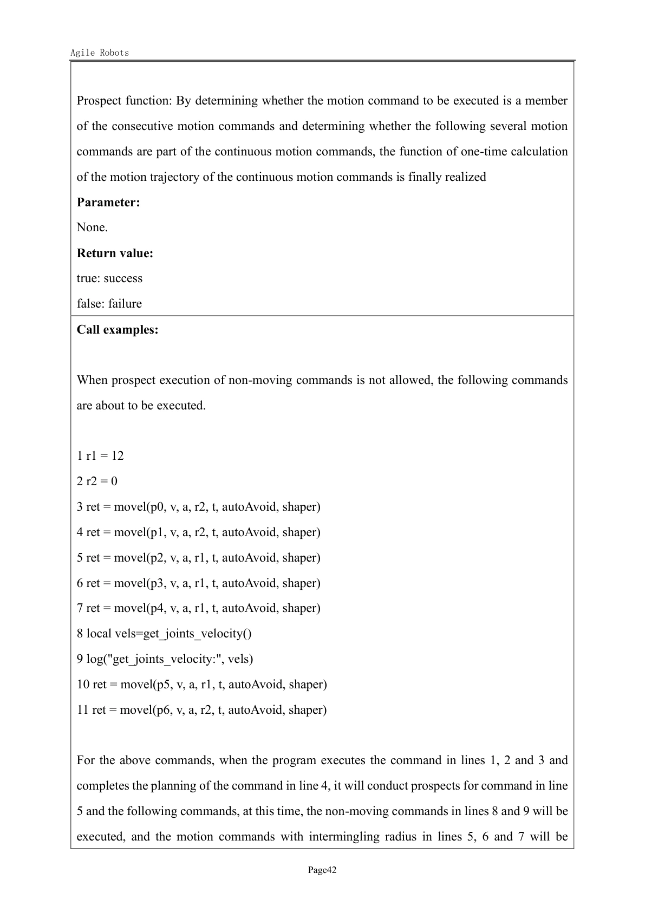



```
Agile Robots 
Page42 
 
Prospect function: By determining whether the motion command to be executed is a member 
of the consecutive motion commands and determining whether the following several motion 
commands are part of the continuous motion commands, the function of one-time calculation 
of the motion trajectory of the continuous motion commands is finally realized 
Parameter: 
None. 
Return value: 
true: success 
false: failure 
Call examples: 
 
When prospect execution of non-moving commands is not allowed, the following commands 
are about to be executed. 
 
1 r1 = 12 
2 r2 = 0 
3 ret = movel(p0, v, a, r2, t, autoAvoid, shaper) 
4 ret = movel(p1, v, a, r2, t, autoAvoid, shaper) 
5 ret = movel(p2, v, a, r1, t, autoAvoid, shaper) 
6 ret = movel(p3, v, a, r1, t, autoAvoid, shaper) 
7 ret = movel(p4, v, a, r1, t, autoAvoid, shaper) 
8 local vels=get_joints_velocity() 
9 log("get_joints_velocity:", vels) 
10 ret = movel(p5, v, a, r1, t, autoAvoid, shaper) 
11 ret = movel(p6, v, a, r2, t, autoAvoid, shaper) 
 
For the above commands, when the program executes the command in lines 1, 2 and 3 and 
completes the planning of the command in line 4, it will conduct prospects for command in line 
5 and the following commands, at this time, the non-moving commands in lines 8 and 9 will be 
executed, and the motion commands with intermingling radius in lines 5, 6 and 7 will be
```



## PDF page 44

**Source:** Industrial Lua Programming Manual\_V3.3.0\_EN\_20260117.pdf, original pdf page 44. [Open the corresponding PDF reading-copy page](https://1292444914-files.gitbook.io/~/files/v0/b/gitbook-x-prod.appspot.com/o/spaces%2FtgOfPnscWebs1eh82EKq%2Fuploads%2FU0JYOssuma2RW4Gd2PqT%2Findustrial-lua-programming-manual-v3-3-0-en-20260117-pp-001-184.pdf?alt=media#page=44).



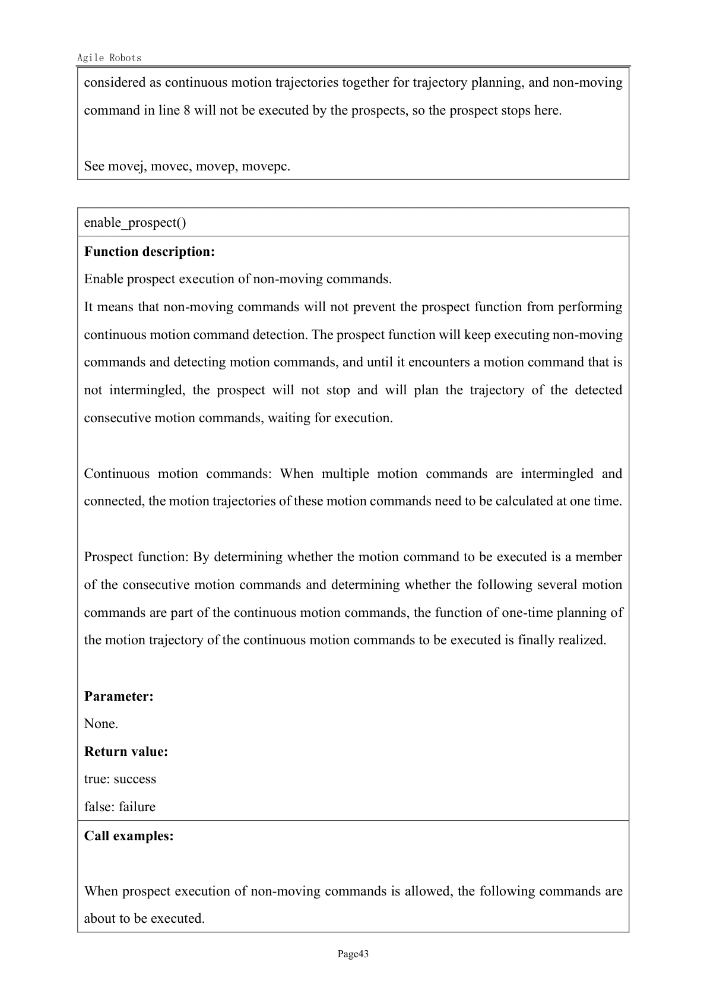



```
Agile Robots 
Page43 
considered as continuous motion trajectories together for trajectory planning, and non-moving 
command in line 8 will not be executed by the prospects, so the prospect stops here. 
 
See movej, movec, movep, movepc. 
 
enable_prospect() 
Function description: 
Enable prospect execution of non-moving commands. 
It means that non-moving commands will not prevent the prospect function from performing 
continuous motion command detection. The prospect function will keep executing non-moving 
commands and detecting motion commands, and until it encounters a motion command that is 
not intermingled, the prospect will not stop and will plan the trajectory of the detected 
consecutive motion commands, waiting for execution. 
 
Continuous motion commands: When multiple motion commands are intermingled and 
connected, the motion trajectories of these motion commands need to be calculated at one time. 
 
Prospect function: By determining whether the motion command to be executed is a member 
of the consecutive motion commands and determining whether the following several motion 
commands are part of the continuous motion commands, the function of one-time planning of 
the motion trajectory of the continuous motion commands to be executed is finally realized. 
 
Parameter: 
None. 
Return value: 
true: success 
false: failure 
Call examples: 
 
When prospect execution of non-moving commands is allowed, the following commands are 
about to be executed.
```



**Original document cross-references:** [PDF 95](pages-073-144.md#pdf-page-95) · [PDF 91](pages-073-144.md#pdf-page-91)

## PDF page 45

**Source:** Industrial Lua Programming Manual\_V3.3.0\_EN\_20260117.pdf, original pdf page 45. [Open the corresponding PDF reading-copy page](https://1292444914-files.gitbook.io/~/files/v0/b/gitbook-x-prod.appspot.com/o/spaces%2FtgOfPnscWebs1eh82EKq%2Fuploads%2FU0JYOssuma2RW4Gd2PqT%2Findustrial-lua-programming-manual-v3-3-0-en-20260117-pp-001-184.pdf?alt=media#page=45).



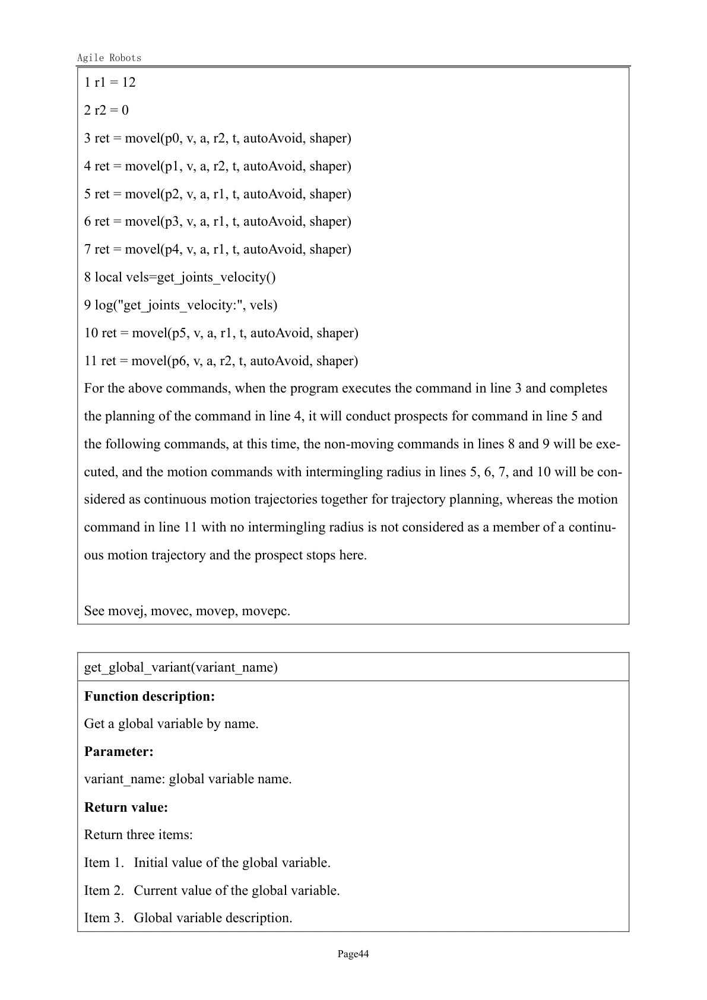



```
Agile Robots 
Page44 
1 r1 = 12 
2 r2 = 0 
3 ret = movel(p0, v, a, r2, t, autoAvoid, shaper) 
4 ret = movel(p1, v, a, r2, t, autoAvoid, shaper) 
5 ret = movel(p2, v, a, r1, t, autoAvoid, shaper) 
6 ret = movel(p3, v, a, r1, t, autoAvoid, shaper) 
7 ret = movel(p4, v, a, r1, t, autoAvoid, shaper) 
8 local vels=get_joints_velocity() 
9 log("get_joints_velocity:", vels) 
10 ret = movel(p5, v, a, r1, t, autoAvoid, shaper) 
11 ret = movel(p6, v, a, r2, t, autoAvoid, shaper) 
For the above commands, when the program executes the command in line 3 and completes 
the planning of the command in line 4, it will conduct prospects for command in line 5 and 
the following commands, at this time, the non-moving commands in lines 8 and 9 will be exe-
cuted, and the motion commands with intermingling radius in lines 5, 6, 7, and 10 will be con-
sidered as continuous motion trajectories together for trajectory planning, whereas the motion 
command in line 11 with no intermingling radius is not considered as a member of a continu-
ous motion trajectory and the prospect stops here. 
 
See movej, movec, movep, movepc. 
 
get_global_variant(variant_name) 
Function description: 
Get a global variable by name. 
Parameter: 
variant_name: global variable name. 
Return value: 
Return three items: 
Item 1.  Initial value of the global variable. 
Item 2.  Current value of the global variable. 
Item 3.  Global variable description.
```



**Original document cross-references:** [PDF 95](pages-073-144.md#pdf-page-95) · [PDF 91](pages-073-144.md#pdf-page-91)

## PDF page 46

**Source:** Industrial Lua Programming Manual\_V3.3.0\_EN\_20260117.pdf, original pdf page 46. [Open the corresponding PDF reading-copy page](https://1292444914-files.gitbook.io/~/files/v0/b/gitbook-x-prod.appspot.com/o/spaces%2FtgOfPnscWebs1eh82EKq%2Fuploads%2FU0JYOssuma2RW4Gd2PqT%2Findustrial-lua-programming-manual-v3-3-0-en-20260117-pp-001-184.pdf?alt=media#page=46).



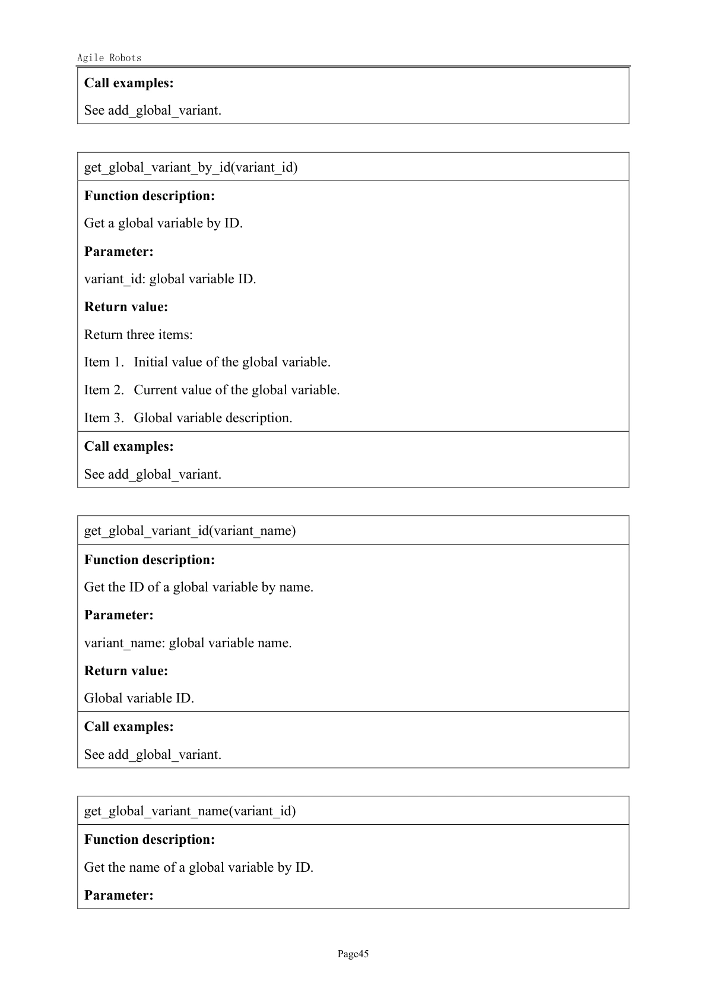



```
Agile Robots 
Page45 
Call examples: 
See add_global_variant. 
 
get_global_variant_by_id(variant_id) 
Function description: 
Get a global variable by ID. 
Parameter: 
variant_id: global variable ID. 
Return value: 
Return three items: 
Item 1.  Initial value of the global variable. 
Item 2.  Current value of the global variable. 
Item 3.  Global variable description. 
Call examples: 
See add_global_variant. 
 
get_global_variant_id(variant_name) 
Function description: 
Get the ID of a global variable by name. 
Parameter: 
variant_name: global variable name. 
Return value: 
Global variable ID. 
Call examples: 
See add_global_variant. 
 
get_global_variant_name(variant_id) 
Function description: 
Get the name of a global variable by ID. 
Parameter:
```



## PDF page 47

**Source:** Industrial Lua Programming Manual\_V3.3.0\_EN\_20260117.pdf, original pdf page 47. [Open the corresponding PDF reading-copy page](https://1292444914-files.gitbook.io/~/files/v0/b/gitbook-x-prod.appspot.com/o/spaces%2FtgOfPnscWebs1eh82EKq%2Fuploads%2FU0JYOssuma2RW4Gd2PqT%2Findustrial-lua-programming-manual-v3-3-0-en-20260117-pp-001-184.pdf?alt=media#page=47).



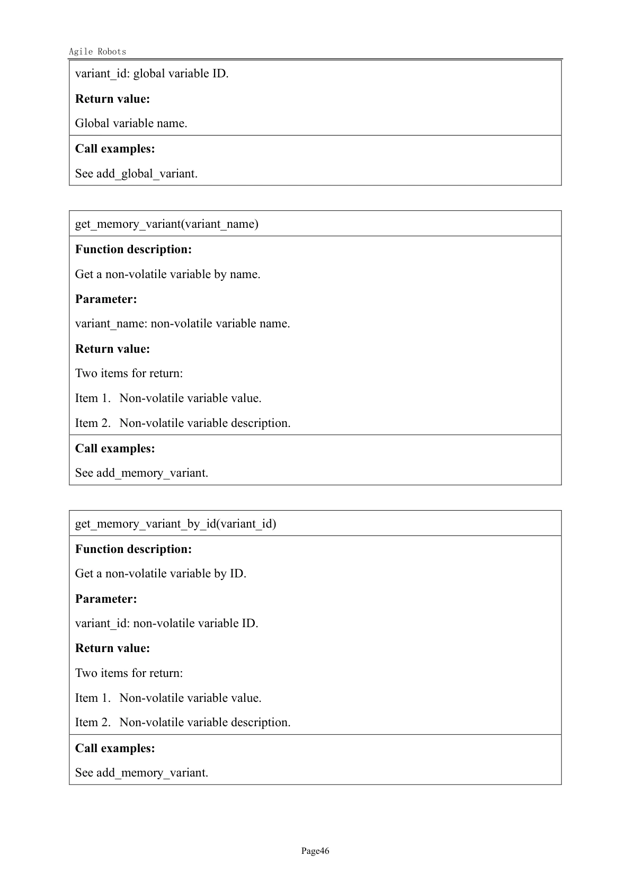



```
Agile Robots 
Page46 
variant_id: global variable ID. 
Return value: 
Global variable name. 
Call examples: 
See add_global_variant. 
 
get_memory_variant(variant_name) 
Function description: 
Get a non-volatile variable by name. 
Parameter: 
variant_name: non-volatile variable name. 
Return value: 
Two items for return: 
Item 1.  Non-volatile variable value. 
Item 2.  Non-volatile variable description. 
Call examples: 
See add_memory_variant. 
 
get_memory_variant_by_id(variant_id) 
Function description: 
Get a non-volatile variable by ID. 
Parameter: 
variant_id: non-volatile variable ID. 
Return value: 
Two items for return: 
Item 1.  Non-volatile variable value. 
Item 2.  Non-volatile variable description. 
Call examples: 
See add_memory_variant.
```



## PDF page 48

**Source:** Industrial Lua Programming Manual\_V3.3.0\_EN\_20260117.pdf, original pdf page 48. [Open the corresponding PDF reading-copy page](https://1292444914-files.gitbook.io/~/files/v0/b/gitbook-x-prod.appspot.com/o/spaces%2FtgOfPnscWebs1eh82EKq%2Fuploads%2FU0JYOssuma2RW4Gd2PqT%2Findustrial-lua-programming-manual-v3-3-0-en-20260117-pp-001-184.pdf?alt=media#page=48).



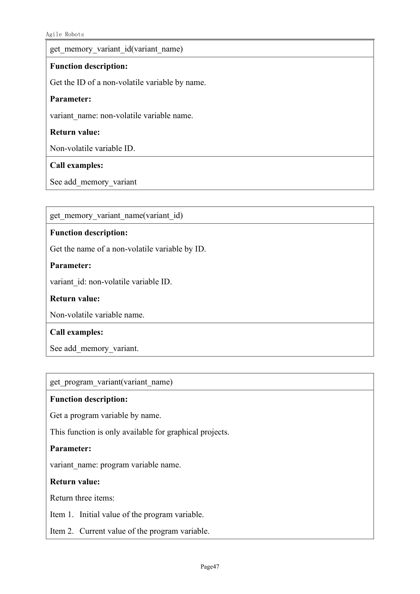



```
Agile Robots 
Page47 
get_memory_variant_id(variant_name) 
Function description: 
Get the ID of a non-volatile variable by name. 
Parameter: 
variant_name: non-volatile variable name. 
Return value: 
Non-volatile variable ID. 
Call examples: 
See add_memory_variant 
 
get_memory_variant_name(variant_id) 
Function description: 
Get the name of a non-volatile variable by ID. 
Parameter: 
variant_id: non-volatile variable ID. 
Return value: 
Non-volatile variable name. 
Call examples: 
See add_memory_variant. 
 
get_program_variant(variant_name) 
Function description: 
Get a program variable by name. 
This function is only available for graphical projects. 
Parameter: 
variant_name: program variable name. 
Return value: 
Return three items: 
Item 1.  Initial value of the program variable. 
Item 2.  Current value of the program variable.
```



## PDF page 49

**Source:** Industrial Lua Programming Manual\_V3.3.0\_EN\_20260117.pdf, original pdf page 49. [Open the corresponding PDF reading-copy page](https://1292444914-files.gitbook.io/~/files/v0/b/gitbook-x-prod.appspot.com/o/spaces%2FtgOfPnscWebs1eh82EKq%2Fuploads%2FU0JYOssuma2RW4Gd2PqT%2Findustrial-lua-programming-manual-v3-3-0-en-20260117-pp-001-184.pdf?alt=media#page=49).



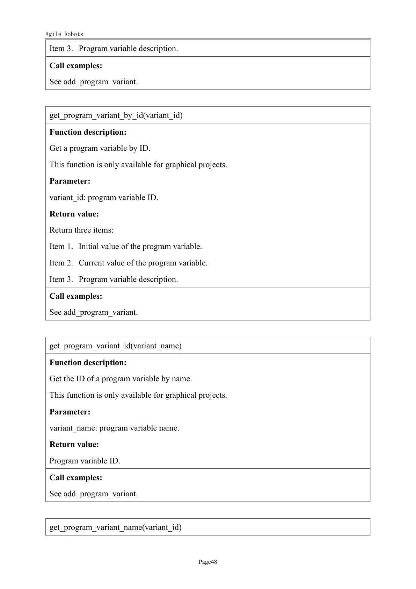



```
Agile Robots 
Page48 
Item 3.  Program variable description. 
Call examples: 
See add_program_variant. 
 
get_program_variant_by_id(variant_id) 
Function description: 
Get a program variable by ID. 
This function is only available for graphical projects. 
Parameter: 
variant_id: program variable ID. 
Return value: 
Return three items: 
Item 1.  Initial value of the program variable. 
Item 2.  Current value of the program variable. 
Item 3.  Program variable description. 
Call examples: 
See add_program_variant. 
 
get_program_variant_id(variant_name) 
Function description: 
Get the ID of a program variable by name. 
This function is only available for graphical projects. 
Parameter: 
variant_name: program variable name. 
Return value: 
Program variable ID. 
Call examples: 
See add_program_variant. 
 
get_program_variant_name(variant_id)
```



## PDF page 50

**Source:** Industrial Lua Programming Manual\_V3.3.0\_EN\_20260117.pdf, original pdf page 50. [Open the corresponding PDF reading-copy page](https://1292444914-files.gitbook.io/~/files/v0/b/gitbook-x-prod.appspot.com/o/spaces%2FtgOfPnscWebs1eh82EKq%2Fuploads%2FU0JYOssuma2RW4Gd2PqT%2Findustrial-lua-programming-manual-v3-3-0-en-20260117-pp-001-184.pdf?alt=media#page=50).



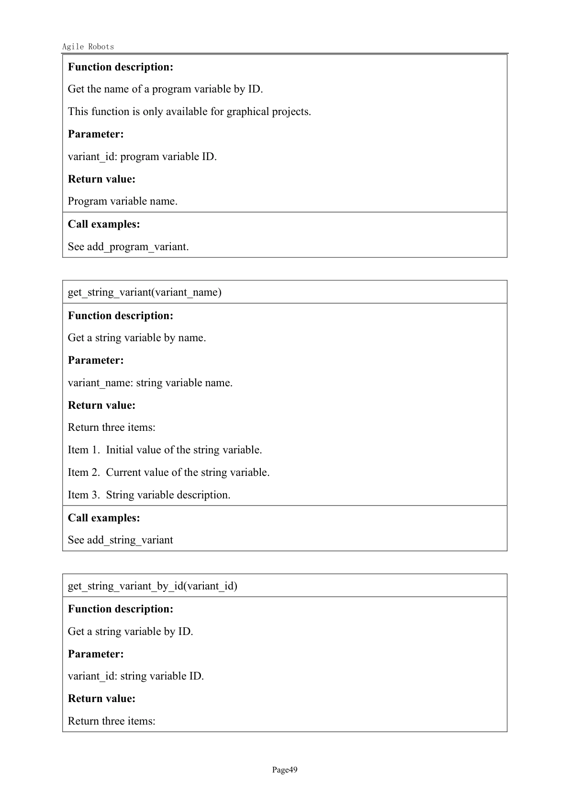



```
Agile Robots 
Page49 
Function description: 
Get the name of a program variable by ID. 
This function is only available for graphical projects. 
Parameter: 
variant_id: program variable ID. 
Return value: 
Program variable name. 
Call examples: 
See add_program_variant. 
 
get_string_variant(variant_name) 
Function description: 
Get a string variable by name. 
Parameter: 
variant_name: string variable name. 
Return value: 
Return three items: 
Item 1.  Initial value of the string variable. 
Item 2.  Current value of the string variable. 
Item 3.  String variable description. 
Call examples: 
See add_string_variant 
 
get_string_variant_by_id(variant_id) 
Function description: 
Get a string variable by ID. 
Parameter: 
variant_id: string variable ID. 
Return value: 
Return three items:
```



**Original document cross-references:** [PDF 32](pages-001-072.md#pdf-page-32)

## PDF page 51

**Source:** Industrial Lua Programming Manual\_V3.3.0\_EN\_20260117.pdf, original pdf page 51. [Open the corresponding PDF reading-copy page](https://1292444914-files.gitbook.io/~/files/v0/b/gitbook-x-prod.appspot.com/o/spaces%2FtgOfPnscWebs1eh82EKq%2Fuploads%2FU0JYOssuma2RW4Gd2PqT%2Findustrial-lua-programming-manual-v3-3-0-en-20260117-pp-001-184.pdf?alt=media#page=51).







```
Agile Robots 
Page50 
Item 1.  Initial value of the string variable. 
Item 2.  Current value of the string variable. 
Item 3.  String variable description. 
Call examples: 
See add_string_variant 
 
get_string_variant_id(variant_name) 
Function description: 
Get the number of a string variable by name. 
Parameter: 
variant_name: string variable name. 
Return value: 
String variable ID. 
Call examples: 
See add_string_variant 
 
get_string_variant_name(variant_id) 
Function description: 
Get the name of a string variable by ID. 
Parameter: 
variant_id: string variable ID. 
Return value: 
String variable name. 
Call examples: 
See add_string_variant. 
 
get_waypoint(waypoint_name) 
Function description: 
Get a waypoint variable by name. 
Parameter:
```



**Original document cross-references:** [PDF 32](pages-001-072.md#pdf-page-32)

## PDF page 52

**Source:** Industrial Lua Programming Manual\_V3.3.0\_EN\_20260117.pdf, original pdf page 52. [Open the corresponding PDF reading-copy page](https://1292444914-files.gitbook.io/~/files/v0/b/gitbook-x-prod.appspot.com/o/spaces%2FtgOfPnscWebs1eh82EKq%2Fuploads%2FU0JYOssuma2RW4Gd2PqT%2Findustrial-lua-programming-manual-v3-3-0-en-20260117-pp-001-184.pdf?alt=media#page=52).







```
Agile Robots 
Page51 
waypoint_name: waypoint variable name. 
Return value: 
Four items for return: 
The first item, a list of the TCP pose components to be stored in the waypoint variable, with 
the first 3 elements being the position (in millimeters) and the last 3 elements being the 
orientation in RPY format (in degrees). 
The second item, a list of joint angles to be saved in the waypoint variable (unit: degrees). 
The third item, the name of the tool frame associated with the waypoint. 
The fourth item, the name of the workpiece frame associated with the waypoint. 
Call examples: 
See  add_waypoint 
 
get_waypoint_by_id(waypoint_id) 
Function description: 
Get a waypoint variable by ID. 
Parameter: 
waypoint_id: waypoint variable ID. 
Return value: 
Four items for return: 
The first item, a list of the TCP pose components to be stored in the waypoint variable, with 
the first 3 elements being the position (in millimeters) and the last 3 elements being the 
orientation in RPY format (in degrees). 
The second item, a list of joint angles to be saved in the waypoint variable (unit: degrees). 
The third item, the name of the tool frame associated with the waypoint. 
The fourth item, the name of the workpiece frame associated with the waypoint. 
Call examples: 
See  add_waypoint 
 
get_waypoint_id(waypoint_name) 
Function description:
```



**Original document cross-references:** [PDF 34](pages-001-072.md#pdf-page-34)

## PDF page 53

**Source:** Industrial Lua Programming Manual\_V3.3.0\_EN\_20260117.pdf, original pdf page 53. [Open the corresponding PDF reading-copy page](https://1292444914-files.gitbook.io/~/files/v0/b/gitbook-x-prod.appspot.com/o/spaces%2FtgOfPnscWebs1eh82EKq%2Fuploads%2FU0JYOssuma2RW4Gd2PqT%2Findustrial-lua-programming-manual-v3-3-0-en-20260117-pp-001-184.pdf?alt=media#page=53).







```
Agile Robots 
Page52 
Get the ID of the waypoint variable by name. 
Parameter: 
waypoint_name: waypoint variable name. 
Return value: 
Waypoint variable ID. 
Call examples: 
See  add_waypoint 
 
get_waypoint_name(waypoint_id) 
Function description: 
Get the name of the waypoint variable by ID. 
Parameter: 
waypoint_id: waypoint variable ID. 
Return value: 
Waypoint variable name 
Call examples: 
See  add_waypoint 
 
get_velocity_percent() 
Function description: 
Get program running velocity percentage. 
Parameter: 
None 
Return value: 
velocityPercent: velocity percentage, with the value range of 1～100. 
 
Call examples: 
velocity_percent = get_velocity_percent() 
log("get_velocity_percent return ", velocity_percent)
```



**Original document cross-references:** [PDF 34](pages-001-072.md#pdf-page-34)

## PDF page 54

**Source:** Industrial Lua Programming Manual\_V3.3.0\_EN\_20260117.pdf, original pdf page 54. [Open the corresponding PDF reading-copy page](https://1292444914-files.gitbook.io/~/files/v0/b/gitbook-x-prod.appspot.com/o/spaces%2FtgOfPnscWebs1eh82EKq%2Fuploads%2FU0JYOssuma2RW4Gd2PqT%2Findustrial-lua-programming-manual-v3-3-0-en-20260117-pp-001-184.pdf?alt=media#page=54).







```
Agile Robots 
Page53 
save() 
Function description: 
Save user settings. 
Parameter: 
None. 
Return value: 
true: success 
false: failure 
Call examples: 
ret = save() 
log(" save return ", ret) 
 
save_all_memory_variant() 
Function description: 
Save all non-volatile variables. Successive calls to this function require a delay of at least 1 
second. 
Parameter: 
None. 
Return value: 
true: success 
false: failure 
Call examples: 
bsucceed = save_all_memory_variant() 
log("save_all_memory_variant return ", bsucceed) 
 
set_global_variant(variant_name, variant_current_value,  variant_initial_value, 
variant_describe) 
Function description: 
Modify a global variable by name. 
Parameter:
```



## PDF page 55

**Source:** Industrial Lua Programming Manual\_V3.3.0\_EN\_20260117.pdf, original pdf page 55. [Open the corresponding PDF reading-copy page](https://1292444914-files.gitbook.io/~/files/v0/b/gitbook-x-prod.appspot.com/o/spaces%2FtgOfPnscWebs1eh82EKq%2Fuploads%2FU0JYOssuma2RW4Gd2PqT%2Findustrial-lua-programming-manual-v3-3-0-en-20260117-pp-001-184.pdf?alt=media#page=55).







```
Agile Robots 
Page54 
variant_name: global variable name. 
variant_current_value: current value of the global variable. 
variant_initial_value: initial value of the global variable. 
variant_describe: global variable description. 
Return value: 
true: success 
false: failure 
Call examples: 
See add_global_variant. 
 
set_global_variant_by_id(variant_id, variant_current_value,  variant_initial_value, 
variant_describe) 
Function description: 
Modify a global variable by ID. 
Parameter: 
variant_id: global variable ID. 
variant_current_value: current value of the global variable. 
variant_initial_value: initial value of the global variable. 
variant_describe: global variable description. 
Return value: 
true: success 
false: failure 
Call examples: 
See add_global_variant. 
 
set_global_variant_combination(variant_id,variant_name, set_name_flag) 
Function description: 
Modify the ID of a global variable by name or modify the name of a global variable by ID 
Parameter: 
variant_id: global variable ID.
```



## PDF page 56

**Source:** Industrial Lua Programming Manual\_V3.3.0\_EN\_20260117.pdf, original pdf page 56. [Open the corresponding PDF reading-copy page](https://1292444914-files.gitbook.io/~/files/v0/b/gitbook-x-prod.appspot.com/o/spaces%2FtgOfPnscWebs1eh82EKq%2Fuploads%2FU0JYOssuma2RW4Gd2PqT%2Findustrial-lua-programming-manual-v3-3-0-en-20260117-pp-001-184.pdf?alt=media#page=56).







```
Agile Robots 
Page55 
variant_name: global variable name. 
set_name_flag: boolean value, if it is true, modify the name by ID, if it is false, modify the ID 
by name. 
Return value: 
true: success 
false: failure 
Call examples: 
See add_global_variant. 
 
set_global_variant_initial_value(variant_name, variant_initial_value) 
Function description: 
Modify the initial value of a global variable by name. 
Parameter: 
variant_name: global variable name. 
variant_initial_value: initial value of the global variable. 
Return value: 
true: success 
false: failure 
Call examples: 
See add_global_variant. 
 
set_global_variant_initial_value_by_id(variant_id, variant_initial_value) 
Function description: 
Modify the initial value of a global variable by ID. 
Parameter: 
variant_id: global variable ID. 
variant_initial_value: initial value of the global variable. 
Return value: 
true: success 
false: failure
```



## PDF page 57

**Source:** Industrial Lua Programming Manual\_V3.3.0\_EN\_20260117.pdf, original pdf page 57. [Open the corresponding PDF reading-copy page](https://1292444914-files.gitbook.io/~/files/v0/b/gitbook-x-prod.appspot.com/o/spaces%2FtgOfPnscWebs1eh82EKq%2Fuploads%2FU0JYOssuma2RW4Gd2PqT%2Findustrial-lua-programming-manual-v3-3-0-en-20260117-pp-001-184.pdf?alt=media#page=57).







```
Agile Robots 
Page56 
Call examples: 
See add_global_variant. 
 
set_memory_variant(variant_name, variant_value, variant_describe) 
Function description: 
Modify a non-volatile variable by name. 
Parameter: 
variant_name: non-volatile variable name. 
variant_value: non-volatile variable value. 
variant_describe: non-volatile variable description. 
Return value: 
true: success 
false: failure 
Call examples: 
See add_memory_variant. 
 
set_memory_variant_by_id(variant_id, variant_value, variant_describe) 
Function description: 
Modify a non-volatile variable by ID. 
Parameter: 
variant_id: non-volatile variable ID. 
variant_value: non-volatile variable value. 
variant_describe: non-volatile variable description. 
Return value: 
true: success 
false: failure 
Call examples: 
See add_memory_variant. 
 
set_memory_variant_combination(variant_id,variant_name, set_name_flag)
```



## PDF page 58

**Source:** Industrial Lua Programming Manual\_V3.3.0\_EN\_20260117.pdf, original pdf page 58. [Open the corresponding PDF reading-copy page](https://1292444914-files.gitbook.io/~/files/v0/b/gitbook-x-prod.appspot.com/o/spaces%2FtgOfPnscWebs1eh82EKq%2Fuploads%2FU0JYOssuma2RW4Gd2PqT%2Findustrial-lua-programming-manual-v3-3-0-en-20260117-pp-001-184.pdf?alt=media#page=58).







```
Agile Robots 
Page57 
Function description: 
Modify the ID of a non-volatile variable by name or modify the name of a non-volatile 
variable by ID. 
Parameter: 
variant_id: non-volatile variable ID. 
variant_name: non-volatile variable name. 
set_name_flag: boolean value, if it is true, modify the name by ID, if it is false, modify the ID 
by name. 
Return value: 
true: success 
false: failure 
Call examples: 
See add_memory_variant. 
 
set_program_variant(variant_name, variant_value, variant_describe) 
Function description: 
Modify a program variable by name. 
This function is only available for graphical projects. 
Parameter: 
variant_name: program variable name. 
variant_value: program variable value. 
variant_describe: program variable description. 
Return value: 
true: success 
false: failure 
Call examples: 
See add_program_variant. 
 
set_program_variant_by_id(variant_id, variant_value, variant_describe) 
Function description:
```



## PDF page 59

**Source:** Industrial Lua Programming Manual\_V3.3.0\_EN\_20260117.pdf, original pdf page 59. [Open the corresponding PDF reading-copy page](https://1292444914-files.gitbook.io/~/files/v0/b/gitbook-x-prod.appspot.com/o/spaces%2FtgOfPnscWebs1eh82EKq%2Fuploads%2FU0JYOssuma2RW4Gd2PqT%2Findustrial-lua-programming-manual-v3-3-0-en-20260117-pp-001-184.pdf?alt=media#page=59).







```
Agile Robots 
Page58 
Modify a program variable by ID. 
This function is only available for graphical projects. 
Parameter: 
variant_id: program variable ID. 
variant_value: program variable value. 
variant_describe: program variable description. 
Return value: 
true: success 
false: failure 
Call examples: 
See add_program_variant. 
 
set_program_variant_combination(variant_id,variant_name, set_name_flag) 
Function description: 
Modify the ID of a program variable by name or modify the name of a program variable by 
ID. 
This function is only available for graphical projects. 
Parameter: 
variant_id: program variable ID. 
variant_name: program variable name. 
set_name_flag: boolean value, if it is true, modify the name by ID, if it is false, modify the ID 
by name. 
Return value: 
true: success 
false: failure 
Call examples: 
See add_program_variant. 
 
set_string_variant(variant_name, variant_value, variant_describe) 
Function description:
```



## PDF page 60

**Source:** Industrial Lua Programming Manual\_V3.3.0\_EN\_20260117.pdf, original pdf page 60. [Open the corresponding PDF reading-copy page](https://1292444914-files.gitbook.io/~/files/v0/b/gitbook-x-prod.appspot.com/o/spaces%2FtgOfPnscWebs1eh82EKq%2Fuploads%2FU0JYOssuma2RW4Gd2PqT%2Findustrial-lua-programming-manual-v3-3-0-en-20260117-pp-001-184.pdf?alt=media#page=60).







```
Agile Robots 
Page59 
Modify a string variable by name. 
Parameter: 
variant_name: string variable name. 
variant_value: current value of the string variable. 
variant_describe: string variable description. 
Return value: 
true: success 
false: failure 
Call examples: 
See add_string_variant. 
 
set_string_variant_by_id(variant_id, variant_value, variant_describe) 
Function description: 
Modify a string variable by ID. 
Parameter: 
variant_id: string variable ID. 
variant_value: current value of the string variable. 
variant_describe: string variable description. 
Return value: 
true: success 
false: failure 
Call examples: 
See add_string_variant. 
 
set_string_variant_combination(variant_id,variant_name, set_name_flag) 
Function description: 
Modify the ID of a string variable by name or modify the name of a string variable by ID 
Parameter: 
variant_id: string variable ID. 
variant_name: string variable name.
```



**Original document cross-references:** [PDF 32](pages-001-072.md#pdf-page-32)

## PDF page 61

**Source:** Industrial Lua Programming Manual\_V3.3.0\_EN\_20260117.pdf, original pdf page 61. [Open the corresponding PDF reading-copy page](https://1292444914-files.gitbook.io/~/files/v0/b/gitbook-x-prod.appspot.com/o/spaces%2FtgOfPnscWebs1eh82EKq%2Fuploads%2FU0JYOssuma2RW4Gd2PqT%2Findustrial-lua-programming-manual-v3-3-0-en-20260117-pp-001-184.pdf?alt=media#page=61).







```
Agile Robots 
Page60 
set_name_flag: boolean value, if it is true, modify the name by ID, if it is false, modify the 
number by name. 
Return value: 
true: success 
false: failure 
Call examples: 
See add_string_variant. 
 
set_string_variant_initial_value(variant_name, variant_initial_value) 
Function description: 
Modify the initial value of a string variable by name. 
Parameter: 
variant_name: string variable name. 
variant_initial_value: initial value of the string variable. 
Return value: 
true: success 
false: failure 
Call examples: 
See add_string_variant. 
 
set_string_variant_initial_value_by_id(variant_id, variant_initial_value) 
Function description: 
Modify the initial value of a string variable by ID. 
Parameter: 
variant_id: string variable ID. 
variant_initial_value: initial value of the string variable. 
Return value: 
true: success 
false: failure 
Call examples:
```



**Original document cross-references:** [PDF 32](pages-001-072.md#pdf-page-32)

## PDF page 62

**Source:** Industrial Lua Programming Manual\_V3.3.0\_EN\_20260117.pdf, original pdf page 62. [Open the corresponding PDF reading-copy page](https://1292444914-files.gitbook.io/~/files/v0/b/gitbook-x-prod.appspot.com/o/spaces%2FtgOfPnscWebs1eh82EKq%2Fuploads%2FU0JYOssuma2RW4Gd2PqT%2Findustrial-lua-programming-manual-v3-3-0-en-20260117-pp-001-184.pdf?alt=media#page=62).







```
Agile Robots 
Page61 
See add_string_variant. 
 
set_velocity_percent(velocityPercent) 
Function description: 
Set program running velocity percentage. 
Parameter: 
velocityPercent: velocity percentage, with the value range of 1～100. 
Return value: 
true: success 
false: failure 
Call examples: 
bsucceed = set_velocity_percent(50) 
log("set_velocity_percent return ", bsucceed) 
 
set_waypoint(waypoint_name, wp_tcp_pos, wp_joints, tool_name,workpiece_name) 
Function description: 
Modify a waypoint variable by name. 
Parameter: 
waypoint_name: waypoint variable name. 
wp_tcp_pos: A list of the TCP pose components to be stored in the waypoint variable. The 
first 3 elements represent the position (in millimeters) and the last 3 elements represent the 
orientation in RPY format (in degrees). 
wp_joints: A list of joint angles to be saved in the waypoint variable (in degrees). 
tool_name: name of the tool frame associated with the waypoint (string). 
workpiece_name: name of the workpiece frame associated with the waypoint (string). 
Return value: 
true: success 
false: failure 
Call examples: 
See  add_waypoint
```



**Original document cross-references:** [PDF 32](pages-001-072.md#pdf-page-32) · [PDF 34](pages-001-072.md#pdf-page-34)

## PDF page 63

**Source:** Industrial Lua Programming Manual\_V3.3.0\_EN\_20260117.pdf, original pdf page 63. [Open the corresponding PDF reading-copy page](https://1292444914-files.gitbook.io/~/files/v0/b/gitbook-x-prod.appspot.com/o/spaces%2FtgOfPnscWebs1eh82EKq%2Fuploads%2FU0JYOssuma2RW4Gd2PqT%2Findustrial-lua-programming-manual-v3-3-0-en-20260117-pp-001-184.pdf?alt=media#page=63).







```
Agile Robots 
Page62 
set_waypoint_byjoints(waypoint_index, wp_joints, tool_name, workpiece_name) 
Function description: 
Modify waypoints by setting joint angles. 
Parameter: 
waypoint_index：Indexing of waypoint variables (list format).  
The first Parameter(Boolean) : True means using ID as the index key. False means using 
waypoint_name as the index key. 
The second Parameter: concrete values 
Example: {true, 1} , {false, "waypoint_name"} 
wp_joints: A list of joint angles to be saved in the waypoint variable (in degrees). 
tool_name: name of the tool frame associated with the waypoint (string type). 
workpiece_name: name of the workpiece frame associated with the waypoint (string type). 
Return value: 
true: success 
false: failure 
Call examples: 
joints = {0, 0, 0, 90, 0, -90, 0} 
ret = set_waypoint_byjoints({true, 1}, joints, "Flange","Base") 
log("set_waypoint_ byjoints() return ", ret) 
 
--Ensure there is a waypoint variable named "wp". 
ret = set_waypoint_byjoints({false, "wp"}, joints, "Flange","Base") 
log("set_waypoint_ byjoints() return ", ret) 
 
set_waypoint_bypose(waypoint_index, wp_tcp_pos, tool_name, workpiece_name) 
Function description: 
Modify waypoints by setting TCP pose. 
Parameter: 
waypoint_index：Indexing of waypoint variables (list format).  
The first Parameter(Boolean) : True means using ID as the index key. False means using 
waypoint_name as the index key. 
The second Parameter: concrete values
```



## PDF page 64

**Source:** Industrial Lua Programming Manual\_V3.3.0\_EN\_20260117.pdf, original pdf page 64. [Open the corresponding PDF reading-copy page](https://1292444914-files.gitbook.io/~/files/v0/b/gitbook-x-prod.appspot.com/o/spaces%2FtgOfPnscWebs1eh82EKq%2Fuploads%2FU0JYOssuma2RW4Gd2PqT%2Findustrial-lua-programming-manual-v3-3-0-en-20260117-pp-001-184.pdf?alt=media#page=64).







```
Agile Robots 
Page63 
Example: {true, 1} , {false, "waypoint_name"} 
wp_tcp_pos: A list of the TCP pose components to be stored in the waypoint variable. The first 3 
elements represent the position (in millimeters) and the last 3 elements represent the orientation 
in RPY format (in degrees). 
tool_name: name of the tool frame associated with the waypoint (string type). 
workpiece_name: name of the workpiece frame associated with the waypoint (string type). 
Return value: 
true: success 
false: failure 
Call examples: 
pos = {607.33, 0, 692.40, 0, 0, 0} 
ret = set_waypoint_bypose({true, 1}, pos, "Flange","Base")  
log("set _waypoint_bypose() return ", ret) 
 
--Ensure there is a waypoint variable named "wp". 
ret = set_waypoint_bypose({false, "wp"}, pos, "Flange","Base") 
log("set_waypoint_bypose() return ", ret) 
 
set_waypoint_by_id(waypoint_id, wp_tcp_pos, wp_joints, tool_name,workpiece_name) 
Function description: 
Modify a waypoint variable by ID. 
Parameter: 
waypoint_id: waypoint variable ID. 
wp_tcp_pos: A list of the TCP pose components to be stored in the waypoint variable. The 
first 3 elements represent the position (in millimeters) and the last 3 elements represent the 
orientation in RPY format (in degrees). 
wp_joints: A list of joint angles to be saved in the waypoint variable (in degrees). 
tool_name: name of the tool frame associated with the waypoint (string). 
workpiece_name: name of the workpiece frame associated with the waypoint (string). 
Return value: 
true: success
```



## PDF page 65

**Source:** Industrial Lua Programming Manual\_V3.3.0\_EN\_20260117.pdf, original pdf page 65. [Open the corresponding PDF reading-copy page](https://1292444914-files.gitbook.io/~/files/v0/b/gitbook-x-prod.appspot.com/o/spaces%2FtgOfPnscWebs1eh82EKq%2Fuploads%2FU0JYOssuma2RW4Gd2PqT%2Findustrial-lua-programming-manual-v3-3-0-en-20260117-pp-001-184.pdf?alt=media#page=65).







```
Agile Robots 
Page64 
false: failure 
Call examples: 
See  add_waypoint 
 
set_waypoint_combination(waypoint_id,waypoint_name, set_name_flag) 
Function description: 
Modify the ID of the waypoint variable by name or modify the name of the waypoint variable 
by ID. 
Parameter: 
waypoint_id: waypoint variable ID. 
waypoint_name: waypoint variable name. 
set_name_flag: boolean value, if it is true, modify the name by ID, if it is false, modify the ID 
by name. 
Return value: 
true: success 
false: failure 
Call examples: 
See  add_waypoint. 
 
2.5 Robot state functions 
2.5.1 List of robot state functions 
Table 6. List of functions associated with robot systems 
No. 
Function name 
Function description 
1  
get_cart_impeda 
Get a Cartesian space impedance control 
parameter 
2  
get_collision_level 
Get the collision detection level 
3  
get_default_tcp_coordinate 
Get the default tool frame 
4  
get_default_workpiece_coordinate 
Get the default workpiece frame 
5  
 
 
6  
get_joint_count 
Get current number of robot joints
```



**Original document cross-references:** [PDF 34](pages-001-072.md#pdf-page-34) · [PDF 68](pages-001-072.md#pdf-page-68) · [PDF 70](pages-001-072.md#pdf-page-70)

## PDF page 66

**Source:** Industrial Lua Programming Manual\_V3.3.0\_EN\_20260117.pdf, original pdf page 66. [Open the corresponding PDF reading-copy page](https://1292444914-files.gitbook.io/~/files/v0/b/gitbook-x-prod.appspot.com/o/spaces%2FtgOfPnscWebs1eh82EKq%2Fuploads%2FU0JYOssuma2RW4Gd2PqT%2Findustrial-lua-programming-manual-v3-3-0-en-20260117-pp-001-184.pdf?alt=media#page=66).







```
Agile Robots 
Page65 
7  
get_joints_current 
Get the feedback value of the current of each 
joint 
8  
get_joints_force 
Get the joint torque caused by the external 
forces acting on the TCP. 
9  
get_joints_impeda 
Get joint space impedance control parameters 
10 
get_joints_link_position 
Get the low-speed side joint angle of the robot 
11 
get_joints_position 
Get the feedback values for each joint position 
12 
get_joints_pos_range 
Get the limits of each joint (soft limits) 
13 
get_joints_temperature 
Get the current temperature of each joint 
14 
get_joints_torque 
Get the feedback value of the torque of each 
joint 
15 
get_joints_velocity 
Get the feedback value of the velocity of each 
joint 
16 
get_max_cart_angular_acc 
Get the maximum angular acceleration of TCP 
running in Cartesian space 
17 
get_max_cart_angular_vel 
Get the maximum angular velocity of TCP 
running in Cartesian space 
18 
get_max_cart_linear_acc 
Get the maximum linear acceleration of TCP 
running in Cartesian space 
19 
get_max_cart_linear_vel 
Get the maximum linear velocity of TCP 
running in Cartesian space 
20 
get_max_joints_acc 
Get the maximum running acceleration of each 
joint (soft limits) 
21 
get_max_joints_vel 
Get the maximum running velocity of each 
joint (soft limits) 
22 
get_max_physical_acc 
Get the maximum running acceleration of each 
joint (physical limitations) 
23 
get_max_physical_vel 
Get the maximum running velocity of each 
joint (physical limitations) 
24 
get_physical_pos_range 
Get the limits of each joint (physical
```



**Original document cross-references:** [PDF 71](pages-001-072.md#pdf-page-71) · [PDF 72](pages-001-072.md#pdf-page-72) · [PDF 73](pages-073-144.md#pdf-page-73) · [PDF 74](pages-073-144.md#pdf-page-74) · [PDF 75](pages-073-144.md#pdf-page-75) · [PDF 76](pages-073-144.md#pdf-page-76) · [PDF 77](pages-073-144.md#pdf-page-77) · [PDF 78](pages-073-144.md#pdf-page-78)

## PDF page 67

**Source:** Industrial Lua Programming Manual\_V3.3.0\_EN\_20260117.pdf, original pdf page 67. [Open the corresponding PDF reading-copy page](https://1292444914-files.gitbook.io/~/files/v0/b/gitbook-x-prod.appspot.com/o/spaces%2FtgOfPnscWebs1eh82EKq%2Fuploads%2FU0JYOssuma2RW4Gd2PqT%2Findustrial-lua-programming-manual-v3-3-0-en-20260117-pp-001-184.pdf?alt=media#page=67).







```
Agile Robots 
Page66 
limitations) 
25 
get_robot_state 
Get the current state of the robot 
26 
get_tcp_coordinate_by_name 
Get the position of tool frame according to the 
tool frame name 
27 
get_tcp_force 
Get the components of the external force and 
external torque on the TCP 
28 
get_tcp_force_external 
Get the resultant force of the external forces on 
the TCP in the translational direction 
29 
get_tcp_payload_by_name 
Get the payload of tool frame according to tool 
frame name 
30 
get_tcp_pose 
Get TCP pose 
31 
get_workpiece_coordinate_by_name 
Get the pose of workpiece frame according to 
the workpiece frame name 
32 
is_collided 
Determine if the robot is in collision with the 
outside world 
33 
is_moving 
Determine the state of robot motion 
34 
set_cart_impeda 
Set a Cartesian space impedance control 
parameter 
35 
set_collision_level 
Set the collision detection level 
36 
set_default_tcp_coordinate 
Set the default tool frame 
37 
set_default_workpiece_coordinate 
Set the default workpiece frame 
38 
set_joints_impeda 
Set joint space impedance control parameters 
39 
set_joints_pos_range 
Set the limits of each joint (soft limits) 
40 
set_max_cart_angular_acc 
Set the maximum angular acceleration of TCP 
running in Cartesian space 
41 
set_max_cart_angular_vel 
Set the maximum angular velocity of TCP 
running in Cartesian space 
42 
set_max_cart_linear_acc 
Set the maximum linear acceleration of TCP 
running in Cartesian space 
43 
set_max_cart_linear_vel 
Set the maximum linear velocity of TCP
```



**Original document cross-references:** [PDF 79](pages-073-144.md#pdf-page-79) · [PDF 80](pages-073-144.md#pdf-page-80) · [PDF 81](pages-073-144.md#pdf-page-81) · [PDF 82](pages-073-144.md#pdf-page-82) · [PDF 83](pages-073-144.md#pdf-page-83) · [PDF 84](pages-073-144.md#pdf-page-84) · [PDF 85](pages-073-144.md#pdf-page-85) · [PDF 86](pages-073-144.md#pdf-page-86) · [PDF 87](pages-073-144.md#pdf-page-87)

## PDF page 68

**Source:** Industrial Lua Programming Manual\_V3.3.0\_EN\_20260117.pdf, original pdf page 68. [Open the corresponding PDF reading-copy page](https://1292444914-files.gitbook.io/~/files/v0/b/gitbook-x-prod.appspot.com/o/spaces%2FtgOfPnscWebs1eh82EKq%2Fuploads%2FU0JYOssuma2RW4Gd2PqT%2Findustrial-lua-programming-manual-v3-3-0-en-20260117-pp-001-184.pdf?alt=media#page=68).







```
Agile Robots 
Page67 
running in Cartesian space 
44 
set_max_joints_acc 
Set the maximum running acceleration of each 
joint (soft limits) 
45 
set_max_joints_vel 
Set the maximum running velocity of each 
joint (soft limits) 
46 
set_tcp_coordinate_matrix 
Set the tool frame transformation matrix 
47 
set_tcp_coordinate_pose 
Set the tool frame transformation pose 
48 
set_tcp_payload 
Set the tool payload 
 
2.5.2 Description and call examples of robot state functions 
get_cart_impeda() 
Function description: 
Get the impedance parameters in Cartesian space of the robot, containing data for stiffness and 
damping ratio. 
[Note]: Can only be performed on a robotic arm that has a torque sensor. 
Parameter: 
None. 
Return value: 
The first element is a six-element tuple indicating the stiffness (in N/m) 
The second element is the damping ratio. 
nil: failed to get. 
Call examples: 
local stiff,damp = get_cart_impeda() 
log( "stiff:",stiff) 
log("damp:",damp) 
 
get_collision_level() 
Function description: 
Get the current collision detection level of the robot. 
Parameter:
```



**Original document cross-references:** [PDF 87](pages-073-144.md#pdf-page-87) · [PDF 88](pages-073-144.md#pdf-page-88) · [PDF 89](pages-073-144.md#pdf-page-89) · [PDF 90](pages-073-144.md#pdf-page-90)

## PDF page 69

**Source:** Industrial Lua Programming Manual\_V3.3.0\_EN\_20260117.pdf, original pdf page 69. [Open the corresponding PDF reading-copy page](https://1292444914-files.gitbook.io/~/files/v0/b/gitbook-x-prod.appspot.com/o/spaces%2FtgOfPnscWebs1eh82EKq%2Fuploads%2FU0JYOssuma2RW4Gd2PqT%2Findustrial-lua-programming-manual-v3-3-0-en-20260117-pp-001-184.pdf?alt=media#page=69).







```
Agile Robots 
Page68 
None. 
Return value: 
int value 
0: No collision detection; 
1: Joint space detection; 
2: Cartesian space detection; 
3: Check joint space detection and Cartesian space detection; 
4: Tcp resultant force detection; 
5: Check joint space detection and Tcp resultant force detection; 
6: Check Cartesian space detection and Tcp resultant force detection; 
7: Check joint space detection, Cartesian space detection and Tcp resultant force detection; 
nil: call failed. 
Call examples: 
local level = get_collision_level() 
if (level == 0) then 
    log("collision detection closed") 
elseif(level == 1) then 
    log("collision detection :joint space") 
elseif(level == 2) then 
    log("collision detection :cart space") 
elseif(level == 3) then 
    log("collision detection :joint space+cart space") 
elseif(level == 4) then 
    log("collision detection :tcp resultant") 
elseif(level == 5) then 
    log( "collision detection :joint space+tcp resultant") 
elseif(level == 6) then 
    log( "collision detection :cart space+tcp resultant") 
elseif(level == 7) then 
    log( "collision detection :joint space+cart space+tcp resultant") 
else
```



## PDF page 70

**Source:** Industrial Lua Programming Manual\_V3.3.0\_EN\_20260117.pdf, original pdf page 70. [Open the corresponding PDF reading-copy page](https://1292444914-files.gitbook.io/~/files/v0/b/gitbook-x-prod.appspot.com/o/spaces%2FtgOfPnscWebs1eh82EKq%2Fuploads%2FU0JYOssuma2RW4Gd2PqT%2Findustrial-lua-programming-manual-v3-3-0-en-20260117-pp-001-184.pdf?alt=media#page=70).







```
Agile Robots 
Page69 
    log( "collision detection in error mode") 
end 
 
get_default_tcp_coordinate() 
Function description: 
Get the name of the default tool frame. 
Parameter: 
None. 
Return value: 
String: name of tool frame. 
nil: failed to get. 
Call examples: 
local tcp = get_default_tcp_coordinate() 
log("get_default_tcp_coordinate return :", tcp) 
 
get_default_workpiece_coordinate() 
Function description: 
Get the name of the default workpiece frame. 
Parameter: 
None. 
Return value: 
String: name of the workpiece frame. 
nil: failed to get. 
Call examples: 
local wp = get_default_workpiece_coordinate() 
log("get_default_workpiece_coordinate return :", wp) 
 
get_joint_count() 
Function description: 
Get the number of joints in the current robotic arm. 
Parameter:
```



## PDF page 71

**Source:** Industrial Lua Programming Manual\_V3.3.0\_EN\_20260117.pdf, original pdf page 71. [Open the corresponding PDF reading-copy page](https://1292444914-files.gitbook.io/~/files/v0/b/gitbook-x-prod.appspot.com/o/spaces%2FtgOfPnscWebs1eh82EKq%2Fuploads%2FU0JYOssuma2RW4Gd2PqT%2Findustrial-lua-programming-manual-v3-3-0-en-20260117-pp-001-184.pdf?alt=media#page=71).







```
Agile Robots 
Page70 
None. 
Return value: 
Number of joints. 
nil: call failed. 
Call examples: 
joint_count=get_joint_count() 
log("joint count = ", joint_count) 
 
 
get_joints_current() 
Function description: 
Get the current feedback values of joints’ current. 
Parameter: 
None. 
Return value: 
The list of the current values of joints, in A. 
nil: call failed. 
Call examples: 
local currents=get_joints_current() 
log("get_joints_velocity:", currents) 
 
get_joints_force() 
Function description: 
Get the torques caused by external forces (excluding torques caused by inertial forces, 
centrifugal forces, coriolis forces, and gravitational forces) at each of the robot's current joints. 
Parameter: 
None. 
Return value: 
A tuple of the values of external forces felt by joints, in Nm. 
nil: call failed. 
Call examples:
```



## PDF page 72

**Source:** Industrial Lua Programming Manual\_V3.3.0\_EN\_20260117.pdf, original pdf page 72. [Open the corresponding PDF reading-copy page](https://1292444914-files.gitbook.io/~/files/v0/b/gitbook-x-prod.appspot.com/o/spaces%2FtgOfPnscWebs1eh82EKq%2Fuploads%2FU0JYOssuma2RW4Gd2PqT%2Findustrial-lua-programming-manual-v3-3-0-en-20260117-pp-001-184.pdf?alt=media#page=72).







```
Agile Robots 
Page71 
local forces = get_joints_force() 
log( "get_joints_force:",forces) 
 
get_joints_impeda() 
Function description: 
Get the impedance parameters for robot joints, containing data of stiffness and damping ratio. 
[Note]: Can only be performed on a robotic arm that has a torque sensor. 
Parameter: 
None. 
Return value: 
The first element is a tuple of stiffnesses of joints (in Nm/rad) 
The second element is the common damping ratio of joints. 
nil: failed to get. 
Call examples: 
stiff,damp = get_joints_impeda() 
log( "stiff:",stiff) 
log("damp:",damp) 
 
get_joints_link_position() 
Function description: 
Get the joint angle of the robot at low-speed side 
Parameter: 
None. 
Return value: 
Return a list of the positions of the robot joints in degrees. 
nil: failed to get. 
Call examples: 
local joints=get_joints_link_position() 
log("get_joints_link_position:", joints) 
 
get_joints_position()
```


