# Industrial Lua programming manual V3.3.0 — PDF pages 73–144


**Complete supplied source:** Industrial Lua Programming Manual\_V3.3.0\_EN\_20260117.pdf · **Coverage:** 192 original PDF pages. [Return to the Agile Robots source library](../).


Every source page is retained in the original order. The **Original page** view preserves complete diagrams, photographs, tables, equations, connector orientation, notices and examples. The **Searchable text** view preserves native PDF text or the slide’s native text, embedded links and substantive speaker notes. Text extraction can retain reading-order/character defects; use the original image for exact layout, table columns and code indentation.


Pendant Lua and external C/C++ or Python APIs use different contexts and units. Preserve every function-specific unit, argument and execution rule. A program, callback, fieldbus write or log example can affect equipment; reference examples are not a first-run motion authorization.


**Attribution:** the manufacturer and contributors identified in the supplied document. Original notices remain visible on every source page. Navigation, revision notes and the linked engineering explanations are OpenELAB editorial additions.

[Full document index](./) · This reading section contains original PDF pages **73–144**.

## Document navigation

| Source section / function                                                                          | Original page                            |
| -------------------------------------------------------------------------------------------------- | ---------------------------------------- |
| 2.6 Robot motion related functions                                                                 | [PDF 90](pages-073-144.md#pdf-page-90)   |
| 2.6.1 List of functions associated with robot motion                                               | [PDF 90](pages-073-144.md#pdf-page-90)   |
| 2.6.2 Description and call examples of functions associated with robot motion                      | [PDF 91](pages-073-144.md#pdf-page-91)   |
| 2.7 IO-related functions                                                                           | [PDF 110](pages-073-144.md#pdf-page-110) |
| 2.7.1 List of IO-related functions                                                                 | [PDF 110](pages-073-144.md#pdf-page-110) |
| 2.7.2 Description and call examples of IO-related functions                                        | [PDF 110](pages-073-144.md#pdf-page-110) |
| 3 External device communication                                                                    | [PDF 111](pages-073-144.md#pdf-page-111) |
| 3.1 Serial port functions                                                                          | [PDF 111](pages-073-144.md#pdf-page-111) |
| 3.1.1 List of serial port functions                                                                | [PDF 111](pages-073-144.md#pdf-page-111) |
| 3.1.2 Description and call examples of serial port functions                                       | [PDF 112](pages-073-144.md#pdf-page-112) |
| 3.2 Socket functions                                                                               | [PDF 115](pages-073-144.md#pdf-page-115) |
| 3.2.1 List of Socket functions                                                                     | [PDF 115](pages-073-144.md#pdf-page-115) |
| 3.2.2 Description and call examples of Socket functions                                            | [PDF 116](pages-073-144.md#pdf-page-116) |
| 4 Industrial bus read and write                                                                    | [PDF 127](pages-073-144.md#pdf-page-127) |
| 1                                                                                                  | [PDF 127](pages-073-144.md#pdf-page-127) |
| 2                                                                                                  | [PDF 127](pages-073-144.md#pdf-page-127) |
| 3                                                                                                  | [PDF 127](pages-073-144.md#pdf-page-127) |
| 4                                                                                                  | [PDF 127](pages-073-144.md#pdf-page-127) |
| 4.1 List of functions associated with external device communication                                | [PDF 127](pages-073-144.md#pdf-page-127) |
| 1                                                                                                  | [PDF 131](pages-073-144.md#pdf-page-131) |
| 2                                                                                                  | [PDF 131](pages-073-144.md#pdf-page-131) |
| 3                                                                                                  | [PDF 131](pages-073-144.md#pdf-page-131) |
| 4                                                                                                  | [PDF 131](pages-073-144.md#pdf-page-131) |
| 4.1                                                                                                | [PDF 131](pages-073-144.md#pdf-page-131) |
| 4.2 Description and call examples of functions associated with communication with external devices | [PDF 131](pages-073-144.md#pdf-page-131) |
| 4.1                                                                                                | [PDF 131](pages-073-144.md#pdf-page-131) |
| 4.2.1 Profinet bus read-write functions                                                            | [PDF 131](pages-073-144.md#pdf-page-131) |

## PDF page 73

**Source:** Industrial Lua Programming Manual\_V3.3.0\_EN\_20260117.pdf, original pdf page 73. [Open the corresponding PDF reading-copy page](https://1292444914-files.gitbook.io/~/files/v0/b/gitbook-x-prod.appspot.com/o/spaces%2FtgOfPnscWebs1eh82EKq%2Fuploads%2FU0JYOssuma2RW4Gd2PqT%2Findustrial-lua-programming-manual-v3-3-0-en-20260117-pp-001-184.pdf?alt=media#page=73).



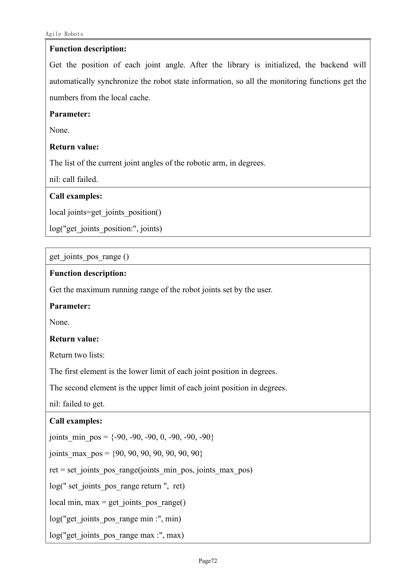



```
Agile Robots 
Page72 
Function description: 
Get the position of each joint angle. After the library is initialized, the backend will 
automatically synchronize the robot state information, so all the monitoring functions get the 
numbers from the local cache. 
Parameter: 
None. 
Return value: 
The list of the current joint angles of the robotic arm, in degrees. 
nil: call failed. 
Call examples: 
local joints=get_joints_position() 
log("get_joints_position:", joints) 
 
get_joints_pos_range () 
Function description: 
Get the maximum running range of the robot joints set by the user. 
Parameter: 
None. 
Return value: 
Return two lists: 
The first element is the lower limit of each joint position in degrees. 
The second element is the upper limit of each joint position in degrees. 
nil: failed to get. 
Call examples: 
joints_min_pos = {-90, -90, -90, 0, -90, -90, -90} 
joints_max_pos = {90, 90, 90, 90, 90, 90, 90} 
ret = set_joints_pos_range(joints_min_pos, joints_max_pos) 
log(" set_joints_pos_range return ",  ret) 
local min, max = get_joints_pos_range() 
log("get_joints_pos_range min :", min) 
log("get_joints_pos_range max :", max)
```



## PDF page 74

**Source:** Industrial Lua Programming Manual\_V3.3.0\_EN\_20260117.pdf, original pdf page 74. [Open the corresponding PDF reading-copy page](https://1292444914-files.gitbook.io/~/files/v0/b/gitbook-x-prod.appspot.com/o/spaces%2FtgOfPnscWebs1eh82EKq%2Fuploads%2FU0JYOssuma2RW4Gd2PqT%2Findustrial-lua-programming-manual-v3-3-0-en-20260117-pp-001-184.pdf?alt=media#page=74).



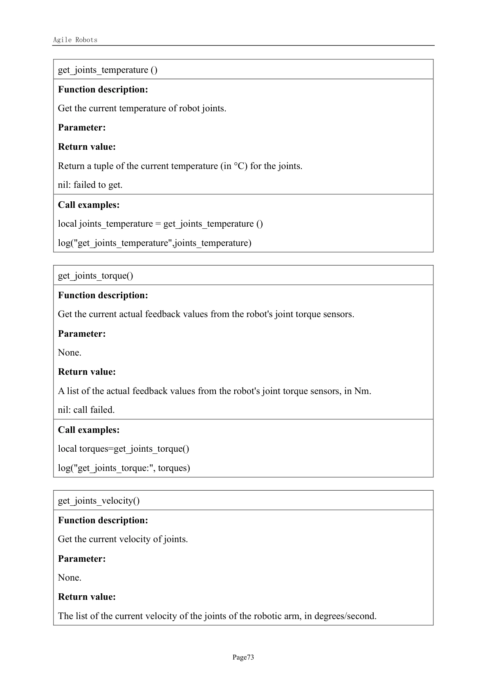



```
Agile Robots 
Page73 
 
get_joints_temperature () 
Function description: 
Get the current temperature of robot joints. 
Parameter: 
Return value: 
Return a tuple of the current temperature (in °C) for the joints. 
nil: failed to get. 
Call examples: 
local joints_temperature = get_joints_temperature () 
log("get_joints_temperature",joints_temperature) 
 
get_joints_torque() 
Function description: 
Get the current actual feedback values from the robot's joint torque sensors. 
Parameter: 
None. 
Return value: 
A list of the actual feedback values from the robot's joint torque sensors, in Nm. 
nil: call failed. 
Call examples: 
local torques=get_joints_torque() 
log("get_joints_torque:", torques) 
 
get_joints_velocity() 
Function description: 
Get the current velocity of joints. 
Parameter: 
None. 
Return value: 
The list of the current velocity of the joints of the robotic arm, in degrees/second.
```



## PDF page 75

**Source:** Industrial Lua Programming Manual\_V3.3.0\_EN\_20260117.pdf, original pdf page 75. [Open the corresponding PDF reading-copy page](https://1292444914-files.gitbook.io/~/files/v0/b/gitbook-x-prod.appspot.com/o/spaces%2FtgOfPnscWebs1eh82EKq%2Fuploads%2FU0JYOssuma2RW4Gd2PqT%2Findustrial-lua-programming-manual-v3-3-0-en-20260117-pp-001-184.pdf?alt=media#page=75).



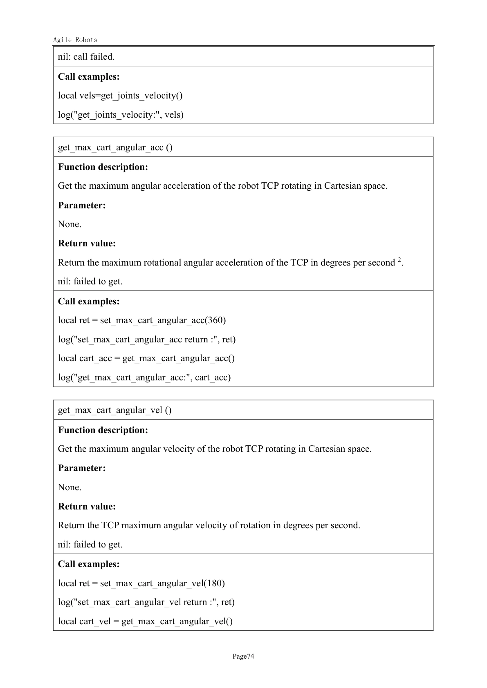



```
Agile Robots 
Page74 
nil: call failed. 
Call examples: 
local vels=get_joints_velocity() 
log("get_joints_velocity:", vels) 
 
get_max_cart_angular_acc () 
Function description: 
Get the maximum angular acceleration of the robot TCP rotating in Cartesian space. 
Parameter: 
None. 
Return value: 
Return the maximum rotational angular acceleration of the TCP in degrees per second 2. 
nil: failed to get. 
Call examples: 
local ret = set_max_cart_angular_acc(360) 
log("set_max_cart_angular_acc return :", ret) 
local cart_acc = get_max_cart_angular_acc() 
log("get_max_cart_angular_acc:", cart_acc) 
 
get_max_cart_angular_vel () 
Function description: 
Get the maximum angular velocity of the robot TCP rotating in Cartesian space. 
Parameter: 
None. 
Return value: 
Return the TCP maximum angular velocity of rotation in degrees per second. 
nil: failed to get. 
Call examples: 
local ret = set_max_cart_angular_vel(180) 
log("set_max_cart_angular_vel return :", ret) 
local cart_vel = get_max_cart_angular_vel()
```



## PDF page 76

**Source:** Industrial Lua Programming Manual\_V3.3.0\_EN\_20260117.pdf, original pdf page 76. [Open the corresponding PDF reading-copy page](https://1292444914-files.gitbook.io/~/files/v0/b/gitbook-x-prod.appspot.com/o/spaces%2FtgOfPnscWebs1eh82EKq%2Fuploads%2FU0JYOssuma2RW4Gd2PqT%2Findustrial-lua-programming-manual-v3-3-0-en-20260117-pp-001-184.pdf?alt=media#page=76).



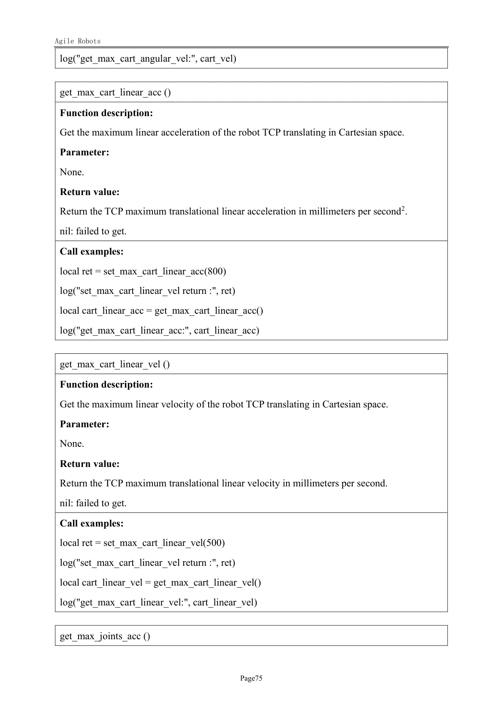



```
Agile Robots 
Page75 
log("get_max_cart_angular_vel:", cart_vel) 
 
get_max_cart_linear_acc () 
Function description: 
Get the maximum linear acceleration of the robot TCP translating in Cartesian space. 
Parameter: 
None. 
Return value: 
Return the TCP maximum translational linear acceleration in millimeters per second2. 
nil: failed to get. 
Call examples: 
local ret = set_max_cart_linear_acc(800) 
log("set_max_cart_linear_vel return :", ret) 
local cart_linear_acc = get_max_cart_linear_acc() 
log("get_max_cart_linear_acc:", cart_linear_acc) 
 
get_max_cart_linear_vel () 
Function description: 
Get the maximum linear velocity of the robot TCP translating in Cartesian space. 
Parameter: 
None. 
Return value: 
Return the TCP maximum translational linear velocity in millimeters per second. 
nil: failed to get. 
Call examples: 
local ret = set_max_cart_linear_vel(500) 
log("set_max_cart_linear_vel return :", ret) 
local cart_linear_vel = get_max_cart_linear_vel() 
log("get_max_cart_linear_vel:", cart_linear_vel) 
 
get_max_joints_acc ()
```



## PDF page 77

**Source:** Industrial Lua Programming Manual\_V3.3.0\_EN\_20260117.pdf, original pdf page 77. [Open the corresponding PDF reading-copy page](https://1292444914-files.gitbook.io/~/files/v0/b/gitbook-x-prod.appspot.com/o/spaces%2FtgOfPnscWebs1eh82EKq%2Fuploads%2FU0JYOssuma2RW4Gd2PqT%2Findustrial-lua-programming-manual-v3-3-0-en-20260117-pp-001-184.pdf?alt=media#page=77).



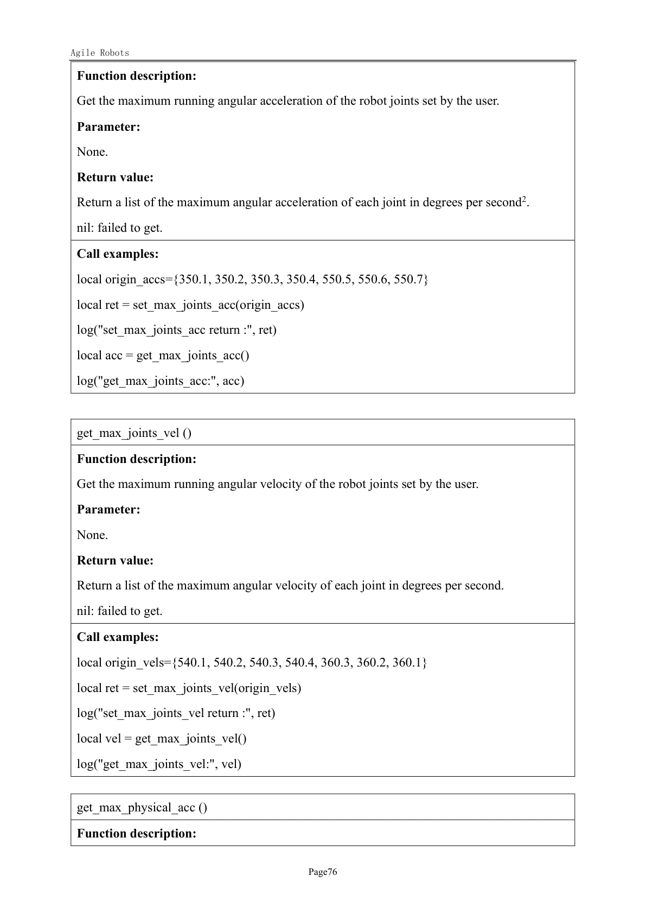



```
Agile Robots 
Page76 
Function description: 
Get the maximum running angular acceleration of the robot joints set by the user. 
Parameter: 
None. 
Return value: 
Return a list of the maximum angular acceleration of each joint in degrees per second2. 
nil: failed to get. 
Call examples: 
local origin_accs={350.1, 350.2, 350.3, 350.4, 550.5, 550.6, 550.7} 
local ret = set_max_joints_acc(origin_accs) 
log("set_max_joints_acc return :", ret) 
local acc = get_max_joints_acc() 
log("get_max_joints_acc:", acc) 
 
get_max_joints_vel () 
Function description: 
Get the maximum running angular velocity of the robot joints set by the user. 
Parameter: 
None. 
Return value: 
Return a list of the maximum angular velocity of each joint in degrees per second. 
nil: failed to get. 
Call examples: 
local origin_vels={540.1, 540.2, 540.3, 540.4, 360.3, 360.2, 360.1} 
local ret = set_max_joints_vel(origin_vels) 
log("set_max_joints_vel return :", ret) 
local vel = get_max_joints_vel() 
log("get_max_joints_vel:", vel) 
 
get_max_physical_acc () 
Function description:
```



## PDF page 78

**Source:** Industrial Lua Programming Manual\_V3.3.0\_EN\_20260117.pdf, original pdf page 78. [Open the corresponding PDF reading-copy page](https://1292444914-files.gitbook.io/~/files/v0/b/gitbook-x-prod.appspot.com/o/spaces%2FtgOfPnscWebs1eh82EKq%2Fuploads%2FU0JYOssuma2RW4Gd2PqT%2Findustrial-lua-programming-manual-v3-3-0-en-20260117-pp-001-184.pdf?alt=media#page=78).



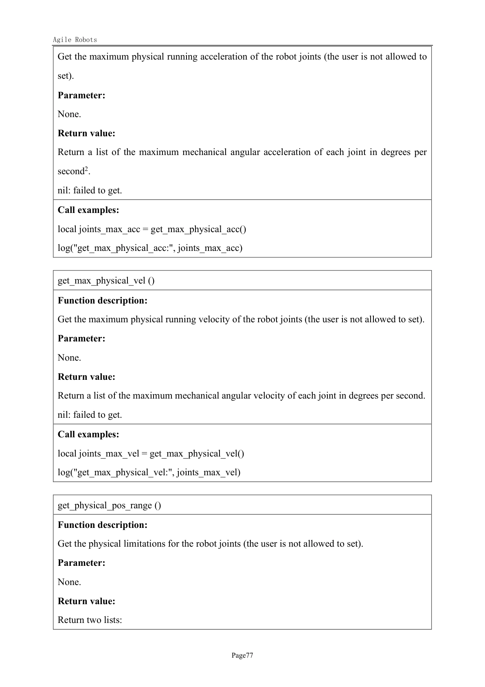



```
Agile Robots 
Page77 
Get the maximum physical running acceleration of the robot joints (the user is not allowed to 
set). 
Parameter: 
None. 
Return value: 
Return a list of the maximum mechanical angular acceleration of each joint in degrees per 
second2. 
nil: failed to get. 
Call examples: 
local joints_max_acc = get_max_physical_acc() 
log("get_max_physical_acc:", joints_max_acc) 
 
get_max_physical_vel () 
Function description: 
Get the maximum physical running velocity of the robot joints (the user is not allowed to set). 
Parameter: 
None. 
Return value: 
Return a list of the maximum mechanical angular velocity of each joint in degrees per second. 
nil: failed to get. 
Call examples: 
local joints_max_vel = get_max_physical_vel() 
log("get_max_physical_vel:", joints_max_vel) 
 
get_physical_pos_range () 
Function description: 
Get the physical limitations for the robot joints (the user is not allowed to set). 
Parameter: 
None. 
Return value: 
Return two lists:
```



## PDF page 79

**Source:** Industrial Lua Programming Manual\_V3.3.0\_EN\_20260117.pdf, original pdf page 79. [Open the corresponding PDF reading-copy page](https://1292444914-files.gitbook.io/~/files/v0/b/gitbook-x-prod.appspot.com/o/spaces%2FtgOfPnscWebs1eh82EKq%2Fuploads%2FU0JYOssuma2RW4Gd2PqT%2Findustrial-lua-programming-manual-v3-3-0-en-20260117-pp-001-184.pdf?alt=media#page=79).



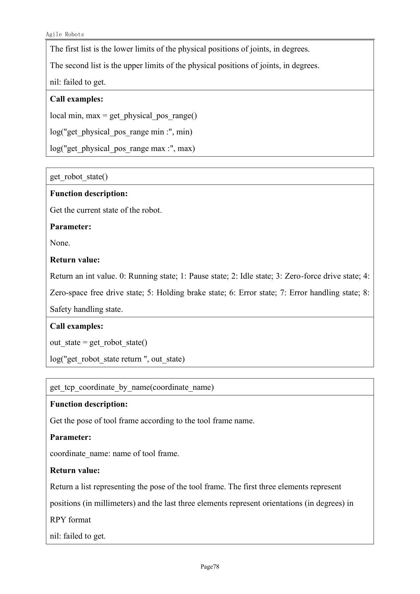



```
Agile Robots 
Page78 
The first list is the lower limits of the physical positions of joints, in degrees. 
The second list is the upper limits of the physical positions of joints, in degrees. 
nil: failed to get. 
Call examples: 
local min, max = get_physical_pos_range() 
log("get_physical_pos_range min :", min) 
log("get_physical_pos_range max :", max) 
 
get_robot_state() 
Function description: 
Get the current state of the robot. 
Parameter: 
None. 
Return value: 
Return an int value. 0: Running state; 1: Pause state; 2: Idle state; 3: Zero-force drive state; 4: 
Zero-space free drive state; 5: Holding brake state; 6: Error state; 7: Error handling state; 8: 
Safety handling state. 
Call examples: 
out_state = get_robot_state() 
log("get_robot_state return ", out_state) 
 
get_tcp_coordinate_by_name(coordinate_name) 
Function description: 
Get the pose of tool frame according to the tool frame name. 
Parameter: 
coordinate_name: name of tool frame. 
Return value: 
Return a list representing the pose of the tool frame. The first three elements represent 
positions (in millimeters) and the last three elements represent orientations (in degrees) in 
RPY format 
nil: failed to get.
```



## PDF page 80

**Source:** Industrial Lua Programming Manual\_V3.3.0\_EN\_20260117.pdf, original pdf page 80. [Open the corresponding PDF reading-copy page](https://1292444914-files.gitbook.io/~/files/v0/b/gitbook-x-prod.appspot.com/o/spaces%2FtgOfPnscWebs1eh82EKq%2Fuploads%2FU0JYOssuma2RW4Gd2PqT%2Findustrial-lua-programming-manual-v3-3-0-en-20260117-pp-001-184.pdf?alt=media#page=80).



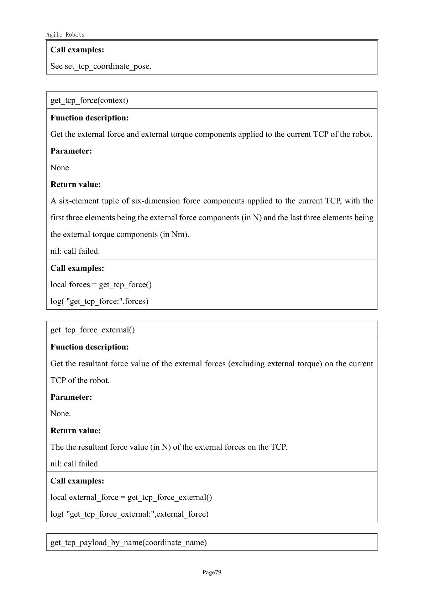



```
Agile Robots 
Page79 
Call examples: 
See set_tcp_coordinate_pose. 
 
 
get_tcp_force_external() 
Function description: 
Get the resultant force value of the external forces (excluding external torque) on the current 
TCP of the robot. 
Parameter: 
None. 
Return value: 
The the resultant force value (in N) of the external forces on the TCP. 
nil: call failed. 
Call examples: 
local external_force = get_tcp_force_external() 
log( "get_tcp_force_external:",external_force) 
 
get_tcp_payload_by_name(coordinate_name) 
get_tcp_force(context) 
Function description: 
Get the external force and external torque components applied to the current TCP of the robot. 
Parameter: 
None. 
Return value: 
A six-element tuple of six-dimension force components applied to the current TCP, with the 
first three elements being the external force components (in N) and the last three elements being 
the external torque components (in Nm). 
nil: call failed. 
Call examples: 
local forces = get_tcp_force() 
log( "get_tcp_force:",forces)
```



## PDF page 81

**Source:** Industrial Lua Programming Manual\_V3.3.0\_EN\_20260117.pdf, original pdf page 81. [Open the corresponding PDF reading-copy page](https://1292444914-files.gitbook.io/~/files/v0/b/gitbook-x-prod.appspot.com/o/spaces%2FtgOfPnscWebs1eh82EKq%2Fuploads%2FU0JYOssuma2RW4Gd2PqT%2Findustrial-lua-programming-manual-v3-3-0-en-20260117-pp-001-184.pdf?alt=media#page=81).



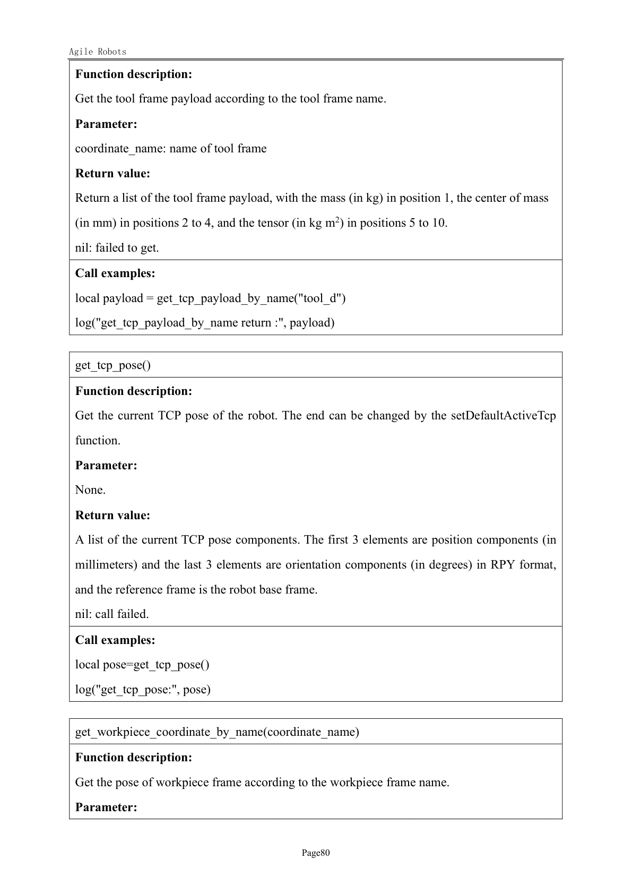



```
Agile Robots 
Page80 
Function description: 
Get the tool frame payload according to the tool frame name. 
Parameter: 
coordinate_name: name of tool frame 
Return value: 
Return a list of the tool frame payload, with the mass (in kg) in position 1, the center of mass 
(in mm) in positions 2 to 4, and the tensor (in kg m2) in positions 5 to 10. 
nil: failed to get. 
Call examples: 
local payload = get_tcp_payload_by_name("tool_d") 
log("get_tcp_payload_by_name return :", payload) 
 
get_tcp_pose() 
Function description: 
Get the current TCP pose of the robot. The end can be changed by the setDefaultActiveTcp 
function. 
Parameter: 
None. 
Return value: 
A list of the current TCP pose components. The first 3 elements are position components (in 
millimeters) and the last 3 elements are orientation components (in degrees) in RPY format, 
and the reference frame is the robot base frame. 
nil: call failed. 
Call examples: 
local pose=get_tcp_pose() 
log("get_tcp_pose:", pose) 
 
get_workpiece_coordinate_by_name(coordinate_name) 
Function description: 
Get the pose of workpiece frame according to the workpiece frame name. 
Parameter:
```



## PDF page 82

**Source:** Industrial Lua Programming Manual\_V3.3.0\_EN\_20260117.pdf, original pdf page 82. [Open the corresponding PDF reading-copy page](https://1292444914-files.gitbook.io/~/files/v0/b/gitbook-x-prod.appspot.com/o/spaces%2FtgOfPnscWebs1eh82EKq%2Fuploads%2FU0JYOssuma2RW4Gd2PqT%2Findustrial-lua-programming-manual-v3-3-0-en-20260117-pp-001-184.pdf?alt=media#page=82).



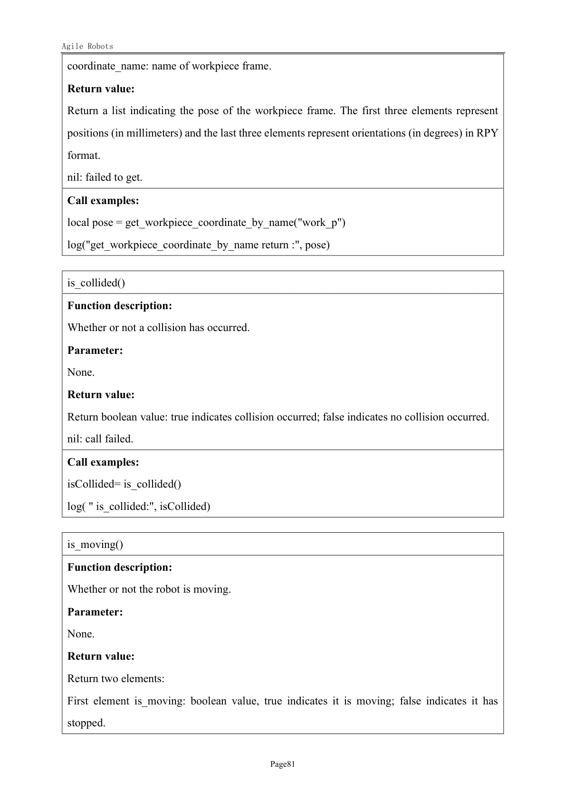



```
Agile Robots 
Page81 
coordinate_name: name of workpiece frame. 
Return value: 
Return a list indicating the pose of the workpiece frame. The first three elements represent 
positions (in millimeters) and the last three elements represent orientations (in degrees) in RPY 
format. 
nil: failed to get. 
Call examples: 
local pose = get_workpiece_coordinate_by_name("work_p") 
log("get_workpiece_coordinate_by_name return :", pose) 
 
is_collided() 
Function description: 
Whether or not a collision has occurred. 
Parameter: 
None. 
Return value: 
Return boolean value: true indicates collision occurred; false indicates no collision occurred. 
nil: call failed. 
Call examples: 
isCollided= is_collided() 
log( " is_collided:", isCollided) 
 
is_moving() 
Function description: 
Whether or not the robot is moving. 
Parameter: 
None. 
Return value: 
Return two elements: 
First element is_moving: boolean value, true indicates it is moving; false indicates it has 
stopped.
```



## PDF page 83

**Source:** Industrial Lua Programming Manual\_V3.3.0\_EN\_20260117.pdf, original pdf page 83. [Open the corresponding PDF reading-copy page](https://1292444914-files.gitbook.io/~/files/v0/b/gitbook-x-prod.appspot.com/o/spaces%2FtgOfPnscWebs1eh82EKq%2Fuploads%2FU0JYOssuma2RW4Gd2PqT%2Findustrial-lua-programming-manual-v3-3-0-en-20260117-pp-001-184.pdf?alt=media#page=83).



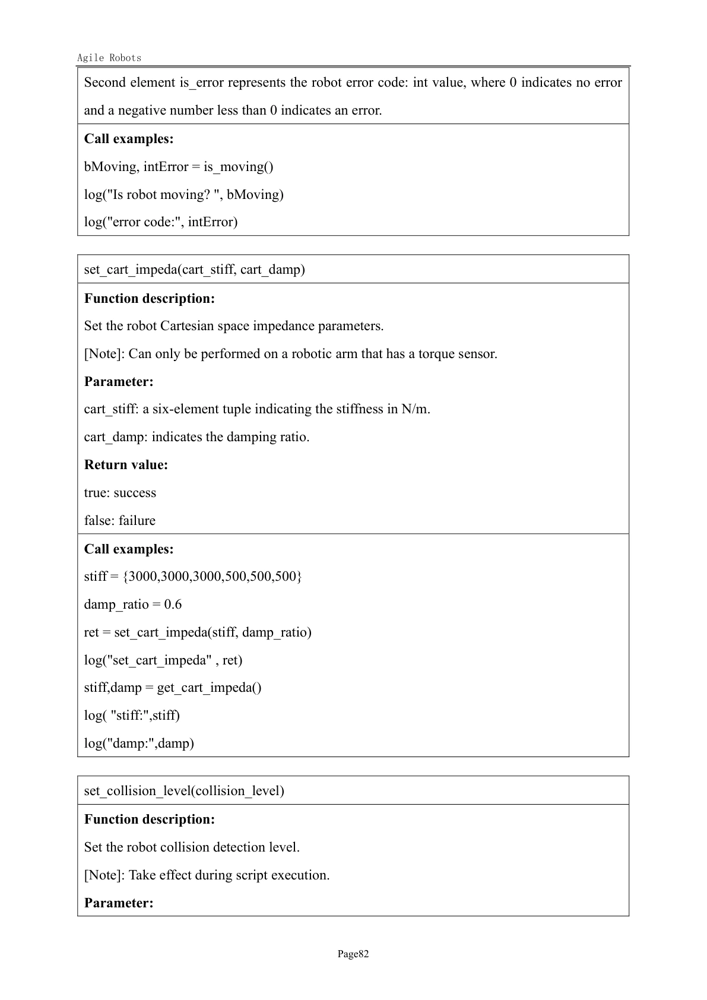



```
Agile Robots 
Page82 
Second element is_error represents the robot error code: int value, where 0 indicates no error 
and a negative number less than 0 indicates an error. 
Call examples: 
bMoving, intError = is_moving() 
log("Is robot moving? ", bMoving) 
log("error code:", intError) 
 
set_cart_impeda(cart_stiff, cart_damp) 
Function description: 
Set the robot Cartesian space impedance parameters. 
[Note]: Can only be performed on a robotic arm that has a torque sensor. 
Parameter: 
cart_stiff: a six-element tuple indicating the stiffness in N/m. 
cart_damp: indicates the damping ratio. 
Return value: 
true: success 
false: failure 
Call examples: 
stiff = {3000,3000,3000,500,500,500} 
damp_ratio = 0.6 
ret = set_cart_impeda(stiff, damp_ratio) 
log("set_cart_impeda" , ret) 
stiff,damp = get_cart_impeda() 
log( "stiff:",stiff) 
log("damp:",damp) 
 
set_collision_level(collision_level) 
Function description: 
Set the robot collision detection level. 
[Note]: Take effect during script execution. 
Parameter:
```



## PDF page 84

**Source:** Industrial Lua Programming Manual\_V3.3.0\_EN\_20260117.pdf, original pdf page 84. [Open the corresponding PDF reading-copy page](https://1292444914-files.gitbook.io/~/files/v0/b/gitbook-x-prod.appspot.com/o/spaces%2FtgOfPnscWebs1eh82EKq%2Fuploads%2FU0JYOssuma2RW4Gd2PqT%2Findustrial-lua-programming-manual-v3-3-0-en-20260117-pp-001-184.pdf?alt=media#page=84).



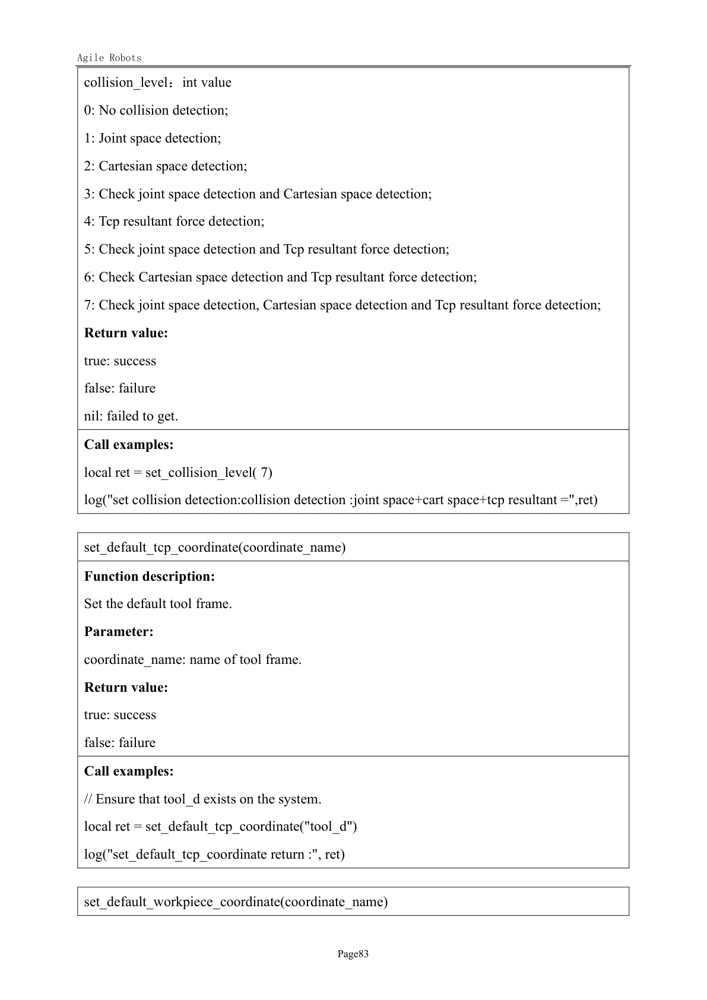



```
Agile Robots 
Page83 
collision_level：int value 
0: No collision detection; 
1: Joint space detection; 
2: Cartesian space detection; 
3: Check joint space detection and Cartesian space detection; 
4: Tcp resultant force detection; 
5: Check joint space detection and Tcp resultant force detection; 
6: Check Cartesian space detection and Tcp resultant force detection; 
7: Check joint space detection, Cartesian space detection and Tcp resultant force detection; 
Return value: 
true: success 
false: failure 
nil: failed to get. 
Call examples: 
local ret = set_collision_level( 7) 
log("set collision detection:collision detection :joint space+cart space+tcp resultant =",ret) 
 
set_default_tcp_coordinate(coordinate_name) 
Function description: 
Set the default tool frame. 
Parameter: 
coordinate_name: name of tool frame. 
Return value: 
true: success 
false: failure 
Call examples: 
// Ensure that tool_d exists on the system. 
local ret = set_default_tcp_coordinate("tool_d") 
log("set_default_tcp_coordinate return :", ret) 
 
set_default_workpiece_coordinate(coordinate_name)
```



## PDF page 85

**Source:** Industrial Lua Programming Manual\_V3.3.0\_EN\_20260117.pdf, original pdf page 85. [Open the corresponding PDF reading-copy page](https://1292444914-files.gitbook.io/~/files/v0/b/gitbook-x-prod.appspot.com/o/spaces%2FtgOfPnscWebs1eh82EKq%2Fuploads%2FU0JYOssuma2RW4Gd2PqT%2Findustrial-lua-programming-manual-v3-3-0-en-20260117-pp-001-184.pdf?alt=media#page=85).



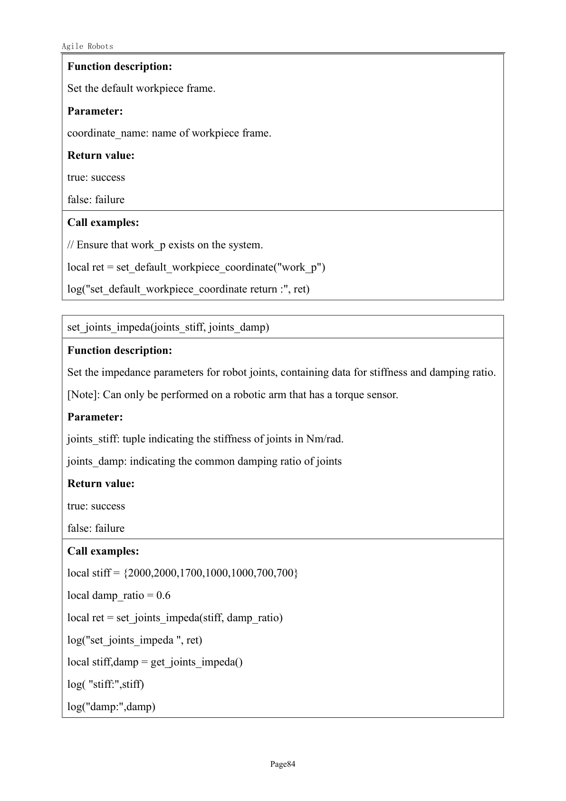



```
Agile Robots 
Page84 
Function description: 
Set the default workpiece frame. 
Parameter: 
coordinate_name: name of workpiece frame. 
Return value: 
true: success 
false: failure 
Call examples: 
// Ensure that work_p exists on the system. 
local ret = set_default_workpiece_coordinate("work_p") 
log("set_default_workpiece_coordinate return :", ret) 
 
set_joints_impeda(joints_stiff, joints_damp) 
Function description: 
Set the impedance parameters for robot joints, containing data for stiffness and damping ratio. 
[Note]: Can only be performed on a robotic arm that has a torque sensor. 
Parameter: 
joints_stiff: tuple indicating the stiffness of joints in Nm/rad. 
joints_damp: indicating the common damping ratio of joints 
Return value: 
true: success 
false: failure 
Call examples: 
local stiff = {2000,2000,1700,1000,1000,700,700} 
local damp_ratio = 0.6  
local ret = set_joints_impeda(stiff, damp_ratio) 
log("set_joints_impeda ", ret) 
local stiff,damp = get_joints_impeda() 
log( "stiff:",stiff) 
log("damp:",damp)
```



## PDF page 86

**Source:** Industrial Lua Programming Manual\_V3.3.0\_EN\_20260117.pdf, original pdf page 86. [Open the corresponding PDF reading-copy page](https://1292444914-files.gitbook.io/~/files/v0/b/gitbook-x-prod.appspot.com/o/spaces%2FtgOfPnscWebs1eh82EKq%2Fuploads%2FU0JYOssuma2RW4Gd2PqT%2Findustrial-lua-programming-manual-v3-3-0-en-20260117-pp-001-184.pdf?alt=media#page=86).



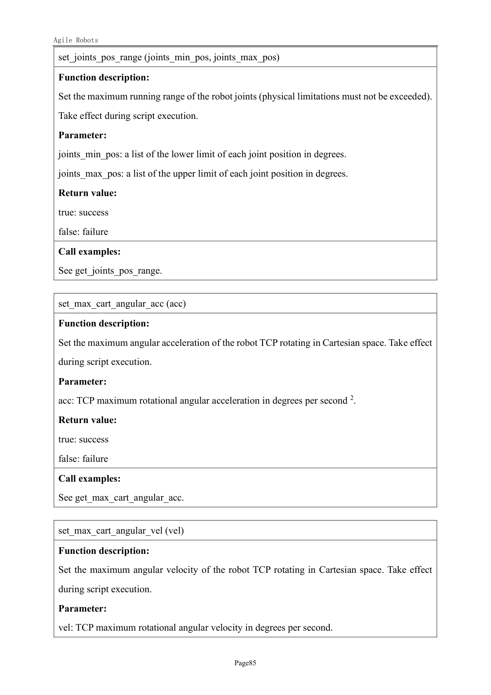



```
Agile Robots 
Page85 
set_joints_pos_range (joints_min_pos, joints_max_pos) 
Function description: 
Set the maximum running range of the robot joints (physical limitations must not be exceeded). 
Take effect during script execution. 
Parameter: 
joints_min_pos: a list of the lower limit of each joint position in degrees. 
joints_max_pos: a list of the upper limit of each joint position in degrees. 
Return value: 
true: success 
false: failure 
Call examples: 
See get_joints_pos_range. 
 
set_max_cart_angular_acc (acc) 
Function description: 
Set the maximum angular acceleration of the robot TCP rotating in Cartesian space. Take effect 
during script execution. 
Parameter: 
acc: TCP maximum rotational angular acceleration in degrees per second 2. 
Return value: 
true: success 
false: failure 
Call examples: 
See get_max_cart_angular_acc. 
 
set_max_cart_angular_vel (vel) 
Function description: 
Set the maximum angular velocity of the robot TCP rotating in Cartesian space. Take effect 
during script execution. 
Parameter: 
vel: TCP maximum rotational angular velocity in degrees per second.
```



**Original document cross-references:** [PDF 73](pages-073-144.md#pdf-page-73) · [PDF 75](pages-073-144.md#pdf-page-75)

## PDF page 87

**Source:** Industrial Lua Programming Manual\_V3.3.0\_EN\_20260117.pdf, original pdf page 87. [Open the corresponding PDF reading-copy page](https://1292444914-files.gitbook.io/~/files/v0/b/gitbook-x-prod.appspot.com/o/spaces%2FtgOfPnscWebs1eh82EKq%2Fuploads%2FU0JYOssuma2RW4Gd2PqT%2Findustrial-lua-programming-manual-v3-3-0-en-20260117-pp-001-184.pdf?alt=media#page=87).



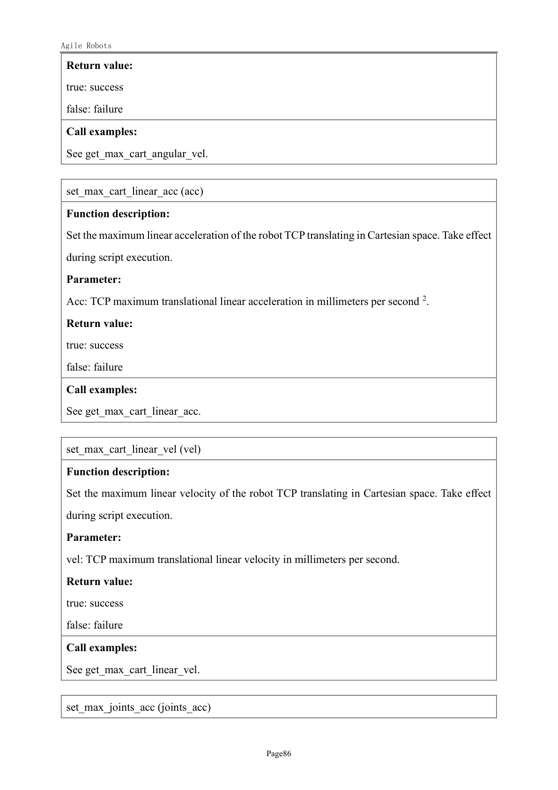



```
Agile Robots 
Page86 
Return value: 
true: success 
false: failure 
Call examples: 
See get_max_cart_angular_vel. 
 
set_max_cart_linear_acc (acc) 
Function description: 
Set the maximum linear acceleration of the robot TCP translating in Cartesian space. Take effect 
during script execution. 
Parameter: 
Acc: TCP maximum translational linear acceleration in millimeters per second 2. 
Return value: 
true: success 
false: failure 
Call examples: 
See get_max_cart_linear_acc. 
 
set_max_cart_linear_vel (vel) 
Function description: 
Set the maximum linear velocity of the robot TCP translating in Cartesian space. Take effect 
during script execution. 
Parameter: 
vel: TCP maximum translational linear velocity in millimeters per second. 
Return value: 
true: success 
false: failure 
Call examples: 
See get_max_cart_linear_vel. 
 
set_max_joints_acc (joints_acc)
```



**Original document cross-references:** [PDF 75](pages-073-144.md#pdf-page-75) · [PDF 76](pages-073-144.md#pdf-page-76)

## PDF page 88

**Source:** Industrial Lua Programming Manual\_V3.3.0\_EN\_20260117.pdf, original pdf page 88. [Open the corresponding PDF reading-copy page](https://1292444914-files.gitbook.io/~/files/v0/b/gitbook-x-prod.appspot.com/o/spaces%2FtgOfPnscWebs1eh82EKq%2Fuploads%2FU0JYOssuma2RW4Gd2PqT%2Findustrial-lua-programming-manual-v3-3-0-en-20260117-pp-001-184.pdf?alt=media#page=88).



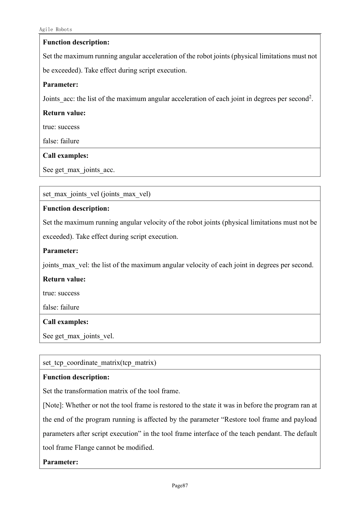



```
Agile Robots 
Page87 
Function description: 
Set the maximum running angular acceleration of the robot joints (physical limitations must not 
be exceeded). Take effect during script execution. 
Parameter: 
Joints_acc: the list of the maximum angular acceleration of each joint in degrees per second2. 
Return value: 
true: success 
false: failure 
Call examples: 
See get_max_joints_acc. 
 
set_max_joints_vel (joints_max_vel) 
Function description: 
Set the maximum running angular velocity of the robot joints (physical limitations must not be 
exceeded). Take effect during script execution. 
Parameter: 
joints_max_vel: the list of the maximum angular velocity of each joint in degrees per second. 
Return value: 
true: success 
false: failure 
Call examples: 
See get_max_joints_vel. 
 
set_tcp_coordinate_matrix(tcp_matrix) 
Function description: 
Set the transformation matrix of the tool frame. 
[Note]: Whether or not the tool frame is restored to the state it was in before the program ran at 
the end of the program running is affected by the parameter “Restore tool frame and payload 
parameters after script execution” in the tool frame interface of the teach pendant. The default 
tool frame Flange cannot be modified. 
Parameter:
```



**Original document cross-references:** [PDF 76](pages-073-144.md#pdf-page-76) · [PDF 77](pages-073-144.md#pdf-page-77)

## PDF page 89

**Source:** Industrial Lua Programming Manual\_V3.3.0\_EN\_20260117.pdf, original pdf page 89. [Open the corresponding PDF reading-copy page](https://1292444914-files.gitbook.io/~/files/v0/b/gitbook-x-prod.appspot.com/o/spaces%2FtgOfPnscWebs1eh82EKq%2Fuploads%2FU0JYOssuma2RW4Gd2PqT%2Findustrial-lua-programming-manual-v3-3-0-en-20260117-pp-001-184.pdf?alt=media#page=89).



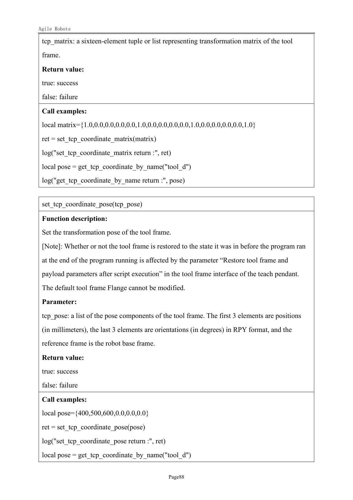



```
Agile Robots 
Page88 
 
set_tcp_coordinate_pose(tcp_pose) 
Function description: 
Set the transformation pose of the tool frame. 
[Note]: Whether or not the tool frame is restored to the state it was in before the program ran 
at the end of the program running is affected by the parameter “Restore tool frame and 
payload parameters after script execution” in the tool frame interface of the teach pendant. 
The default tool frame Flange cannot be modified. 
Parameter: 
tcp_pose: a list of the pose components of the tool frame. The first 3 elements are positions 
(in millimeters), the last 3 elements are orientations (in degrees) in RPY format, and the 
reference frame is the robot base frame. 
Return value: 
true: success 
false: failure 
Call examples: 
local pose={400,500,600,0.0,0.0,0.0} 
ret = set_tcp_coordinate_pose(pose) 
log("set_tcp_coordinate_pose return :", ret) 
local pose = get_tcp_coordinate_by_name("tool_d") 
tcp_matrix: a sixteen-element tuple or list representing transformation matrix of the tool 
frame. 
Return value: 
true: success 
false: failure 
Call examples: 
local matrix={1.0,0.0,0.0,0.0,0.0,1.0,0.0,0.0,0.0,0.0,1.0,0.0,0.0,0.0,0.0,1.0} 
ret = set_tcp_coordinate_matrix(matrix) 
log("set_tcp_coordinate_matrix return :", ret) 
local pose = get_tcp_coordinate_by_name("tool_d") 
log("get_tcp_coordinate_by_name return :", pose)
```



## PDF page 90

**Source:** Industrial Lua Programming Manual\_V3.3.0\_EN\_20260117.pdf, original pdf page 90. [Open the corresponding PDF reading-copy page](https://1292444914-files.gitbook.io/~/files/v0/b/gitbook-x-prod.appspot.com/o/spaces%2FtgOfPnscWebs1eh82EKq%2Fuploads%2FU0JYOssuma2RW4Gd2PqT%2Findustrial-lua-programming-manual-v3-3-0-en-20260117-pp-001-184.pdf?alt=media#page=90).



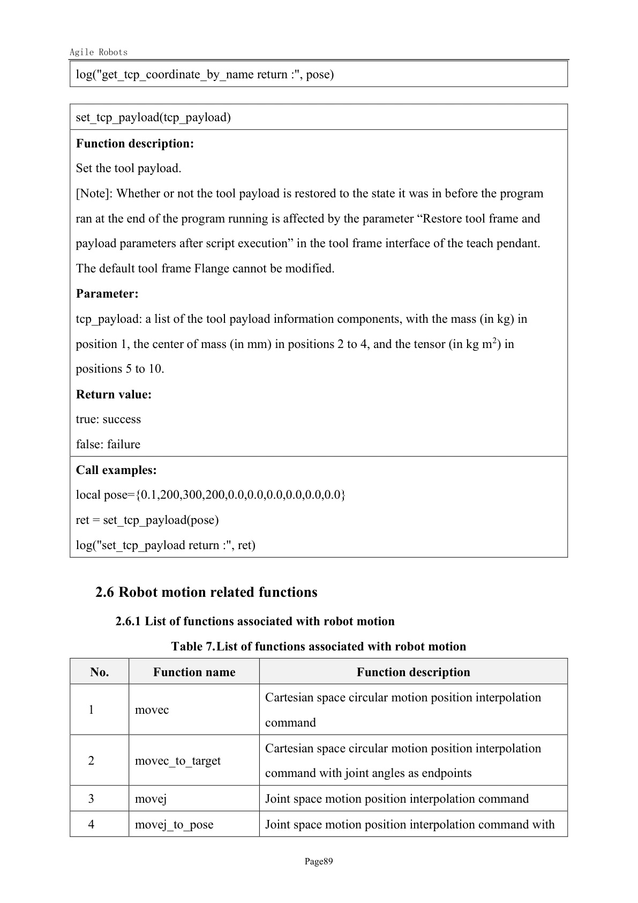



```
Agile Robots 
Page89 
log("get_tcp_coordinate_by_name return :", pose) 
 
set_tcp_payload(tcp_payload) 
Function description: 
Set the tool payload. 
[Note]: Whether or not the tool payload is restored to the state it was in before the program 
ran at the end of the program running is affected by the parameter “Restore tool frame and 
payload parameters after script execution” in the tool frame interface of the teach pendant. 
The default tool frame Flange cannot be modified. 
Parameter: 
tcp_payload: a list of the tool payload information components, with the mass (in kg) in 
position 1, the center of mass (in mm) in positions 2 to 4, and the tensor (in kg m2) in 
positions 5 to 10. 
Return value: 
true: success 
false: failure 
Call examples: 
local pose={0.1,200,300,200,0.0,0.0,0.0,0.0,0.0,0.0} 
ret = set_tcp_payload(pose) 
log("set_tcp_payload return :", ret) 
 
2.6 Robot motion related functions 
2.6.1 List of functions associated with robot motion 
Table 7. List of functions associated with robot motion 
No. 
Function name 
Function description 
1  
movec 
Cartesian space circular motion position interpolation 
command 
2  
movec_to_target 
Cartesian space circular motion position interpolation 
command with joint angles as endpoints 
3  
movej 
Joint space motion position interpolation command 
4  
movej_to_pose 
Joint space motion position interpolation command with
```



**Original document cross-references:** [PDF 91](pages-073-144.md#pdf-page-91) · [PDF 94](pages-073-144.md#pdf-page-94) · [PDF 95](pages-073-144.md#pdf-page-95)

## PDF page 91

**Source:** Industrial Lua Programming Manual\_V3.3.0\_EN\_20260117.pdf, original pdf page 91. [Open the corresponding PDF reading-copy page](https://1292444914-files.gitbook.io/~/files/v0/b/gitbook-x-prod.appspot.com/o/spaces%2FtgOfPnscWebs1eh82EKq%2Fuploads%2FU0JYOssuma2RW4Gd2PqT%2Findustrial-lua-programming-manual-v3-3-0-en-20260117-pp-001-184.pdf?alt=media#page=91).



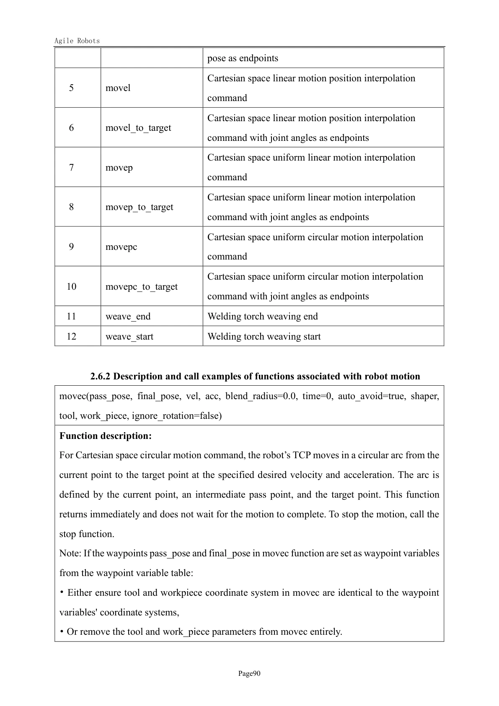



```
Agile Robots 
Page90 
pose as endpoints 
5  
movel 
Cartesian space linear motion position interpolation 
command 
6  
movel_to_target 
Cartesian space linear motion position interpolation 
command with joint angles as endpoints 
7  
movep 
Cartesian space uniform linear motion interpolation 
command 
8  
movep_to_target 
Cartesian space uniform linear motion interpolation 
command with joint angles as endpoints 
9  
movepc 
Cartesian space uniform circular motion interpolation 
command 
10 
movepc_to_target 
Cartesian space uniform circular motion interpolation 
command with joint angles as endpoints 
11 
weave_end 
Welding torch weaving end 
12 
weave_start 
Welding torch weaving start 
 
2.6.2 Description and call examples of functions associated with robot motion 
movec(pass_pose, final_pose, vel, acc, blend_radius=0.0, time=0, auto_avoid=true, shaper, 
tool, work_piece, ignore_rotation=false) 
Function description: 
For Cartesian space circular motion command, the robot’s TCP moves in a circular arc from the 
current point to the target point at the specified desired velocity and acceleration. The arc is 
defined by the current point, an intermediate pass point, and the target point. This function 
returns immediately and does not wait for the motion to complete. To stop the motion, call the 
stop function. 
Note: If the waypoints pass_pose and final_pose in movec function are set as waypoint variables 
from the waypoint variable table: 
• Either ensure tool and workpiece coordinate system in movec are identical to the waypoint 
variables' coordinate systems, 
• Or remove the tool and work_piece parameters from movec entirely.
```



**Original document cross-references:** [PDF 100](pages-073-144.md#pdf-page-100) · [PDF 101](pages-073-144.md#pdf-page-101) · [PDF 104](pages-073-144.md#pdf-page-104) · [PDF 108](pages-073-144.md#pdf-page-108) · [PDF 109](pages-073-144.md#pdf-page-109) · [PDF 110](pages-073-144.md#pdf-page-110)

## PDF page 92

**Source:** Industrial Lua Programming Manual\_V3.3.0\_EN\_20260117.pdf, original pdf page 92. [Open the corresponding PDF reading-copy page](https://1292444914-files.gitbook.io/~/files/v0/b/gitbook-x-prod.appspot.com/o/spaces%2FtgOfPnscWebs1eh82EKq%2Fuploads%2FU0JYOssuma2RW4Gd2PqT%2Findustrial-lua-programming-manual-v3-3-0-en-20260117-pp-001-184.pdf?alt=media#page=92).



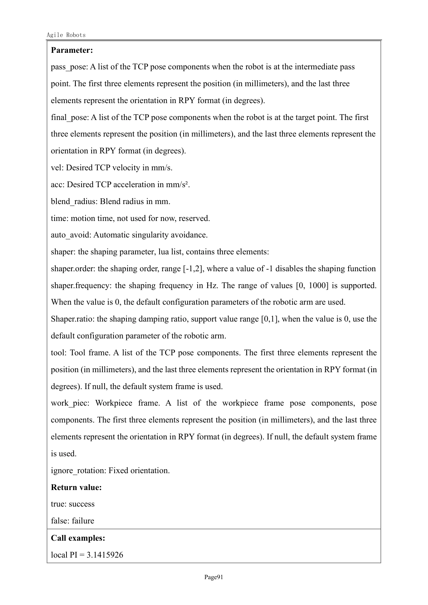



```
Agile Robots 
Page91 
Parameter: 
pass_pose: A list of the TCP pose components when the robot is at the intermediate pass 
point. The first three elements represent the position (in millimeters), and the last three 
elements represent the orientation in RPY format (in degrees). 
final_pose: A list of the TCP pose components when the robot is at the target point. The first 
three elements represent the position (in millimeters), and the last three elements represent the 
orientation in RPY format (in degrees). 
vel: Desired TCP velocity in mm/s. 
acc: Desired TCP acceleration in mm/s². 
blend_radius: Blend radius in mm. 
time: motion time, not used for now, reserved. 
auto_avoid: Automatic singularity avoidance. 
shaper: the shaping parameter, lua list, contains three elements: 
shaper.order: the shaping order, range [-1,2], where a value of -1 disables the shaping function 
shaper.frequency: the shaping frequency in Hz. The range of values [0, 1000] is supported. 
When the value is 0, the default configuration parameters of the robotic arm are used. 
Shaper.ratio: the shaping damping ratio, support value range [0,1], when the value is 0, use the 
default configuration parameter of the robotic arm. 
tool: Tool frame. A list of the TCP pose components. The first three elements represent the 
position (in millimeters), and the last three elements represent the orientation in RPY format (in 
degrees). If null, the default system frame is used. 
work_piec: Workpiece frame. A list of the workpiece frame pose components, pose 
components. The first three elements represent the position (in millimeters), and the last three 
elements represent the orientation in RPY format (in degrees). If null, the default system frame 
is used. 
ignore_rotation: Fixed orientation. 
Return value: 
true: success 
false: failure 
Call examples: 
local PI = 3.1415926
```



## PDF page 93

**Source:** Industrial Lua Programming Manual\_V3.3.0\_EN\_20260117.pdf, original pdf page 93. [Open the corresponding PDF reading-copy page](https://1292444914-files.gitbook.io/~/files/v0/b/gitbook-x-prod.appspot.com/o/spaces%2FtgOfPnscWebs1eh82EKq%2Fuploads%2FU0JYOssuma2RW4Gd2PqT%2Findustrial-lua-programming-manual-v3-3-0-en-20260117-pp-001-184.pdf?alt=media#page=93).



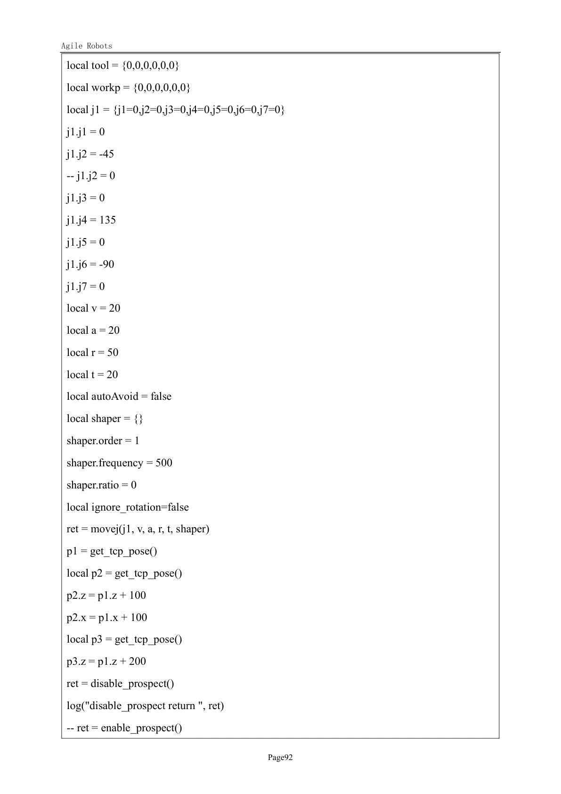



```
Agile Robots 
Page92 
local tool = {0,0,0,0,0,0} 
local workp = {0,0,0,0,0,0} 
local j1 = {j1=0,j2=0,j3=0,j4=0,j5=0,j6=0,j7=0} 
j1.j1 = 0 
j1.j2 = -45 
-- j1.j2 = 0 
j1.j3 = 0 
j1.j4 = 135 
j1.j5 = 0 
j1.j6 = -90 
j1.j7 = 0 
local v = 20 
local a = 20 
local r = 50 
local t = 20 
local autoAvoid = false 
local shaper = {} 
shaper.order = 1 
shaper.frequency = 500 
shaper.ratio = 0 
local ignore_rotation=false 
ret = movej(j1, v, a, r, t, shaper) 
p1 = get_tcp_pose() 
local p2 = get_tcp_pose() 
p2.z = p1.z + 100 
p2.x = p1.x + 100 
local p3 = get_tcp_pose() 
p3.z = p1.z + 200 
ret = disable_prospect() 
log("disable_prospect return ", ret) 
-- ret = enable_prospect()
```



## PDF page 94

**Source:** Industrial Lua Programming Manual\_V3.3.0\_EN\_20260117.pdf, original pdf page 94. [Open the corresponding PDF reading-copy page](https://1292444914-files.gitbook.io/~/files/v0/b/gitbook-x-prod.appspot.com/o/spaces%2FtgOfPnscWebs1eh82EKq%2Fuploads%2FU0JYOssuma2RW4Gd2PqT%2Findustrial-lua-programming-manual-v3-3-0-en-20260117-pp-001-184.pdf?alt=media#page=94).



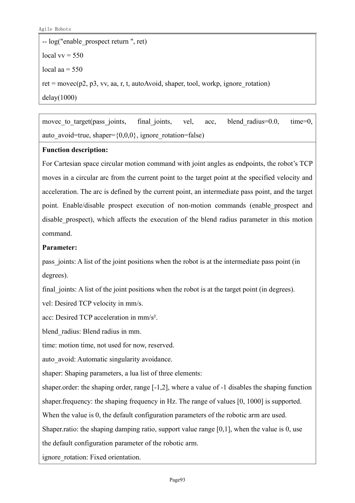



```
Agile Robots 
Page93 
-- log("enable_prospect return ", ret) 
local vv = 550 
local aa = 550 
ret = movec(p2, p3, vv, aa, r, t, autoAvoid, shaper, tool, workp, ignore_rotation) 
delay(1000) 
 
movec_to_target(pass_joints, 
final_joints, 
vel, 
acc, 
blend_radius=0.0, 
time=0, 
auto_avoid=true, shaper={0,0,0}, ignore_rotation=false) 
Function description: 
For Cartesian space circular motion command with joint angles as endpoints, the robot’s TCP 
moves in a circular arc from the current point to the target point at the specified velocity and 
acceleration. The arc is defined by the current point, an intermediate pass point, and the target 
point. Enable/disable prospect execution of non-motion commands (enable_prospect and 
disable_prospect), which affects the execution of the blend radius parameter in this motion 
command. 
Parameter: 
pass_joints: A list of the joint positions when the robot is at the intermediate pass point (in 
degrees). 
final_joints: A list of the joint positions when the robot is at the target point (in degrees). 
vel: Desired TCP velocity in mm/s. 
acc: Desired TCP acceleration in mm/s². 
blend_radius: Blend radius in mm. 
time: motion time, not used for now, reserved. 
auto_avoid: Automatic singularity avoidance. 
shaper: Shaping parameters, a lua list of three elements: 
shaper.order: the shaping order, range [-1,2], where a value of -1 disables the shaping function 
shaper.frequency: the shaping frequency in Hz. The range of values [0, 1000] is supported. 
When the value is 0, the default configuration parameters of the robotic arm are used. 
Shaper.ratio: the shaping damping ratio, support value range [0,1], when the value is 0, use 
the default configuration parameter of the robotic arm. 
ignore_rotation: Fixed orientation.
```



## PDF page 95

**Source:** Industrial Lua Programming Manual\_V3.3.0\_EN\_20260117.pdf, original pdf page 95. [Open the corresponding PDF reading-copy page](https://1292444914-files.gitbook.io/~/files/v0/b/gitbook-x-prod.appspot.com/o/spaces%2FtgOfPnscWebs1eh82EKq%2Fuploads%2FU0JYOssuma2RW4Gd2PqT%2Findustrial-lua-programming-manual-v3-3-0-en-20260117-pp-001-184.pdf?alt=media#page=95).



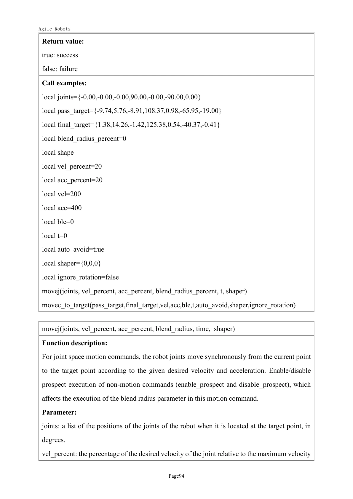



```
Agile Robots 
Page94 
Return value: 
true: success 
false: failure 
Call examples: 
local joints={-0.00,-0.00,-0.00,90.00,-0.00,-90.00,0.00} 
local pass_target={-9.74,5.76,-8.91,108.37,0.98,-65.95,-19.00} 
local final_target={1.38,14.26,-1.42,125.38,0.54,-40.37,-0.41} 
local blend_radius_percent=0 
local shape 
local vel_percent=20 
local acc_percent=20 
local vel=200 
local acc=400 
local ble=0 
local t=0 
local auto_avoid=true 
local shaper={0,0,0} 
local ignore_rotation=false 
movej(joints, vel_percent, acc_percent, blend_radius_percent, t, shaper) 
movec_to_target(pass_target,final_target,vel,acc,ble,t,auto_avoid,shaper,ignore_rotation) 
 
movej(joints, vel_percent, acc_percent, blend_radius, time,  shaper) 
Function description: 
For joint space motion commands, the robot joints move synchronously from the current point 
to the target point according to the given desired velocity and acceleration. Enable/disable 
prospect execution of non-motion commands (enable_prospect and disable_prospect), which 
affects the execution of the blend radius parameter in this motion command. 
Parameter: 
joints: a list of the positions of the joints of the robot when it is located at the target point, in 
degrees. 
vel_percent: the percentage of the desired velocity of the joint relative to the maximum velocity
```



## PDF page 96

**Source:** Industrial Lua Programming Manual\_V3.3.0\_EN\_20260117.pdf, original pdf page 96. [Open the corresponding PDF reading-copy page](https://1292444914-files.gitbook.io/~/files/v0/b/gitbook-x-prod.appspot.com/o/spaces%2FtgOfPnscWebs1eh82EKq%2Fuploads%2FU0JYOssuma2RW4Gd2PqT%2Findustrial-lua-programming-manual-v3-3-0-en-20260117-pp-001-184.pdf?alt=media#page=96).



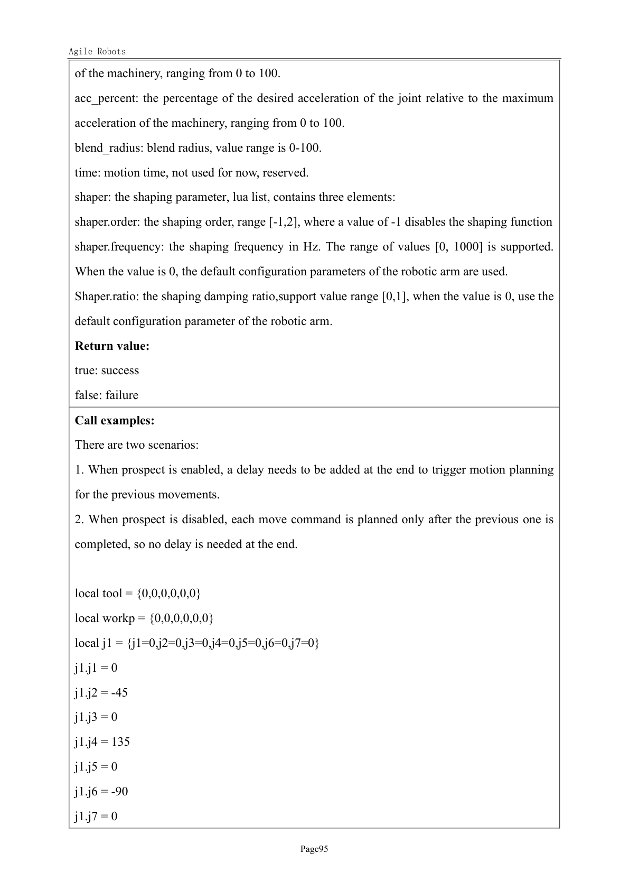



```
Agile Robots 
Page95 
of the machinery, ranging from 0 to 100. 
acc_percent: the percentage of the desired acceleration of the joint relative to the maximum 
acceleration of the machinery, ranging from 0 to 100. 
blend_radius: blend radius, value range is 0-100. 
time: motion time, not used for now, reserved. 
shaper: the shaping parameter, lua list, contains three elements: 
shaper.order: the shaping order, range [-1,2], where a value of -1 disables the shaping function 
shaper.frequency: the shaping frequency in Hz. The range of values [0, 1000] is supported. 
When the value is 0, the default configuration parameters of the robotic arm are used. 
Shaper.ratio: the shaping damping ratio,support value range [0,1], when the value is 0, use the 
default configuration parameter of the robotic arm. 
Return value: 
true: success 
false: failure 
Call examples: 
There are two scenarios: 
1. When prospect is enabled, a delay needs to be added at the end to trigger motion planning 
for the previous movements. 
2. When prospect is disabled, each move command is planned only after the previous one is 
completed, so no delay is needed at the end. 
 
local tool = {0,0,0,0,0,0} 
local workp = {0,0,0,0,0,0} 
local j1 = {j1=0,j2=0,j3=0,j4=0,j5=0,j6=0,j7=0} 
j1.j1 = 0 
j1.j2 = -45 
j1.j3 = 0 
j1.j4 = 135 
j1.j5 = 0 
j1.j6 = -90 
j1.j7 = 0
```



## PDF page 97

**Source:** Industrial Lua Programming Manual\_V3.3.0\_EN\_20260117.pdf, original pdf page 97. [Open the corresponding PDF reading-copy page](https://1292444914-files.gitbook.io/~/files/v0/b/gitbook-x-prod.appspot.com/o/spaces%2FtgOfPnscWebs1eh82EKq%2Fuploads%2FU0JYOssuma2RW4Gd2PqT%2Findustrial-lua-programming-manual-v3-3-0-en-20260117-pp-001-184.pdf?alt=media#page=97).



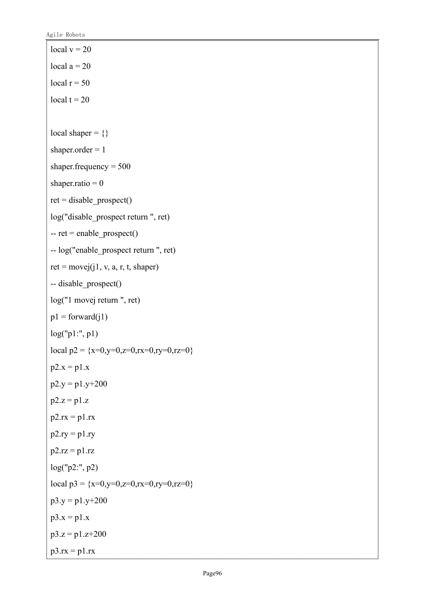



```
Agile Robots 
Page96 
local v = 20 
local a = 20 
local r = 50 
local t = 20 
 
local shaper = {} 
shaper.order = 1 
shaper.frequency = 500 
shaper.ratio = 0 
ret = disable_prospect() 
log("disable_prospect return ", ret) 
-- ret = enable_prospect() 
-- log("enable_prospect return ", ret) 
ret = movej(j1, v, a, r, t, shaper) 
-- disable_prospect() 
log("1 movej return ", ret) 
p1 = forward(j1) 
log("p1:", p1) 
local p2 = {x=0,y=0,z=0,rx=0,ry=0,rz=0} 
p2.x = p1.x 
p2.y = p1.y+200 
p2.z = p1.z 
p2.rx = p1.rx 
p2.ry = p1.ry 
p2.rz = p1.rz 
log("p2:", p2) 
local p3 = {x=0,y=0,z=0,rx=0,ry=0,rz=0} 
p3.y = p1.y+200 
p3.x = p1.x 
p3.z = p1.z+200 
p3.rx = p1.rx
```



## PDF page 98

**Source:** Industrial Lua Programming Manual\_V3.3.0\_EN\_20260117.pdf, original pdf page 98. [Open the corresponding PDF reading-copy page](https://1292444914-files.gitbook.io/~/files/v0/b/gitbook-x-prod.appspot.com/o/spaces%2FtgOfPnscWebs1eh82EKq%2Fuploads%2FU0JYOssuma2RW4Gd2PqT%2Findustrial-lua-programming-manual-v3-3-0-en-20260117-pp-001-184.pdf?alt=media#page=98).



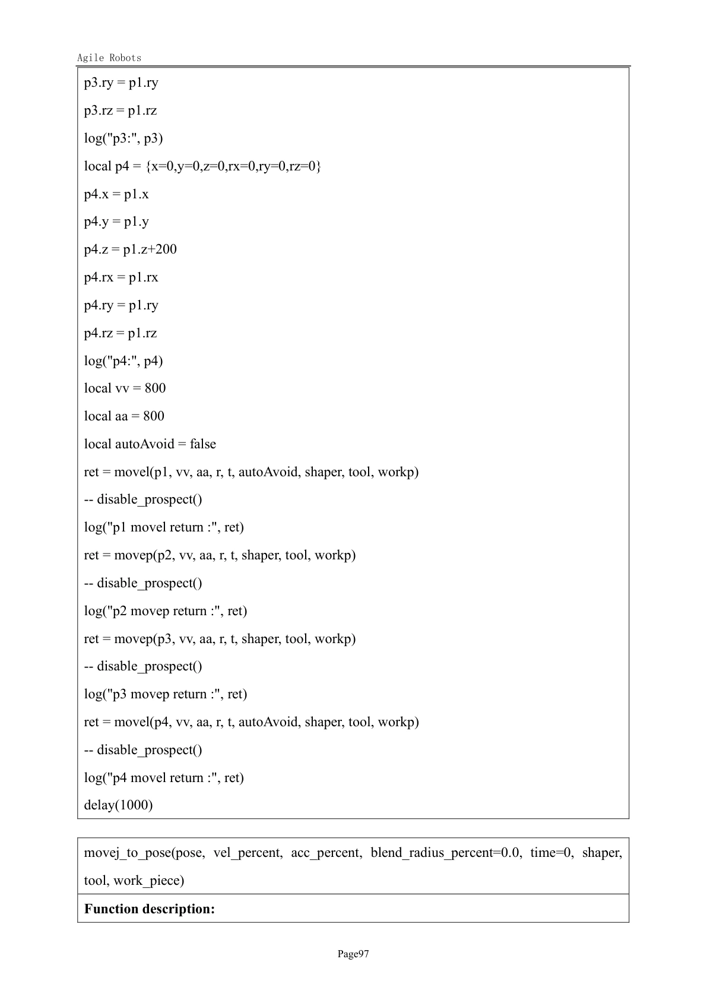



```
Agile Robots 
Page97 
p3.ry = p1.ry 
p3.rz = p1.rz 
log("p3:", p3) 
local p4 = {x=0,y=0,z=0,rx=0,ry=0,rz=0} 
p4.x = p1.x 
p4.y = p1.y 
p4.z = p1.z+200 
p4.rx = p1.rx 
p4.ry = p1.ry 
p4.rz = p1.rz 
log("p4:", p4) 
local vv = 800 
local aa = 800 
local autoAvoid = false 
ret = movel(p1, vv, aa, r, t, autoAvoid, shaper, tool, workp) 
-- disable_prospect() 
log("p1 movel return :", ret) 
ret = movep(p2, vv, aa, r, t, shaper, tool, workp) 
-- disable_prospect() 
log("p2 movep return :", ret) 
ret = movep(p3, vv, aa, r, t, shaper, tool, workp) 
-- disable_prospect() 
log("p3 movep return :", ret) 
ret = movel(p4, vv, aa, r, t, autoAvoid, shaper, tool, workp) 
-- disable_prospect() 
log("p4 movel return :", ret) 
delay(1000) 
 
movej_to_pose(pose, vel_percent, acc_percent, blend_radius_percent=0.0, time=0, shaper, 
tool, work_piece) 
Function description:
```



## PDF page 99

**Source:** Industrial Lua Programming Manual\_V3.3.0\_EN\_20260117.pdf, original pdf page 99. [Open the corresponding PDF reading-copy page](https://1292444914-files.gitbook.io/~/files/v0/b/gitbook-x-prod.appspot.com/o/spaces%2FtgOfPnscWebs1eh82EKq%2Fuploads%2FU0JYOssuma2RW4Gd2PqT%2Findustrial-lua-programming-manual-v3-3-0-en-20260117-pp-001-184.pdf?alt=media#page=99).



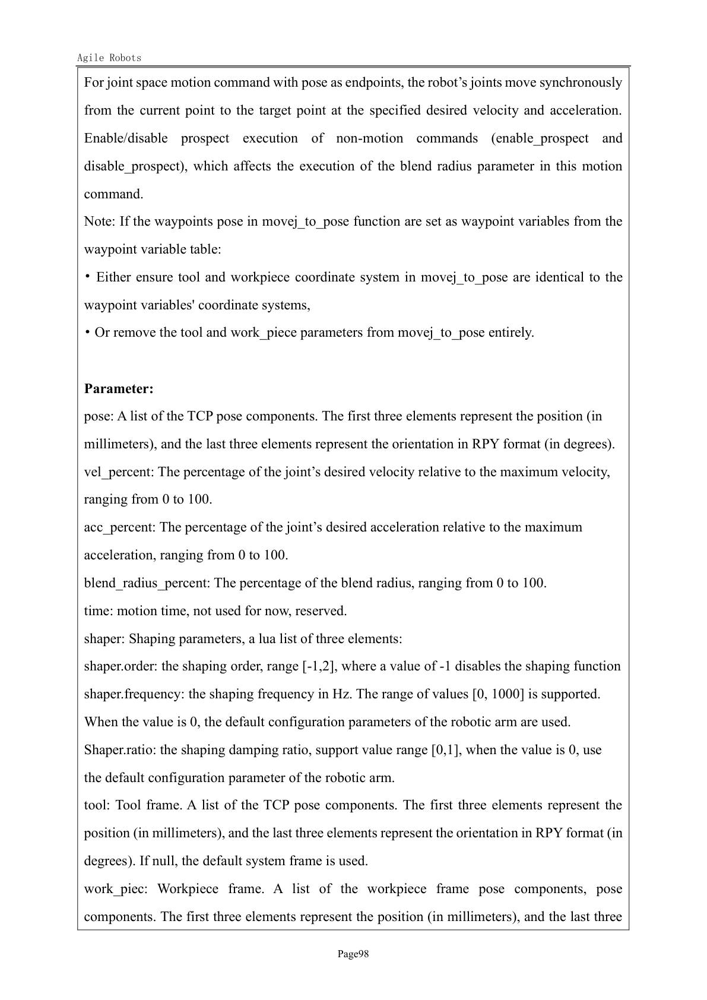



```
Agile Robots 
Page98 
For joint space motion command with pose as endpoints, the robot’s joints move synchronously 
from the current point to the target point at the specified desired velocity and acceleration. 
Enable/disable prospect execution of non-motion commands (enable_prospect and 
disable_prospect), which affects the execution of the blend radius parameter in this motion 
command. 
Note: If the waypoints pose in movej_to_pose function are set as waypoint variables from the 
waypoint variable table: 
• Either ensure tool and workpiece coordinate system in movej_to_pose are identical to the 
waypoint variables' coordinate systems, 
• Or remove the tool and work_piece parameters from movej_to_pose entirely. 
 
Parameter: 
pose: A list of the TCP pose components. The first three elements represent the position (in 
millimeters), and the last three elements represent the orientation in RPY format (in degrees). 
vel_percent: The percentage of the joint’s desired velocity relative to the maximum velocity, 
ranging from 0 to 100. 
acc_percent: The percentage of the joint’s desired acceleration relative to the maximum 
acceleration, ranging from 0 to 100. 
blend_radius_percent: The percentage of the blend radius, ranging from 0 to 100. 
time: motion time, not used for now, reserved. 
shaper: Shaping parameters, a lua list of three elements: 
shaper.order: the shaping order, range [-1,2], where a value of -1 disables the shaping function 
shaper.frequency: the shaping frequency in Hz. The range of values [0, 1000] is supported. 
When the value is 0, the default configuration parameters of the robotic arm are used. 
Shaper.ratio: the shaping damping ratio, support value range [0,1], when the value is 0, use 
the default configuration parameter of the robotic arm. 
tool: Tool frame. A list of the TCP pose components. The first three elements represent the 
position (in millimeters), and the last three elements represent the orientation in RPY format (in 
degrees). If null, the default system frame is used. 
work_piec: Workpiece frame. A list of the workpiece frame pose components, pose 
components. The first three elements represent the position (in millimeters), and the last three
```



## PDF page 100

**Source:** Industrial Lua Programming Manual\_V3.3.0\_EN\_20260117.pdf, original pdf page 100. [Open the corresponding PDF reading-copy page](https://1292444914-files.gitbook.io/~/files/v0/b/gitbook-x-prod.appspot.com/o/spaces%2FtgOfPnscWebs1eh82EKq%2Fuploads%2FU0JYOssuma2RW4Gd2PqT%2Findustrial-lua-programming-manual-v3-3-0-en-20260117-pp-001-184.pdf?alt=media#page=100).



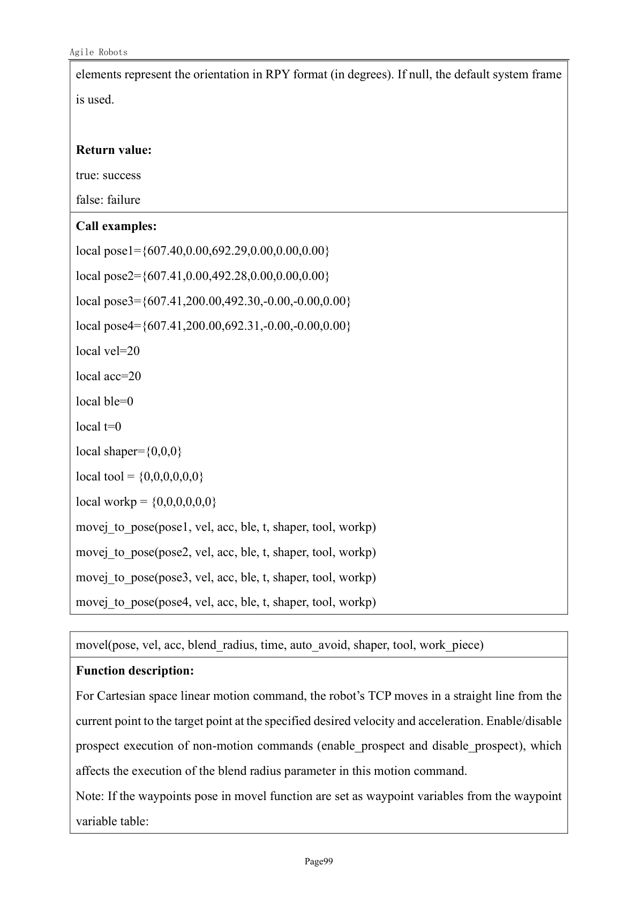



```
Agile Robots 
Page99 
elements represent the orientation in RPY format (in degrees). If null, the default system frame 
is used. 
 
Return value: 
true: success 
false: failure 
Call examples: 
local pose1={607.40,0.00,692.29,0.00,0.00,0.00} 
local pose2={607.41,0.00,492.28,0.00,0.00,0.00} 
local pose3={607.41,200.00,492.30,-0.00,-0.00,0.00} 
local pose4={607.41,200.00,692.31,-0.00,-0.00,0.00} 
local vel=20 
local acc=20 
local ble=0 
local t=0 
local shaper={0,0,0} 
local tool = {0,0,0,0,0,0} 
local workp = {0,0,0,0,0,0} 
movej_to_pose(pose1, vel, acc, ble, t, shaper, tool, workp) 
movej_to_pose(pose2, vel, acc, ble, t, shaper, tool, workp) 
movej_to_pose(pose3, vel, acc, ble, t, shaper, tool, workp) 
movej_to_pose(pose4, vel, acc, ble, t, shaper, tool, workp) 
 
movel(pose, vel, acc, blend_radius, time, auto_avoid, shaper, tool, work_piece) 
Function description: 
For Cartesian space linear motion command, the robot’s TCP moves in a straight line from the 
current point to the target point at the specified desired velocity and acceleration. Enable/disable 
prospect execution of non-motion commands (enable_prospect and disable_prospect), which 
affects the execution of the blend radius parameter in this motion command. 
Note: If the waypoints pose in movel function are set as waypoint variables from the waypoint 
variable table:
```



## PDF page 101

**Source:** Industrial Lua Programming Manual\_V3.3.0\_EN\_20260117.pdf, original pdf page 101. [Open the corresponding PDF reading-copy page](https://1292444914-files.gitbook.io/~/files/v0/b/gitbook-x-prod.appspot.com/o/spaces%2FtgOfPnscWebs1eh82EKq%2Fuploads%2FU0JYOssuma2RW4Gd2PqT%2Findustrial-lua-programming-manual-v3-3-0-en-20260117-pp-001-184.pdf?alt=media#page=101).



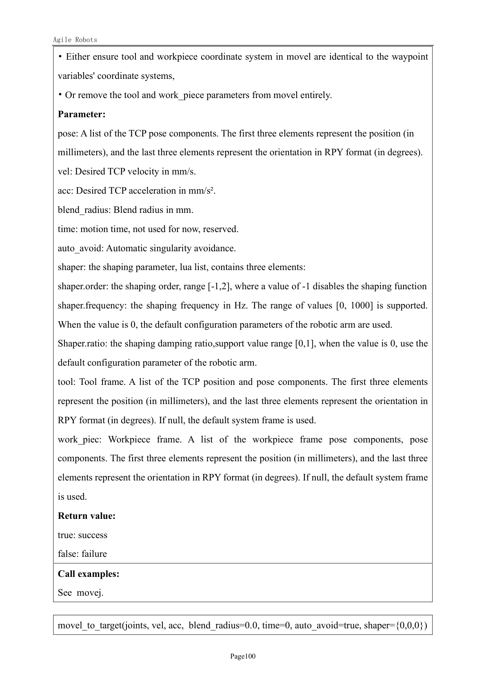



```
Agile Robots 
Page100 
• Either ensure tool and workpiece coordinate system in movel are identical to the waypoint 
variables' coordinate systems, 
• Or remove the tool and work_piece parameters from movel entirely. 
Parameter: 
pose: A list of the TCP pose components. The first three elements represent the position (in 
millimeters), and the last three elements represent the orientation in RPY format (in degrees). 
vel: Desired TCP velocity in mm/s. 
acc: Desired TCP acceleration in mm/s². 
blend_radius: Blend radius in mm. 
time: motion time, not used for now, reserved. 
auto_avoid: Automatic singularity avoidance. 
shaper: the shaping parameter, lua list, contains three elements: 
shaper.order: the shaping order, range [-1,2], where a value of -1 disables the shaping function 
shaper.frequency: the shaping frequency in Hz. The range of values [0, 1000] is supported. 
When the value is 0, the default configuration parameters of the robotic arm are used. 
Shaper.ratio: the shaping damping ratio,support value range [0,1], when the value is 0, use the 
default configuration parameter of the robotic arm. 
tool: Tool frame. A list of the TCP position and pose components. The first three elements 
represent the position (in millimeters), and the last three elements represent the orientation in 
RPY format (in degrees). If null, the default system frame is used. 
work_piec: Workpiece frame. A list of the workpiece frame pose components, pose 
components. The first three elements represent the position (in millimeters), and the last three 
elements represent the orientation in RPY format (in degrees). If null, the default system frame 
is used. 
Return value: 
true: success 
false: failure 
Call examples: 
See  movej.  
 
movel_to_target(joints, vel, acc,  blend_radius=0.0, time=0, auto_avoid=true, shaper={0,0,0})
```



**Original document cross-references:** [PDF 95](pages-073-144.md#pdf-page-95)

## PDF page 102

**Source:** Industrial Lua Programming Manual\_V3.3.0\_EN\_20260117.pdf, original pdf page 102. [Open the corresponding PDF reading-copy page](https://1292444914-files.gitbook.io/~/files/v0/b/gitbook-x-prod.appspot.com/o/spaces%2FtgOfPnscWebs1eh82EKq%2Fuploads%2FU0JYOssuma2RW4Gd2PqT%2Findustrial-lua-programming-manual-v3-3-0-en-20260117-pp-001-184.pdf?alt=media#page=102).



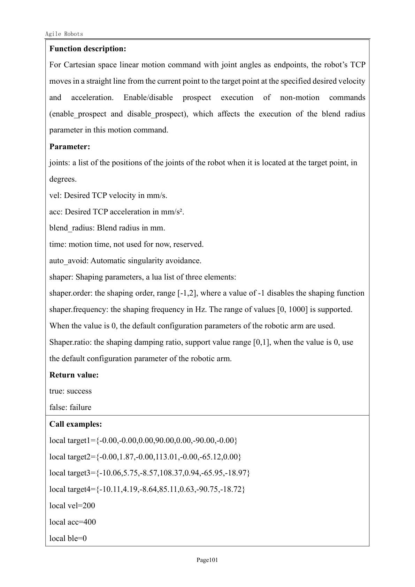



```
Agile Robots 
Page101 
Function description: 
For Cartesian space linear motion command with joint angles as endpoints, the robot’s TCP 
moves in a straight line from the current point to the target point at the specified desired velocity 
and 
acceleration. 
Enable/disable 
prospect 
execution 
of 
non-motion 
commands 
(enable_prospect and disable_prospect), which affects the execution of the blend radius 
parameter in this motion command. 
Parameter: 
joints: a list of the positions of the joints of the robot when it is located at the target point, in 
degrees. 
vel: Desired TCP velocity in mm/s. 
acc: Desired TCP acceleration in mm/s². 
blend_radius: Blend radius in mm. 
time: motion time, not used for now, reserved. 
auto_avoid: Automatic singularity avoidance. 
shaper: Shaping parameters, a lua list of three elements: 
shaper.order: the shaping order, range [-1,2], where a value of -1 disables the shaping function 
shaper.frequency: the shaping frequency in Hz. The range of values [0, 1000] is supported. 
When the value is 0, the default configuration parameters of the robotic arm are used. 
Shaper.ratio: the shaping damping ratio, support value range [0,1], when the value is 0, use 
the default configuration parameter of the robotic arm. 
Return value: 
true: success 
false: failure 
Call examples: 
local target1={-0.00,-0.00,0.00,90.00,0.00,-90.00,-0.00} 
local target2={-0.00,1.87,-0.00,113.01,-0.00,-65.12,0.00} 
local target3={-10.06,5.75,-8.57,108.37,0.94,-65.95,-18.97} 
local target4={-10.11,4.19,-8.64,85.11,0.63,-90.75,-18.72} 
local vel=200 
local acc=400 
local ble=0
```



## PDF page 103

**Source:** Industrial Lua Programming Manual\_V3.3.0\_EN\_20260117.pdf, original pdf page 103. [Open the corresponding PDF reading-copy page](https://1292444914-files.gitbook.io/~/files/v0/b/gitbook-x-prod.appspot.com/o/spaces%2FtgOfPnscWebs1eh82EKq%2Fuploads%2FU0JYOssuma2RW4Gd2PqT%2Findustrial-lua-programming-manual-v3-3-0-en-20260117-pp-001-184.pdf?alt=media#page=103).



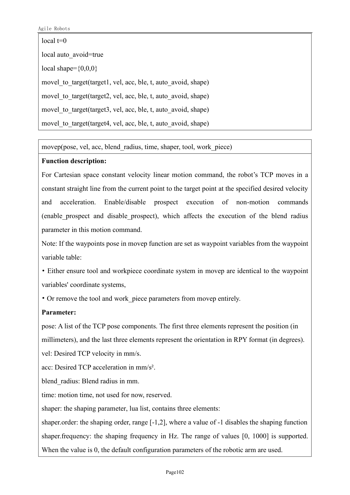



```
Agile Robots 
Page102 
local t=0 
local auto_avoid=true 
local shape={0,0,0} 
movel_to_target(target1, vel, acc, ble, t, auto_avoid, shape) 
movel_to_target(target2, vel, acc, ble, t, auto_avoid, shape) 
movel_to_target(target3, vel, acc, ble, t, auto_avoid, shape) 
movel_to_target(target4, vel, acc, ble, t, auto_avoid, shape) 
 
movep(pose, vel, acc, blend_radius, time, shaper, tool, work_piece) 
Function description: 
For Cartesian space constant velocity linear motion command, the robot’s TCP moves in a 
constant straight line from the current point to the target point at the specified desired velocity 
and 
acceleration. 
Enable/disable 
prospect 
execution 
of 
non-motion 
commands 
(enable_prospect and disable_prospect), which affects the execution of the blend radius 
parameter in this motion command. 
Note: If the waypoints pose in movep function are set as waypoint variables from the waypoint 
variable table: 
• Either ensure tool and workpiece coordinate system in movep are identical to the waypoint 
variables' coordinate systems, 
• Or remove the tool and work_piece parameters from movep entirely. 
Parameter: 
pose: A list of the TCP pose components. The first three elements represent the position (in 
millimeters), and the last three elements represent the orientation in RPY format (in degrees). 
vel: Desired TCP velocity in mm/s. 
acc: Desired TCP acceleration in mm/s². 
blend_radius: Blend radius in mm. 
time: motion time, not used for now, reserved. 
shaper: the shaping parameter, lua list, contains three elements: 
shaper.order: the shaping order, range [-1,2], where a value of -1 disables the shaping function 
shaper.frequency: the shaping frequency in Hz. The range of values [0, 1000] is supported. 
When the value is 0, the default configuration parameters of the robotic arm are used.
```



## PDF page 104

**Source:** Industrial Lua Programming Manual\_V3.3.0\_EN\_20260117.pdf, original pdf page 104. [Open the corresponding PDF reading-copy page](https://1292444914-files.gitbook.io/~/files/v0/b/gitbook-x-prod.appspot.com/o/spaces%2FtgOfPnscWebs1eh82EKq%2Fuploads%2FU0JYOssuma2RW4Gd2PqT%2Findustrial-lua-programming-manual-v3-3-0-en-20260117-pp-001-184.pdf?alt=media#page=104).



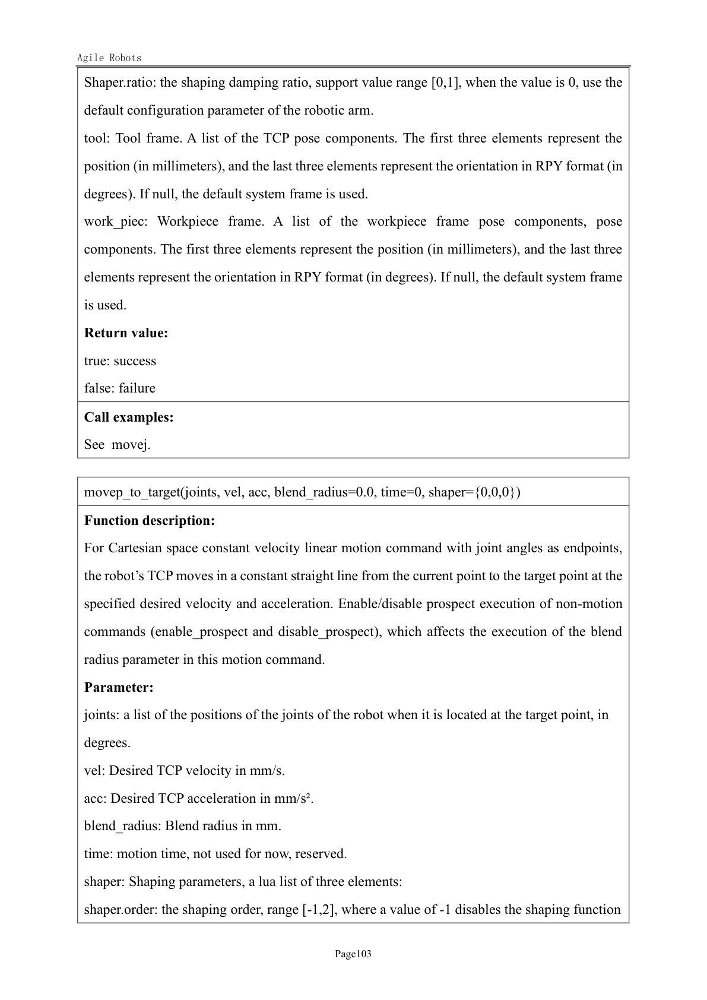



```
Agile Robots 
Page103 
Shaper.ratio: the shaping damping ratio, support value range [0,1], when the value is 0, use the 
default configuration parameter of the robotic arm. 
tool: Tool frame. A list of the TCP pose components. The first three elements represent the 
position (in millimeters), and the last three elements represent the orientation in RPY format (in 
degrees). If null, the default system frame is used. 
work_piec: Workpiece frame. A list of the workpiece frame pose components, pose 
components. The first three elements represent the position (in millimeters), and the last three 
elements represent the orientation in RPY format (in degrees). If null, the default system frame 
is used. 
Return value: 
true: success 
false: failure 
Call examples: 
See  movej. 
 
movep_to_target(joints, vel, acc, blend_radius=0.0, time=0, shaper={0,0,0}) 
Function description: 
For Cartesian space constant velocity linear motion command with joint angles as endpoints, 
the robot’s TCP moves in a constant straight line from the current point to the target point at the 
specified desired velocity and acceleration. Enable/disable prospect execution of non-motion 
commands (enable_prospect and disable_prospect), which affects the execution of the blend 
radius parameter in this motion command. 
Parameter: 
joints: a list of the positions of the joints of the robot when it is located at the target point, in 
degrees. 
vel: Desired TCP velocity in mm/s. 
acc: Desired TCP acceleration in mm/s². 
blend_radius: Blend radius in mm. 
time: motion time, not used for now, reserved. 
shaper: Shaping parameters, a lua list of three elements: 
shaper.order: the shaping order, range [-1,2], where a value of -1 disables the shaping function
```



**Original document cross-references:** [PDF 95](pages-073-144.md#pdf-page-95)

## PDF page 105

**Source:** Industrial Lua Programming Manual\_V3.3.0\_EN\_20260117.pdf, original pdf page 105. [Open the corresponding PDF reading-copy page](https://1292444914-files.gitbook.io/~/files/v0/b/gitbook-x-prod.appspot.com/o/spaces%2FtgOfPnscWebs1eh82EKq%2Fuploads%2FU0JYOssuma2RW4Gd2PqT%2Findustrial-lua-programming-manual-v3-3-0-en-20260117-pp-001-184.pdf?alt=media#page=105).



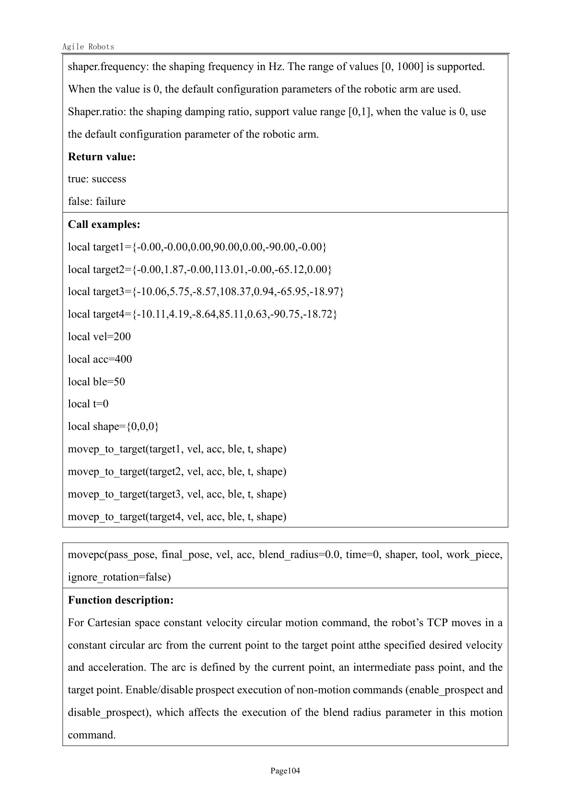



```
Agile Robots 
Page104 
shaper.frequency: the shaping frequency in Hz. The range of values [0, 1000] is supported. 
When the value is 0, the default configuration parameters of the robotic arm are used. 
Shaper.ratio: the shaping damping ratio, support value range [0,1], when the value is 0, use 
the default configuration parameter of the robotic arm. 
Return value: 
true: success 
false: failure 
Call examples: 
local target1={-0.00,-0.00,0.00,90.00,0.00,-90.00,-0.00} 
local target2={-0.00,1.87,-0.00,113.01,-0.00,-65.12,0.00} 
local target3={-10.06,5.75,-8.57,108.37,0.94,-65.95,-18.97} 
local target4={-10.11,4.19,-8.64,85.11,0.63,-90.75,-18.72} 
local vel=200 
local acc=400 
local ble=50 
local t=0 
local shape={0,0,0} 
movep_to_target(target1, vel, acc, ble, t, shape) 
movep_to_target(target2, vel, acc, ble, t, shape) 
movep_to_target(target3, vel, acc, ble, t, shape) 
movep_to_target(target4, vel, acc, ble, t, shape) 
 
movepc(pass_pose, final_pose, vel, acc, blend_radius=0.0, time=0, shaper, tool, work_piece, 
ignore_rotation=false) 
Function description: 
For Cartesian space constant velocity circular motion command, the robot’s TCP moves in a 
constant circular arc from the current point to the target point atthe specified desired velocity 
and acceleration. The arc is defined by the current point, an intermediate pass point, and the 
target point. Enable/disable prospect execution of non-motion commands (enable_prospect and 
disable_prospect), which affects the execution of the blend radius parameter in this motion 
command.
```



## PDF page 106

**Source:** Industrial Lua Programming Manual\_V3.3.0\_EN\_20260117.pdf, original pdf page 106. [Open the corresponding PDF reading-copy page](https://1292444914-files.gitbook.io/~/files/v0/b/gitbook-x-prod.appspot.com/o/spaces%2FtgOfPnscWebs1eh82EKq%2Fuploads%2FU0JYOssuma2RW4Gd2PqT%2Findustrial-lua-programming-manual-v3-3-0-en-20260117-pp-001-184.pdf?alt=media#page=106).



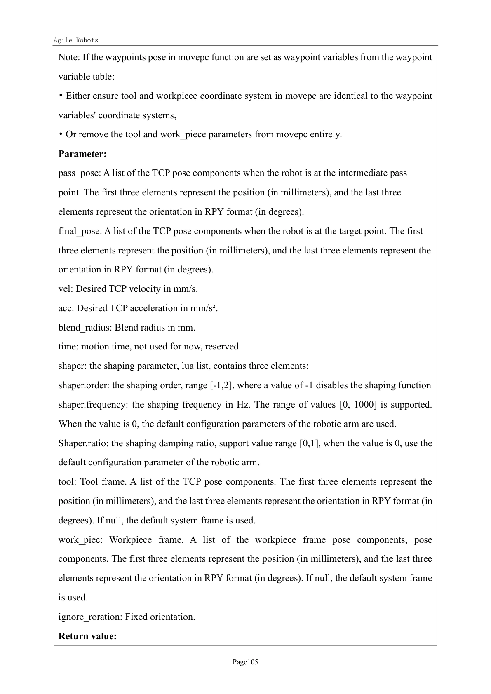



```
Agile Robots 
Page105 
Note: If the waypoints pose in movepc function are set as waypoint variables from the waypoint 
variable table: 
• Either ensure tool and workpiece coordinate system in movepc are identical to the waypoint 
variables' coordinate systems, 
• Or remove the tool and work_piece parameters from movepc entirely. 
Parameter: 
pass_pose: A list of the TCP pose components when the robot is at the intermediate pass 
point. The first three elements represent the position (in millimeters), and the last three 
elements represent the orientation in RPY format (in degrees). 
final_pose: A list of the TCP pose components when the robot is at the target point. The first 
three elements represent the position (in millimeters), and the last three elements represent the 
orientation in RPY format (in degrees). 
vel: Desired TCP velocity in mm/s. 
acc: Desired TCP acceleration in mm/s². 
blend_radius: Blend radius in mm. 
time: motion time, not used for now, reserved. 
shaper: the shaping parameter, lua list, contains three elements: 
shaper.order: the shaping order, range [-1,2], where a value of -1 disables the shaping function 
shaper.frequency: the shaping frequency in Hz. The range of values [0, 1000] is supported. 
When the value is 0, the default configuration parameters of the robotic arm are used. 
Shaper.ratio: the shaping damping ratio, support value range [0,1], when the value is 0, use the 
default configuration parameter of the robotic arm. 
tool: Tool frame. A list of the TCP pose components. The first three elements represent the 
position (in millimeters), and the last three elements represent the orientation in RPY format (in 
degrees). If null, the default system frame is used. 
work_piec: Workpiece frame. A list of the workpiece frame pose components, pose 
components. The first three elements represent the position (in millimeters), and the last three 
elements represent the orientation in RPY format (in degrees). If null, the default system frame 
is used. 
ignore_roration: Fixed orientation. 
Return value:
```



## PDF page 107

**Source:** Industrial Lua Programming Manual\_V3.3.0\_EN\_20260117.pdf, original pdf page 107. [Open the corresponding PDF reading-copy page](https://1292444914-files.gitbook.io/~/files/v0/b/gitbook-x-prod.appspot.com/o/spaces%2FtgOfPnscWebs1eh82EKq%2Fuploads%2FU0JYOssuma2RW4Gd2PqT%2Findustrial-lua-programming-manual-v3-3-0-en-20260117-pp-001-184.pdf?alt=media#page=107).



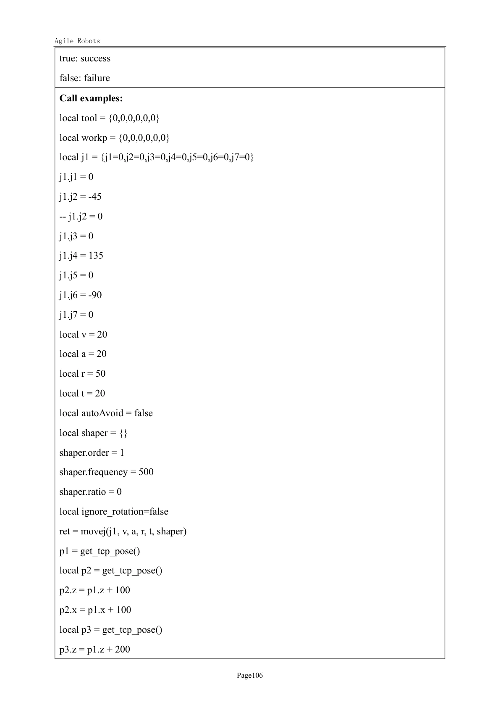



```
Agile Robots 
Page106 
true: success 
false: failure 
Call examples: 
local tool = {0,0,0,0,0,0} 
local workp = {0,0,0,0,0,0} 
local j1 = {j1=0,j2=0,j3=0,j4=0,j5=0,j6=0,j7=0} 
j1.j1 = 0 
j1.j2 = -45 
-- j1.j2 = 0 
j1.j3 = 0 
j1.j4 = 135 
j1.j5 = 0 
j1.j6 = -90 
j1.j7 = 0 
local v = 20 
local a = 20 
local r = 50 
local t = 20 
local autoAvoid = false 
local shaper = {} 
shaper.order = 1 
shaper.frequency = 500 
shaper.ratio = 0 
local ignore_rotation=false 
ret = movej(j1, v, a, r, t, shaper) 
p1 = get_tcp_pose() 
local p2 = get_tcp_pose() 
p2.z = p1.z + 100 
p2.x = p1.x + 100 
local p3 = get_tcp_pose() 
p3.z = p1.z + 200
```



## PDF page 108

**Source:** Industrial Lua Programming Manual\_V3.3.0\_EN\_20260117.pdf, original pdf page 108. [Open the corresponding PDF reading-copy page](https://1292444914-files.gitbook.io/~/files/v0/b/gitbook-x-prod.appspot.com/o/spaces%2FtgOfPnscWebs1eh82EKq%2Fuploads%2FU0JYOssuma2RW4Gd2PqT%2Findustrial-lua-programming-manual-v3-3-0-en-20260117-pp-001-184.pdf?alt=media#page=108).



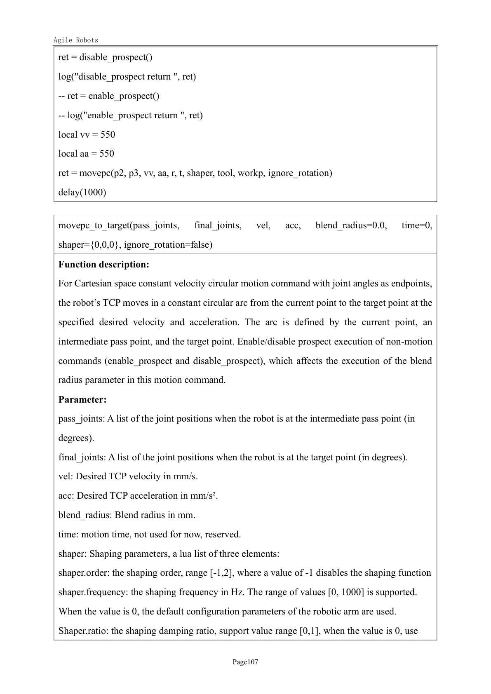



```
Agile Robots 
Page107 
ret = disable_prospect() 
log("disable_prospect return ", ret) 
-- ret = enable_prospect() 
-- log("enable_prospect return ", ret) 
local vv = 550 
local aa = 550 
ret = movepc(p2, p3, vv, aa, r, t, shaper, tool, workp, ignore_rotation) 
delay(1000) 
 
movepc_to_target(pass_joints, 
final_joints, 
vel, 
acc, 
blend_radius=0.0, 
time=0, 
shaper={0,0,0}, ignore_rotation=false) 
Function description: 
For Cartesian space constant velocity circular motion command with joint angles as endpoints, 
the robot’s TCP moves in a constant circular arc from the current point to the target point at the 
specified desired velocity and acceleration. The arc is defined by the current point, an 
intermediate pass point, and the target point. Enable/disable prospect execution of non-motion 
commands (enable_prospect and disable_prospect), which affects the execution of the blend 
radius parameter in this motion command. 
Parameter: 
pass_joints: A list of the joint positions when the robot is at the intermediate pass point (in 
degrees). 
final_joints: A list of the joint positions when the robot is at the target point (in degrees). 
vel: Desired TCP velocity in mm/s. 
acc: Desired TCP acceleration in mm/s². 
blend_radius: Blend radius in mm. 
time: motion time, not used for now, reserved. 
shaper: Shaping parameters, a lua list of three elements: 
shaper.order: the shaping order, range [-1,2], where a value of -1 disables the shaping function 
shaper.frequency: the shaping frequency in Hz. The range of values [0, 1000] is supported. 
When the value is 0, the default configuration parameters of the robotic arm are used. 
Shaper.ratio: the shaping damping ratio, support value range [0,1], when the value is 0, use
```



## PDF page 109

**Source:** Industrial Lua Programming Manual\_V3.3.0\_EN\_20260117.pdf, original pdf page 109. [Open the corresponding PDF reading-copy page](https://1292444914-files.gitbook.io/~/files/v0/b/gitbook-x-prod.appspot.com/o/spaces%2FtgOfPnscWebs1eh82EKq%2Fuploads%2FU0JYOssuma2RW4Gd2PqT%2Findustrial-lua-programming-manual-v3-3-0-en-20260117-pp-001-184.pdf?alt=media#page=109).



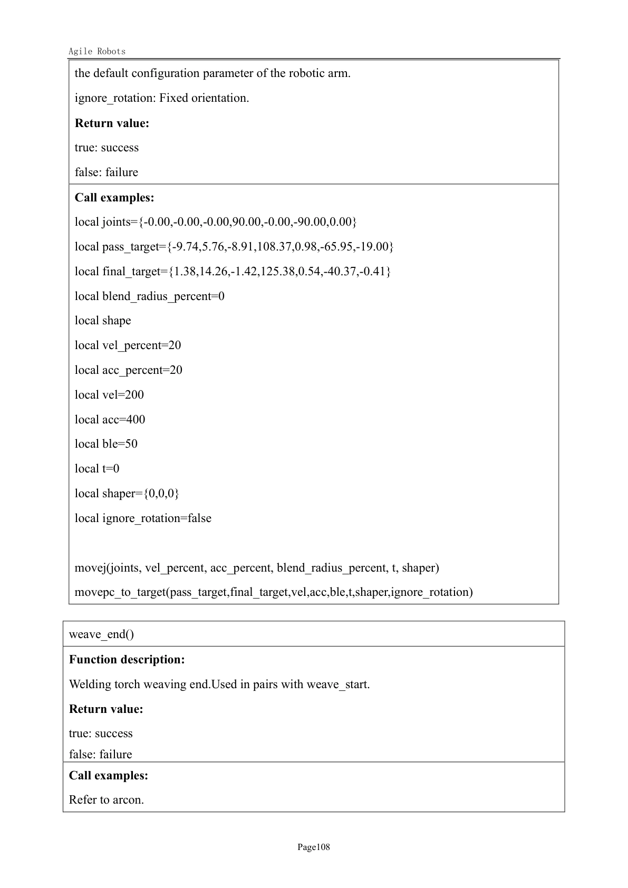



```
Agile Robots 
Page108 
the default configuration parameter of the robotic arm. 
ignore_rotation: Fixed orientation. 
Return value: 
true: success 
false: failure 
Call examples: 
local joints={-0.00,-0.00,-0.00,90.00,-0.00,-90.00,0.00} 
local pass_target={-9.74,5.76,-8.91,108.37,0.98,-65.95,-19.00} 
local final_target={1.38,14.26,-1.42,125.38,0.54,-40.37,-0.41} 
local blend_radius_percent=0 
local shape 
local vel_percent=20 
local acc_percent=20 
local vel=200 
local acc=400 
local ble=50 
local t=0 
local shaper={0,0,0} 
local ignore_rotation=false 
 
movej(joints, vel_percent, acc_percent, blend_radius_percent, t, shaper) 
movepc_to_target(pass_target,final_target,vel,acc,ble,t,shaper,ignore_rotation) 
 
weave_end() 
Function description: 
Welding torch weaving end.Used in pairs with weave_start. 
Return value: 
true: success 
false: failure 
Call examples: 
Refer to arcon.
```



## PDF page 110

**Source:** Industrial Lua Programming Manual\_V3.3.0\_EN\_20260117.pdf, original pdf page 110. [Open the corresponding PDF reading-copy page](https://1292444914-files.gitbook.io/~/files/v0/b/gitbook-x-prod.appspot.com/o/spaces%2FtgOfPnscWebs1eh82EKq%2Fuploads%2FU0JYOssuma2RW4Gd2PqT%2Findustrial-lua-programming-manual-v3-3-0-en-20260117-pp-001-184.pdf?alt=media#page=110).



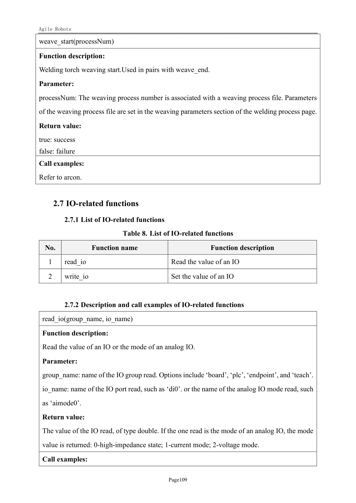



```
Agile Robots 
Page109 
weave_start(processNum) 
Function description: 
Welding torch weaving start.Used in pairs with weave_end. 
Parameter: 
processNum: The weaving process number is associated with a weaving process file. Parameters 
of the weaving process file are set in the weaving parameters section of the welding process page. 
Return value: 
true: success 
false: failure 
Call examples: 
Refer to arcon. 
 
2.7 IO-related functions 
2.7.1 List of IO-related functions 
Table 8. List of IO-related functions 
No. 
Function name 
Function description 
1 
read_io 
Read the value of an IO 
2 
write_io 
Set the value of an IO 
 
2.7.2 Description and call examples of IO-related functions 
read_io(group_name, io_name) 
Function description: 
Read the value of an IO or the mode of an analog IO. 
Parameter: 
group_name: name of the IO group read. Options include ‘board’, ‘plc’, ‘endpoint’, and ‘teach’. 
io_name: name of the IO port read, such as ‘di0’. or the name of the analog IO mode read, such 
as ‘aimode0’. 
Return value: 
The value of the IO read, of type double. If the one read is the mode of an analog IO, the mode 
value is returned: 0-high-impedance state; 1-current mode; 2-voltage mode. 
Call examples:
```



**Original document cross-references:** [PDF 110](pages-073-144.md#pdf-page-110) · [PDF 111](pages-073-144.md#pdf-page-111)

## PDF page 111

**Source:** Industrial Lua Programming Manual\_V3.3.0\_EN\_20260117.pdf, original pdf page 111. [Open the corresponding PDF reading-copy page](https://1292444914-files.gitbook.io/~/files/v0/b/gitbook-x-prod.appspot.com/o/spaces%2FtgOfPnscWebs1eh82EKq%2Fuploads%2FU0JYOssuma2RW4Gd2PqT%2Findustrial-lua-programming-manual-v3-3-0-en-20260117-pp-001-184.pdf?alt=media#page=111).



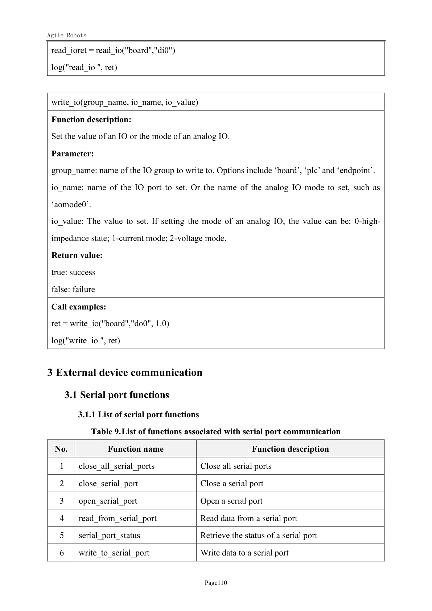



```
Agile Robots 
Page110 
read_ioret = read_io("board","di0") 
log("read_io ", ret) 
 
write_io(group_name, io_name, io_value) 
Function description: 
Set the value of an IO or the mode of an analog IO. 
Parameter: 
group_name: name of the IO group to write to. Options include ‘board’, ‘plc’ and ‘endpoint’. 
io_name: name of the IO port to set. Or the name of the analog IO mode to set, such as 
‘aomode0’. 
io_value: The value to set. If setting the mode of an analog IO, the value can be: 0-high-
impedance state; 1-current mode; 2-voltage mode. 
Return value: 
true: success 
false: failure 
Call examples: 
ret = write_io("board","do0", 1.0) 
log("write_io ", ret) 
 
3 External device communication 
3.1 Serial port functions 
3.1.1 List of serial port functions 
Table 9. List of functions associated with serial port communication 
No. 
Function name 
Function description 
1  
close_all_serial_ports 
Close all serial ports 
2  
close_serial_port 
Close a serial port 
3  
open_serial_port 
Open a serial port 
4  
read_from_serial_port 
Read data from a serial port 
5  
serial_port_status 
Retrieve the status of a serial port 
6  
write_to_serial_port 
Write data to a serial port
```



**Original document cross-references:** [PDF 115](pages-073-144.md#pdf-page-115)

## PDF page 112

**Source:** Industrial Lua Programming Manual\_V3.3.0\_EN\_20260117.pdf, original pdf page 112. [Open the corresponding PDF reading-copy page](https://1292444914-files.gitbook.io/~/files/v0/b/gitbook-x-prod.appspot.com/o/spaces%2FtgOfPnscWebs1eh82EKq%2Fuploads%2FU0JYOssuma2RW4Gd2PqT%2Findustrial-lua-programming-manual-v3-3-0-en-20260117-pp-001-184.pdf?alt=media#page=112).



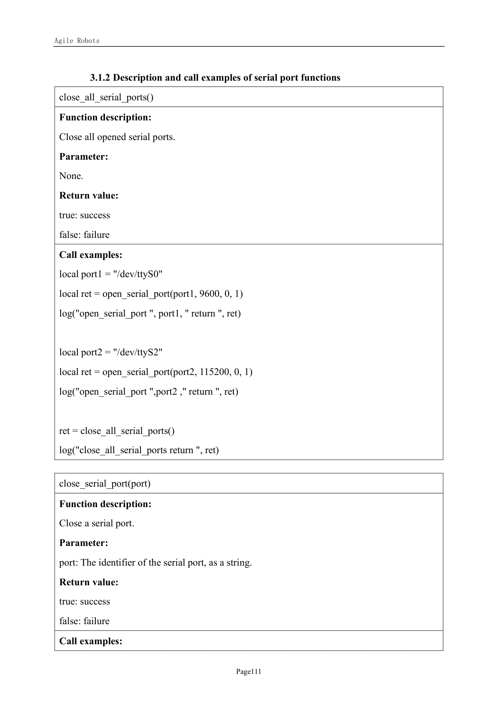



```
Agile Robots 
Page111 
 
3.1.2 Description and call examples of serial port functions 
close_all_serial_ports() 
Function description: 
Close all opened serial ports. 
Parameter: 
None. 
Return value: 
true: success 
false: failure 
Call examples: 
local port1 = "/dev/ttyS0" 
local ret = open_serial_port(port1, 9600, 0, 1) 
log("open_serial_port ", port1, " return ", ret) 
 
local port2 = "/dev/ttyS2" 
local ret = open_serial_port(port2, 115200, 0, 1) 
log("open_serial_port ",port2 ," return ", ret) 
 
ret = close_all_serial_ports() 
log("close_all_serial_ports return ", ret) 
 
close_serial_port(port) 
Function description: 
Close a serial port. 
Parameter: 
port: The identifier of the serial port, as a string. 
Return value: 
true: success 
false: failure 
Call examples:
```



## PDF page 113

**Source:** Industrial Lua Programming Manual\_V3.3.0\_EN\_20260117.pdf, original pdf page 113. [Open the corresponding PDF reading-copy page](https://1292444914-files.gitbook.io/~/files/v0/b/gitbook-x-prod.appspot.com/o/spaces%2FtgOfPnscWebs1eh82EKq%2Fuploads%2FU0JYOssuma2RW4Gd2PqT%2Findustrial-lua-programming-manual-v3-3-0-en-20260117-pp-001-184.pdf?alt=media#page=113).



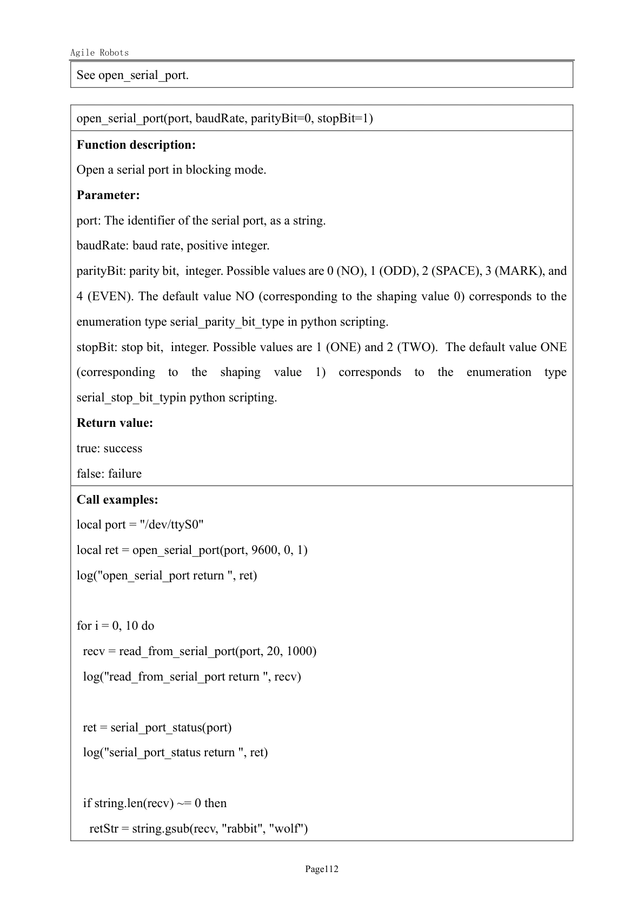



```
Agile Robots 
Page112 
See open_serial_port. 
 
open_serial_port(port, baudRate, parityBit=0, stopBit=1) 
Function description: 
Open a serial port in blocking mode. 
Parameter: 
port: The identifier of the serial port, as a string. 
baudRate: baud rate, positive integer. 
parityBit: parity bit,  integer. Possible values are 0 (NO), 1 (ODD), 2 (SPACE), 3 (MARK), and 
4 (EVEN). The default value NO (corresponding to the shaping value 0) corresponds to the 
enumeration type serial_parity_bit_type in python scripting. 
stopBit: stop bit,  integer. Possible values are 1 (ONE) and 2 (TWO).  The default value ONE 
(corresponding to the shaping value 1) corresponds to the enumeration type 
serial_stop_bit_typin python scripting. 
Return value: 
true: success 
false: failure 
Call examples: 
local port = "/dev/ttyS0" 
local ret = open_serial_port(port, 9600, 0, 1) 
log("open_serial_port return ", ret) 
 
for i = 0, 10 do 
  recv = read_from_serial_port(port, 20, 1000) 
  log("read_from_serial_port return ", recv) 
   
  ret = serial_port_status(port) 
  log("serial_port_status return ", ret) 
   
  if string.len(recv) ~= 0 then 
    retStr = string.gsub(recv, "rabbit", "wolf")
```



**Original document cross-references:** [PDF 115](pages-073-144.md#pdf-page-115)

## PDF page 114

**Source:** Industrial Lua Programming Manual\_V3.3.0\_EN\_20260117.pdf, original pdf page 114. [Open the corresponding PDF reading-copy page](https://1292444914-files.gitbook.io/~/files/v0/b/gitbook-x-prod.appspot.com/o/spaces%2FtgOfPnscWebs1eh82EKq%2Fuploads%2FU0JYOssuma2RW4Gd2PqT%2Findustrial-lua-programming-manual-v3-3-0-en-20260117-pp-001-184.pdf?alt=media#page=114).



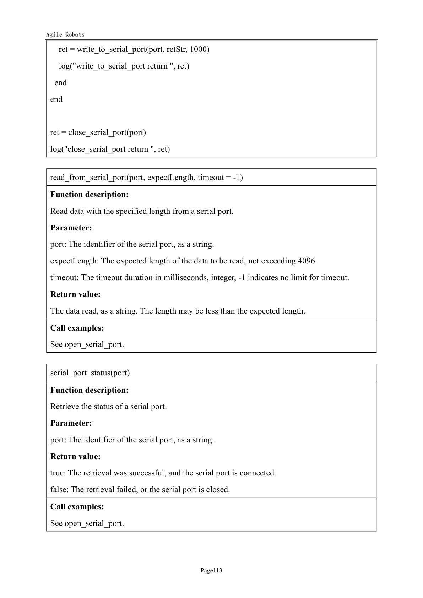



```
Agile Robots 
Page113 
    ret = write_to_serial_port(port, retStr, 1000) 
    log("write_to_serial_port return ", ret) 
  end 
end 
 
ret = close_serial_port(port) 
log("close_serial_port return ", ret) 
 
read_from_serial_port(port, expectLength, timeout = -1) 
Function description: 
Read data with the specified length from a serial port. 
Parameter: 
port: The identifier of the serial port, as a string. 
expectLength: The expected length of the data to be read, not exceeding 4096. 
timeout: The timeout duration in milliseconds, integer, -1 indicates no limit for timeout. 
Return value: 
The data read, as a string. The length may be less than the expected length. 
Call examples: 
See open_serial_port. 
 
serial_port_status(port) 
Function description: 
Retrieve the status of a serial port. 
Parameter: 
port: The identifier of the serial port, as a string. 
Return value: 
true: The retrieval was successful, and the serial port is connected. 
false: The retrieval failed, or the serial port is closed. 
Call examples: 
See open_serial_port.
```



**Original document cross-references:** [PDF 115](pages-073-144.md#pdf-page-115)

## PDF page 115

**Source:** Industrial Lua Programming Manual\_V3.3.0\_EN\_20260117.pdf, original pdf page 115. [Open the corresponding PDF reading-copy page](https://1292444914-files.gitbook.io/~/files/v0/b/gitbook-x-prod.appspot.com/o/spaces%2FtgOfPnscWebs1eh82EKq%2Fuploads%2FU0JYOssuma2RW4Gd2PqT%2Findustrial-lua-programming-manual-v3-3-0-en-20260117-pp-001-184.pdf?alt=media#page=115).



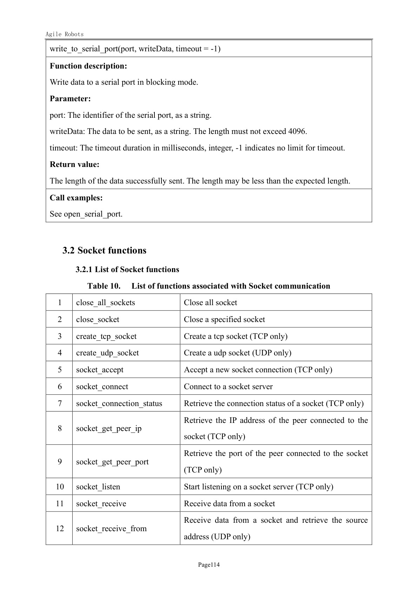



```
Agile Robots 
Page114 
write_to_serial_port(port, writeData, timeout = -1) 
Function description: 
Write data to a serial port in blocking mode. 
Parameter: 
port: The identifier of the serial port, as a string. 
writeData: The data to be sent, as a string. The length must not exceed 4096. 
timeout: The timeout duration in milliseconds, integer, -1 indicates no limit for timeout. 
Return value: 
The length of the data successfully sent. The length may be less than the expected length. 
Call examples: 
See open_serial_port. 
 
3.2 Socket functions 
3.2.1 List of Socket functions 
Table 10. 
List of functions associated with Socket communication 
1  
close_all_sockets 
Close all socket 
2  
close_socket 
Close a specified socket 
3  
create_tcp_socket 
Create a tcp socket (TCP only) 
4  
create_udp_socket 
Create a udp socket (UDP only) 
5  
socket_accept 
Accept a new socket connection (TCP only) 
6  
socket_connect 
Connect to a socket server 
7  
socket_connection_status 
Retrieve the connection status of a socket (TCP only) 
8  
socket_get_peer_ip 
Retrieve the IP address of the peer connected to the 
socket (TCP only) 
9  
socket_get_peer_port 
Retrieve the port of the peer connected to the socket 
(TCP only) 
10 
socket_listen 
Start listening on a socket server (TCP only) 
11 
socket_receive 
Receive data from a socket 
12 
socket_receive_from 
Receive data from a socket and retrieve the source 
address (UDP only)
```



**Original document cross-references:** [PDF 115](pages-073-144.md#pdf-page-115) · [PDF 116](pages-073-144.md#pdf-page-116) · [PDF 127](pages-073-144.md#pdf-page-127) · [PDF 118](pages-073-144.md#pdf-page-118) · [PDF 119](pages-073-144.md#pdf-page-119) · [PDF 121](pages-073-144.md#pdf-page-121) · [PDF 122](pages-073-144.md#pdf-page-122) · [PDF 123](pages-073-144.md#pdf-page-123) · [PDF 124](pages-073-144.md#pdf-page-124)

## PDF page 116

**Source:** Industrial Lua Programming Manual\_V3.3.0\_EN\_20260117.pdf, original pdf page 116. [Open the corresponding PDF reading-copy page](https://1292444914-files.gitbook.io/~/files/v0/b/gitbook-x-prod.appspot.com/o/spaces%2FtgOfPnscWebs1eh82EKq%2Fuploads%2FU0JYOssuma2RW4Gd2PqT%2Findustrial-lua-programming-manual-v3-3-0-en-20260117-pp-001-184.pdf?alt=media#page=116).



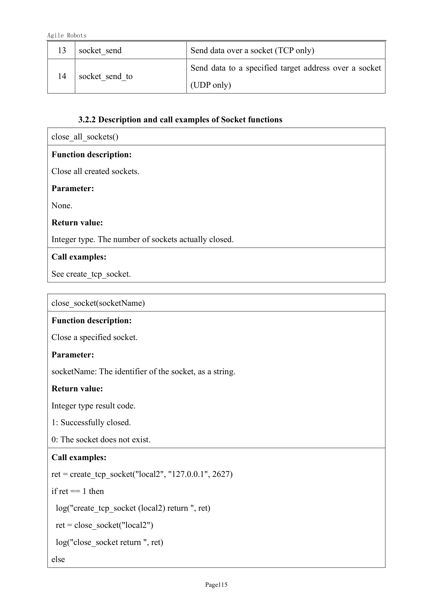



```
Agile Robots 
Page115 
13 
socket_send 
Send data over a socket (TCP only) 
14 
socket_send_to 
Send data to a specified target address over a socket 
(UDP only) 
 
3.2.2 Description and call examples of Socket functions 
close_all_sockets() 
Function description: 
Close all created sockets. 
Parameter: 
None. 
Return value: 
Integer type. The number of sockets actually closed. 
Call examples: 
See create_tcp_socket. 
 
close_socket(socketName) 
Function description: 
Close a specified socket. 
Parameter: 
socketName: The identifier of the socket, as a string. 
Return value: 
Integer type result code. 
1: Successfully closed. 
0: The socket does not exist. 
Call examples: 
ret = create_tcp_socket("local2", "127.0.0.1", 2627) 
if ret == 1 then 
  log("create_tcp_socket (local2) return ", ret) 
  ret = close_socket("local2") 
  log("close_socket return ", ret) 
else
```



**Original document cross-references:** [PDF 126](pages-073-144.md#pdf-page-126) · [PDF 127](pages-073-144.md#pdf-page-127)

## PDF page 117

**Source:** Industrial Lua Programming Manual\_V3.3.0\_EN\_20260117.pdf, original pdf page 117. [Open the corresponding PDF reading-copy page](https://1292444914-files.gitbook.io/~/files/v0/b/gitbook-x-prod.appspot.com/o/spaces%2FtgOfPnscWebs1eh82EKq%2Fuploads%2FU0JYOssuma2RW4Gd2PqT%2Findustrial-lua-programming-manual-v3-3-0-en-20260117-pp-001-184.pdf?alt=media#page=117).



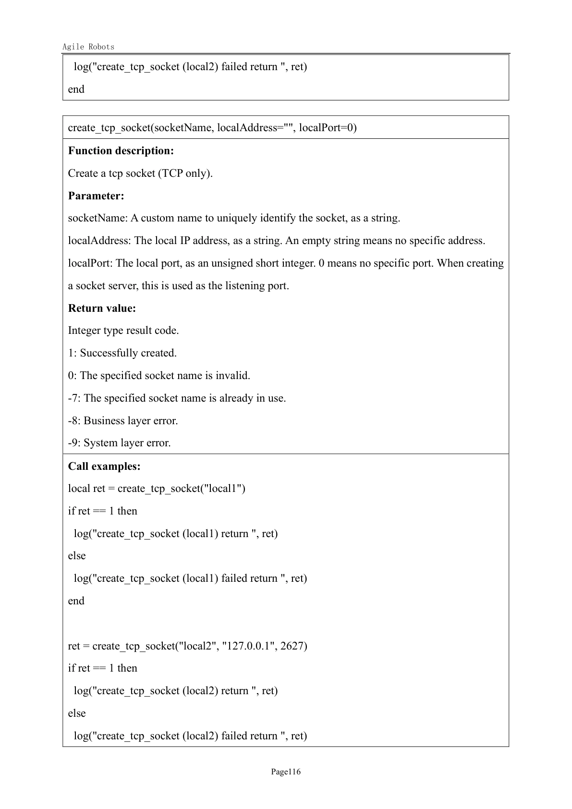



```
Agile Robots 
Page116 
  log("create_tcp_socket (local2) failed return ", ret) 
end 
 
create_tcp_socket(socketName, localAddress="", localPort=0) 
Function description: 
Create a tcp socket (TCP only). 
Parameter: 
socketName: A custom name to uniquely identify the socket, as a string. 
localAddress: The local IP address, as a string. An empty string means no specific address. 
localPort: The local port, as an unsigned short integer. 0 means no specific port. When creating 
a socket server, this is used as the listening port. 
Return value: 
Integer type result code. 
1: Successfully created. 
0: The specified socket name is invalid. 
-7: The specified socket name is already in use. 
-8: Business layer error. 
-9: System layer error. 
Call examples: 
local ret = create_tcp_socket("local1") 
if ret == 1 then 
  log("create_tcp_socket (local1) return ", ret) 
else 
  log("create_tcp_socket (local1) failed return ", ret) 
end 
 
ret = create_tcp_socket("local2", "127.0.0.1", 2627) 
if ret == 1 then 
  log("create_tcp_socket (local2) return ", ret) 
else 
  log("create_tcp_socket (local2) failed return ", ret)
```



## PDF page 118

**Source:** Industrial Lua Programming Manual\_V3.3.0\_EN\_20260117.pdf, original pdf page 118. [Open the corresponding PDF reading-copy page](https://1292444914-files.gitbook.io/~/files/v0/b/gitbook-x-prod.appspot.com/o/spaces%2FtgOfPnscWebs1eh82EKq%2Fuploads%2FU0JYOssuma2RW4Gd2PqT%2Findustrial-lua-programming-manual-v3-3-0-en-20260117-pp-001-184.pdf?alt=media#page=118).



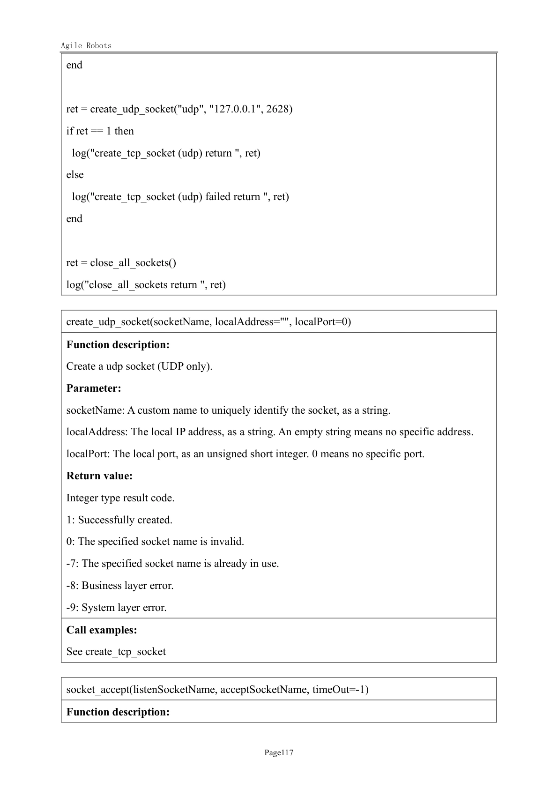



```
Agile Robots 
Page117 
end 
 
ret = create_udp_socket("udp", "127.0.0.1", 2628) 
if ret == 1 then 
  log("create_tcp_socket (udp) return ", ret) 
else 
  log("create_tcp_socket (udp) failed return ", ret) 
end 
 
ret = close_all_sockets() 
log("close_all_sockets return ", ret) 
 
create_udp_socket(socketName, localAddress="", localPort=0) 
Function description: 
Create a udp socket (UDP only). 
Parameter: 
socketName: A custom name to uniquely identify the socket, as a string. 
localAddress: The local IP address, as a string. An empty string means no specific address. 
localPort: The local port, as an unsigned short integer. 0 means no specific port. 
Return value: 
Integer type result code. 
1: Successfully created. 
0: The specified socket name is invalid. 
-7: The specified socket name is already in use. 
-8: Business layer error. 
-9: System layer error. 
Call examples: 
See create_tcp_socket 
 
socket_accept(listenSocketName, acceptSocketName, timeOut=-1) 
Function description:
```



**Original document cross-references:** [PDF 127](pages-073-144.md#pdf-page-127)

## PDF page 119

**Source:** Industrial Lua Programming Manual\_V3.3.0\_EN\_20260117.pdf, original pdf page 119. [Open the corresponding PDF reading-copy page](https://1292444914-files.gitbook.io/~/files/v0/b/gitbook-x-prod.appspot.com/o/spaces%2FtgOfPnscWebs1eh82EKq%2Fuploads%2FU0JYOssuma2RW4Gd2PqT%2Findustrial-lua-programming-manual-v3-3-0-en-20260117-pp-001-184.pdf?alt=media#page=119).



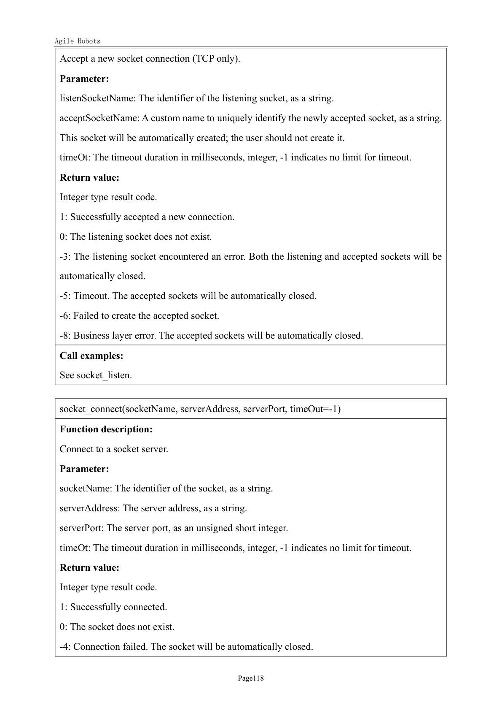



```
Agile Robots 
Page118 
Accept a new socket connection (TCP only). 
Parameter: 
listenSocketName: The identifier of the listening socket, as a string. 
acceptSocketName: A custom name to uniquely identify the newly accepted socket, as a string. 
This socket will be automatically created; the user should not create it. 
timeOt: The timeout duration in milliseconds, integer, -1 indicates no limit for timeout. 
Return value: 
Integer type result code. 
1: Successfully accepted a new connection. 
0: The listening socket does not exist. 
-3: The listening socket encountered an error. Both the listening and accepted sockets will be 
automatically closed. 
-5: Timeout. The accepted sockets will be automatically closed. 
-6: Failed to create the accepted socket. 
-8: Business layer error. The accepted sockets will be automatically closed. 
Call examples: 
See socket_listen. 
 
socket_connect(socketName, serverAddress, serverPort, timeOut=-1) 
Function description: 
Connect to a socket server. 
Parameter: 
socketName: The identifier of the socket, as a string. 
serverAddress: The server address, as a string. 
serverPort: The server port, as an unsigned short integer. 
timeOt: The timeout duration in milliseconds, integer, -1 indicates no limit for timeout. 
Return value: 
Integer type result code. 
1: Successfully connected. 
0: The socket does not exist. 
-4: Connection failed. The socket will be automatically closed.
```



**Original document cross-references:** [PDF 122](pages-073-144.md#pdf-page-122)

## PDF page 120

**Source:** Industrial Lua Programming Manual\_V3.3.0\_EN\_20260117.pdf, original pdf page 120. [Open the corresponding PDF reading-copy page](https://1292444914-files.gitbook.io/~/files/v0/b/gitbook-x-prod.appspot.com/o/spaces%2FtgOfPnscWebs1eh82EKq%2Fuploads%2FU0JYOssuma2RW4Gd2PqT%2Findustrial-lua-programming-manual-v3-3-0-en-20260117-pp-001-184.pdf?alt=media#page=120).



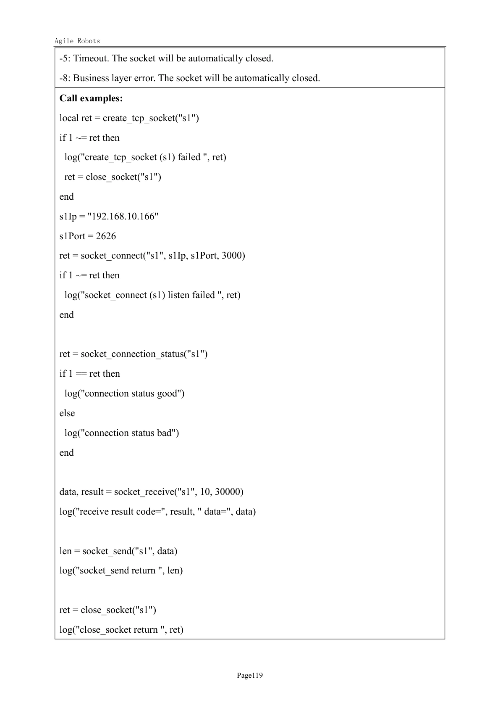



```
Agile Robots 
Page119 
-5: Timeout. The socket will be automatically closed. 
-8: Business layer error. The socket will be automatically closed. 
Call examples: 
local ret = create_tcp_socket("s1")  
if 1 ~= ret then 
  log("create_tcp_socket (s1) failed ", ret) 
  ret = close_socket("s1") 
end 
s1Ip = "192.168.10.166" 
s1Port = 2626 
ret = socket_connect("s1", s1Ip, s1Port, 3000) 
if 1 ~= ret then 
  log("socket_connect (s1) listen failed ", ret) 
end 
 
ret = socket_connection_status("s1") 
if 1 == ret then 
  log("connection status good") 
else 
  log("connection status bad") 
end 
 
data, result = socket_receive("s1", 10, 30000) 
log("receive result code=", result, " data=", data) 
 
len = socket_send("s1", data) 
log("socket_send return ", len) 
 
ret = close_socket("s1") 
log("close_socket return ", ret)
```



## PDF page 121

**Source:** Industrial Lua Programming Manual\_V3.3.0\_EN\_20260117.pdf, original pdf page 121. [Open the corresponding PDF reading-copy page](https://1292444914-files.gitbook.io/~/files/v0/b/gitbook-x-prod.appspot.com/o/spaces%2FtgOfPnscWebs1eh82EKq%2Fuploads%2FU0JYOssuma2RW4Gd2PqT%2Findustrial-lua-programming-manual-v3-3-0-en-20260117-pp-001-184.pdf?alt=media#page=121).



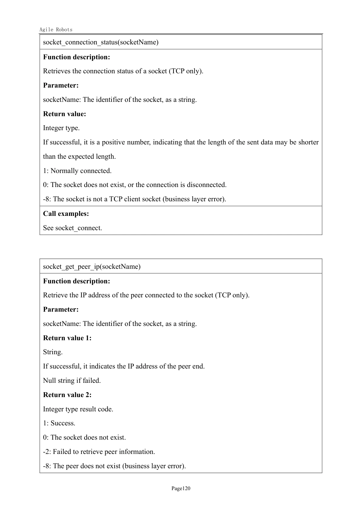



```
Agile Robots 
Page120 
socket_connection_status(socketName) 
Function description: 
Retrieves the connection status of a socket (TCP only). 
Parameter: 
socketName: The identifier of the socket, as a string. 
Return value: 
Integer type. 
If successful, it is a positive number, indicating that the length of the sent data may be shorter 
than the expected length. 
1: Normally connected. 
0: The socket does not exist, or the connection is disconnected. 
-8: The socket is not a TCP client socket (business layer error). 
Call examples: 
See socket_connect. 
 
 
socket_get_peer_ip(socketName) 
Function description: 
Retrieve the IP address of the peer connected to the socket (TCP only). 
Parameter: 
socketName: The identifier of the socket, as a string. 
Return value 1: 
String. 
If successful, it indicates the IP address of the peer end. 
Null string if failed. 
Return value 2: 
Integer type result code. 
1: Success. 
0: The socket does not exist. 
-2: Failed to retrieve peer information. 
-8: The peer does not exist (business layer error).
```



**Original document cross-references:** [PDF 119](pages-073-144.md#pdf-page-119)

## PDF page 122

**Source:** Industrial Lua Programming Manual\_V3.3.0\_EN\_20260117.pdf, original pdf page 122. [Open the corresponding PDF reading-copy page](https://1292444914-files.gitbook.io/~/files/v0/b/gitbook-x-prod.appspot.com/o/spaces%2FtgOfPnscWebs1eh82EKq%2Fuploads%2FU0JYOssuma2RW4Gd2PqT%2Findustrial-lua-programming-manual-v3-3-0-en-20260117-pp-001-184.pdf?alt=media#page=122).



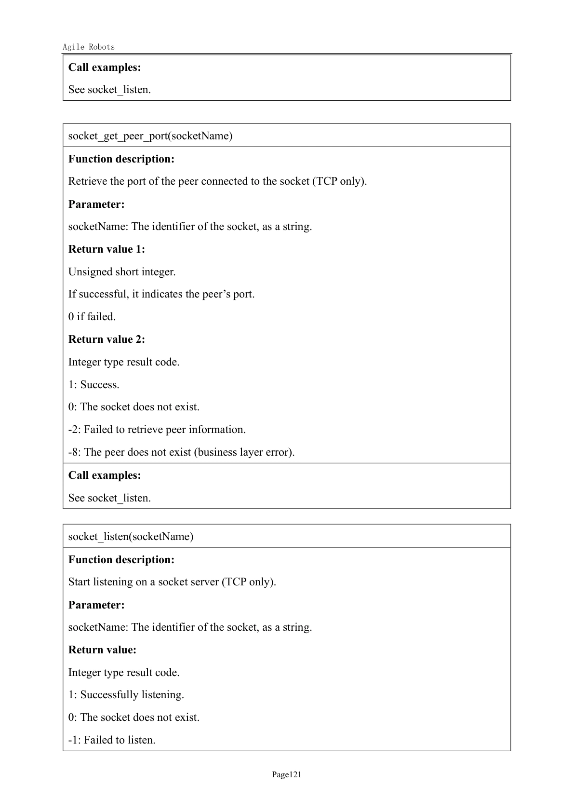



```
Agile Robots 
Page121 
Call examples: 
See socket_listen. 
 
socket_get_peer_port(socketName) 
Function description: 
Retrieve the port of the peer connected to the socket (TCP only). 
Parameter: 
socketName: The identifier of the socket, as a string. 
Return value 1: 
Unsigned short integer. 
If successful, it indicates the peer’s port. 
0 if failed. 
Return value 2: 
Integer type result code. 
1: Success. 
0: The socket does not exist. 
-2: Failed to retrieve peer information. 
-8: The peer does not exist (business layer error). 
Call examples: 
See socket_listen. 
 
socket_listen(socketName) 
Function description: 
Start listening on a socket server (TCP only). 
Parameter: 
socketName: The identifier of the socket, as a string. 
Return value: 
Integer type result code. 
1: Successfully listening. 
0: The socket does not exist. 
-1: Failed to listen.
```



**Original document cross-references:** [PDF 122](pages-073-144.md#pdf-page-122)

## PDF page 123

**Source:** Industrial Lua Programming Manual\_V3.3.0\_EN\_20260117.pdf, original pdf page 123. [Open the corresponding PDF reading-copy page](https://1292444914-files.gitbook.io/~/files/v0/b/gitbook-x-prod.appspot.com/o/spaces%2FtgOfPnscWebs1eh82EKq%2Fuploads%2FU0JYOssuma2RW4Gd2PqT%2Findustrial-lua-programming-manual-v3-3-0-en-20260117-pp-001-184.pdf?alt=media#page=123).







```
Agile Robots 
Page122 
Call examples: 
if 1 ~= create_tcp_socket("socket1", "", 2626) then 
 
log("create tcp socket 1 failed") 
end 
 
if 1 ~= socket_listen("socket1") then 
 
log("socket 1 listen successful") 
end 
 
result = socket_accept("socket1", "socket2") 
if result ~= 1 then 
 
log("accept socket failed, error code=", result) 
end 
log("accept new socket successful") 
 
len = socket_send("socket2", "hello world") 
log("socket_send return ", len) 
 
peerIp, code = socket_get_peer_ip("socket2") 
if 1 == code then 
 
log("peer ip=", peerIp) 
end 
peerPort, code = socket_get_peer_port("socket2") 
if 1 == code then 
 
log("peer port=", peerPort) 
end 
 
ret = close_socket("socket1") 
 
socket_receive(socketName, expectLength, timeOut=-1) 
Function description:
```



## PDF page 124

**Source:** Industrial Lua Programming Manual\_V3.3.0\_EN\_20260117.pdf, original pdf page 124. [Open the corresponding PDF reading-copy page](https://1292444914-files.gitbook.io/~/files/v0/b/gitbook-x-prod.appspot.com/o/spaces%2FtgOfPnscWebs1eh82EKq%2Fuploads%2FU0JYOssuma2RW4Gd2PqT%2Findustrial-lua-programming-manual-v3-3-0-en-20260117-pp-001-184.pdf?alt=media#page=124).







```
Agile Robots 
Page123 
Receive data from a socket. 
Parameter: 
socketName: The identifier of the socket, as a string. 
expectLength: The expected length of the data to receive, valid range is 1 to 4096. 
timeOt: The timeout duration in milliseconds, integer, -1 indicates no limit for timeout. 
Return value 1: 
String type. 
If successful, it indicates that the received data may be shorter than the expected length. 
Null if failed. 
Return value 2: 
Integer type result code. 
If successful, it is a positive number, indicating that the length of the received data may be 
shorter than the expected length. 
0: The socket does not exist; no data was received. 
-5: Timeout; no data was received. 
-8: Business layer error; some data may have been received. 
-9: System layer error; some data may have been received. 
-10: Connection interrupted; no data was received (TCP only) . 
-11: Receive failed; no data was received (e.g., udp packet length insufficient). 
Call examples: 
See socket_connect 
 
socket_receive_from(socketName, expectLength, timeOut=-1) 
Function description: 
Receive data from a socket and retrieve the source address (UDP only). 
Parameter: 
socketName: The identifier of the socket, as a string. 
expectLength: The expected length of the data to receive, valid range is 1 to 4096. 
timeOt: The timeout duration in milliseconds, integer, -1 indicates no limit for timeout. 
Return value 1: 
String type.
```



**Original document cross-references:** [PDF 119](pages-073-144.md#pdf-page-119)

## PDF page 125

**Source:** Industrial Lua Programming Manual\_V3.3.0\_EN\_20260117.pdf, original pdf page 125. [Open the corresponding PDF reading-copy page](https://1292444914-files.gitbook.io/~/files/v0/b/gitbook-x-prod.appspot.com/o/spaces%2FtgOfPnscWebs1eh82EKq%2Fuploads%2FU0JYOssuma2RW4Gd2PqT%2Findustrial-lua-programming-manual-v3-3-0-en-20260117-pp-001-184.pdf?alt=media#page=125).







```
Agile Robots 
Page124 
If successful, it indicates that the received data may be shorter than the expected length. 
Null if failed. 
Return value 2: 
Integer type result code. 
If successful, it is a positive number, indicating that the length of the sent data may be shorter 
than the expected length. 
0: The socket does not exist; no data was received. 
-5: Timeout; no data was received. 
-8: Business layer error; some data may have been received. 
-9: System layer error; some data may have been received. 
-11: Receive failed; no data was received (e.g., udp packet length insufficient). 
Return value 3: 
The IP address of the sending end. 
Return value 4: 
The port of the sending end. 
Call examples: 
local ret = create_udp_socket("socket1", "", 2626) 
if 1 ~= ret then 
 
log("create udp socket 1 failed ",ret) 
end 
log("create udp socket 1 ",ret) 
 
data, resultCode, fromIp, fromPort = socket_receive_from("socket1", 4096, 30000) 
log("receive_from result code=",resultCode) 
log("from ip=",fromIp) 
log("from port=",fromPort) 
log("received data=",data) 
 
ret = close_socket("socket1") 
log("close_socket ret=", ret)
```



## PDF page 126

**Source:** Industrial Lua Programming Manual\_V3.3.0\_EN\_20260117.pdf, original pdf page 126. [Open the corresponding PDF reading-copy page](https://1292444914-files.gitbook.io/~/files/v0/b/gitbook-x-prod.appspot.com/o/spaces%2FtgOfPnscWebs1eh82EKq%2Fuploads%2FU0JYOssuma2RW4Gd2PqT%2Findustrial-lua-programming-manual-v3-3-0-en-20260117-pp-001-184.pdf?alt=media#page=126).







```
Agile Robots 
Page125 
 
socket_send(socketName, sendData, timeOut=-1) 
Function description: 
Send data over a socket (TCP only). 
Parameter: 
socketName: The identifier of the socket, as a string. 
sendData: The data to be sent, as a string. The valid length range is 1 to 4096. 
timeOt: The timeout duration in milliseconds, integer, -1 indicates no limit for timeout. 
Return value: 
Integer type. 
If successful, it is a positive number, indicating that the length of the sent data may be shorter 
than the expected length. 
0: The socket does not exist; no data was sent. 
-5: Timeout; no data was sent. 
-8: Business layer error; some data may have been sent. 
-9: System layer error; some data may have been sent. 
-12: Connection interrupted; no data was sent. 
Call examples: 
See socket_connect. 
 
socket_send_to(socketName, sendData, toAddress, toPort, timeOut=-1) 
Function description: 
Send data to a specified target address over a socket (UDP only). 
Parameter: 
socketName: The identifier of the socket, as a string. 
sendData: The data to be sent, as a string. The valid length range is 1 to 4096. 
toAddress: The target address, as a string. 
toPort: The target port, as an unsigned short integer. 
timeOt: The timeout duration in milliseconds, integer, -1 indicates no limit for timeout. 
Return value:
```



**Original document cross-references:** [PDF 119](pages-073-144.md#pdf-page-119)

## PDF page 127

**Source:** Industrial Lua Programming Manual\_V3.3.0\_EN\_20260117.pdf, original pdf page 127. [Open the corresponding PDF reading-copy page](https://1292444914-files.gitbook.io/~/files/v0/b/gitbook-x-prod.appspot.com/o/spaces%2FtgOfPnscWebs1eh82EKq%2Fuploads%2FU0JYOssuma2RW4Gd2PqT%2Findustrial-lua-programming-manual-v3-3-0-en-20260117-pp-001-184.pdf?alt=media#page=127).







```
Agile Robots 
Page126 
Integer type. 
If successful, it is a positive number, indicating that the length of the sent data may be shorter 
than the expected length. 
0: The socket does not exist; no data was sent. 
-5: Timeout; no data was sent. 
-8: Business layer error; some data may have been sent. 
-9: System layer error; some data may have been sent. 
-12: Connection interrupted; no data was sent. 
Call examples: 
local ret = create_udp_socket("socket1", "", 2626) 
if 1 ~= ret then 
 
log("create udp socket 1 failed ",ret) 
end 
log("create udp socket 1 ",ret) 
 
data = "hello" 
length = socket_send_to("socket1", data, "192.168.10.166", 8081, 3000) 
log("send_to result length=", length) 
log("sent data=",data) 
 
ret = close_socket("socket1") 
log("close_socket ret=", ret) 
 
4 Industrial bus read and write 
4.1 List of functions associated with external device communication 
Table 11 List of functions associated with external device communication 
No. 
Function name 
Function description 
1  
pn_read_input_bit 
Read a single BIT from a Profinet bus input collection 
2  
pn_read_input_bits 
Read multiple BITs from a Profinet bus input 
collection
```



**Original document cross-references:** [PDF 131](pages-073-144.md#pdf-page-131) · [PDF 132](pages-073-144.md#pdf-page-132)

## PDF page 128

**Source:** Industrial Lua Programming Manual\_V3.3.0\_EN\_20260117.pdf, original pdf page 128. [Open the corresponding PDF reading-copy page](https://1292444914-files.gitbook.io/~/files/v0/b/gitbook-x-prod.appspot.com/o/spaces%2FtgOfPnscWebs1eh82EKq%2Fuploads%2FU0JYOssuma2RW4Gd2PqT%2Findustrial-lua-programming-manual-v3-3-0-en-20260117-pp-001-184.pdf?alt=media#page=128).







```
Agile Robots 
Page127 
3  
pn_read_input_float 
Read a single floating number from a Profinet bus 
input collection 
4  
pn_read_input_floats 
Read multiple floating numbers from a Profinet bus 
input collection 
5  
pn_read_input_int 
Read a single integer from a Profinet bus input 
collection 
6  
pn_read_input_ints 
Read multiple integers from a Profinet bus input 
collection 
7  
pn_read_input_slot_bit 
Read a single BIT from a Profinet bus input subslot 
8  
pn_read_input_slot_bits 
Read multiple BITs from a Profinet bus input subslot 
9  
pn_read_input_slot_byte 
Read a single byte from a Profinet bus input subslot 
10  
pn_read_input_slot_bytes 
Read multiple bytes from a Profinet bus input subslot 
11  
pn_read_output_bit 
Read a single BIT from a Profinet bus output 
collection 
12  
pn_read_output_bits 
Read multiple BITs from a Profinet bus output 
collection 
13  
pn_read_output_float 
Read a single floating number from a Profinet bus 
output collection 
14  
pn_read_output_floats 
Read multiple floating numbers from a Profinet bus 
output collection 
15  
pn_read_output_int 
Read a single integer from a Profinet bus output 
collection 
16  
pn_read_output_ints 
Read multiple integers from a Profinet bus output 
collection 
17  
pn_read_output_slot_bit 
Read a single BIT from a Profinet bus output subslot 
18  
pn_read_output_slot_bits 
Read multiple BITs from a Profinet bus output subslot 
19  
pn_read_output_slot_byte 
Read a single byte from a Profinet bus output subslot 
20  
pn_read_output_slot_bytes 
Read multiple bytes from a Profinet bus output 
subslot 
21  
pn_write_bit 
Write a single BIT to a Profinet bus input collection
```



**Original document cross-references:** [PDF 132](pages-073-144.md#pdf-page-132) · [PDF 133](pages-073-144.md#pdf-page-133) · [PDF 134](pages-073-144.md#pdf-page-134) · [PDF 135](pages-073-144.md#pdf-page-135) · [PDF 136](pages-073-144.md#pdf-page-136) · [PDF 137](pages-073-144.md#pdf-page-137) · [PDF 138](pages-073-144.md#pdf-page-138) · [PDF 139](pages-073-144.md#pdf-page-139) · [PDF 140](pages-073-144.md#pdf-page-140) · [PDF 141](pages-073-144.md#pdf-page-141) · [PDF 142](pages-073-144.md#pdf-page-142) · [PDF 143](pages-073-144.md#pdf-page-143) · [PDF 144](pages-073-144.md#pdf-page-144)

## PDF page 129

**Source:** Industrial Lua Programming Manual\_V3.3.0\_EN\_20260117.pdf, original pdf page 129. [Open the corresponding PDF reading-copy page](https://1292444914-files.gitbook.io/~/files/v0/b/gitbook-x-prod.appspot.com/o/spaces%2FtgOfPnscWebs1eh82EKq%2Fuploads%2FU0JYOssuma2RW4Gd2PqT%2Findustrial-lua-programming-manual-v3-3-0-en-20260117-pp-001-184.pdf?alt=media#page=129).







```
Agile Robots 
Page128 
22  
pn_write_bits 
Write multiple BITs to a Profinet bus input collection 
23  
pn_write_float 
Write a single floating number to a Profinet bus input 
collection 
24  
pn_write_floats 
Write multiple floating numbers to a Profinet bus 
input collection 
25  
pn_write_int 
Write a single integer to a Profinet bus input 
collection 
26  
pn_write_ints 
Write multiple integers to a Profinet bus input 
collection 
27  
pn_write_slot_bit 
Write a single BIT to a Profinet bus input subslot 
28  
pn_write_slot_bits 
Write multiple BITs to a Profinet bus input subslot 
29  
pn_write_slot_byte 
Write a single byte to a Profinet bus input subslot 
30  
pn_write_slot_bytes 
Write multiple bytes to a Profinet bus input subslot 
31  
mb_float_to_registers 
Convert a single floating number into two Modbus 
register values 
32  
mb_m_read_input_bit 
Modbus master station reads a single BIT in slave sta-
tion iutput 
33  
mb_m_read_input_bits 
Modbus master station reads multiple BITs in slave 
station iutput 
34  
mb_m_read_input_register 
Modbus master station reads a single register in slave 
station iutput 
35  
mb_m_read_input_registers 
Modbus master station reads multiple registers in 
slave station iutput 
36  
mb_m_read_output_bit 
Modbus master station reads a single BIT in slave sta-
tion output 
37  
mb_m_read_output_bits 
Modbus master station reads multiple BITs in slave 
station output 
38  
mb_m_read_output_register 
Modbus master station reads a single register in slave 
station output
```



**Original document cross-references:** [PDF 145](pages-145-192.md#pdf-page-145) · [PDF 146](pages-145-192.md#pdf-page-146) · [PDF 147](pages-145-192.md#pdf-page-147) · [PDF 148](pages-145-192.md#pdf-page-148) · [PDF 149](pages-145-192.md#pdf-page-149) · [PDF 151](pages-145-192.md#pdf-page-151) · [PDF 152](pages-145-192.md#pdf-page-152) · [PDF 153](pages-145-192.md#pdf-page-153) · [PDF 154](pages-145-192.md#pdf-page-154) · [PDF 156](pages-145-192.md#pdf-page-156) · [PDF 157](pages-145-192.md#pdf-page-157) · [PDF 158](pages-145-192.md#pdf-page-158)

## PDF page 130

**Source:** Industrial Lua Programming Manual\_V3.3.0\_EN\_20260117.pdf, original pdf page 130. [Open the corresponding PDF reading-copy page](https://1292444914-files.gitbook.io/~/files/v0/b/gitbook-x-prod.appspot.com/o/spaces%2FtgOfPnscWebs1eh82EKq%2Fuploads%2FU0JYOssuma2RW4Gd2PqT%2Findustrial-lua-programming-manual-v3-3-0-en-20260117-pp-001-184.pdf?alt=media#page=130).







```
Agile Robots 
Page129 
39  
mb_m_read_output_registers 
Modbus master station reads multiple registers in 
slave station output 
40  
mb_m_write_bit 
Modbus master station writes a single BIT to slave sta-
tion output 
41  
mb_m_write_bits 
Modbus master station writes multiple BITs to slave 
station output 
42  
mb_m_write_register 
Modbus master station writes a single register to slave 
station output 
43  
mb_m_write_registers 
Modbus master station writes multiple registers to 
slave station output 
44  
mb_registers_to_float 
Convert two Modbus register values into a single 
floating number 
45  
mb_s_read_input_bit 
Modbus slave station reads a single BIT from its intput 
46  
mb_s_read_input_bits 
Modbus slave station reads multiple BITs from its 
intput 
47  
mb_s_read_input_register 
Modbus slave station reads a single register from its in-
put 
48  
mb_s_read_input_registers 
Modbus slave station reads multiple registers from its 
input 
49  
mb_s_read_output_bit 
Modbus slave station reads a single BIT from its output 
50  
mb_s_read_output_bits 
Modbus slave station reads multiple BITs from its 
output 
51  
mb_s_read_output_register 
Modbus slave station reads a single register from its 
output 
52  
mb_s_read_output_registers 
Modbus slave station reads multiple registers from its 
output 
53  
mb_s_write_bit 
Modbus slave station writes a single BIT to its intput 
54  
mb_s_write_bits 
Modbus slave station writes multiple BITs to its intput 
55  
mb_s_write_register 
Modbus slave station writes a single register to its input
```



**Original document cross-references:** [PDF 159](pages-145-192.md#pdf-page-159) · [PDF 160](pages-145-192.md#pdf-page-160) · [PDF 162](pages-145-192.md#pdf-page-162) · [PDF 163](pages-145-192.md#pdf-page-163) · [PDF 164](pages-145-192.md#pdf-page-164) · [PDF 165](pages-145-192.md#pdf-page-165) · [PDF 166](pages-145-192.md#pdf-page-166) · [PDF 167](pages-145-192.md#pdf-page-167) · [PDF 168](pages-145-192.md#pdf-page-168) · [PDF 169](pages-145-192.md#pdf-page-169) · [PDF 170](pages-145-192.md#pdf-page-170) · [PDF 171](pages-145-192.md#pdf-page-171) · [PDF 172](pages-145-192.md#pdf-page-172)

## PDF page 131

**Source:** Industrial Lua Programming Manual\_V3.3.0\_EN\_20260117.pdf, original pdf page 131. [Open the corresponding PDF reading-copy page](https://1292444914-files.gitbook.io/~/files/v0/b/gitbook-x-prod.appspot.com/o/spaces%2FtgOfPnscWebs1eh82EKq%2Fuploads%2FU0JYOssuma2RW4Gd2PqT%2Findustrial-lua-programming-manual-v3-3-0-en-20260117-pp-001-184.pdf?alt=media#page=131).







```
Agile Robots 
Page130 
56  
mb_s_write_registers 
Modbus slave station writes multiple registers to its 
input 
 
Remarks: 
1  Integers occupy 4 bytes on the Profinet bus; floating numbers occupy 4 bytes on the Profinet 
or Modbus bus; registers occupy 2 bytes on the Modbus bus. 
2  Functions prefixed with mb_m are applicable when the robotic arm acts as a Modbus RTU or 
TCP master station to read/write data from/to a slave station. From the master station’s 
perspective, output data flows from the robotic arm to the slave station, and input data flows 
from the slave station to the robotic arm. These interfaces cannot be used to read/write the 
robotic arm’s own data 
3  Functions prefixed with mb_s are applicable when the robotic arm acts as a Modbus TCP 
slave station to read/write its own data. From the master station's perspective, output data 
flows from the master station to the robotic arm, and input data flows from the robotic arm to 
the master station. 
 
4.2  Description and call examples of functions associated with 
communication with external devices 
4.2.1 Profinet bus read-write functions 
pn_read_input_bit(groupName, bitIndex) 
Function description: 
Read a single BIT at the specified index of the bus-specified input set. 
Parameter: 
groupName: the name of the set. 
bitIndex: the BIT index within the set (zero-based). 
Return value 1: 
resultCode: integer type, which executes the result code. See Profinet bus read-write function 
result code table. 
Return value 2: 
data: Bit type, single BIT value read, the value is 0 or 1.
```



**Original document cross-references:** [PDF 172](pages-145-192.md#pdf-page-172) · [PDF 175](pages-145-192.md#pdf-page-175)

## PDF page 132

**Source:** Industrial Lua Programming Manual\_V3.3.0\_EN\_20260117.pdf, original pdf page 132. [Open the corresponding PDF reading-copy page](https://1292444914-files.gitbook.io/~/files/v0/b/gitbook-x-prod.appspot.com/o/spaces%2FtgOfPnscWebs1eh82EKq%2Fuploads%2FU0JYOssuma2RW4Gd2PqT%2Findustrial-lua-programming-manual-v3-3-0-en-20260117-pp-001-184.pdf?alt=media#page=132).







```
Agile Robots 
Page131 
Call examples: 
resultCode, data = pn_read_input_bit("input.bool", 13) 
if resultCode == 0 then 
 
log("PN read bit success, data is ", data) 
else 
 
log("PN read bit failed, error is ", resultCode) 
end 
 
pn_read_input_bits(groupName, bitIndex, count) 
Function description: 
Read multiple BITs at the specified index of the bus-specified output set. 
Parameter: 
groupName: the name of the set. 
bitIndex: the BIT index-based within the set (zero-based). 
count: Number of BITs. 
Return value 1: 
resultCode: integer type, which executes the result code. See Profinet bus read-write function 
result code table. 
Return value 2: 
data: Bit type array, multiple BIT values read, the value is 0 or 1. 
Call examples: 
resultCode, data = pn_read_input_bits("input.bool", 13, 7) 
if resultCode == 0 then 
 
log("PN read bits success, data is ", data) 
else 
 
log("PN read bits failed, error is ", resultCode) 
end 
 
pn_read_input_float(groupName, floatIndex) 
Function description:
```



**Original document cross-references:** [PDF 175](pages-145-192.md#pdf-page-175)

## PDF page 133

**Source:** Industrial Lua Programming Manual\_V3.3.0\_EN\_20260117.pdf, original pdf page 133. [Open the corresponding PDF reading-copy page](https://1292444914-files.gitbook.io/~/files/v0/b/gitbook-x-prod.appspot.com/o/spaces%2FtgOfPnscWebs1eh82EKq%2Fuploads%2FU0JYOssuma2RW4Gd2PqT%2Findustrial-lua-programming-manual-v3-3-0-en-20260117-pp-001-184.pdf?alt=media#page=133).







```
Agile Robots 
Page132 
Read a single floating-point number at the specified index of the bus-specified input set. 
Parameter: 
groupName: the name of the set. 
floatIndex: floating-point index within the set (zero-based). 
Return value 1: 
resultCode: integer type, which executes the result code. See Profinet bus read-write function 
result code table. 
Return value 2: 
data: floating-point number type, a single floating-point number value read. 
Call examples: 
resultCode, data = pn_read_input_float("input.float", 1) 
if resultCode == 0 then 
 
log("PN read float success, data is ", data) 
else 
 
log("PN read float failed, error is ", resultCode) 
end 
 
pn_read_input_floats(groupName, floatIndex, count) 
Function description: 
Read multiple floating-point numbers at the specified index-based of the bus-specified input 
set. 
Parameter: 
groupName: the name of the set. 
floatIndex: floating-point index-based within the set (zero-based). 
count: Number of floating-point numbers. 
Return value 1: 
resultCode: integer type, which executes the result code. See Profinet bus read-write function 
result code table. 
Return value 2: 
data: floating-point number type array, multiple floating-point number values read.
```



**Original document cross-references:** [PDF 175](pages-145-192.md#pdf-page-175)

## PDF page 134

**Source:** Industrial Lua Programming Manual\_V3.3.0\_EN\_20260117.pdf, original pdf page 134. [Open the corresponding PDF reading-copy page](https://1292444914-files.gitbook.io/~/files/v0/b/gitbook-x-prod.appspot.com/o/spaces%2FtgOfPnscWebs1eh82EKq%2Fuploads%2FU0JYOssuma2RW4Gd2PqT%2Findustrial-lua-programming-manual-v3-3-0-en-20260117-pp-001-184.pdf?alt=media#page=134).







```
Agile Robots 
Page133 
Call examples: 
resultCode, data = pn_read_input_floats("input.float", 1, 2) 
if resultCode == 0 then 
 
log("PN read floats success, data is ", data) 
else 
 
log("PN read floats failed, error is ", resultCode) 
end 
 
pn_read_input_int(groupName, intIndex) 
Function description: 
Read a single integer at the specified index of the bus-specified input set. 
Parameter: 
groupName: the name of the set. 
intIndex: the integer index within the set (zero-based). 
Return value 1: 
resultCode: integer type, which executes the result code. See Profinet bus read-write function 
result code table. 
Return value 2: 
data: integer type, a single integer value read. 
Call examples: 
resultCode, data = pn_read_input_int("input.int", 1) 
if resultCode == 0 then 
 
log("PN read int success, data is ", data) 
else 
 
log("PN read int failed, error is ", resultCode) 
end 
 
pn_read_input_ints(groupName, intIndex, count) 
Function description: 
Read multiple integers at the specified index-based of the bus-specified input set.
```



**Original document cross-references:** [PDF 175](pages-145-192.md#pdf-page-175)

## PDF page 135

**Source:** Industrial Lua Programming Manual\_V3.3.0\_EN\_20260117.pdf, original pdf page 135. [Open the corresponding PDF reading-copy page](https://1292444914-files.gitbook.io/~/files/v0/b/gitbook-x-prod.appspot.com/o/spaces%2FtgOfPnscWebs1eh82EKq%2Fuploads%2FU0JYOssuma2RW4Gd2PqT%2Findustrial-lua-programming-manual-v3-3-0-en-20260117-pp-001-184.pdf?alt=media#page=135).







```
Agile Robots 
Page134 
Parameter: 
groupName: the name of the set. 
intIndex: the integer index-based within the set (zero-based). 
count: Number of integers. 
Return value 1: 
resultCode: integer type, which executes the result code. See Profinet bus read-write function 
result code table. 
Return value 2: 
data: integer type array, multiple integer values read. 
Call examples: 
resultCode, data = pn_read_input_ints("input.int", 1, 2) 
if resultCode == 0 then 
 
log("PN read ints success, data is ", data) 
else 
 
log("PN read ints failed, error is ", resultCode) 
end 
 
pn_read_input_slot_bit(byteIndex, bitIndex) 
Function description: 
Read a single BIT of the specified index in the subslot input area of the bus. 
Parameter: 
byteIndex: byte index (zero-based). 
byteIndex: BIT index (zero-based, 0 is the low BIT). 
Return value 1: 
resultCode: integer type, which executes the result code. See Profinet bus read-write function 
result code table. 
Return value 2: 
data: Bit type, single BIT value read, the value is 0 or 1. 
Call examples: 
resultCode, data = pn_read_input_slot_bit(13, 5)
```



**Original document cross-references:** [PDF 175](pages-145-192.md#pdf-page-175)

## PDF page 136

**Source:** Industrial Lua Programming Manual\_V3.3.0\_EN\_20260117.pdf, original pdf page 136. [Open the corresponding PDF reading-copy page](https://1292444914-files.gitbook.io/~/files/v0/b/gitbook-x-prod.appspot.com/o/spaces%2FtgOfPnscWebs1eh82EKq%2Fuploads%2FU0JYOssuma2RW4Gd2PqT%2Findustrial-lua-programming-manual-v3-3-0-en-20260117-pp-001-184.pdf?alt=media#page=136).







```
Agile Robots 
Page135 
if resultCode == 0 then 
 
log("PN read slot bit success, data is ", data) 
else 
 
log("PN read slot bit failed, error is ", resultCode) 
end 
 
pn_read_input_slot_bits(byteIndex, bitIndex, count) 
Function description: 
Read multiple BITs of the starting index specified in the subslot input area of the bus. 
Parameter: 
byteIndex: byte index-based (zero-based). 
bitIndex: BIT index-based (zero-based, 0 is the low BIT). 
count: Number of BITs. 
Return value 1: 
resultCode: integer type, which executes the result code. See Profinet bus read-write function 
result code table. 
Return value 2: 
data: Bit type array, multiple BIT values read, the value is 0 or 1. 
Call examples: 
resultCode, data = pn_read_input_slot_bits(13, 5, 3) 
if resultCode == 0 then 
 
log("PN read slot bits success, data is ", data) 
else 
 
log("PN read slot bits failed, error is ", resultCode) 
end 
 
pn_read_input_slot_byte(byteIndex) 
Function description: 
Read a single byte of the specified index in the subslot input area of the bus. 
Parameter:
```



**Original document cross-references:** [PDF 175](pages-145-192.md#pdf-page-175)

## PDF page 137

**Source:** Industrial Lua Programming Manual\_V3.3.0\_EN\_20260117.pdf, original pdf page 137. [Open the corresponding PDF reading-copy page](https://1292444914-files.gitbook.io/~/files/v0/b/gitbook-x-prod.appspot.com/o/spaces%2FtgOfPnscWebs1eh82EKq%2Fuploads%2FU0JYOssuma2RW4Gd2PqT%2Findustrial-lua-programming-manual-v3-3-0-en-20260117-pp-001-184.pdf?alt=media#page=137).







```
Agile Robots 
Page136 
byteIndex: byte index (zero-based). 
Return value 1: 
resultCode: integer type, which executes the result code. See Profinet bus read-write function 
result code table. 
Return value 2: 
data: byte type, single byte value read. 
Call examples: 
resultCode, data = pn_read_input_slot_byte(13) 
if resultCode == 0 then 
 
log("PN read slot byte success, data is ", data) 
else 
 
log("PN read slot byte failed, error is ", resultCode) 
end 
 
pn_read_input_slot_bytes(byteIndex, count) 
Function description: 
Read multiple bytes of the starting index specified in the subslot input area of the bus. 
Parameter: 
byteIndex: byte index-based (zero-based). 
count: Number of bytes. 
Return value 1: 
resultCode: integer type, which executes the result code. See Profinet bus read-write function 
result code table. 
Return value 2: 
data: Byte array, read multiple byte values. 
Call examples: 
resultCode, data = pn_read_input_slot_bytes(13, 5) 
if resultCode == 0 then 
 
log("PN read slot bytes success, data is ", data) 
else
```



**Original document cross-references:** [PDF 175](pages-145-192.md#pdf-page-175)

## PDF page 138

**Source:** Industrial Lua Programming Manual\_V3.3.0\_EN\_20260117.pdf, original pdf page 138. [Open the corresponding PDF reading-copy page](https://1292444914-files.gitbook.io/~/files/v0/b/gitbook-x-prod.appspot.com/o/spaces%2FtgOfPnscWebs1eh82EKq%2Fuploads%2FU0JYOssuma2RW4Gd2PqT%2Findustrial-lua-programming-manual-v3-3-0-en-20260117-pp-001-184.pdf?alt=media#page=138).







```
Agile Robots 
Page137 
 
log("PN read slot bytes failed, error is ", resultCode) 
end 
 
pn_read_output_bit(groupName, bitIndex) 
Function description: 
Read a single BIT at the specified index of the bus-specified output set. 
Parameter: 
groupName: the name of the set. 
bitIndex: the BIT index within the set (zero-based). 
Return value 1: 
resultCode: integer type, which executes the result code. See Profinet bus read-write function 
result code table. 
Return value 2: 
data: Bit type, single BIT value read, the value is 0 or 1. 
Call examples: 
resultCode, data = pn_read_output_bit("output.bool", 13) 
if resultCode == 0 then 
 
log("PN read bit success, data is ", data) 
else 
 
log("PN read bit failed, error is ", resultCode) 
end 
 
pn_read_output_bits(groupName, bitIndex, count) 
Function description: 
Read multiple BITs at the specified index of the bus-specified output set. 
Parameter: 
groupName: the name of the set. 
bitIndex: the BIT index-based within the set (zero-based). 
count: Number of BITs. 
Return value 1:
```



**Original document cross-references:** [PDF 175](pages-145-192.md#pdf-page-175)

## PDF page 139

**Source:** Industrial Lua Programming Manual\_V3.3.0\_EN\_20260117.pdf, original pdf page 139. [Open the corresponding PDF reading-copy page](https://1292444914-files.gitbook.io/~/files/v0/b/gitbook-x-prod.appspot.com/o/spaces%2FtgOfPnscWebs1eh82EKq%2Fuploads%2FU0JYOssuma2RW4Gd2PqT%2Findustrial-lua-programming-manual-v3-3-0-en-20260117-pp-001-184.pdf?alt=media#page=139).







```
Agile Robots 
Page138 
resultCode: integer type, which executes the result code. See Profinet bus read-write function 
result code table. 
Return value 2: 
data: Bit type array, multiple BIT values read, the value is 0 or 1. 
Call examples: 
resultCode, data = pn_read_output_bits("output.bool", 13, 7) 
if resultCode == 0 then 
 
log("PN read bits success, data is ", data) 
else 
 
log("PN read bits failed, error is ", resultCode) 
end 
 
pn_read_output_float(groupName, floatIndex) 
Function description: 
Read a single floating-point number at the specified index of the bus-specified output set. 
Parameter: 
groupName: the name of the set. 
floatIndex: floating-point index within the set (zero-based). 
Return value 1: 
resultCode: integer type, which executes the result code. See Profinet bus read-write function 
result code table. 
Return value 2: 
data: floating-point number type, a single floating-point number value read. 
Call examples: 
resultCode, data = pn_read_output_float("output.float", 1) 
if resultCode == 0 then 
 
log("PN read float success, data is ", data) 
else 
 
log("PN read float failed, error is ", resultCode) 
end
```



**Original document cross-references:** [PDF 175](pages-145-192.md#pdf-page-175)

## PDF page 140

**Source:** Industrial Lua Programming Manual\_V3.3.0\_EN\_20260117.pdf, original pdf page 140. [Open the corresponding PDF reading-copy page](https://1292444914-files.gitbook.io/~/files/v0/b/gitbook-x-prod.appspot.com/o/spaces%2FtgOfPnscWebs1eh82EKq%2Fuploads%2FU0JYOssuma2RW4Gd2PqT%2Findustrial-lua-programming-manual-v3-3-0-en-20260117-pp-001-184.pdf?alt=media#page=140).







```
Agile Robots 
Page139 
pn_read_output_floats(groupName, floatIndex, count) 
Function description: 
Read multiple floating-point numbers at the specified index-based of the bus-specified output 
set. 
Parameter: 
groupName: the name of the set. 
floatIndex: floating-point index-based within the set (zero-based). 
count: Number of floating-point numbers. 
Return value 1: 
resultCode: integer type, which executes the result code. See Profinet bus read-write function 
result code table. 
Return value 2: 
data: floating-point number type array, multiple floating-point number values read. 
Call examples: 
resultCode, data = pn_read_output_floats("output.float", 1, 2) 
if resultCode == 0 then 
 
log("PN read floats success, data is ", data) 
else 
 
log("PN read floats failed, error is ", resultCode) 
end 
 
pn_read_output_int(groupName, intIndex) 
Function description: 
Read a single integer at the specified index of the bus-specified output set. 
Parameter: 
groupName: the name of the set. 
intIndex: the integer index within the set (zero-based). 
Return value 1: 
resultCode: integer type, which executes the result code. See Profinet bus read-write function 
result code table.
```



**Original document cross-references:** [PDF 175](pages-145-192.md#pdf-page-175)

## PDF page 141

**Source:** Industrial Lua Programming Manual\_V3.3.0\_EN\_20260117.pdf, original pdf page 141. [Open the corresponding PDF reading-copy page](https://1292444914-files.gitbook.io/~/files/v0/b/gitbook-x-prod.appspot.com/o/spaces%2FtgOfPnscWebs1eh82EKq%2Fuploads%2FU0JYOssuma2RW4Gd2PqT%2Findustrial-lua-programming-manual-v3-3-0-en-20260117-pp-001-184.pdf?alt=media#page=141).







```
Agile Robots 
Page140 
Return value 2: 
data: integer type, a single integer value read. 
Call examples: 
resultCode, data = pn_read_output_int("output.int", 1) 
if resultCode == 0 then 
 
log("PN read int success, data is ", data) 
else 
 
log("PN read int failed, error is ", resultCode) 
end 
 
pn_read_output_ints(groupName, intIndex, count) 
Function description: 
Read multiple integers at the specified index-based of the bus-specified output set. 
Parameter: 
groupName: the name of the set. 
intIndex: the integer index-based within the set (zero-based). 
count: Number of integers. 
Return value 1: 
resultCode: integer type, which executes the result code. See Profinet bus read-write function 
result code table. 
Return value 2: 
data: integer type array, multiple integer values read. 
Call examples: 
resultCode, data = pn_read_output_ints("output.int", 1, 2) 
if resultCode == 0 then 
 
log("PN read ints success, data is ", data) 
else 
 
log("PN read ints failed, error is ", resultCode) 
end
```



**Original document cross-references:** [PDF 175](pages-145-192.md#pdf-page-175)

## PDF page 142

**Source:** Industrial Lua Programming Manual\_V3.3.0\_EN\_20260117.pdf, original pdf page 142. [Open the corresponding PDF reading-copy page](https://1292444914-files.gitbook.io/~/files/v0/b/gitbook-x-prod.appspot.com/o/spaces%2FtgOfPnscWebs1eh82EKq%2Fuploads%2FU0JYOssuma2RW4Gd2PqT%2Findustrial-lua-programming-manual-v3-3-0-en-20260117-pp-001-184.pdf?alt=media#page=142).







```
Agile Robots 
Page141 
pn_read_output_slot_bit(byteIndex, bitIndex) 
Function description: 
Read a single BIT of the specified index in the subslot output area of the bus. 
Parameter: 
byteIndex: byte index (zero-based). 
byteIndex: BIT index (zero-based, 0 is the low BIT). 
Return value 1: 
resultCode: integer type, which executes the result code. See Profinet bus read-write function 
result code table. 
Return value 2: 
data: Bit type, single BIT value read, the value is 0 or 1. 
Call examples: 
resultCode, data = pn_read_output_slot_bit(13, 5) 
if resultCode == 0 then 
 
log("PN read slot bit success, data is ", data) 
else 
 
log("PN read slot bit failed, error is ", resultCode) 
end 
 
pn_read_output_slot_bits(byteIndex, bitIndex, count) 
Function description: 
Read multiple BITs of the specified index in the subslot output area of the bus. 
Parameter: 
byteIndex: byte index-based (zero-based). 
bitIndex: BIT index-based (zero-based, 0 is the low BIT). 
count: Number of BITs. 
Return value 1: 
resultCode: integer type, which executes the result code. See Profinet bus read-write function 
result code table. 
Return value 2:
```



**Original document cross-references:** [PDF 175](pages-145-192.md#pdf-page-175)

## PDF page 143

**Source:** Industrial Lua Programming Manual\_V3.3.0\_EN\_20260117.pdf, original pdf page 143. [Open the corresponding PDF reading-copy page](https://1292444914-files.gitbook.io/~/files/v0/b/gitbook-x-prod.appspot.com/o/spaces%2FtgOfPnscWebs1eh82EKq%2Fuploads%2FU0JYOssuma2RW4Gd2PqT%2Findustrial-lua-programming-manual-v3-3-0-en-20260117-pp-001-184.pdf?alt=media#page=143).







```
Agile Robots 
Page142 
data: Bit type array, multiple BIT values read, the value is 0 or 1. 
Call examples: 
resultCode, data = pn_read_output_slot_bits(13, 5, 3) 
if resultCode == 0 then 
 
log("PN read slot bits success, data is ", data) 
else 
 
log("PN read slot bits failed, error is ", resultCode) 
end 
 
pn_read_output_slot_byte(byteIndex) 
Function description: 
Read a single byte of the specified index in the subslot output area of the bus. 
Parameter: 
byteIndex: byte index (zero-based). 
Return value 1: 
resultCode: integer type, which executes the result code. See Profinet bus read-write function r
esult code table. 
Return value 2: 
data: byte type, single byte value read. 
Call examples: 
resultCode, data = pn_read_output_slot_byte(13) 
if resultCode == 0 then 
 
log("PN read slot byte success, data is ", data) 
else 
 
log("PN read slot byte failed, error is ", resultCode) 
end 
 
pn_read_output_slot_bytes(byteIndex, count) 
Function description: 
Read multiple byte of the specified index in the subslot output area of the bus.
```



**Original document cross-references:** [PDF 175](pages-145-192.md#pdf-page-175)

## PDF page 144

**Source:** Industrial Lua Programming Manual\_V3.3.0\_EN\_20260117.pdf, original pdf page 144. [Open the corresponding PDF reading-copy page](https://1292444914-files.gitbook.io/~/files/v0/b/gitbook-x-prod.appspot.com/o/spaces%2FtgOfPnscWebs1eh82EKq%2Fuploads%2FU0JYOssuma2RW4Gd2PqT%2Findustrial-lua-programming-manual-v3-3-0-en-20260117-pp-001-184.pdf?alt=media#page=144).







```
Agile Robots 
Page143 
Parameter: 
byteIndex: byte index-based (zero-based). 
count: Number of bytes. 
Return value 1: 
resultCode: integer type, which executes the result code. See Profinet bus read-write function r
esult code table. 
Return value 2: 
data: Byte array, read multiple byte values. 
Call examples: 
resultCode, data = pn_read_output_slot_bytes(13, 5) 
if resultCode == 0 then 
 
log("PN read slot bytes success, data is ", data) 
else 
 
log("PN read slot bytes failed, error is ", resultCode) 
end 
 
pn_write_bit(groupName, bitIndex, data) 
Function description: 
Write a single BIT at the specified index of the bus-specified set. 
Parameter: 
groupName: the name of the set. 
bitIndex: the BIT index within the set (zero-based). 
data: Bit type, single BIT value to be written, the value is 0 or 1. 
Return value: 
resultCode: integer type, which executes the result code. See Profinet bus read-write function 
result code table. 
Call examples: 
data = 1 
resultCode = pn_write_bit("input.bool", 13, data) 
if resultCode == 0 then
```



**Original document cross-references:** [PDF 175](pages-145-192.md#pdf-page-175)
