# Industrial Lua programming manual V3.3.0 — PDF pages 145–192


**Complete supplied source:** Industrial Lua Programming Manual\_V3.3.0\_EN\_20260117.pdf · **Coverage:** 192 original PDF pages. [Return to the Agile Robots source library](../).


Every source page is retained in the original order. The **Original page** view preserves complete diagrams, photographs, tables, equations, connector orientation, notices and examples. The **Searchable text** view preserves native PDF text or the slide’s native text, embedded links and substantive speaker notes. Text extraction can retain reading-order/character defects; use the original image for exact layout, table columns and code indentation.


Pendant Lua and external C/C++ or Python APIs use different contexts and units. Preserve every function-specific unit, argument and execution rule. A program, callback, fieldbus write or log example can affect equipment; reference examples are not a first-run motion authorization.


**Attribution:** the manufacturer and contributors identified in the supplied document. Original notices remain visible on every source page. Navigation, revision notes and the linked engineering explanations are OpenELAB editorial additions.

[Full document index](./) · This reading section contains original PDF pages **145–192**.

## Document navigation

| Source section / function                                | Original page                            |
| -------------------------------------------------------- | ---------------------------------------- |
| 4.2.2 Modbus bus master station read-write functions     | [PDF 151](pages-145-192.md#pdf-page-151) |
| 4.2.3 Modbus bus slave station read-write functions      | [PDF 165](pages-145-192.md#pdf-page-165) |
| 4.2.4 Modbus bus tool function                           | [PDF 173](pages-145-192.md#pdf-page-173) |
| 5 Appendices                                             | [PDF 175](pages-145-192.md#pdf-page-175) |
| 5.1 Profinet bus read-write function error code table    | [PDF 175](pages-145-192.md#pdf-page-175) |
| 5.2 Profinet bus read-write set function attribute table | [PDF 177](pages-145-192.md#pdf-page-177) |
| 5.2.1 Configuration Type-1                               | [PDF 177](pages-145-192.md#pdf-page-177) |
| 5.2.2 Configuration Type-2                               | [PDF 177](pages-145-192.md#pdf-page-177) |
| 5.2.3 Configuration Type-3                               | [PDF 177](pages-145-192.md#pdf-page-177) |
| 5.2.4 Configuration Type-4                               | [PDF 178](pages-145-192.md#pdf-page-178) |
| 5.2.5 Configuration Type-5                               | [PDF 178](pages-145-192.md#pdf-page-178) |
| 5.3 Profinet bus read-write slot function attribute list | [PDF 183](pages-145-192.md#pdf-page-183) |
| 5.3.1 Configuration Type-1                               | [PDF 183](pages-145-192.md#pdf-page-183) |
| 5.3.2 Configuration Type-2                               | [PDF 184](pages-145-192.md#pdf-page-184) |
| 5.3.3 Configuration Type-3                               | [PDF 184](pages-145-192.md#pdf-page-184) |
| 5.3.4 Configuration Type-4                               | [PDF 185](pages-145-192.md#pdf-page-185) |
| 5.3.5 Configuration Type-5                               | [PDF 185](pages-145-192.md#pdf-page-185) |
| 5.4 Modbus bus read-write function result code table     | [PDF 187](pages-145-192.md#pdf-page-187) |
| 5.5 Modbus bus slave data attribute table                | [PDF 189](pages-145-192.md#pdf-page-189) |
| 5.5.1 Input bit data table                               | [PDF 189](pages-145-192.md#pdf-page-189) |
| 5.5.2 Output bit data table                              | [PDF 189](pages-145-192.md#pdf-page-189) |
| 5.5.3 Input register data table                          | [PDF 189](pages-145-192.md#pdf-page-189) |
| 5.5.4 Output register data table                         | [PDF 192](pages-145-192.md#pdf-page-192) |

## PDF page 145

**Source:** Industrial Lua Programming Manual\_V3.3.0\_EN\_20260117.pdf, original pdf page 145. [Open the corresponding PDF reading-copy page](https://1292444914-files.gitbook.io/~/files/v0/b/gitbook-x-prod.appspot.com/o/spaces%2FtgOfPnscWebs1eh82EKq%2Fuploads%2FU0JYOssuma2RW4Gd2PqT%2Findustrial-lua-programming-manual-v3-3-0-en-20260117-pp-001-184.pdf?alt=media#page=145).



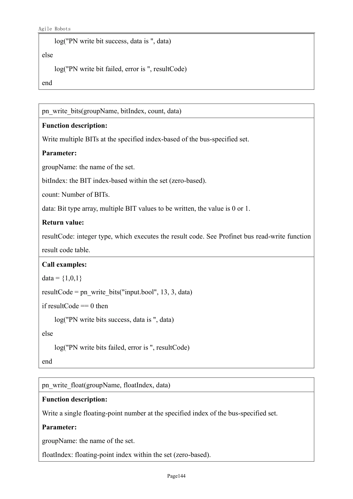



```
Agile Robots 
Page144 
 
log("PN write bit success, data is ", data) 
else 
 
log("PN write bit failed, error is ", resultCode) 
end 
 
pn_write_bits(groupName, bitIndex, count, data) 
Function description: 
Write multiple BITs at the specified index-based of the bus-specified set. 
Parameter: 
groupName: the name of the set. 
bitIndex: the BIT index-based within the set (zero-based). 
count: Number of BITs. 
data: Bit type array, multiple BIT values to be written, the value is 0 or 1. 
Return value: 
resultCode: integer type, which executes the result code. See Profinet bus read-write function 
result code table. 
Call examples: 
data = {1,0,1} 
resultCode = pn_write_bits("input.bool", 13, 3, data) 
if resultCode == 0 then 
 
log("PN write bits success, data is ", data) 
else 
 
log("PN write bits failed, error is ", resultCode) 
end 
 
pn_write_float(groupName, floatIndex, data) 
Function description: 
Write a single floating-point number at the specified index of the bus-specified set. 
Parameter: 
groupName: the name of the set. 
floatIndex: floating-point index within the set (zero-based).
```



**Original document cross-references:** [PDF 175](pages-145-192.md#pdf-page-175)

## PDF page 146

**Source:** Industrial Lua Programming Manual\_V3.3.0\_EN\_20260117.pdf, original pdf page 146. [Open the corresponding PDF reading-copy page](https://1292444914-files.gitbook.io/~/files/v0/b/gitbook-x-prod.appspot.com/o/spaces%2FtgOfPnscWebs1eh82EKq%2Fuploads%2FU0JYOssuma2RW4Gd2PqT%2Findustrial-lua-programming-manual-v3-3-0-en-20260117-pp-001-184.pdf?alt=media#page=146).



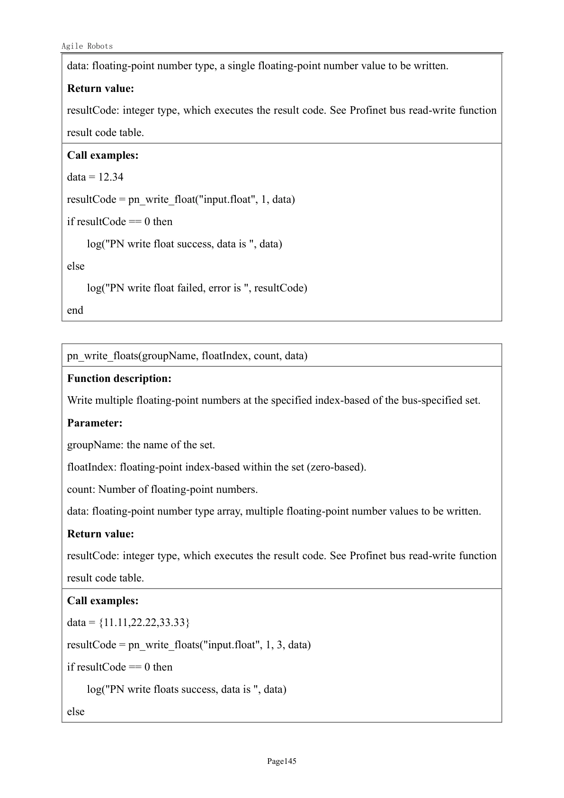



```
Agile Robots 
Page145 
data: floating-point number type, a single floating-point number value to be written. 
Return value: 
resultCode: integer type, which executes the result code. See Profinet bus read-write function 
result code table. 
Call examples: 
data = 12.34 
resultCode = pn_write_float("input.float", 1, data) 
if resultCode == 0 then 
 
log("PN write float success, data is ", data) 
else 
 
log("PN write float failed, error is ", resultCode) 
end 
 
pn_write_floats(groupName, floatIndex, count, data) 
Function description: 
Write multiple floating-point numbers at the specified index-based of the bus-specified set. 
Parameter: 
groupName: the name of the set. 
floatIndex: floating-point index-based within the set (zero-based). 
count: Number of floating-point numbers. 
data: floating-point number type array, multiple floating-point number values to be written. 
Return value: 
resultCode: integer type, which executes the result code. See Profinet bus read-write function 
result code table. 
Call examples: 
data = {11.11,22.22,33.33} 
resultCode = pn_write_floats("input.float", 1, 3, data) 
if resultCode == 0 then 
 
log("PN write floats success, data is ", data) 
else
```



**Original document cross-references:** [PDF 175](pages-145-192.md#pdf-page-175)

## PDF page 147

**Source:** Industrial Lua Programming Manual\_V3.3.0\_EN\_20260117.pdf, original pdf page 147. [Open the corresponding PDF reading-copy page](https://1292444914-files.gitbook.io/~/files/v0/b/gitbook-x-prod.appspot.com/o/spaces%2FtgOfPnscWebs1eh82EKq%2Fuploads%2FU0JYOssuma2RW4Gd2PqT%2Findustrial-lua-programming-manual-v3-3-0-en-20260117-pp-001-184.pdf?alt=media#page=147).



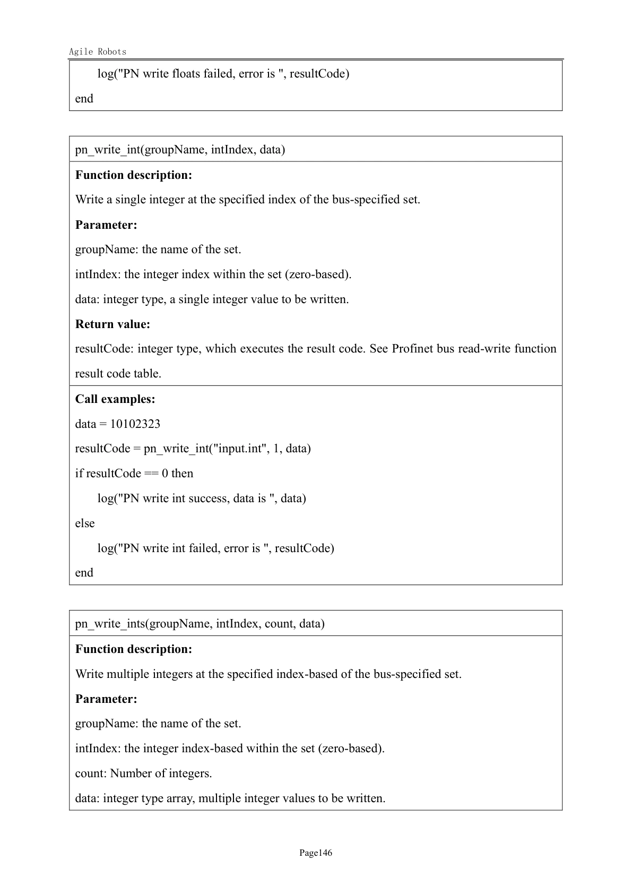



```
Agile Robots 
Page146 
 
log("PN write floats failed, error is ", resultCode) 
end 
 
pn_write_int(groupName, intIndex, data) 
Function description: 
Write a single integer at the specified index of the bus-specified set. 
Parameter: 
groupName: the name of the set. 
intIndex: the integer index within the set (zero-based). 
data: integer type, a single integer value to be written. 
Return value: 
resultCode: integer type, which executes the result code. See Profinet bus read-write function 
result code table. 
Call examples: 
data = 10102323 
resultCode = pn_write_int("input.int", 1, data) 
if resultCode == 0 then 
 
log("PN write int success, data is ", data) 
else 
 
log("PN write int failed, error is ", resultCode) 
end 
 
pn_write_ints(groupName, intIndex, count, data) 
Function description: 
Write multiple integers at the specified index-based of the bus-specified set. 
Parameter: 
groupName: the name of the set. 
intIndex: the integer index-based within the set (zero-based). 
count: Number of integers. 
data: integer type array, multiple integer values to be written.
```



**Original document cross-references:** [PDF 175](pages-145-192.md#pdf-page-175)

## PDF page 148

**Source:** Industrial Lua Programming Manual\_V3.3.0\_EN\_20260117.pdf, original pdf page 148. [Open the corresponding PDF reading-copy page](https://1292444914-files.gitbook.io/~/files/v0/b/gitbook-x-prod.appspot.com/o/spaces%2FtgOfPnscWebs1eh82EKq%2Fuploads%2FU0JYOssuma2RW4Gd2PqT%2Findustrial-lua-programming-manual-v3-3-0-en-20260117-pp-001-184.pdf?alt=media#page=148).



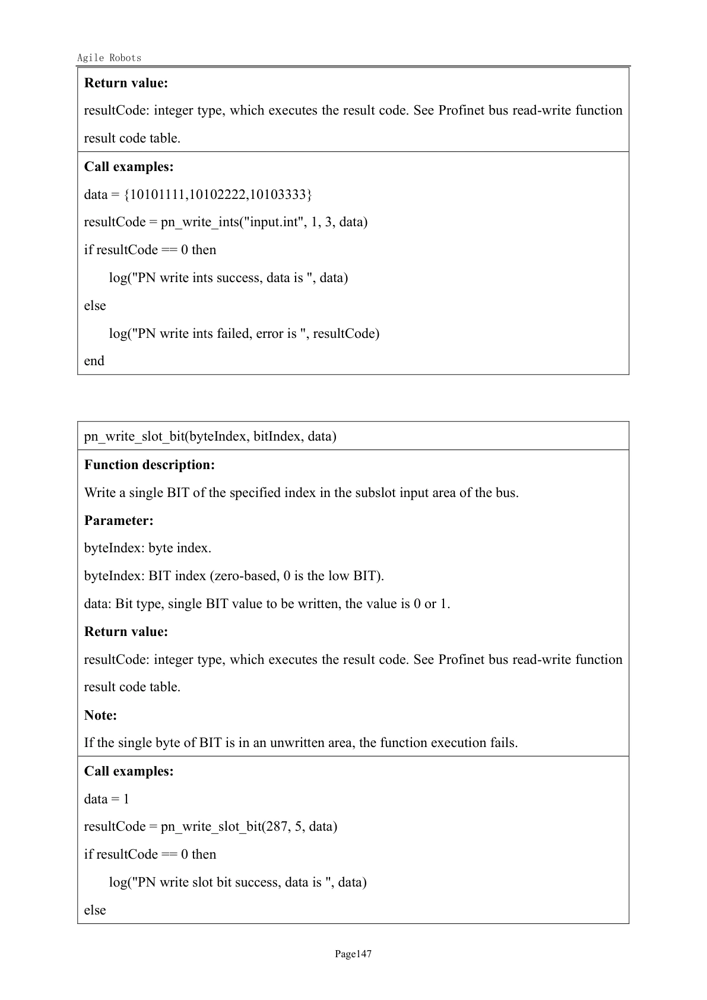



```
Agile Robots 
Page147 
Return value: 
resultCode: integer type, which executes the result code. See Profinet bus read-write function 
result code table. 
Call examples: 
data = {10101111,10102222,10103333} 
resultCode = pn_write_ints("input.int", 1, 3, data) 
if resultCode == 0 then 
 
log("PN write ints success, data is ", data) 
else 
 
log("PN write ints failed, error is ", resultCode) 
end 
 
 
pn_write_slot_bit(byteIndex, bitIndex, data) 
Function description: 
Write a single BIT of the specified index in the subslot input area of the bus. 
Parameter: 
byteIndex: byte index. 
byteIndex: BIT index (zero-based, 0 is the low BIT). 
data: Bit type, single BIT value to be written, the value is 0 or 1. 
Return value: 
resultCode: integer type, which executes the result code. See Profinet bus read-write function 
result code table. 
Note: 
If the single byte of BIT is in an unwritten area, the function execution fails. 
Call examples: 
data = 1 
resultCode = pn_write_slot_bit(287, 5, data) 
if resultCode == 0 then 
 
log("PN write slot bit success, data is ", data) 
else
```



**Original document cross-references:** [PDF 175](pages-145-192.md#pdf-page-175)

## PDF page 149

**Source:** Industrial Lua Programming Manual\_V3.3.0\_EN\_20260117.pdf, original pdf page 149. [Open the corresponding PDF reading-copy page](https://1292444914-files.gitbook.io/~/files/v0/b/gitbook-x-prod.appspot.com/o/spaces%2FtgOfPnscWebs1eh82EKq%2Fuploads%2FU0JYOssuma2RW4Gd2PqT%2Findustrial-lua-programming-manual-v3-3-0-en-20260117-pp-001-184.pdf?alt=media#page=149).



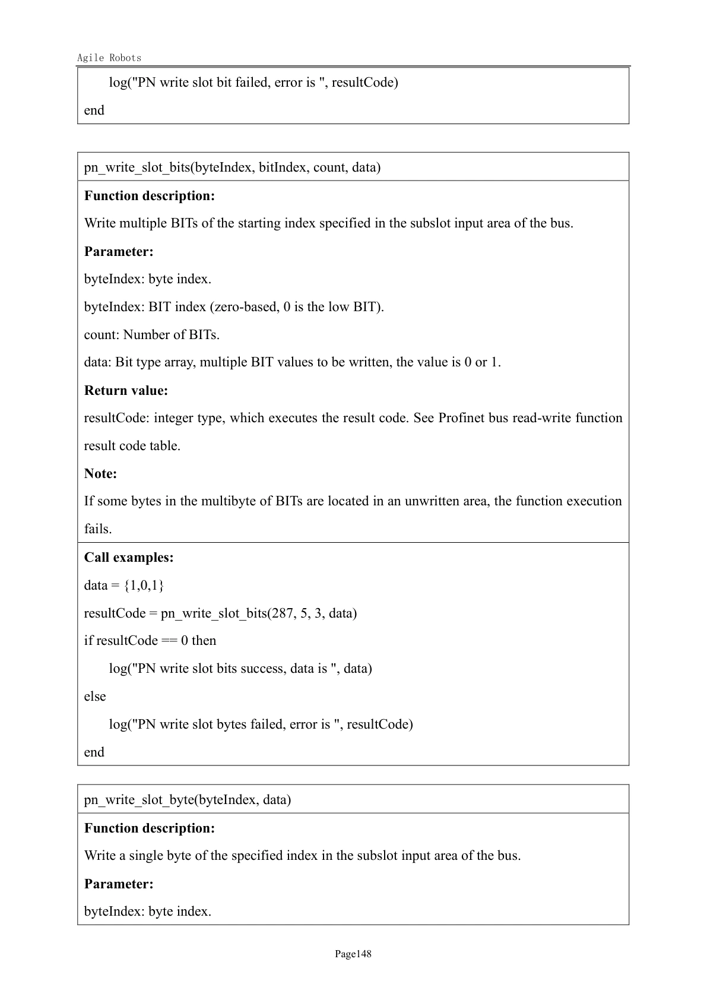



```
Agile Robots 
Page148 
 
log("PN write slot bit failed, error is ", resultCode) 
end 
 
pn_write_slot_bits(byteIndex, bitIndex, count, data) 
Function description: 
Write multiple BITs of the starting index specified in the subslot input area of the bus. 
Parameter: 
byteIndex: byte index. 
byteIndex: BIT index (zero-based, 0 is the low BIT). 
count: Number of BITs. 
data: Bit type array, multiple BIT values to be written, the value is 0 or 1. 
Return value: 
resultCode: integer type, which executes the result code. See Profinet bus read-write function 
result code table. 
Note: 
If some bytes in the multibyte of BITs are located in an unwritten area, the function execution 
fails. 
Call examples: 
data = {1,0,1} 
resultCode = pn_write_slot_bits(287, 5, 3, data) 
if resultCode == 0 then 
 
log("PN write slot bits success, data is ", data) 
else 
 
log("PN write slot bytes failed, error is ", resultCode) 
end 
 
pn_write_slot_byte(byteIndex, data) 
Function description: 
Write a single byte of the specified index in the subslot input area of the bus. 
Parameter: 
byteIndex: byte index.
```



**Original document cross-references:** [PDF 175](pages-145-192.md#pdf-page-175)

## PDF page 150

**Source:** Industrial Lua Programming Manual\_V3.3.0\_EN\_20260117.pdf, original pdf page 150. [Open the corresponding PDF reading-copy page](https://1292444914-files.gitbook.io/~/files/v0/b/gitbook-x-prod.appspot.com/o/spaces%2FtgOfPnscWebs1eh82EKq%2Fuploads%2FU0JYOssuma2RW4Gd2PqT%2Findustrial-lua-programming-manual-v3-3-0-en-20260117-pp-001-184.pdf?alt=media#page=150).



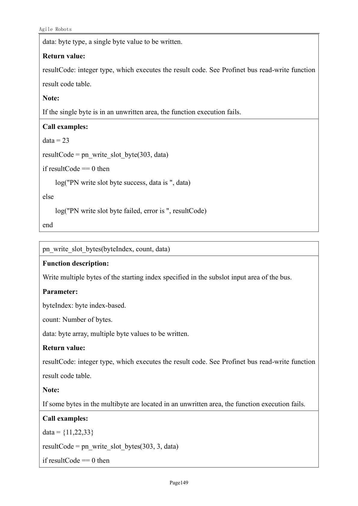



```
Agile Robots 
Page149 
data: byte type, a single byte value to be written. 
Return value: 
resultCode: integer type, which executes the result code. See Profinet bus read-write function 
result code table. 
Note: 
If the single byte is in an unwritten area, the function execution fails. 
Call examples: 
data = 23 
resultCode = pn_write_slot_byte(303, data) 
if resultCode == 0 then 
 
log("PN write slot byte success, data is ", data) 
else 
 
log("PN write slot byte failed, error is ", resultCode) 
end 
 
pn_write_slot_bytes(byteIndex, count, data) 
Function description: 
Write multiple bytes of the starting index specified in the subslot input area of the bus. 
Parameter: 
byteIndex: byte index-based. 
count: Number of bytes. 
data: byte array, multiple byte values to be written. 
Return value: 
resultCode: integer type, which executes the result code. See Profinet bus read-write function 
result code table. 
Note: 
If some bytes in the multibyte are located in an unwritten area, the function execution fails. 
Call examples: 
data = {11,22,33} 
resultCode = pn_write_slot_bytes(303, 3, data) 
if resultCode == 0 then
```



**Original document cross-references:** [PDF 175](pages-145-192.md#pdf-page-175)

## PDF page 151

**Source:** Industrial Lua Programming Manual\_V3.3.0\_EN\_20260117.pdf, original pdf page 151. [Open the corresponding PDF reading-copy page](https://1292444914-files.gitbook.io/~/files/v0/b/gitbook-x-prod.appspot.com/o/spaces%2FtgOfPnscWebs1eh82EKq%2Fuploads%2FU0JYOssuma2RW4Gd2PqT%2Findustrial-lua-programming-manual-v3-3-0-en-20260117-pp-001-184.pdf?alt=media#page=151).



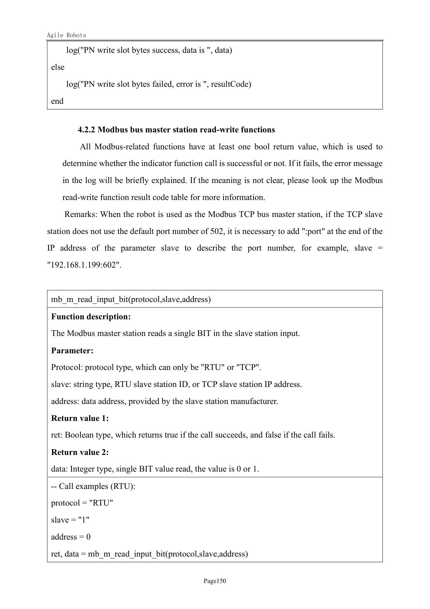



```
Agile Robots 
Page150 
 
log("PN write slot bytes success, data is ", data) 
else 
 
log("PN write slot bytes failed, error is ", resultCode) 
end 
 
4.2.2 Modbus bus master station read-write functions 
All Modbus-related functions have at least one bool return value, which is used to 
determine whether the indicator function call is successful or not. If it fails, the error message 
in the log will be briefly explained. If the meaning is not clear, please look up the Modbus 
read-write function result code table for more information. 
Remarks: When the robot is used as the Modbus TCP bus master station, if the TCP slave 
station does not use the default port number of 502, it is necessary to add ":port" at the end of the 
IP address of the parameter slave to describe the port number, for example, slave = 
"192.168.1.199:602". 
 
mb_m_read_input_bit(protocol,slave,address) 
Function description: 
The Modbus master station reads a single BIT in the slave station input. 
Parameter: 
Protocol: protocol type, which can only be "RTU" or "TCP". 
slave: string type, RTU slave station ID, or TCP slave station IP address. 
address: data address, provided by the slave station manufacturer. 
Return value 1: 
ret: Boolean type, which returns true if the call succeeds, and false if the call fails.  
Return value 2: 
data: Integer type, single BIT value read, the value is 0 or 1. 
-- Call examples (RTU): 
protocol = "RTU" 
slave = "1" 
address = 0 
ret, data = mb_m_read_input_bit(protocol,slave,address)
```



**Original document cross-references:** [PDF 187](pages-145-192.md#pdf-page-187)

## PDF page 152

**Source:** Industrial Lua Programming Manual\_V3.3.0\_EN\_20260117.pdf, original pdf page 152. [Open the corresponding PDF reading-copy page](https://1292444914-files.gitbook.io/~/files/v0/b/gitbook-x-prod.appspot.com/o/spaces%2FtgOfPnscWebs1eh82EKq%2Fuploads%2FU0JYOssuma2RW4Gd2PqT%2Findustrial-lua-programming-manual-v3-3-0-en-20260117-pp-001-184.pdf?alt=media#page=152).



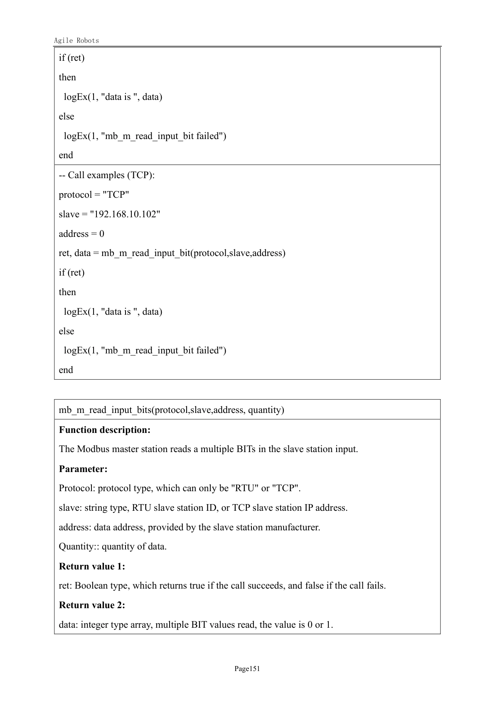



```
Agile Robots 
Page151 
if (ret) 
then 
  logEx(1, "data is ", data) 
else 
  logEx(1, "mb_m_read_input_bit failed") 
end 
-- Call examples (TCP): 
protocol = "TCP" 
slave = "192.168.10.102" 
address = 0 
ret, data = mb_m_read_input_bit(protocol,slave,address) 
if (ret) 
then 
  logEx(1, "data is ", data) 
else 
  logEx(1, "mb_m_read_input_bit failed") 
end 
 
mb_m_read_input_bits(protocol,slave,address, quantity) 
Function description: 
The Modbus master station reads a multiple BITs in the slave station input. 
Parameter: 
Protocol: protocol type, which can only be "RTU" or "TCP". 
slave: string type, RTU slave station ID, or TCP slave station IP address. 
address: data address, provided by the slave station manufacturer. 
Quantity:: quantity of data. 
Return value 1: 
ret: Boolean type, which returns true if the call succeeds, and false if the call fails.  
Return value 2: 
data: integer type array, multiple BIT values read, the value is 0 or 1.
```



## PDF page 153

**Source:** Industrial Lua Programming Manual\_V3.3.0\_EN\_20260117.pdf, original pdf page 153. [Open the corresponding PDF reading-copy page](https://1292444914-files.gitbook.io/~/files/v0/b/gitbook-x-prod.appspot.com/o/spaces%2FtgOfPnscWebs1eh82EKq%2Fuploads%2FU0JYOssuma2RW4Gd2PqT%2Findustrial-lua-programming-manual-v3-3-0-en-20260117-pp-001-184.pdf?alt=media#page=153).



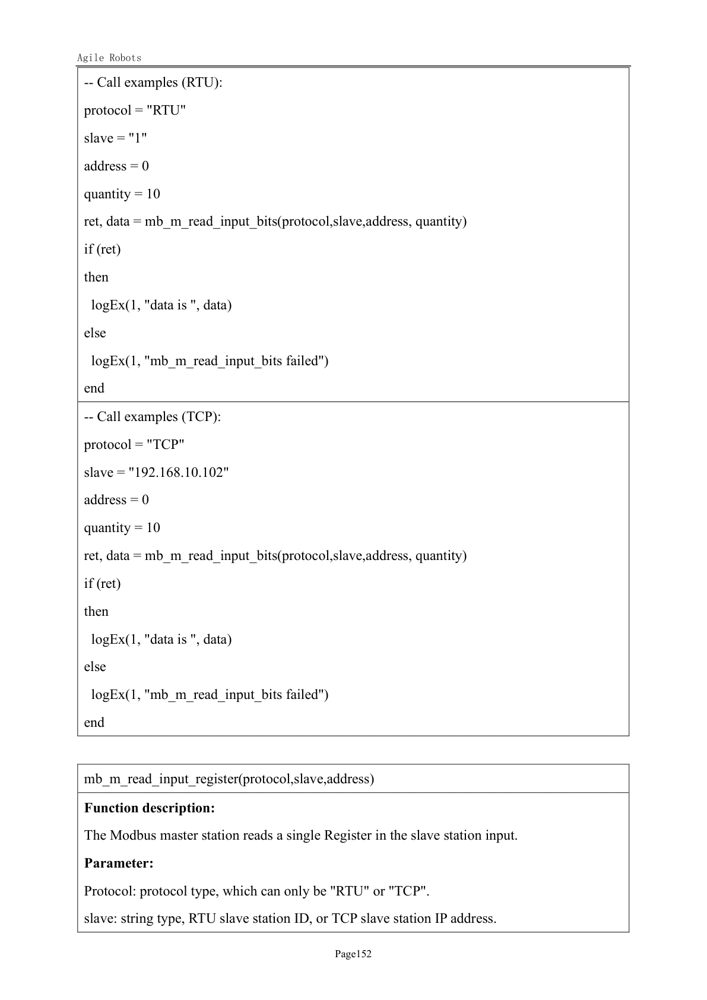



```
Agile Robots 
Page152 
-- Call examples (RTU): 
protocol = "RTU" 
slave = "1" 
address = 0 
quantity = 10 
ret, data = mb_m_read_input_bits(protocol,slave,address, quantity) 
if (ret) 
then 
  logEx(1, "data is ", data) 
else 
  logEx(1, "mb_m_read_input_bits failed") 
end 
-- Call examples (TCP): 
protocol = "TCP" 
slave = "192.168.10.102" 
address = 0 
quantity = 10 
ret, data = mb_m_read_input_bits(protocol,slave,address, quantity) 
if (ret) 
then 
  logEx(1, "data is ", data) 
else 
  logEx(1, "mb_m_read_input_bits failed") 
end 
 
mb_m_read_input_register(protocol,slave,address) 
Function description: 
The Modbus master station reads a single Register in the slave station input. 
Parameter: 
Protocol: protocol type, which can only be "RTU" or "TCP". 
slave: string type, RTU slave station ID, or TCP slave station IP address.
```



## PDF page 154

**Source:** Industrial Lua Programming Manual\_V3.3.0\_EN\_20260117.pdf, original pdf page 154. [Open the corresponding PDF reading-copy page](https://1292444914-files.gitbook.io/~/files/v0/b/gitbook-x-prod.appspot.com/o/spaces%2FtgOfPnscWebs1eh82EKq%2Fuploads%2FU0JYOssuma2RW4Gd2PqT%2Findustrial-lua-programming-manual-v3-3-0-en-20260117-pp-001-184.pdf?alt=media#page=154).



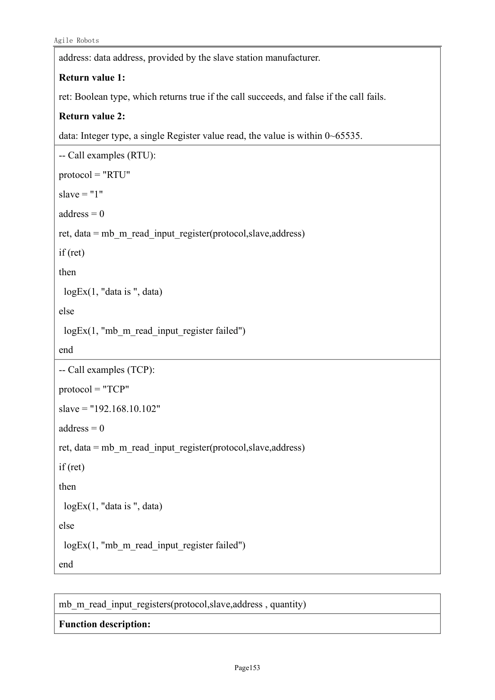



```
Agile Robots 
Page153 
address: data address, provided by the slave station manufacturer. 
Return value 1: 
ret: Boolean type, which returns true if the call succeeds, and false if the call fails.  
Return value 2: 
data: Integer type, a single Register value read, the value is within 0~65535. 
-- Call examples (RTU): 
protocol = "RTU" 
slave = "1" 
address = 0 
ret, data = mb_m_read_input_register(protocol,slave,address) 
if (ret) 
then 
  logEx(1, "data is ", data) 
else 
  logEx(1, "mb_m_read_input_register failed") 
end 
-- Call examples (TCP): 
protocol = "TCP" 
slave = "192.168.10.102" 
address = 0 
ret, data = mb_m_read_input_register(protocol,slave,address) 
if (ret) 
then 
  logEx(1, "data is ", data) 
else 
  logEx(1, "mb_m_read_input_register failed") 
end 
 
mb_m_read_input_registers(protocol,slave,address , quantity) 
Function description:
```



## PDF page 155

**Source:** Industrial Lua Programming Manual\_V3.3.0\_EN\_20260117.pdf, original pdf page 155. [Open the corresponding PDF reading-copy page](https://1292444914-files.gitbook.io/~/files/v0/b/gitbook-x-prod.appspot.com/o/spaces%2FtgOfPnscWebs1eh82EKq%2Fuploads%2FU0JYOssuma2RW4Gd2PqT%2Findustrial-lua-programming-manual-v3-3-0-en-20260117-pp-001-184.pdf?alt=media#page=155).



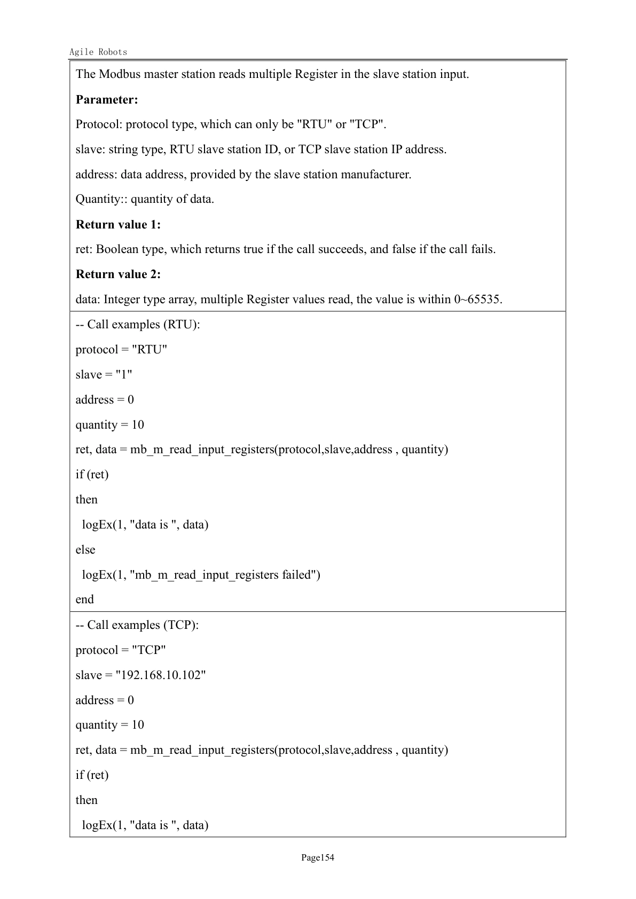



```
Agile Robots 
Page154 
The Modbus master station reads multiple Register in the slave station input. 
Parameter: 
Protocol: protocol type, which can only be "RTU" or "TCP". 
slave: string type, RTU slave station ID, or TCP slave station IP address. 
address: data address, provided by the slave station manufacturer. 
Quantity:: quantity of data. 
Return value 1: 
ret: Boolean type, which returns true if the call succeeds, and false if the call fails.  
Return value 2: 
data: Integer type array, multiple Register values read, the value is within 0~65535. 
-- Call examples (RTU): 
protocol = "RTU" 
slave = "1" 
address = 0 
quantity = 10 
ret, data = mb_m_read_input_registers(protocol,slave,address , quantity) 
if (ret) 
then 
  logEx(1, "data is ", data) 
else 
  logEx(1, "mb_m_read_input_registers failed") 
end 
-- Call examples (TCP): 
protocol = "TCP" 
slave = "192.168.10.102" 
address = 0 
quantity = 10 
ret, data = mb_m_read_input_registers(protocol,slave,address , quantity) 
if (ret) 
then 
  logEx(1, "data is ", data)
```



## PDF page 156

**Source:** Industrial Lua Programming Manual\_V3.3.0\_EN\_20260117.pdf, original pdf page 156. [Open the corresponding PDF reading-copy page](https://1292444914-files.gitbook.io/~/files/v0/b/gitbook-x-prod.appspot.com/o/spaces%2FtgOfPnscWebs1eh82EKq%2Fuploads%2FU0JYOssuma2RW4Gd2PqT%2Findustrial-lua-programming-manual-v3-3-0-en-20260117-pp-001-184.pdf?alt=media#page=156).



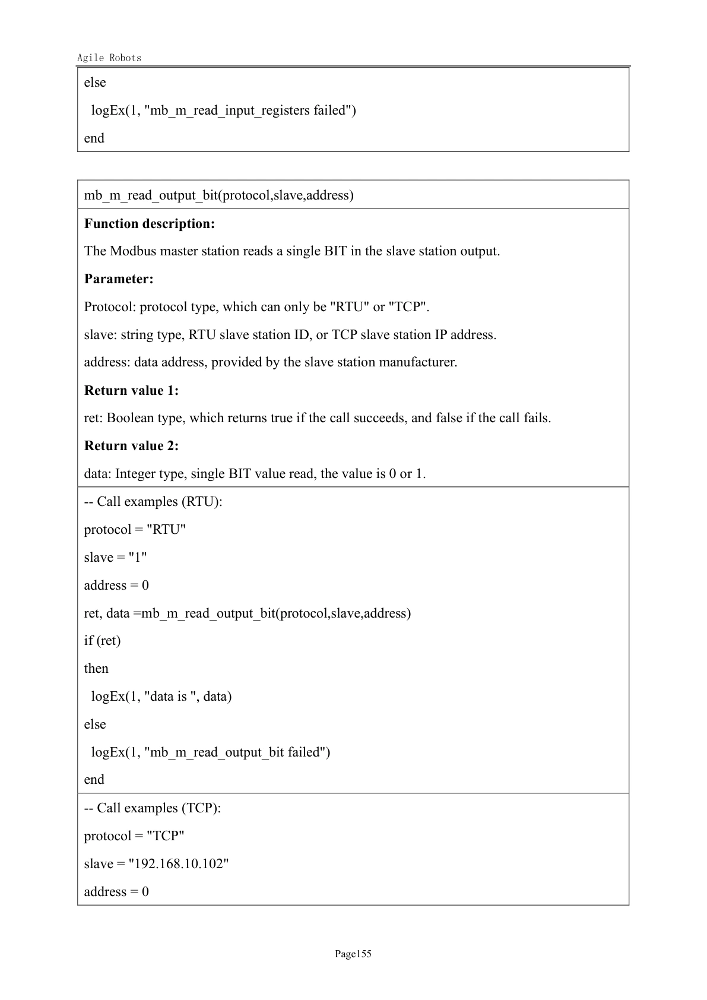



```
Agile Robots 
Page155 
else 
  logEx(1, "mb_m_read_input_registers failed") 
end 
 
mb_m_read_output_bit(protocol,slave,address) 
Function description: 
The Modbus master station reads a single BIT in the slave station output. 
Parameter: 
Protocol: protocol type, which can only be "RTU" or "TCP". 
slave: string type, RTU slave station ID, or TCP slave station IP address. 
address: data address, provided by the slave station manufacturer. 
Return value 1: 
ret: Boolean type, which returns true if the call succeeds, and false if the call fails.  
Return value 2: 
data: Integer type, single BIT value read, the value is 0 or 1. 
-- Call examples (RTU): 
protocol = "RTU" 
slave = "1" 
address = 0 
ret, data =mb_m_read_output_bit(protocol,slave,address) 
if (ret) 
then 
  logEx(1, "data is ", data) 
else 
  logEx(1, "mb_m_read_output_bit failed") 
end 
-- Call examples (TCP): 
protocol = "TCP" 
slave = "192.168.10.102" 
address = 0
```



## PDF page 157

**Source:** Industrial Lua Programming Manual\_V3.3.0\_EN\_20260117.pdf, original pdf page 157. [Open the corresponding PDF reading-copy page](https://1292444914-files.gitbook.io/~/files/v0/b/gitbook-x-prod.appspot.com/o/spaces%2FtgOfPnscWebs1eh82EKq%2Fuploads%2FU0JYOssuma2RW4Gd2PqT%2Findustrial-lua-programming-manual-v3-3-0-en-20260117-pp-001-184.pdf?alt=media#page=157).



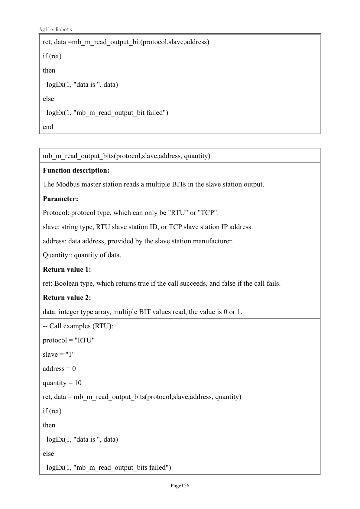



```
Agile Robots 
Page156 
ret, data =mb_m_read_output_bit(protocol,slave,address) 
if (ret) 
then 
  logEx(1, "data is ", data) 
else 
  logEx(1, "mb_m_read_output_bit failed") 
end 
 
mb_m_read_output_bits(protocol,slave,address, quantity) 
Function description: 
The Modbus master station reads a multiple BITs in the slave station output. 
Parameter: 
Protocol: protocol type, which can only be "RTU" or "TCP". 
slave: string type, RTU slave station ID, or TCP slave station IP address. 
address: data address, provided by the slave station manufacturer. 
Quantity:: quantity of data. 
Return value 1: 
ret: Boolean type, which returns true if the call succeeds, and false if the call fails.  
Return value 2: 
data: integer type array, multiple BIT values read, the value is 0 or 1. 
-- Call examples (RTU): 
protocol = "RTU" 
slave = "1" 
address = 0 
quantity = 10 
ret, data = mb_m_read_output_bits(protocol,slave,address, quantity) 
if (ret) 
then 
  logEx(1, "data is ", data) 
else 
  logEx(1, "mb_m_read_output_bits failed")
```



## PDF page 158

**Source:** Industrial Lua Programming Manual\_V3.3.0\_EN\_20260117.pdf, original pdf page 158. [Open the corresponding PDF reading-copy page](https://1292444914-files.gitbook.io/~/files/v0/b/gitbook-x-prod.appspot.com/o/spaces%2FtgOfPnscWebs1eh82EKq%2Fuploads%2FU0JYOssuma2RW4Gd2PqT%2Findustrial-lua-programming-manual-v3-3-0-en-20260117-pp-001-184.pdf?alt=media#page=158).



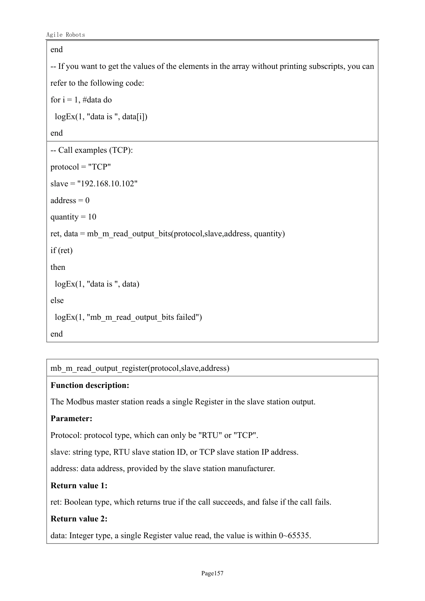



```
Agile Robots 
Page157 
end 
-- If you want to get the values of the elements in the array without printing subscripts, you can 
refer to the following code: 
for i = 1, #data do 
  logEx(1, "data is ", data[i]) 
end 
-- Call examples (TCP): 
protocol = "TCP" 
slave = "192.168.10.102" 
address = 0 
quantity = 10 
ret, data = mb_m_read_output_bits(protocol,slave,address, quantity) 
if (ret) 
then 
  logEx(1, "data is ", data) 
else 
  logEx(1, "mb_m_read_output_bits failed") 
end 
 
mb_m_read_output_register(protocol,slave,address) 
Function description: 
The Modbus master station reads a single Register in the slave station output. 
Parameter: 
Protocol: protocol type, which can only be "RTU" or "TCP". 
slave: string type, RTU slave station ID, or TCP slave station IP address. 
address: data address, provided by the slave station manufacturer. 
Return value 1: 
ret: Boolean type, which returns true if the call succeeds, and false if the call fails.  
Return value 2: 
data: Integer type, a single Register value read, the value is within 0~65535.
```



## PDF page 159

**Source:** Industrial Lua Programming Manual\_V3.3.0\_EN\_20260117.pdf, original pdf page 159. [Open the corresponding PDF reading-copy page](https://1292444914-files.gitbook.io/~/files/v0/b/gitbook-x-prod.appspot.com/o/spaces%2FtgOfPnscWebs1eh82EKq%2Fuploads%2FU0JYOssuma2RW4Gd2PqT%2Findustrial-lua-programming-manual-v3-3-0-en-20260117-pp-001-184.pdf?alt=media#page=159).



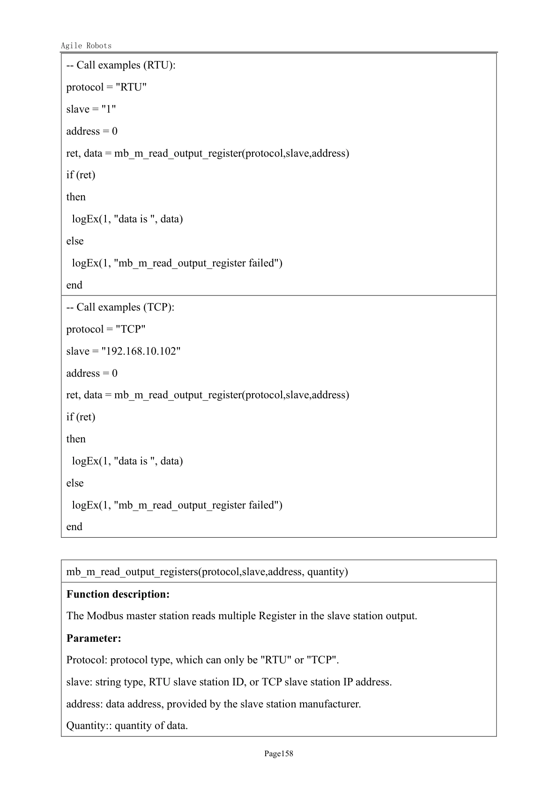



```
Agile Robots 
Page158 
-- Call examples (RTU): 
protocol = "RTU" 
slave = "1" 
address = 0 
ret, data = mb_m_read_output_register(protocol,slave,address) 
if (ret) 
then 
  logEx(1, "data is ", data) 
else 
  logEx(1, "mb_m_read_output_register failed") 
end 
-- Call examples (TCP): 
protocol = "TCP" 
slave = "192.168.10.102" 
address = 0 
ret, data = mb_m_read_output_register(protocol,slave,address) 
if (ret) 
then 
  logEx(1, "data is ", data) 
else 
  logEx(1, "mb_m_read_output_register failed") 
end 
 
mb_m_read_output_registers(protocol,slave,address, quantity) 
Function description: 
The Modbus master station reads multiple Register in the slave station output. 
Parameter: 
Protocol: protocol type, which can only be "RTU" or "TCP". 
slave: string type, RTU slave station ID, or TCP slave station IP address. 
address: data address, provided by the slave station manufacturer. 
Quantity:: quantity of data.
```



## PDF page 160

**Source:** Industrial Lua Programming Manual\_V3.3.0\_EN\_20260117.pdf, original pdf page 160. [Open the corresponding PDF reading-copy page](https://1292444914-files.gitbook.io/~/files/v0/b/gitbook-x-prod.appspot.com/o/spaces%2FtgOfPnscWebs1eh82EKq%2Fuploads%2FU0JYOssuma2RW4Gd2PqT%2Findustrial-lua-programming-manual-v3-3-0-en-20260117-pp-001-184.pdf?alt=media#page=160).



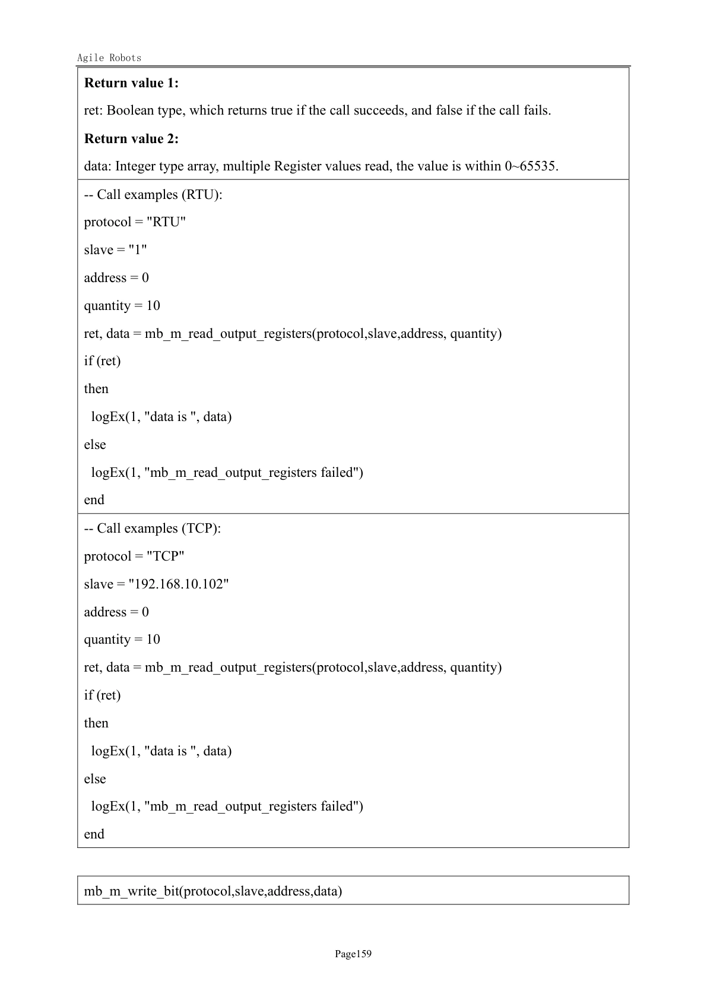



```
Agile Robots 
Page159 
Return value 1: 
ret: Boolean type, which returns true if the call succeeds, and false if the call fails.  
Return value 2: 
data: Integer type array, multiple Register values read, the value is within 0~65535. 
-- Call examples (RTU): 
protocol = "RTU" 
slave = "1" 
address = 0 
quantity = 10 
ret, data = mb_m_read_output_registers(protocol,slave,address, quantity) 
if (ret) 
then 
  logEx(1, "data is ", data) 
else 
  logEx(1, "mb_m_read_output_registers failed") 
end 
-- Call examples (TCP): 
protocol = "TCP" 
slave = "192.168.10.102" 
address = 0 
quantity = 10 
ret, data = mb_m_read_output_registers(protocol,slave,address, quantity) 
if (ret) 
then 
  logEx(1, "data is ", data) 
else 
  logEx(1, "mb_m_read_output_registers failed") 
end 
 
mb_m_write_bit(protocol,slave,address,data)
```



## PDF page 161

**Source:** Industrial Lua Programming Manual\_V3.3.0\_EN\_20260117.pdf, original pdf page 161. [Open the corresponding PDF reading-copy page](https://1292444914-files.gitbook.io/~/files/v0/b/gitbook-x-prod.appspot.com/o/spaces%2FtgOfPnscWebs1eh82EKq%2Fuploads%2FU0JYOssuma2RW4Gd2PqT%2Findustrial-lua-programming-manual-v3-3-0-en-20260117-pp-001-184.pdf?alt=media#page=161).



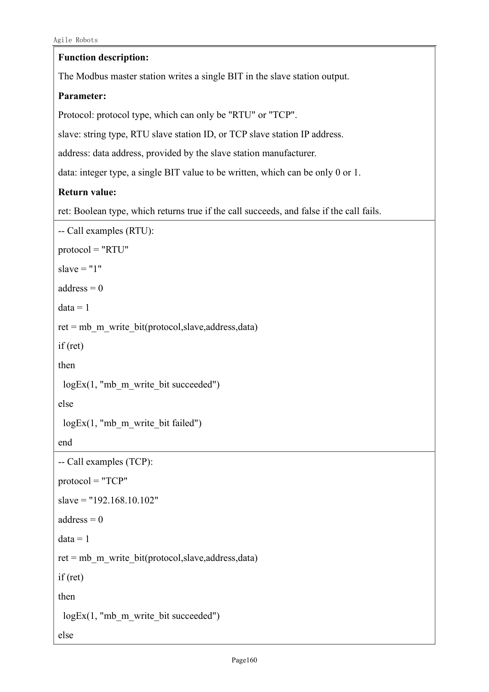



```
Agile Robots 
Page160 
Function description: 
The Modbus master station writes a single BIT in the slave station output. 
Parameter: 
Protocol: protocol type, which can only be "RTU" or "TCP". 
slave: string type, RTU slave station ID, or TCP slave station IP address. 
address: data address, provided by the slave station manufacturer. 
data: integer type, a single BIT value to be written, which can be only 0 or 1. 
Return value: 
ret: Boolean type, which returns true if the call succeeds, and false if the call fails.  
-- Call examples (RTU): 
protocol = "RTU" 
slave = "1" 
address = 0 
data = 1 
ret = mb_m_write_bit(protocol,slave,address,data) 
if (ret) 
then 
  logEx(1, "mb_m_write_bit succeeded") 
else 
  logEx(1, "mb_m_write_bit failed") 
end 
-- Call examples (TCP): 
protocol = "TCP" 
slave = "192.168.10.102" 
address = 0 
data = 1 
ret = mb_m_write_bit(protocol,slave,address,data) 
if (ret) 
then 
  logEx(1, "mb_m_write_bit succeeded") 
else
```



## PDF page 162

**Source:** Industrial Lua Programming Manual\_V3.3.0\_EN\_20260117.pdf, original pdf page 162. [Open the corresponding PDF reading-copy page](https://1292444914-files.gitbook.io/~/files/v0/b/gitbook-x-prod.appspot.com/o/spaces%2FtgOfPnscWebs1eh82EKq%2Fuploads%2FU0JYOssuma2RW4Gd2PqT%2Findustrial-lua-programming-manual-v3-3-0-en-20260117-pp-001-184.pdf?alt=media#page=162).



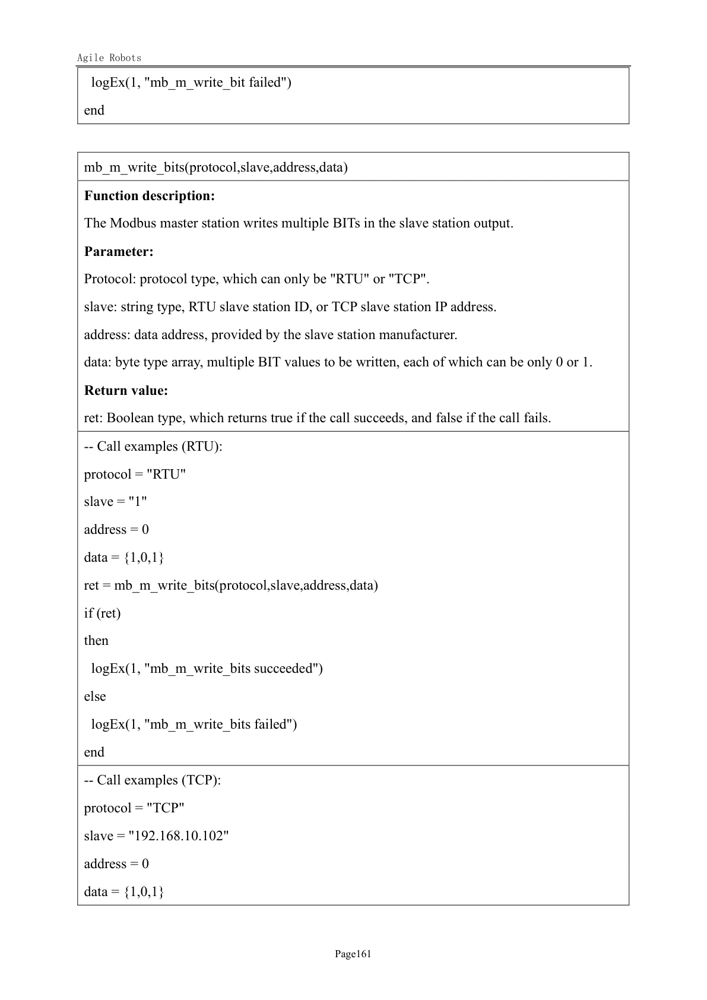



```
Agile Robots 
Page161 
  logEx(1, "mb_m_write_bit failed") 
end 
 
mb_m_write_bits(protocol,slave,address,data) 
Function description: 
The Modbus master station writes multiple BITs in the slave station output. 
Parameter: 
Protocol: protocol type, which can only be "RTU" or "TCP". 
slave: string type, RTU slave station ID, or TCP slave station IP address. 
address: data address, provided by the slave station manufacturer. 
data: byte type array, multiple BIT values to be written, each of which can be only 0 or 1. 
Return value: 
ret: Boolean type, which returns true if the call succeeds, and false if the call fails.  
-- Call examples (RTU): 
protocol = "RTU" 
slave = "1" 
address = 0 
data = {1,0,1} 
ret = mb_m_write_bits(protocol,slave,address,data) 
if (ret) 
then 
  logEx(1, "mb_m_write_bits succeeded") 
else 
  logEx(1, "mb_m_write_bits failed") 
end 
-- Call examples (TCP): 
protocol = "TCP" 
slave = "192.168.10.102" 
address = 0 
data = {1,0,1}
```



## PDF page 163

**Source:** Industrial Lua Programming Manual\_V3.3.0\_EN\_20260117.pdf, original pdf page 163. [Open the corresponding PDF reading-copy page](https://1292444914-files.gitbook.io/~/files/v0/b/gitbook-x-prod.appspot.com/o/spaces%2FtgOfPnscWebs1eh82EKq%2Fuploads%2FU0JYOssuma2RW4Gd2PqT%2Findustrial-lua-programming-manual-v3-3-0-en-20260117-pp-001-184.pdf?alt=media#page=163).



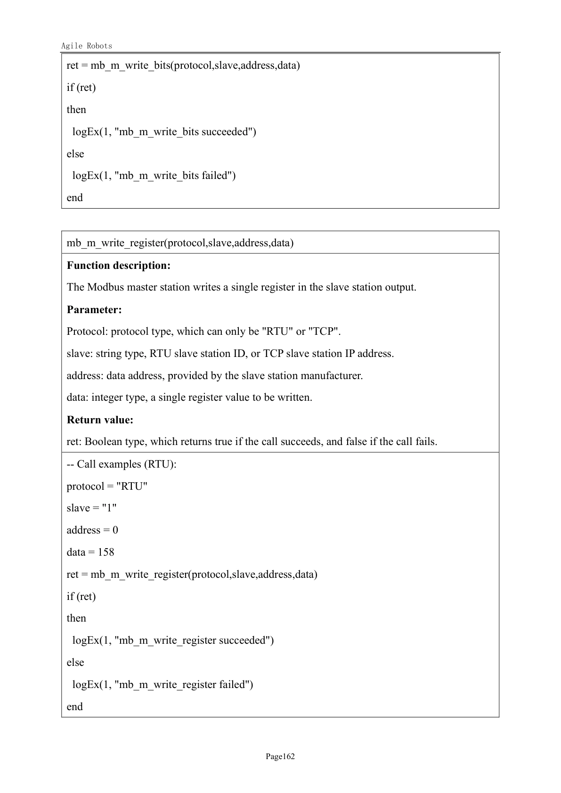



```
Agile Robots 
Page162 
ret = mb_m_write_bits(protocol,slave,address,data) 
if (ret) 
then 
  logEx(1, "mb_m_write_bits succeeded") 
else 
  logEx(1, "mb_m_write_bits failed") 
end 
 
mb_m_write_register(protocol,slave,address,data) 
Function description: 
The Modbus master station writes a single register in the slave station output. 
Parameter: 
Protocol: protocol type, which can only be "RTU" or "TCP". 
slave: string type, RTU slave station ID, or TCP slave station IP address. 
address: data address, provided by the slave station manufacturer. 
data: integer type, a single register value to be written. 
Return value: 
ret: Boolean type, which returns true if the call succeeds, and false if the call fails.  
-- Call examples (RTU): 
protocol = "RTU" 
slave = "1" 
address = 0 
data = 158  
ret = mb_m_write_register(protocol,slave,address,data) 
if (ret) 
then 
  logEx(1, "mb_m_write_register succeeded") 
else 
  logEx(1, "mb_m_write_register failed") 
end
```



## PDF page 164

**Source:** Industrial Lua Programming Manual\_V3.3.0\_EN\_20260117.pdf, original pdf page 164. [Open the corresponding PDF reading-copy page](https://1292444914-files.gitbook.io/~/files/v0/b/gitbook-x-prod.appspot.com/o/spaces%2FtgOfPnscWebs1eh82EKq%2Fuploads%2FU0JYOssuma2RW4Gd2PqT%2Findustrial-lua-programming-manual-v3-3-0-en-20260117-pp-001-184.pdf?alt=media#page=164).



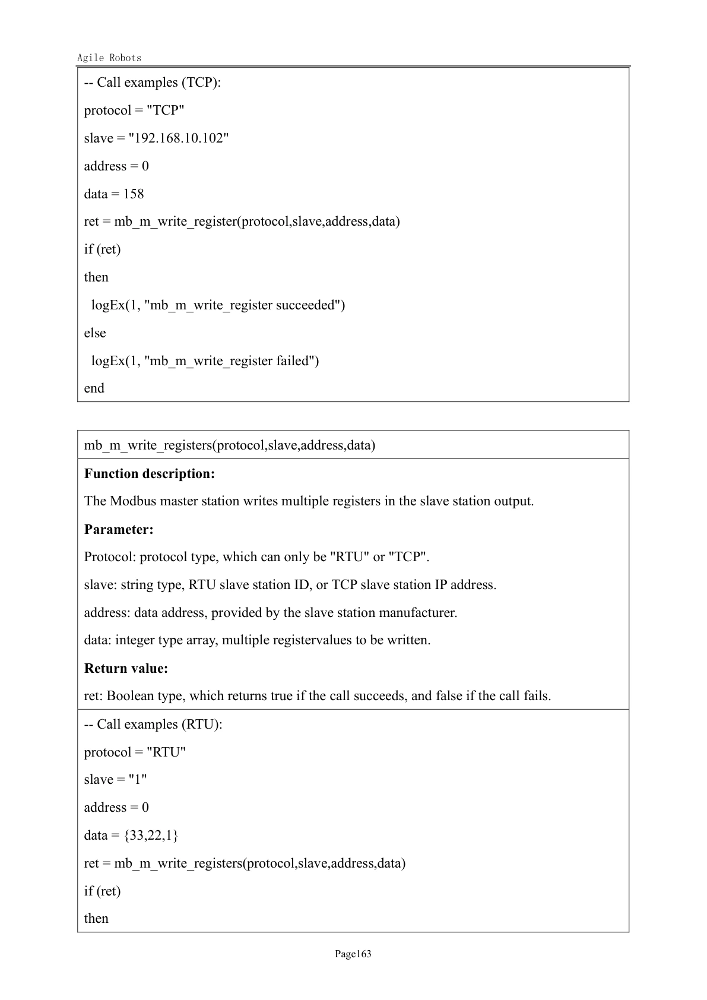



```
Agile Robots 
Page163 
-- Call examples (TCP): 
protocol = "TCP" 
slave = "192.168.10.102" 
address = 0 
data = 158  
ret = mb_m_write_register(protocol,slave,address,data) 
if (ret) 
then 
  logEx(1, "mb_m_write_register succeeded") 
else 
  logEx(1, "mb_m_write_register failed") 
end 
 
mb_m_write_registers(protocol,slave,address,data) 
Function description: 
The Modbus master station writes multiple registers in the slave station output. 
Parameter: 
Protocol: protocol type, which can only be "RTU" or "TCP". 
slave: string type, RTU slave station ID, or TCP slave station IP address. 
address: data address, provided by the slave station manufacturer. 
data: integer type array, multiple registervalues to be written. 
Return value: 
ret: Boolean type, which returns true if the call succeeds, and false if the call fails.  
-- Call examples (RTU): 
protocol = "RTU" 
slave = "1" 
address = 0 
data = {33,22,1}  
ret = mb_m_write_registers(protocol,slave,address,data) 
if (ret) 
then
```



## PDF page 165

**Source:** Industrial Lua Programming Manual\_V3.3.0\_EN\_20260117.pdf, original pdf page 165. [Open the corresponding PDF reading-copy page](https://1292444914-files.gitbook.io/~/files/v0/b/gitbook-x-prod.appspot.com/o/spaces%2FtgOfPnscWebs1eh82EKq%2Fuploads%2FU0JYOssuma2RW4Gd2PqT%2Findustrial-lua-programming-manual-v3-3-0-en-20260117-pp-001-184.pdf?alt=media#page=165).



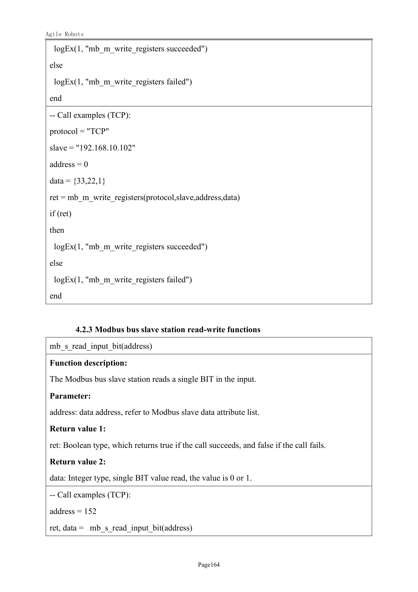



```
Agile Robots 
Page164 
  logEx(1, "mb_m_write_registers succeeded") 
else 
  logEx(1, "mb_m_write_registers failed") 
end 
-- Call examples (TCP): 
protocol = "TCP" 
slave = "192.168.10.102" 
address = 0 
data = {33,22,1}  
ret = mb_m_write_registers(protocol,slave,address,data) 
if (ret) 
then 
  logEx(1, "mb_m_write_registers succeeded") 
else 
  logEx(1, "mb_m_write_registers failed") 
end 
 
4.2.3 Modbus bus slave station read-write functions 
mb_s_read_input_bit(address) 
Function description: 
The Modbus bus slave station reads a single BIT in the input. 
Parameter: 
address: data address, refer to Modbus slave data attribute list. 
Return value 1: 
ret: Boolean type, which returns true if the call succeeds, and false if the call fails. 
Return value 2: 
data: Integer type, single BIT value read, the value is 0 or 1.  
-- Call examples (TCP): 
address = 152 
ret, data =   mb_s_read_input_bit(address)
```



**Original document cross-references:** [PDF 189](pages-145-192.md#pdf-page-189)

## PDF page 166

**Source:** Industrial Lua Programming Manual\_V3.3.0\_EN\_20260117.pdf, original pdf page 166. [Open the corresponding PDF reading-copy page](https://1292444914-files.gitbook.io/~/files/v0/b/gitbook-x-prod.appspot.com/o/spaces%2FtgOfPnscWebs1eh82EKq%2Fuploads%2FU0JYOssuma2RW4Gd2PqT%2Findustrial-lua-programming-manual-v3-3-0-en-20260117-pp-001-184.pdf?alt=media#page=166).



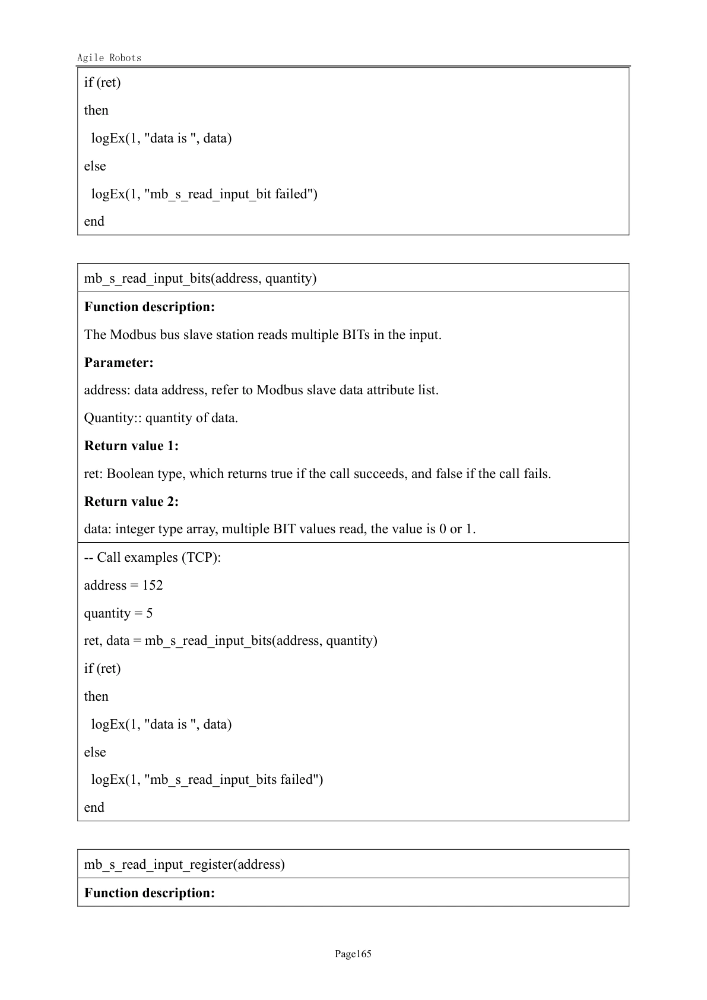



```
Agile Robots 
Page165 
if (ret) 
then 
  logEx(1, "data is ", data) 
else 
  logEx(1, "mb_s_read_input_bit failed") 
end 
 
mb_s_read_input_bits(address, quantity) 
Function description: 
The Modbus bus slave station reads multiple BITs in the input. 
Parameter: 
address: data address, refer to Modbus slave data attribute list. 
Quantity:: quantity of data. 
Return value 1: 
ret: Boolean type, which returns true if the call succeeds, and false if the call fails. 
Return value 2: 
data: integer type array, multiple BIT values read, the value is 0 or 1. 
-- Call examples (TCP): 
address = 152 
quantity = 5 
ret, data = mb_s_read_input_bits(address, quantity) 
if (ret) 
then 
  logEx(1, "data is ", data) 
else 
  logEx(1, "mb_s_read_input_bits failed") 
end 
 
mb_s_read_input_register(address) 
Function description:
```



**Original document cross-references:** [PDF 189](pages-145-192.md#pdf-page-189)

## PDF page 167

**Source:** Industrial Lua Programming Manual\_V3.3.0\_EN\_20260117.pdf, original pdf page 167. [Open the corresponding PDF reading-copy page](https://1292444914-files.gitbook.io/~/files/v0/b/gitbook-x-prod.appspot.com/o/spaces%2FtgOfPnscWebs1eh82EKq%2Fuploads%2FU0JYOssuma2RW4Gd2PqT%2Findustrial-lua-programming-manual-v3-3-0-en-20260117-pp-001-184.pdf?alt=media#page=167).



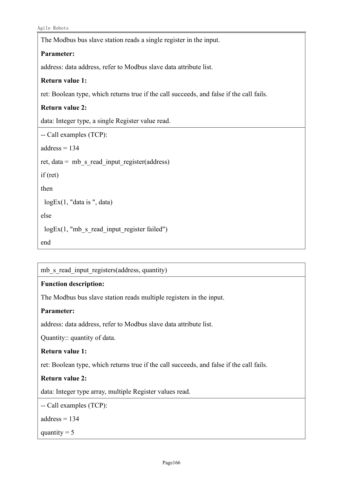



```
Agile Robots 
Page166 
The Modbus bus slave station reads a single register in the input. 
Parameter: 
address: data address, refer to Modbus slave data attribute list. 
Return value 1: 
ret: Boolean type, which returns true if the call succeeds, and false if the call fails. 
Return value 2: 
data: Integer type, a single Register value read.  
-- Call examples (TCP): 
address = 134 
ret, data =  mb_s_read_input_register(address) 
if (ret) 
then 
  logEx(1, "data is ", data) 
else 
  logEx(1, "mb_s_read_input_register failed") 
end 
 
mb_s_read_input_registers(address, quantity) 
Function description: 
The Modbus bus slave station reads multiple registers in the input. 
Parameter: 
address: data address, refer to Modbus slave data attribute list. 
Quantity:: quantity of data. 
Return value 1: 
ret: Boolean type, which returns true if the call succeeds, and false if the call fails. 
Return value 2: 
data: Integer type array, multiple Register values read.  
-- Call examples (TCP): 
address = 134 
quantity = 5
```



**Original document cross-references:** [PDF 189](pages-145-192.md#pdf-page-189)

## PDF page 168

**Source:** Industrial Lua Programming Manual\_V3.3.0\_EN\_20260117.pdf, original pdf page 168. [Open the corresponding PDF reading-copy page](https://1292444914-files.gitbook.io/~/files/v0/b/gitbook-x-prod.appspot.com/o/spaces%2FtgOfPnscWebs1eh82EKq%2Fuploads%2FU0JYOssuma2RW4Gd2PqT%2Findustrial-lua-programming-manual-v3-3-0-en-20260117-pp-001-184.pdf?alt=media#page=168).



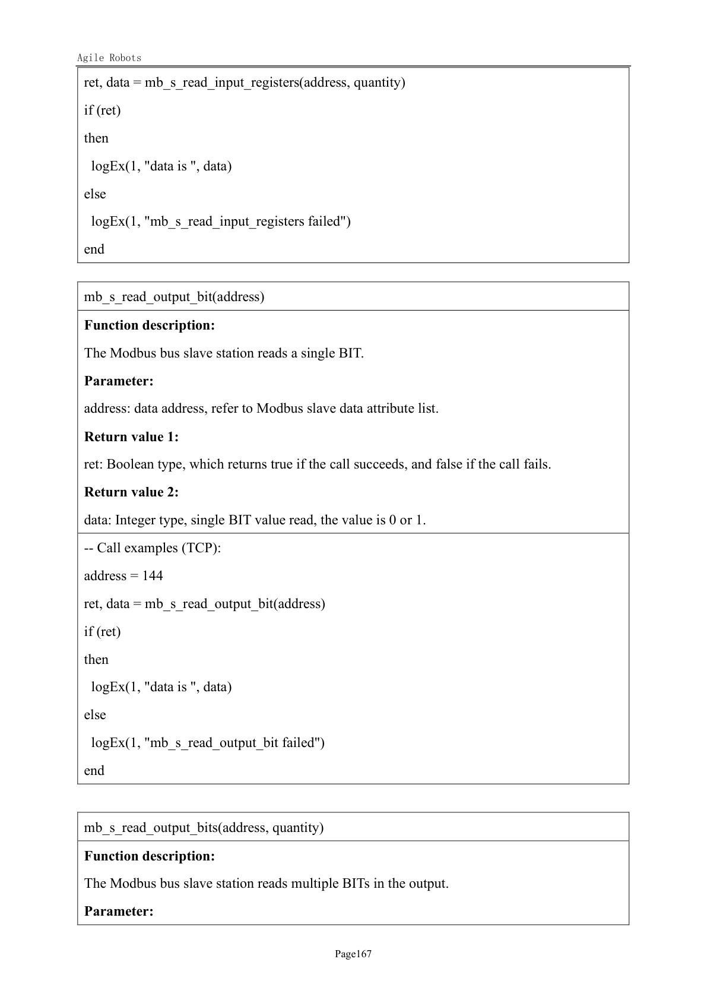



```
Agile Robots 
Page167 
ret, data = mb_s_read_input_registers(address, quantity) 
if (ret) 
then 
  logEx(1, "data is ", data) 
else 
  logEx(1, "mb_s_read_input_registers failed") 
end 
 
mb_s_read_output_bit(address) 
Function description: 
The Modbus bus slave station reads a single BIT. 
Parameter: 
address: data address, refer to Modbus slave data attribute list. 
Return value 1: 
ret: Boolean type, which returns true if the call succeeds, and false if the call fails. 
Return value 2: 
data: Integer type, single BIT value read, the value is 0 or 1.  
-- Call examples (TCP): 
address = 144 
ret, data = mb_s_read_output_bit(address) 
if (ret) 
then 
  logEx(1, "data is ", data) 
else 
  logEx(1, "mb_s_read_output_bit failed") 
end 
 
mb_s_read_output_bits(address, quantity) 
Function description: 
The Modbus bus slave station reads multiple BITs in the output. 
Parameter:
```



**Original document cross-references:** [PDF 189](pages-145-192.md#pdf-page-189)

## PDF page 169

**Source:** Industrial Lua Programming Manual\_V3.3.0\_EN\_20260117.pdf, original pdf page 169. [Open the corresponding PDF reading-copy page](https://1292444914-files.gitbook.io/~/files/v0/b/gitbook-x-prod.appspot.com/o/spaces%2FtgOfPnscWebs1eh82EKq%2Fuploads%2FU0JYOssuma2RW4Gd2PqT%2Findustrial-lua-programming-manual-v3-3-0-en-20260117-pp-001-184.pdf?alt=media#page=169).



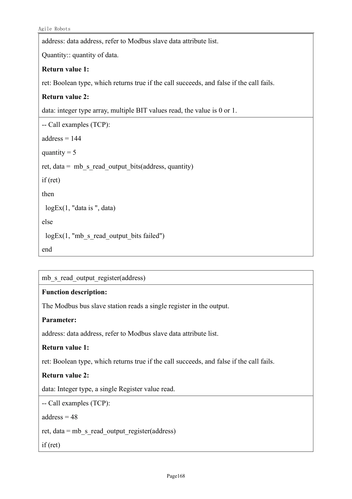



```
Agile Robots 
Page168 
address: data address, refer to Modbus slave data attribute list. 
Quantity:: quantity of data. 
Return value 1: 
ret: Boolean type, which returns true if the call succeeds, and false if the call fails. 
Return value 2: 
data: integer type array, multiple BIT values read, the value is 0 or 1. 
-- Call examples (TCP): 
address = 144 
quantity = 5 
ret, data =  mb_s_read_output_bits(address, quantity) 
if (ret) 
then 
  logEx(1, "data is ", data) 
else 
  logEx(1, "mb_s_read_output_bits failed") 
end 
 
mb_s_read_output_register(address) 
Function description: 
The Modbus bus slave station reads a single register in the output. 
Parameter: 
address: data address, refer to Modbus slave data attribute list. 
Return value 1: 
ret: Boolean type, which returns true if the call succeeds, and false if the call fails. 
Return value 2: 
data: Integer type, a single Register value read.  
-- Call examples (TCP): 
address = 48 
ret, data = mb_s_read_output_register(address) 
if (ret)
```



**Original document cross-references:** [PDF 189](pages-145-192.md#pdf-page-189)

## PDF page 170

**Source:** Industrial Lua Programming Manual\_V3.3.0\_EN\_20260117.pdf, original pdf page 170. [Open the corresponding PDF reading-copy page](https://1292444914-files.gitbook.io/~/files/v0/b/gitbook-x-prod.appspot.com/o/spaces%2FtgOfPnscWebs1eh82EKq%2Fuploads%2FU0JYOssuma2RW4Gd2PqT%2Findustrial-lua-programming-manual-v3-3-0-en-20260117-pp-001-184.pdf?alt=media#page=170).



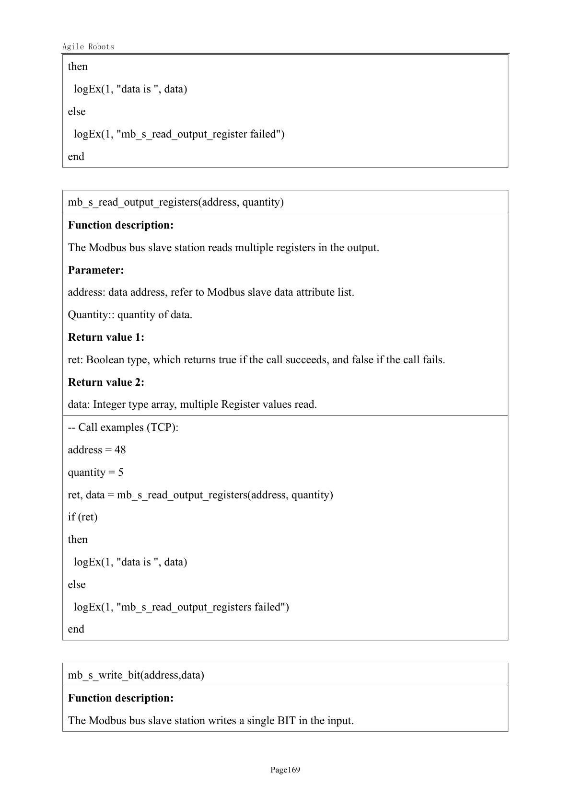



```
Agile Robots 
Page169 
then 
  logEx(1, "data is ", data) 
else 
  logEx(1, "mb_s_read_output_register failed") 
end 
 
mb_s_read_output_registers(address, quantity) 
Function description: 
The Modbus bus slave station reads multiple registers in the output. 
Parameter: 
address: data address, refer to Modbus slave data attribute list. 
Quantity:: quantity of data. 
Return value 1: 
ret: Boolean type, which returns true if the call succeeds, and false if the call fails. 
Return value 2: 
data: Integer type array, multiple Register values read. 
-- Call examples (TCP): 
address = 48 
quantity = 5 
ret, data = mb_s_read_output_registers(address, quantity) 
if (ret) 
then 
  logEx(1, "data is ", data) 
else 
  logEx(1, "mb_s_read_output_registers failed") 
end 
 
mb_s_write_bit(address,data) 
Function description: 
The Modbus bus slave station writes a single BIT in the input.
```



**Original document cross-references:** [PDF 189](pages-145-192.md#pdf-page-189)

## PDF page 171

**Source:** Industrial Lua Programming Manual\_V3.3.0\_EN\_20260117.pdf, original pdf page 171. [Open the corresponding PDF reading-copy page](https://1292444914-files.gitbook.io/~/files/v0/b/gitbook-x-prod.appspot.com/o/spaces%2FtgOfPnscWebs1eh82EKq%2Fuploads%2FU0JYOssuma2RW4Gd2PqT%2Findustrial-lua-programming-manual-v3-3-0-en-20260117-pp-001-184.pdf?alt=media#page=171).



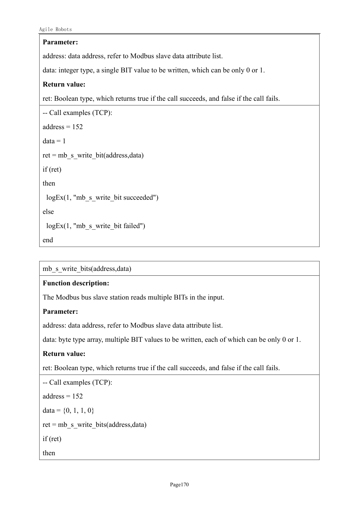



```
Agile Robots 
Page170 
Parameter: 
address: data address, refer to Modbus slave data attribute list. 
data: integer type, a single BIT value to be written, which can be only 0 or 1. 
Return value: 
ret: Boolean type, which returns true if the call succeeds, and false if the call fails. 
-- Call examples (TCP): 
address = 152 
data = 1 
ret = mb_s_write_bit(address,data) 
if (ret) 
then 
  logEx(1, "mb_s_write_bit succeeded") 
else 
  logEx(1, "mb_s_write_bit failed") 
end 
 
mb_s_write_bits(address,data) 
Function description: 
The Modbus bus slave station reads multiple BITs in the input. 
Parameter: 
address: data address, refer to Modbus slave data attribute list. 
data: byte type array, multiple BIT values to be written, each of which can be only 0 or 1. 
Return value: 
ret: Boolean type, which returns true if the call succeeds, and false if the call fails. 
-- Call examples (TCP): 
address = 152 
data = {0, 1, 1, 0} 
ret = mb_s_write_bits(address,data) 
if (ret) 
then
```



**Original document cross-references:** [PDF 189](pages-145-192.md#pdf-page-189)

## PDF page 172

**Source:** Industrial Lua Programming Manual\_V3.3.0\_EN\_20260117.pdf, original pdf page 172. [Open the corresponding PDF reading-copy page](https://1292444914-files.gitbook.io/~/files/v0/b/gitbook-x-prod.appspot.com/o/spaces%2FtgOfPnscWebs1eh82EKq%2Fuploads%2FU0JYOssuma2RW4Gd2PqT%2Findustrial-lua-programming-manual-v3-3-0-en-20260117-pp-001-184.pdf?alt=media#page=172).



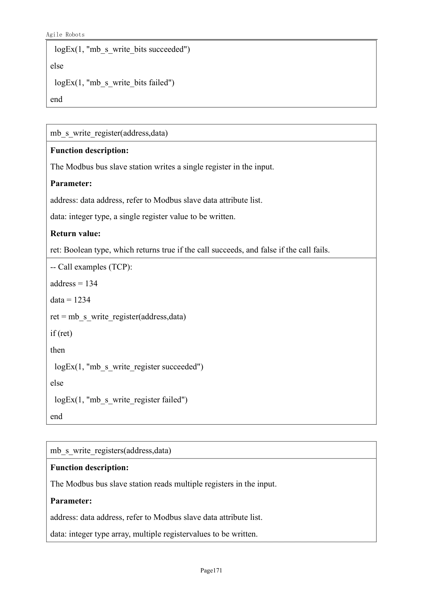



```
Agile Robots 
Page171 
  logEx(1, "mb_s_write_bits succeeded") 
else 
  logEx(1, "mb_s_write_bits failed") 
end 
 
mb_s_write_register(address,data) 
Function description: 
The Modbus bus slave station writes a single register in the input. 
Parameter: 
address: data address, refer to Modbus slave data attribute list. 
data: integer type, a single register value to be written. 
Return value: 
ret: Boolean type, which returns true if the call succeeds, and false if the call fails. 
-- Call examples (TCP): 
address = 134 
data = 1234 
ret = mb_s_write_register(address,data) 
if (ret) 
then 
  logEx(1, "mb_s_write_register succeeded") 
else 
  logEx(1, "mb_s_write_register failed") 
end 
 
mb_s_write_registers(address,data) 
Function description: 
The Modbus bus slave station reads multiple registers in the input. 
Parameter: 
address: data address, refer to Modbus slave data attribute list. 
data: integer type array, multiple registervalues to be written.
```



**Original document cross-references:** [PDF 189](pages-145-192.md#pdf-page-189)

## PDF page 173

**Source:** Industrial Lua Programming Manual\_V3.3.0\_EN\_20260117.pdf, original pdf page 173. [Open the corresponding PDF reading-copy page](https://1292444914-files.gitbook.io/~/files/v0/b/gitbook-x-prod.appspot.com/o/spaces%2FtgOfPnscWebs1eh82EKq%2Fuploads%2FU0JYOssuma2RW4Gd2PqT%2Findustrial-lua-programming-manual-v3-3-0-en-20260117-pp-001-184.pdf?alt=media#page=173).



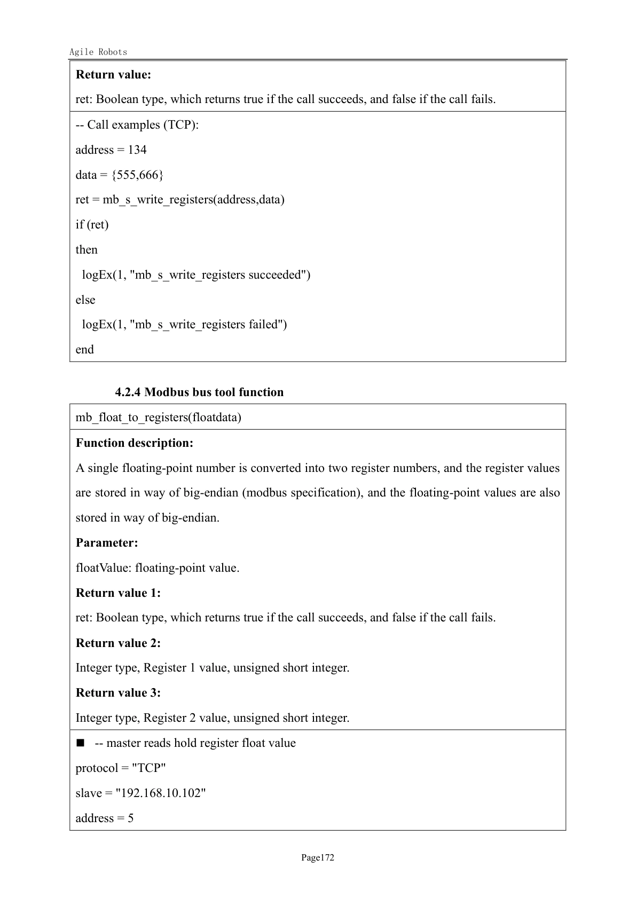



```
Agile Robots 
Page172 
Return value: 
ret: Boolean type, which returns true if the call succeeds, and false if the call fails. 
-- Call examples (TCP): 
address = 134 
data = {555,666}  
ret = mb_s_write_registers(address,data) 
if (ret) 
then 
  logEx(1, "mb_s_write_registers succeeded") 
else 
  logEx(1, "mb_s_write_registers failed") 
end 
 
4.2.4 Modbus bus tool function 
mb_float_to_registers(floatdata) 
Function description: 
A single floating-point number is converted into two register numbers, and the register values 
are stored in way of big-endian (modbus specification), and the floating-point values are also 
stored in way of big-endian. 
Parameter: 
floatValue: floating-point value. 
Return value 1: 
ret: Boolean type, which returns true if the call succeeds, and false if the call fails. 
Return value 2: 
Integer type, Register 1 value, unsigned short integer. 
Return value 3: 
Integer type, Register 2 value, unsigned short integer. 
◼ -- master reads hold register float value 
protocol = "TCP" 
slave = "192.168.10.102" 
address = 5
```



## PDF page 174

**Source:** Industrial Lua Programming Manual\_V3.3.0\_EN\_20260117.pdf, original pdf page 174. [Open the corresponding PDF reading-copy page](https://1292444914-files.gitbook.io/~/files/v0/b/gitbook-x-prod.appspot.com/o/spaces%2FtgOfPnscWebs1eh82EKq%2Fuploads%2FU0JYOssuma2RW4Gd2PqT%2Findustrial-lua-programming-manual-v3-3-0-en-20260117-pp-001-184.pdf?alt=media#page=174).



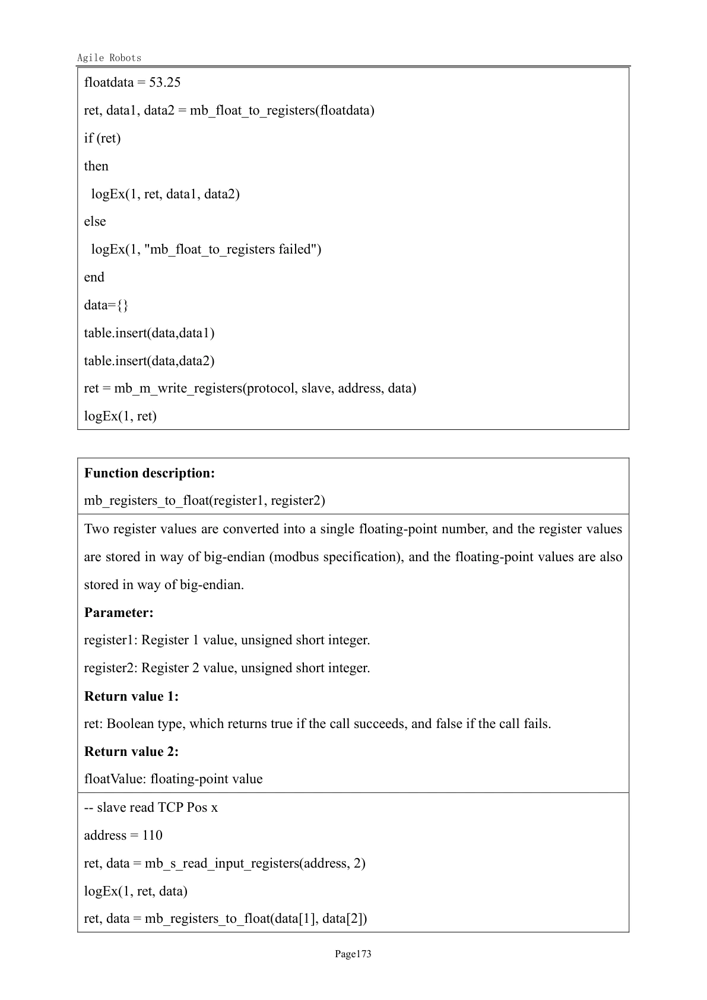



```
Agile Robots 
Page173 
floatdata = 53.25 
ret, data1, data2 = mb_float_to_registers(floatdata) 
if (ret) 
then 
  logEx(1, ret, data1, data2) 
else 
  logEx(1, "mb_float_to_registers failed") 
end 
data={} 
table.insert(data,data1) 
table.insert(data,data2) 
ret = mb_m_write_registers(protocol, slave, address, data) 
logEx(1, ret)  
 
Function description: 
mb_registers_to_float(register1, register2) 
Two register values are converted into a single floating-point number, and the register values 
are stored in way of big-endian (modbus specification), and the floating-point values are also 
stored in way of big-endian. 
Parameter: 
register1: Register 1 value, unsigned short integer. 
register2: Register 2 value, unsigned short integer. 
Return value 1: 
ret: Boolean type, which returns true if the call succeeds, and false if the call fails. 
Return value 2: 
floatValue: floating-point value 
-- slave read TCP Pos x 
address = 110 
ret, data = mb_s_read_input_registers(address, 2) 
logEx(1, ret, data) 
ret, data = mb_registers_to_float(data[1], data[2])
```



## PDF page 175

**Source:** Industrial Lua Programming Manual\_V3.3.0\_EN\_20260117.pdf, original pdf page 175. [Open the corresponding PDF reading-copy page](https://1292444914-files.gitbook.io/~/files/v0/b/gitbook-x-prod.appspot.com/o/spaces%2FtgOfPnscWebs1eh82EKq%2Fuploads%2FU0JYOssuma2RW4Gd2PqT%2Findustrial-lua-programming-manual-v3-3-0-en-20260117-pp-001-184.pdf?alt=media#page=175).



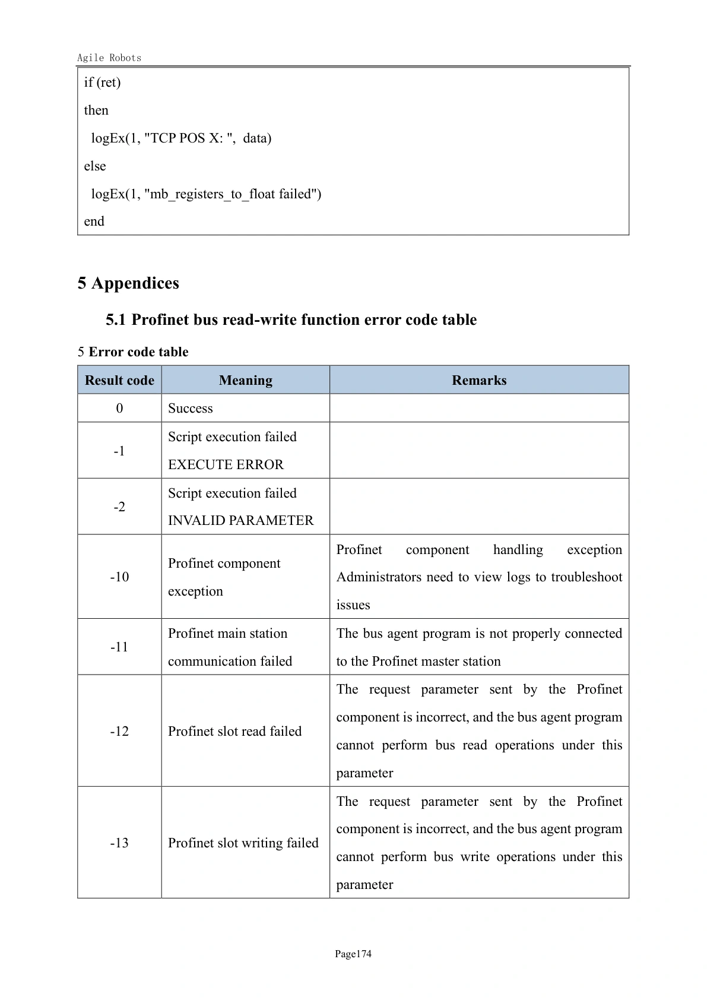



```
Agile Robots 
Page174 
if (ret) 
then 
  logEx(1, "TCP POS X: ",  data) 
else 
  logEx(1, "mb_registers_to_float failed") 
end 
 
5 Appendices 
5.1 Profinet bus read-write function error code table 
5 Error code table 
Result code 
Meaning 
Remarks 
0 
Success 
 
-1 
Script execution failed 
EXECUTE ERROR 
 
-2 
Script execution failed 
INVALID PARAMETER 
 
-10 
Profinet component 
exception 
Profinet 
component 
handling 
exception 
Administrators need to view logs to troubleshoot 
issues 
-11 
Profinet main station 
communication failed 
The bus agent program is not properly connected 
to the Profinet master station 
-12 
Profinet slot read failed 
The request parameter sent by the Profinet 
component is incorrect, and the bus agent program 
cannot perform bus read operations under this 
parameter 
-13 
Profinet slot writing failed 
The request parameter sent by the Profinet 
component is incorrect, and the bus agent program 
cannot perform bus write operations under this 
parameter
```



## PDF page 176

**Source:** Industrial Lua Programming Manual\_V3.3.0\_EN\_20260117.pdf, original pdf page 176. [Open the corresponding PDF reading-copy page](https://1292444914-files.gitbook.io/~/files/v0/b/gitbook-x-prod.appspot.com/o/spaces%2FtgOfPnscWebs1eh82EKq%2Fuploads%2FU0JYOssuma2RW4Gd2PqT%2Findustrial-lua-programming-manual-v3-3-0-en-20260117-pp-001-184.pdf?alt=media#page=176).



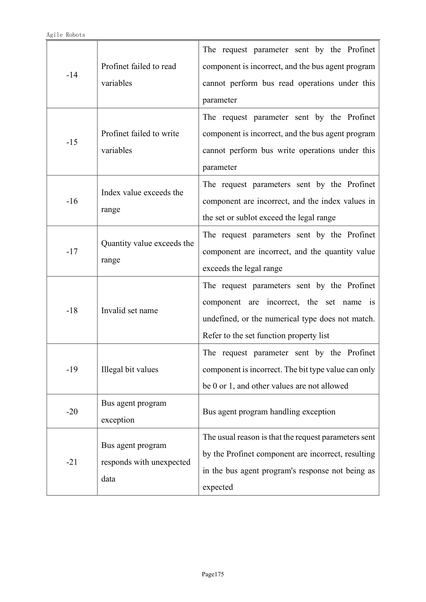



```
Agile Robots 
Page175 
-14 
Profinet failed to read 
variables 
The request parameter sent by the Profinet 
component is incorrect, and the bus agent program 
cannot perform bus read operations under this 
parameter 
-15 
Profinet failed to write 
variables 
The request parameter sent by the Profinet 
component is incorrect, and the bus agent program 
cannot perform bus write operations under this 
parameter 
-16 
Index value exceeds the 
range 
The request parameters sent by the Profinet 
component are incorrect, and the index values in 
the set or sublot exceed the legal range 
-17 
Quantity value exceeds the 
range 
The request parameters sent by the Profinet 
component are incorrect, and the quantity value 
exceeds the legal range 
-18 
Invalid set name 
The request parameters sent by the Profinet 
component are incorrect, the set name is 
undefined, or the numerical type does not match. 
Refer to the set function property list 
-19 
Illegal bit values 
The request parameter sent by the Profinet 
component is incorrect. The bit type value can only 
be 0 or 1, and other values are not allowed 
-20 
Bus agent program 
exception 
Bus agent program handling exception 
-21 
Bus agent program 
responds with unexpected 
data 
The usual reason is that the request parameters sent 
by the Profinet component are incorrect, resulting 
in the bus agent program's response not being as 
expected
```



**Original document cross-references:** [PDF 177](pages-145-192.md#pdf-page-177)

## PDF page 177

**Source:** Industrial Lua Programming Manual\_V3.3.0\_EN\_20260117.pdf, original pdf page 177. [Open the corresponding PDF reading-copy page](https://1292444914-files.gitbook.io/~/files/v0/b/gitbook-x-prod.appspot.com/o/spaces%2FtgOfPnscWebs1eh82EKq%2Fuploads%2FU0JYOssuma2RW4Gd2PqT%2Findustrial-lua-programming-manual-v3-3-0-en-20260117-pp-001-184.pdf?alt=media#page=177).



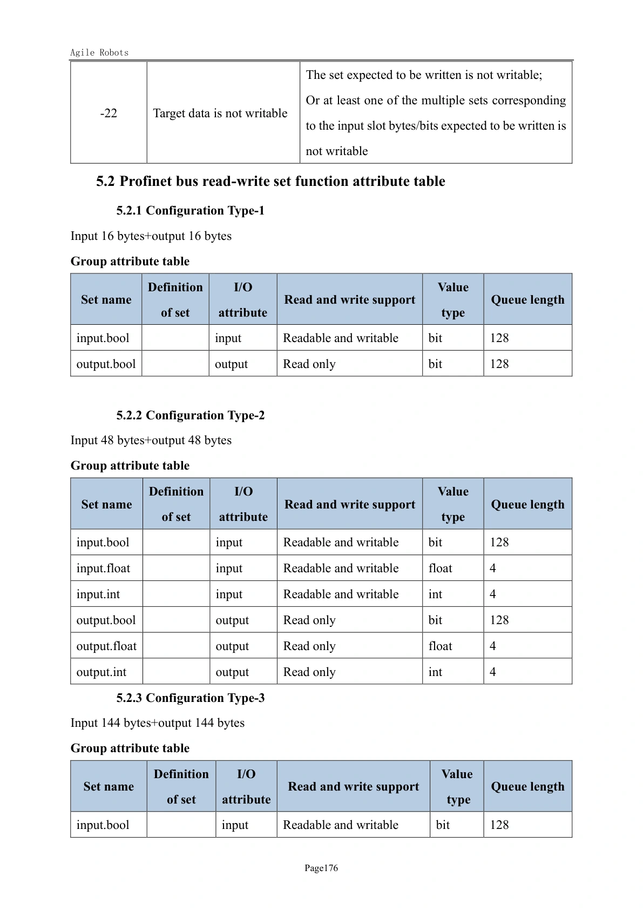



```
Agile Robots 
Page176 
-22 
Target data is not writable 
The set expected to be written is not writable; 
Or at least one of the multiple sets corresponding 
to the input slot bytes/bits expected to be written is 
not writable 
5.2 Profinet bus read-write set function attribute table 
5.2.1 Configuration Type-1 
Input 16 bytes+output 16 bytes 
Group attribute table 
Set name 
Definition 
of set 
I/O  
attribute 
Read and write support 
Value  
type 
Queue length 
input.bool 
 
input 
Readable and writable 
bit 
128 
output.bool  
output 
Read only 
bit 
128 
 
5.2.2 Configuration Type-2 
Input 48 bytes+output 48 bytes 
Group attribute table 
Set name 
Definition 
of set 
I/O  
attribute 
Read and write support 
Value  
type 
Queue length 
input.bool 
 
input 
Readable and writable 
bit 
128 
input.float 
 
input 
Readable and writable 
float 
4 
input.int 
 
input 
Readable and writable 
int 
4 
output.bool  
output 
Read only 
bit 
128 
output.float  
output 
Read only 
float 
4 
output.int 
 
output 
Read only 
int 
4 
5.2.3 Configuration Type-3 
Input 144 bytes+output 144 bytes 
Group attribute table 
Set name 
Definition 
of set 
I/O  
attribute 
Read and write support 
Value 
 type 
Queue length 
input.bool 
 
input 
Readable and writable 
bit 
128
```



## PDF page 178

**Source:** Industrial Lua Programming Manual\_V3.3.0\_EN\_20260117.pdf, original pdf page 178. [Open the corresponding PDF reading-copy page](https://1292444914-files.gitbook.io/~/files/v0/b/gitbook-x-prod.appspot.com/o/spaces%2FtgOfPnscWebs1eh82EKq%2Fuploads%2FU0JYOssuma2RW4Gd2PqT%2Findustrial-lua-programming-manual-v3-3-0-en-20260117-pp-001-184.pdf?alt=media#page=178).



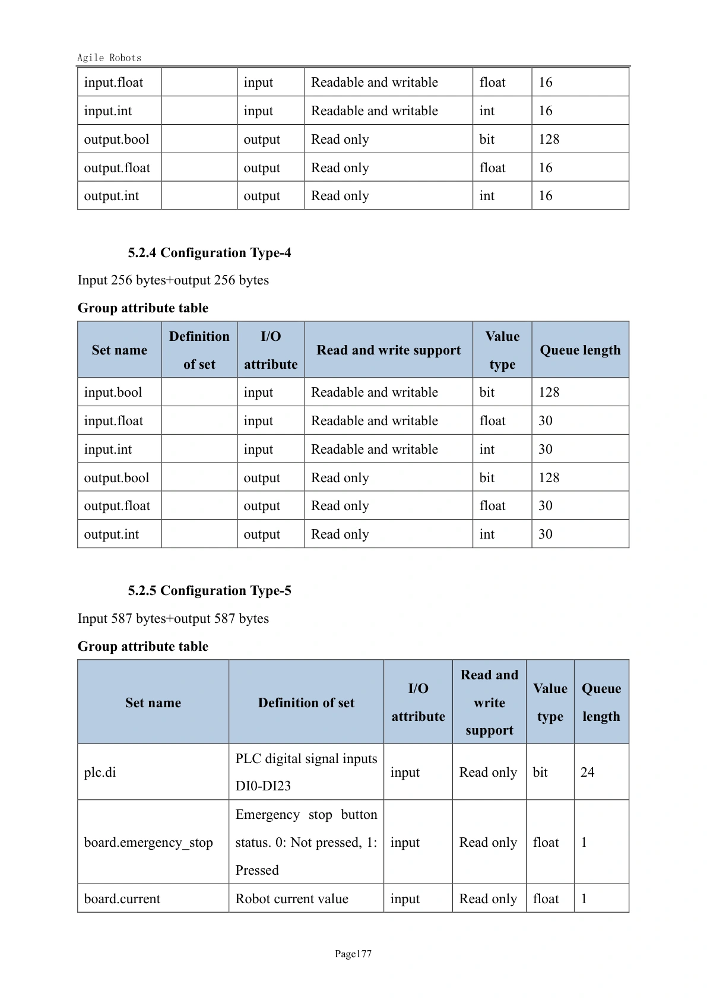



```
Agile Robots 
Page177 
input.float 
 
input 
Readable and writable 
float 
16 
input.int 
 
input 
Readable and writable 
int 
16 
output.bool 
 
output 
Read only 
bit 
128 
output.float 
 
output 
Read only 
float 
16 
output.int 
 
output 
Read only 
int 
16 
 
5.2.4 Configuration Type-4 
Input 256 bytes+output 256 bytes 
Group attribute table 
Set name 
Definition 
of set 
I/O  
attribute 
Read and write support 
Value  
type 
Queue length 
input.bool 
 
input 
Readable and writable 
bit 
128 
input.float 
 
input 
Readable and writable 
float 
30 
input.int 
 
input 
Readable and writable 
int 
30 
output.bool 
 
output 
Read only 
bit 
128 
output.float 
 
output 
Read only 
float 
30 
output.int 
 
output 
Read only 
int 
30 
 
5.2.5 Configuration Type-5 
Input 587 bytes+output 587 bytes 
Group attribute table 
Set name 
Definition of set 
I/O  
attribute 
Read and  
write 
support 
Value 
type 
Queue  
length 
plc.di 
PLC digital signal inputs 
DI0-DI23 
input 
Read only 
bit 
24 
board.emergency_stop 
Emergency stop button 
status. 0: Not pressed, 1: 
Pressed 
input 
Read only 
float 
1 
board.current 
Robot current value 
input 
Read only 
float 
1
```



## PDF page 179

**Source:** Industrial Lua Programming Manual\_V3.3.0\_EN\_20260117.pdf, original pdf page 179. [Open the corresponding PDF reading-copy page](https://1292444914-files.gitbook.io/~/files/v0/b/gitbook-x-prod.appspot.com/o/spaces%2FtgOfPnscWebs1eh82EKq%2Fuploads%2FU0JYOssuma2RW4Gd2PqT%2Findustrial-lua-programming-manual-v3-3-0-en-20260117-pp-001-184.pdf?alt=media#page=179).



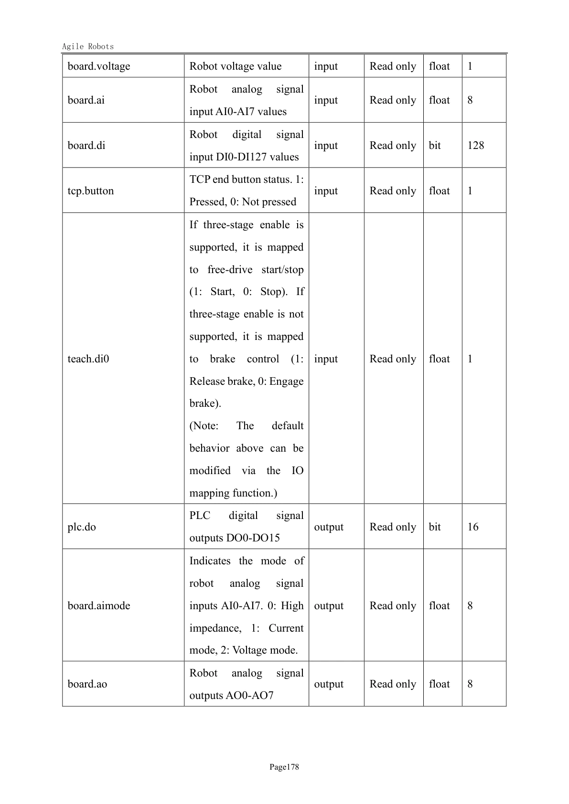



```
Agile Robots 
Page178 
board.voltage 
Robot voltage value 
input 
Read only 
float 
1 
board.ai 
Robot 
analog 
signal 
input AI0-AI7 values 
input 
Read only 
float 
8 
board.di 
Robot 
digital 
signal 
input DI0-DI127 values 
input 
Read only 
bit 
128 
tcp.button 
TCP end button status. 1: 
Pressed, 0: Not pressed 
input 
Read only 
float 
1 
teach.di0 
If three-stage enable is 
supported, it is mapped 
to free-drive start/stop 
(1: Start, 0: Stop). If 
three-stage enable is not 
supported, it is mapped 
to brake control (1: 
Release brake, 0: Engage 
brake). 
(Note: 
The 
default 
behavior above can be 
modified via the IO 
mapping function.) 
input 
Read only 
float 
1 
plc.do 
PLC 
digital 
signal 
outputs DO0-DO15 
output 
Read only 
bit 
16 
board.aimode 
Indicates the mode of 
robot 
analog 
signal 
inputs AI0-AI7. 0: High 
impedance, 1: Current 
mode, 2: Voltage mode. 
output 
Read only 
float 
8 
board.ao 
Robot 
analog 
signal 
outputs AO0-AO7 
output 
Read only 
float 
8
```



## PDF page 180

**Source:** Industrial Lua Programming Manual\_V3.3.0\_EN\_20260117.pdf, original pdf page 180. [Open the corresponding PDF reading-copy page](https://1292444914-files.gitbook.io/~/files/v0/b/gitbook-x-prod.appspot.com/o/spaces%2FtgOfPnscWebs1eh82EKq%2Fuploads%2FU0JYOssuma2RW4Gd2PqT%2Findustrial-lua-programming-manual-v3-3-0-en-20260117-pp-001-184.pdf?alt=media#page=180).



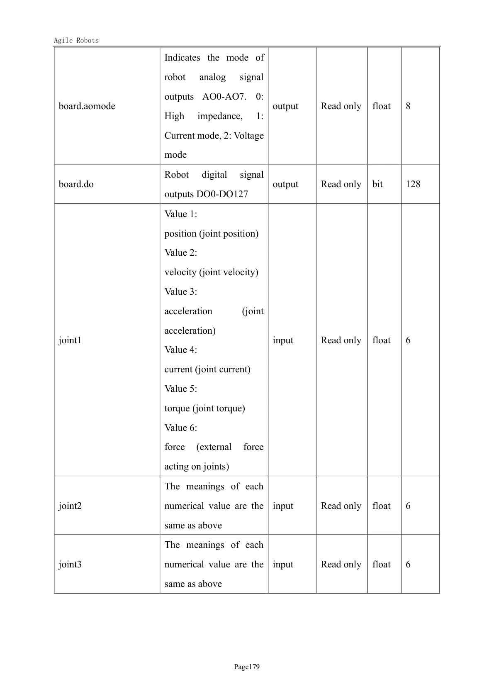



```
Agile Robots 
Page179 
board.aomode 
Indicates the mode of 
robot 
analog 
signal 
outputs AO0-AO7. 0: 
High 
impedance, 
1: 
Current mode, 2: Voltage 
mode 
output 
Read only 
float 
8 
board.do 
Robot 
digital 
signal 
outputs DO0-DO127 
output 
Read only 
bit 
128 
joint1 
Value 1: 
position (joint position) 
Value 2: 
velocity (joint velocity) 
Value 3: 
acceleration 
(joint 
acceleration) 
Value 4: 
current (joint current) 
Value 5: 
torque (joint torque) 
Value 6: 
force 
(external 
force 
acting on joints) 
input 
Read only 
float 
6 
joint2 
The meanings of each 
numerical value are the 
same as above 
input 
Read only 
float 
6 
joint3 
The meanings of each 
numerical value are the 
same as above 
input 
Read only 
float 
6
```



## PDF page 181

**Source:** Industrial Lua Programming Manual\_V3.3.0\_EN\_20260117.pdf, original pdf page 181. [Open the corresponding PDF reading-copy page](https://1292444914-files.gitbook.io/~/files/v0/b/gitbook-x-prod.appspot.com/o/spaces%2FtgOfPnscWebs1eh82EKq%2Fuploads%2FU0JYOssuma2RW4Gd2PqT%2Findustrial-lua-programming-manual-v3-3-0-en-20260117-pp-001-184.pdf?alt=media#page=181).



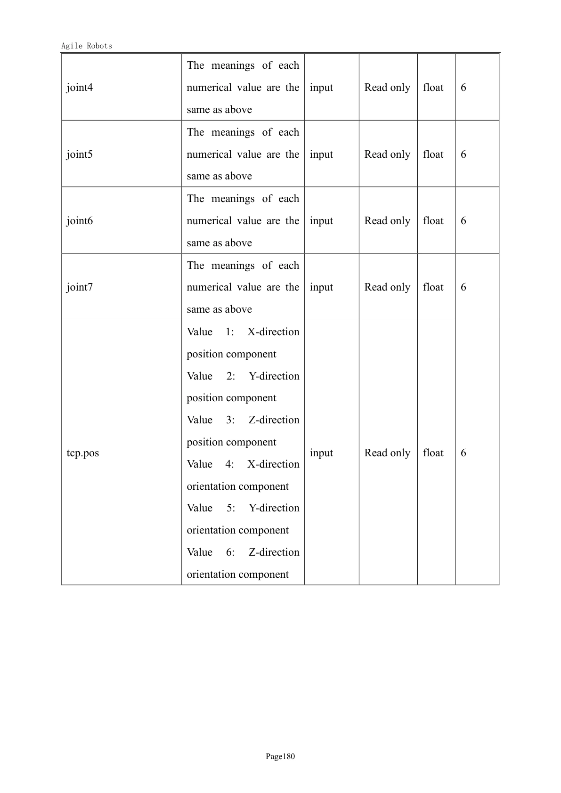



```
Agile Robots 
Page180 
joint4 
The meanings of each 
numerical value are the 
same as above 
input 
Read only 
float 
6 
joint5 
The meanings of each 
numerical value are the 
same as above 
input 
Read only 
float 
6 
joint6 
The meanings of each 
numerical value are the 
same as above 
input 
Read only 
float 
6 
joint7 
The meanings of each 
numerical value are the 
same as above 
input 
Read only 
float 
6 
tcp.pos 
Value 
1: 
X-direction 
position component 
Value 
2: 
Y-direction 
position component 
Value 
3: 
Z-direction 
position component 
Value 
4: 
X-direction 
orientation component 
Value 
5: 
Y-direction 
orientation component 
Value 
6: 
Z-direction 
orientation component 
input 
Read only 
float 
6
```



## PDF page 182

**Source:** Industrial Lua Programming Manual\_V3.3.0\_EN\_20260117.pdf, original pdf page 182. [Open the corresponding PDF reading-copy page](https://1292444914-files.gitbook.io/~/files/v0/b/gitbook-x-prod.appspot.com/o/spaces%2FtgOfPnscWebs1eh82EKq%2Fuploads%2FU0JYOssuma2RW4Gd2PqT%2Findustrial-lua-programming-manual-v3-3-0-en-20260117-pp-001-184.pdf?alt=media#page=182).



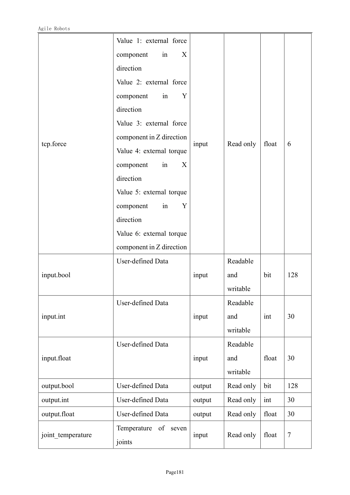



```
Agile Robots 
Page181 
tcp.force 
Value 1: external force 
component 
in 
X 
direction 
Value 2: external force 
component 
in 
Y 
direction 
Value 3: external force 
component in Z direction 
Value 4: external torque 
component 
in 
X 
direction 
Value 5: external torque 
component 
in 
Y 
direction 
Value 6: external torque 
component in Z direction 
input 
Read only 
float 
6 
input.bool 
User-defined Data 
input 
Readable 
and 
writable 
bit 
128 
input.int 
User-defined Data 
input 
Readable 
and 
writable 
int 
30 
input.float 
User-defined Data 
input 
Readable 
and 
writable 
float 
30 
output.bool 
User-defined Data 
output 
Read only 
bit 
128 
output.int 
User-defined Data 
output 
Read only 
int 
30 
output.float 
User-defined Data 
output 
Read only 
float 
30 
joint_temperature 
Temperature of seven 
joints 
input 
Read only 
float 
7
```



## PDF page 183

**Source:** Industrial Lua Programming Manual\_V3.3.0\_EN\_20260117.pdf, original pdf page 183. [Open the corresponding PDF reading-copy page](https://1292444914-files.gitbook.io/~/files/v0/b/gitbook-x-prod.appspot.com/o/spaces%2FtgOfPnscWebs1eh82EKq%2Fuploads%2FU0JYOssuma2RW4Gd2PqT%2Findustrial-lua-programming-manual-v3-3-0-en-20260117-pp-001-184.pdf?alt=media#page=183).



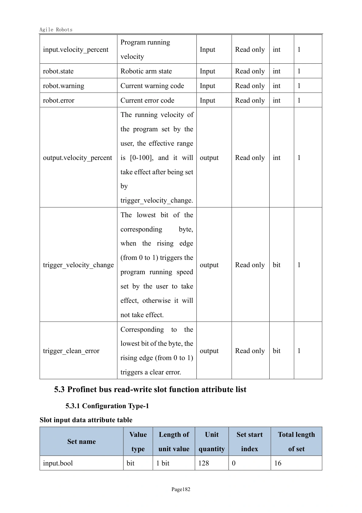



```
Agile Robots 
Page182 
input.velocity_percent 
Program running 
velocity 
Input 
Read only 
int 
1 
robot.state 
Robotic arm state 
Input 
Read only 
int 
1 
robot.warning 
Current warning code 
Input 
Read only 
int 
1 
robot.error 
Current error code 
Input 
Read only 
int 
1 
output.velocity_percent 
The running velocity of 
the program set by the 
user, the effective range 
is [0-100], and it will 
take effect after being set 
by 
trigger_velocity_change. 
output 
Read only 
int 
1 
trigger_velocity_change 
The lowest bit of the 
corresponding 
byte, 
when the rising edge 
(from 0 to 1) triggers the 
program running speed 
set by the user to take 
effect, otherwise it will 
not take effect. 
output 
Read only 
bit 
1 
trigger_clean_error 
Corresponding to the 
lowest bit of the byte, the 
rising edge (from 0 to 1) 
triggers a clear error. 
output 
Read only 
bit 
1 
5.3 Profinet bus read-write slot function attribute list 
5.3.1 Configuration Type-1 
Slot input data attribute table 
Set name 
Value  
type 
Length of  
unit value 
Unit  
quantity 
Set start  
index 
Total length  
of set 
input.bool 
bit 
1 bit 
128 
0 
16
```



## PDF page 184

**Source:** Industrial Lua Programming Manual\_V3.3.0\_EN\_20260117.pdf, original pdf page 184. [Open the corresponding PDF reading-copy page](https://1292444914-files.gitbook.io/~/files/v0/b/gitbook-x-prod.appspot.com/o/spaces%2FtgOfPnscWebs1eh82EKq%2Fuploads%2FU0JYOssuma2RW4Gd2PqT%2Findustrial-lua-programming-manual-v3-3-0-en-20260117-pp-001-184.pdf?alt=media#page=184).



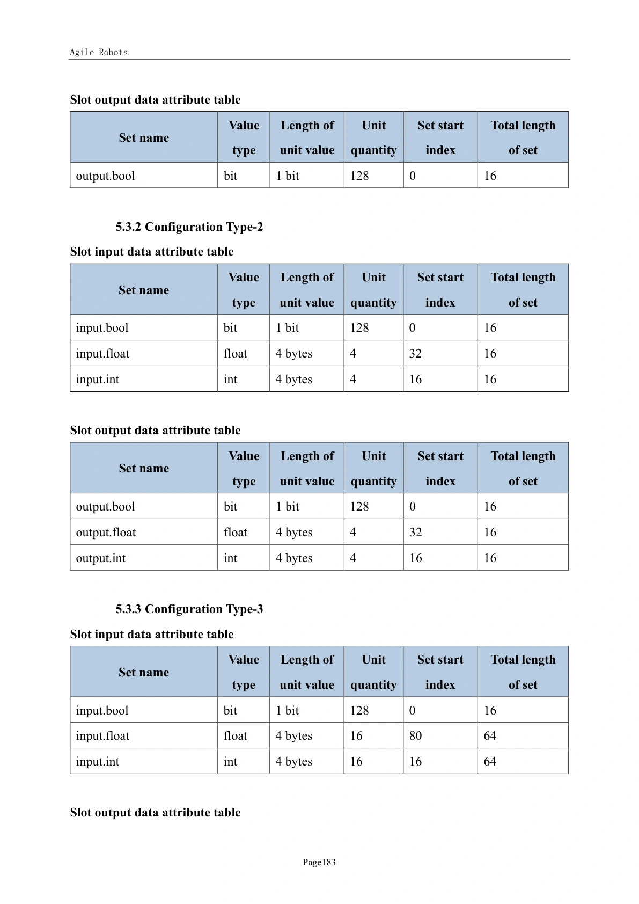



```
Agile Robots 
Page183 
 
Slot output data attribute table 
Set name 
Value  
type 
Length of  
unit value 
Unit  
quantity 
Set start  
index 
Total length  
of set 
output.bool 
bit 
1 bit 
128 
0 
16 
 
5.3.2 Configuration Type-2 
Slot input data attribute table 
Set name 
Value  
type 
Length of  
unit value 
Unit  
quantity 
Set start  
index 
Total length  
of set 
input.bool 
bit 
1 bit 
128 
0 
16 
input.float 
float 
4 bytes 
4 
32 
16 
input.int 
int 
4 bytes 
4 
16 
16 
 
Slot output data attribute table 
Set name 
Value  
type 
Length of  
unit value 
Unit  
quantity 
Set start  
index 
Total length  
of set 
output.bool 
bit 
1 bit 
128 
0 
16 
output.float 
float 
4 bytes 
4 
32 
16 
output.int 
int 
4 bytes 
4 
16 
16 
 
5.3.3 Configuration Type-3 
Slot input data attribute table 
Set name 
Value  
type 
Length of  
unit value 
Unit  
quantity 
Set start  
index 
Total length  
of set 
input.bool 
bit 
1 bit 
128 
0 
16 
input.float 
float 
4 bytes 
16 
80 
64 
input.int 
int 
4 bytes 
16 
16 
64 
 
Slot output data attribute table
```



## PDF page 185

**Source:** Industrial Lua Programming Manual\_V3.3.0\_EN\_20260117.pdf, original pdf page 185. [Open the corresponding PDF reading-copy page](https://1292444914-files.gitbook.io/~/files/v0/b/gitbook-x-prod.appspot.com/o/spaces%2FtgOfPnscWebs1eh82EKq%2Fuploads%2FE6fCk6dsShfO05bTex9N%2Findustrial-lua-programming-manual-v3-3-0-en-20260117-pp-185-192.pdf?alt=media#page=1).



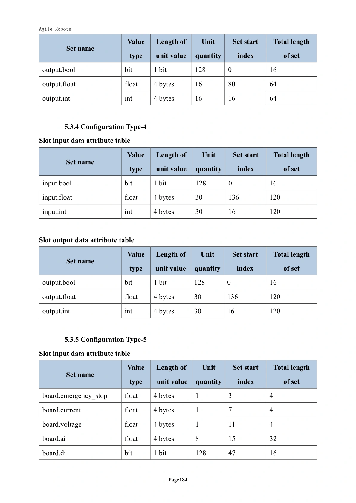



```
Agile Robots 
Page184 
Set name 
Value  
type 
Length of  
unit value 
Unit  
quantity 
Set start  
index 
Total length  
of set 
output.bool 
bit 
1 bit 
128 
0 
16 
output.float 
float 
4 bytes 
16 
80 
64 
output.int 
int 
4 bytes 
16 
16 
64 
 
5.3.4 Configuration Type-4 
Slot input data attribute table 
Set name 
Value  
type 
Length of  
unit value 
Unit  
quantity 
Set start  
index 
Total length  
of set 
input.bool 
bit 
1 bit 
128 
0 
16 
input.float 
float 
4 bytes 
30 
136 
120 
input.int 
int 
4 bytes 
30 
16 
120 
 
Slot output data attribute table 
Set name 
Value  
type 
Length of  
unit value 
Unit  
quantity 
Set start  
index 
Total length  
of set 
output.bool 
bit 
1 bit 
128 
0 
16 
output.float 
float 
4 bytes 
30 
136 
120 
output.int 
int 
4 bytes 
30 
16 
120 
 
5.3.5 Configuration Type-5 
Slot input data attribute table 
Set name 
Value  
type 
Length of 
 unit value 
Unit  
quantity 
Set start  
index 
Total length  
of set 
board.emergency_stop 
float 
4 bytes 
1 
3 
4 
board.current 
float 
4 bytes 
1 
7 
4 
board.voltage 
float 
4 bytes 
1 
11 
4 
board.ai 
float 
4 bytes 
8 
15 
32 
board.di 
bit 
1 bit 
128 
47 
16
```



## PDF page 186

**Source:** Industrial Lua Programming Manual\_V3.3.0\_EN\_20260117.pdf, original pdf page 186. [Open the corresponding PDF reading-copy page](https://1292444914-files.gitbook.io/~/files/v0/b/gitbook-x-prod.appspot.com/o/spaces%2FtgOfPnscWebs1eh82EKq%2Fuploads%2FE6fCk6dsShfO05bTex9N%2Findustrial-lua-programming-manual-v3-3-0-en-20260117-pp-185-192.pdf?alt=media#page=2).



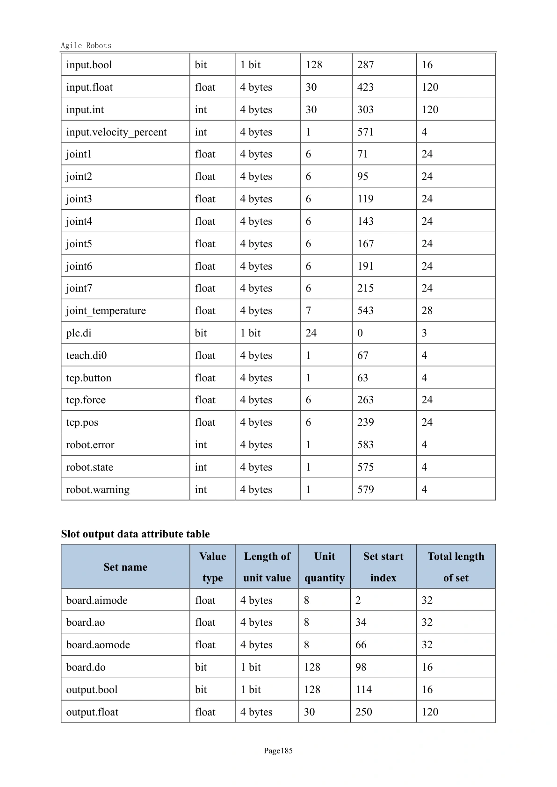



```
Agile Robots 
Page185 
input.bool 
bit 
1 bit 
128 
287 
16 
input.float 
float 
4 bytes 
30 
423 
120 
input.int 
int 
4 bytes 
30 
303 
120 
input.velocity_percent 
int 
4 bytes 
1 
571 
4 
joint1 
float 
4 bytes 
6 
71 
24 
joint2 
float 
4 bytes 
6 
95 
24 
joint3 
float 
4 bytes 
6 
119 
24 
joint4 
float 
4 bytes 
6 
143 
24 
joint5 
float 
4 bytes 
6 
167 
24 
joint6 
float 
4 bytes 
6 
191 
24 
joint7 
float 
4 bytes 
6 
215 
24 
joint_temperature 
float 
4 bytes 
7 
543 
28 
plc.di 
bit 
1 bit 
24 
0 
3 
teach.di0 
float 
4 bytes 
1 
67 
4 
tcp.button 
float 
4 bytes 
1 
63 
4 
tcp.force 
float 
4 bytes 
6 
263 
24 
tcp.pos 
float 
4 bytes 
6 
239 
24 
robot.error 
int 
4 bytes 
1 
583 
4 
robot.state 
int 
4 bytes 
1 
575 
4 
robot.warning 
int 
4 bytes 
1 
579 
4 
 
Slot output data attribute table 
Set name 
Value  
type 
Length of  
unit value 
Unit  
quantity 
Set start  
index 
Total length  
of set 
board.aimode 
float 
4 bytes 
8 
2 
32 
board.ao 
float 
4 bytes 
8 
34 
32 
board.aomode 
float 
4 bytes 
8 
66 
32 
board.do 
bit 
1 bit 
128 
98 
16 
output.bool 
bit 
1 bit 
128 
114 
16 
output.float 
float 
4 bytes 
30 
250 
120
```



## PDF page 187

**Source:** Industrial Lua Programming Manual\_V3.3.0\_EN\_20260117.pdf, original pdf page 187. [Open the corresponding PDF reading-copy page](https://1292444914-files.gitbook.io/~/files/v0/b/gitbook-x-prod.appspot.com/o/spaces%2FtgOfPnscWebs1eh82EKq%2Fuploads%2FE6fCk6dsShfO05bTex9N%2Findustrial-lua-programming-manual-v3-3-0-en-20260117-pp-185-192.pdf?alt=media#page=3).



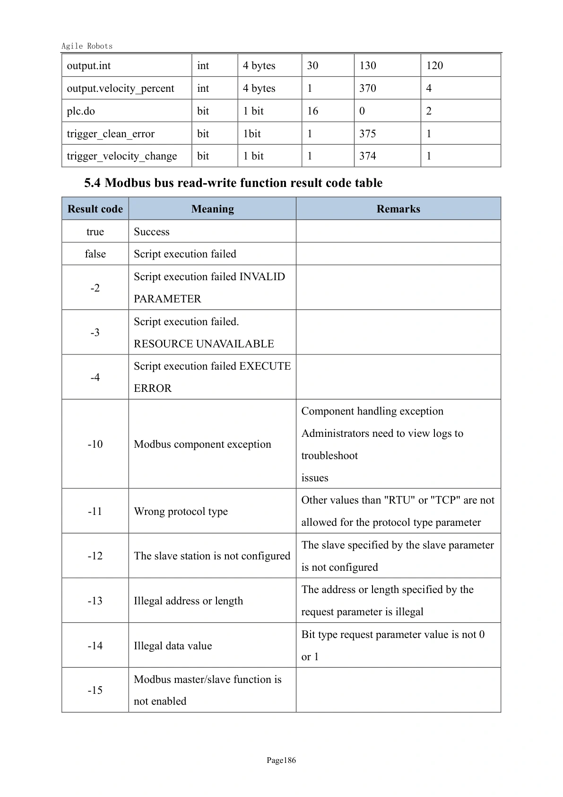



```
Agile Robots 
Page186 
output.int 
int 
4 bytes 
30 
130 
120 
output.velocity_percent 
int 
4 bytes 
1 
370 
4 
plc.do 
bit 
1 bit 
16 
0 
2 
trigger_clean_error 
bit 
1bit 
1 
375 
1 
trigger_velocity_change 
bit 
1 bit 
1 
374 
1 
5.4 Modbus bus read-write function result code table 
Result code 
Meaning 
Remarks 
true 
Success 
 
false 
Script execution failed 
 
-2 
Script execution failed INVALID 
PARAMETER 
 
-3 
Script execution failed. 
RESOURCE UNAVAILABLE 
 
-4 
Script execution failed EXECUTE 
ERROR 
 
-10 
Modbus component exception 
Component handling exception 
Administrators need to view logs to 
troubleshoot  
issues 
-11 
Wrong protocol type 
Other values than "RTU" or "TCP" are not 
allowed for the protocol type parameter 
-12 
The slave station is not configured 
The slave specified by the slave parameter 
is not configured 
-13 
Illegal address or length 
The address or length specified by the  
request parameter is illegal 
-14 
Illegal data value 
Bit type request parameter value is not 0  
or 1 
-15 
Modbus master/slave function is 
not enabled
```



## PDF page 188

**Source:** Industrial Lua Programming Manual\_V3.3.0\_EN\_20260117.pdf, original pdf page 188. [Open the corresponding PDF reading-copy page](https://1292444914-files.gitbook.io/~/files/v0/b/gitbook-x-prod.appspot.com/o/spaces%2FtgOfPnscWebs1eh82EKq%2Fuploads%2FE6fCk6dsShfO05bTex9N%2Findustrial-lua-programming-manual-v3-3-0-en-20260117-pp-185-192.pdf?alt=media#page=4).



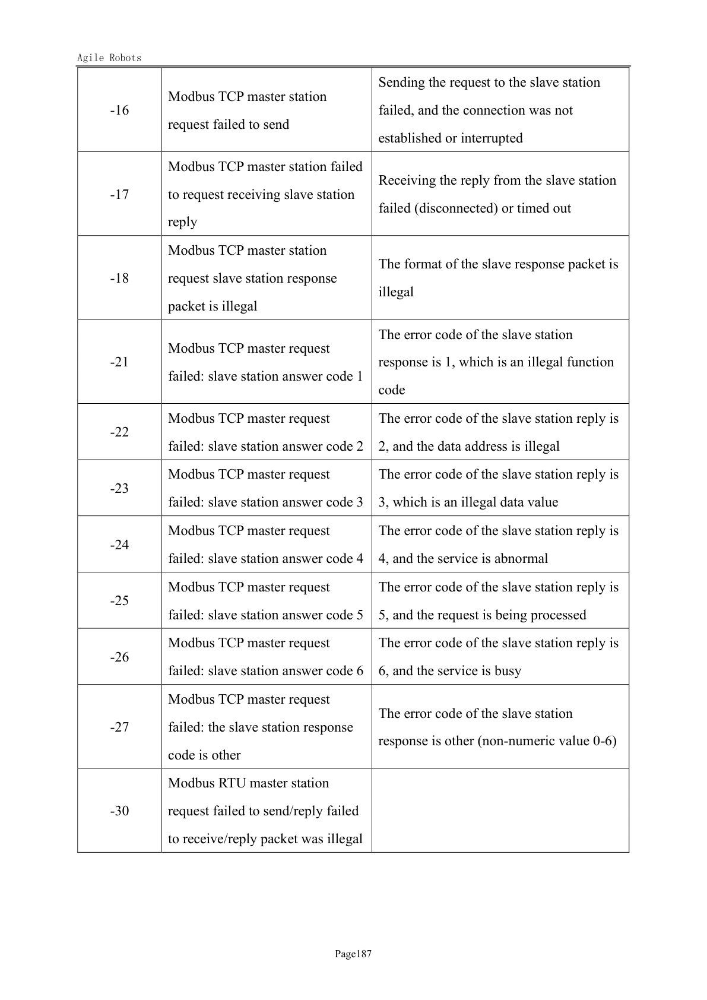



```
Agile Robots 
Page187 
-16 
Modbus TCP master station 
request failed to send 
Sending the request to the slave station 
failed, and the connection was not 
established or interrupted 
-17 
Modbus TCP master station failed 
to request receiving slave station 
reply 
Receiving the reply from the slave station 
failed (disconnected) or timed out 
-18 
Modbus TCP master station 
request slave station response 
packet is illegal 
The format of the slave response packet is 
illegal 
-21 
Modbus TCP master request 
failed: slave station answer code 1 
The error code of the slave station 
response is 1, which is an illegal function 
code 
-22 
Modbus TCP master request 
failed: slave station answer code 2 
The error code of the slave station reply is 
2, and the data address is illegal 
-23 
Modbus TCP master request 
failed: slave station answer code 3 
The error code of the slave station reply is 
3, which is an illegal data value 
-24 
Modbus TCP master request 
failed: slave station answer code 4 
The error code of the slave station reply is 
4, and the service is abnormal 
-25 
Modbus TCP master request 
failed: slave station answer code 5 
The error code of the slave station reply is 
5, and the request is being processed 
-26 
Modbus TCP master request 
failed: slave station answer code 6 
The error code of the slave station reply is 
6, and the service is busy 
-27 
Modbus TCP master request 
failed: the slave station response 
code is other 
The error code of the slave station 
response is other (non-numeric value 0-6) 
-30 
Modbus RTU master station 
request failed to send/reply failed 
to receive/reply packet was illegal
```



## PDF page 189

**Source:** Industrial Lua Programming Manual\_V3.3.0\_EN\_20260117.pdf, original pdf page 189. [Open the corresponding PDF reading-copy page](https://1292444914-files.gitbook.io/~/files/v0/b/gitbook-x-prod.appspot.com/o/spaces%2FtgOfPnscWebs1eh82EKq%2Fuploads%2FE6fCk6dsShfO05bTex9N%2Findustrial-lua-programming-manual-v3-3-0-en-20260117-pp-185-192.pdf?alt=media#page=5).



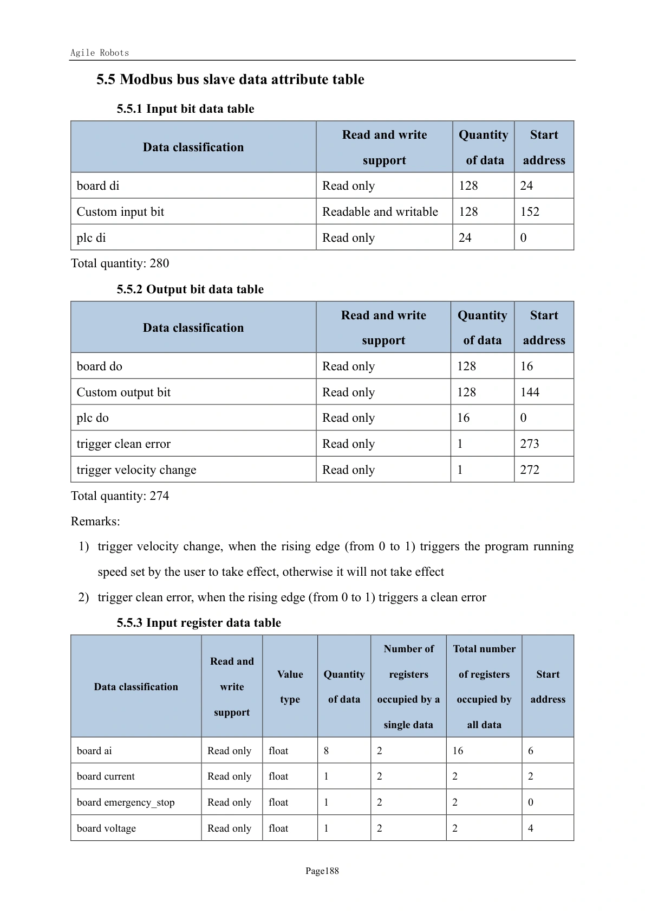



```
Agile Robots 
Page188 
5.5 Modbus bus slave data attribute table 
5.5.1 Input bit data table 
Data classification 
Read and write  
support 
Quantity 
 of data 
Start  
address 
board di 
Read only 
128 
24 
Custom input bit 
Readable and writable 
128 
152 
plc di 
Read only 
24 
0 
Total quantity: 280 
5.5.2 Output bit data table 
Data classification 
Read and write  
support 
Quantity 
of data 
Start  
address 
board do 
Read only 
128 
16 
Custom output bit 
Read only 
128 
144 
plc do 
Read only 
16 
0 
trigger clean error 
Read only 
1 
273 
trigger velocity change 
Read only 
1 
272 
Total quantity: 274 
Remarks: 
1) trigger velocity change, when the rising edge (from 0 to 1) triggers the program running 
speed set by the user to take effect, otherwise it will not take effect 
2) trigger clean error, when the rising edge (from 0 to 1) triggers a clean error 
5.5.3 Input register data table 
Data classification 
Read and 
write  
support 
Value  
type 
Quantity 
of data 
Number of  
registers  
occupied by a 
single data 
Total number 
of registers  
occupied by  
all data 
Start  
address 
board ai 
Read only 
float 
8 
2 
16 
6 
board current 
Read only 
float 
1 
2 
2 
2 
board emergency_stop 
Read only 
float 
1 
2 
2 
0 
board voltage 
Read only 
float 
1 
2 
2 
4
```



## PDF page 190

**Source:** Industrial Lua Programming Manual\_V3.3.0\_EN\_20260117.pdf, original pdf page 190. [Open the corresponding PDF reading-copy page](https://1292444914-files.gitbook.io/~/files/v0/b/gitbook-x-prod.appspot.com/o/spaces%2FtgOfPnscWebs1eh82EKq%2Fuploads%2FE6fCk6dsShfO05bTex9N%2Findustrial-lua-programming-manual-v3-3-0-en-20260117-pp-185-192.pdf?alt=media#page=6).



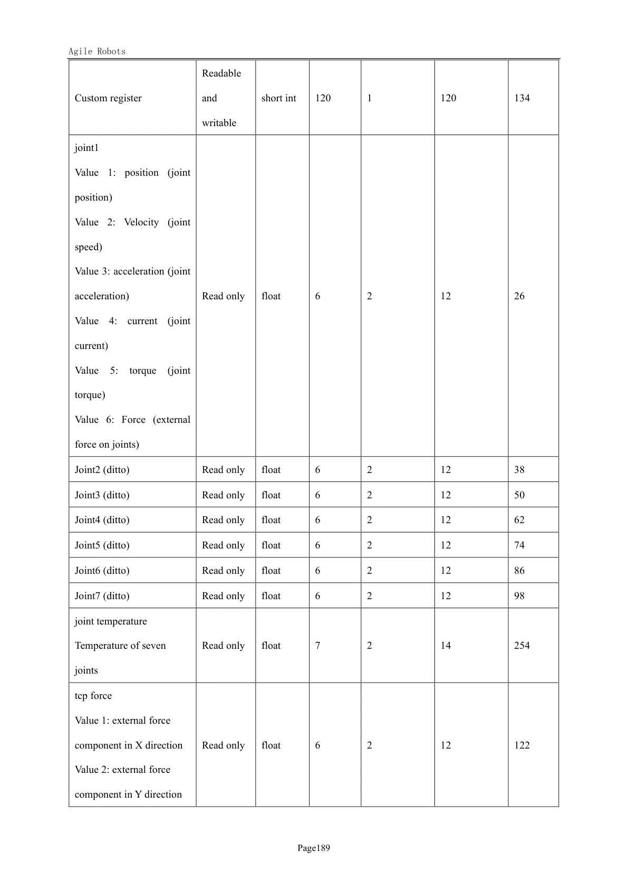



```
Agile Robots 
Page189 
Custom register 
Readable 
and 
writable 
short int 
120 
1 
120 
134 
joint1 
Value 1: position (joint 
position) 
Value 2: Velocity (joint 
speed) 
Value 3: acceleration (joint 
acceleration) 
Value 4: current (joint 
current) 
Value 
5: 
torque 
(joint 
torque) 
Value 6: Force (external 
force on joints) 
Read only 
float 
6 
2 
12 
26 
Joint2 (ditto) 
Read only 
float 
6 
2 
12 
38 
Joint3 (ditto) 
Read only 
float 
6 
2 
12 
50 
Joint4 (ditto) 
Read only 
float 
6 
2 
12 
62 
Joint5 (ditto) 
Read only 
float 
6 
2 
12 
74 
Joint6 (ditto) 
Read only 
float 
6 
2 
12 
86 
Joint7 (ditto) 
Read only 
float 
6 
2 
12 
98 
joint temperature 
Temperature of seven 
joints 
Read only 
float 
7 
2 
14 
254 
tcp force 
Value 1: external force 
component in X direction 
Value 2: external force 
component in Y direction 
Read only 
float 
6 
2 
12 
122
```



## PDF page 191

**Source:** Industrial Lua Programming Manual\_V3.3.0\_EN\_20260117.pdf, original pdf page 191. [Open the corresponding PDF reading-copy page](https://1292444914-files.gitbook.io/~/files/v0/b/gitbook-x-prod.appspot.com/o/spaces%2FtgOfPnscWebs1eh82EKq%2Fuploads%2FE6fCk6dsShfO05bTex9N%2Findustrial-lua-programming-manual-v3-3-0-en-20260117-pp-185-192.pdf?alt=media#page=7).



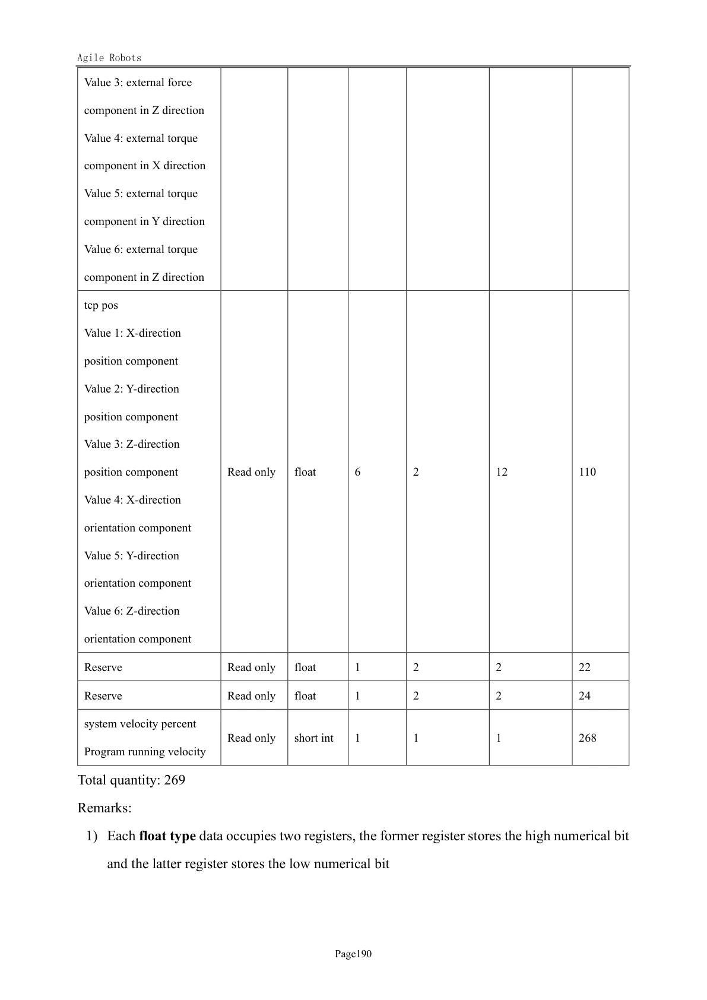



```
Agile Robots 
Page190 
Value 3: external force 
component in Z direction 
Value 4: external torque 
component in X direction 
Value 5: external torque 
component in Y direction 
Value 6: external torque 
component in Z direction 
tcp pos 
Value 1: X-direction 
position component 
Value 2: Y-direction 
position component 
Value 3: Z-direction 
position component 
Value 4: X-direction 
orientation component 
Value 5: Y-direction 
orientation component 
Value 6: Z-direction 
orientation component 
Read only 
float 
6 
2 
12 
110 
Reserve 
Read only 
float 
1 
2 
2 
22 
Reserve 
Read only 
float 
1 
2 
2 
24 
system velocity percent 
Program running velocity 
Read only 
short int 
1 
1 
1 
268 
Total quantity: 269 
Remarks: 
1) Each float type data occupies two registers, the former register stores the high numerical bit 
and the latter register stores the low numerical bit
```



## PDF page 192

**Source:** Industrial Lua Programming Manual\_V3.3.0\_EN\_20260117.pdf, original pdf page 192. [Open the corresponding PDF reading-copy page](https://1292444914-files.gitbook.io/~/files/v0/b/gitbook-x-prod.appspot.com/o/spaces%2FtgOfPnscWebs1eh82EKq%2Fuploads%2FE6fCk6dsShfO05bTex9N%2Findustrial-lua-programming-manual-v3-3-0-en-20260117-pp-185-192.pdf?alt=media#page=8).



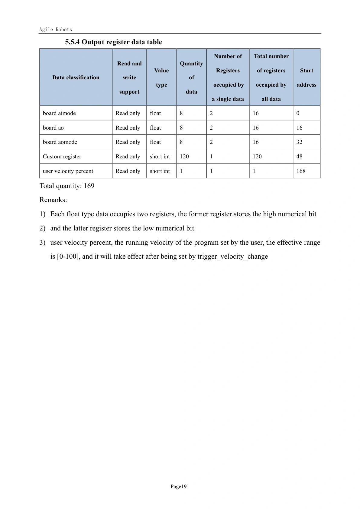



```
Agile Robots 
Page191 
5.5.4 Output register data table 
Data classification 
Read and 
write  
support 
Value  
type 
Quantity 
of  
data 
Number of  
Registers 
 occupied by 
a single data 
Total number 
of registers  
occupied by  
all data 
Start  
address 
board aimode 
Read only 
float 
8 
2 
16 
0 
board ao 
Read only 
float 
8 
2 
16 
16 
board aomode 
Read only 
float 
8 
2 
16 
32 
Custom register 
Read only 
short int 
120 
1 
120 
48 
user velocity percent 
Read only 
short int 
1 
1 
1 
168 
Total quantity: 169 
Remarks: 
1) Each float type data occupies two registers, the former register stores the high numerical bit  
2) and the latter register stores the low numerical bit 
3) user velocity percent, the running velocity of the program set by the user, the effective range 
is [0-100], and it will take effect after being set by trigger_velocity_change
```


