# Industrial teaching pendant manual V3.3.0 — PDF pages 1–72


**Complete supplied source:** Industrial Teaching Pendant Software User Manual\_V3.3.0\_EN\_20260204.pdf · **Coverage:** 286 original PDF pages. [Return to the Agile Robots source library](../).


Every source page is retained in the original order. The **Original page** view preserves complete diagrams, photographs, tables, equations, connector orientation, notices and examples. The **Searchable text** view preserves native PDF text or the slide’s native text, embedded links and substantive speaker notes. Text extraction can retain reading-order/character defects; use the original image for exact layout, table columns and code indentation.


The pendant controls modes, enable state, tasks, I/O, calibration, safety-related configuration and peripheral equipment. A stopped arm does not prove that every output or process is de-energized. Apply the delivered hardware/software and safety procedures.


**Attribution:** the manufacturer and contributors identified in the supplied document. Original notices remain visible on every source page. Navigation, revision notes and the linked engineering explanations are OpenELAB editorial additions.

[Full document index](./) · This reading section contains original PDF pages **1–72**.

## Document navigation

| Source section / function                 | Original page                          |
| ----------------------------------------- | -------------------------------------- |
| 1. Main Interface                         | [PDF 5](pages-001-072.md#pdf-page-5)   |
| 1.1.Teaching pendant main interface       | [PDF 5](pages-001-072.md#pdf-page-5)   |
| 1.2.Software main menu                    | [PDF 8](pages-001-072.md#pdf-page-8)   |
| 1.3.Virtual keyboard                      | [PDF 9](pages-001-072.md#pdf-page-9)   |
| 1.4.Project management                    | [PDF 9](pages-001-072.md#pdf-page-9)   |
| 1.5.Screen Shot                           | [PDF 10](pages-001-072.md#pdf-page-10) |
| 2.Startup Interface                       | [PDF 11](pages-001-072.md#pdf-page-11) |
| 3.Manual Operation                        | [PDF 14](pages-001-072.md#pdf-page-14) |
| 3.1.Robot arm position display            | [PDF 14](pages-001-072.md#pdf-page-14) |
| 3.2.Coordinate system selection           | [PDF 15](pages-001-072.md#pdf-page-15) |
| 3.3.Manual operation mode                 | [PDF 16](pages-001-072.md#pdf-page-16) |
| 3.4.Joint space motion                    | [PDF 17](pages-001-072.md#pdf-page-17) |
| 3.5.Cartesian space motion                | [PDF 19](pages-001-072.md#pdf-page-19) |
| 3.6.Nullspace Motion                      | [PDF 21](pages-001-072.md#pdf-page-21) |
| 3.7.Freedrive                             | [PDF 22](pages-001-072.md#pdf-page-22) |
| 3.8.Home                                  | [PDF 23](pages-001-072.md#pdf-page-23) |
| 3.9.Control Mode                          | [PDF 23](pages-001-072.md#pdf-page-23) |
| 3.10.Speed control                        | [PDF 24](pages-001-072.md#pdf-page-24) |
| 3.11.IO control                           | [PDF 25](pages-001-072.md#pdf-page-25) |
| 4.Programming                             | [PDF 26](pages-001-072.md#pdf-page-26) |
| 4.1.Programming interface                 | [PDF 26](pages-001-072.md#pdf-page-26) |
| 4.2.Program line number                   | [PDF 26](pages-001-072.md#pdf-page-26) |
| 4.3.Tracking Threads                      | [PDF 28](pages-001-072.md#pdf-page-28) |
| 4.4.Program tree structure control        | [PDF 31](pages-001-072.md#pdf-page-31) |
| 4.4.1.New program                         | [PDF 31](pages-001-072.md#pdf-page-31) |
| 4.4.2.Delete program or instruction       | [PDF 32](pages-001-072.md#pdf-page-32) |
| 4.4.3.Copy program or instruction         | [PDF 32](pages-001-072.md#pdf-page-32) |
| 4.4.4.Cut program or instruction          | [PDF 33](pages-001-072.md#pdf-page-33) |
| 4.4.5.Suppress and Unsuppress instruction | [PDF 33](pages-001-072.md#pdf-page-33) |
| 4.4.6.Undo and Redo                       | [PDF 34](pages-001-072.md#pdf-page-34) |
| 4.5.Instruction component                 | [PDF 35](pages-001-072.md#pdf-page-35) |
| 4.5.1.Functional instruction              | [PDF 35](pages-001-072.md#pdf-page-35) |
| 4.5.1.1.Move                              | [PDF 35](pages-001-072.md#pdf-page-35) |
| 4.5.1.2.MoveC                             | [PDF 39](pages-001-072.md#pdf-page-39) |
| 4.5.1.3.Waypoint                          | [PDF 40](pages-001-072.md#pdf-page-40) |
| 4.5.1.4.Wait                              | [PDF 45](pages-001-072.md#pdf-page-45) |
| 4.5.1.5.Settings                          | [PDF 47](pages-001-072.md#pdf-page-47) |
| 4.5.1.6.Comment                           | [PDF 49](pages-001-072.md#pdf-page-49) |
| 4.5.1.7.Folder                            | [PDF 50](pages-001-072.md#pdf-page-50) |
| 4.5.1.8.Termination                       | [PDF 50](pages-001-072.md#pdf-page-50) |
| 4.5.1.9.Subroutine                        | [PDF 51](pages-001-072.md#pdf-page-51) |
| 4.5.1.10.Python Script                    | [PDF 52](pages-001-072.md#pdf-page-52) |
| 4.5.1.12.Control Mode                     | [PDF 57](pages-001-072.md#pdf-page-57) |
| 4.5.1.13.Enter force control              | [PDF 58](pages-001-072.md#pdf-page-58) |
| 4.5.1.14.Exit force control               | [PDF 59](pages-001-072.md#pdf-page-59) |
| 4.5.1.15.Collision detection              | [PDF 59](pages-001-072.md#pdf-page-59) |
| 4.5.1.16.Interactive instruction          | [PDF 61](pages-001-072.md#pdf-page-61) |
| 4.5.1.17.Conveyor belt instruction        | [PDF 62](pages-001-072.md#pdf-page-62) |
| 4.4.1.18.Jump instruction                 | [PDF 63](pages-001-072.md#pdf-page-63) |
| 4.5.1.19.Label instruction                | [PDF 63](pages-001-072.md#pdf-page-63) |
| 4.5.1.20.Timer instruction                | [PDF 63](pages-001-072.md#pdf-page-63) |
| 4.5.2.Logic instruction                   | [PDF 65](pages-001-072.md#pdf-page-65) |
| 4.5.2.1.Conditional block                 | [PDF 65](pages-001-072.md#pdf-page-65) |
| 4.5.2.2.Conditional branching             | [PDF 65](pages-001-072.md#pdf-page-65) |
| 4.5.2.3.Loop block                        | [PDF 67](pages-001-072.md#pdf-page-67) |
| 4.5.2.4.Break loop                        | [PDF 67](pages-001-072.md#pdf-page-67) |
| 4.5.2.5.Continue loop                     | [PDF 68](pages-001-072.md#pdf-page-68) |
| 4.6.System variable table                 | [PDF 68](pages-001-072.md#pdf-page-68) |
| 4.6.1.1.Open File                         | [PDF 69](pages-001-072.md#pdf-page-69) |
| 4.6.1.2.Setting the main program          | [PDF 70](pages-001-072.md#pdf-page-70) |
| 4.6.1.3.Cache All                         | [PDF 71](pages-001-072.md#pdf-page-71) |
| 4.6.1.4.Create files (folders)            | [PDF 72](pages-001-072.md#pdf-page-72) |

## PDF page 1

**Source:** Industrial Teaching Pendant Software User Manual\_V3.3.0\_EN\_20260204.pdf, original pdf page 1. [Open the corresponding PDF reading-copy page](https://1292444914-files.gitbook.io/~/files/v0/b/gitbook-x-prod.appspot.com/o/spaces%2FtgOfPnscWebs1eh82EKq%2Fuploads%2FdkNcExcX8fuDcS0TVH0V%2Findustrial-teaching-pendant-software-user-manual-v3-3-0-en-20260204-pp-001-010.pdf?alt=media#page=1).



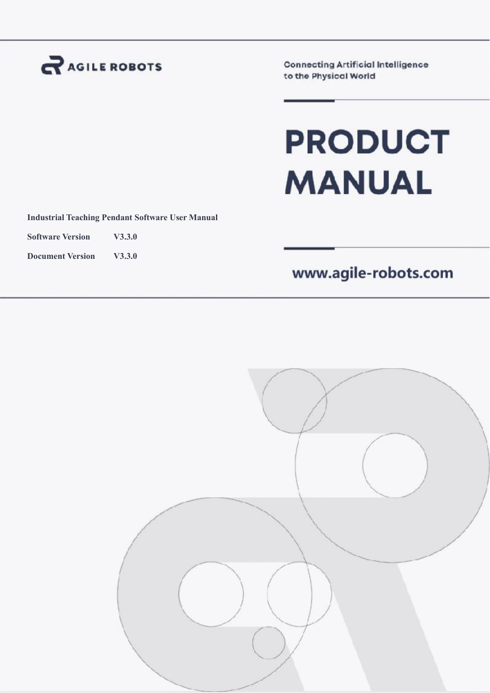



```
Agile Robots 
Page I  
 
Industrial Teaching Pendant Software User Manual  
Software Version  
V3.3.0  
Document Version  
V3.3.0
```



## PDF page 2

**Source:** Industrial Teaching Pendant Software User Manual\_V3.3.0\_EN\_20260204.pdf, original pdf page 2. [Open the corresponding PDF reading-copy page](https://1292444914-files.gitbook.io/~/files/v0/b/gitbook-x-prod.appspot.com/o/spaces%2FtgOfPnscWebs1eh82EKq%2Fuploads%2FdkNcExcX8fuDcS0TVH0V%2Findustrial-teaching-pendant-software-user-manual-v3-3-0-en-20260204-pp-001-010.pdf?alt=media#page=2).



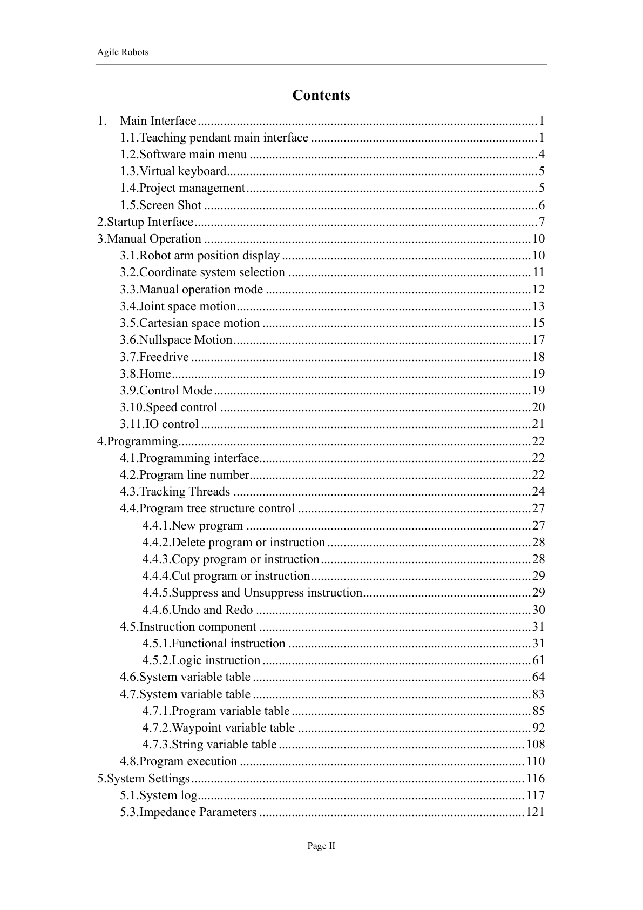



```
Agile Robots 
Page II  
Contents  
1. Main Interface ......................................................................................................... 1 
1.1.Teaching pendant main interface ...................................................................... 1 
1.2.Software main menu ......................................................................................... 4 
1.3.Virtual keyboard ................................................................................................ 5 
1.4.Project management .......................................................................................... 5 
1.5.Screen Shot ....................................................................................................... 6 
2.Startup Interface .......................................................................................................... 7 
3.Manual Operation ..................................................................................................... 10 
3.1.Robot arm position display ............................................................................. 10 
3.2.Coordinate system selection ........................................................................... 11 
3.3.Manual operation mode .................................................................................. 12 
3.4.Joint space motion ........................................................................................... 13 
3.5.Cartesian space motion ................................................................................... 15 
3.6.Nullspace Motion ............................................................................................ 17 
3.7.Freedrive ......................................................................................................... 18 
3.8.Home ............................................................................................................... 19 
3.9.Control Mode .................................................................................................. 19 
3.10.Speed control ................................................................................................ 20 
3.11.IO control ...................................................................................................... 21 
4.Programming ............................................................................................................. 22 
4.1.Programming interface .................................................................................... 22 
4.2.Program line number ....................................................................................... 22 
4.3.Tracking Threads ............................................................................................ 24 
4.4.Program tree structure control ........................................................................ 27 
4.4.1.New program ........................................................................................ 27 
4.4.2.Delete program or instruction ............................................................... 28 
4.4.3.Copy program or instruction ................................................................. 28 
4.4.4.Cut program or instruction .................................................................... 29 
4.4.5.Suppress and Unsuppress instruction .................................................... 29 
4.4.6.Undo and Redo ..................................................................................... 30 
4.5.Instruction component .................................................................................... 31 
4.5.1.Functional instruction ........................................................................... 31 
4.5.2.Logic instruction ................................................................................... 61 
4.6.System variable table ...................................................................................... 64 
4.7.System variable table ...................................................................................... 83 
4.7.1.Program variable table .......................................................................... 85 
4.7.2.Waypoint variable table ........................................................................ 92 
4.7.3.String variable table ............................................................................ 108 
4.8.Program execution ........................................................................................ 110 
5.System Settings ....................................................................................................... 116 
5.1.System log ..................................................................................................... 117 
5.3.Impedance Parameters .................................................................................. 121
```



**Original document cross-references:** [PDF 5](pages-001-072.md#pdf-page-5) · [PDF 8](pages-001-072.md#pdf-page-8) · [PDF 9](pages-001-072.md#pdf-page-9) · [PDF 10](pages-001-072.md#pdf-page-10) · [PDF 11](pages-001-072.md#pdf-page-11) · [PDF 14](pages-001-072.md#pdf-page-14) · [PDF 15](pages-001-072.md#pdf-page-15) · [PDF 16](pages-001-072.md#pdf-page-16) · [PDF 17](pages-001-072.md#pdf-page-17) · [PDF 19](pages-001-072.md#pdf-page-19) · [PDF 21](pages-001-072.md#pdf-page-21) · [PDF 22](pages-001-072.md#pdf-page-22) · [PDF 23](pages-001-072.md#pdf-page-23) · [PDF 24](pages-001-072.md#pdf-page-24) · [PDF 25](pages-001-072.md#pdf-page-25) · [PDF 26](pages-001-072.md#pdf-page-26) · [PDF 28](pages-001-072.md#pdf-page-28) · [PDF 31](pages-001-072.md#pdf-page-31) · [PDF 32](pages-001-072.md#pdf-page-32) · [PDF 33](pages-001-072.md#pdf-page-33) · [PDF 34](pages-001-072.md#pdf-page-34) · [PDF 35](pages-001-072.md#pdf-page-35) · [PDF 65](pages-001-072.md#pdf-page-65) · [PDF 68](pages-001-072.md#pdf-page-68) · [PDF 87](pages-073-144.md#pdf-page-87) · [PDF 89](pages-073-144.md#pdf-page-89) · [PDF 96](pages-073-144.md#pdf-page-96) · [PDF 112](pages-073-144.md#pdf-page-112) · [PDF 114](pages-073-144.md#pdf-page-114) · [PDF 120](pages-073-144.md#pdf-page-120) · [PDF 121](pages-073-144.md#pdf-page-121) · [PDF 125](pages-073-144.md#pdf-page-125)

## PDF page 3

**Source:** Industrial Teaching Pendant Software User Manual\_V3.3.0\_EN\_20260204.pdf, original pdf page 3. [Open the corresponding PDF reading-copy page](https://1292444914-files.gitbook.io/~/files/v0/b/gitbook-x-prod.appspot.com/o/spaces%2FtgOfPnscWebs1eh82EKq%2Fuploads%2FdkNcExcX8fuDcS0TVH0V%2Findustrial-teaching-pendant-software-user-manual-v3-3-0-en-20260204-pp-001-010.pdf?alt=media#page=3).



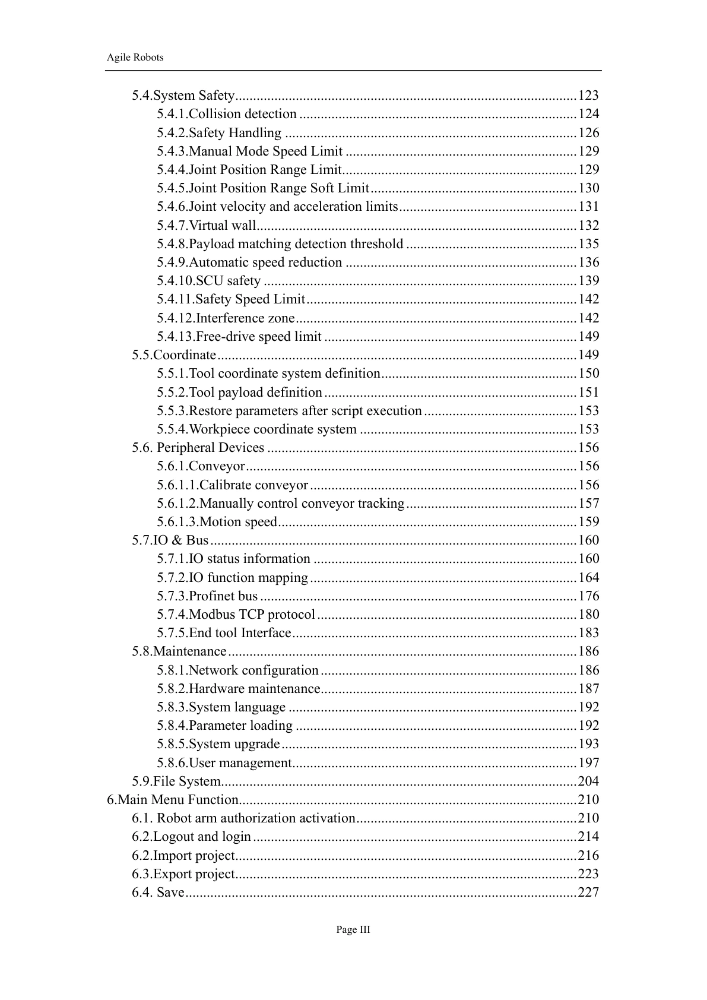



```
Agile Robots 
Page III  
5.4.System Safety ................................................................................................ 123 
5.4.1.Collision detection .............................................................................. 124 
5.4.2.Safety Handling .................................................................................. 126 
5.4.3.Manual Mode Speed Limit ................................................................. 129 
5.4.4.Joint Position Range Limit.................................................................. 129 
5.4.5.Joint Position Range Soft Limit .......................................................... 130 
5.4.6.Joint velocity and acceleration limits .................................................. 131 
5.4.7.Virtual wall .......................................................................................... 132 
5.4.8.Payload matching detection threshold ................................................ 135 
5.4.9.Automatic speed reduction ................................................................. 136 
5.4.10.SCU safety ........................................................................................ 139 
5.4.11.Safety Speed Limit ............................................................................ 142 
5.4.12.Interference zone ............................................................................... 142 
5.4.13.Free-drive speed limit ....................................................................... 149 
5.5.Coordinate ..................................................................................................... 149 
5.5.1.Tool coordinate system definition ....................................................... 150 
5.5.2.Tool payload definition ....................................................................... 151 
5.5.3.Restore parameters after script execution ........................................... 153 
5.5.4.Workpiece coordinate system ............................................................. 153 
5.6. Peripheral Devices ....................................................................................... 156 
5.6.1.Conveyor ............................................................................................. 156 
5.6.1.1.Calibrate conveyor ........................................................................... 156 
5.6.1.2.Manually control conveyor tracking ................................................ 157 
5.6.1.3.Motion speed .................................................................................... 159 
5.7.IO & Bus ....................................................................................................... 160 
5.7.1.IO status information .......................................................................... 160 
5.7.2.IO function mapping ........................................................................... 164 
5.7.3.Profinet bus ......................................................................................... 176 
5.7.4.Modbus TCP protocol ......................................................................... 180 
5.7.5.End tool Interface ................................................................................ 183 
5.8.Maintenance .................................................................................................. 186 
5.8.1.Network configuration ........................................................................ 186 
5.8.2.Hardware maintenance ........................................................................ 187 
5.8.3.System language ................................................................................. 192 
5.8.4.Parameter loading ............................................................................... 192 
5.8.5.System upgrade ................................................................................... 193 
5.8.6.User management ................................................................................ 197 
5.9.File System .................................................................................................... 204 
6.Main Menu Function ............................................................................................... 210 
6.1. Robot arm authorization activation .............................................................. 210 
6.2.Logout and login ........................................................................................... 214 
6.2.Import project ................................................................................................ 216 
6.3.Export project ................................................................................................ 223 
6.4. Save .............................................................................................................. 227
```



**Original document cross-references:** [PDF 127](pages-073-144.md#pdf-page-127) · [PDF 128](pages-073-144.md#pdf-page-128) · [PDF 130](pages-073-144.md#pdf-page-130) · [PDF 133](pages-073-144.md#pdf-page-133) · [PDF 134](pages-073-144.md#pdf-page-134) · [PDF 135](pages-073-144.md#pdf-page-135) · [PDF 136](pages-073-144.md#pdf-page-136) · [PDF 139](pages-073-144.md#pdf-page-139) · [PDF 140](pages-073-144.md#pdf-page-140) · [PDF 143](pages-073-144.md#pdf-page-143) · [PDF 146](pages-145-216.md#pdf-page-146) · [PDF 153](pages-145-216.md#pdf-page-153) · [PDF 154](pages-145-216.md#pdf-page-154) · [PDF 155](pages-145-216.md#pdf-page-155) · [PDF 157](pages-145-216.md#pdf-page-157) · [PDF 160](pages-145-216.md#pdf-page-160) · [PDF 161](pages-145-216.md#pdf-page-161) · [PDF 163](pages-145-216.md#pdf-page-163) · [PDF 164](pages-145-216.md#pdf-page-164) · [PDF 168](pages-145-216.md#pdf-page-168) · [PDF 180](pages-145-216.md#pdf-page-180) · [PDF 184](pages-145-216.md#pdf-page-184) · [PDF 187](pages-145-216.md#pdf-page-187) · [PDF 190](pages-145-216.md#pdf-page-190) · [PDF 191](pages-145-216.md#pdf-page-191) · [PDF 196](pages-145-216.md#pdf-page-196) · [PDF 198](pages-145-216.md#pdf-page-198) · [PDF 201](pages-145-216.md#pdf-page-201) · [PDF 209](pages-145-216.md#pdf-page-209) · [PDF 215](pages-145-216.md#pdf-page-215) · [PDF 221](pages-217-286.md#pdf-page-221) · [PDF 223](pages-217-286.md#pdf-page-223) · [PDF 230](pages-217-286.md#pdf-page-230) · [PDF 234](pages-217-286.md#pdf-page-234)

## PDF page 4

**Source:** Industrial Teaching Pendant Software User Manual\_V3.3.0\_EN\_20260204.pdf, original pdf page 4. [Open the corresponding PDF reading-copy page](https://1292444914-files.gitbook.io/~/files/v0/b/gitbook-x-prod.appspot.com/o/spaces%2FtgOfPnscWebs1eh82EKq%2Fuploads%2FdkNcExcX8fuDcS0TVH0V%2Findustrial-teaching-pendant-software-user-manual-v3-3-0-en-20260204-pp-001-010.pdf?alt=media#page=4).



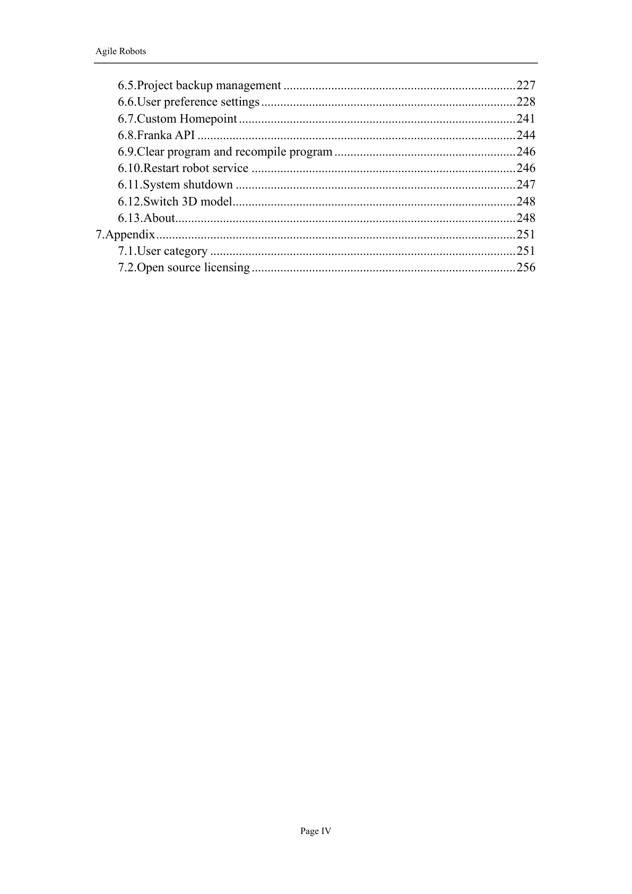



```
Agile Robots 
Page IV  
6.5.Project backup management ......................................................................... 227 
6.6.User preference settings ................................................................................ 228 
6.7.Custom Homepoint ....................................................................................... 241 
6.8.Franka API .................................................................................................... 244 
6.9.Clear program and recompile program ......................................................... 246 
6.10.Restart robot service ................................................................................... 246 
6.11.System shutdown ........................................................................................ 247 
6.12.Switch 3D model ......................................................................................... 248 
6.13.About ........................................................................................................... 248 
7.Appendix ................................................................................................................. 251 
7.1.User category ................................................................................................ 251 
7.2.Open source licensing ................................................................................... 256
```



**Original document cross-references:** [PDF 235](pages-217-286.md#pdf-page-235) · [PDF 236](pages-217-286.md#pdf-page-236) · [PDF 249](pages-217-286.md#pdf-page-249) · [PDF 252](pages-217-286.md#pdf-page-252) · [PDF 254](pages-217-286.md#pdf-page-254) · [PDF 255](pages-217-286.md#pdf-page-255) · [PDF 256](pages-217-286.md#pdf-page-256) · [PDF 259](pages-217-286.md#pdf-page-259) · [PDF 264](pages-217-286.md#pdf-page-264)

## PDF page 5

**Source:** Industrial Teaching Pendant Software User Manual\_V3.3.0\_EN\_20260204.pdf, original pdf page 5. [Open the corresponding PDF reading-copy page](https://1292444914-files.gitbook.io/~/files/v0/b/gitbook-x-prod.appspot.com/o/spaces%2FtgOfPnscWebs1eh82EKq%2Fuploads%2FdkNcExcX8fuDcS0TVH0V%2Findustrial-teaching-pendant-software-user-manual-v3-3-0-en-20260204-pp-001-010.pdf?alt=media#page=5).



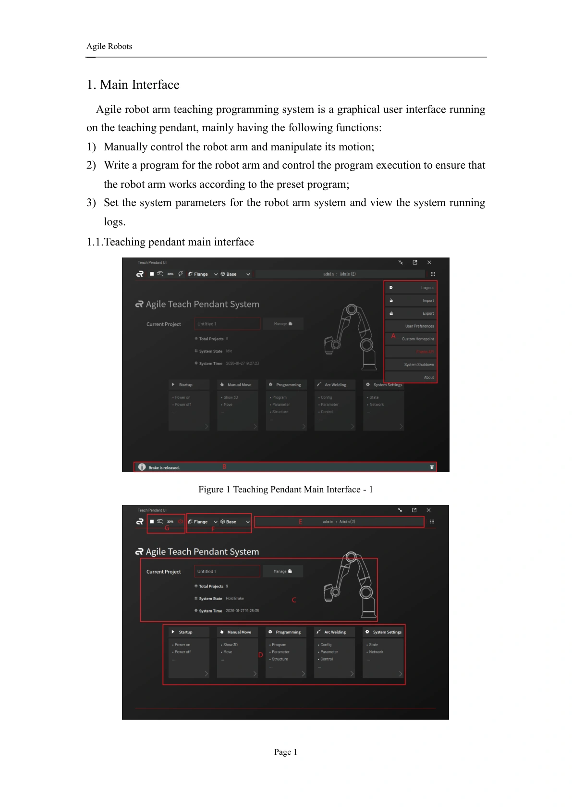



```
Agile Robots 
Page 1 
 
1. Main Interface  
Agile robot arm teaching programming system is a graphical user interface running 
on the teaching pendant, mainly having the following functions:  
1)  Manually control the robot arm and manipulate its motion;  
2)  Write a program for the robot arm and control the program execution to ensure that 
the robot arm works according to the preset program;  
3)  Set the system parameters for the robot arm system and view the system running 
logs.  
1.1.Teaching pendant main interface  
 
Figure 1 Teaching Pendant Main Interface - 1
```



## PDF page 6

**Source:** Industrial Teaching Pendant Software User Manual\_V3.3.0\_EN\_20260204.pdf, original pdf page 6. [Open the corresponding PDF reading-copy page](https://1292444914-files.gitbook.io/~/files/v0/b/gitbook-x-prod.appspot.com/o/spaces%2FtgOfPnscWebs1eh82EKq%2Fuploads%2FdkNcExcX8fuDcS0TVH0V%2Findustrial-teaching-pendant-software-user-manual-v3-3-0-en-20260204-pp-001-010.pdf?alt=media#page=6).



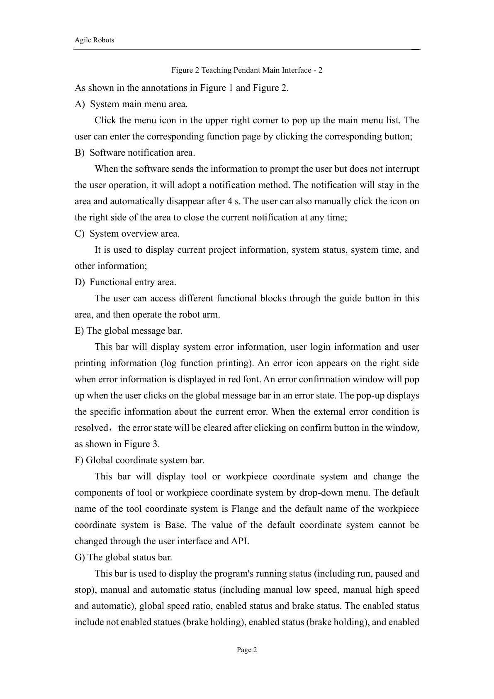



```
Agile Robots 
Page 2 
 
Figure 2 Teaching Pendant Main Interface - 2 
As shown in the annotations in Figure 1 and Figure 2. 
A)  System main menu area.  
Click the menu icon in the upper right corner to pop up the main menu list. The 
user can enter the corresponding function page by clicking the corresponding button;  
B)  Software notification area.  
When the software sends the information to prompt the user but does not interrupt 
the user operation, it will adopt a notification method. The notification will stay in the 
area and automatically disappear after 4 s. The user can also manually click the icon on 
the right side of the area to close the current notification at any time;  
C)  System overview area.  
It is used to display current project information, system status, system time, and 
other information;  
D)  Functional entry area.  
The user can access different functional blocks through the guide button in this 
area, and then operate the robot arm.  
E) The global message bar.  
This bar will display system error information, user login information and user 
printing information (log function printing). An error icon appears on the right side 
when error information is displayed in red font. An error confirmation window will pop 
up when the user clicks on the global message bar in an error state. The pop-up displays 
the specific information about the current error. When the external error condition is 
resolved，the error state will be cleared after clicking on confirm button in the window,  
as shown in Figure 3. 
F) Global coordinate system bar.  
This bar will display tool or workpiece coordinate system and change the 
components of tool or workpiece coordinate system by drop-down menu. The default 
name of the tool coordinate system is Flange and the default name of the workpiece 
coordinate system is Base. The value of the default coordinate system cannot be 
changed through the user interface and API. 
G) The global status bar.  
This bar is used to display the program's running status (including run, paused and 
stop), manual and automatic status (including manual low speed, manual high speed 
and automatic), global speed ratio, enabled status and brake status. The enabled status 
include not enabled statues (brake holding), enabled status (brake holding), and enabled
```



**Original document cross-references:** [PDF 5](pages-001-072.md#pdf-page-5) · [PDF 6](pages-001-072.md#pdf-page-6) · [PDF 8](pages-001-072.md#pdf-page-8)

## PDF page 7

**Source:** Industrial Teaching Pendant Software User Manual\_V3.3.0\_EN\_20260204.pdf, original pdf page 7. [Open the corresponding PDF reading-copy page](https://1292444914-files.gitbook.io/~/files/v0/b/gitbook-x-prod.appspot.com/o/spaces%2FtgOfPnscWebs1eh82EKq%2Fuploads%2FdkNcExcX8fuDcS0TVH0V%2Findustrial-teaching-pendant-software-user-manual-v3-3-0-en-20260204-pp-001-010.pdf?alt=media#page=7).



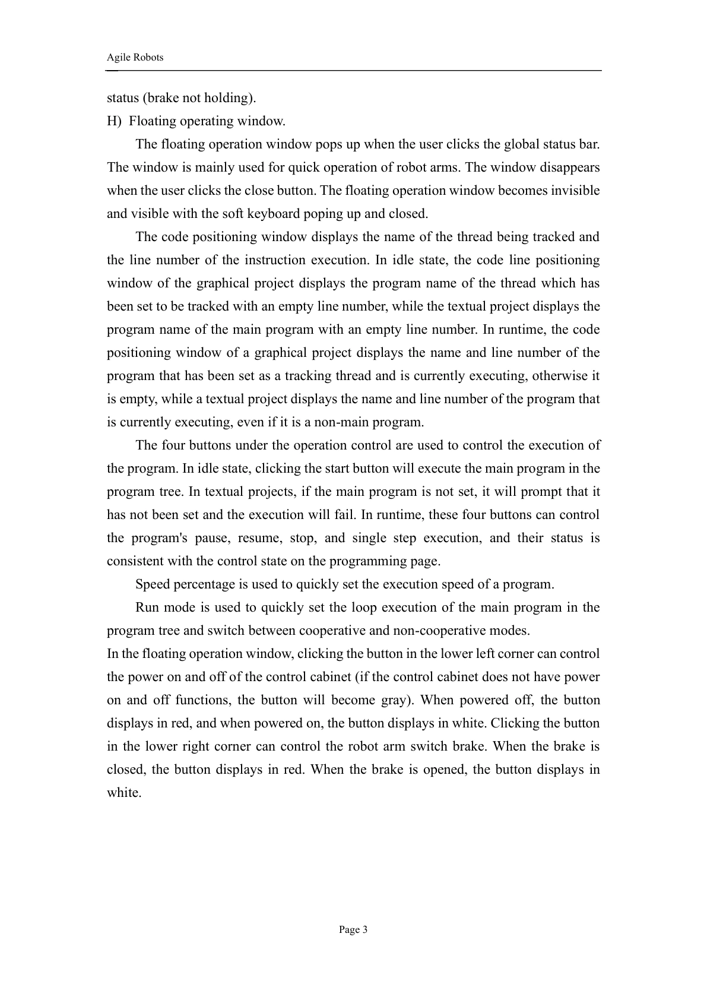



```
Agile Robots 
Page 3 
 
status (brake not holding). 
H)  Floating operating window.  
The floating operation window pops up when the user clicks the global status bar. 
The window is mainly used for quick operation of robot arms. The window disappears 
when the user clicks the close button. The floating operation window becomes invisible 
and visible with the soft keyboard poping up and closed.  
The code positioning window displays the name of the thread being tracked and 
the line number of the instruction execution. In idle state, the code line positioning 
window of the graphical project displays the program name of the thread which has 
been set to be tracked with an empty line number, while the textual project displays the 
program name of the main program with an empty line number. In runtime, the code 
positioning window of a graphical project displays the name and line number of the 
program that has been set as a tracking thread and is currently executing, otherwise it 
is empty, while a textual project displays the name and line number of the program that 
is currently executing, even if it is a non-main program. 
The four buttons under the operation control are used to control the execution of 
the program. In idle state, clicking the start button will execute the main program in the 
program tree. In textual projects, if the main program is not set, it will prompt that it 
has not been set and the execution will fail. In runtime, these four buttons can control 
the program's pause, resume, stop, and single step execution, and their status is 
consistent with the control state on the programming page. 
Speed percentage is used to quickly set the execution speed of a program. 
Run mode is used to quickly set the loop execution of the main program in the 
program tree and switch between cooperative and non-cooperative modes. 
In the floating operation window, clicking the button in the lower left corner can control 
the power on and off of the control cabinet (if the control cabinet does not have power 
on and off functions, the button will become gray). When powered off, the button 
displays in red, and when powered on, the button displays in white. Clicking the button 
in the lower right corner can control the robot arm switch brake. When the brake is 
closed, the button displays in red. When the brake is opened, the button displays in 
white.
```



## PDF page 8

**Source:** Industrial Teaching Pendant Software User Manual\_V3.3.0\_EN\_20260204.pdf, original pdf page 8. [Open the corresponding PDF reading-copy page](https://1292444914-files.gitbook.io/~/files/v0/b/gitbook-x-prod.appspot.com/o/spaces%2FtgOfPnscWebs1eh82EKq%2Fuploads%2FdkNcExcX8fuDcS0TVH0V%2Findustrial-teaching-pendant-software-user-manual-v3-3-0-en-20260204-pp-001-010.pdf?alt=media#page=8).



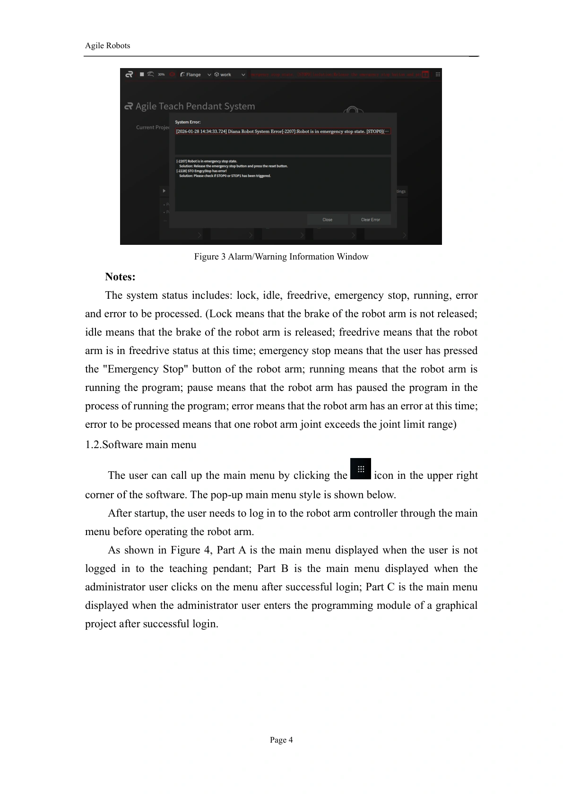



```
Agile Robots 
Page 4 
 
 
Figure 3 Alarm/Warning Information Window 
Notes:  
The system status includes: lock, idle, freedrive, emergency stop, running, error 
and error to be processed. (Lock means that the brake of the robot arm is not released; 
idle means that the brake of the robot arm is released; freedrive means that the robot 
arm is in freedrive status at this time; emergency stop means that the user has pressed 
the "Emergency Stop" button of the robot arm; running means that the robot arm is 
running the program; pause means that the robot arm has paused the program in the 
process of running the program; error means that the robot arm has an error at this time; 
error to be processed means that one robot arm joint exceeds the joint limit range)  
1.2.Software main menu  
The user can call up the main menu by clicking the 
 icon in the upper right 
corner of the software. The pop-up main menu style is shown below.  
After startup, the user needs to log in to the robot arm controller through the main 
menu before operating the robot arm.  
As shown in Figure 4, Part A is the main menu displayed when the user is not 
logged in to the teaching pendant; Part B is the main menu displayed when the 
administrator user clicks on the menu after successful login; Part C is the main menu 
displayed when the administrator user enters the programming module of a graphical 
project after successful login.
```



**Original document cross-references:** [PDF 9](pages-001-072.md#pdf-page-9)

## PDF page 9

**Source:** Industrial Teaching Pendant Software User Manual\_V3.3.0\_EN\_20260204.pdf, original pdf page 9. [Open the corresponding PDF reading-copy page](https://1292444914-files.gitbook.io/~/files/v0/b/gitbook-x-prod.appspot.com/o/spaces%2FtgOfPnscWebs1eh82EKq%2Fuploads%2FdkNcExcX8fuDcS0TVH0V%2Findustrial-teaching-pendant-software-user-manual-v3-3-0-en-20260204-pp-001-010.pdf?alt=media#page=9).



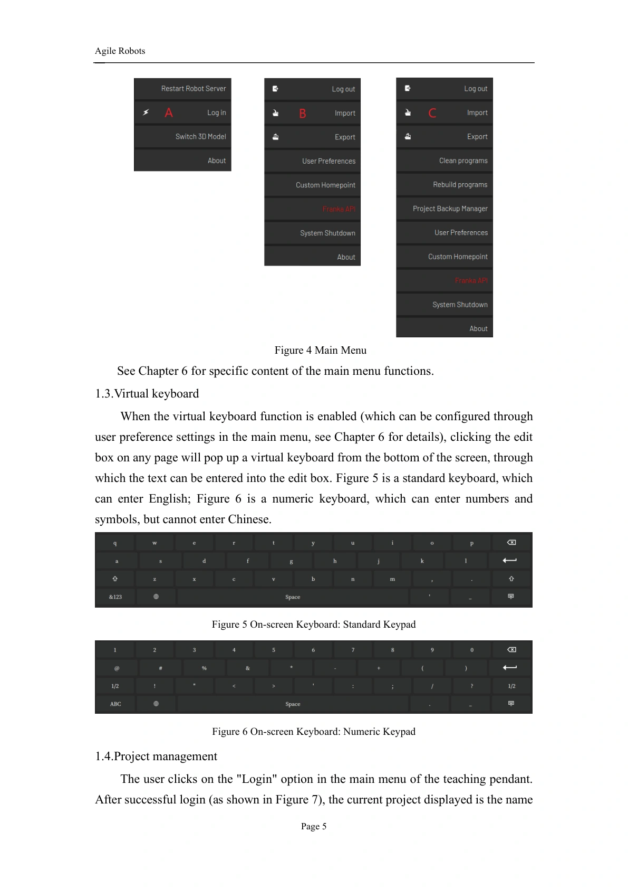



```
Agile Robots 
Page 5 
 
 
 Figure 4 Main Menu  
See Chapter 6 for specific content of the main menu functions.  
1.3.Virtual keyboard  
When the virtual keyboard function is enabled (which can be configured through 
user preference settings in the main menu, see Chapter 6 for details), clicking the edit 
box on any page will pop up a virtual keyboard from the bottom of the screen, through 
which the text can be entered into the edit box. Figure 5 is a standard keyboard, which 
can enter English; Figure 6 is a numeric keyboard, which can enter numbers and 
symbols, but cannot enter Chinese.  
 
Figure 5 On-screen Keyboard: Standard Keypad 
 
Figure 6 On-screen Keyboard: Numeric Keypad 
1.4.Project management  
The user clicks on the "Login" option in the main menu of the teaching pendant. 
After successful login (as shown in Figure 7), the current project displayed is the name
```



**Original document cross-references:** [PDF 9](pages-001-072.md#pdf-page-9) · [PDF 10](pages-001-072.md#pdf-page-10)

## PDF page 10

**Source:** Industrial Teaching Pendant Software User Manual\_V3.3.0\_EN\_20260204.pdf, original pdf page 10. [Open the corresponding PDF reading-copy page](https://1292444914-files.gitbook.io/~/files/v0/b/gitbook-x-prod.appspot.com/o/spaces%2FtgOfPnscWebs1eh82EKq%2Fuploads%2FdkNcExcX8fuDcS0TVH0V%2Findustrial-teaching-pendant-software-user-manual-v3-3-0-en-20260204-pp-001-010.pdf?alt=media#page=10).



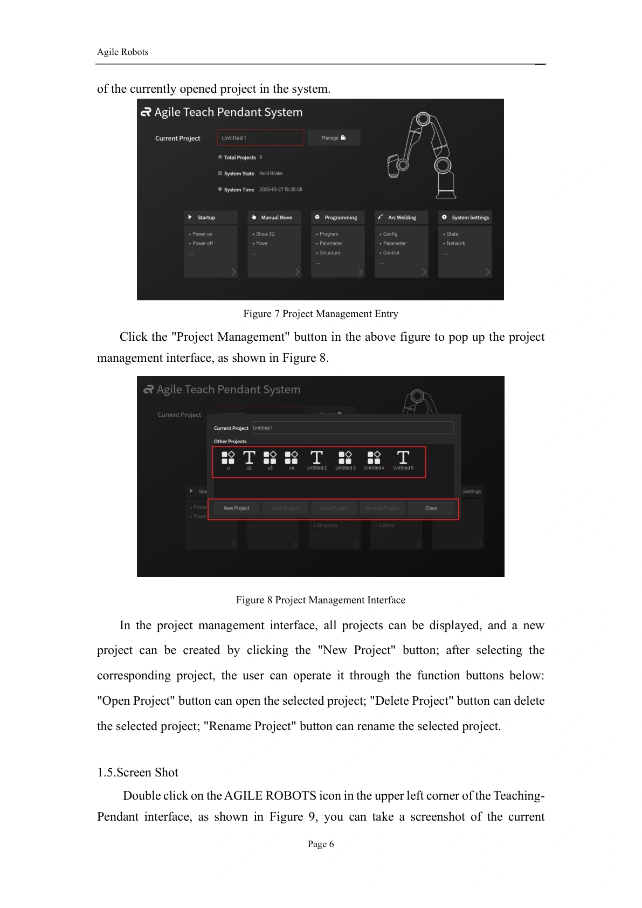



```
Agile Robots 
Page 6 
 
of the currently opened project in the system.  
 
Figure 7 Project Management Entry 
Click the "Project Management" button in the above figure to pop up the project 
management interface, as shown in Figure 8. 
 
Figure 8 Project Management Interface 
In the project management interface, all projects can be displayed, and a new 
project can be created by clicking the "New Project" button; after selecting the 
corresponding project, the user can operate it through the function buttons below: 
"Open Project" button can open the selected project; "Delete Project" button can delete 
the selected project; "Rename Project" button can rename the selected project.  
 
1.5.Screen Shot 
Double click on the AGILE ROBOTS icon in the upper left corner of the Teaching-
Pendant interface, as shown in Figure 9, you can take a screenshot of the current
```



**Original document cross-references:** [PDF 10](pages-001-072.md#pdf-page-10) · [PDF 11](pages-001-072.md#pdf-page-11)

## PDF page 11

**Source:** Industrial Teaching Pendant Software User Manual\_V3.3.0\_EN\_20260204.pdf, original pdf page 11. [Open the corresponding PDF reading-copy page](https://1292444914-files.gitbook.io/~/files/v0/b/gitbook-x-prod.appspot.com/o/spaces%2FtgOfPnscWebs1eh82EKq%2Fuploads%2FilxnXp8qmmT6Nw0R0myO%2Findustrial-teaching-pendant-software-user-manual-v3-3-0-en-20260204-pp-011-018.pdf?alt=media#page=1).



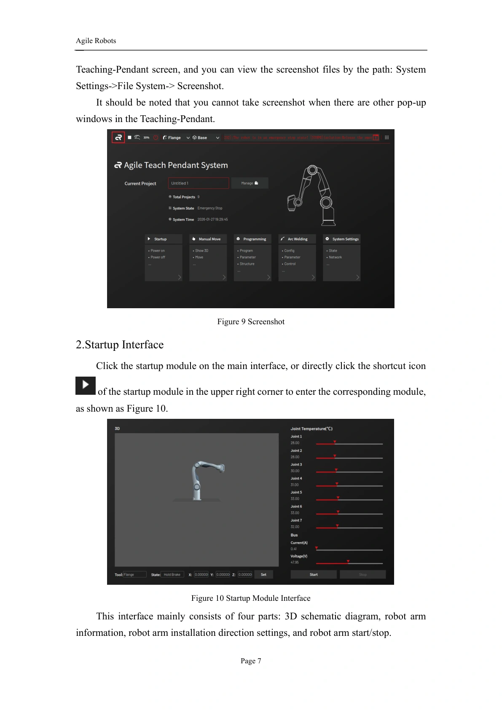



```
Agile Robots 
Page 7 
 
Teaching-Pendant screen, and you can view the screenshot files by the path: System 
Settings->File System-> Screenshot. 
It should be noted that you cannot take screenshot when there are other pop-up 
windows in the Teaching-Pendant. 
 
Figure 9 Screenshot 
2.Startup Interface  
Click the startup module on the main interface, or directly click the shortcut icon 
 of the startup module in the upper right corner to enter the corresponding module, 
as shown as Figure 10. 
 
Figure 10 Startup Module Interface 
This interface mainly consists of four parts: 3D schematic diagram, robot arm 
information, robot arm installation direction settings, and robot arm start/stop.
```



**Original document cross-references:** [PDF 11](pages-001-072.md#pdf-page-11)

## PDF page 12

**Source:** Industrial Teaching Pendant Software User Manual\_V3.3.0\_EN\_20260204.pdf, original pdf page 12. [Open the corresponding PDF reading-copy page](https://1292444914-files.gitbook.io/~/files/v0/b/gitbook-x-prod.appspot.com/o/spaces%2FtgOfPnscWebs1eh82EKq%2Fuploads%2FilxnXp8qmmT6Nw0R0myO%2Findustrial-teaching-pendant-software-user-manual-v3-3-0-en-20260204-pp-011-018.pdf?alt=media#page=2).



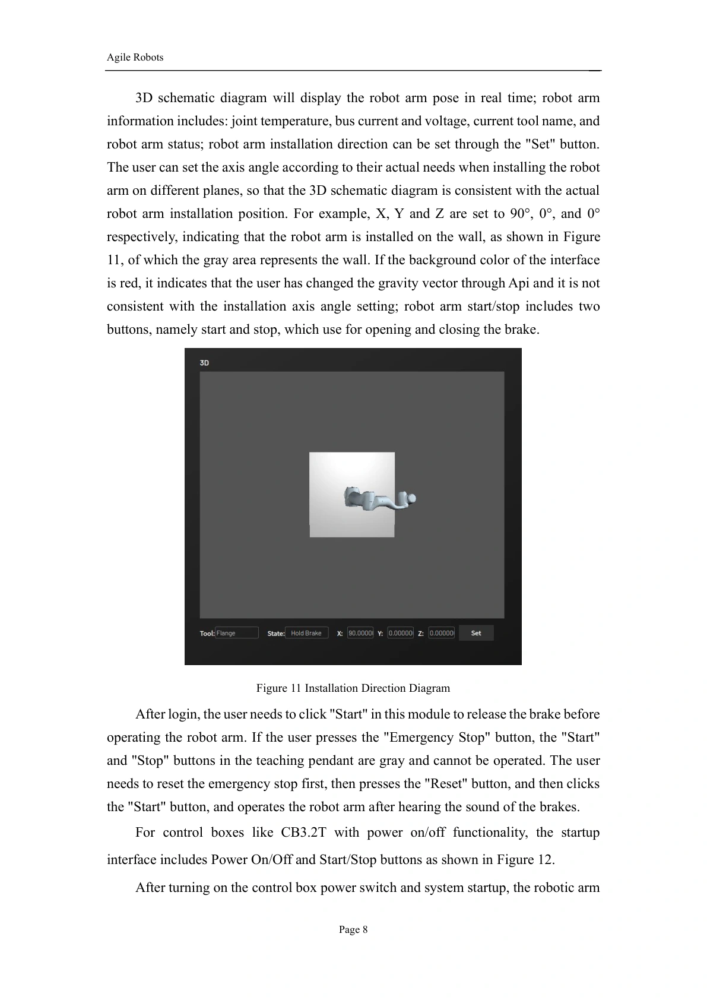



```
Agile Robots 
Page 8 
 
3D schematic diagram will display the robot arm pose in real time; robot arm 
information includes: joint temperature, bus current and voltage, current tool name, and 
robot arm status; robot arm installation direction can be set through the "Set" button. 
The user can set the axis angle according to their actual needs when installing the robot 
arm on different planes, so that the 3D schematic diagram is consistent with the actual 
robot arm installation position. For example, X, Y and Z are set to 90°, 0°, and 0° 
respectively, indicating that the robot arm is installed on the wall, as shown in Figure 
11, of which the gray area represents the wall. If the background color of the interface 
is red, it indicates that the user has changed the gravity vector through Api and it is not 
consistent with the installation axis angle setting; robot arm start/stop includes two 
buttons, namely start and stop, which use for opening and closing the brake.  
 
Figure 11 Installation Direction Diagram 
After login, the user needs to click "Start" in this module to release the brake before 
operating the robot arm. If the user presses the "Emergency Stop" button, the "Start" 
and "Stop" buttons in the teaching pendant are gray and cannot be operated. The user 
needs to reset the emergency stop first, then presses the "Reset" button, and then clicks 
the "Start" button, and operates the robot arm after hearing the sound of the brakes.  
For control boxes like CB3.2T with power on/off functionality, the startup 
interface includes Power On/Off and Start/Stop buttons as shown in Figure 12. 
After turning on the control box power switch and system startup, the robotic arm
```



**Original document cross-references:** [PDF 12](pages-001-072.md#pdf-page-12) · [PDF 13](pages-001-072.md#pdf-page-13)

## PDF page 13

**Source:** Industrial Teaching Pendant Software User Manual\_V3.3.0\_EN\_20260204.pdf, original pdf page 13. [Open the corresponding PDF reading-copy page](https://1292444914-files.gitbook.io/~/files/v0/b/gitbook-x-prod.appspot.com/o/spaces%2FtgOfPnscWebs1eh82EKq%2Fuploads%2FilxnXp8qmmT6Nw0R0myO%2Findustrial-teaching-pendant-software-user-manual-v3-3-0-en-20260204-pp-011-018.pdf?alt=media#page=3).



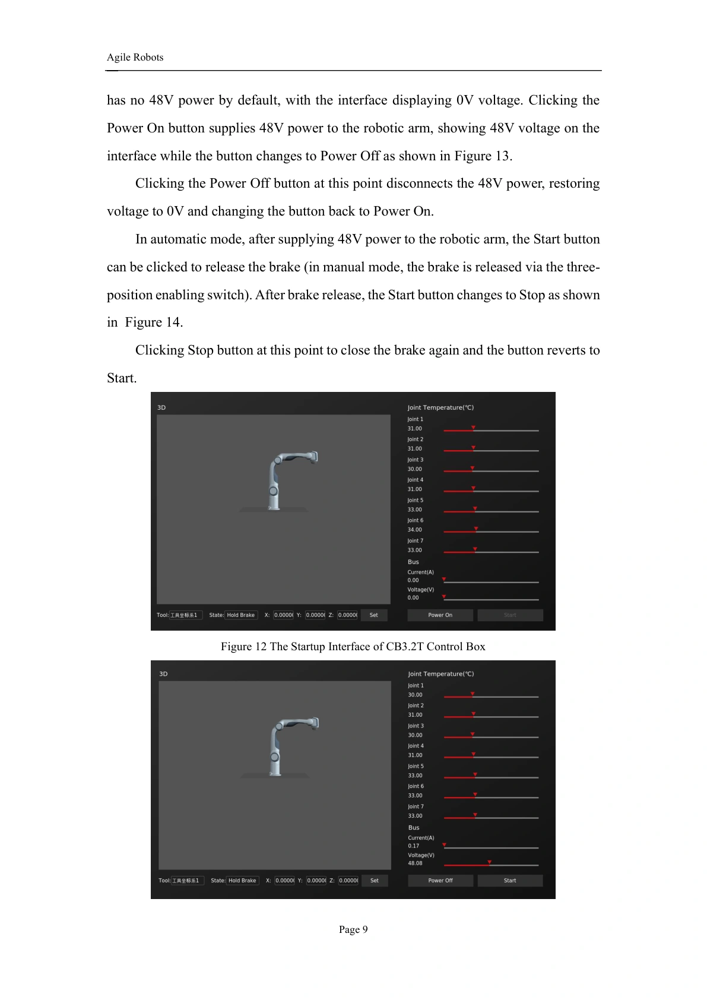



```
Agile Robots 
Page 9 
 
has no 48V power by default, with the interface displaying 0V voltage. Clicking the 
Power On button supplies 48V power to the robotic arm, showing 48V voltage on the 
interface while the button changes to Power Off as shown in Figure 13. 
Clicking the Power Off button at this point disconnects the 48V power, restoring 
voltage to 0V and changing the button back to Power On. 
In automatic mode, after supplying 48V power to the robotic arm, the Start button 
can be clicked to release the brake (in manual mode, the brake is released via the three-
position enabling switch). After brake release, the Start button changes to Stop as shown 
in  Figure 14. 
Clicking Stop button at this point to close the brake again and the button reverts to 
Start. 
 
Figure 12 The Startup Interface of CB3.2T Control Box
```



**Original document cross-references:** [PDF 14](pages-001-072.md#pdf-page-14)

## PDF page 14

**Source:** Industrial Teaching Pendant Software User Manual\_V3.3.0\_EN\_20260204.pdf, original pdf page 14. [Open the corresponding PDF reading-copy page](https://1292444914-files.gitbook.io/~/files/v0/b/gitbook-x-prod.appspot.com/o/spaces%2FtgOfPnscWebs1eh82EKq%2Fuploads%2FilxnXp8qmmT6Nw0R0myO%2Findustrial-teaching-pendant-software-user-manual-v3-3-0-en-20260204-pp-011-018.pdf?alt=media#page=4).



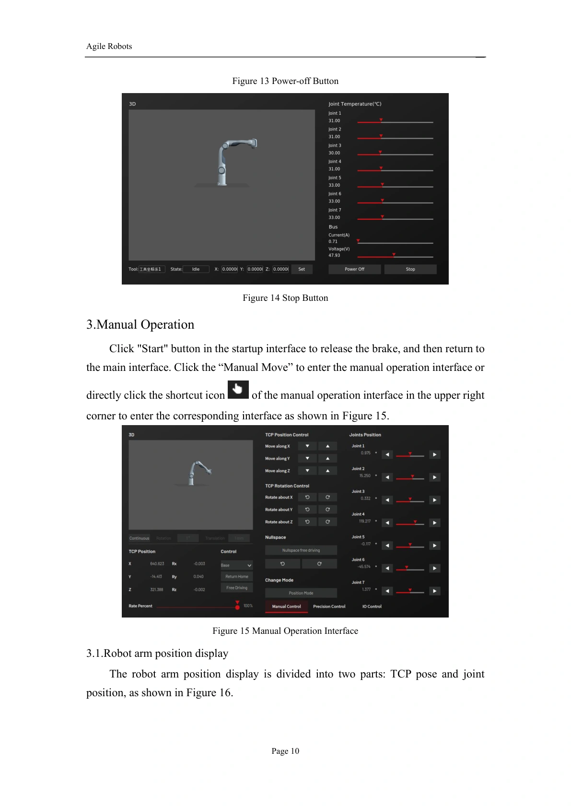



```
Agile Robots 
Page 10 
 
Figure 13 Power-off Button 
 
Figure 14 Stop Button 
3.Manual Operation  
Click "Start" button in the startup interface to release the brake, and then return to  
the main interface. Click the “Manual Move” to enter the manual operation interface or 
directly click the shortcut icon 
 of the manual operation interface in the upper right 
corner to enter the corresponding interface as shown in Figure 15.  
 
Figure 15 Manual Operation Interface 
3.1.Robot arm position display  
The robot arm position display is divided into two parts: TCP pose and joint 
position, as shown in Figure 16.
```



**Original document cross-references:** [PDF 14](pages-001-072.md#pdf-page-14) · [PDF 15](pages-001-072.md#pdf-page-15)

## PDF page 15

**Source:** Industrial Teaching Pendant Software User Manual\_V3.3.0\_EN\_20260204.pdf, original pdf page 15. [Open the corresponding PDF reading-copy page](https://1292444914-files.gitbook.io/~/files/v0/b/gitbook-x-prod.appspot.com/o/spaces%2FtgOfPnscWebs1eh82EKq%2Fuploads%2FilxnXp8qmmT6Nw0R0myO%2Findustrial-teaching-pendant-software-user-manual-v3-3-0-en-20260204-pp-011-018.pdf?alt=media#page=5).



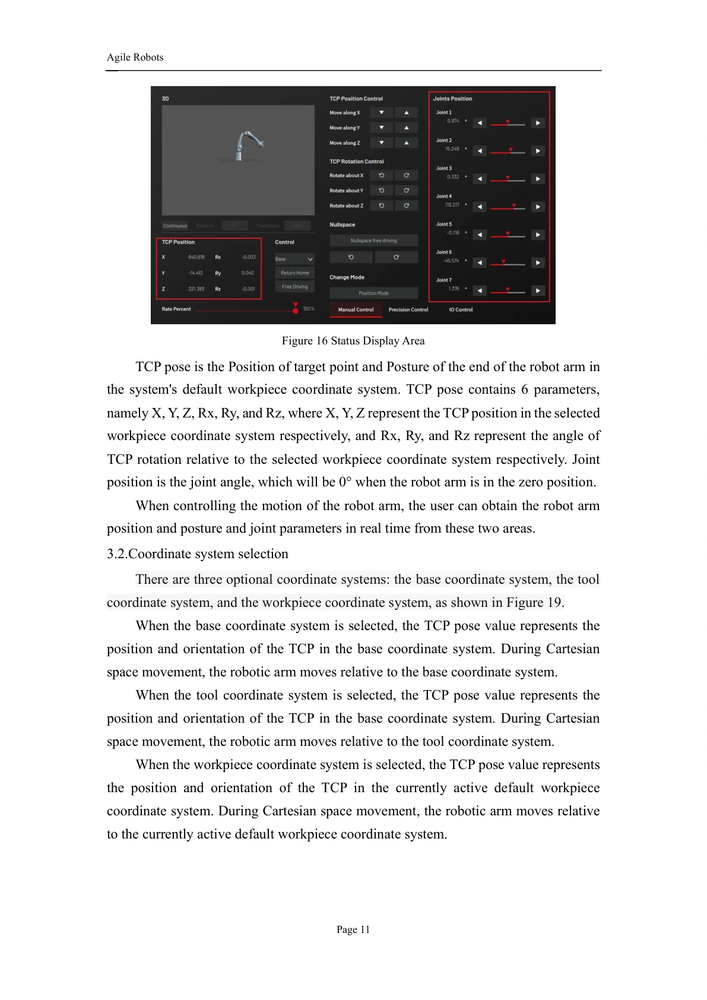



```
Agile Robots 
Page 11 
 
 
Figure 16 Status Display Area 
TCP pose is the Position of target point and Posture of the end of the robot arm in 
the system's default workpiece coordinate system. TCP pose contains 6 parameters, 
namely X, Y, Z, Rx, Ry, and Rz, where X, Y, Z represent the TCP position in the selected 
workpiece coordinate system respectively, and Rx, Ry, and Rz represent the angle of 
TCP rotation relative to the selected workpiece coordinate system respectively. Joint 
position is the joint angle, which will be 0° when the robot arm is in the zero position.  
When controlling the motion of the robot arm, the user can obtain the robot arm 
position and posture and joint parameters in real time from these two areas.  
3.2.Coordinate system selection  
There are three optional coordinate systems: the base coordinate system, the tool 
coordinate system, and the workpiece coordinate system, as shown in Figure 19. 
When the base coordinate system is selected, the TCP pose value represents the 
position and orientation of the TCP in the base coordinate system. During Cartesian 
space movement, the robotic arm moves relative to the base coordinate system. 
When the tool coordinate system is selected, the TCP pose value represents the 
position and orientation of the TCP in the base coordinate system. During Cartesian 
space movement, the robotic arm moves relative to the tool coordinate system. 
When the workpiece coordinate system is selected, the TCP pose value represents 
the position and orientation of the TCP in the currently active default workpiece 
coordinate system. During Cartesian space movement, the robotic arm moves relative 
to the currently active default workpiece coordinate system.
```



## PDF page 16

**Source:** Industrial Teaching Pendant Software User Manual\_V3.3.0\_EN\_20260204.pdf, original pdf page 16. [Open the corresponding PDF reading-copy page](https://1292444914-files.gitbook.io/~/files/v0/b/gitbook-x-prod.appspot.com/o/spaces%2FtgOfPnscWebs1eh82EKq%2Fuploads%2FilxnXp8qmmT6Nw0R0myO%2Findustrial-teaching-pendant-software-user-manual-v3-3-0-en-20260204-pp-011-018.pdf?alt=media#page=6).



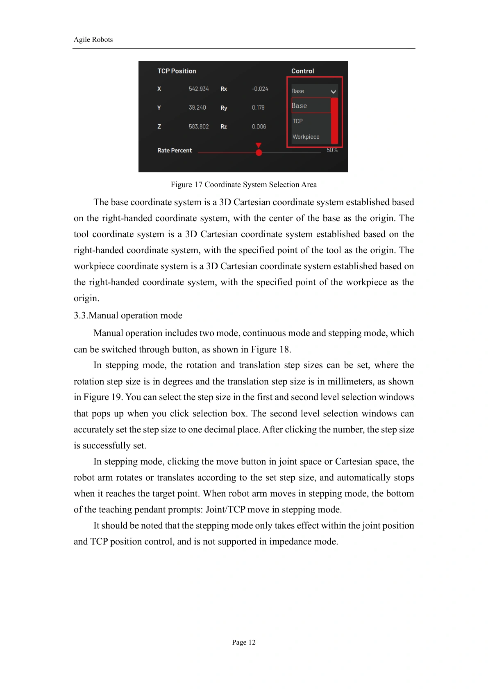



```
Agile Robots 
Page 12 
 
 
Figure 17 Coordinate System Selection Area 
The base coordinate system is a 3D Cartesian coordinate system established based 
on the right-handed coordinate system, with the center of the base as the origin. The 
tool coordinate system is a 3D Cartesian coordinate system established based on the 
right-handed coordinate system, with the specified point of the tool as the origin. The 
workpiece coordinate system is a 3D Cartesian coordinate system established based on 
the right-handed coordinate system, with the specified point of the workpiece as the 
origin.  
3.3.Manual operation mode  
Manual operation includes two mode, continuous mode and stepping mode, which 
can be switched through button, as shown in Figure 18.  
In stepping mode, the rotation and translation step sizes can be set, where the 
rotation step size is in degrees and the translation step size is in millimeters, as shown 
in Figure 19. You can select the step size in the first and second level selection windows 
that pops up when you click selection box. The second level selection windows can 
accurately set the step size to one decimal place. After clicking the number, the step size 
is successfully set. 
In stepping mode, clicking the move button in joint space or Cartesian space, the 
robot arm rotates or translates according to the set step size, and automatically stops 
when it reaches the target point. When robot arm moves in stepping mode, the bottom 
of the teaching pendant prompts: Joint/TCP move in stepping mode. 
It should be noted that the stepping mode only takes effect within the joint position 
and TCP position control, and is not supported in impedance mode.
```



**Original document cross-references:** [PDF 17](pages-001-072.md#pdf-page-17)

## PDF page 17

**Source:** Industrial Teaching Pendant Software User Manual\_V3.3.0\_EN\_20260204.pdf, original pdf page 17. [Open the corresponding PDF reading-copy page](https://1292444914-files.gitbook.io/~/files/v0/b/gitbook-x-prod.appspot.com/o/spaces%2FtgOfPnscWebs1eh82EKq%2Fuploads%2FilxnXp8qmmT6Nw0R0myO%2Findustrial-teaching-pendant-software-user-manual-v3-3-0-en-20260204-pp-011-018.pdf?alt=media#page=7).



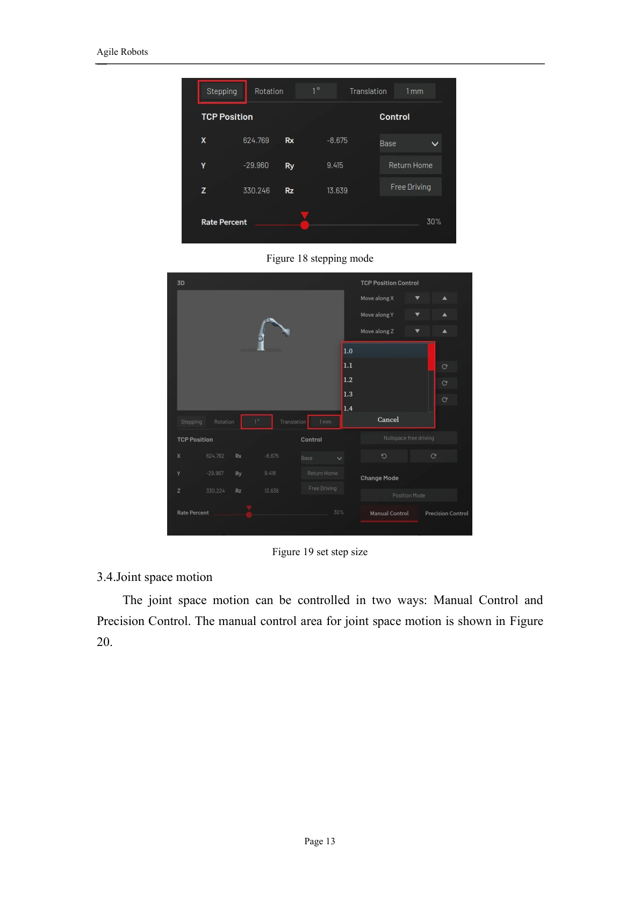



```
Agile Robots 
Page 13 
 
 
Figure 18 stepping mode 
 
Figure 19 set step size 
3.4.Joint space motion  
The joint space motion can be controlled in two ways: Manual Control and 
Precision Control. The manual control area for joint space motion is shown in Figure 
20.
```



**Original document cross-references:** [PDF 18](pages-001-072.md#pdf-page-18)

## PDF page 18

**Source:** Industrial Teaching Pendant Software User Manual\_V3.3.0\_EN\_20260204.pdf, original pdf page 18. [Open the corresponding PDF reading-copy page](https://1292444914-files.gitbook.io/~/files/v0/b/gitbook-x-prod.appspot.com/o/spaces%2FtgOfPnscWebs1eh82EKq%2Fuploads%2FilxnXp8qmmT6Nw0R0myO%2Findustrial-teaching-pendant-software-user-manual-v3-3-0-en-20260204-pp-011-018.pdf?alt=media#page=8).



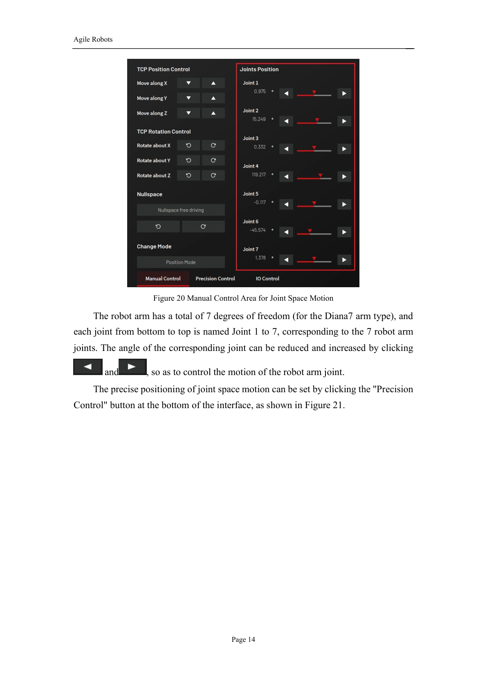



```
Agile Robots 
Page 14 
 
 
Figure 20 Manual Control Area for Joint Space Motion 
The robot arm has a total of 7 degrees of freedom (for the Diana7 arm type), and 
each joint from bottom to top is named Joint 1 to 7, corresponding to the 7 robot arm 
joints. The angle of the corresponding joint can be reduced and increased by clicking
 and
, so as to control the motion of the robot arm joint.  
The precise positioning of joint space motion can be set by clicking the "Precision 
Control" button at the bottom of the interface, as shown in Figure 21.
```



**Original document cross-references:** [PDF 19](pages-001-072.md#pdf-page-19)

## PDF page 19

**Source:** Industrial Teaching Pendant Software User Manual\_V3.3.0\_EN\_20260204.pdf, original pdf page 19. [Open the corresponding PDF reading-copy page](https://1292444914-files.gitbook.io/~/files/v0/b/gitbook-x-prod.appspot.com/o/spaces%2FtgOfPnscWebs1eh82EKq%2Fuploads%2F03PQuOLSdernb0fvUab9%2Findustrial-teaching-pendant-software-user-manual-v3-3-0-en-20260204-pp-019-026.pdf?alt=media#page=1).



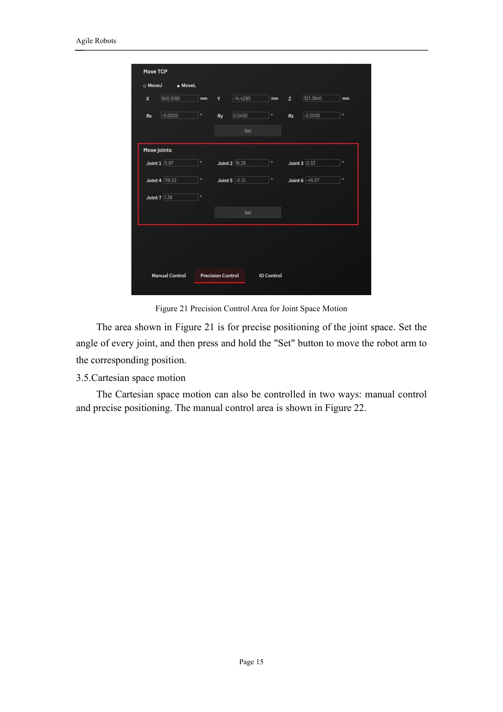



```
Agile Robots 
Page 15 
 
 
Figure 21 Precision Control Area for Joint Space Motion 
The area shown in Figure 21 is for precise positioning of the joint space. Set the 
angle of every joint, and then press and hold the "Set" button to move the robot arm to 
the corresponding position.  
3.5.Cartesian space motion  
The Cartesian space motion can also be controlled in two ways: manual control 
and precise positioning. The manual control area is shown in Figure 22.
```



**Original document cross-references:** [PDF 19](pages-001-072.md#pdf-page-19) · [PDF 20](pages-001-072.md#pdf-page-20)

## PDF page 20

**Source:** Industrial Teaching Pendant Software User Manual\_V3.3.0\_EN\_20260204.pdf, original pdf page 20. [Open the corresponding PDF reading-copy page](https://1292444914-files.gitbook.io/~/files/v0/b/gitbook-x-prod.appspot.com/o/spaces%2FtgOfPnscWebs1eh82EKq%2Fuploads%2F03PQuOLSdernb0fvUab9%2Findustrial-teaching-pendant-software-user-manual-v3-3-0-en-20260204-pp-019-026.pdf?alt=media#page=2).



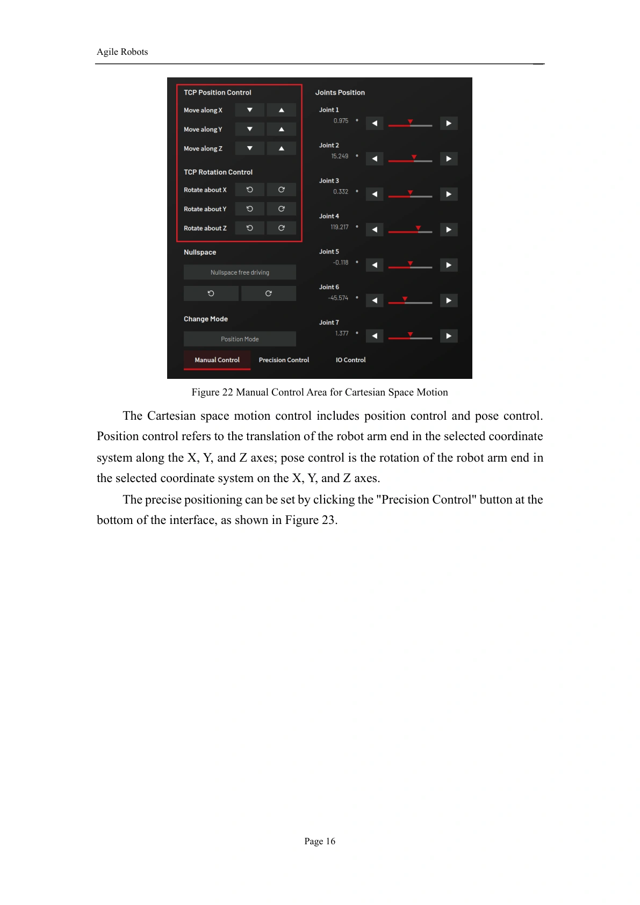



```
Agile Robots 
Page 16 
 
 
Figure 22 Manual Control Area for Cartesian Space Motion 
The Cartesian space motion control includes position control and pose control. 
Position control refers to the translation of the robot arm end in the selected coordinate 
system along the X, Y, and Z axes; pose control is the rotation of the robot arm end in 
the selected coordinate system on the X, Y, and Z axes.  
The precise positioning can be set by clicking the "Precision Control" button at the 
bottom of the interface, as shown in Figure 23.
```



**Original document cross-references:** [PDF 21](pages-001-072.md#pdf-page-21)

## PDF page 21

**Source:** Industrial Teaching Pendant Software User Manual\_V3.3.0\_EN\_20260204.pdf, original pdf page 21. [Open the corresponding PDF reading-copy page](https://1292444914-files.gitbook.io/~/files/v0/b/gitbook-x-prod.appspot.com/o/spaces%2FtgOfPnscWebs1eh82EKq%2Fuploads%2F03PQuOLSdernb0fvUab9%2Findustrial-teaching-pendant-software-user-manual-v3-3-0-en-20260204-pp-019-026.pdf?alt=media#page=3).



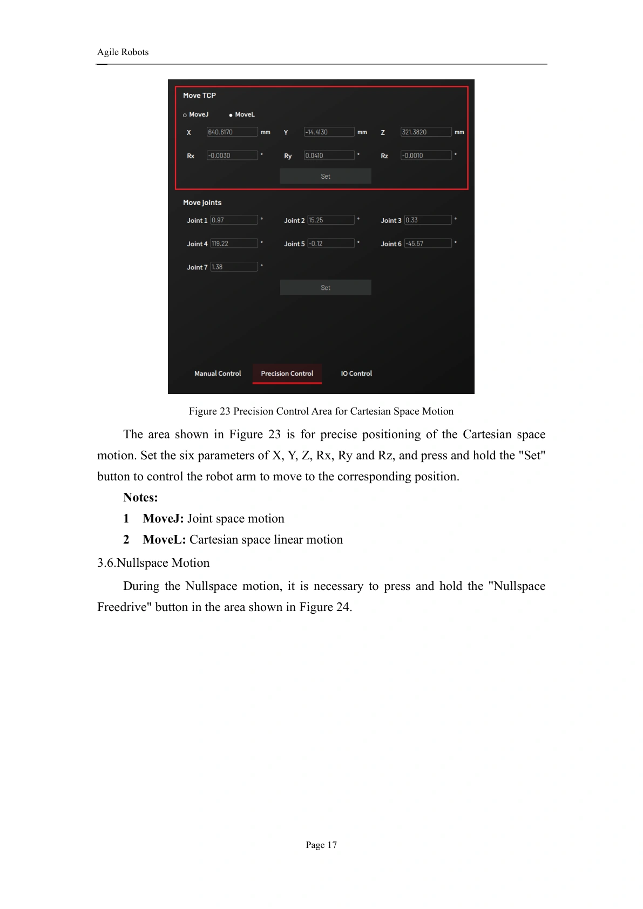



```
Agile Robots 
Page 17 
 
 
Figure 23 Precision Control Area for Cartesian Space Motion 
The area shown in Figure 23 is for precise positioning of the Cartesian space 
motion. Set the six parameters of X, Y, Z, Rx, Ry and Rz, and press and hold the "Set" 
button to control the robot arm to move to the corresponding position.  
Notes:  
1 MoveJ: Joint space motion  
2 MoveL: Cartesian space linear motion  
3.6.Nullspace Motion  
During the Nullspace motion, it is necessary to press and hold the "Nullspace 
Freedrive" button in the area shown in Figure 24.
```



**Original document cross-references:** [PDF 21](pages-001-072.md#pdf-page-21) · [PDF 22](pages-001-072.md#pdf-page-22)

## PDF page 22

**Source:** Industrial Teaching Pendant Software User Manual\_V3.3.0\_EN\_20260204.pdf, original pdf page 22. [Open the corresponding PDF reading-copy page](https://1292444914-files.gitbook.io/~/files/v0/b/gitbook-x-prod.appspot.com/o/spaces%2FtgOfPnscWebs1eh82EKq%2Fuploads%2F03PQuOLSdernb0fvUab9%2Findustrial-teaching-pendant-software-user-manual-v3-3-0-en-20260204-pp-019-026.pdf?alt=media#page=4).



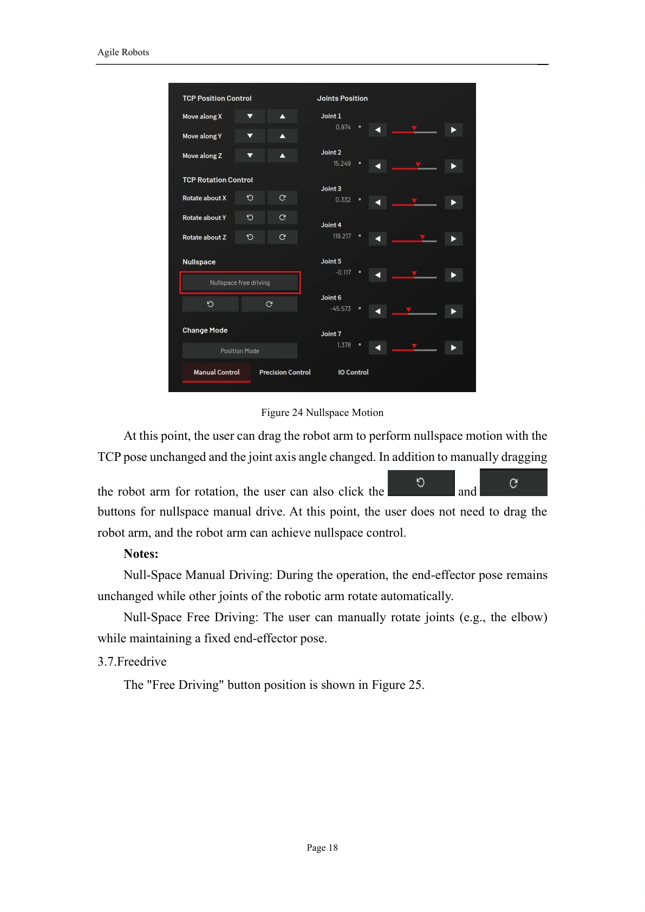



```
Agile Robots 
Page 18 
 
 
Figure 24 Nullspace Motion  
At this point, the user can drag the robot arm to perform nullspace motion with the 
TCP pose unchanged and the joint axis angle changed. In addition to manually dragging 
the robot arm for rotation, the user can also click the 
 and 
 
buttons for nullspace manual drive. At this point, the user does not need to drag the 
robot arm, and the robot arm can achieve nullspace control.  
Notes:  
Null-Space Manual Driving: During the operation, the end-effector pose remains 
unchanged while other joints of the robotic arm rotate automatically. 
Null-Space Free Driving: The user can manually rotate joints (e.g., the elbow) 
while maintaining a fixed end-effector pose. 
3.7.Freedrive  
The "Free Driving" button position is shown in Figure 25.
```



**Original document cross-references:** [PDF 23](pages-001-072.md#pdf-page-23)

## PDF page 23

**Source:** Industrial Teaching Pendant Software User Manual\_V3.3.0\_EN\_20260204.pdf, original pdf page 23. [Open the corresponding PDF reading-copy page](https://1292444914-files.gitbook.io/~/files/v0/b/gitbook-x-prod.appspot.com/o/spaces%2FtgOfPnscWebs1eh82EKq%2Fuploads%2F03PQuOLSdernb0fvUab9%2Findustrial-teaching-pendant-software-user-manual-v3-3-0-en-20260204-pp-019-026.pdf?alt=media#page=5).



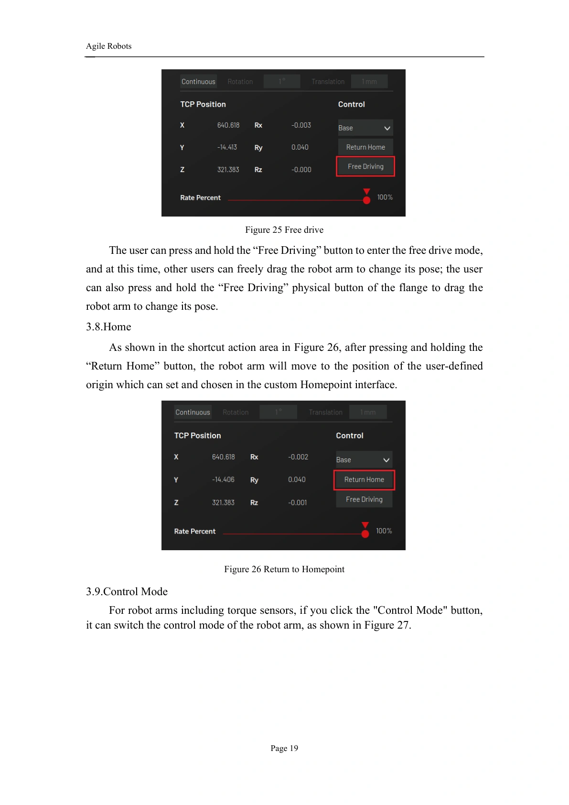



```
Agile Robots 
Page 19 
 
 
Figure 25 Free drive  
The user can press and hold the “Free Driving” button to enter the free drive mode, 
and at this time, other users can freely drag the robot arm to change its pose; the user 
can also press and hold the “Free Driving” physical button of the flange to drag the 
robot arm to change its pose.  
3.8.Home  
As shown in the shortcut action area in Figure 26, after pressing and holding the 
“Return Home” button, the robot arm will move to the position of the user-defined 
origin which can set and chosen in the custom Homepoint interface.  
 
Figure 26 Return to Homepoint 
3.9.Control Mode  
For robot arms including torque sensors, if you click the "Control Mode" button, 
it can switch the control mode of the robot arm, as shown in Figure 27.
```



**Original document cross-references:** [PDF 23](pages-001-072.md#pdf-page-23) · [PDF 24](pages-001-072.md#pdf-page-24)

## PDF page 24

**Source:** Industrial Teaching Pendant Software User Manual\_V3.3.0\_EN\_20260204.pdf, original pdf page 24. [Open the corresponding PDF reading-copy page](https://1292444914-files.gitbook.io/~/files/v0/b/gitbook-x-prod.appspot.com/o/spaces%2FtgOfPnscWebs1eh82EKq%2Fuploads%2F03PQuOLSdernb0fvUab9%2Findustrial-teaching-pendant-software-user-manual-v3-3-0-en-20260204-pp-019-026.pdf?alt=media#page=6).



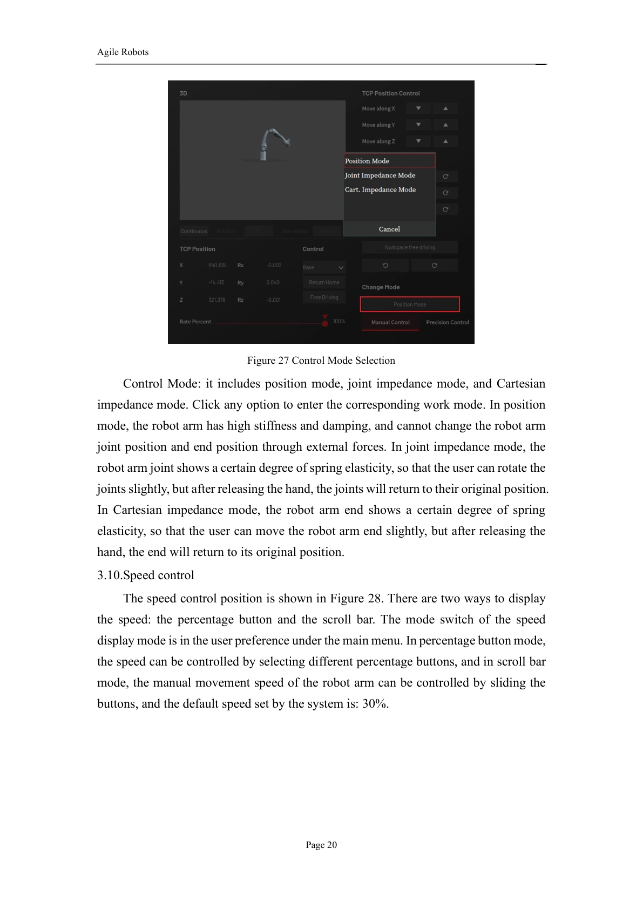



```
Agile Robots 
Page 20 
 
 
Figure 27 Control Mode Selection 
Control Mode: it includes position mode, joint impedance mode, and Cartesian 
impedance mode. Click any option to enter the corresponding work mode. In position 
mode, the robot arm has high stiffness and damping, and cannot change the robot arm 
joint position and end position through external forces. In joint impedance mode, the 
robot arm joint shows a certain degree of spring elasticity, so that the user can rotate the 
joints slightly, but after releasing the hand, the joints will return to their original position. 
In Cartesian impedance mode, the robot arm end shows a certain degree of spring 
elasticity, so that the user can move the robot arm end slightly, but after releasing the 
hand, the end will return to its original position.  
3.10.Speed control  
The speed control position is shown in Figure 28. There are two ways to display 
the speed: the percentage button and the scroll bar. The mode switch of the speed 
display mode is in the user preference under the main menu. In percentage button mode, 
the speed can be controlled by selecting different percentage buttons, and in scroll bar 
mode, the manual movement speed of the robot arm can be controlled by sliding the 
buttons, and the default speed set by the system is: 30%.
```



**Original document cross-references:** [PDF 25](pages-001-072.md#pdf-page-25)

## PDF page 25

**Source:** Industrial Teaching Pendant Software User Manual\_V3.3.0\_EN\_20260204.pdf, original pdf page 25. [Open the corresponding PDF reading-copy page](https://1292444914-files.gitbook.io/~/files/v0/b/gitbook-x-prod.appspot.com/o/spaces%2FtgOfPnscWebs1eh82EKq%2Fuploads%2F03PQuOLSdernb0fvUab9%2Findustrial-teaching-pendant-software-user-manual-v3-3-0-en-20260204-pp-019-026.pdf?alt=media#page=7).



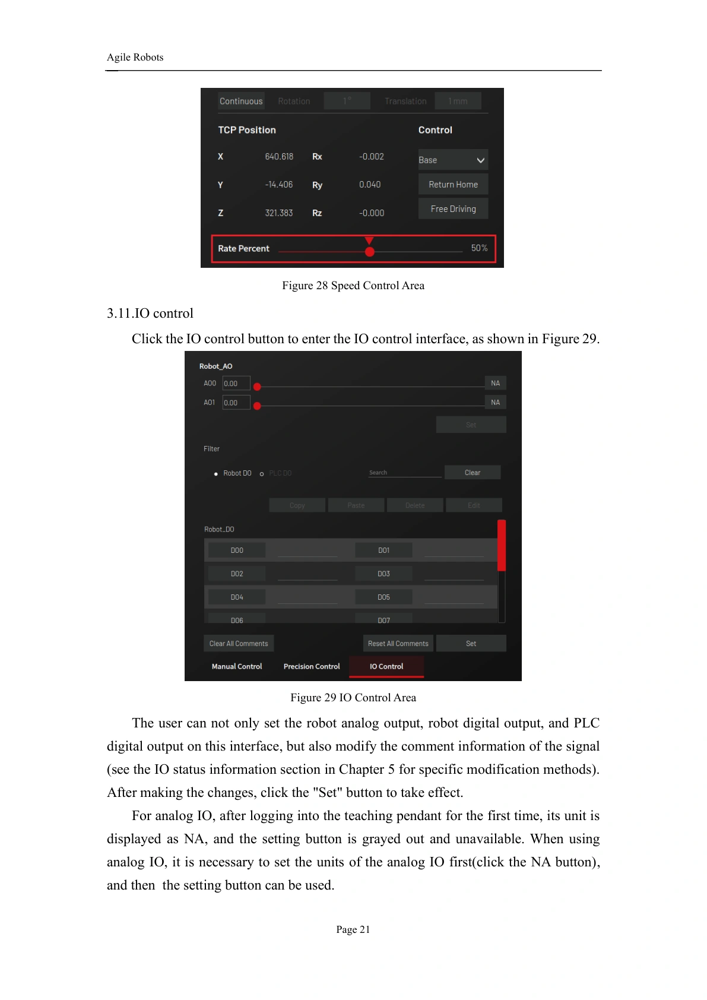



```
Agile Robots 
Page 21 
 
 
Figure 28 Speed Control Area 
3.11.IO control  
Click the IO control button to enter the IO control interface, as shown in Figure 29.  
 
Figure 29 IO Control Area 
The user can not only set the robot analog output, robot digital output, and PLC 
digital output on this interface, but also modify the comment information of the signal 
(see the IO status information section in Chapter 5 for specific modification methods). 
After making the changes, click the "Set" button to take effect.  
For analog IO, after logging into the teaching pendant for the first time, its unit is 
displayed as NA, and the setting button is grayed out and unavailable. When using 
analog IO, it is necessary to set the units of the analog IO first(click the NA button), 
and then  the setting button can be used.
```



**Original document cross-references:** [PDF 25](pages-001-072.md#pdf-page-25)

## PDF page 26

**Source:** Industrial Teaching Pendant Software User Manual\_V3.3.0\_EN\_20260204.pdf, original pdf page 26. [Open the corresponding PDF reading-copy page](https://1292444914-files.gitbook.io/~/files/v0/b/gitbook-x-prod.appspot.com/o/spaces%2FtgOfPnscWebs1eh82EKq%2Fuploads%2F03PQuOLSdernb0fvUab9%2Findustrial-teaching-pendant-software-user-manual-v3-3-0-en-20260204-pp-019-026.pdf?alt=media#page=8).



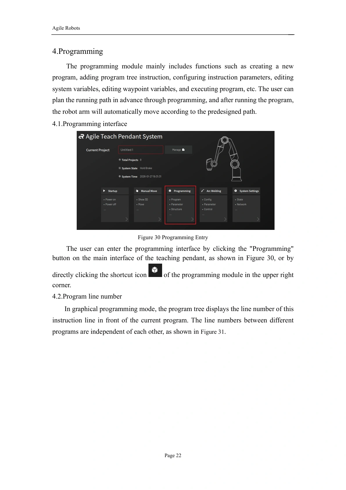



```
Agile Robots 
Page 22 
 
4.Programming  
The programming module mainly includes functions such as creating a new 
program, adding program tree instruction, configuring instruction parameters, editing 
system variables, editing waypoint variables, and executing program, etc. The user can 
plan the running path in advance through programming, and after running the program, 
the robot arm will automatically move according to the predesigned path.  
4.1.Programming interface  
 
Figure 30 Programming Entry 
The user can enter the programming interface by clicking the "Programming" 
button on the main interface of the teaching pendant, as shown in Figure 30, or by 
directly clicking the shortcut icon 
 of the programming module in the upper right 
corner.  
4.2.Program line number  
In graphical programming mode, the program tree displays the line number of this 
instruction line in front of the current program. The line numbers between different 
programs are independent of each other, as shown in Figure 31.
```



**Original document cross-references:** [PDF 26](pages-001-072.md#pdf-page-26) · [PDF 27](pages-001-072.md#pdf-page-27)

## PDF page 27

**Source:** Industrial Teaching Pendant Software User Manual\_V3.3.0\_EN\_20260204.pdf, original pdf page 27. [Open the corresponding PDF reading-copy page](https://1292444914-files.gitbook.io/~/files/v0/b/gitbook-x-prod.appspot.com/o/spaces%2FtgOfPnscWebs1eh82EKq%2Fuploads%2FfL6AuKXkl6vH1xZtPV9S%2Findustrial-teaching-pendant-software-user-manual-v3-3-0-en-20260204-pp-027-031.pdf?alt=media#page=1).



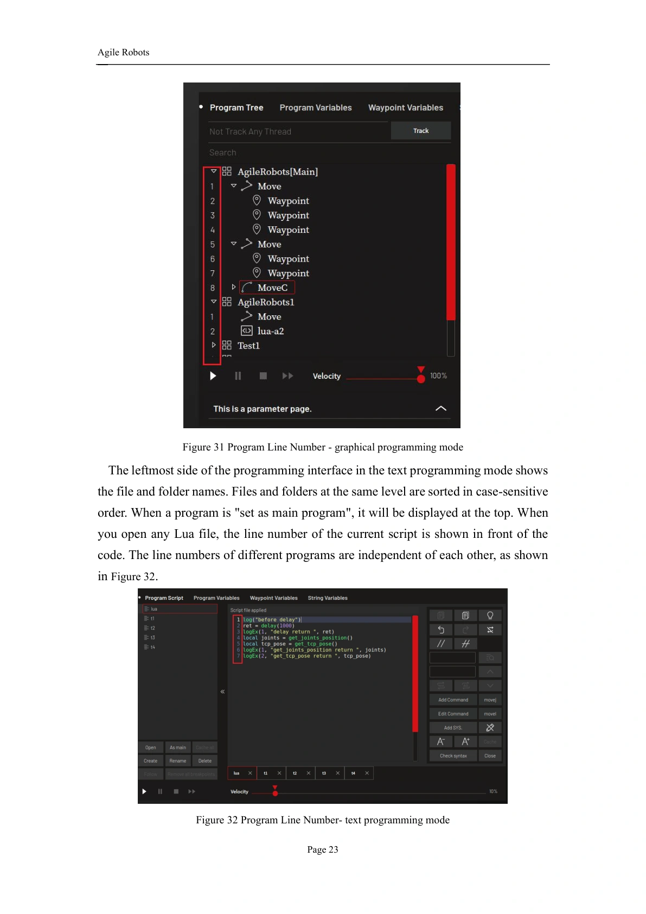



```
Agile Robots 
Page 23 
 
 
Figure 31 Program Line Number - graphical programming mode 
The leftmost side of the programming interface in the text programming mode shows 
the file and folder names. Files and folders at the same level are sorted in case-sensitive 
order. When a program is "set as main program", it will be displayed at the top. When 
you open any Lua file, the line number of the current script is shown in front of the 
code. The line numbers of different programs are independent of each other, as shown 
in Figure 32. 
 
Figure 32 Program Line Number- text programming mode
```



**Original document cross-references:** [PDF 27](pages-001-072.md#pdf-page-27)

## PDF page 28

**Source:** Industrial Teaching Pendant Software User Manual\_V3.3.0\_EN\_20260204.pdf, original pdf page 28. [Open the corresponding PDF reading-copy page](https://1292444914-files.gitbook.io/~/files/v0/b/gitbook-x-prod.appspot.com/o/spaces%2FtgOfPnscWebs1eh82EKq%2Fuploads%2FfL6AuKXkl6vH1xZtPV9S%2Findustrial-teaching-pendant-software-user-manual-v3-3-0-en-20260204-pp-027-031.pdf?alt=media#page=2).



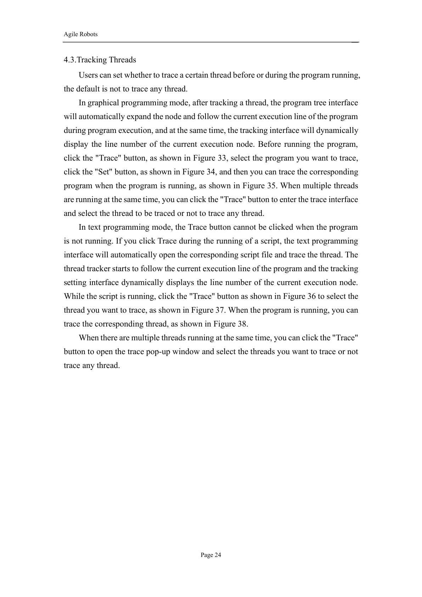



```
Agile Robots 
Page 24 
 
4.3.Tracking Threads  
Users can set whether to trace a certain thread before or during the program running, 
the default is not to trace any thread.  
In graphical programming mode, after tracking a thread, the program tree interface 
will automatically expand the node and follow the current execution line of the program 
during program execution, and at the same time, the tracking interface will dynamically 
display the line number of the current execution node. Before running the program, 
click the "Trace" button, as shown in Figure 33, select the program you want to trace, 
click the "Set" button, as shown in Figure 34, and then you can trace the corresponding 
program when the program is running, as shown in Figure 35. When multiple threads 
are running at the same time, you can click the "Trace" button to enter the trace interface 
and select the thread to be traced or not to trace any thread.  
In text programming mode, the Trace button cannot be clicked when the program 
is not running. If you click Trace during the running of a script, the text programming 
interface will automatically open the corresponding script file and trace the thread. The 
thread tracker starts to follow the current execution line of the program and the tracking 
setting interface dynamically displays the line number of the current execution node. 
While the script is running, click the "Trace" button as shown in Figure 36 to select the 
thread you want to trace, as shown in Figure 37. When the program is running, you can 
trace the corresponding thread, as shown in Figure 38. 
When there are multiple threads running at the same time, you can click the "Trace" 
button to open the trace pop-up window and select the threads you want to trace or not 
trace any thread.
```



**Original document cross-references:** [PDF 29](pages-001-072.md#pdf-page-29) · [PDF 30](pages-001-072.md#pdf-page-30) · [PDF 31](pages-001-072.md#pdf-page-31)

## PDF page 29

**Source:** Industrial Teaching Pendant Software User Manual\_V3.3.0\_EN\_20260204.pdf, original pdf page 29. [Open the corresponding PDF reading-copy page](https://1292444914-files.gitbook.io/~/files/v0/b/gitbook-x-prod.appspot.com/o/spaces%2FtgOfPnscWebs1eh82EKq%2Fuploads%2FfL6AuKXkl6vH1xZtPV9S%2Findustrial-teaching-pendant-software-user-manual-v3-3-0-en-20260204-pp-027-031.pdf?alt=media#page=3).



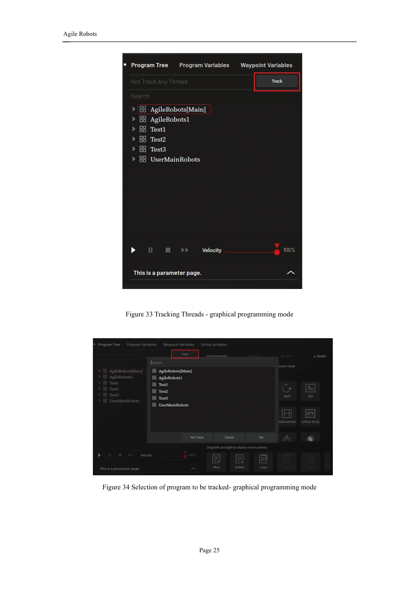



```
Agile Robots 
Page 25 
 
 
 
Figure 33 Tracking Threads - graphical programming mode 
 
 
Figure 34 Selection of program to be tracked- graphical programming mode
```



## PDF page 30

**Source:** Industrial Teaching Pendant Software User Manual\_V3.3.0\_EN\_20260204.pdf, original pdf page 30. [Open the corresponding PDF reading-copy page](https://1292444914-files.gitbook.io/~/files/v0/b/gitbook-x-prod.appspot.com/o/spaces%2FtgOfPnscWebs1eh82EKq%2Fuploads%2FfL6AuKXkl6vH1xZtPV9S%2Findustrial-teaching-pendant-software-user-manual-v3-3-0-en-20260204-pp-027-031.pdf?alt=media#page=4).



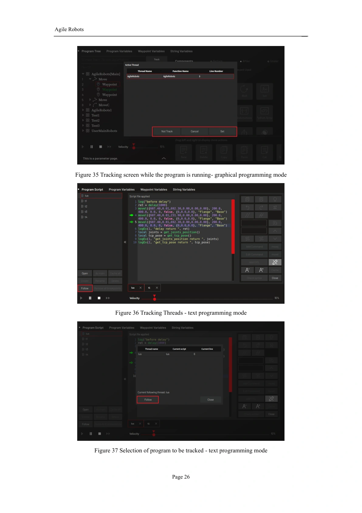



```
Agile Robots 
Page 26 
 
 
Figure 35 Tracking screen while the program is running- graphical programming mode 
 
Figure 36 Tracking Threads - text programming mode 
 
Figure 37 Selection of program to be tracked - text programming mode
```



## PDF page 31

**Source:** Industrial Teaching Pendant Software User Manual\_V3.3.0\_EN\_20260204.pdf, original pdf page 31. [Open the corresponding PDF reading-copy page](https://1292444914-files.gitbook.io/~/files/v0/b/gitbook-x-prod.appspot.com/o/spaces%2FtgOfPnscWebs1eh82EKq%2Fuploads%2FfL6AuKXkl6vH1xZtPV9S%2Findustrial-teaching-pendant-software-user-manual-v3-3-0-en-20260204-pp-027-031.pdf?alt=media#page=5).



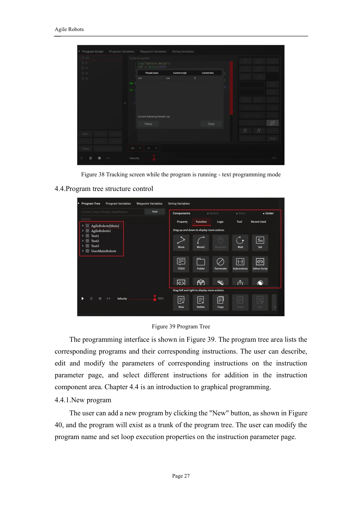



```
Agile Robots 
Page 27 
 
 
Figure 38 Tracking screen while the program is running - text programming mode 
4.4.Program tree structure control 
 
Figure 39 Program Tree 
The programming interface is shown in Figure 39. The program tree area lists the 
corresponding programs and their corresponding instructions. The user can describe, 
edit and modify the parameters of corresponding instructions on the instruction 
parameter page, and select different instructions for addition in the instruction 
component area. Chapter 4.4 is an introduction to graphical programming. 
4.4.1.New program  
The user can add a new program by clicking the "New" button, as shown in Figure 
40, and the program will exist as a trunk of the program tree. The user can modify the 
program name and set loop execution properties on the instruction parameter page.
```



**Original document cross-references:** [PDF 31](pages-001-072.md#pdf-page-31) · [PDF 32](pages-001-072.md#pdf-page-32)

## PDF page 32

**Source:** Industrial Teaching Pendant Software User Manual\_V3.3.0\_EN\_20260204.pdf, original pdf page 32. [Open the corresponding PDF reading-copy page](https://1292444914-files.gitbook.io/~/files/v0/b/gitbook-x-prod.appspot.com/o/spaces%2FtgOfPnscWebs1eh82EKq%2Fuploads%2FevZhP74vliq7scraDwZ0%2Findustrial-teaching-pendant-software-user-manual-v3-3-0-en-20260204-pp-032-034.pdf?alt=media#page=1).



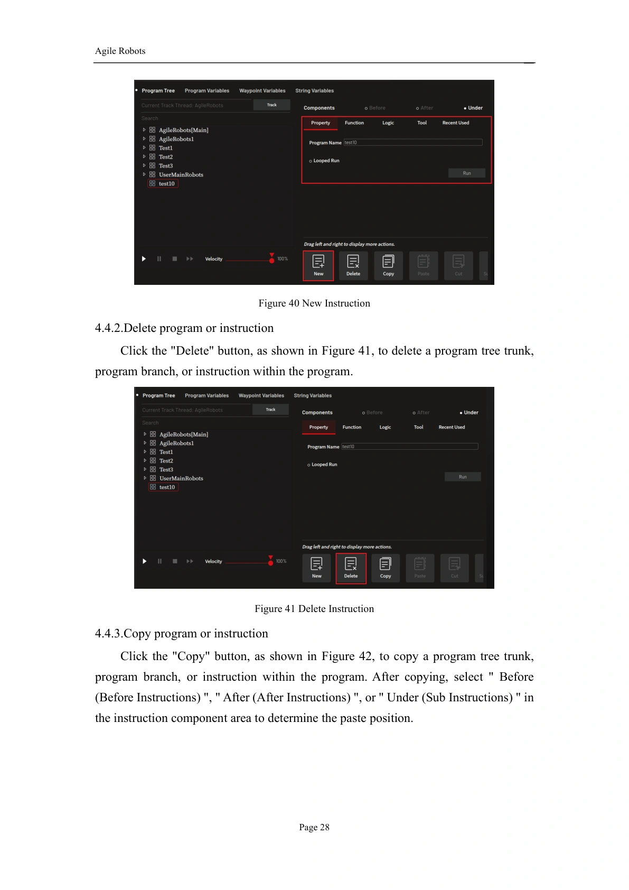



```
Agile Robots 
Page 28 
 
 
Figure 40 New Instruction 
4.4.2.Delete program or instruction  
Click the "Delete" button, as shown in Figure 41, to delete a program tree trunk, 
program branch, or instruction within the program.  
 
Figure 41 Delete Instruction 
4.4.3.Copy program or instruction  
Click the "Copy" button, as shown in Figure 42, to copy a program tree trunk, 
program branch, or instruction within the program. After copying, select " Before 
(Before Instructions) ", " After (After Instructions) ", or " Under (Sub Instructions) " in 
the instruction component area to determine the paste position.
```



**Original document cross-references:** [PDF 32](pages-001-072.md#pdf-page-32) · [PDF 33](pages-001-072.md#pdf-page-33)

## PDF page 33

**Source:** Industrial Teaching Pendant Software User Manual\_V3.3.0\_EN\_20260204.pdf, original pdf page 33. [Open the corresponding PDF reading-copy page](https://1292444914-files.gitbook.io/~/files/v0/b/gitbook-x-prod.appspot.com/o/spaces%2FtgOfPnscWebs1eh82EKq%2Fuploads%2FevZhP74vliq7scraDwZ0%2Findustrial-teaching-pendant-software-user-manual-v3-3-0-en-20260204-pp-032-034.pdf?alt=media#page=2).



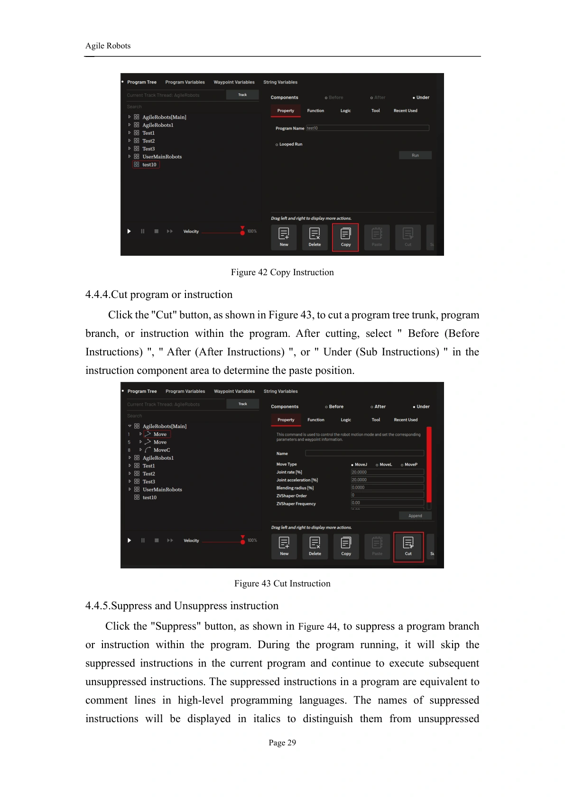



```
Agile Robots 
Page 29 
 
 
Figure 42 Copy Instruction 
4.4.4.Cut program or instruction  
Click the "Cut" button, as shown in Figure 43, to cut a program tree trunk, program 
branch, or instruction within the program. After cutting, select " Before (Before 
Instructions) ", " After (After Instructions) ", or " Under (Sub Instructions) " in the 
instruction component area to determine the paste position.  
 
Figure 43 Cut Instruction 
4.4.5.Suppress and Unsuppress instruction  
Click the "Suppress" button, as shown in Figure 44, to suppress a program branch 
or instruction within the program. During the program running, it will skip the 
suppressed instructions in the current program and continue to execute subsequent 
unsuppressed instructions. The suppressed instructions in a program are equivalent to 
comment lines in high-level programming languages. The names of suppressed 
instructions will be displayed in italics to distinguish them from unsuppressed
```



**Original document cross-references:** [PDF 33](pages-001-072.md#pdf-page-33) · [PDF 34](pages-001-072.md#pdf-page-34)

## PDF page 34

**Source:** Industrial Teaching Pendant Software User Manual\_V3.3.0\_EN\_20260204.pdf, original pdf page 34. [Open the corresponding PDF reading-copy page](https://1292444914-files.gitbook.io/~/files/v0/b/gitbook-x-prod.appspot.com/o/spaces%2FtgOfPnscWebs1eh82EKq%2Fuploads%2FevZhP74vliq7scraDwZ0%2Findustrial-teaching-pendant-software-user-manual-v3-3-0-en-20260204-pp-032-034.pdf?alt=media#page=3).



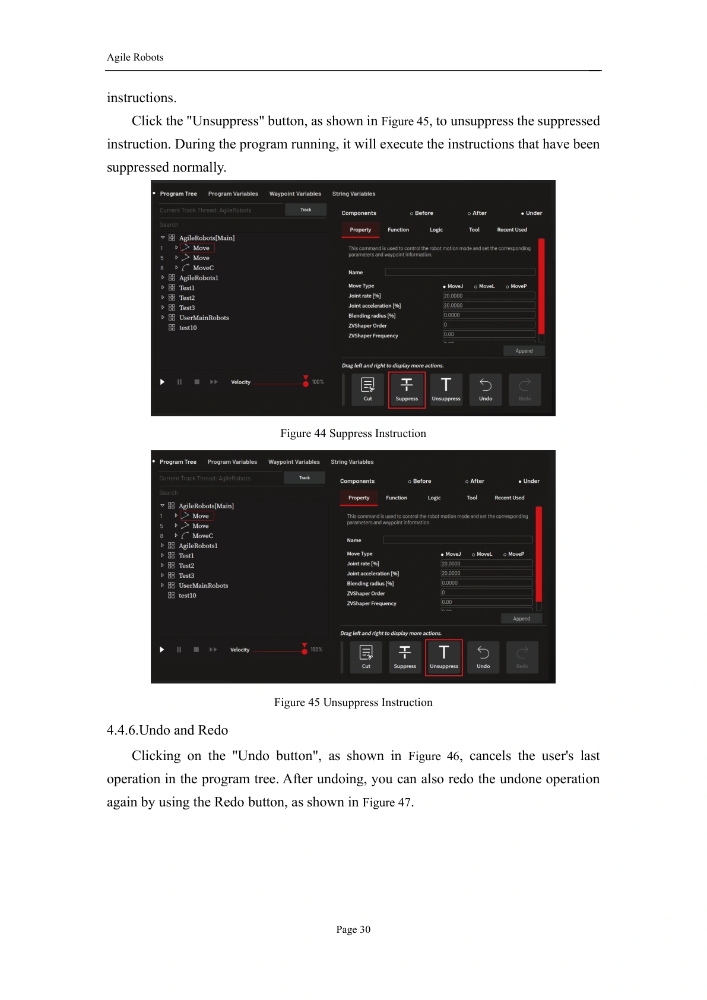



```
Agile Robots 
Page 30 
 
instructions.  
Click the "Unsuppress" button, as shown in Figure 45, to unsuppress the suppressed 
instruction. During the program running, it will execute the instructions that have been 
suppressed normally.  
 
Figure 44 Suppress Instruction 
 
Figure 45 Unsuppress Instruction 
4.4.6.Undo and Redo 
 
Clicking on the "Undo button", as shown in Figure 46, cancels the user's last 
operation in the program tree. After undoing, you can also redo the undone operation 
again by using the Redo button, as shown in Figure 47.
```



**Original document cross-references:** [PDF 34](pages-001-072.md#pdf-page-34) · [PDF 35](pages-001-072.md#pdf-page-35)

## PDF page 35

**Source:** Industrial Teaching Pendant Software User Manual\_V3.3.0\_EN\_20260204.pdf, original pdf page 35. [Open the corresponding PDF reading-copy page](https://1292444914-files.gitbook.io/~/files/v0/b/gitbook-x-prod.appspot.com/o/spaces%2FtgOfPnscWebs1eh82EKq%2Fuploads%2FDc4ENQzdh1GavYHDwyFX%2Findustrial-teaching-pendant-software-user-manual-v3-3-0-en-20260204-pp-035-039.pdf?alt=media#page=1).



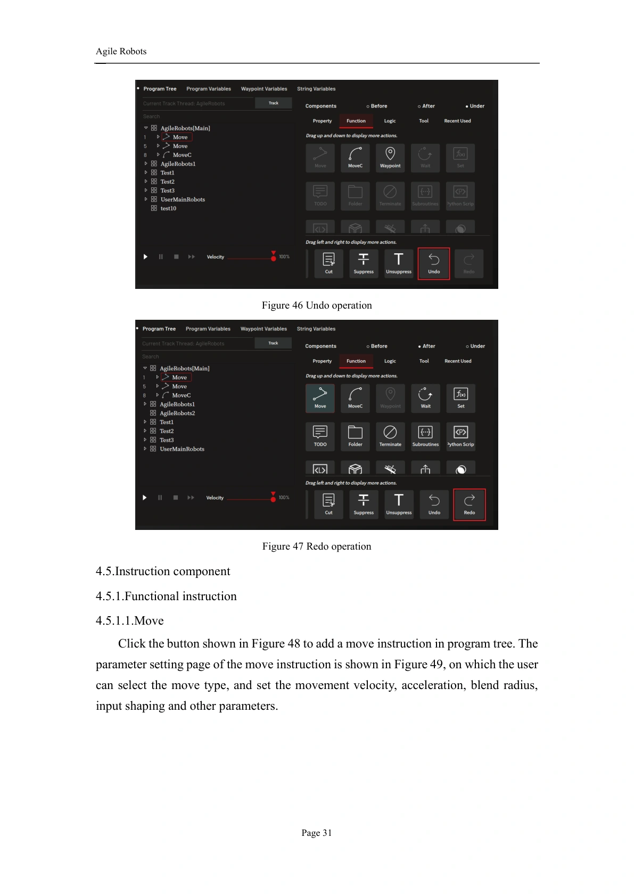



```
Agile Robots 
Page 31 
 
 
Figure 46 Undo operation 
 
Figure 47 Redo operation 
4.5.Instruction component  
4.5.1.Functional instruction  
4.5.1.1.Move  
Click the button shown in Figure 48 to add a move instruction in program tree. The 
parameter setting page of the move instruction is shown in Figure 49, on which the user 
can select the move type, and set the movement velocity, acceleration, blend radius, 
input shaping and other parameters.
```



**Original document cross-references:** [PDF 36](pages-001-072.md#pdf-page-36)

## PDF page 36

**Source:** Industrial Teaching Pendant Software User Manual\_V3.3.0\_EN\_20260204.pdf, original pdf page 36. [Open the corresponding PDF reading-copy page](https://1292444914-files.gitbook.io/~/files/v0/b/gitbook-x-prod.appspot.com/o/spaces%2FtgOfPnscWebs1eh82EKq%2Fuploads%2FDc4ENQzdh1GavYHDwyFX%2Findustrial-teaching-pendant-software-user-manual-v3-3-0-en-20260204-pp-035-039.pdf?alt=media#page=2).



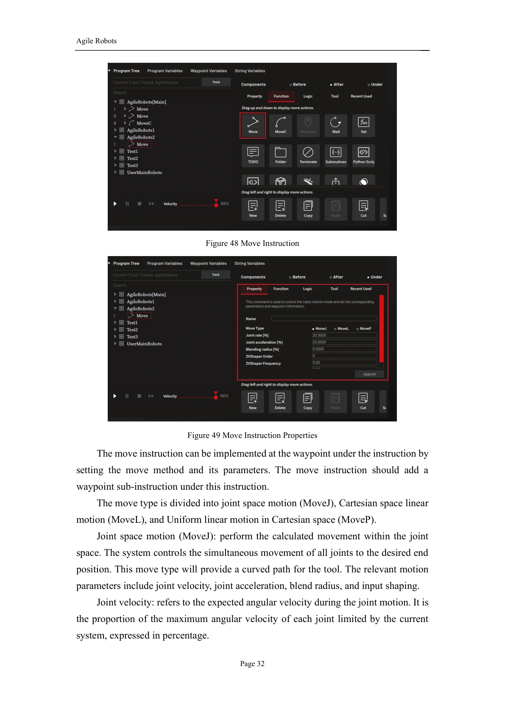



```
Agile Robots 
Page 32 
 
 
Figure 48 Move Instruction 
 
Figure 49 Move Instruction Properties 
The move instruction can be implemented at the waypoint under the instruction by 
setting the move method and its parameters. The move instruction should add a 
waypoint sub-instruction under this instruction.  
The move type is divided into joint space motion (MoveJ), Cartesian space linear 
motion (MoveL), and Uniform linear motion in Cartesian space (MoveP).  
Joint space motion (MoveJ): perform the calculated movement within the joint 
space. The system controls the simultaneous movement of all joints to the desired end 
position. This move type will provide a curved path for the tool. The relevant motion 
parameters include joint velocity, joint acceleration, blend radius, and input shaping.  
Joint velocity: refers to the expected angular velocity during the joint motion. It is 
the proportion of the maximum angular velocity of each joint limited by the current 
system, expressed in percentage.
```



## PDF page 37

**Source:** Industrial Teaching Pendant Software User Manual\_V3.3.0\_EN\_20260204.pdf, original pdf page 37. [Open the corresponding PDF reading-copy page](https://1292444914-files.gitbook.io/~/files/v0/b/gitbook-x-prod.appspot.com/o/spaces%2FtgOfPnscWebs1eh82EKq%2Fuploads%2FDc4ENQzdh1GavYHDwyFX%2Findustrial-teaching-pendant-software-user-manual-v3-3-0-en-20260204-pp-035-039.pdf?alt=media#page=3).



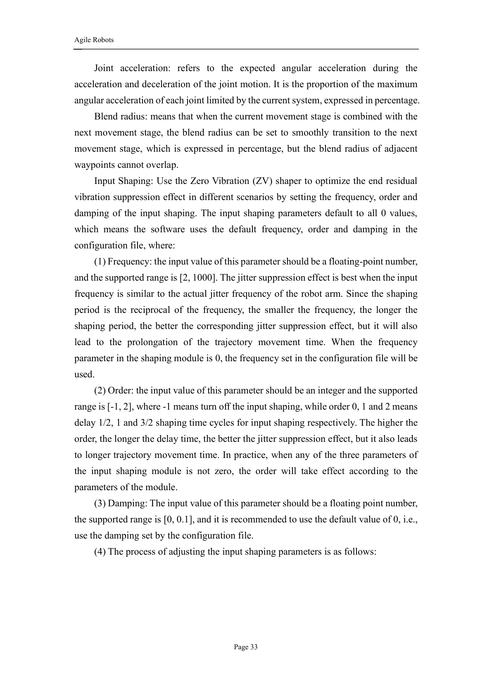



```
Agile Robots 
Page 33 
 
Joint acceleration: refers to the expected angular acceleration during the 
acceleration and deceleration of the joint motion. It is the proportion of the maximum 
angular acceleration of each joint limited by the current system, expressed in percentage.  
Blend radius: means that when the current movement stage is combined with the 
next movement stage, the blend radius can be set to smoothly transition to the next 
movement stage, which is expressed in percentage, but the blend radius of adjacent 
waypoints cannot overlap.  
Input Shaping: Use the Zero Vibration (ZV) shaper to optimize the end residual 
vibration suppression effect in different scenarios by setting the frequency, order and 
damping of the input shaping. The input shaping parameters default to all 0 values, 
which means the software uses the default frequency, order and damping in the 
configuration file, where:  
(1) Frequency: the input value of this parameter should be a floating-point number, 
and the supported range is [2, 1000]. The jitter suppression effect is best when the input 
frequency is similar to the actual jitter frequency of the robot arm. Since the shaping 
period is the reciprocal of the frequency, the smaller the frequency, the longer the 
shaping period, the better the corresponding jitter suppression effect, but it will also 
lead to the prolongation of the trajectory movement time. When the frequency 
parameter in the shaping module is 0, the frequency set in the configuration file will be 
used.  
(2) Order: the input value of this parameter should be an integer and the supported 
range is [-1, 2], where -1 means turn off the input shaping, while order 0, 1 and 2 means 
delay 1/2, 1 and 3/2 shaping time cycles for input shaping respectively. The higher the 
order, the longer the delay time, the better the jitter suppression effect, but it also leads 
to longer trajectory movement time. In practice, when any of the three parameters of 
the input shaping module is not zero, the order will take effect according to the 
parameters of the module.  
(3) Damping: The input value of this parameter should be a floating point number, 
the supported range is [0, 0.1], and it is recommended to use the default value of 0, i.e., 
use the damping set by the configuration file. 
(4) The process of adjusting the input shaping parameters is as follows:
```



## PDF page 38

**Source:** Industrial Teaching Pendant Software User Manual\_V3.3.0\_EN\_20260204.pdf, original pdf page 38. [Open the corresponding PDF reading-copy page](https://1292444914-files.gitbook.io/~/files/v0/b/gitbook-x-prod.appspot.com/o/spaces%2FtgOfPnscWebs1eh82EKq%2Fuploads%2FDc4ENQzdh1GavYHDwyFX%2Findustrial-teaching-pendant-software-user-manual-v3-3-0-en-20260204-pp-035-039.pdf?alt=media#page=4).



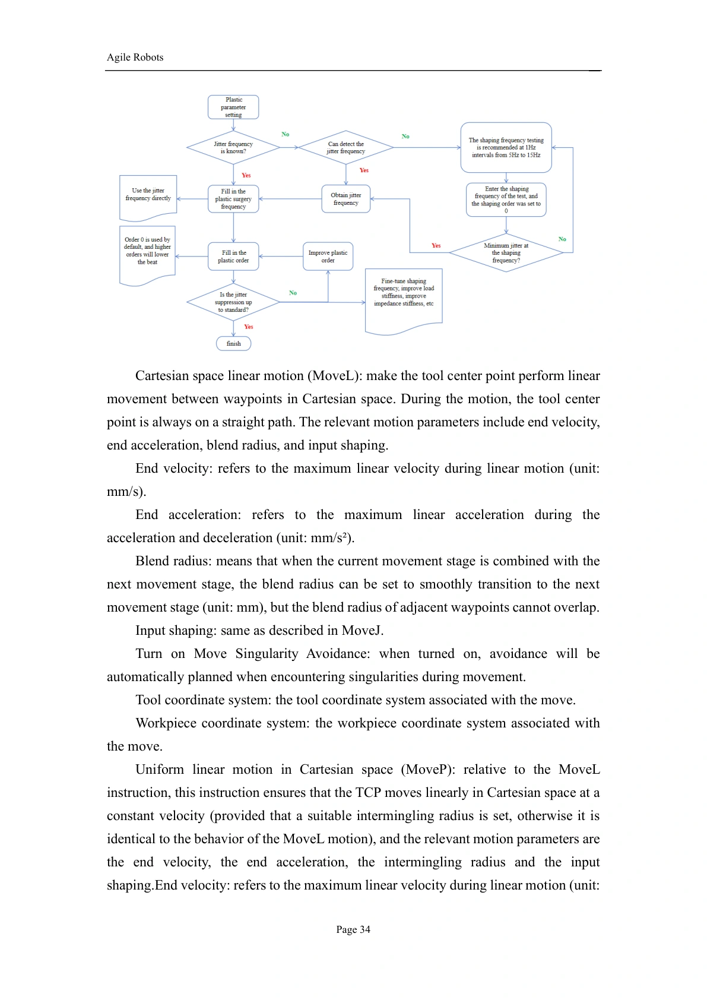



```
Agile Robots 
Page 34 
 
 
Cartesian space linear motion (MoveL): make the tool center point perform linear 
movement between waypoints in Cartesian space. During the motion, the tool center 
point is always on a straight path. The relevant motion parameters include end velocity, 
end acceleration, blend radius, and input shaping.  
End velocity: refers to the maximum linear velocity during linear motion (unit: 
mm/s).  
End acceleration: refers to the maximum linear acceleration during the 
acceleration and deceleration (unit: mm/s²).  
Blend radius: means that when the current movement stage is combined with the 
next movement stage, the blend radius can be set to smoothly transition to the next 
movement stage (unit: mm), but the blend radius of adjacent waypoints cannot overlap.  
Input shaping: same as described in MoveJ.  
Turn on Move Singularity Avoidance: when turned on, avoidance will be 
automatically planned when encountering singularities during movement. 
Tool coordinate system: the tool coordinate system associated with the move. 
Workpiece coordinate system: the workpiece coordinate system associated with 
the move. 
Uniform linear motion in Cartesian space (MoveP): relative to the MoveL 
instruction, this instruction ensures that the TCP moves linearly in Cartesian space at a 
constant velocity (provided that a suitable intermingling radius is set, otherwise it is 
identical to the behavior of the MoveL motion), and the relevant motion parameters are 
the end velocity, the end acceleration, the intermingling radius and the input 
shaping.End velocity: refers to the maximum linear velocity during linear motion (unit:
```



## PDF page 39

**Source:** Industrial Teaching Pendant Software User Manual\_V3.3.0\_EN\_20260204.pdf, original pdf page 39. [Open the corresponding PDF reading-copy page](https://1292444914-files.gitbook.io/~/files/v0/b/gitbook-x-prod.appspot.com/o/spaces%2FtgOfPnscWebs1eh82EKq%2Fuploads%2FDc4ENQzdh1GavYHDwyFX%2Findustrial-teaching-pendant-software-user-manual-v3-3-0-en-20260204-pp-035-039.pdf?alt=media#page=5).



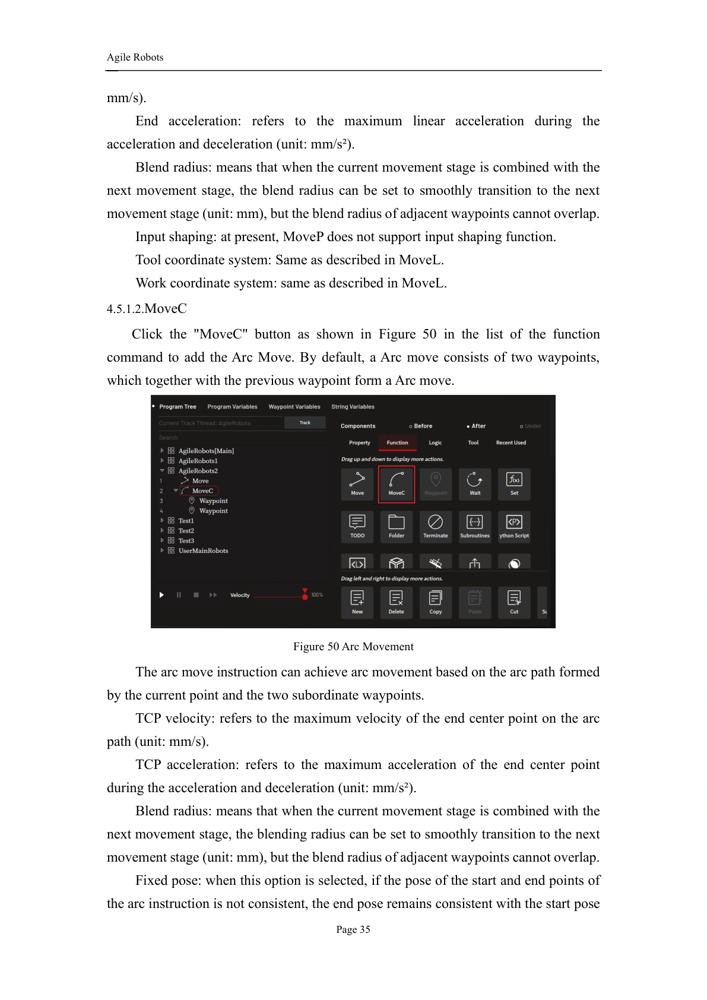



```
Agile Robots 
Page 35 
 
mm/s).  
End acceleration: refers to the maximum linear acceleration during the 
acceleration and deceleration (unit: mm/s²).  
Blend radius: means that when the current movement stage is combined with the 
next movement stage, the blend radius can be set to smoothly transition to the next 
movement stage (unit: mm), but the blend radius of adjacent waypoints cannot overlap.  
Input shaping: at present, MoveP does not support input shaping function.  
Tool coordinate system: Same as described in MoveL. 
Work coordinate system: same as described in MoveL. 
4.5.1.2.MoveC 
Click the "MoveC" button as shown in Figure 50 in the list of the function 
command to add the Arc Move. By default, a Arc move consists of two waypoints, 
which together with the previous waypoint form a Arc move. 
 
Figure 50 Arc Movement 
The arc move instruction can achieve arc movement based on the arc path formed 
by the current point and the two subordinate waypoints.  
TCP velocity: refers to the maximum velocity of the end center point on the arc 
path (unit: mm/s).  
TCP acceleration: refers to the maximum acceleration of the end center point 
during the acceleration and deceleration (unit: mm/s²).  
Blend radius: means that when the current movement stage is combined with the 
next movement stage, the blending radius can be set to smoothly transition to the next 
movement stage (unit: mm), but the blend radius of adjacent waypoints cannot overlap.  
Fixed pose: when this option is selected, if the pose of the start and end points of 
the arc instruction is not consistent, the end pose remains consistent with the start pose
```



**Original document cross-references:** [PDF 39](pages-001-072.md#pdf-page-39)

## PDF page 40

**Source:** Industrial Teaching Pendant Software User Manual\_V3.3.0\_EN\_20260204.pdf, original pdf page 40. [Open the corresponding PDF reading-copy page](https://1292444914-files.gitbook.io/~/files/v0/b/gitbook-x-prod.appspot.com/o/spaces%2FtgOfPnscWebs1eh82EKq%2Fuploads%2FaAKcRNYrY44BagQd1uc5%2Findustrial-teaching-pendant-software-user-manual-v3-3-0-en-20260204-pp-040-043.pdf?alt=media#page=1).



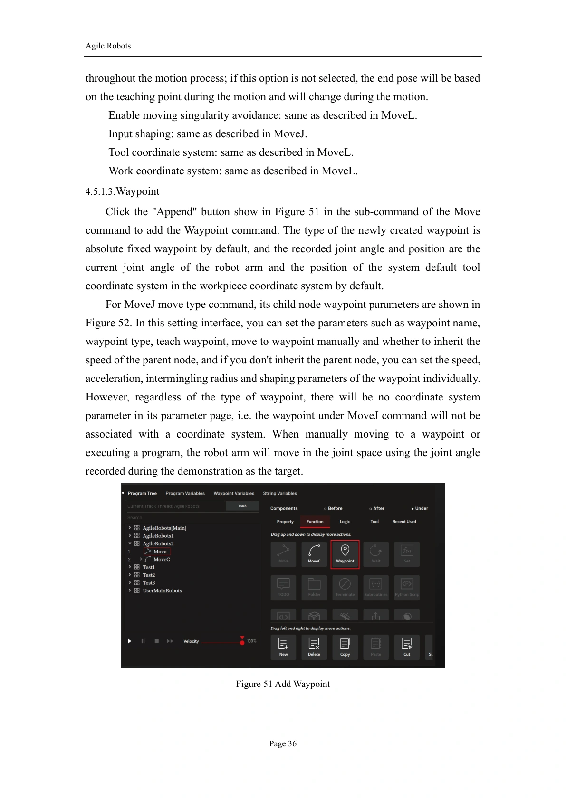



```
Agile Robots 
Page 36 
 
throughout the motion process; if this option is not selected, the end pose will be based 
on the teaching point during the motion and will change during the motion.  
Enable moving singularity avoidance: same as described in MoveL. 
Input shaping: same as described in MoveJ.  
Tool coordinate system: same as described in MoveL. 
Work coordinate system: same as described in MoveL. 
4.5.1.3.Waypoint  
Click the "Append" button show in Figure 51 in the sub-command of the Move 
command to add the Waypoint command. The type of the newly created waypoint is 
absolute fixed waypoint by default, and the recorded joint angle and position are the 
current joint angle of the robot arm and the position of the system default tool 
coordinate system in the workpiece coordinate system by default.  
For MoveJ move type command, its child node waypoint parameters are shown in 
Figure 52. In this setting interface, you can set the parameters such as waypoint name, 
waypoint type, teach waypoint, move to waypoint manually and whether to inherit the 
speed of the parent node, and if you don't inherit the parent node, you can set the speed, 
acceleration, intermingling radius and shaping parameters of the waypoint individually. 
However, regardless of the type of waypoint, there will be no coordinate system 
parameter in its parameter page, i.e. the waypoint under MoveJ command will not be 
associated with a coordinate system. When manually moving to a waypoint or 
executing a program, the robot arm will move in the joint space using the joint angle 
recorded during the demonstration as the target. 
 
Figure 51 Add Waypoint
```



**Original document cross-references:** [PDF 40](pages-001-072.md#pdf-page-40) · [PDF 41](pages-001-072.md#pdf-page-41)

## PDF page 41

**Source:** Industrial Teaching Pendant Software User Manual\_V3.3.0\_EN\_20260204.pdf, original pdf page 41. [Open the corresponding PDF reading-copy page](https://1292444914-files.gitbook.io/~/files/v0/b/gitbook-x-prod.appspot.com/o/spaces%2FtgOfPnscWebs1eh82EKq%2Fuploads%2FaAKcRNYrY44BagQd1uc5%2Findustrial-teaching-pendant-software-user-manual-v3-3-0-en-20260204-pp-040-043.pdf?alt=media#page=2).



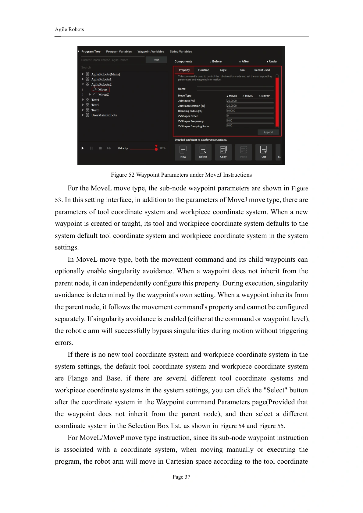



```
Agile Robots 
Page 37 
 
 
Figure 52 Waypoint Parameters under MoveJ Instructions 
For the MoveL move type, the sub-node waypoint parameters are shown in Figure 
53. In this setting interface, in addition to the parameters of MoveJ move type, there are 
parameters of tool coordinate system and workpiece coordinate system. When a new 
waypoint is created or taught, its tool and workpiece coordinate system defaults to the 
system default tool coordinate system and workpiece coordinate system in the system 
settings. 
In MoveL move type, both the movement command and its child waypoints can 
optionally enable singularity avoidance. When a waypoint does not inherit from the 
parent node, it can independently configure this property. During execution, singularity 
avoidance is determined by the waypoint's own setting. When a waypoint inherits from 
the parent node, it follows the movement command's property and cannot be configured 
separately. If singularity avoidance is enabled (either at the command or waypoint level), 
the robotic arm will successfully bypass singularities during motion without triggering 
errors. 
If there is no new tool coordinate system and workpiece coordinate system in the 
system settings, the default tool coordinate system and workpiece coordinate system 
are Flange and Base. if there are several different tool coordinate systems and 
workpiece coordinate systems in the system settings, you can click the "Select" button 
after the coordinate system in the Waypoint command Parameters page(Provided that 
the waypoint does not inherit from the parent node), and then select a different 
coordinate system in the Selection Box list, as shown in Figure 54 and Figure 55. 
For MoveL/MoveP move type instruction, since its sub-node waypoint instruction 
is associated with a coordinate system, when moving manually or executing the 
program, the robot arm will move in Cartesian space according to the tool coordinate
```



**Original document cross-references:** [PDF 42](pages-001-072.md#pdf-page-42) · [PDF 43](pages-001-072.md#pdf-page-43)

## PDF page 42

**Source:** Industrial Teaching Pendant Software User Manual\_V3.3.0\_EN\_20260204.pdf, original pdf page 42. [Open the corresponding PDF reading-copy page](https://1292444914-files.gitbook.io/~/files/v0/b/gitbook-x-prod.appspot.com/o/spaces%2FtgOfPnscWebs1eh82EKq%2Fuploads%2FaAKcRNYrY44BagQd1uc5%2Findustrial-teaching-pendant-software-user-manual-v3-3-0-en-20260204-pp-040-043.pdf?alt=media#page=3).



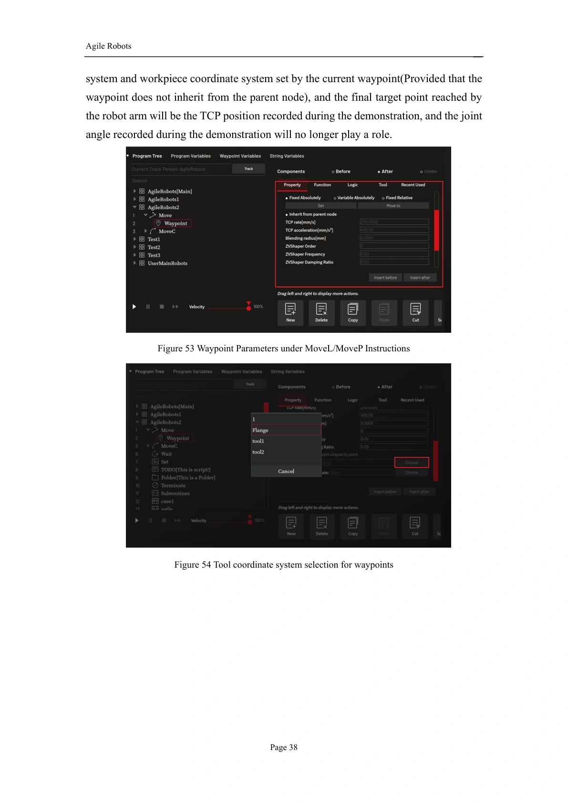



```
Agile Robots 
Page 38 
 
system and workpiece coordinate system set by the current waypoint(Provided that the 
waypoint does not inherit from the parent node), and the final target point reached by 
the robot arm will be the TCP position recorded during the demonstration, and the joint 
angle recorded during the demonstration will no longer play a role. 
 
Figure 53 Waypoint Parameters under MoveL/MoveP Instructions 
 
Figure 54 Tool coordinate system selection for waypoints
```



## PDF page 43

**Source:** Industrial Teaching Pendant Software User Manual\_V3.3.0\_EN\_20260204.pdf, original pdf page 43. [Open the corresponding PDF reading-copy page](https://1292444914-files.gitbook.io/~/files/v0/b/gitbook-x-prod.appspot.com/o/spaces%2FtgOfPnscWebs1eh82EKq%2Fuploads%2FaAKcRNYrY44BagQd1uc5%2Findustrial-teaching-pendant-software-user-manual-v3-3-0-en-20260204-pp-040-043.pdf?alt=media#page=4).



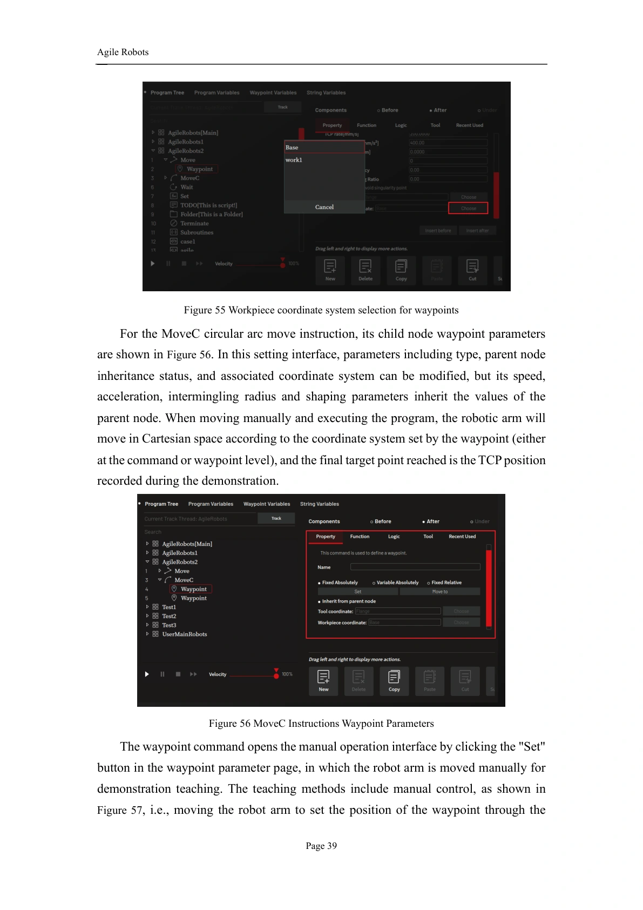



```
Agile Robots 
Page 39 
 
 
Figure 55 Workpiece coordinate system selection for waypoints 
For the MoveC circular arc move instruction, its child node waypoint parameters 
are shown in Figure 56. In this setting interface, parameters including type, parent node 
inheritance status, and associated coordinate system can be modified, but its speed, 
acceleration, intermingling radius and shaping parameters inherit the values of the 
parent node. When moving manually and executing the program, the robotic arm will 
move in Cartesian space according to the coordinate system set by the waypoint (either 
at the command or waypoint level), and the final target point reached is the TCP position 
recorded during the demonstration. 
 
Figure 56 MoveC Instructions Waypoint Parameters 
The waypoint command opens the manual operation interface by clicking the "Set" 
button in the waypoint parameter page, in which the robot arm is moved manually for 
demonstration teaching. The teaching methods include manual control, as shown in 
Figure 57, i.e., moving the robot arm to set the position of the waypoint through the
```



**Original document cross-references:** [PDF 43](pages-001-072.md#pdf-page-43) · [PDF 44](pages-001-072.md#pdf-page-44)

## PDF page 44

**Source:** Industrial Teaching Pendant Software User Manual\_V3.3.0\_EN\_20260204.pdf, original pdf page 44. [Open the corresponding PDF reading-copy page](https://1292444914-files.gitbook.io/~/files/v0/b/gitbook-x-prod.appspot.com/o/spaces%2FtgOfPnscWebs1eh82EKq%2Fuploads%2FU6Lcv4WrtwIDwLKtyMh4%2Findustrial-teaching-pendant-software-user-manual-v3-3-0-en-20260204-pp-044-051.pdf?alt=media#page=1).



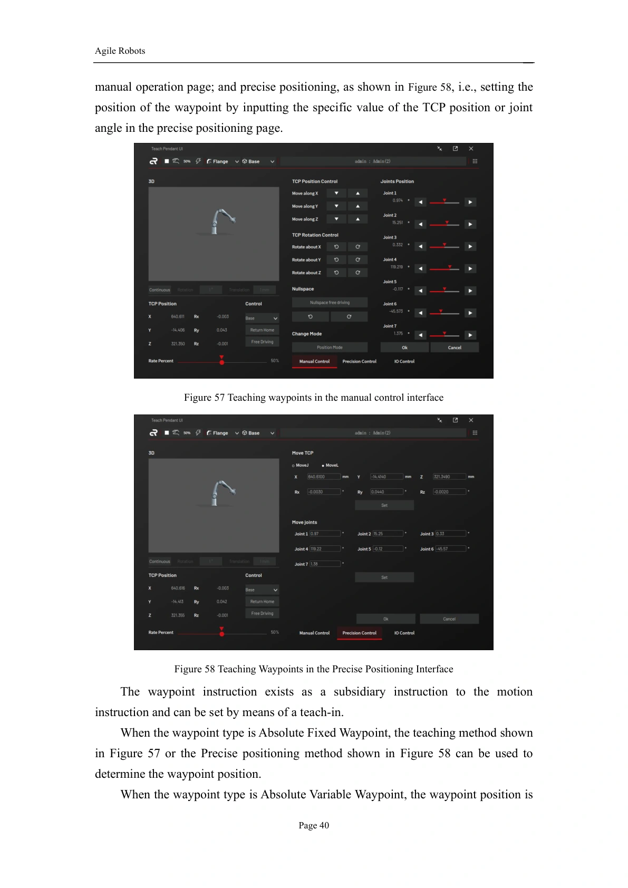



```
Agile Robots 
Page 40 
 
manual operation page; and precise positioning, as shown in Figure 58, i.e., setting the 
position of the waypoint by inputting the specific value of the TCP position or joint 
angle in the precise positioning page. 
 
Figure 57 Teaching waypoints in the manual control interface 
 
Figure 58 Teaching Waypoints in the Precise Positioning Interface 
The waypoint instruction exists as a subsidiary instruction to the motion 
instruction and can be set by means of a teach-in. 
When the waypoint type is Absolute Fixed Waypoint, the teaching method shown 
in Figure 57 or the Precise positioning method shown in Figure 58 can be used to 
determine the waypoint position. 
When the waypoint type is Absolute Variable Waypoint, the waypoint position is
```



**Original document cross-references:** [PDF 44](pages-001-072.md#pdf-page-44)

## PDF page 45

**Source:** Industrial Teaching Pendant Software User Manual\_V3.3.0\_EN\_20260204.pdf, original pdf page 45. [Open the corresponding PDF reading-copy page](https://1292444914-files.gitbook.io/~/files/v0/b/gitbook-x-prod.appspot.com/o/spaces%2FtgOfPnscWebs1eh82EKq%2Fuploads%2FU6Lcv4WrtwIDwLKtyMh4%2Findustrial-teaching-pendant-software-user-manual-v3-3-0-en-20260204-pp-044-051.pdf?alt=media#page=2).



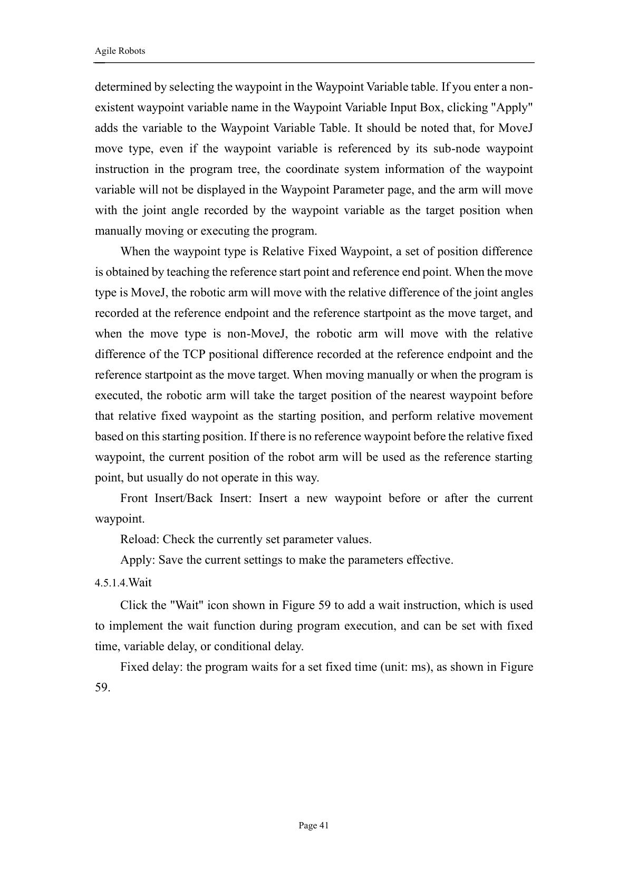



```
Agile Robots 
Page 41 
 
determined by selecting the waypoint in the Waypoint Variable table. If you enter a non-
existent waypoint variable name in the Waypoint Variable Input Box, clicking "Apply" 
adds the variable to the Waypoint Variable Table. It should be noted that, for MoveJ 
move type, even if the waypoint variable is referenced by its sub-node waypoint 
instruction in the program tree, the coordinate system information of the waypoint 
variable will not be displayed in the Waypoint Parameter page, and the arm will move 
with the joint angle recorded by the waypoint variable as the target position when 
manually moving or executing the program. 
When the waypoint type is Relative Fixed Waypoint, a set of position difference 
is obtained by teaching the reference start point and reference end point. When the move 
type is MoveJ, the robotic arm will move with the relative difference of the joint angles 
recorded at the reference endpoint and the reference startpoint as the move target, and 
when the move type is non-MoveJ, the robotic arm will move with the relative 
difference of the TCP positional difference recorded at the reference endpoint and the 
reference startpoint as the move target. When moving manually or when the program is 
executed, the robotic arm will take the target position of the nearest waypoint before 
that relative fixed waypoint as the starting position, and perform relative movement 
based on this starting position. If there is no reference waypoint before the relative fixed 
waypoint, the current position of the robot arm will be used as the reference starting 
point, but usually do not operate in this way. 
Front Insert/Back Insert: Insert a new waypoint before or after the current 
waypoint. 
Reload: Check the currently set parameter values. 
Apply: Save the current settings to make the parameters effective. 
4.5.1.4.Wait  
Click the "Wait" icon shown in Figure 59 to add a wait instruction, which is used 
to implement the wait function during program execution, and can be set with fixed 
time, variable delay, or conditional delay.  
Fixed delay: the program waits for a set fixed time (unit: ms), as shown in Figure 
59.
```



**Original document cross-references:** [PDF 46](pages-001-072.md#pdf-page-46)

## PDF page 46

**Source:** Industrial Teaching Pendant Software User Manual\_V3.3.0\_EN\_20260204.pdf, original pdf page 46. [Open the corresponding PDF reading-copy page](https://1292444914-files.gitbook.io/~/files/v0/b/gitbook-x-prod.appspot.com/o/spaces%2FtgOfPnscWebs1eh82EKq%2Fuploads%2FU6Lcv4WrtwIDwLKtyMh4%2Findustrial-teaching-pendant-software-user-manual-v3-3-0-en-20260204-pp-044-051.pdf?alt=media#page=3).



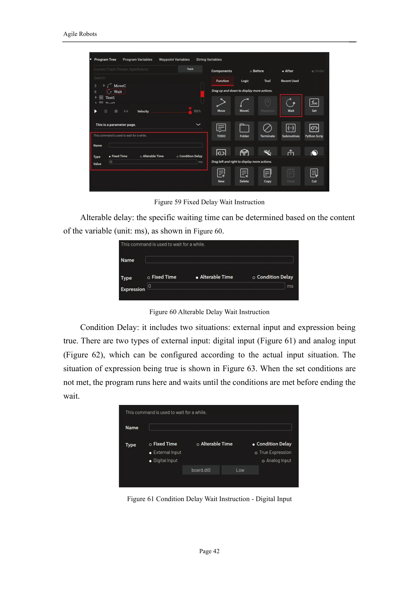



```
Agile Robots 
Page 42 
 
 
Figure 59 Fixed Delay Wait Instruction 
Alterable delay: the specific waiting time can be determined based on the content 
of the variable (unit: ms), as shown in Figure 60.  
 
Figure 60 Alterable Delay Wait Instruction 
Condition Delay: it includes two situations: external input and expression being 
true. There are two types of external input: digital input (Figure 61) and analog input 
(Figure 62), which can be configured according to the actual input situation. The 
situation of expression being true is shown in Figure 63. When the set conditions are 
not met, the program runs here and waits until the conditions are met before ending the 
wait.  
 
Figure 61 Condition Delay Wait Instruction - Digital Input
```



**Original document cross-references:** [PDF 46](pages-001-072.md#pdf-page-46) · [PDF 47](pages-001-072.md#pdf-page-47)

## PDF page 47

**Source:** Industrial Teaching Pendant Software User Manual\_V3.3.0\_EN\_20260204.pdf, original pdf page 47. [Open the corresponding PDF reading-copy page](https://1292444914-files.gitbook.io/~/files/v0/b/gitbook-x-prod.appspot.com/o/spaces%2FtgOfPnscWebs1eh82EKq%2Fuploads%2FU6Lcv4WrtwIDwLKtyMh4%2Findustrial-teaching-pendant-software-user-manual-v3-3-0-en-20260204-pp-044-051.pdf?alt=media#page=4).



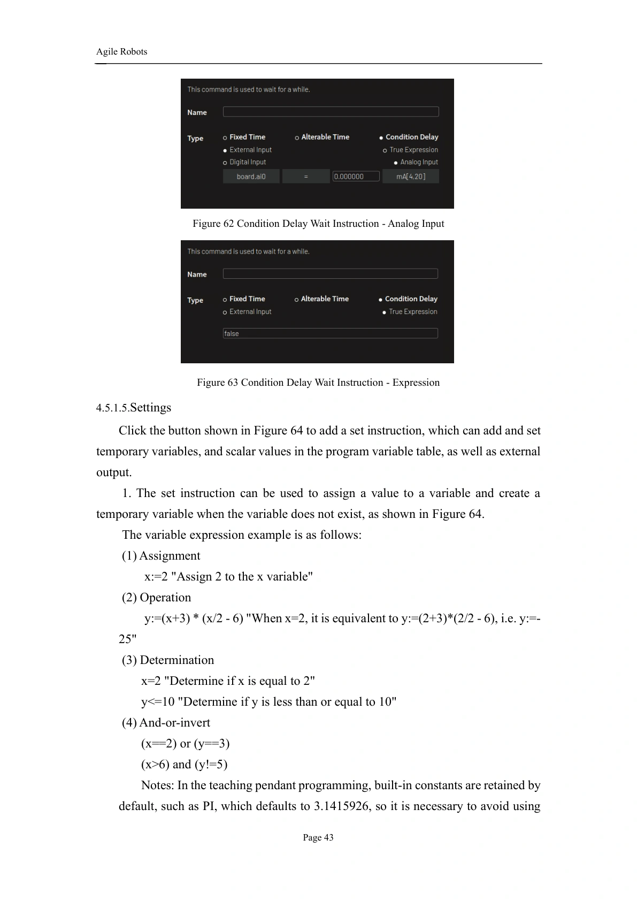



```
Agile Robots 
Page 43 
 
 
Figure 62 Condition Delay Wait Instruction - Analog Input 
 
Figure 63 Condition Delay Wait Instruction - Expression 
4.5.1.5.Settings  
Click the button shown in Figure 64 to add a set instruction, which can add and set 
temporary variables, and scalar values in the program variable table, as well as external 
output.  
1. The set instruction can be used to assign a value to a variable and create a 
temporary variable when the variable does not exist, as shown in Figure 64.  
The variable expression example is as follows:  
(1) Assignment  
 x:=2 "Assign 2 to the x variable"  
(2) Operation  
 y:=(x+3) * (x/2 - 6) "When x=2, it is equivalent to y:=(2+3)*(2/2 - 6), i.e. y:=-
25"  
(3) Determination  
x=2 "Determine if x is equal to 2"  
y<=10 "Determine if y is less than or equal to 10"  
(4) And-or-invert  
(x==2) or (y==3)  
(x>6) and (y!=5)  
Notes: In the teaching pendant programming, built-in constants are retained by 
default, such as PI, which defaults to 3.1415926, so it is necessary to avoid using
```



**Original document cross-references:** [PDF 48](pages-001-072.md#pdf-page-48)

## PDF page 48

**Source:** Industrial Teaching Pendant Software User Manual\_V3.3.0\_EN\_20260204.pdf, original pdf page 48. [Open the corresponding PDF reading-copy page](https://1292444914-files.gitbook.io/~/files/v0/b/gitbook-x-prod.appspot.com/o/spaces%2FtgOfPnscWebs1eh82EKq%2Fuploads%2FU6Lcv4WrtwIDwLKtyMh4%2Findustrial-teaching-pendant-software-user-manual-v3-3-0-en-20260204-pp-044-051.pdf?alt=media#page=5).



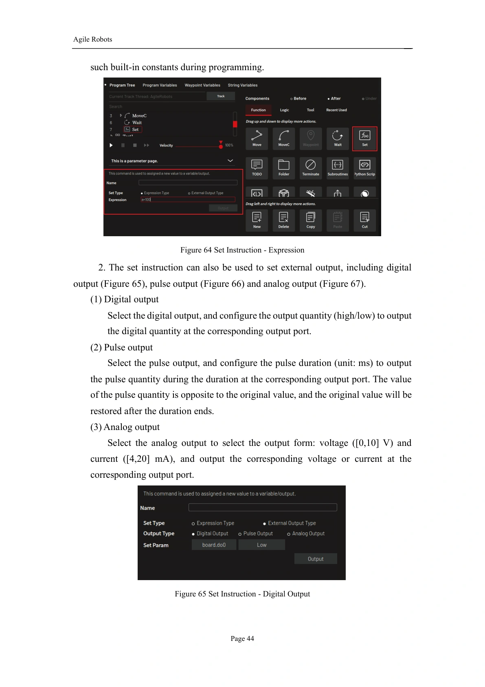



```
Agile Robots 
Page 44 
 
such built-in constants during programming.  
 
Figure 64 Set Instruction - Expression 
2. The set instruction can also be used to set external output, including digital 
output (Figure 65), pulse output (Figure 66) and analog output (Figure 67).  
(1) Digital output  
Select the digital output, and configure the output quantity (high/low) to output 
the digital quantity at the corresponding output port.  
(2) Pulse output  
Select the pulse output, and configure the pulse duration (unit: ms) to output 
the pulse quantity during the duration at the corresponding output port. The value 
of the pulse quantity is opposite to the original value, and the original value will be 
restored after the duration ends.  
(3) Analog output  
Select the analog output to select the output form: voltage ([0,10] V) and 
current ([4,20] mA), and output the corresponding voltage or current at the 
corresponding output port.  
 
Figure 65 Set Instruction - Digital Output
```



**Original document cross-references:** [PDF 48](pages-001-072.md#pdf-page-48) · [PDF 49](pages-001-072.md#pdf-page-49)

## PDF page 49

**Source:** Industrial Teaching Pendant Software User Manual\_V3.3.0\_EN\_20260204.pdf, original pdf page 49. [Open the corresponding PDF reading-copy page](https://1292444914-files.gitbook.io/~/files/v0/b/gitbook-x-prod.appspot.com/o/spaces%2FtgOfPnscWebs1eh82EKq%2Fuploads%2FU6Lcv4WrtwIDwLKtyMh4%2Findustrial-teaching-pendant-software-user-manual-v3-3-0-en-20260204-pp-044-051.pdf?alt=media#page=6).



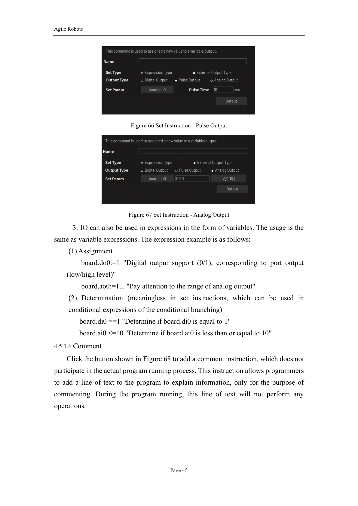



```
Agile Robots 
Page 45 
 
 
Figure 66 Set Instruction - Pulse Output 
 
Figure 67 Set Instruction - Analog Output 
3. IO can also be used in expressions in the form of variables. The usage is the 
same as variable expressions. The expression example is as follows:  
(1) Assignment  
 board.do0:=1 "Digital output support (0/1), corresponding to port output 
(low/high level)"  
 board.ao0:=1.1 "Pay attention to the range of analog output"  
(2) Determination (meaningless in set instructions, which can be used in 
conditional expressions of the conditional branching)  
board.di0 ==1 "Determine if board.di0 is equal to 1"  
board.ai0 <=10 "Determine if board.ai0 is less than or equal to 10"  
4.5.1.6.Comment  
Click the button shown in Figure 68 to add a comment instruction, which does not 
participate in the actual program running process. This instruction allows programmers 
to add a line of text to the program to explain information, only for the purpose of 
commenting. During the program running, this line of text will not perform any 
operations.
```



**Original document cross-references:** [PDF 50](pages-001-072.md#pdf-page-50)

## PDF page 50

**Source:** Industrial Teaching Pendant Software User Manual\_V3.3.0\_EN\_20260204.pdf, original pdf page 50. [Open the corresponding PDF reading-copy page](https://1292444914-files.gitbook.io/~/files/v0/b/gitbook-x-prod.appspot.com/o/spaces%2FtgOfPnscWebs1eh82EKq%2Fuploads%2FU6Lcv4WrtwIDwLKtyMh4%2Findustrial-teaching-pendant-software-user-manual-v3-3-0-en-20260204-pp-044-051.pdf?alt=media#page=7).



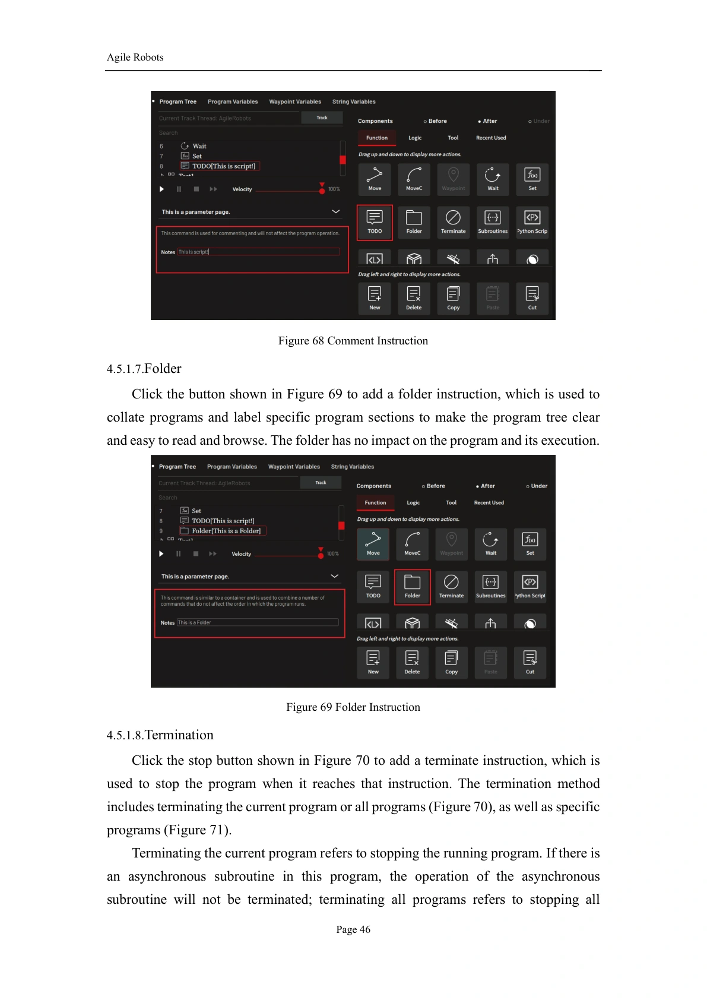



```
Agile Robots 
Page 46 
 
 
Figure 68 Comment Instruction 
4.5.1.7.Folder  
Click the button shown in Figure 69 to add a folder instruction, which is used to 
collate programs and label specific program sections to make the program tree clear 
and easy to read and browse. The folder has no impact on the program and its execution.  
 
Figure 69 Folder Instruction 
4.5.1.8.Termination  
Click the stop button shown in Figure 70 to add a terminate instruction, which is 
used to stop the program when it reaches that instruction. The termination method 
includes terminating the current program or all programs (Figure 70), as well as specific 
programs (Figure 71).  
Terminating the current program refers to stopping the running program. If there is 
an asynchronous subroutine in this program, the operation of the asynchronous 
subroutine will not be terminated; terminating all programs refers to stopping all
```



**Original document cross-references:** [PDF 50](pages-001-072.md#pdf-page-50) · [PDF 51](pages-001-072.md#pdf-page-51)

## PDF page 51

**Source:** Industrial Teaching Pendant Software User Manual\_V3.3.0\_EN\_20260204.pdf, original pdf page 51. [Open the corresponding PDF reading-copy page](https://1292444914-files.gitbook.io/~/files/v0/b/gitbook-x-prod.appspot.com/o/spaces%2FtgOfPnscWebs1eh82EKq%2Fuploads%2FU6Lcv4WrtwIDwLKtyMh4%2Findustrial-teaching-pendant-software-user-manual-v3-3-0-en-20260204-pp-044-051.pdf?alt=media#page=8).







```
Agile Robots 
Page 47 
 
running programs, including asynchronous subroutines; a specific program can be 
terminated by clicking the "Modify" button to select the program tree to stop, and then 
the selected program can be terminated.  
 
Figure 70 Terminate Instruction 
 
Figure 71 Terminate Instruction - Terminating Specific Program 
4.5.1.9.Subroutine 
Click the button shown in Figure 72 to add a subroutine instruction, which can add 
a subroutine according to the selected position. When the subroutine is called, the 
program lines in the subroutine will be run.  
When synchronous calling is selected, as shown in Figure 72, the execution 
sequence of this program is to wait for the completion of the synchronous subroutine 
before entering the next instruction of this program. When asynchronous calling is 
selected, as shown in Figure 73, the execution sequence of this program is to execute 
the next instruction while entering the asynchronous program.
```



**Original document cross-references:** [PDF 52](pages-001-072.md#pdf-page-52)

## PDF page 52

**Source:** Industrial Teaching Pendant Software User Manual\_V3.3.0\_EN\_20260204.pdf, original pdf page 52. [Open the corresponding PDF reading-copy page](https://1292444914-files.gitbook.io/~/files/v0/b/gitbook-x-prod.appspot.com/o/spaces%2FtgOfPnscWebs1eh82EKq%2Fuploads%2FZHJ9jy20P0LVUtDlo5aS%2Findustrial-teaching-pendant-software-user-manual-v3-3-0-en-20260204-pp-052-055.pdf?alt=media#page=1).







```
Agile Robots 
Page 48 
 
 
Figure 72 Subprogram Instruction - Synchronous 
 
Figure 73 Subroutine Instruction - Asynchronous 
4.5.1.10.Python Script  
Click the button shown in Figure 74 to add a python script instruction, which is 
used to add a python script program at the specified position and implement various 
operations such as motion control and IO control of the robot arm through the input 
script program.  
To create a new python script, as shown in Figure 74, enter the name of the script 
file in the name input box and click "New" button to create a new script file.  
After creating a new script file, the script editor will automatically open, as shown 
in Figure 75. Enter the script content in the opened script editor, and click "Cache" 
button to save the new script program. In addition, text copying, pasting, searching, 
replacing, API function prompts, script checking and other actions can be performed on 
the script editor interface.
```



**Original document cross-references:** [PDF 53](pages-001-072.md#pdf-page-53) · [PDF 54](pages-001-072.md#pdf-page-54)

## PDF page 53

**Source:** Industrial Teaching Pendant Software User Manual\_V3.3.0\_EN\_20260204.pdf, original pdf page 53. [Open the corresponding PDF reading-copy page](https://1292444914-files.gitbook.io/~/files/v0/b/gitbook-x-prod.appspot.com/o/spaces%2FtgOfPnscWebs1eh82EKq%2Fuploads%2FZHJ9jy20P0LVUtDlo5aS%2Findustrial-teaching-pendant-software-user-manual-v3-3-0-en-20260204-pp-052-055.pdf?alt=media#page=2).







```
Agile Robots 
Page 49 
 
If a python script file already exists in the current project, the user can select a 
different script file by clicking the "Select" button shown in Figure 76.  
To import an existing script, click the "Import" button shown in Figure 77 to pop 
up a folder selection page, on which the user can find the position of the file to import 
the script, in order to achieve the function of importing the script. After importing the 
script file, the user also needs to click the "Apply" and "Save" buttons to save it locally.  
In the parameter page properties of the script instruction, the user can also rename 
and delete the script file. It should be noted that after deleting the script file, the robot 
server will completely delete the file.  
Notes: if there are actions to modify tools and payload parameters in the script, 
after the program runs, the user can select to keep or restore to the parameters before 
running and set them through (5.5.3 Recovery parameters after script execution).  
 
Figure 74 New Script
```



**Original document cross-references:** [PDF 54](pages-001-072.md#pdf-page-54)

## PDF page 54

**Source:** Industrial Teaching Pendant Software User Manual\_V3.3.0\_EN\_20260204.pdf, original pdf page 54. [Open the corresponding PDF reading-copy page](https://1292444914-files.gitbook.io/~/files/v0/b/gitbook-x-prod.appspot.com/o/spaces%2FtgOfPnscWebs1eh82EKq%2Fuploads%2FZHJ9jy20P0LVUtDlo5aS%2Findustrial-teaching-pendant-software-user-manual-v3-3-0-en-20260204-pp-052-055.pdf?alt=media#page=3).







```
Agile Robots 
Page 50 
 
Figure 75 Script Editor 
 
Figure 76 Select Script 
 
Figure 77 Import Script 
 
4.5.1.11.  
Lua Script 
Click the button shown in Figure 78 to add an editable Lua script program to the 
specified location in the graphical program, through which you can complete various 
operations such as motion control, IO control and so on for the robotic arm. 
Create a new Lua script program, as shown in Figure 78, enter the script file name 
in the Name input box and click "New Lua" to create a new script file. 
After creating a new Lua script file, the Script Editor opens automatically, as 
shown in Figure 79. Write a script program in the opened script editor and click "Cache" 
to save the newly created script program. At the same time, you can operate the buttons 
on the script editor interface to copy, paste, find, replace, API function prompts and
```



**Original document cross-references:** [PDF 55](pages-001-072.md#pdf-page-55) · [PDF 56](pages-001-072.md#pdf-page-56)

## PDF page 55

**Source:** Industrial Teaching Pendant Software User Manual\_V3.3.0\_EN\_20260204.pdf, original pdf page 55. [Open the corresponding PDF reading-copy page](https://1292444914-files.gitbook.io/~/files/v0/b/gitbook-x-prod.appspot.com/o/spaces%2FtgOfPnscWebs1eh82EKq%2Fuploads%2FZHJ9jy20P0LVUtDlo5aS%2Findustrial-teaching-pendant-software-user-manual-v3-3-0-en-20260204-pp-052-055.pdf?alt=media#page=4).







```
Agile Robots 
Page 51 
 
script check. 
If a script file already exists in the current project, you can select a different script 
file by clicking the "Select" button as shown in Figure 80. 
To import an existing script, click the "Import" button as shown in Figure 81, a 
folder selection page will pop up, through which you can find the location of the script 
file you want to import and then select it and click the "Select" button to execute the 
import. After the script file is imported, you also need to click the "Apply" and "Save" 
buttons to save it locally. 
In the parameter page properties of the script command, you can also rename the 
script file and delete the script file. Note that when a script file is deleted, the robot 
server will completely delete the file. 
Note:If there are operations in the script that modify the tool and load parameters, 
you can choose to keep or restore them to the parameters before running after the 
program has finished running, which is set through (5.5.3 Restoring Parameters after 
Script Execution). 
 
Figure 78 New Lua Script
```



**Original document cross-references:** [PDF 56](pages-001-072.md#pdf-page-56) · [PDF 57](pages-001-072.md#pdf-page-57)

## PDF page 56

**Source:** Industrial Teaching Pendant Software User Manual\_V3.3.0\_EN\_20260204.pdf, original pdf page 56. [Open the corresponding PDF reading-copy page](https://1292444914-files.gitbook.io/~/files/v0/b/gitbook-x-prod.appspot.com/o/spaces%2FtgOfPnscWebs1eh82EKq%2Fuploads%2Fy5HHsYCwDnGUh8rC7Ueb%2Findustrial-teaching-pendant-software-user-manual-v3-3-0-en-20260204-pp-056-058.pdf?alt=media#page=1).







```
Agile Robots 
Page 52 
 
 
Figure 79 Lua script editor 
 
Figure 80 Select Lua script
```



## PDF page 57

**Source:** Industrial Teaching Pendant Software User Manual\_V3.3.0\_EN\_20260204.pdf, original pdf page 57. [Open the corresponding PDF reading-copy page](https://1292444914-files.gitbook.io/~/files/v0/b/gitbook-x-prod.appspot.com/o/spaces%2FtgOfPnscWebs1eh82EKq%2Fuploads%2Fy5HHsYCwDnGUh8rC7Ueb%2Findustrial-teaching-pendant-software-user-manual-v3-3-0-en-20260204-pp-056-058.pdf?alt=media#page=2).







```
Agile Robots 
Page 53 
 
Figure 81 Importing Lua scripts 
 
4.5.1.12.Control Mode  
Click the button shown in Figure 82 to add a control mode instruction, which can 
change the current control mode, such as position mode, joint space impedance mode, 
and Cartesian space impedance mode.  
Position mode: all joints enter the operating status of the position loop, and the 
determination standard is whether the end reaches the target position, as shown in 
Figure 82.  
Joint space impedance mode: when only considering joint pose, the joint achieves 
the impedance status of the target joint pose in each joint angle based on the 
collaborative constraints of joint stiffness and damping, as shown in Figure 83.  
Cartesian space impedance mode: when only considering the end pose, the end 
achieves the impedance status in all directions of the target end pose based on the 
collaborative constraints of Cartesian space stiffness and damping, as shown in Figure 
84. 
 
Figure 82 Control Mode Instruction - Position Mode
```



**Original document cross-references:** [PDF 57](pages-001-072.md#pdf-page-57) · [PDF 58](pages-001-072.md#pdf-page-58)

## PDF page 58

**Source:** Industrial Teaching Pendant Software User Manual\_V3.3.0\_EN\_20260204.pdf, original pdf page 58. [Open the corresponding PDF reading-copy page](https://1292444914-files.gitbook.io/~/files/v0/b/gitbook-x-prod.appspot.com/o/spaces%2FtgOfPnscWebs1eh82EKq%2Fuploads%2Fy5HHsYCwDnGUh8rC7Ueb%2Findustrial-teaching-pendant-software-user-manual-v3-3-0-en-20260204-pp-056-058.pdf?alt=media#page=3).







```
Agile Robots 
Page 54 
 
Figure 83 Control Mode Instruction - Joint Impedance Mode 
 
Figure 84 Control Mode Instruction - Cartesian Impedance Mode 
4.5.1.13.Enter force control  
Click the "Force" button shown in Figure 85 to add the enter force control 
instruction, which is used to enter force control mode, and set corresponding motion 
parameters such as reference coordinate system, force direction, and force size, etc.  
After executing the enter force control instruction, a move instruction is usually 
added, and the plane of movement is orthogonal to the direction of force control for 
force control.  
Reference coordinate system type: refers to the reference coordinate system that 
determines the force direction definition, which currently supports both the base 
coordinate system and the tool coordinate system. When the tool coordinate system is 
not defined, it is the end coordinate system.  
Force direction: refers to applying a constant force in a given direction.  
Force value: refers to the target value of the applied servo force (unit: N).  
Maximum approach velocity: refers to the maximum velocity that follows or 
moves away from the direction (unit: mm/s) when the force value in the direction of 
application is detected to be not equal to the target value.  
Maximum allowable offset distance: refers to the maximum linear distance that 
deviates from the force direction during the motion (unit: mm).  
Notes:  
When entering force control mode, the collision detection function will be 
automatically turned off, and the control mode will switch to Cartesian impedance 
mode.
```



**Original document cross-references:** [PDF 59](pages-001-072.md#pdf-page-59)

## PDF page 59

**Source:** Industrial Teaching Pendant Software User Manual\_V3.3.0\_EN\_20260204.pdf, original pdf page 59. [Open the corresponding PDF reading-copy page](https://1292444914-files.gitbook.io/~/files/v0/b/gitbook-x-prod.appspot.com/o/spaces%2FtgOfPnscWebs1eh82EKq%2Fuploads%2FyXZ9Bc6Is8gYi7lVCfjG%2Findustrial-teaching-pendant-software-user-manual-v3-3-0-en-20260204-pp-059-062.pdf?alt=media#page=1).







```
Agile Robots 
Page 55 
 
 
Figure 85 Enter Force Control Instruction 
4.5.1.14.Exit force control  
Click the "Exit Force" button shown in Figure 86 to add an exit force control 
instruction, which is used in conjunction with entering force control to exit force control 
mode, and set the control mode of the robot arm after exiting force control, including 
position mode, joint space impedance mode, and Cartesian space impedance mode.  
 
Figure 86 Exit Force Control Instruction 
4.5.1.15.Collision detection  
Click the "Collision" button shown in Figure 87 to add a collision detection 
instruction. Collision detection is a protective mechanism for the robot arm to 
automatically stop when encountering obstacles.  
The types of collision detection that can be enabled by this instruction include joint 
space detection (Figure 88), Cartesian space detection (Figure 89), and TCP resultant 
force detection (Figure 90). Three types of collision detection can be multiple, and the
```



**Original document cross-references:** [PDF 59](pages-001-072.md#pdf-page-59) · [PDF 60](pages-001-072.md#pdf-page-60) · [PDF 61](pages-001-072.md#pdf-page-61)

## PDF page 60

**Source:** Industrial Teaching Pendant Software User Manual\_V3.3.0\_EN\_20260204.pdf, original pdf page 60. [Open the corresponding PDF reading-copy page](https://1292444914-files.gitbook.io/~/files/v0/b/gitbook-x-prod.appspot.com/o/spaces%2FtgOfPnscWebs1eh82EKq%2Fuploads%2FyXZ9Bc6Is8gYi7lVCfjG%2Findustrial-teaching-pendant-software-user-manual-v3-3-0-en-20260204-pp-059-062.pdf?alt=media#page=2).







```
Agile Robots 
Page 56 
 
collision detection will be turned off when none of the three types of collision detection 
are selected. The parameters for various types of collision detection can be set 
separately in the instruction parameter page, and are not affected by the collision 
detection parameters in the system setting page.  
 
Figure 87 Collision Detection Instruction 
 
Figure 88 Collision Detection Instruction - Joint Collision Detection 
 
Figure 89 Collision Detection Instruction - Cartesian Collision Detection
```



## PDF page 61

**Source:** Industrial Teaching Pendant Software User Manual\_V3.3.0\_EN\_20260204.pdf, original pdf page 61. [Open the corresponding PDF reading-copy page](https://1292444914-files.gitbook.io/~/files/v0/b/gitbook-x-prod.appspot.com/o/spaces%2FtgOfPnscWebs1eh82EKq%2Fuploads%2FyXZ9Bc6Is8gYi7lVCfjG%2Findustrial-teaching-pendant-software-user-manual-v3-3-0-en-20260204-pp-059-062.pdf?alt=media#page=3).







```
Agile Robots 
Page 57 
 
 
Figure 90 Collision Detection Instruction - TCP Resultant Force Collision Detection 
4.5.1.16.Interactive instruction  
Click the button shown in Figure 91 to add an interactive instruction, which can 
provide a human-machine interaction window during program running, so that the user 
can perform some selective actions:  
⚫ 
Prompt: the prompt information displayed on the prompt window interface;  
⚫ 
Interaction button: select interactive form, supporting four forms: Yes, Yes/No, 
Confirm, Confirm/Cancel;  
⚫ 
Result variable: enter a variable name, which can be an added global variable 
or program variable. If the variable does not exist, a temporary variable will 
be automatically created; When the [Yes/Confirm] button is selected, the 
variable value is 1, and when the [No/Cancel] button is selected, the variable 
value is 2.  
After the user clicks the "Interaction" button, the result variable is assigned a value, 
which can be used for subsequent program execution, such as dynamically determining 
which branch to use when used with conditional instructions.
```



**Original document cross-references:** [PDF 62](pages-001-072.md#pdf-page-62)

## PDF page 62

**Source:** Industrial Teaching Pendant Software User Manual\_V3.3.0\_EN\_20260204.pdf, original pdf page 62. [Open the corresponding PDF reading-copy page](https://1292444914-files.gitbook.io/~/files/v0/b/gitbook-x-prod.appspot.com/o/spaces%2FtgOfPnscWebs1eh82EKq%2Fuploads%2FyXZ9Bc6Is8gYi7lVCfjG%2Findustrial-teaching-pendant-software-user-manual-v3-3-0-en-20260204-pp-059-062.pdf?alt=media#page=4).







```
Agile Robots 
Page 58 
 
 
Figure 91 Interactive Instruction 
4.5.1.17.Conveyor belt instruction  
Click the button shown in Figure 92 to add a conveyor belt instruction. On the 
instruction parameter page, the user can set the conveyor belt 1 or 2 to start tracking or 
stop tracking. When the program executes this instruction, if the instruction property is 
to start tracking the conveyor belt, all instructions after this instruction are the 
instruction actions during the conveyor belt tracking until the conveyor belt tracking 
stop instruction is executed.  
Notes: in the process of using the conveyor belt tracking function, after calibrating 
the conveyor belt, the workpiece coordinate system and tool coordinate system cannot 
be modified; otherwise, the conveyor belt tracking will fail and the system will report 
an error. After turning on the conveyor belt tracking, in case of any errors, the program 
will stop. 
 
Figure 92 Conveyor Belt Instruction
```



**Original document cross-references:** [PDF 62](pages-001-072.md#pdf-page-62)

## PDF page 63

**Source:** Industrial Teaching Pendant Software User Manual\_V3.3.0\_EN\_20260204.pdf, original pdf page 63. [Open the corresponding PDF reading-copy page](https://1292444914-files.gitbook.io/~/files/v0/b/gitbook-x-prod.appspot.com/o/spaces%2FtgOfPnscWebs1eh82EKq%2Fuploads%2FNMaVPzymgPwWFf8fApJy%2Findustrial-teaching-pendant-software-user-manual-v3-3-0-en-20260204-pp-063-067.pdf?alt=media#page=1).







```
Agile Robots 
Page 59 
 
4.4.1.18.Jump instruction  
Click the button shown in Figure 93 to add a jump instruction. On the instruction 
parameter page, the user can specify the label instruction in the program. When this 
instruction is executed, the program will automatically jump to the position where the 
specified label instruction is located and continue executing.  
 
Figure 93 Jump Instruction 
4.5.1.19.Label instruction  
Click the button shown in Figure 94 to add a label instruction. On the instruction 
parameter page, the user can customize the name of the label instruction, which is 
usually used in conjunction with the jump instruction.  
 
Figure 94 Label Instruction 
4.5.1.20.Timer instruction  
Click the button shown in Figure 95 to add a timer instruction. On the instruction 
parameter page, the user can set the name and action of the timer, including
```



**Original document cross-references:** [PDF 63](pages-001-072.md#pdf-page-63) · [PDF 64](pages-001-072.md#pdf-page-64)

## PDF page 64

**Source:** Industrial Teaching Pendant Software User Manual\_V3.3.0\_EN\_20260204.pdf, original pdf page 64. [Open the corresponding PDF reading-copy page](https://1292444914-files.gitbook.io/~/files/v0/b/gitbook-x-prod.appspot.com/o/spaces%2FtgOfPnscWebs1eh82EKq%2Fuploads%2FNMaVPzymgPwWFf8fApJy%2Findustrial-teaching-pendant-software-user-manual-v3-3-0-en-20260204-pp-063-067.pdf?alt=media#page=2).







```
Agile Robots 
Page 60 
 
start/continue, pause, end, and output to variables. The four options are used in 
combination and support the creation of multiple timing variables.  
During using, for different actions of the same timer (start, pause, end, output to 
variables), it is necessary to ensure the same name, and timer instruction can also be 
used in conjunction with script function. The four options for timer action are as follows:  
Start/continue: the current name timer starts or continues timing;  
Pause: the current name timer pauses timing and will continue to accumulate time 
at the next start;  
End: the current name timer ends timing, and the next start time will start from zero;  
Output to variables: output the current name timer results to a variable. The user 
needs to define a global variable before using it, then clicks the "Variable Output" button 
and selects the variable name to output in the pop-up window, as shown in Figure 96, 
only global variables from the program variable table are displayed in the variable list.  
It should be noted that the timer instruction can only carry out the timing within the 
current program and cannot carry out the timing across programs.  
 
Figure 95 Timer Instruction
```



**Original document cross-references:** [PDF 65](pages-001-072.md#pdf-page-65)

## PDF page 65

**Source:** Industrial Teaching Pendant Software User Manual\_V3.3.0\_EN\_20260204.pdf, original pdf page 65. [Open the corresponding PDF reading-copy page](https://1292444914-files.gitbook.io/~/files/v0/b/gitbook-x-prod.appspot.com/o/spaces%2FtgOfPnscWebs1eh82EKq%2Fuploads%2FNMaVPzymgPwWFf8fApJy%2Findustrial-teaching-pendant-software-user-manual-v3-3-0-en-20260204-pp-063-067.pdf?alt=media#page=3).







```
Agile Robots 
Page 61 
 
 
Figure 96 Timer Selection Variable 
4.5.2.Logic instruction  
4.5.2.1.Conditional block  
Click the "Conditional Block" button on the logic instruction page to add a 
conditional block instruction，as shown in Figure 97. The conditional statement 
structure can change the actions of the robot by determining if the expression is true or 
false. 
A conditional block can be selected in the logic instruction editor. When using the 
conditional block, it is necessary to have at least one conditional branch, under which 
other sub instructions can be added.  
 
Figure 97 Conditional Block Instruction 
4.5.2.2.Conditional branching  
As a subsidiary function of conditional blocks, conditional branching allows users 
to customize conditional expressions through program variables to determine the
```



**Original document cross-references:** [PDF 65](pages-001-072.md#pdf-page-65)

## PDF page 66

**Source:** Industrial Teaching Pendant Software User Manual\_V3.3.0\_EN\_20260204.pdf, original pdf page 66. [Open the corresponding PDF reading-copy page](https://1292444914-files.gitbook.io/~/files/v0/b/gitbook-x-prod.appspot.com/o/spaces%2FtgOfPnscWebs1eh82EKq%2Fuploads%2FNMaVPzymgPwWFf8fApJy%2Findustrial-teaching-pendant-software-user-manual-v3-3-0-en-20260204-pp-063-067.pdf?alt=media#page=4).







```
Agile Robots 
Page 62 
 
execution sequence of the program in the conditional block. Expressions support quick 
and advanced settings.  
⚫ 
Advanced settings; the user can customize the expression. Refer to the setting 
function instruction for the display rules of writing expressions, as shown in 
Figure 98.  
⚫ 
Quick settings; the user can automatically generate expressions as conditions 
by selecting predicates. Currently, variable, digital input, and digital output are 
supported, as shown in Figure 99.  
The grammar logic in a conditional block is equivalent to if, else if, else in high-
level programming languages, where the first conditional branching statement in the 
conditional block corresponds to if, the last other cases correspond to else, and the 
middle conditional branching corresponds to else if.  
 
Figure 98 Conditional Branching Instruction - Advanced Settings 
 
Figure 99 Conditional Branching Instruction - Quick Settings
```



**Original document cross-references:** [PDF 66](pages-001-072.md#pdf-page-66)

## PDF page 67

**Source:** Industrial Teaching Pendant Software User Manual\_V3.3.0\_EN\_20260204.pdf, original pdf page 67. [Open the corresponding PDF reading-copy page](https://1292444914-files.gitbook.io/~/files/v0/b/gitbook-x-prod.appspot.com/o/spaces%2FtgOfPnscWebs1eh82EKq%2Fuploads%2FNMaVPzymgPwWFf8fApJy%2Findustrial-teaching-pendant-software-user-manual-v3-3-0-en-20260204-pp-063-067.pdf?alt=media#page=5).







```
Agile Robots 
Page 63 
 
4.5.2.3.Loop block  
Click the "Loop Block" button on the logical page as shown in Figure 100 to add 
a loop block instruction. The loop statement structure can determine whether to carry 
out the loop execution by determining if the expression is true or false. The loop 
statement structure contains at least one loop body.  
Program instruction can specify the number of loops when the loop condition 
expression is true (Figure 100), or can run in the infinite loop (Figure 101).  
Refer to the setting function instruction for the rules of writing expressions.  
 
Figure 100 Loop Block Instruction - Finite Loop 
 
Figure 101 Loop Block Instruction - Infinite Loop 
4.5.2.4.Break loop  
In the loop body of the loop block, click the button shown in Figure 102 to add a 
break instruction, which is used to terminate the loop process and continue executing 
subsequent instructions.
```



**Original document cross-references:** [PDF 67](pages-001-072.md#pdf-page-67) · [PDF 68](pages-001-072.md#pdf-page-68)

## PDF page 68

**Source:** Industrial Teaching Pendant Software User Manual\_V3.3.0\_EN\_20260204.pdf, original pdf page 68. [Open the corresponding PDF reading-copy page](https://1292444914-files.gitbook.io/~/files/v0/b/gitbook-x-prod.appspot.com/o/spaces%2FtgOfPnscWebs1eh82EKq%2Fuploads%2F8ttpJ8jM2pIYIlynRw1I%2Findustrial-teaching-pendant-software-user-manual-v3-3-0-en-20260204-pp-068-073.pdf?alt=media#page=1).







```
Agile Robots 
Page 64 
 
 
Figure 102 Jump out of the Loop Instruction 
4.5.2.5.Continue loop  
In the loop body of the loop block, click the button shown in Figure 103 to add a 
continue instruction, which is used to terminate the current loop process and continue 
executing the next loop.  
 
Figure 103 Continue Loop Instruction  
4.6.System variable table  
The program tree interface of the graphical project focuses on a graphical approach 
to programming. The corresponding program script interface in the text project focuses 
on the editing and management of Lua script files. 
The main interface of text programming is shown in Figure 104. The leftmost part 
of the program script interface is the Lua script file tree and file operation area, which 
displays Lua script files and folders, and performs operations such as adding, deleting, 
and modifying files. The center of the interface is the Lua script file display area, and
```



**Original document cross-references:** [PDF 68](pages-001-072.md#pdf-page-68) · [PDF 69](pages-001-072.md#pdf-page-69)

## PDF page 69

**Source:** Industrial Teaching Pendant Software User Manual\_V3.3.0\_EN\_20260204.pdf, original pdf page 69. [Open the corresponding PDF reading-copy page](https://1292444914-files.gitbook.io/~/files/v0/b/gitbook-x-prod.appspot.com/o/spaces%2FtgOfPnscWebs1eh82EKq%2Fuploads%2F8ttpJ8jM2pIYIlynRw1I%2Findustrial-teaching-pendant-software-user-manual-v3-3-0-en-20260204-pp-068-073.pdf?alt=media#page=2).







```
Agile Robots 
Page 65 
 
the rightmost side is the script editing command area. 
 
Figure 104 Text Project Programming Interface 
4.6.1.1.Open File 
When the "Open" button is clicked, the Teaching Pendant does not respond when 
there is no check box in the file directory; when a file is clicked and there is a check 
box on the file, the script file is opened, as shown in Figure 105; when a folder is clicked 
and there is a check box on the folder, the list of files in the folder is expanded in the 
file directory, as shown in Figure 106. 
 
Figure 105 Open File
```



**Original document cross-references:** [PDF 69](pages-001-072.md#pdf-page-69) · [PDF 70](pages-001-072.md#pdf-page-70)

## PDF page 70

**Source:** Industrial Teaching Pendant Software User Manual\_V3.3.0\_EN\_20260204.pdf, original pdf page 70. [Open the corresponding PDF reading-copy page](https://1292444914-files.gitbook.io/~/files/v0/b/gitbook-x-prod.appspot.com/o/spaces%2FtgOfPnscWebs1eh82EKq%2Fuploads%2F8ttpJ8jM2pIYIlynRw1I%2Findustrial-teaching-pendant-software-user-manual-v3-3-0-en-20260204-pp-068-073.pdf?alt=media#page=3).







```
Agile Robots 
Page 66 
 
 
Figure 106 Open Folder 
4.6.1.2.Setting the main program 
When there is no main program, the file tree is sorted directly in alphabetical order, 
as shown in Figure 107. Select the script file and click "As main", the file is set as the 
main program, then a line will be added at the top of the file tree and the name of the 
current main program will be displayed, as shown in Figure 108. Select Bind Main 
Program in Main Menu - User Preferences, no matter what file or folder is selected by 
the cursor, when you click the "Run" button, it will run the main program. 
 
 
Figure 107 No main program
```



**Original document cross-references:** [PDF 70](pages-001-072.md#pdf-page-70) · [PDF 71](pages-001-072.md#pdf-page-71)

## PDF page 71

**Source:** Industrial Teaching Pendant Software User Manual\_V3.3.0\_EN\_20260204.pdf, original pdf page 71. [Open the corresponding PDF reading-copy page](https://1292444914-files.gitbook.io/~/files/v0/b/gitbook-x-prod.appspot.com/o/spaces%2FtgOfPnscWebs1eh82EKq%2Fuploads%2F8ttpJ8jM2pIYIlynRw1I%2Findustrial-teaching-pendant-software-user-manual-v3-3-0-en-20260204-pp-068-073.pdf?alt=media#page=4).







```
Agile Robots 
Page 67 
 
 
Figure 108 Setting up the main program 
4.6.1.3.Cache All 
Files that have been modified but not yet cached will be marked with an asterisk 
(*) in front of the file name in the tab bar below the display area, as shown in Figure 
109. After modifying multiple files, click the "Cache All" button to cache all modified 
files that have not yet been cached, as shown in Figure 110. 
 
Figure 109 Multiple files modified
```



**Original document cross-references:** [PDF 71](pages-001-072.md#pdf-page-71) · [PDF 72](pages-001-072.md#pdf-page-72)

## PDF page 72

**Source:** Industrial Teaching Pendant Software User Manual\_V3.3.0\_EN\_20260204.pdf, original pdf page 72. [Open the corresponding PDF reading-copy page](https://1292444914-files.gitbook.io/~/files/v0/b/gitbook-x-prod.appspot.com/o/spaces%2FtgOfPnscWebs1eh82EKq%2Fuploads%2F8ttpJ8jM2pIYIlynRw1I%2Findustrial-teaching-pendant-software-user-manual-v3-3-0-en-20260204-pp-068-073.pdf?alt=media#page=5).







```
Agile Robots 
Page 68 
 
 
Figure 110 Cache All 
4.6.1.4.Create files (folders) 
Click the "Create" button, enter a name and select the corresponding node 
properties to create a new file or folder, as shown in Figure 111. After selecting the 
folder and clicking the "Create" button, the pop-up window will show more options for 
the node hierarchy, as shown in Figure 112. After new creation, the file will appear in 
the file list in alphabetical order. Folders can be nested up to two levels. 
 
 
Figure 111 New files
```



**Original document cross-references:** [PDF 72](pages-001-072.md#pdf-page-72) · [PDF 73](pages-073-144.md#pdf-page-73)
