# Industrial teaching pendant manual V3.3.0 — PDF pages 73–144


**Complete supplied source:** Industrial Teaching Pendant Software User Manual\_V3.3.0\_EN\_20260204.pdf · **Coverage:** 286 original PDF pages. [Return to the Agile Robots source library](../).


Every source page is retained in the original order. The **Original page** view preserves complete diagrams, photographs, tables, equations, connector orientation, notices and examples. The **Searchable text** view preserves native PDF text or the slide’s native text, embedded links and substantive speaker notes. Text extraction can retain reading-order/character defects; use the original image for exact layout, table columns and code indentation.


The pendant controls modes, enable state, tasks, I/O, calibration, safety-related configuration and peripheral equipment. A stopped arm does not prove that every output or process is de-energized. Apply the delivered hardware/software and safety procedures.


**Attribution:** the manufacturer and contributors identified in the supplied document. Original notices remain visible on every source page. Navigation, revision notes and the linked engineering explanations are OpenELAB editorial additions.

[Full document index](./) · This reading section contains original PDF pages **73–144**.

## Document navigation

| Source section / function                    | Original page                            |
| -------------------------------------------- | ---------------------------------------- |
| 4.6.1.5.Rename File (folder)                 | [PDF 73](pages-073-144.md#pdf-page-73)   |
| 4.6.1.6.Remove File (folder)                 | [PDF 73](pages-073-144.md#pdf-page-73)   |
| 4.6.1.7.Tracking threads                     | [PDF 74](pages-073-144.md#pdf-page-74)   |
| 4.6.1.8.Delete all breakpoints               | [PDF 74](pages-073-144.md#pdf-page-74)   |
| 4.6.1.9.Script editing commands              | [PDF 75](pages-073-144.md#pdf-page-75)   |
| 4.7.System variable table                    | [PDF 87](pages-073-144.md#pdf-page-87)   |
| 4.7.1.Program variable table                 | [PDF 89](pages-073-144.md#pdf-page-89)   |
| 4.7.1.1.Global variable table                | [PDF 89](pages-073-144.md#pdf-page-89)   |
| 4.7.1.2.Local variable table                 | [PDF 94](pages-073-144.md#pdf-page-94)   |
| 4.7.1.3.Non-volatile variable                | [PDF 95](pages-073-144.md#pdf-page-95)   |
| 4.7.2.Waypoint variable table                | [PDF 96](pages-073-144.md#pdf-page-96)   |
| 4.7.2.1.Waypoint group management            | [PDF 108](pages-073-144.md#pdf-page-108) |
| 4.7.3.String variable table                  | [PDF 112](pages-073-144.md#pdf-page-112) |
| 4.8.Program execution                        | [PDF 114](pages-073-144.md#pdf-page-114) |
| 5.System Settings                            | [PDF 120](pages-073-144.md#pdf-page-120) |
| 5.1.System log                               | [PDF 121](pages-073-144.md#pdf-page-121) |
| 5.3.Impedance Parameters                     | [PDF 125](pages-073-144.md#pdf-page-125) |
| 5.4.System Safety                            | [PDF 127](pages-073-144.md#pdf-page-127) |
| 5.4.1.Collision detection                    | [PDF 128](pages-073-144.md#pdf-page-128) |
| 5.4.2.Safety Handling                        | [PDF 130](pages-073-144.md#pdf-page-130) |
| 5.4.3.Manual Mode Speed Limit                | [PDF 133](pages-073-144.md#pdf-page-133) |
| 5.4.4.Joint Position Range Limit             | [PDF 133](pages-073-144.md#pdf-page-133) |
| 5.4.5.Joint Position Range Soft Limit        | [PDF 134](pages-073-144.md#pdf-page-134) |
| 5.4.6.Joint velocity and acceleration limits | [PDF 135](pages-073-144.md#pdf-page-135) |
| 5.4.7.Virtual wall                           | [PDF 136](pages-073-144.md#pdf-page-136) |
| 5.4.7.1.Simple virtual wall                  | [PDF 136](pages-073-144.md#pdf-page-136) |
| 5.4.7.2.Complex Virtual Wall                 | [PDF 137](pages-073-144.md#pdf-page-137) |
| 5.4.7.3.Tool envelope                        | [PDF 138](pages-073-144.md#pdf-page-138) |
| 5.4.8.Payload matching detection threshold   | [PDF 139](pages-073-144.md#pdf-page-139) |
| 5.4.9.Automatic speed reduction              | [PDF 140](pages-073-144.md#pdf-page-140) |
| 5.4.10.SCU safety                            | [PDF 143](pages-073-144.md#pdf-page-143) |

## PDF page 73

**Source:** Industrial Teaching Pendant Software User Manual\_V3.3.0\_EN\_20260204.pdf, original pdf page 73. [Open the corresponding PDF reading-copy page](https://1292444914-files.gitbook.io/~/files/v0/b/gitbook-x-prod.appspot.com/o/spaces%2FtgOfPnscWebs1eh82EKq%2Fuploads%2F8ttpJ8jM2pIYIlynRw1I%2Findustrial-teaching-pendant-software-user-manual-v3-3-0-en-20260204-pp-068-073.pdf?alt=media#page=6).



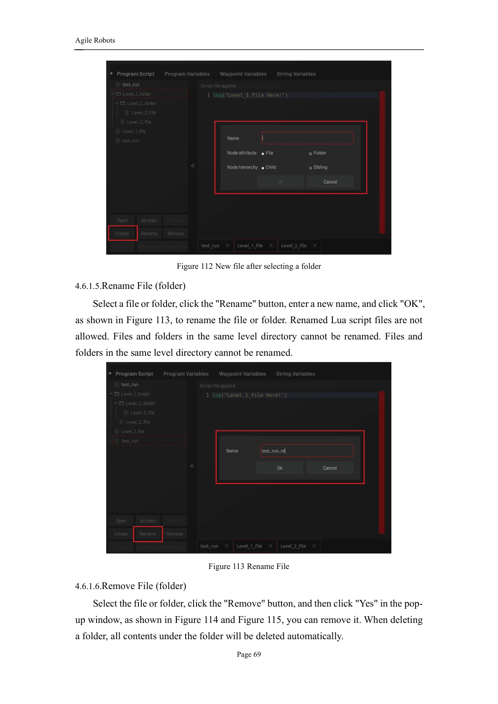



```
Agile Robots 
Page 69 
 
 
Figure 112 New file after selecting a folder 
4.6.1.5.Rename File (folder) 
Select a file or folder, click the "Rename" button, enter a new name, and click "OK", 
as shown in Figure 113, to rename the file or folder. Renamed Lua script files are not 
allowed. Files and folders in the same level directory cannot be renamed. Files and 
folders in the same level directory cannot be renamed. 
 
Figure 113 Rename File 
4.6.1.6.Remove File (folder) 
Select the file or folder, click the "Remove" button, and then click "Yes" in the pop-
up window, as shown in Figure 114 and Figure 115, you can remove it. When deleting 
a folder, all contents under the folder will be deleted automatically.
```



**Original document cross-references:** [PDF 73](pages-073-144.md#pdf-page-73) · [PDF 74](pages-073-144.md#pdf-page-74)

## PDF page 74

**Source:** Industrial Teaching Pendant Software User Manual\_V3.3.0\_EN\_20260204.pdf, original pdf page 74. [Open the corresponding PDF reading-copy page](https://1292444914-files.gitbook.io/~/files/v0/b/gitbook-x-prod.appspot.com/o/spaces%2FtgOfPnscWebs1eh82EKq%2Fuploads%2FoOgZ8jA6FysIEqz6poCv%2Findustrial-teaching-pendant-software-user-manual-v3-3-0-en-20260204-pp-074-081.pdf?alt=media#page=1).



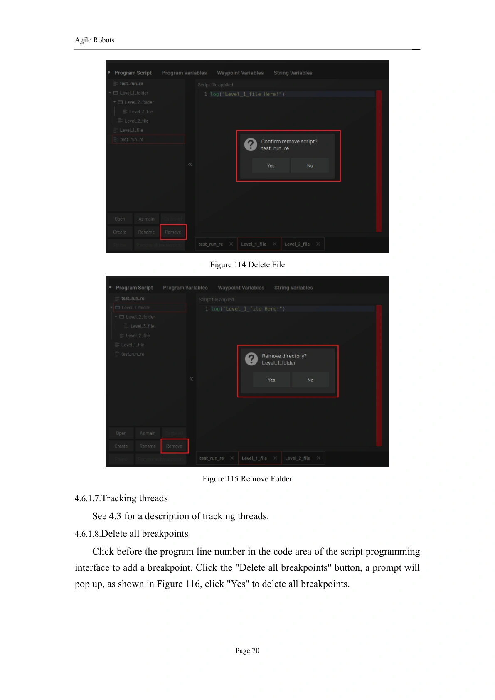



```
Agile Robots 
Page 70 
 
 
Figure 114 Delete File 
 
Figure 115 Remove Folder 
4.6.1.7.Tracking threads 
See 4.3 for a description of tracking threads. 
4.6.1.8.Delete all breakpoints 
Click before the program line number in the code area of the script programming 
interface to add a breakpoint. Click the "Delete all breakpoints" button, a prompt will 
pop up, as shown in Figure 116, click "Yes" to delete all breakpoints.
```



**Original document cross-references:** [PDF 75](pages-073-144.md#pdf-page-75)

## PDF page 75

**Source:** Industrial Teaching Pendant Software User Manual\_V3.3.0\_EN\_20260204.pdf, original pdf page 75. [Open the corresponding PDF reading-copy page](https://1292444914-files.gitbook.io/~/files/v0/b/gitbook-x-prod.appspot.com/o/spaces%2FtgOfPnscWebs1eh82EKq%2Fuploads%2FoOgZ8jA6FysIEqz6poCv%2Findustrial-teaching-pendant-software-user-manual-v3-3-0-en-20260204-pp-074-081.pdf?alt=media#page=2).



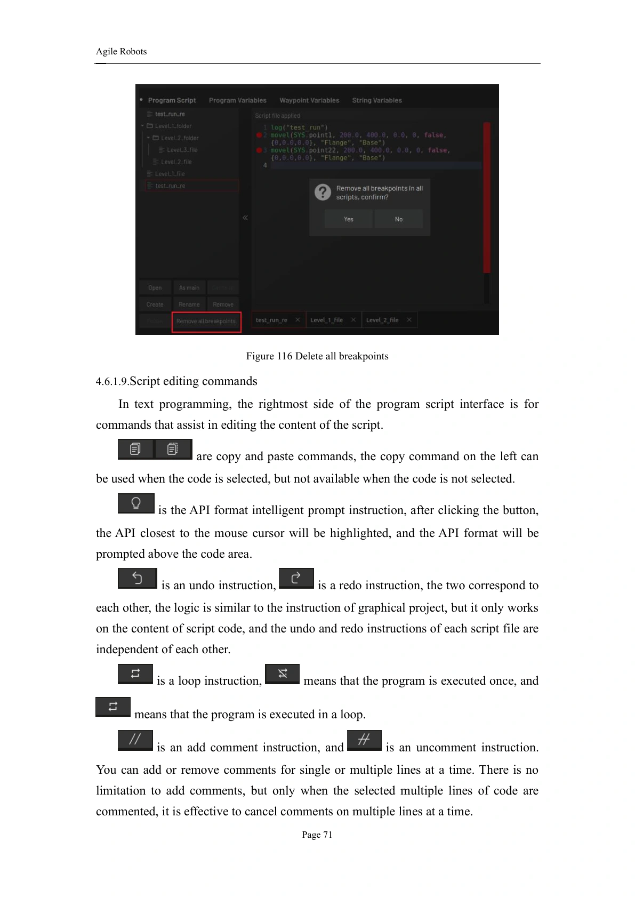



```
Agile Robots 
Page 71 
 
 
Figure 116 Delete all breakpoints 
4.6.1.9.Script editing commands 
In text programming, the rightmost side of the program script interface is for 
commands that assist in editing the content of the script. 
 are copy and paste commands, the copy command on the left can 
be used when the code is selected, but not available when the code is not selected. 
 is the API format intelligent prompt instruction, after clicking the button, 
the API closest to the mouse cursor will be highlighted, and the API format will be 
prompted above the code area. 
 is an undo instruction, 
 is a redo instruction, the two correspond to 
each other, the logic is similar to the instruction of graphical project, but it only works 
on the content of script code, and the undo and redo instructions of each script file are 
independent of each other. 
 is a loop instruction, 
 means that the program is executed once, and 
 means that the program is executed in a loop. 
 is an add comment instruction, and 
 is an uncomment instruction. 
You can add or remove comments for single or multiple lines at a time. There is no 
limitation to add comments, but only when the selected multiple lines of code are 
commented, it is effective to cancel comments on multiple lines at a time.
```



## PDF page 76

**Source:** Industrial Teaching Pendant Software User Manual\_V3.3.0\_EN\_20260204.pdf, original pdf page 76. [Open the corresponding PDF reading-copy page](https://1292444914-files.gitbook.io/~/files/v0/b/gitbook-x-prod.appspot.com/o/spaces%2FtgOfPnscWebs1eh82EKq%2Fuploads%2FoOgZ8jA6FysIEqz6poCv%2Findustrial-teaching-pendant-software-user-manual-v3-3-0-en-20260204-pp-074-081.pdf?alt=media#page=3).



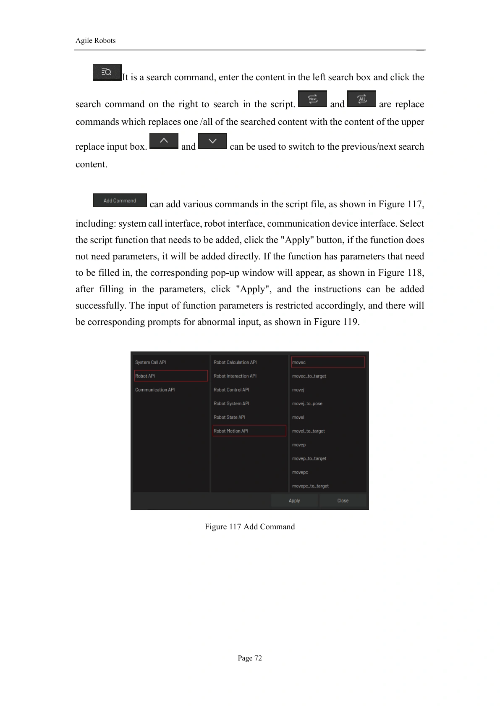



```
Agile Robots 
Page 72 
 
It is a search command, enter the content in the left search box and click the 
search command on the right to search in the script. 
 and 
 are replace 
commands which replaces one /all of the searched content with the content of the upper 
replace input box. 
 and 
 can be used to switch to the previous/next search 
content. 
 
 can add various commands in the script file, as shown in Figure 117, 
including: system call interface, robot interface, communication device interface. Select 
the script function that needs to be added, click the "Apply" button, if the function does 
not need parameters, it will be added directly. If the function has parameters that need 
to be filled in, the corresponding pop-up window will appear, as shown in Figure 118, 
after filling in the parameters, click "Apply", and the instructions can be added 
successfully. The input of function parameters is restricted accordingly, and there will 
be corresponding prompts for abnormal input, as shown in Figure 119. 
 
 
Figure 117 Add Command
```



**Original document cross-references:** [PDF 76](pages-073-144.md#pdf-page-76) · [PDF 77](pages-073-144.md#pdf-page-77)

## PDF page 77

**Source:** Industrial Teaching Pendant Software User Manual\_V3.3.0\_EN\_20260204.pdf, original pdf page 77. [Open the corresponding PDF reading-copy page](https://1292444914-files.gitbook.io/~/files/v0/b/gitbook-x-prod.appspot.com/o/spaces%2FtgOfPnscWebs1eh82EKq%2Fuploads%2FoOgZ8jA6FysIEqz6poCv%2Findustrial-teaching-pendant-software-user-manual-v3-3-0-en-20260204-pp-074-081.pdf?alt=media#page=4).



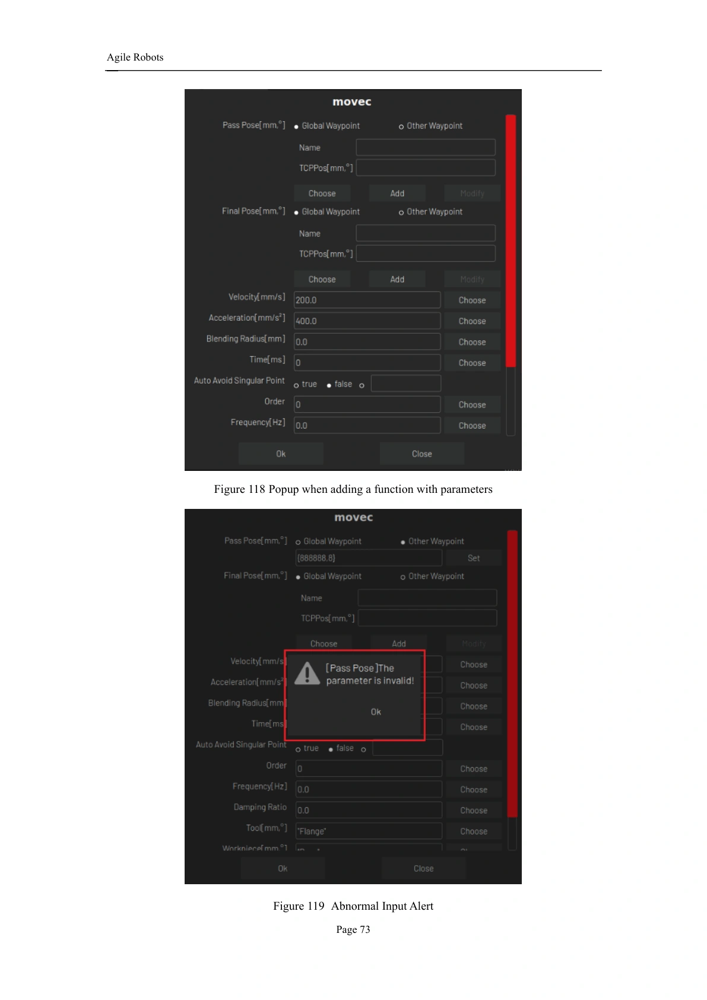



```
Agile Robots 
Page 73 
 
 
Figure 118 Popup when adding a function with parameters 
 
Figure 119  Abnormal Input Alert
```



## PDF page 78

**Source:** Industrial Teaching Pendant Software User Manual\_V3.3.0\_EN\_20260204.pdf, original pdf page 78. [Open the corresponding PDF reading-copy page](https://1292444914-files.gitbook.io/~/files/v0/b/gitbook-x-prod.appspot.com/o/spaces%2FtgOfPnscWebs1eh82EKq%2Fuploads%2FoOgZ8jA6FysIEqz6poCv%2Findustrial-teaching-pendant-software-user-manual-v3-3-0-en-20260204-pp-074-081.pdf?alt=media#page=5).



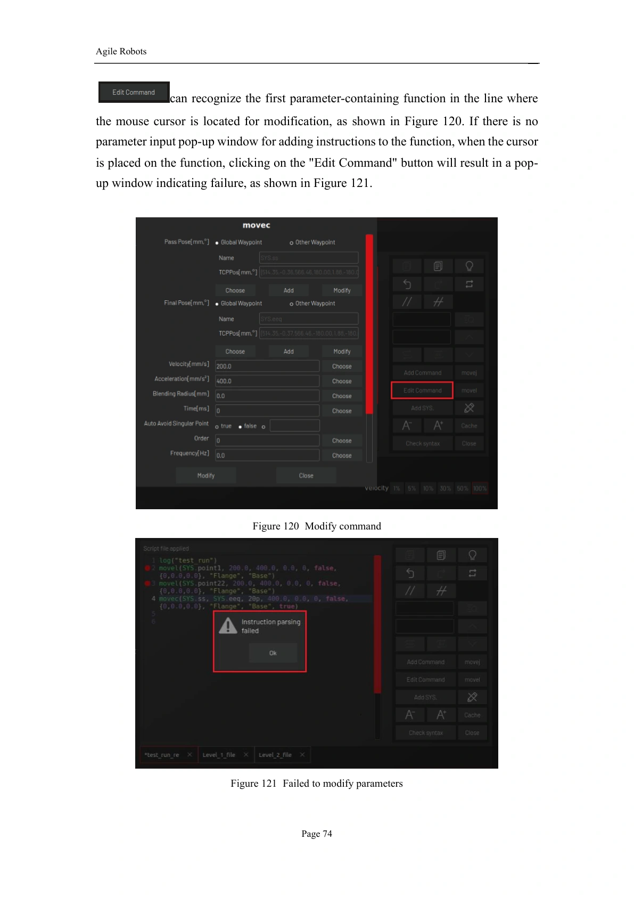



```
Agile Robots 
Page 74 
 
 
can recognize the first parameter-containing function in the line where 
the mouse cursor is located for modification, as shown in Figure 120. If there is no 
parameter input pop-up window for adding instructions to the function, when the cursor 
is placed on the function, clicking on the "Edit Command" button will result in a pop-
up window indicating failure, as shown in Figure 121. 
 
 
Figure 120  Modify command 
 
Figure 121  Failed to modify parameters
```



**Original document cross-references:** [PDF 78](pages-073-144.md#pdf-page-78)

## PDF page 79

**Source:** Industrial Teaching Pendant Software User Manual\_V3.3.0\_EN\_20260204.pdf, original pdf page 79. [Open the corresponding PDF reading-copy page](https://1292444914-files.gitbook.io/~/files/v0/b/gitbook-x-prod.appspot.com/o/spaces%2FtgOfPnscWebs1eh82EKq%2Fuploads%2FoOgZ8jA6FysIEqz6poCv%2Findustrial-teaching-pendant-software-user-manual-v3-3-0-en-20260204-pp-074-081.pdf?alt=media#page=6).



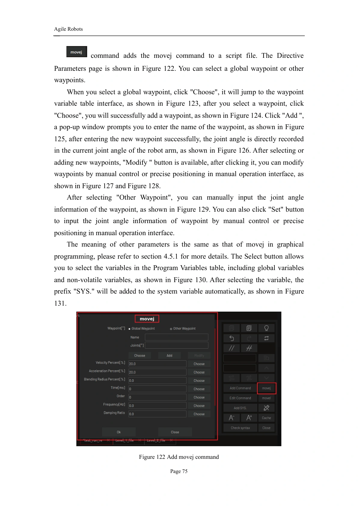



```
Agile Robots 
Page 75 
 
  command adds the movej command to a script file. The Directive 
Parameters page is shown in Figure 122. You can select a global waypoint or other 
waypoints. 
When you select a global waypoint, click "Choose", it will jump to the waypoint 
variable table interface, as shown in Figure 123, after you select a waypoint, click 
"Choose", you will successfully add a waypoint, as shown in Figure 124. Click "Add ", 
a pop-up window prompts you to enter the name of the waypoint, as shown in Figure 
125, after entering the new waypoint successfully, the joint angle is directly recorded 
in the current joint angle of the robot arm, as shown in Figure 126. After selecting or 
adding new waypoints, "Modify " button is available, after clicking it, you can modify 
waypoints by manual control or precise positioning in manual operation interface, as 
shown in Figure 127 and Figure 128. 
After selecting "Other Waypoint", you can manually input the joint angle 
information of the waypoint, as shown in Figure 129. You can also click "Set" button 
to input the joint angle information of waypoint by manual control or precise 
positioning in manual operation interface. 
The meaning of other parameters is the same as that of movej in graphical 
programming, please refer to section 4.5.1 for more details. The Select button allows 
you to select the variables in the Program Variables table, including global variables 
and non-volatile variables, as shown in Figure 130. After selecting the variable, the 
prefix "SYS." will be added to the system variable automatically, as shown in Figure 
131. 
 
Figure 122 Add movej command
```



**Original document cross-references:** [PDF 79](pages-073-144.md#pdf-page-79) · [PDF 80](pages-073-144.md#pdf-page-80) · [PDF 81](pages-073-144.md#pdf-page-81) · [PDF 82](pages-073-144.md#pdf-page-82) · [PDF 83](pages-073-144.md#pdf-page-83) · [PDF 84](pages-073-144.md#pdf-page-84)

## PDF page 80

**Source:** Industrial Teaching Pendant Software User Manual\_V3.3.0\_EN\_20260204.pdf, original pdf page 80. [Open the corresponding PDF reading-copy page](https://1292444914-files.gitbook.io/~/files/v0/b/gitbook-x-prod.appspot.com/o/spaces%2FtgOfPnscWebs1eh82EKq%2Fuploads%2FoOgZ8jA6FysIEqz6poCv%2Findustrial-teaching-pendant-software-user-manual-v3-3-0-en-20260204-pp-074-081.pdf?alt=media#page=7).



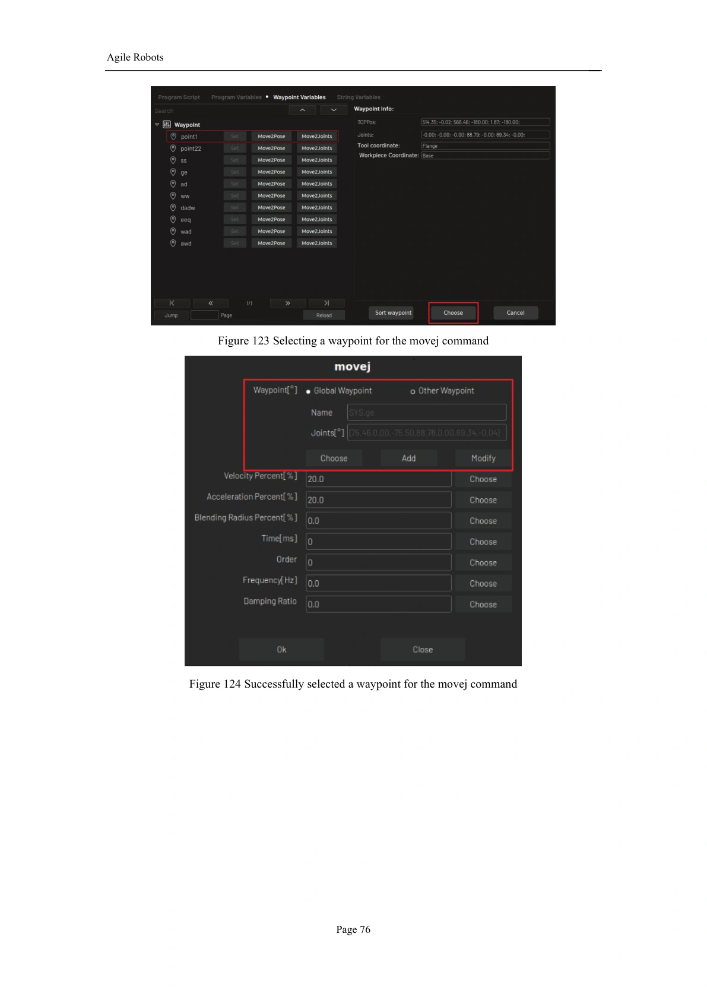



```
Agile Robots 
Page 76 
 
 
Figure 123 Selecting a waypoint for the movej command 
 
Figure 124 Successfully selected a waypoint for the movej command
```



## PDF page 81

**Source:** Industrial Teaching Pendant Software User Manual\_V3.3.0\_EN\_20260204.pdf, original pdf page 81. [Open the corresponding PDF reading-copy page](https://1292444914-files.gitbook.io/~/files/v0/b/gitbook-x-prod.appspot.com/o/spaces%2FtgOfPnscWebs1eh82EKq%2Fuploads%2FoOgZ8jA6FysIEqz6poCv%2Findustrial-teaching-pendant-software-user-manual-v3-3-0-en-20260204-pp-074-081.pdf?alt=media#page=8).



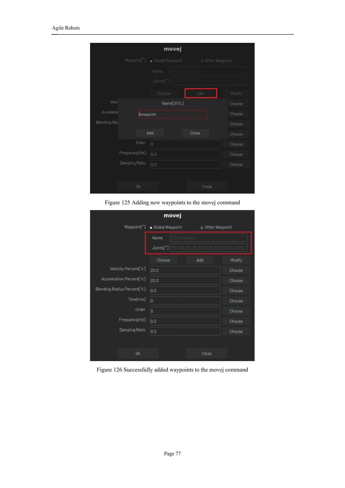



```
Agile Robots 
Page 77 
 
 
Figure 125 Adding new waypoints to the movej command 
 
Figure 126 Successfully added waypoints to the movej command
```



## PDF page 82

**Source:** Industrial Teaching Pendant Software User Manual\_V3.3.0\_EN\_20260204.pdf, original pdf page 82. [Open the corresponding PDF reading-copy page](https://1292444914-files.gitbook.io/~/files/v0/b/gitbook-x-prod.appspot.com/o/spaces%2FtgOfPnscWebs1eh82EKq%2Fuploads%2FbH7YXuXp0AJt8EYKU9Vc%2Findustrial-teaching-pendant-software-user-manual-v3-3-0-en-20260204-pp-082-088.pdf?alt=media#page=1).



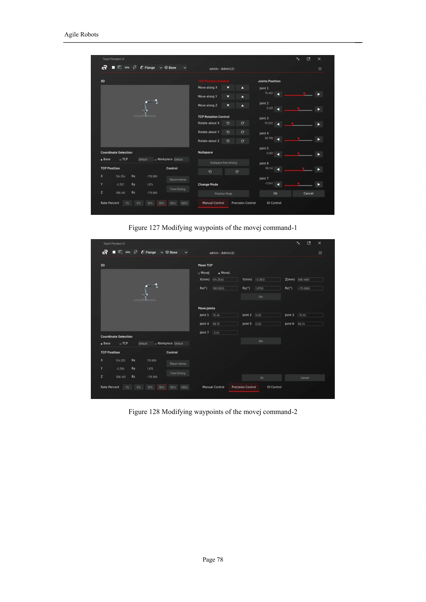



```
Agile Robots 
Page 78 
 
 
Figure 127 Modifying waypoints of the movej command-1 
 
Figure 128 Modifying waypoints of the movej command-2
```



## PDF page 83

**Source:** Industrial Teaching Pendant Software User Manual\_V3.3.0\_EN\_20260204.pdf, original pdf page 83. [Open the corresponding PDF reading-copy page](https://1292444914-files.gitbook.io/~/files/v0/b/gitbook-x-prod.appspot.com/o/spaces%2FtgOfPnscWebs1eh82EKq%2Fuploads%2FbH7YXuXp0AJt8EYKU9Vc%2Findustrial-teaching-pendant-software-user-manual-v3-3-0-en-20260204-pp-082-088.pdf?alt=media#page=2).



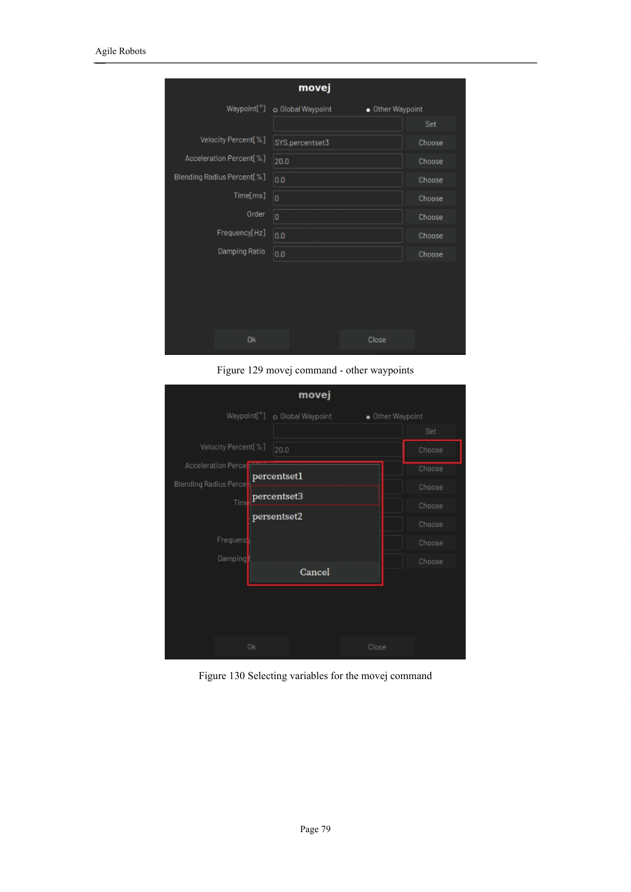



```
Agile Robots 
Page 79 
 
 
Figure 129 movej command - other waypoints 
 
Figure 130 Selecting variables for the movej command
```



## PDF page 84

**Source:** Industrial Teaching Pendant Software User Manual\_V3.3.0\_EN\_20260204.pdf, original pdf page 84. [Open the corresponding PDF reading-copy page](https://1292444914-files.gitbook.io/~/files/v0/b/gitbook-x-prod.appspot.com/o/spaces%2FtgOfPnscWebs1eh82EKq%2Fuploads%2FbH7YXuXp0AJt8EYKU9Vc%2Findustrial-teaching-pendant-software-user-manual-v3-3-0-en-20260204-pp-082-088.pdf?alt=media#page=3).



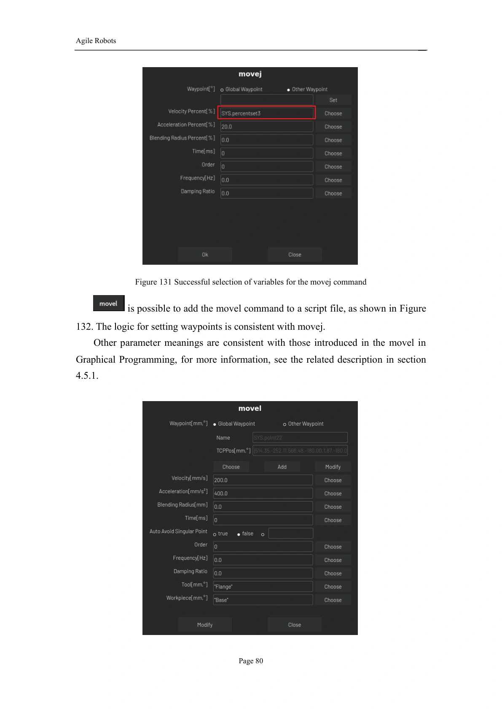



```
Agile Robots 
Page 80 
 
 
Figure 131 Successful selection of variables for the movej command 
 is possible to add the movel command to a script file, as shown in Figure 
132. The logic for setting waypoints is consistent with movej. 
Other parameter meanings are consistent with those introduced in the movel in 
Graphical Programming, for more information, see the related description in section 
4.5.1.
```



**Original document cross-references:** [PDF 85](pages-073-144.md#pdf-page-85)

## PDF page 85

**Source:** Industrial Teaching Pendant Software User Manual\_V3.3.0\_EN\_20260204.pdf, original pdf page 85. [Open the corresponding PDF reading-copy page](https://1292444914-files.gitbook.io/~/files/v0/b/gitbook-x-prod.appspot.com/o/spaces%2FtgOfPnscWebs1eh82EKq%2Fuploads%2FbH7YXuXp0AJt8EYKU9Vc%2Findustrial-teaching-pendant-software-user-manual-v3-3-0-en-20260204-pp-082-088.pdf?alt=media#page=4).



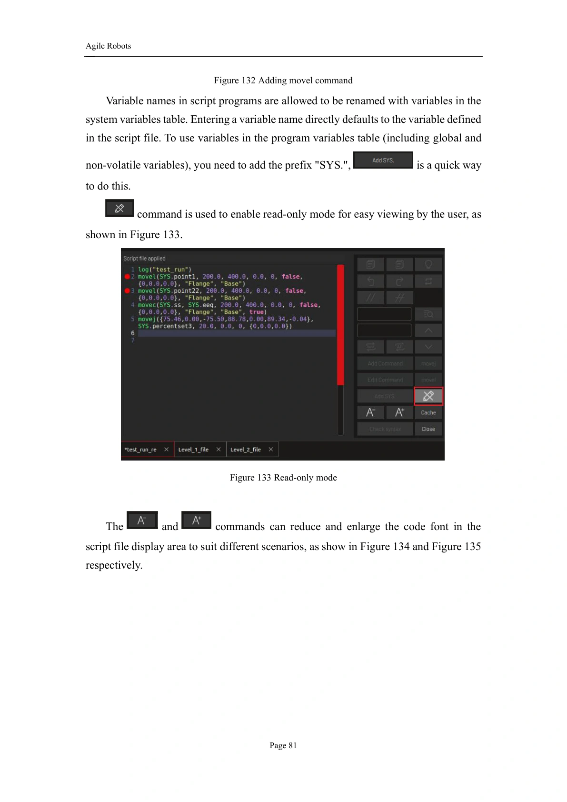



```
Agile Robots 
Page 81 
 
Figure 132 Adding movel command 
Variable names in script programs are allowed to be renamed with variables in the 
system variables table. Entering a variable name directly defaults to the variable defined 
in the script file. To use variables in the program variables table (including global and 
non-volatile variables), you need to add the prefix "SYS.", 
 is a quick way 
to do this. 
 command is used to enable read-only mode for easy viewing by the user, as 
shown in Figure 133. 
 
Figure 133 Read-only mode 
 
The 
 and 
 commands can reduce and enlarge the code font in the 
script file display area to suit different scenarios, as show in Figure 134 and Figure 135 
respectively.
```



**Original document cross-references:** [PDF 85](pages-073-144.md#pdf-page-85) · [PDF 86](pages-073-144.md#pdf-page-86)

## PDF page 86

**Source:** Industrial Teaching Pendant Software User Manual\_V3.3.0\_EN\_20260204.pdf, original pdf page 86. [Open the corresponding PDF reading-copy page](https://1292444914-files.gitbook.io/~/files/v0/b/gitbook-x-prod.appspot.com/o/spaces%2FtgOfPnscWebs1eh82EKq%2Fuploads%2FbH7YXuXp0AJt8EYKU9Vc%2Findustrial-teaching-pendant-software-user-manual-v3-3-0-en-20260204-pp-082-088.pdf?alt=media#page=5).



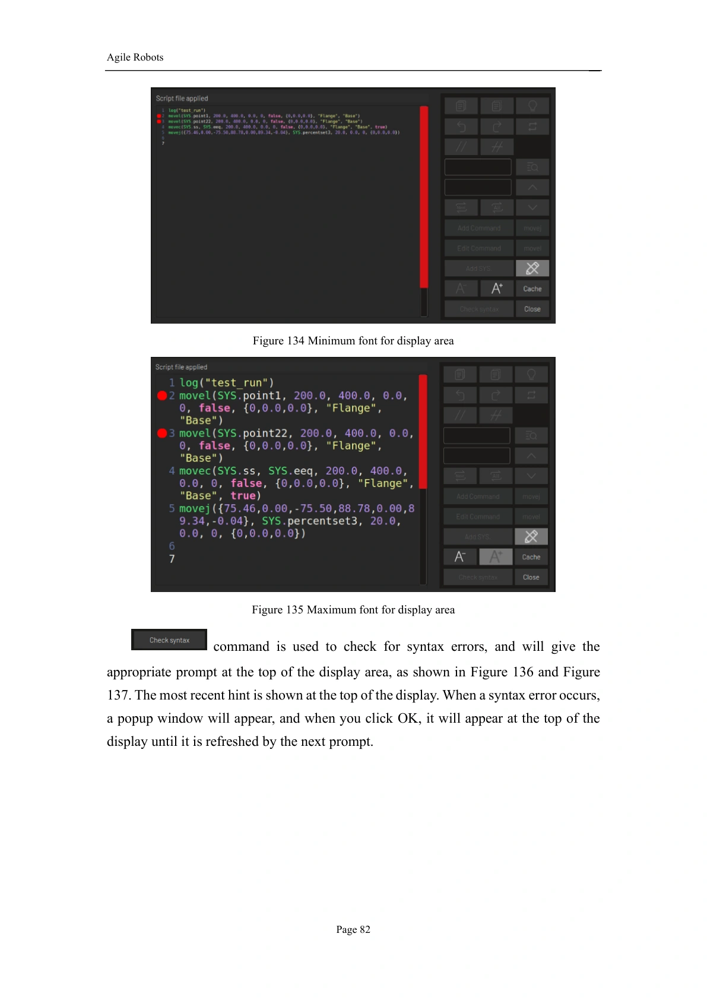



```
Agile Robots 
Page 82 
 
 
Figure 134 Minimum font for display area 
 
Figure 135 Maximum font for display area 
  command is used to check for syntax errors, and will give the 
appropriate prompt at the top of the display area, as shown in Figure 136 and Figure 
137. The most recent hint is shown at the top of the display. When a syntax error occurs, 
a popup window will appear, and when you click OK, it will appear at the top of the 
display until it is refreshed by the next prompt.
```



**Original document cross-references:** [PDF 87](pages-073-144.md#pdf-page-87)

## PDF page 87

**Source:** Industrial Teaching Pendant Software User Manual\_V3.3.0\_EN\_20260204.pdf, original pdf page 87. [Open the corresponding PDF reading-copy page](https://1292444914-files.gitbook.io/~/files/v0/b/gitbook-x-prod.appspot.com/o/spaces%2FtgOfPnscWebs1eh82EKq%2Fuploads%2FbH7YXuXp0AJt8EYKU9Vc%2Findustrial-teaching-pendant-software-user-manual-v3-3-0-en-20260204-pp-082-088.pdf?alt=media#page=6).



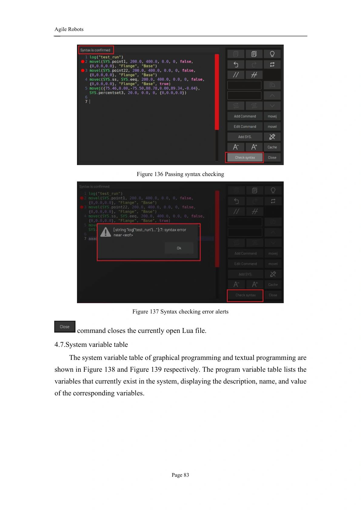



```
Agile Robots 
Page 83 
 
 
Figure 136 Passing syntax checking 
 
Figure 137 Syntax checking error alerts 
 command closes the currently open Lua file. 
4.7.System variable table  
The system variable table of graphical programming and textual programming are 
shown in Figure 138 and Figure 139 respectively. The program variable table lists the 
variables that currently exist in the system, displaying the description, name, and value 
of the corresponding variables.
```



**Original document cross-references:** [PDF 88](pages-073-144.md#pdf-page-88)

## PDF page 88

**Source:** Industrial Teaching Pendant Software User Manual\_V3.3.0\_EN\_20260204.pdf, original pdf page 88. [Open the corresponding PDF reading-copy page](https://1292444914-files.gitbook.io/~/files/v0/b/gitbook-x-prod.appspot.com/o/spaces%2FtgOfPnscWebs1eh82EKq%2Fuploads%2FbH7YXuXp0AJt8EYKU9Vc%2Findustrial-teaching-pendant-software-user-manual-v3-3-0-en-20260204-pp-082-088.pdf?alt=media#page=7).



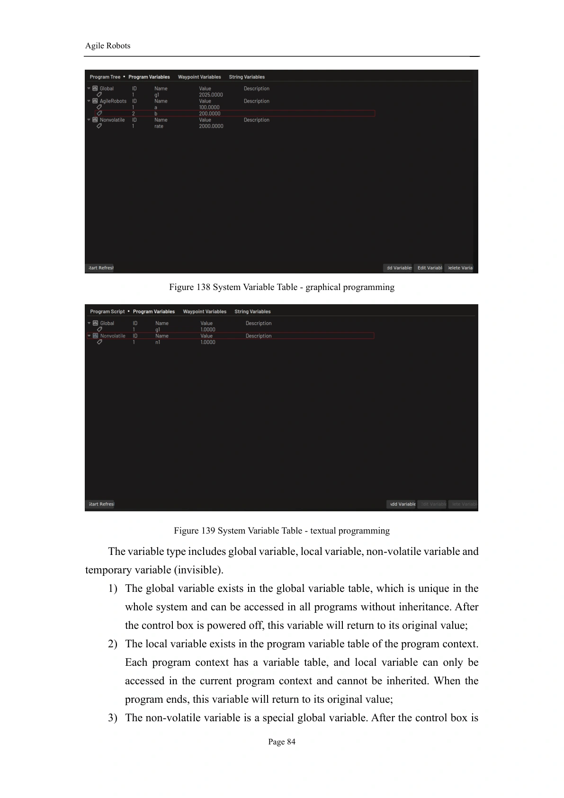



```
Agile Robots 
Page 84 
 
 
Figure 138 System Variable Table - graphical programming 
 
Figure 139 System Variable Table - textual programming 
The variable type includes global variable, local variable, non-volatile variable and 
temporary variable (invisible).  
1)  The global variable exists in the global variable table, which is unique in the 
whole system and can be accessed in all programs without inheritance. After 
the control box is powered off, this variable will return to its original value;  
2)  The local variable exists in the program variable table of the program context. 
Each program context has a variable table, and local variable can only be 
accessed in the current program context and cannot be inherited. When the 
program ends, this variable will return to its original value;  
3)  The non-volatile variable is a special global variable. After the control box is
```



## PDF page 89

**Source:** Industrial Teaching Pendant Software User Manual\_V3.3.0\_EN\_20260204.pdf, original pdf page 89. [Open the corresponding PDF reading-copy page](https://1292444914-files.gitbook.io/~/files/v0/b/gitbook-x-prod.appspot.com/o/spaces%2FtgOfPnscWebs1eh82EKq%2Fuploads%2Fp9D2ZNSKmJvEjEXxacgT%2Findustrial-teaching-pendant-software-user-manual-v3-3-0-en-20260204-pp-089-094.pdf?alt=media#page=1).



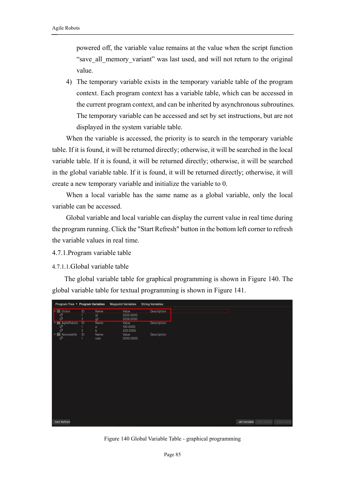



```
Agile Robots 
Page 85 
 
powered off, the variable value remains at the value when the script function 
“save_all_memory_variant” was last used, and will not return to the original 
value.  
4)  The temporary variable exists in the temporary variable table of the program 
context. Each program context has a variable table, which can be accessed in 
the current program context, and can be inherited by asynchronous subroutines. 
The temporary variable can be accessed and set by set instructions, but are not 
displayed in the system variable table.  
When the variable is accessed, the priority is to search in the temporary variable 
table. If it is found, it will be returned directly; otherwise, it will be searched in the local 
variable table. If it is found, it will be returned directly; otherwise, it will be searched 
in the global variable table. If it is found, it will be returned directly; otherwise, it will 
create a new temporary variable and initialize the variable to 0.  
When a local variable has the same name as a global variable, only the local 
variable can be accessed.  
Global variable and local variable can display the current value in real time during 
the program running. Click the "Start Refresh" button in the bottom left corner to refresh 
the variable values in real time.  
4.7.1.Program variable table  
4.7.1.1.Global variable table  
The global variable table for graphical programming is shown in Figure 140. The 
global variable table for textual programming is shown in Figure 141. 
 
Figure 140 Global Variable Table - graphical programming
```



**Original document cross-references:** [PDF 89](pages-073-144.md#pdf-page-89) · [PDF 90](pages-073-144.md#pdf-page-90)

## PDF page 90

**Source:** Industrial Teaching Pendant Software User Manual\_V3.3.0\_EN\_20260204.pdf, original pdf page 90. [Open the corresponding PDF reading-copy page](https://1292444914-files.gitbook.io/~/files/v0/b/gitbook-x-prod.appspot.com/o/spaces%2FtgOfPnscWebs1eh82EKq%2Fuploads%2Fp9D2ZNSKmJvEjEXxacgT%2Findustrial-teaching-pendant-software-user-manual-v3-3-0-en-20260204-pp-089-094.pdf?alt=media#page=2).



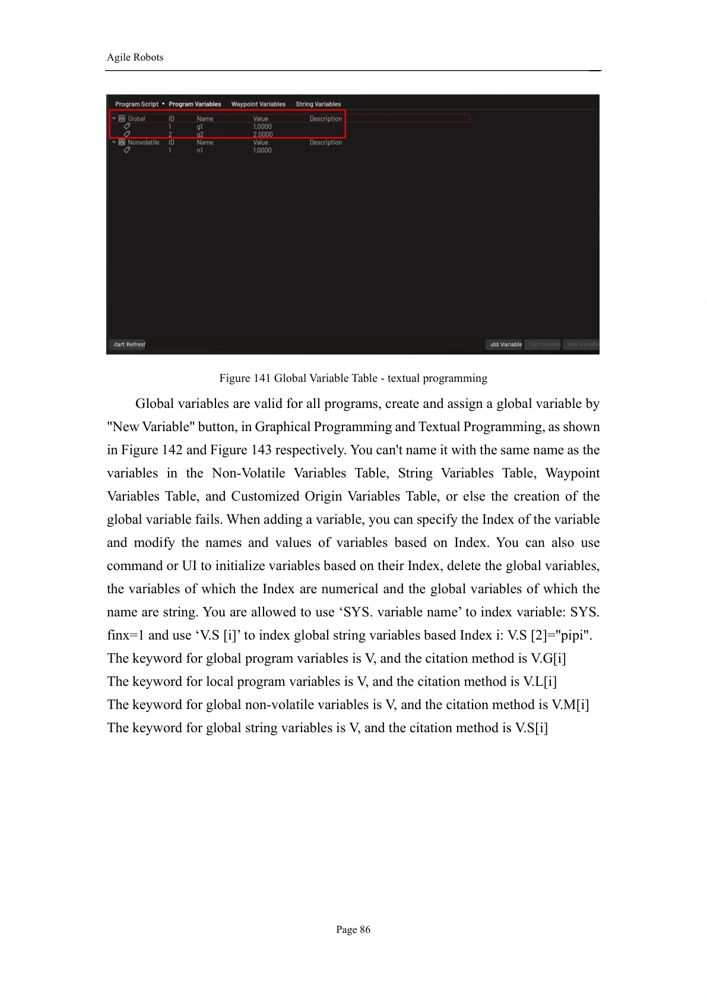



```
Agile Robots 
Page 86 
 
 
Figure 141 Global Variable Table - textual programming 
Global variables are valid for all programs, create and assign a global variable by 
"New Variable" button, in Graphical Programming and Textual Programming, as shown 
in Figure 142 and Figure 143 respectively. You can't name it with the same name as the 
variables in the Non-Volatile Variables Table, String Variables Table, Waypoint 
Variables Table, and Customized Origin Variables Table, or else the creation of the 
global variable fails. When adding a variable, you can specify the Index of the variable 
and modify the names and values of variables based on Index. You can also use 
command or UI to initialize variables based on their Index, delete the global variables, 
the variables of which the Index are numerical and the global variables of which the 
name are string. You are allowed to use ‘SYS. variable name’ to index variable: SYS. 
finx=1 and use ‘V.S [i]’ to index global string variables based Index i: V.S [2]="pipi". 
The keyword for global program variables is V, and the citation method is V.G[i] 
The keyword for local program variables is V, and the citation method is V.L[i] 
The keyword for global non-volatile variables is V, and the citation method is V.M[i] 
The keyword for global string variables is V, and the citation method is V.S[i]
```



**Original document cross-references:** [PDF 91](pages-073-144.md#pdf-page-91)

## PDF page 91

**Source:** Industrial Teaching Pendant Software User Manual\_V3.3.0\_EN\_20260204.pdf, original pdf page 91. [Open the corresponding PDF reading-copy page](https://1292444914-files.gitbook.io/~/files/v0/b/gitbook-x-prod.appspot.com/o/spaces%2FtgOfPnscWebs1eh82EKq%2Fuploads%2Fp9D2ZNSKmJvEjEXxacgT%2Findustrial-teaching-pendant-software-user-manual-v3-3-0-en-20260204-pp-089-094.pdf?alt=media#page=3).



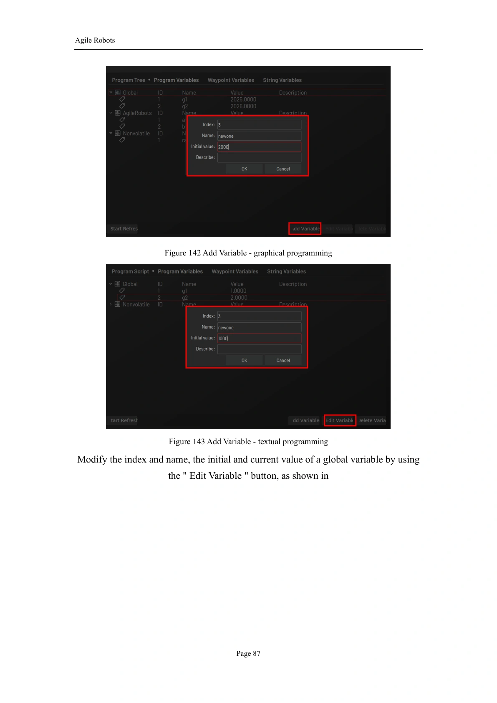



```
Agile Robots 
Page 87 
 
 
Figure 142 Add Variable - graphical programming 
 
Figure 143 Add Variable - textual programming 
Modify the index and name, the initial and current value of a global variable by using 
the " Edit Variable " button, as shown in
```



## PDF page 92

**Source:** Industrial Teaching Pendant Software User Manual\_V3.3.0\_EN\_20260204.pdf, original pdf page 92. [Open the corresponding PDF reading-copy page](https://1292444914-files.gitbook.io/~/files/v0/b/gitbook-x-prod.appspot.com/o/spaces%2FtgOfPnscWebs1eh82EKq%2Fuploads%2Fp9D2ZNSKmJvEjEXxacgT%2Findustrial-teaching-pendant-software-user-manual-v3-3-0-en-20260204-pp-089-094.pdf?alt=media#page=4).



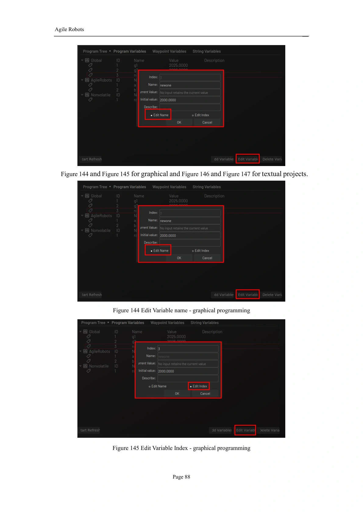



```
Agile Robots 
Page 88 
 
 
Figure 144 and Figure 145 for graphical and Figure 146 and Figure 147 for textual projects. 
 
Figure 144 Edit Variable name - graphical programming 
 
Figure 145 Edit Variable Index - graphical programming
```



**Original document cross-references:** [PDF 92](pages-073-144.md#pdf-page-92) · [PDF 93](pages-073-144.md#pdf-page-93)

## PDF page 93

**Source:** Industrial Teaching Pendant Software User Manual\_V3.3.0\_EN\_20260204.pdf, original pdf page 93. [Open the corresponding PDF reading-copy page](https://1292444914-files.gitbook.io/~/files/v0/b/gitbook-x-prod.appspot.com/o/spaces%2FtgOfPnscWebs1eh82EKq%2Fuploads%2Fp9D2ZNSKmJvEjEXxacgT%2Findustrial-teaching-pendant-software-user-manual-v3-3-0-en-20260204-pp-089-094.pdf?alt=media#page=5).



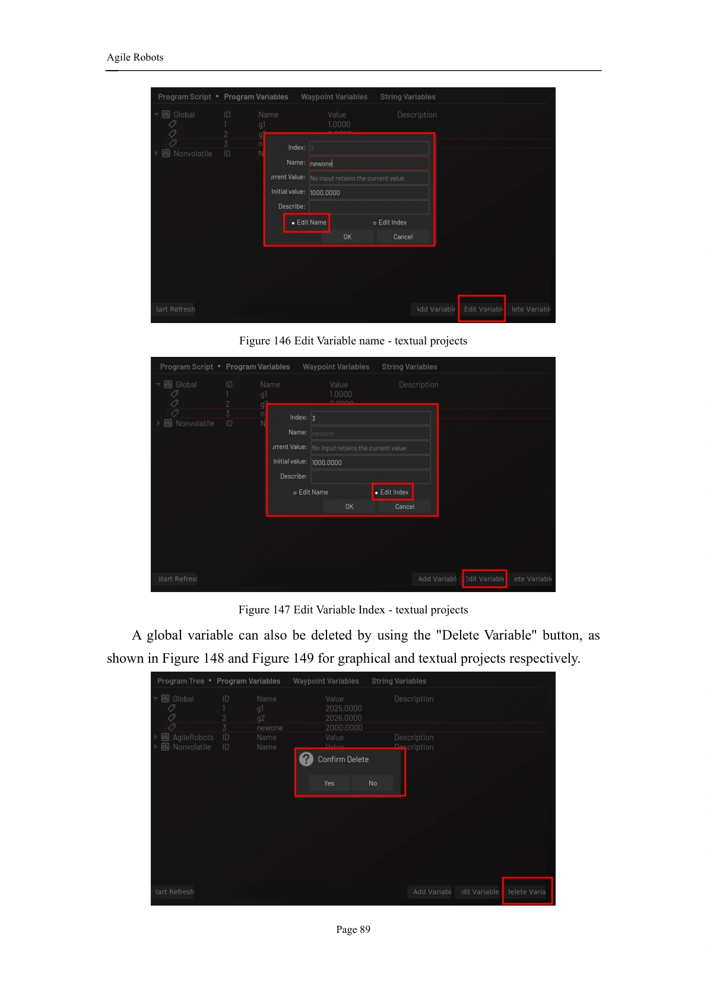



```
Agile Robots 
Page 89 
 
 
Figure 146 Edit Variable name - textual projects 
 
Figure 147 Edit Variable Index - textual projects 
A global variable can also be deleted by using the "Delete Variable" button, as 
shown in Figure 148 and Figure 149 for graphical and textual projects respectively.
```



**Original document cross-references:** [PDF 94](pages-073-144.md#pdf-page-94)

## PDF page 94

**Source:** Industrial Teaching Pendant Software User Manual\_V3.3.0\_EN\_20260204.pdf, original pdf page 94. [Open the corresponding PDF reading-copy page](https://1292444914-files.gitbook.io/~/files/v0/b/gitbook-x-prod.appspot.com/o/spaces%2FtgOfPnscWebs1eh82EKq%2Fuploads%2Fp9D2ZNSKmJvEjEXxacgT%2Findustrial-teaching-pendant-software-user-manual-v3-3-0-en-20260204-pp-089-094.pdf?alt=media#page=6).



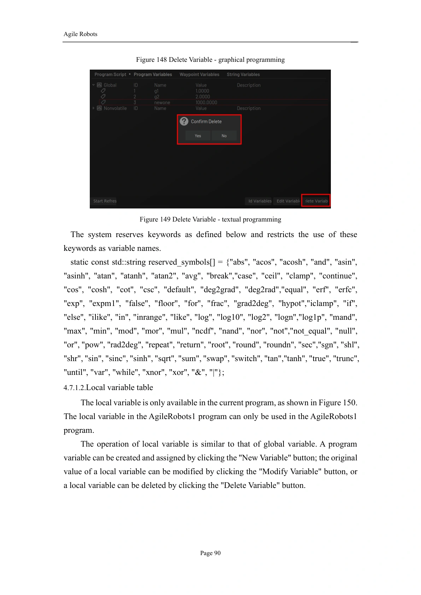



```
Agile Robots 
Page 90 
 
Figure 148 Delete Variable - graphical programming 
 
Figure 149 Delete Variable - textual programming 
The system reserves keywords as defined below and restricts the use of these 
keywords as variable names. 
static const std::string reserved_symbols[] = {"abs", "acos", "acosh", "and", "asin", 
"asinh", "atan", "atanh", "atan2", "avg", "break","case", "ceil", "clamp", "continue", 
"cos", "cosh", "cot", "csc", "default", "deg2grad", "deg2rad","equal", "erf", "erfc", 
"exp", "expm1", "false", "floor", "for", "frac", "grad2deg", "hypot","iclamp", "if", 
"else", "ilike", "in", "inrange", "like", "log", "log10", "log2", "logn","log1p", "mand", 
"max", "min", "mod", "mor", "mul", "ncdf", "nand", "nor", "not","not_equal", "null", 
"or", "pow", "rad2deg", "repeat", "return", "root", "round", "roundn", "sec","sgn", "shl", 
"shr", "sin", "sinc", "sinh", "sqrt", "sum", "swap", "switch", "tan","tanh", "true", "trunc", 
"until", "var", "while", "xnor", "xor", "&", "|"}; 
4.7.1.2.Local variable table  
The local variable is only available in the current program, as shown in Figure 150. 
The local variable in the AgileRobots1 program can only be used in the AgileRobots1 
program.  
The operation of local variable is similar to that of global variable. A program 
variable can be created and assigned by clicking the "New Variable" button; the original 
value of a local variable can be modified by clicking the "Modify Variable" button, or 
a local variable can be deleted by clicking the "Delete Variable" button.
```



**Original document cross-references:** [PDF 95](pages-073-144.md#pdf-page-95)

## PDF page 95

**Source:** Industrial Teaching Pendant Software User Manual\_V3.3.0\_EN\_20260204.pdf, original pdf page 95. [Open the corresponding PDF reading-copy page](https://1292444914-files.gitbook.io/~/files/v0/b/gitbook-x-prod.appspot.com/o/spaces%2FtgOfPnscWebs1eh82EKq%2Fuploads%2F6FYczKK8YSp1cyF7ytyf%2Findustrial-teaching-pendant-software-user-manual-v3-3-0-en-20260204-pp-095-101.pdf?alt=media#page=1).



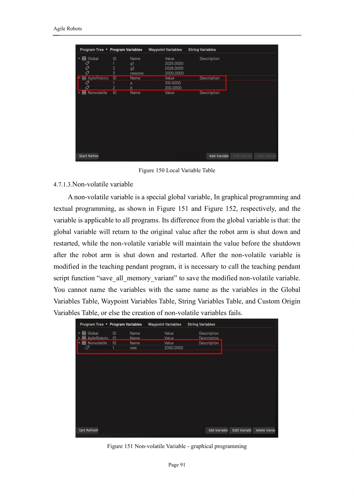



```
Agile Robots 
Page 91 
 
 
Figure 150 Local Variable Table 
4.7.1.3.Non-volatile variable  
A non-volatile variable is a special global variable, In graphical programming and 
textual programming, as shown in Figure 151 and Figure 152, respectively, and the 
variable is applicable to all programs. Its difference from the global variable is that: the 
global variable will return to the original value after the robot arm is shut down and 
restarted, while the non-volatile variable will maintain the value before the shutdown 
after the robot arm is shut down and restarted. After the non-volatile variable is 
modified in the teaching pendant program, it is necessary to call the teaching pendant 
script function “save_all_memory_variant” to save the modified non-volatile variable. 
You cannot name the variables with the same name as the variables in the Global 
Variables Table, Waypoint Variables Table, String Variables Table, and Custom Origin 
Variables Table, or else the creation of non-volatile variables fails.  
 
Figure 151 Non-volatile Variable - graphical programming
```



**Original document cross-references:** [PDF 95](pages-073-144.md#pdf-page-95) · [PDF 96](pages-073-144.md#pdf-page-96)

## PDF page 96

**Source:** Industrial Teaching Pendant Software User Manual\_V3.3.0\_EN\_20260204.pdf, original pdf page 96. [Open the corresponding PDF reading-copy page](https://1292444914-files.gitbook.io/~/files/v0/b/gitbook-x-prod.appspot.com/o/spaces%2FtgOfPnscWebs1eh82EKq%2Fuploads%2F6FYczKK8YSp1cyF7ytyf%2Findustrial-teaching-pendant-software-user-manual-v3-3-0-en-20260204-pp-095-101.pdf?alt=media#page=2).



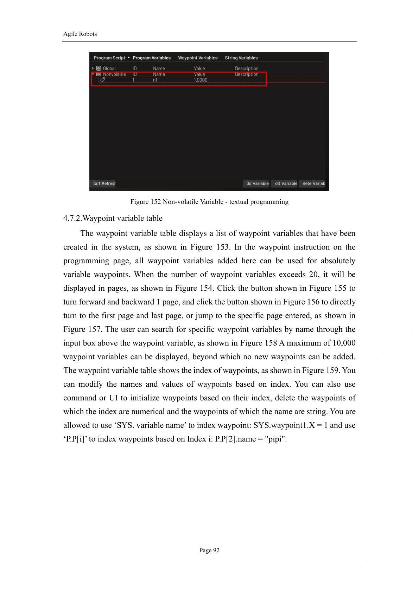



```
Agile Robots 
Page 92 
 
 
Figure 152 Non-volatile Variable - textual programming 
4.7.2.Waypoint variable table  
The waypoint variable table displays a list of waypoint variables that have been 
created in the system, as shown in Figure 153. In the waypoint instruction on the 
programming page, all waypoint variables added here can be used for absolutely 
variable waypoints. When the number of waypoint variables exceeds 20, it will be 
displayed in pages, as shown in Figure 154. Click the button shown in Figure 155 to 
turn forward and backward 1 page, and click the button shown in Figure 156 to directly 
turn to the first page and last page, or jump to the specific page entered, as shown in 
Figure 157. The user can search for specific waypoint variables by name through the 
input box above the waypoint variable, as shown in Figure 158 A maximum of 10,000 
waypoint variables can be displayed, beyond which no new waypoints can be added. 
The waypoint variable table shows the index of waypoints, as shown in Figure 159. You 
can modify the names and values of waypoints based on index. You can also use 
command or UI to initialize waypoints based on their index, delete the waypoints of 
which the index are numerical and the waypoints of which the name are string. You are 
allowed to use ‘SYS. variable name’ to index waypoint: SYS.waypoint1.X = 1 and use 
‘P.P[i]’ to index waypoints based on Index i: P.P[2].name = "pipi".
```



**Original document cross-references:** [PDF 97](pages-073-144.md#pdf-page-97) · [PDF 98](pages-073-144.md#pdf-page-98) · [PDF 99](pages-073-144.md#pdf-page-99) · [PDF 101](pages-073-144.md#pdf-page-101)

## PDF page 97

**Source:** Industrial Teaching Pendant Software User Manual\_V3.3.0\_EN\_20260204.pdf, original pdf page 97. [Open the corresponding PDF reading-copy page](https://1292444914-files.gitbook.io/~/files/v0/b/gitbook-x-prod.appspot.com/o/spaces%2FtgOfPnscWebs1eh82EKq%2Fuploads%2F6FYczKK8YSp1cyF7ytyf%2Findustrial-teaching-pendant-software-user-manual-v3-3-0-en-20260204-pp-095-101.pdf?alt=media#page=3).



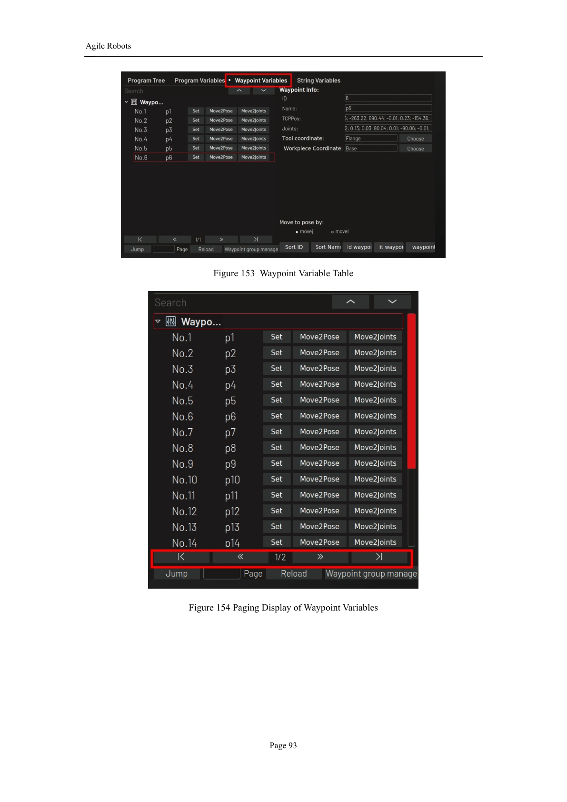



```
Agile Robots 
Page 93 
 
 
Figure 153  Waypoint Variable Table 
 
Figure 154 Paging Display of Waypoint Variables
```



## PDF page 98

**Source:** Industrial Teaching Pendant Software User Manual\_V3.3.0\_EN\_20260204.pdf, original pdf page 98. [Open the corresponding PDF reading-copy page](https://1292444914-files.gitbook.io/~/files/v0/b/gitbook-x-prod.appspot.com/o/spaces%2FtgOfPnscWebs1eh82EKq%2Fuploads%2F6FYczKK8YSp1cyF7ytyf%2Findustrial-teaching-pendant-software-user-manual-v3-3-0-en-20260204-pp-095-101.pdf?alt=media#page=4).



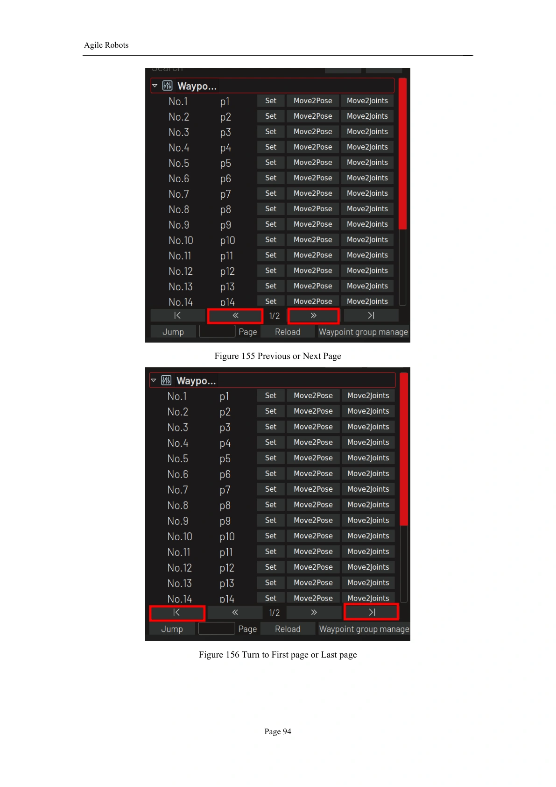



```
Agile Robots 
Page 94 
 
 
Figure 155 Previous or Next Page 
 
Figure 156 Turn to First page or Last page
```



## PDF page 99

**Source:** Industrial Teaching Pendant Software User Manual\_V3.3.0\_EN\_20260204.pdf, original pdf page 99. [Open the corresponding PDF reading-copy page](https://1292444914-files.gitbook.io/~/files/v0/b/gitbook-x-prod.appspot.com/o/spaces%2FtgOfPnscWebs1eh82EKq%2Fuploads%2F6FYczKK8YSp1cyF7ytyf%2Findustrial-teaching-pendant-software-user-manual-v3-3-0-en-20260204-pp-095-101.pdf?alt=media#page=5).



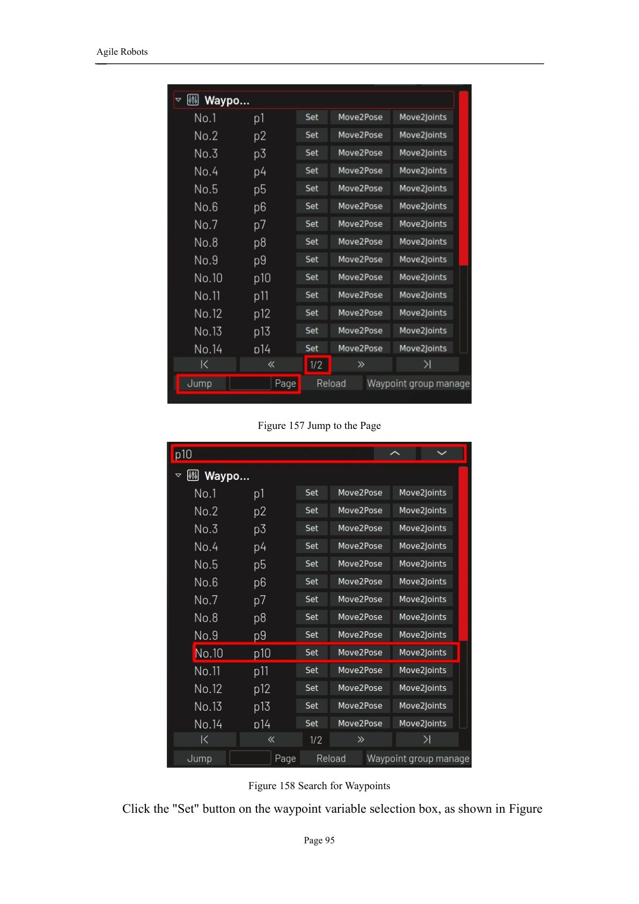



```
Agile Robots 
Page 95 
 
 
Figure 157 Jump to the Page 
 
Figure 158 Search for Waypoints 
Click the "Set" button on the waypoint variable selection box, as shown in Figure
```



**Original document cross-references:** [PDF 101](pages-073-144.md#pdf-page-101)

## PDF page 100

**Source:** Industrial Teaching Pendant Software User Manual\_V3.3.0\_EN\_20260204.pdf, original pdf page 100. [Open the corresponding PDF reading-copy page](https://1292444914-files.gitbook.io/~/files/v0/b/gitbook-x-prod.appspot.com/o/spaces%2FtgOfPnscWebs1eh82EKq%2Fuploads%2F6FYczKK8YSp1cyF7ytyf%2Findustrial-teaching-pendant-software-user-manual-v3-3-0-en-20260204-pp-095-101.pdf?alt=media#page=6).







```
Agile Robots 
Page 96 
 
159, to set the position of the waypoint. Setting the waypoint can be set by the 
demonstration teaching, as shown in Figure 160, or by the precise positioning, as shown 
in Figure 161. 
If you click "Move2pose" on the waypoint variable selection box, as shown in 
Figure 162, the robot arm will move the TCP to the recorded posture in Cartesian space 
with reference to the currently set coordinate system. "Move2pose" includes two 
methods: movej and movel, as shown in Figure 163 and Figure 164. If you click on 
"Move2joints", as shown in Figure 165, the robot arm will move the robot arm in joint 
space to the recorded joint angle position. 
When a waypoint's referenced workpiece/tool coordinate systems differ from the 
global coordinate systems, the global coordinate system automatically switches to the 
waypoint's referenced coordinate systems during "Move2pose" or "Set". The teach 
pendant bottom notification bar will display that "Current global artifact tool the 
coordinate system is inconsistent with the reference workpiece tool coordinate system 
of the waypoint, and the global workpiece tool coordinate system has been switched to 
the reference workpiece tool coordinate system for the waypoint", as shown in Figure 
166.  
If modifying the workpiece coordinate system in the waypoint info, the system 
will recalculate joint angles through inverse kinematics and updates joint values. If joint 
angles calculation fails, the system will throw errors. The teach pendant bottom 
notification bar will displays that " Inverse kinematics failed and coordinate system 
remains unchanged", as shown in Figure 167.
```



**Original document cross-references:** [PDF 101](pages-073-144.md#pdf-page-101) · [PDF 102](pages-073-144.md#pdf-page-102) · [PDF 103](pages-073-144.md#pdf-page-103) · [PDF 104](pages-073-144.md#pdf-page-104) · [PDF 105](pages-073-144.md#pdf-page-105)

## PDF page 101

**Source:** Industrial Teaching Pendant Software User Manual\_V3.3.0\_EN\_20260204.pdf, original pdf page 101. [Open the corresponding PDF reading-copy page](https://1292444914-files.gitbook.io/~/files/v0/b/gitbook-x-prod.appspot.com/o/spaces%2FtgOfPnscWebs1eh82EKq%2Fuploads%2F6FYczKK8YSp1cyF7ytyf%2Findustrial-teaching-pendant-software-user-manual-v3-3-0-en-20260204-pp-095-101.pdf?alt=media#page=7).



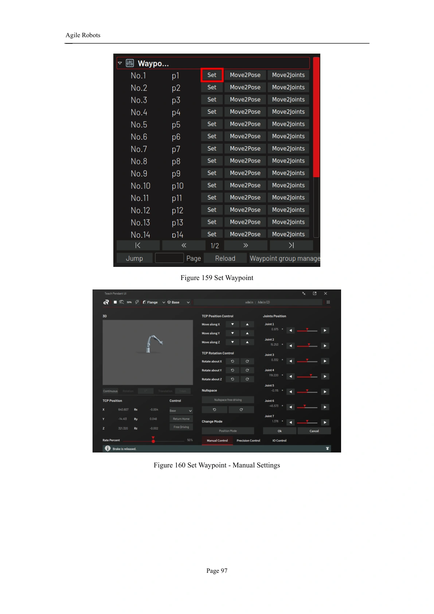



```
Agile Robots 
Page 97 
 
 
Figure 159 Set Waypoint 
 
Figure 160 Set Waypoint - Manual Settings
```



## PDF page 102

**Source:** Industrial Teaching Pendant Software User Manual\_V3.3.0\_EN\_20260204.pdf, original pdf page 102. [Open the corresponding PDF reading-copy page](https://1292444914-files.gitbook.io/~/files/v0/b/gitbook-x-prod.appspot.com/o/spaces%2FtgOfPnscWebs1eh82EKq%2Fuploads%2FmluSJxyaFNjUEtOixdPi%2Findustrial-teaching-pendant-software-user-manual-v3-3-0-en-20260204-pp-102-103.pdf?alt=media#page=1).



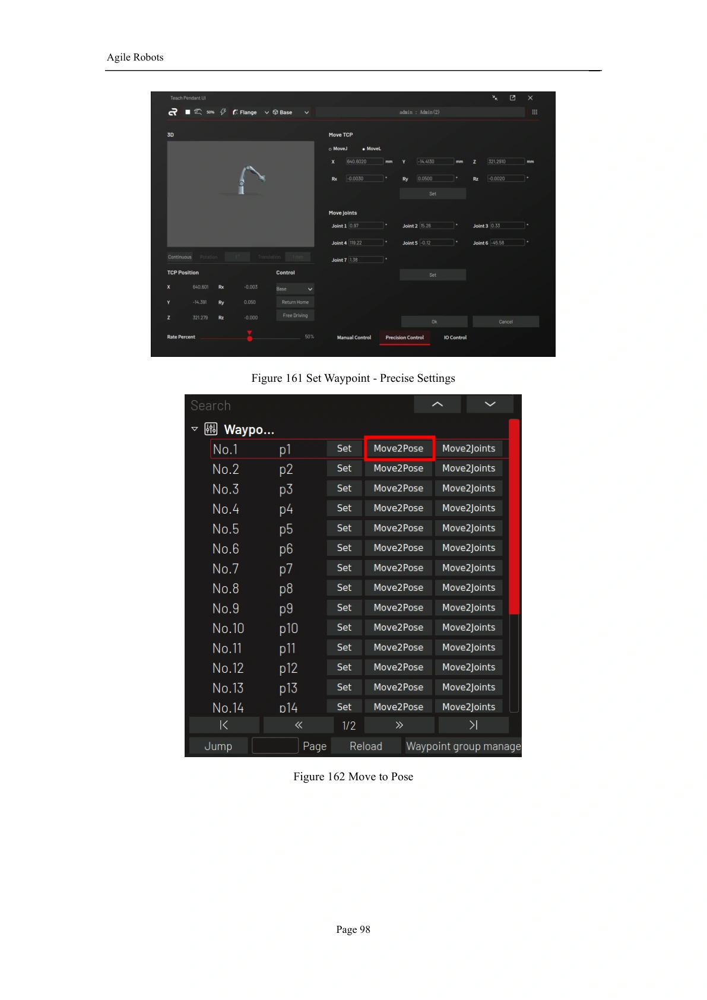



```
Agile Robots 
Page 98 
 
 
Figure 161 Set Waypoint - Precise Settings 
 
Figure 162 Move to Pose
```



## PDF page 103

**Source:** Industrial Teaching Pendant Software User Manual\_V3.3.0\_EN\_20260204.pdf, original pdf page 103. [Open the corresponding PDF reading-copy page](https://1292444914-files.gitbook.io/~/files/v0/b/gitbook-x-prod.appspot.com/o/spaces%2FtgOfPnscWebs1eh82EKq%2Fuploads%2FmluSJxyaFNjUEtOixdPi%2Findustrial-teaching-pendant-software-user-manual-v3-3-0-en-20260204-pp-102-103.pdf?alt=media#page=2).



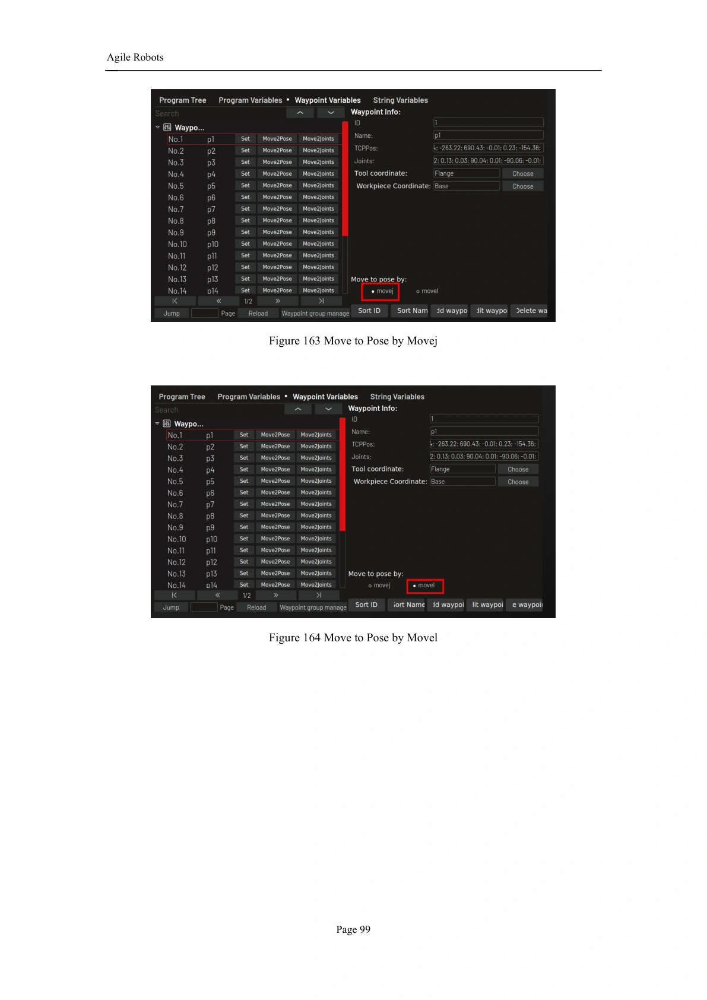



```
Agile Robots 
Page 99 
 
 
Figure 163 Move to Pose by Movej 
 
 
Figure 164 Move to Pose by Movel
```



## PDF page 104

**Source:** Industrial Teaching Pendant Software User Manual\_V3.3.0\_EN\_20260204.pdf, original pdf page 104. [Open the corresponding PDF reading-copy page](https://1292444914-files.gitbook.io/~/files/v0/b/gitbook-x-prod.appspot.com/o/spaces%2FtgOfPnscWebs1eh82EKq%2Fuploads%2F3imJ3BJf1wDlM58IyIQF%2Findustrial-teaching-pendant-software-user-manual-v3-3-0-en-20260204-pp-104-105.pdf?alt=media#page=1).



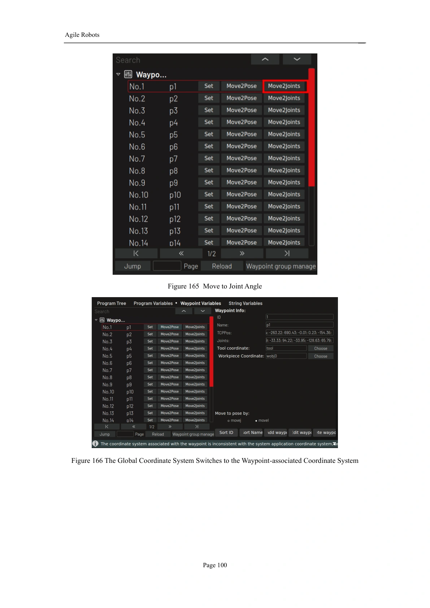



```
Agile Robots 
Page 100 
 
  
Figure 165  Move to Joint Angle 
 
Figure 166 The Global Coordinate System Switches to the Waypoint-associated Coordinate System
```



## PDF page 105

**Source:** Industrial Teaching Pendant Software User Manual\_V3.3.0\_EN\_20260204.pdf, original pdf page 105. [Open the corresponding PDF reading-copy page](https://1292444914-files.gitbook.io/~/files/v0/b/gitbook-x-prod.appspot.com/o/spaces%2FtgOfPnscWebs1eh82EKq%2Fuploads%2F3imJ3BJf1wDlM58IyIQF%2Findustrial-teaching-pendant-software-user-manual-v3-3-0-en-20260204-pp-104-105.pdf?alt=media#page=2).



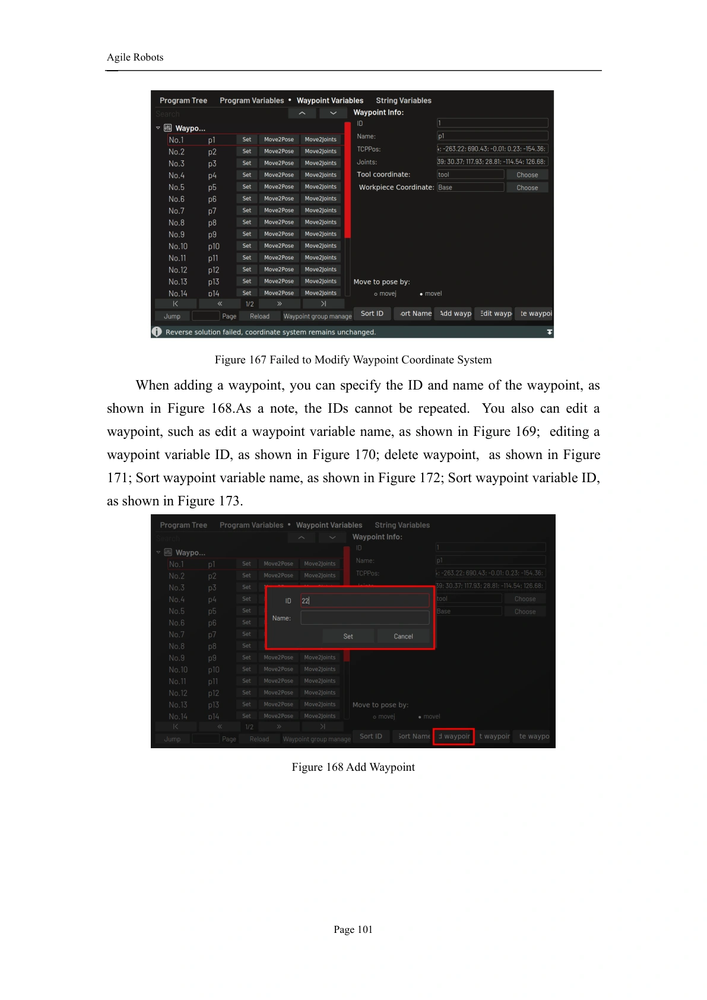



```
Agile Robots 
Page 101 
 
 
Figure 167 Failed to Modify Waypoint Coordinate System 
When adding a waypoint, you can specify the ID and name of the waypoint, as 
shown in Figure 168.As a note, the IDs cannot be repeated.  You also can edit a 
waypoint, such as edit a waypoint variable name, as shown in Figure 169;  editing a 
waypoint variable ID, as shown in Figure 170; delete waypoint,  as shown in Figure 
171; Sort waypoint variable name, as shown in Figure 172; Sort waypoint variable ID, 
as shown in Figure 173. 
 
Figure 168 Add Waypoint
```



**Original document cross-references:** [PDF 105](pages-073-144.md#pdf-page-105) · [PDF 106](pages-073-144.md#pdf-page-106) · [PDF 107](pages-073-144.md#pdf-page-107)

## PDF page 106

**Source:** Industrial Teaching Pendant Software User Manual\_V3.3.0\_EN\_20260204.pdf, original pdf page 106. [Open the corresponding PDF reading-copy page](https://1292444914-files.gitbook.io/~/files/v0/b/gitbook-x-prod.appspot.com/o/spaces%2FtgOfPnscWebs1eh82EKq%2Fuploads%2FFIoHdiJuRPsGPi20ntk2%2Findustrial-teaching-pendant-software-user-manual-v3-3-0-en-20260204-pp-106-107.pdf?alt=media#page=1).



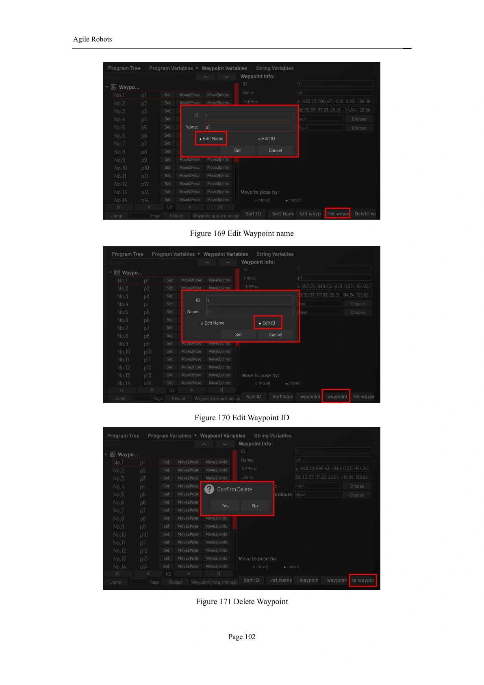



```
Agile Robots 
Page 102 
 
 
Figure 169 Edit Waypoint name 
 
Figure 170 Edit Waypoint ID 
 
Figure 171 Delete Waypoint
```



## PDF page 107

**Source:** Industrial Teaching Pendant Software User Manual\_V3.3.0\_EN\_20260204.pdf, original pdf page 107. [Open the corresponding PDF reading-copy page](https://1292444914-files.gitbook.io/~/files/v0/b/gitbook-x-prod.appspot.com/o/spaces%2FtgOfPnscWebs1eh82EKq%2Fuploads%2FFIoHdiJuRPsGPi20ntk2%2Findustrial-teaching-pendant-software-user-manual-v3-3-0-en-20260204-pp-106-107.pdf?alt=media#page=2).



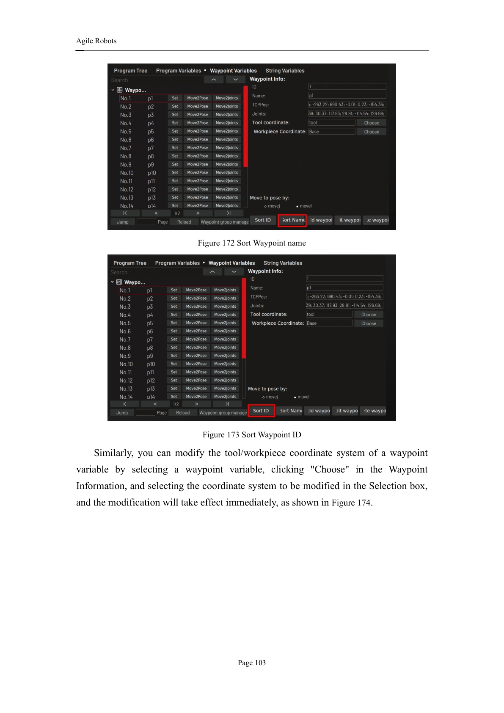



```
Agile Robots 
Page 103 
 
 
Figure 172 Sort Waypoint name 
 
Figure 173 Sort Waypoint ID 
Similarly, you can modify the tool/workpiece coordinate system of a waypoint 
variable by selecting a waypoint variable, clicking "Choose" in the Waypoint 
Information, and selecting the coordinate system to be modified in the Selection box, 
and the modification will take effect immediately, as shown in Figure 174.
```



**Original document cross-references:** [PDF 108](pages-073-144.md#pdf-page-108)

## PDF page 108

**Source:** Industrial Teaching Pendant Software User Manual\_V3.3.0\_EN\_20260204.pdf, original pdf page 108. [Open the corresponding PDF reading-copy page](https://1292444914-files.gitbook.io/~/files/v0/b/gitbook-x-prod.appspot.com/o/spaces%2FtgOfPnscWebs1eh82EKq%2Fuploads%2F7XoUKoaEVsiYVM61MoqP%2Findustrial-teaching-pendant-software-user-manual-v3-3-0-en-20260204-pp-108-112.pdf?alt=media#page=1).



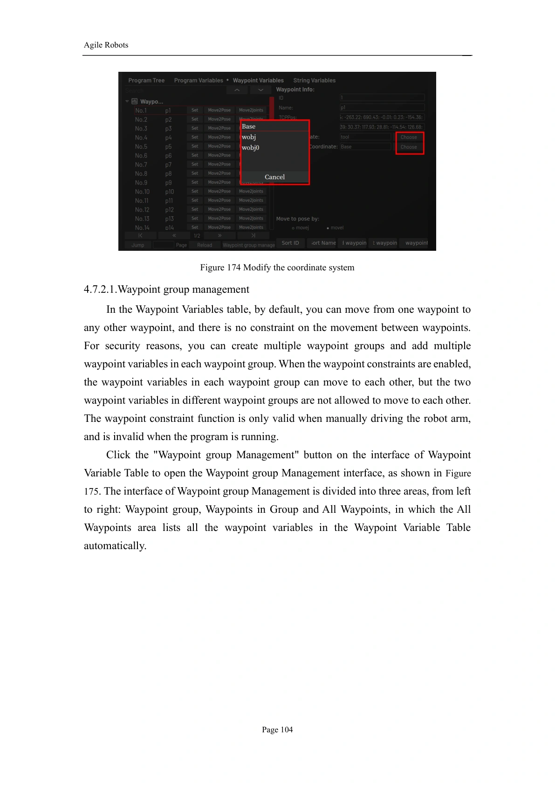



```
Agile Robots 
Page 104 
 
 
Figure 174 Modify the coordinate system 
4.7.2.1.Waypoint group management 
In the Waypoint Variables table, by default, you can move from one waypoint to 
any other waypoint, and there is no constraint on the movement between waypoints. 
For security reasons, you can create multiple waypoint groups and add multiple 
waypoint variables in each waypoint group. When the waypoint constraints are enabled, 
the waypoint variables in each waypoint group can move to each other, but the two 
waypoint variables in different waypoint groups are not allowed to move to each other. 
The waypoint constraint function is only valid when manually driving the robot arm, 
and is invalid when the program is running.  
Click the "Waypoint group Management" button on the interface of Waypoint 
Variable Table to open the Waypoint group Management interface, as shown in Figure 
175. The interface of Waypoint group Management is divided into three areas, from left 
to right: Waypoint group, Waypoints in Group and All Waypoints, in which the All 
Waypoints area lists all the waypoint variables in the Waypoint Variable Table 
automatically.
```



**Original document cross-references:** [PDF 109](pages-073-144.md#pdf-page-109)

## PDF page 109

**Source:** Industrial Teaching Pendant Software User Manual\_V3.3.0\_EN\_20260204.pdf, original pdf page 109. [Open the corresponding PDF reading-copy page](https://1292444914-files.gitbook.io/~/files/v0/b/gitbook-x-prod.appspot.com/o/spaces%2FtgOfPnscWebs1eh82EKq%2Fuploads%2F7XoUKoaEVsiYVM61MoqP%2Findustrial-teaching-pendant-software-user-manual-v3-3-0-en-20260204-pp-108-112.pdf?alt=media#page=2).



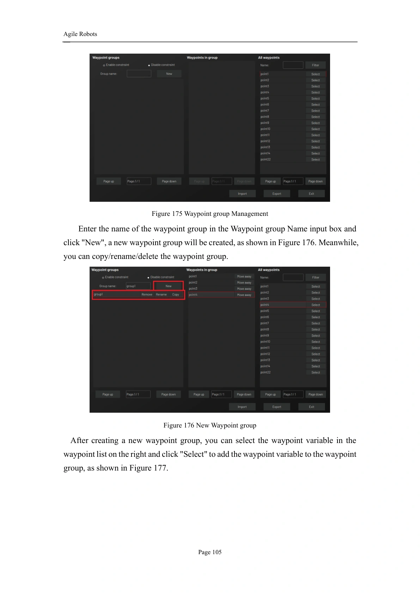



```
Agile Robots 
Page 105 
 
 
Figure 175 Waypoint group Management 
Enter the name of the waypoint group in the Waypoint group Name input box and 
click "New", a new waypoint group will be created, as shown in Figure 176. Meanwhile, 
you can copy/rename/delete the waypoint group. 
 
Figure 176 New Waypoint group 
After creating a new waypoint group, you can select the waypoint variable in the 
waypoint list on the right and click "Select" to add the waypoint variable to the waypoint 
group, as shown in Figure 177.
```



**Original document cross-references:** [PDF 109](pages-073-144.md#pdf-page-109) · [PDF 110](pages-073-144.md#pdf-page-110)

## PDF page 110

**Source:** Industrial Teaching Pendant Software User Manual\_V3.3.0\_EN\_20260204.pdf, original pdf page 110. [Open the corresponding PDF reading-copy page](https://1292444914-files.gitbook.io/~/files/v0/b/gitbook-x-prod.appspot.com/o/spaces%2FtgOfPnscWebs1eh82EKq%2Fuploads%2F7XoUKoaEVsiYVM61MoqP%2Findustrial-teaching-pendant-software-user-manual-v3-3-0-en-20260204-pp-108-112.pdf?alt=media#page=3).



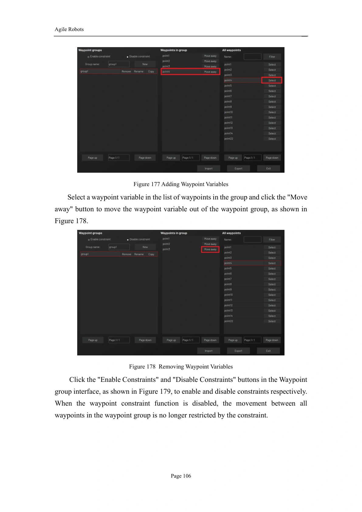



```
Agile Robots 
Page 106 
 
 
Figure 177 Adding Waypoint Variables 
Select a waypoint variable in the list of waypoints in the group and click the "Move 
away" button to move the waypoint variable out of the waypoint group, as shown in 
Figure 178. 
 
Figure 178  Removing Waypoint Variables 
Click the "Enable Constraints" and "Disable Constraints" buttons in the Waypoint 
group interface, as shown in Figure 179, to enable and disable constraints respectively. 
When the waypoint constraint function is disabled, the movement between all 
waypoints in the waypoint group is no longer restricted by the constraint.
```



**Original document cross-references:** [PDF 110](pages-073-144.md#pdf-page-110) · [PDF 111](pages-073-144.md#pdf-page-111)

## PDF page 111

**Source:** Industrial Teaching Pendant Software User Manual\_V3.3.0\_EN\_20260204.pdf, original pdf page 111. [Open the corresponding PDF reading-copy page](https://1292444914-files.gitbook.io/~/files/v0/b/gitbook-x-prod.appspot.com/o/spaces%2FtgOfPnscWebs1eh82EKq%2Fuploads%2F7XoUKoaEVsiYVM61MoqP%2Findustrial-teaching-pendant-software-user-manual-v3-3-0-en-20260204-pp-108-112.pdf?alt=media#page=4).



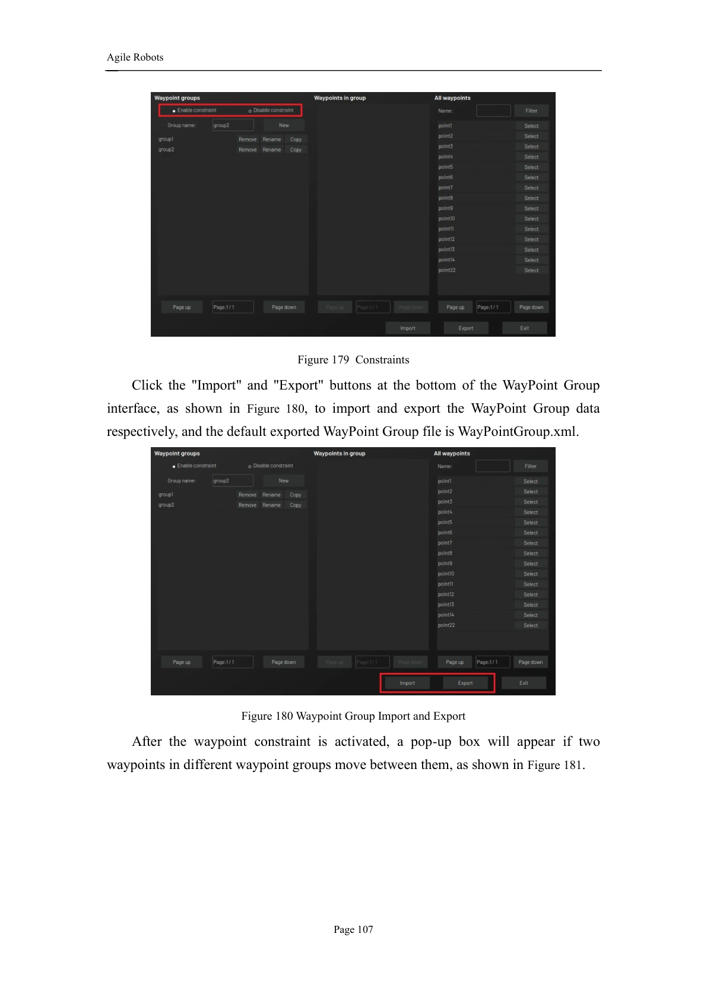



```
Agile Robots 
Page 107 
 
 
Figure 179  Constraints 
Click the "Import" and "Export" buttons at the bottom of the WayPoint Group 
interface, as shown in Figure 180, to import and export the WayPoint Group data 
respectively, and the default exported WayPoint Group file is WayPointGroup.xml. 
 
Figure 180 Waypoint Group Import and Export 
After the waypoint constraint is activated, a pop-up box will appear if two 
waypoints in different waypoint groups move between them, as shown in Figure 181.
```



**Original document cross-references:** [PDF 111](pages-073-144.md#pdf-page-111) · [PDF 112](pages-073-144.md#pdf-page-112)

## PDF page 112

**Source:** Industrial Teaching Pendant Software User Manual\_V3.3.0\_EN\_20260204.pdf, original pdf page 112. [Open the corresponding PDF reading-copy page](https://1292444914-files.gitbook.io/~/files/v0/b/gitbook-x-prod.appspot.com/o/spaces%2FtgOfPnscWebs1eh82EKq%2Fuploads%2F7XoUKoaEVsiYVM61MoqP%2Findustrial-teaching-pendant-software-user-manual-v3-3-0-en-20260204-pp-108-112.pdf?alt=media#page=5).



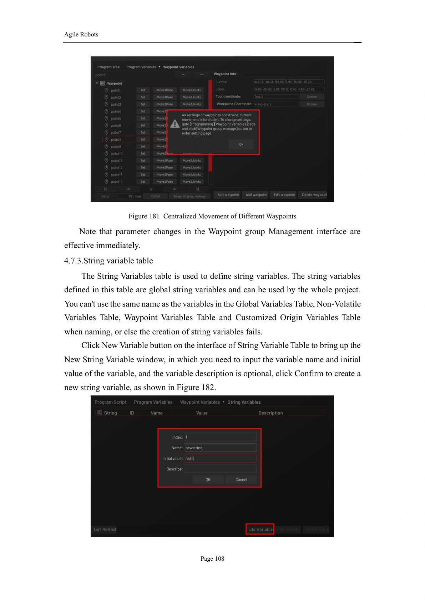



```
Agile Robots 
Page 108 
 
 
Figure 181  Centralized Movement of Different Waypoints 
Note that parameter changes in the Waypoint group Management interface are 
effective immediately. 
4.7.3.String variable table 
The String Variables table is used to define string variables. The string variables 
defined in this table are global string variables and can be used by the whole project. 
You can't use the same name as the variables in the Global Variables Table, Non-Volatile 
Variables Table, Waypoint Variables Table and Customized Origin Variables Table 
when naming, or else the creation of string variables fails. 
Click New Variable button on the interface of String Variable Table to bring up the 
New String Variable window, in which you need to input the variable name and initial 
value of the variable, and the variable description is optional, click Confirm to create a 
new string variable, as shown in Figure 182.
```



**Original document cross-references:** [PDF 113](pages-073-144.md#pdf-page-113)

## PDF page 113

**Source:** Industrial Teaching Pendant Software User Manual\_V3.3.0\_EN\_20260204.pdf, original pdf page 113. [Open the corresponding PDF reading-copy page](https://1292444914-files.gitbook.io/~/files/v0/b/gitbook-x-prod.appspot.com/o/spaces%2FtgOfPnscWebs1eh82EKq%2Fuploads%2FjY16hu4fopurvy8UYlBp%2Findustrial-teaching-pendant-software-user-manual-v3-3-0-en-20260204-pp-113-118.pdf?alt=media#page=1).



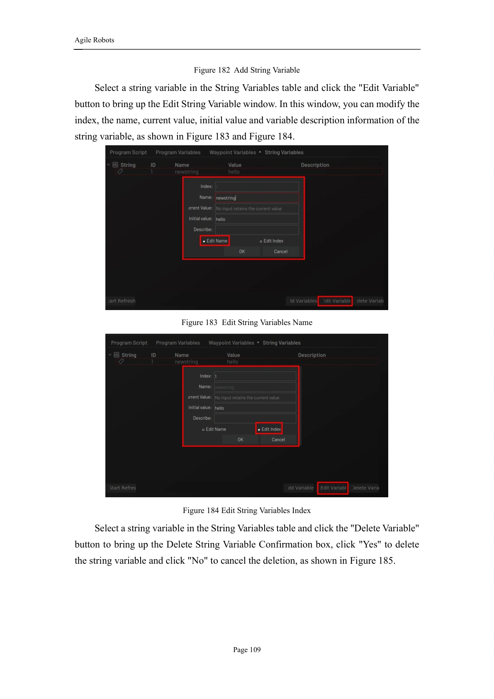



```
Agile Robots 
Page 109 
 
Figure 182  Add String Variable 
Select a string variable in the String Variables table and click the "Edit Variable" 
button to bring up the Edit String Variable window. In this window, you can modify the 
index, the name, current value, initial value and variable description information of the 
string variable, as shown in Figure 183 and Figure 184. 
 
Figure 183  Edit String Variables Name 
 
Figure 184 Edit String Variables Index 
Select a string variable in the String Variables table and click the "Delete Variable" 
button to bring up the Delete String Variable Confirmation box, click "Yes" to delete 
the string variable and click "No" to cancel the deletion, as shown in Figure 185.
```



**Original document cross-references:** [PDF 113](pages-073-144.md#pdf-page-113) · [PDF 114](pages-073-144.md#pdf-page-114)

## PDF page 114

**Source:** Industrial Teaching Pendant Software User Manual\_V3.3.0\_EN\_20260204.pdf, original pdf page 114. [Open the corresponding PDF reading-copy page](https://1292444914-files.gitbook.io/~/files/v0/b/gitbook-x-prod.appspot.com/o/spaces%2FtgOfPnscWebs1eh82EKq%2Fuploads%2FjY16hu4fopurvy8UYlBp%2Findustrial-teaching-pendant-software-user-manual-v3-3-0-en-20260204-pp-113-118.pdf?alt=media#page=2).



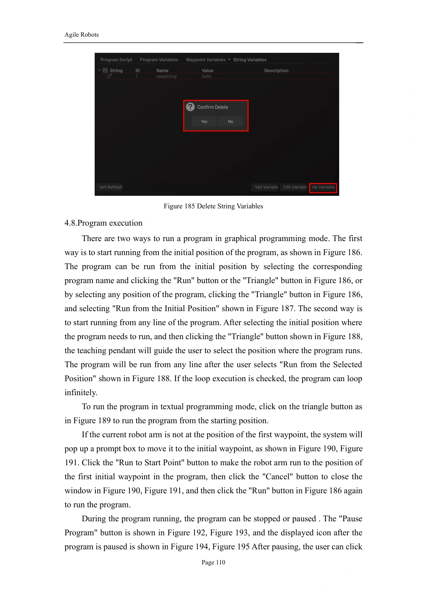



```
Agile Robots 
Page 110 
 
 
Figure 185 Delete String Variables 
4.8.Program execution  
There are two ways to run a program in graphical programming mode. The first 
way is to start running from the initial position of the program, as shown in Figure 186. 
The program can be run from the initial position by selecting the corresponding 
program name and clicking the "Run" button or the "Triangle" button in Figure 186, or 
by selecting any position of the program, clicking the "Triangle" button in Figure 186, 
and selecting "Run from the Initial Position" shown in Figure 187. The second way is 
to start running from any line of the program. After selecting the initial position where 
the program needs to run, and then clicking the "Triangle" button shown in Figure 188, 
the teaching pendant will guide the user to select the position where the program runs. 
The program will be run from any line after the user selects "Run from the Selected 
Position" shown in Figure 188. If the loop execution is checked, the program can loop 
infinitely.  
To run the program in textual programming mode, click on the triangle button as 
in Figure 189 to run the program from the starting position. 
If the current robot arm is not at the position of the first waypoint, the system will 
pop up a prompt box to move it to the initial waypoint, as shown in Figure 190, Figure 
191. Click the "Run to Start Point" button to make the robot arm run to the position of 
the first initial waypoint in the program, then click the "Cancel" button to close the 
window in Figure 190, Figure 191, and then click the "Run" button in Figure 186 again 
to run the program.  
During the program running, the program can be stopped or paused . The "Pause 
Program" button is shown in Figure 192, Figure 193, and the displayed icon after the 
program is paused is shown in Figure 194, Figure 195 After pausing, the user can click
```



**Original document cross-references:** [PDF 115](pages-073-144.md#pdf-page-115) · [PDF 116](pages-073-144.md#pdf-page-116) · [PDF 117](pages-073-144.md#pdf-page-117) · [PDF 118](pages-073-144.md#pdf-page-118) · [PDF 119](pages-073-144.md#pdf-page-119)

## PDF page 115

**Source:** Industrial Teaching Pendant Software User Manual\_V3.3.0\_EN\_20260204.pdf, original pdf page 115. [Open the corresponding PDF reading-copy page](https://1292444914-files.gitbook.io/~/files/v0/b/gitbook-x-prod.appspot.com/o/spaces%2FtgOfPnscWebs1eh82EKq%2Fuploads%2FjY16hu4fopurvy8UYlBp%2Findustrial-teaching-pendant-software-user-manual-v3-3-0-en-20260204-pp-113-118.pdf?alt=media#page=3).



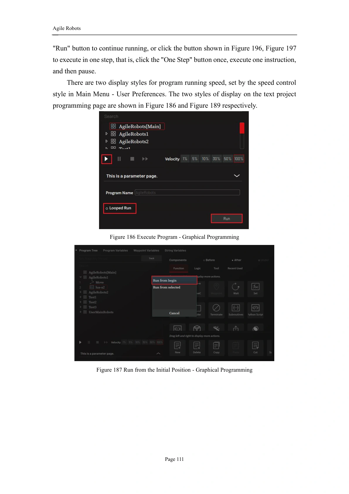



```
Agile Robots 
Page 111 
 
"Run" button to continue running, or click the button shown in Figure 196, Figure 197 
to execute in one step, that is, click the "One Step" button once, execute one instruction, 
and then pause.  
There are two display styles for program running speed, set by the speed control 
style in Main Menu - User Preferences. The two styles of display on the text project 
programming page are shown in Figure 186 and Figure 189 respectively. 
 
Figure 186 Execute Program - Graphical Programming 
 
Figure 187 Run from the Initial Position - Graphical Programming
```



**Original document cross-references:** [PDF 119](pages-073-144.md#pdf-page-119) · [PDF 120](pages-073-144.md#pdf-page-120) · [PDF 115](pages-073-144.md#pdf-page-115) · [PDF 116](pages-073-144.md#pdf-page-116)

## PDF page 116

**Source:** Industrial Teaching Pendant Software User Manual\_V3.3.0\_EN\_20260204.pdf, original pdf page 116. [Open the corresponding PDF reading-copy page](https://1292444914-files.gitbook.io/~/files/v0/b/gitbook-x-prod.appspot.com/o/spaces%2FtgOfPnscWebs1eh82EKq%2Fuploads%2FjY16hu4fopurvy8UYlBp%2Findustrial-teaching-pendant-software-user-manual-v3-3-0-en-20260204-pp-113-118.pdf?alt=media#page=4).



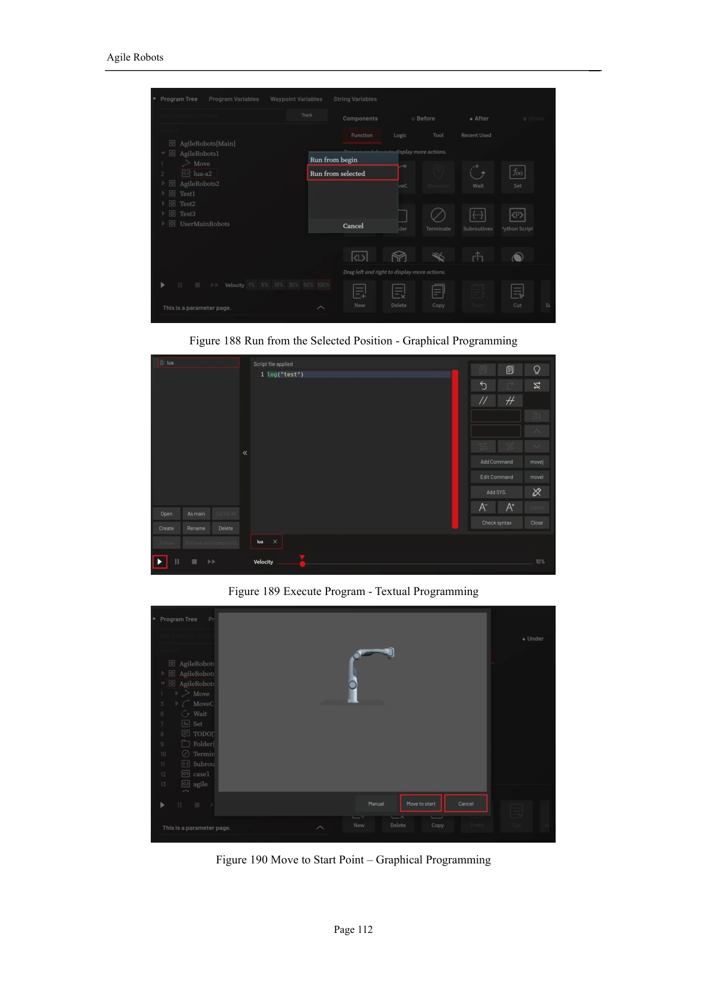



```
Agile Robots 
Page 112 
 
 
Figure 188 Run from the Selected Position - Graphical Programming 
 
Figure 189 Execute Program - Textual Programming 
 
Figure 190 Move to Start Point – Graphical Programming
```



## PDF page 117

**Source:** Industrial Teaching Pendant Software User Manual\_V3.3.0\_EN\_20260204.pdf, original pdf page 117. [Open the corresponding PDF reading-copy page](https://1292444914-files.gitbook.io/~/files/v0/b/gitbook-x-prod.appspot.com/o/spaces%2FtgOfPnscWebs1eh82EKq%2Fuploads%2FjY16hu4fopurvy8UYlBp%2Findustrial-teaching-pendant-software-user-manual-v3-3-0-en-20260204-pp-113-118.pdf?alt=media#page=5).



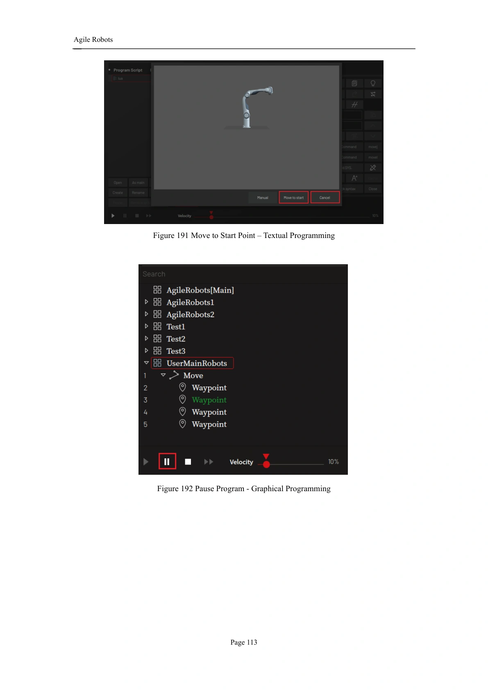



```
Agile Robots 
Page 113 
 
 
Figure 191 Move to Start Point – Textual Programming 
 
 
Figure 192 Pause Program - Graphical Programming
```



## PDF page 118

**Source:** Industrial Teaching Pendant Software User Manual\_V3.3.0\_EN\_20260204.pdf, original pdf page 118. [Open the corresponding PDF reading-copy page](https://1292444914-files.gitbook.io/~/files/v0/b/gitbook-x-prod.appspot.com/o/spaces%2FtgOfPnscWebs1eh82EKq%2Fuploads%2FjY16hu4fopurvy8UYlBp%2Findustrial-teaching-pendant-software-user-manual-v3-3-0-en-20260204-pp-113-118.pdf?alt=media#page=6).



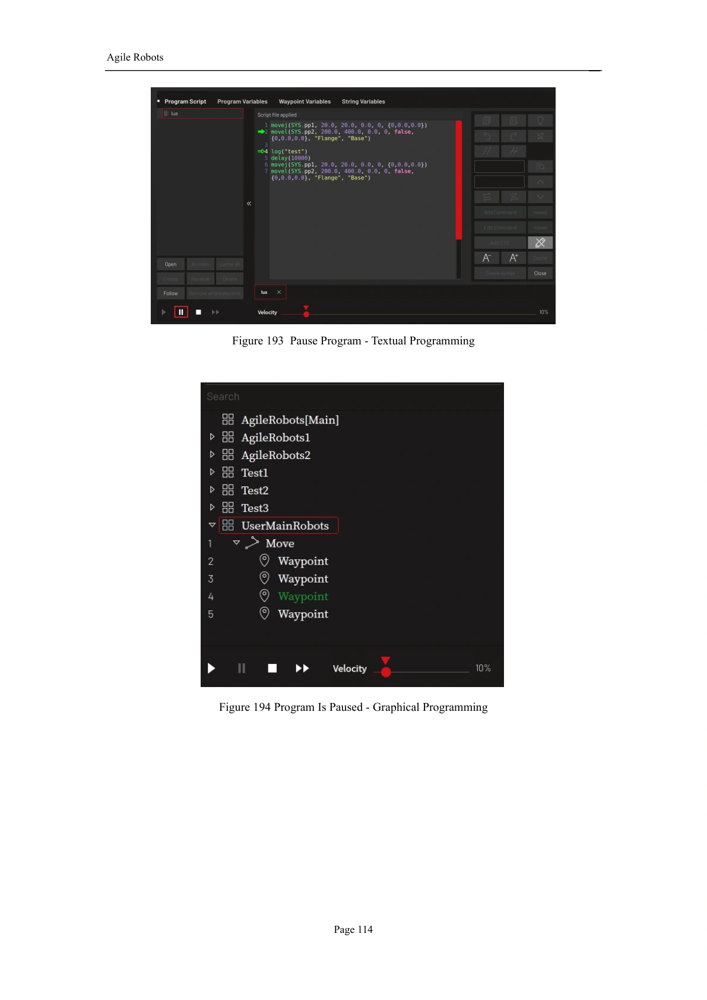



```
Agile Robots 
Page 114 
 
 
Figure 193  Pause Program - Textual Programming 
 
 
Figure 194 Program Is Paused - Graphical Programming
```



## PDF page 119

**Source:** Industrial Teaching Pendant Software User Manual\_V3.3.0\_EN\_20260204.pdf, original pdf page 119. [Open the corresponding PDF reading-copy page](https://1292444914-files.gitbook.io/~/files/v0/b/gitbook-x-prod.appspot.com/o/spaces%2FtgOfPnscWebs1eh82EKq%2Fuploads%2FIQ5WcMlmRt4jC6nItQ1Z%2Findustrial-teaching-pendant-software-user-manual-v3-3-0-en-20260204-pp-119-120.pdf?alt=media#page=1).



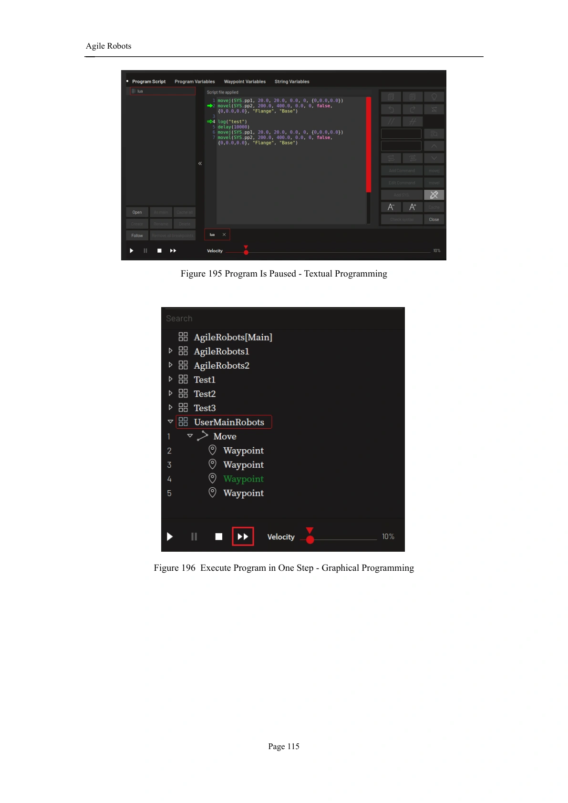



```
Agile Robots 
Page 115 
 
 
Figure 195 Program Is Paused - Textual Programming 
 
 
Figure 196  Execute Program in One Step - Graphical Programming
```



## PDF page 120

**Source:** Industrial Teaching Pendant Software User Manual\_V3.3.0\_EN\_20260204.pdf, original pdf page 120. [Open the corresponding PDF reading-copy page](https://1292444914-files.gitbook.io/~/files/v0/b/gitbook-x-prod.appspot.com/o/spaces%2FtgOfPnscWebs1eh82EKq%2Fuploads%2FIQ5WcMlmRt4jC6nItQ1Z%2Findustrial-teaching-pendant-software-user-manual-v3-3-0-en-20260204-pp-119-120.pdf?alt=media#page=2).



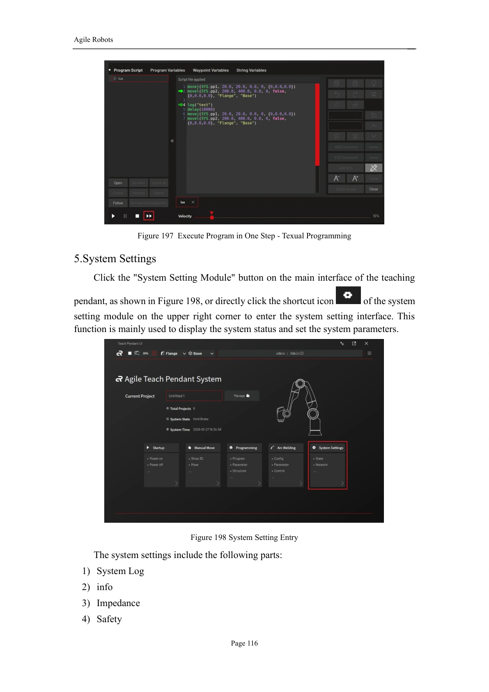



```
Agile Robots 
Page 116 
 
 
Figure 197  Execute Program in One Step - Texual Programming 
5.System Settings  
Click the "System Setting Module" button on the main interface of the teaching 
pendant, as shown in Figure 198, or directly click the shortcut icon 
 of the system 
setting module on the upper right corner to enter the system setting interface. This 
function is mainly used to display the system status and set the system parameters.  
 
Figure 198 System Setting Entry 
The system settings include the following parts:  
1) System Log 
2) info 
3)  Impedance  
4)  Safety
```



**Original document cross-references:** [PDF 120](pages-073-144.md#pdf-page-120)

## PDF page 121

**Source:** Industrial Teaching Pendant Software User Manual\_V3.3.0\_EN\_20260204.pdf, original pdf page 121. [Open the corresponding PDF reading-copy page](https://1292444914-files.gitbook.io/~/files/v0/b/gitbook-x-prod.appspot.com/o/spaces%2FtgOfPnscWebs1eh82EKq%2Fuploads%2Ff783QkkG8ZFjatpFmokK%2Findustrial-teaching-pendant-software-user-manual-v3-3-0-en-20260204-pp-121-122.pdf?alt=media#page=1).



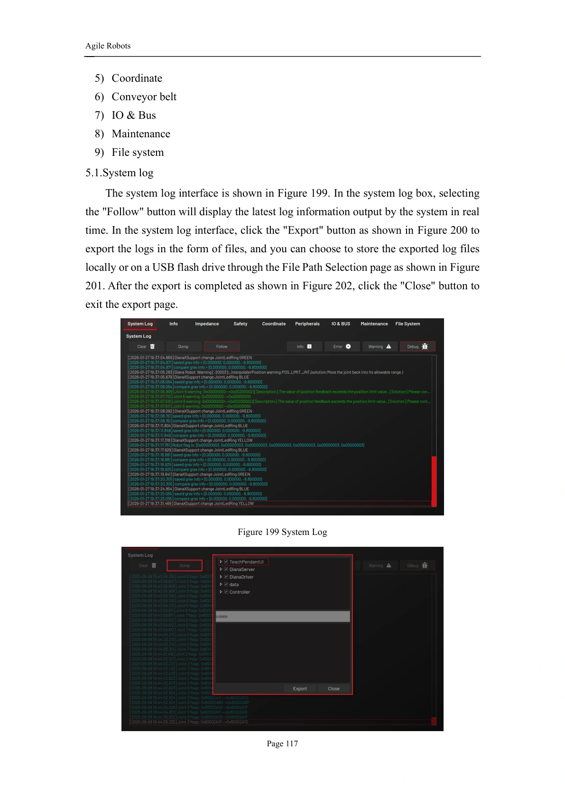



```
Agile Robots 
Page 117 
 
5)  Coordinate  
6)  Conveyor belt  
7)  IO & Bus  
8)  Maintenance  
9) File system 
5.1.System log 
 
The system log interface is shown in Figure 199. In the system log box, selecting 
the "Follow" button will display the latest log information output by the system in real 
time. In the system log interface, click the "Export" button as shown in Figure 200 to 
export the logs in the form of files, and you can choose to store the exported log files 
locally or on a USB flash drive through the File Path Selection page as shown in Figure 
201. After the export is completed as shown in Figure 202, click the "Close" button to 
exit the export page. 
 
Figure 199 System Log
```



**Original document cross-references:** [PDF 121](pages-073-144.md#pdf-page-121) · [PDF 122](pages-073-144.md#pdf-page-122)

## PDF page 122

**Source:** Industrial Teaching Pendant Software User Manual\_V3.3.0\_EN\_20260204.pdf, original pdf page 122. [Open the corresponding PDF reading-copy page](https://1292444914-files.gitbook.io/~/files/v0/b/gitbook-x-prod.appspot.com/o/spaces%2FtgOfPnscWebs1eh82EKq%2Fuploads%2Ff783QkkG8ZFjatpFmokK%2Findustrial-teaching-pendant-software-user-manual-v3-3-0-en-20260204-pp-121-122.pdf?alt=media#page=2).



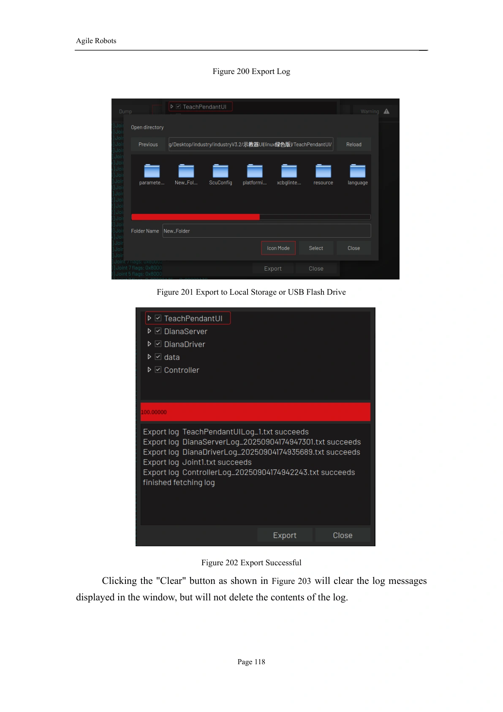



```
Agile Robots 
Page 118 
 
Figure 200 Export Log 
 
 
Figure 201 Export to Local Storage or USB Flash Drive 
 
Figure 202 Export Successful 
Clicking the "Clear" button as shown in Figure 203 will clear the log messages 
displayed in the window, but will not delete the contents of the log.
```



**Original document cross-references:** [PDF 123](pages-073-144.md#pdf-page-123)

## PDF page 123

**Source:** Industrial Teaching Pendant Software User Manual\_V3.3.0\_EN\_20260204.pdf, original pdf page 123. [Open the corresponding PDF reading-copy page](https://1292444914-files.gitbook.io/~/files/v0/b/gitbook-x-prod.appspot.com/o/spaces%2FtgOfPnscWebs1eh82EKq%2Fuploads%2FacjA2WWaLQd0HBJEbDra%2Findustrial-teaching-pendant-software-user-manual-v3-3-0-en-20260204-pp-123-125.pdf?alt=media#page=1).



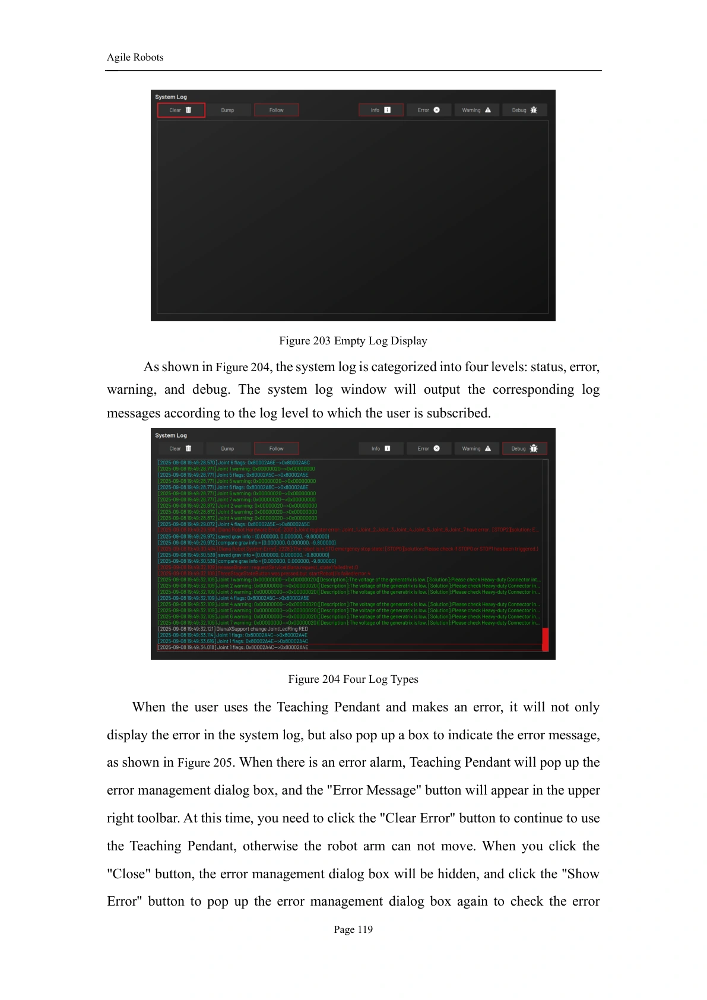



```
Agile Robots 
Page 119 
 
 
Figure 203 Empty Log Display 
As shown in Figure 204, the system log is categorized into four levels: status, error, 
warning, and debug. The system log window will output the corresponding log 
messages according to the log level to which the user is subscribed. 
 
Figure 204 Four Log Types 
When the user uses the Teaching Pendant and makes an error, it will not only 
display the error in the system log, but also pop up a box to indicate the error message, 
as shown in Figure 205. When there is an error alarm, Teaching Pendant will pop up the 
error management dialog box, and the "Error Message" button will appear in the upper 
right toolbar. At this time, you need to click the "Clear Error" button to continue to use 
the Teaching Pendant, otherwise the robot arm can not move. When you click the 
"Close" button, the error management dialog box will be hidden, and click the "Show 
Error" button to pop up the error management dialog box again to check the error
```



**Original document cross-references:** [PDF 123](pages-073-144.md#pdf-page-123) · [PDF 124](pages-073-144.md#pdf-page-124)

## PDF page 124

**Source:** Industrial Teaching Pendant Software User Manual\_V3.3.0\_EN\_20260204.pdf, original pdf page 124. [Open the corresponding PDF reading-copy page](https://1292444914-files.gitbook.io/~/files/v0/b/gitbook-x-prod.appspot.com/o/spaces%2FtgOfPnscWebs1eh82EKq%2Fuploads%2FacjA2WWaLQd0HBJEbDra%2Findustrial-teaching-pendant-software-user-manual-v3-3-0-en-20260204-pp-123-125.pdf?alt=media#page=2).







```
Agile Robots 
Page 120 
 
message. 
 
Figure 205 Error Management Dialog Box 
5.2.  System Status 
The system status interface is shown in Figure 206, which displays the information 
feedback of each joint of the robotic arm in real time, including joint position, joint 
speed, joint current and joint torque information, as well as the speed of the TCP in real 
time. 
The status information of the control box, CPU: xxx MEM: xxx: This function 
displays the overall CPU and memory usage of the control box. When the CPU or 
memory exceeds 80% for 3 consecutive seconds, the robot immediately executes Stop1 
and enters an error state. 
Left table: This table displays processes with CPU or memory usage exceeding 
25%. The CPU usage is multi-core data. When the CPU or memory exceeds 80% for 3 
consecutive seconds, the robot immediately executes Stop1 and enters an error state 
Right table: This table display content when user data (/user_data) occupies more 
than 50% of the disk, an alarm for more than 70% and displaying an engineering 
management interface for 90%, reminding users to delete redundant projects.
```



**Original document cross-references:** [PDF 125](pages-073-144.md#pdf-page-125)

## PDF page 125

**Source:** Industrial Teaching Pendant Software User Manual\_V3.3.0\_EN\_20260204.pdf, original pdf page 125. [Open the corresponding PDF reading-copy page](https://1292444914-files.gitbook.io/~/files/v0/b/gitbook-x-prod.appspot.com/o/spaces%2FtgOfPnscWebs1eh82EKq%2Fuploads%2FacjA2WWaLQd0HBJEbDra%2Findustrial-teaching-pendant-software-user-manual-v3-3-0-en-20260204-pp-123-125.pdf?alt=media#page=3).







```
Agile Robots 
Page 121 
 
 
Figure 206 System Info 
5.3.Impedance Parameters 
On the impedance page, the stiffness and damping ratio parameters of the robot 
arm in joint space and Cartesian space can be set respectively according to different 
spaces. In Cartesian space, the impedance parameters of the base coordinate system or 
tool coordinate system can also be set according to different coordinate systems.  
As shown in Figure 207, the impedance parameters can be directly entered in the 
edit box, or adjusted by sliding the round red button. After the parameters are adjusted, 
the user needs to click the "Apply" button to make the modified impedance parameters 
active.  
It is worth noting that the "Apply" button here only temporarily makes the 
configuration parameters active. After the system restarts, the previously permanently 
saved configuration information will still be used. To keep the configuration 
information permanently active, the user needs to use the "Save" function in the main 
menu to save it.
```



**Original document cross-references:** [PDF 126](pages-073-144.md#pdf-page-126)

## PDF page 126

**Source:** Industrial Teaching Pendant Software User Manual\_V3.3.0\_EN\_20260204.pdf, original pdf page 126. [Open the corresponding PDF reading-copy page](https://1292444914-files.gitbook.io/~/files/v0/b/gitbook-x-prod.appspot.com/o/spaces%2FtgOfPnscWebs1eh82EKq%2Fuploads%2FsSFwDTqB2iCYJEshnlND%2Findustrial-teaching-pendant-software-user-manual-v3-3-0-en-20260204-pp-126-128.pdf?alt=media#page=1).







```
Agile Robots 
Page 122 
 
 
Figure 207 Impedance Page 
Click the "Import" button shown in Figure 208 to import the configuration 
information of impedance parameters from the local or USB disk. After the successful 
import, click the "Apply" button shown in Figure 209 to make the imported impedance 
parameters active. Similarly, click the "Save" button in the main menu to make the 
parameters active permanently.  
 
Figure 208 Import Impedance Parameters
```



**Original document cross-references:** [PDF 126](pages-073-144.md#pdf-page-126) · [PDF 127](pages-073-144.md#pdf-page-127)

## PDF page 127

**Source:** Industrial Teaching Pendant Software User Manual\_V3.3.0\_EN\_20260204.pdf, original pdf page 127. [Open the corresponding PDF reading-copy page](https://1292444914-files.gitbook.io/~/files/v0/b/gitbook-x-prod.appspot.com/o/spaces%2FtgOfPnscWebs1eh82EKq%2Fuploads%2FsSFwDTqB2iCYJEshnlND%2Findustrial-teaching-pendant-software-user-manual-v3-3-0-en-20260204-pp-126-128.pdf?alt=media#page=2).







```
Agile Robots 
Page 123 
 
 
Figure 209 Apply Impedance Parameters 
Click the "Export" button shown in Figure 210 to export the impedance parameters. 
On the pop-up folder selection page, the user can select to export to local or USB disk.  
 
Figure 210 Export Impedance Parameters 
The "Refresh" button is used to load the robot arm configuration information, and 
the "Apply" button is used to write the current configuration information into the 
robot arm.  
5.4.System Safety  
Safety involves collision detection, safety handling, joint position range limit, joint 
position soft range limit, joint velocity and acceleration limits, virtual wall, and payload 
deviation threshold. The user can select whether to enable collision detection function, 
select safety handling mode, and configure the motion range, velocity, and acceleration 
of the robot arm according to the actual operating environment requirements, so that it 
can move within the specified range and protect people and objects around the robot
```



**Original document cross-references:** [PDF 127](pages-073-144.md#pdf-page-127)

## PDF page 128

**Source:** Industrial Teaching Pendant Software User Manual\_V3.3.0\_EN\_20260204.pdf, original pdf page 128. [Open the corresponding PDF reading-copy page](https://1292444914-files.gitbook.io/~/files/v0/b/gitbook-x-prod.appspot.com/o/spaces%2FtgOfPnscWebs1eh82EKq%2Fuploads%2FsSFwDTqB2iCYJEshnlND%2Findustrial-teaching-pendant-software-user-manual-v3-3-0-en-20260204-pp-126-128.pdf?alt=media#page=3).







```
Agile Robots 
Page 124 
 
arm.  
5.4.1.Collision detection  
When the "Safety" page is accessed, the "Collision Detection" interface will be 
opened by default. The collision detection configuration interface can also be switched 
by clicking on the "Collision Detection" option, as shown in Figure 211.  
 
Figure 211 Collision Detection 
In the collision detection interface, the collision detection level includes joint 
space detection, Cartesian space detection, and TCP resultant force detection. These 
three collision detection levels can be multiple or none of them can be selected. When 
none of them are selected, it means that the collision detection is closed. By selecting 
multiple options, the combination of functions at different detection levels can be 
configured. When multiple detection levels are checked, the collision detection 
thresholds for each level take effect simultaneously. Clicking the "Set" button in the 
interface will send the current settings to the robot arm and make it active. The "Get 
Current Level" button is used to obtain the current collision detection level and 
threshold of the robot arm. As mentioned earlier, to make the configuration information 
active permanently, the user needs to click the "Save" button in the main menu.  
Joint space detection: as shown in Figure 212when the torque (Nm) of a joint is 
greater than or equal to the set threshold, the robot arm will automatically stop operation 
based on safety protection.
```



**Original document cross-references:** [PDF 128](pages-073-144.md#pdf-page-128) · [PDF 129](pages-073-144.md#pdf-page-129)

## PDF page 129

**Source:** Industrial Teaching Pendant Software User Manual\_V3.3.0\_EN\_20260204.pdf, original pdf page 129. [Open the corresponding PDF reading-copy page](https://1292444914-files.gitbook.io/~/files/v0/b/gitbook-x-prod.appspot.com/o/spaces%2FtgOfPnscWebs1eh82EKq%2Fuploads%2F1YVYApY5uzTDLtsIoFUe%2Findustrial-teaching-pendant-software-user-manual-v3-3-0-en-20260204-pp-129-132.pdf?alt=media#page=1).







```
Agile Robots 
Page 125 
 
 
Figure 212 Joint Space Detection 
Cartesian space detection as shown in Figure 213, Cartesian space detection 
mainly detects that when the force (N) at the end of the robot arm in the X/Y/Z direction 
of the coordinate system is greater than or equal to the set threshold, the robot arm will 
stop operation based on safety protection. When the rotation torque (Nm) along X/Y/Z 
is detected to be greater than or equal to the set threshold, the robot arm will 
automatically stop operation based on safety protection.  
 
Figure 213 Cartesian Space Detection 
TCP resultant force detection: as shown in Figure 214, when the resultant force 
(N) at the end is greater than or equal to the detection threshold, the robot arm will 
automatically stop operation based on safety protection.
```



**Original document cross-references:** [PDF 129](pages-073-144.md#pdf-page-129) · [PDF 130](pages-073-144.md#pdf-page-130)

## PDF page 130

**Source:** Industrial Teaching Pendant Software User Manual\_V3.3.0\_EN\_20260204.pdf, original pdf page 130. [Open the corresponding PDF reading-copy page](https://1292444914-files.gitbook.io/~/files/v0/b/gitbook-x-prod.appspot.com/o/spaces%2FtgOfPnscWebs1eh82EKq%2Fuploads%2F1YVYApY5uzTDLtsIoFUe%2Findustrial-teaching-pendant-software-user-manual-v3-3-0-en-20260204-pp-129-132.pdf?alt=media#page=2).







```
Agile Robots 
Page 126 
 
 
Figure 214 TCP Resultant Force Detection 
After the collision, the robotic arm will be stopped according to different Stop 
Categories, which can be selected through the interface shown in Figure 215, and 
different Stop Categories have different stopping behaviors, including Stop2 for the 
robotic arm to decelerate and stop according to a certain acceleration, and will not close 
the brake; Stop1 for the robotic arm to decelerate and stop according to a certain 
acceleration, and then close the brake; and Stop0 for the robotic arm to turn off the 
servo and close the brake immediately. 
 
Figure 215 Stop Category of Collision 
5.4.2.Safety Handling 
As shown in Figure 216, the "Safe Handling" interface can set whether to enter the 
safe handling state or not, after entering the safe handling mode, the robot arm will 
automatically close the holding brake, and can only carry out the Cartesian space drive, 
single-joint drive and safe freedrive. Freedrive will become safe freedrive (safe zero
```



**Original document cross-references:** [PDF 130](pages-073-144.md#pdf-page-130) · [PDF 131](pages-073-144.md#pdf-page-131)

## PDF page 131

**Source:** Industrial Teaching Pendant Software User Manual\_V3.3.0\_EN\_20260204.pdf, original pdf page 131. [Open the corresponding PDF reading-copy page](https://1292444914-files.gitbook.io/~/files/v0/b/gitbook-x-prod.appspot.com/o/spaces%2FtgOfPnscWebs1eh82EKq%2Fuploads%2F1YVYApY5uzTDLtsIoFUe%2Findustrial-teaching-pendant-software-user-manual-v3-3-0-en-20260204-pp-129-132.pdf?alt=media#page=3).







```
Agile Robots 
Page 127 
 
force drive allows the robot arm to enter into freedrive under abnormal conditions, 
allows the robot arm to exceed the limit position, and will not check whether the load 
is matched when entering), as shown in Figure 217, clicking on the red button to drive 
will automatically open the holding brake, and release the button to close the holding 
brake. It should be noted that the safety freedrive function has requirements on the joint 
firmware version, and the function cannot be enabled when the joint firmware version 
is lower than 3.0.0. 
 
Figure 216 Safe Handling Interface 
 
Figure 217 Safe Free-drive Interface  
 In addition to the above ways to actively enter the safety handling state, there are 
two other passive cases to enter the safety processing state: 
Case 1: The robotic arm has a joint that exceeds the limit position, and the user 
automatically enters the safety handling state after clearing the error. After entering the 
safety handling state, single-joint drive (for the joints exceeding the limit can only be 
driven backward, while other joints are allowed to be driven in both directions) and safe 
freedrive are allowed, and Cartesian space drive is not allowed. As shown in Figure 218,
```



**Original document cross-references:** [PDF 131](pages-073-144.md#pdf-page-131) · [PDF 132](pages-073-144.md#pdf-page-132)

## PDF page 132

**Source:** Industrial Teaching Pendant Software User Manual\_V3.3.0\_EN\_20260204.pdf, original pdf page 132. [Open the corresponding PDF reading-copy page](https://1292444914-files.gitbook.io/~/files/v0/b/gitbook-x-prod.appspot.com/o/spaces%2FtgOfPnscWebs1eh82EKq%2Fuploads%2F1YVYApY5uzTDLtsIoFUe%2Findustrial-teaching-pendant-software-user-manual-v3-3-0-en-20260204-pp-129-132.pdf?alt=media#page=4).







```
Agile Robots 
Page 128 
 
when all the joints of the robotic arm return to within the limit position, a pop-up 
window will ask the user whether he/she needs to exit the safety handling state, as 
shown in Figure 219, selecting "Yes" to exit the state, and selecting "No" to continue to 
stay in the state. 
 
Figure 218 Passive Entry into Safety Handling State -1 
 
Figure 219 Passive Entry into Safety Handling State-2 
 Case 2: The robot arm exceeds the Cartesian position limitation (TCP/tool 
envelope/elbow envelope exceeds the complex virtual wall), after entering the safety 
handling state, it is only allowed to do the Cartesian spatial drive, single-joint drive and 
safe freedrive, and the Cartesian and single-joint drive can only move in the direction 
within the limitation, as shown in Figure 220, when the robot arm returns to within the 
Cartesian position limit, a pop-up window will ask the user whether to exit the safety 
handling state, as shown in Figure 221, choose "Yes" to exit the state, and choose "No" 
to continue to stay in the state.
```



**Original document cross-references:** [PDF 132](pages-073-144.md#pdf-page-132) · [PDF 133](pages-073-144.md#pdf-page-133)

## PDF page 133

**Source:** Industrial Teaching Pendant Software User Manual\_V3.3.0\_EN\_20260204.pdf, original pdf page 133. [Open the corresponding PDF reading-copy page](https://1292444914-files.gitbook.io/~/files/v0/b/gitbook-x-prod.appspot.com/o/spaces%2FtgOfPnscWebs1eh82EKq%2Fuploads%2FoEpBDVCI0i6TVJLgI8LX%2Findustrial-teaching-pendant-software-user-manual-v3-3-0-en-20260204-pp-133-137.pdf?alt=media#page=1).







```
Agile Robots 
Page 129 
 
Note that only Manual and Collaborative modes can enter the Safety Handling state; 
Automatic mode does not allow Safety Handling. 
 
Figure 220 Passive Entry into Safety Handling State -3 
 
Figure 221 Passive Entry into Safety Handling State -4 
5.4.3.Manual Mode Speed Limit 
Manual Mode Speed Limit allows you to limit the user's speed to Manual Low or 
Manual High when in Manual Mode. For detailed information, see 8) Enabling Manual-
Auto Mode Switching in 6.6 User Preferences. 
5.4.4.Joint Position Range Limit 
The motion range of joint can be set on the "Joint Position Range Limit" interface 
shown in Figure 222 to make the joint move within the specified range (unit: °). The 
upper and lower limits of each angle range are set within the allowable range of Diana 
robot arm design.
```



**Original document cross-references:** [PDF 134](pages-073-144.md#pdf-page-134)

## PDF page 134

**Source:** Industrial Teaching Pendant Software User Manual\_V3.3.0\_EN\_20260204.pdf, original pdf page 134. [Open the corresponding PDF reading-copy page](https://1292444914-files.gitbook.io/~/files/v0/b/gitbook-x-prod.appspot.com/o/spaces%2FtgOfPnscWebs1eh82EKq%2Fuploads%2FoEpBDVCI0i6TVJLgI8LX%2Findustrial-teaching-pendant-software-user-manual-v3-3-0-en-20260204-pp-133-137.pdf?alt=media#page=2).







```
Agile Robots 
Page 130 
 
 
Figure 222 Joint Position Range Limit 
The "Apply" button is used to write the current set value to the robot arm. If the 
upper limit value set for a joint is less than the lower limit value, the application will 
fail. The "Refresh" button is used to obtain the joint position range value written after 
the last successful setting of the joint position range in the robot arm.  
The mechanical position range of each joint of Diana robot arm is shown in Table 
1:  
Table 1 
Mechanical Limit of Each Joint of Diana Robot Arm 
Joint No.  
Minimum value for 
joint (°)  
Maximum value for 
joint (°)  
1  
-179  
179  
2  
-90  
90  
3  
-179  
179  
4  
0  
175  
5  
-179  
179  
6  
-179  
179  
7  
-179  
179  
5.4.5.Joint Position Range Soft Limit  
The upper and lower soft limits of each joint can be set on the Joint Position Range 
Soft Limit interface shown in Figure 223, with a default range of lower limit of joint 
limit position +5 ° to upper limit of joint limit position -5 °. After the settings, the robot 
arm joints form a virtual joint wall between the lower limit of the joint limit position to 
the lower limit of the joint soft limit position, and the upper limit of the joint soft limit 
position to the upper limit of the joint limit position. During the free drive, there will 
be significant resistance when the joint reaches the virtual wall. The resistance reaches 
its maximum at the outer edge of the wall and the robot arm cannot be pushed into the
```



**Original document cross-references:** [PDF 134](pages-073-144.md#pdf-page-134) · [PDF 135](pages-073-144.md#pdf-page-135)

## PDF page 135

**Source:** Industrial Teaching Pendant Software User Manual\_V3.3.0\_EN\_20260204.pdf, original pdf page 135. [Open the corresponding PDF reading-copy page](https://1292444914-files.gitbook.io/~/files/v0/b/gitbook-x-prod.appspot.com/o/spaces%2FtgOfPnscWebs1eh82EKq%2Fuploads%2FoEpBDVCI0i6TVJLgI8LX%2Findustrial-teaching-pendant-software-user-manual-v3-3-0-en-20260204-pp-133-137.pdf?alt=media#page=3).







```
Agile Robots 
Page 131 
 
virtual wall. Clicking the "Apply" button can write the current parameter settings into 
the robot arm, and the "Reload" button is used to obtain the soft limit of the current 
robot arm.  
Notes: when the Joint Position Range Limit is reduced, the Joint Position Range 
Soft Limit will automatically decrease, but when the Joint Position Range Limit is 
expanded, the Joint Position Range Soft Limit will not automatically increase and needs 
to be manually set.  
 
Figure 223 Joint Position Range Soft Limit 
5.4.6.Joint velocity and acceleration limits  
The "Joint Velocity and Acceleration Limits" sub interface shown in Figure 224 is 
divided into Cartesian space and joint space velocity and acceleration settings.  
 
Figure 224 Velocity and Acceleration Limits 
1) The Cartesian space contains: maximum translational velocity (unit: mm/s), 
maximum translational acceleration (unit: mm/s2), maximum rotational angular 
velocity (unit: °/s), and maximum rotational angular acceleration (unit: °/s2). The joint
```



**Original document cross-references:** [PDF 135](pages-073-144.md#pdf-page-135)

## PDF page 136

**Source:** Industrial Teaching Pendant Software User Manual\_V3.3.0\_EN\_20260204.pdf, original pdf page 136. [Open the corresponding PDF reading-copy page](https://1292444914-files.gitbook.io/~/files/v0/b/gitbook-x-prod.appspot.com/o/spaces%2FtgOfPnscWebs1eh82EKq%2Fuploads%2FoEpBDVCI0i6TVJLgI8LX%2Findustrial-teaching-pendant-software-user-manual-v3-3-0-en-20260204-pp-133-137.pdf?alt=media#page=4).







```
Agile Robots 
Page 132 
 
space contains: maximum angular velocity (unit: °/s) and maximum angular 
acceleration (unit: °/s2) of each joint. The "Apply" button is used to write the current 
set value to the robot arm. The "Refresh" button is used to obtain the last successfully 
set velocity and acceleration limit values of the robot arm.  
5.4.7.Virtual wall  
 
The virtual wall function is another safety setting function that protects the robot 
arm.  
As shown in Figure 225, a simple virtual wall can be opened on the corresponding 
sub interface by selecting the "Virtual Wall" or "Complex Virtual Wall" option in the 
options. When closed, the joint virtual wall will be enabled. Click the "Apply" button 
to write the current settings into the robot arm. Click the "Get Current Mode" button to 
obtain the virtual wall mode that the current robot arm takes effect.  
 
Figure 225 Virtual Wall 
5.4.7.1.Simple virtual wall  
When the "Simple Virtual Wall" is set to open on the "Virtual Wall" sub interface, 
a cube will be created in the base coordinate system with the current TCP position as 
the center point, serving as the robot arm motion range of the robot arm. As shown in 
Figure 226, in the simple virtual wall sub interface in Cartesian space, the user can set 
the length in the x, y, and z directions of the cube where the virtual wall is located, as 
well as the thickness of the virtual wall used in that cube. After the settings, the TCP at 
the end of the robot arm will have significant resistance when reaching the virtual wall. 
The resistance reaches its maximum at the outer edge of the wall and the robot arm 
cannot be pushed into the virtual wall.
```



**Original document cross-references:** [PDF 136](pages-073-144.md#pdf-page-136) · [PDF 137](pages-073-144.md#pdf-page-137)

## PDF page 137

**Source:** Industrial Teaching Pendant Software User Manual\_V3.3.0\_EN\_20260204.pdf, original pdf page 137. [Open the corresponding PDF reading-copy page](https://1292444914-files.gitbook.io/~/files/v0/b/gitbook-x-prod.appspot.com/o/spaces%2FtgOfPnscWebs1eh82EKq%2Fuploads%2FoEpBDVCI0i6TVJLgI8LX%2Findustrial-teaching-pendant-software-user-manual-v3-3-0-en-20260204-pp-133-137.pdf?alt=media#page=5).







```
Agile Robots 
Page 133 
 
 
Figure 226 Simple Virtual Wall 
The "Apply" button is used to write the current settings to the robot arm, and the 
"Refresh" button is used to obtain the thickness and range of the Cartesian virtual wall 
of the current robot arm.  
5.4.7.2.Complex Virtual Wall 
In the Complex Virtual Walls page, users can manually create complex virtual 
walls. It supports the creation of up to 8 complex virtual walls (i.e. 8 safety planes) and 
the user can copy and paste, delete, hide and rename each complex virtual wall, but the 
hide operation does not disable the complex virtual wall, it just doesn't show the 
complex virtual wall on the interface, as shown in Figure 227. 
The Teach-In 3D graphical display of the robot arm and the virtual wall with 
arrows indicating the restricted and unrestricted sides of the complex virtual wall allows 
the user to zoom in, zoom out and rotate the graphical interface. 
Steps to create a complex virtual wall: 
1. After the user clicks on the "New", you need to teach three points that are not in 
the same straight line, road point 1, road point 2, road point 3, (record the points need 
to use the base coordinate system), that is to say, to complete the calibration of the 
complex virtual wall, that is, the usual three points to create a plane. 
2. After completing the calibration of the complex virtual wall plane, you need to 
teach the fourth point, road point 4 (the point can not be in the plane of the complex 
virtual wall, and record the location of points need to use the base coordinate system), 
used to specify the complex virtual wall of the non-restricted side (i.e., the safety zone). 
3. Click "Set" and then click "Apply", the virtual wall setup is complete, click 
"Show", the complex virtual wall and arrows will appear in the Robot 3D display area.
```



**Original document cross-references:** [PDF 138](pages-073-144.md#pdf-page-138)

## PDF page 138

**Source:** Industrial Teaching Pendant Software User Manual\_V3.3.0\_EN\_20260204.pdf, original pdf page 138. [Open the corresponding PDF reading-copy page](https://1292444914-files.gitbook.io/~/files/v0/b/gitbook-x-prod.appspot.com/o/spaces%2FtgOfPnscWebs1eh82EKq%2Fuploads%2FLQPS5ea9tqlUp8AV5zWH%2Findustrial-teaching-pendant-software-user-manual-v3-3-0-en-20260204-pp-138-144.pdf?alt=media#page=1).







```
Agile Robots 
Page 134 
 
 
Figure 227  Complex virtual wall 
The user can set the following parameters for a single complex virtual wall: 
(1) Complex Virtual Wall Name 
  Support to change the complex virtual wall name directly in the complex virtual 
wall name text box, click "Set" and "Apply", complex virtual wall does not allow 
renaming. 
(2) Limit methods (Disable, Reduce and Stop) 
Disable: The complex virtual wall is displayed in gray, without any limit. 
Reduce: Virtual wall displays yellow. Parameters are passed to SCU safety 
configuration software only. In system safety interface, The effect of reduce option 
equals disabling virtual wall. The enable/disable of reduce status must be performed in 
SCU safety software. 
Stop: The complex virtual wall is displayed in red color, the robot arm will stop 
moving and alert the user when it approaches and almost touches the wall. 
(3) Limit elbow (Yes, No) 
Each model of robotic arm has a virtual elbow envelope sphere of appropriate size 
(not shown for the time being). For example, the elbow of the 7-axis arm is the 4th joint. 
Yes: The elbow envelope sphere, TCP and tool envelope are simultaneously 
limited by a complex virtual wall. 
No: The Elbow Envelope Sphere is not restricted by the Complex Virtual Wall, 
only the TCP and Tool Envelope are restricted by the Complex Virtual Wall. 
5.4.7.3.Tool envelope 
The user can create up to 5 tool envelopes for a tool and can copy and paste, delete 
and rename each tool envelope. The Teach-In interface graphically displays the tool 
envelopes as a green sphere. The user can zoom in, out and rotate the graphical
```



## PDF page 139

**Source:** Industrial Teaching Pendant Software User Manual\_V3.3.0\_EN\_20260204.pdf, original pdf page 139. [Open the corresponding PDF reading-copy page](https://1292444914-files.gitbook.io/~/files/v0/b/gitbook-x-prod.appspot.com/o/spaces%2FtgOfPnscWebs1eh82EKq%2Fuploads%2FLQPS5ea9tqlUp8AV5zWH%2Findustrial-teaching-pendant-software-user-manual-v3-3-0-en-20260204-pp-138-144.pdf?alt=media#page=2).







```
Agile Robots 
Page 135 
 
interface,, as shown in Figure 228. 
 
Figure 228 Tool envelope 
The user can set the following parameters of the tool envelope: 
(1) Sphere Center (TCPX, TCPY, TCPZ) 
 
The position of the center of the tool envelope sphere relative to the flange 
coordinate system, TCPX, TCPY and TCPZ are all in mm, input range [-10000,10000]. 
(2) Radius 
 
Radius of the envelope sphere in mm, input range [0,10000]. 
(3) Name 
 
Support to change the name directly in the name text box, then click "Set" and 
"Apply" in turn. The tool envelope does not allow renaming. 
5.4.8.Payload matching detection threshold  
During the use of the robot arm, the payload deviation threshold will be checked 
before turning on the freedrive and switching the control mode to impedance mode. In 
the payload deviation threshold modification page shown in Figure 229, the user can 
modify the threshold according to their usage needs, with values ranging from 0 to 18 
(unit: Nm).
```



**Original document cross-references:** [PDF 139](pages-073-144.md#pdf-page-139) · [PDF 140](pages-073-144.md#pdf-page-140)

## PDF page 140

**Source:** Industrial Teaching Pendant Software User Manual\_V3.3.0\_EN\_20260204.pdf, original pdf page 140. [Open the corresponding PDF reading-copy page](https://1292444914-files.gitbook.io/~/files/v0/b/gitbook-x-prod.appspot.com/o/spaces%2FtgOfPnscWebs1eh82EKq%2Fuploads%2FLQPS5ea9tqlUp8AV5zWH%2Findustrial-teaching-pendant-software-user-manual-v3-3-0-en-20260204-pp-138-144.pdf?alt=media#page=3).







```
Agile Robots 
Page 136 
 
 
Figure 229 Payload Deviation Threshold 
The "Apply" button is used to write the current settings to the robot arm. The "Get" 
button is used to obtain the payload deviation threshold that is currently in effect for the 
robot arm.  
5.4.9.Automatic speed reduction 
 
This interface is used to set 3 kinds of auto speed reduction functions. Automatic 
speed reduction after Pause, as shown in Figure 230, when the program is paused in 
any way, the running speed of the program is automatically reduced to the set value, as 
shown in Figure 231. 
 
Figure 230 Automatic speed reduction after pause -1
```



**Original document cross-references:** [PDF 140](pages-073-144.md#pdf-page-140) · [PDF 141](pages-073-144.md#pdf-page-141)

## PDF page 141

**Source:** Industrial Teaching Pendant Software User Manual\_V3.3.0\_EN\_20260204.pdf, original pdf page 141. [Open the corresponding PDF reading-copy page](https://1292444914-files.gitbook.io/~/files/v0/b/gitbook-x-prod.appspot.com/o/spaces%2FtgOfPnscWebs1eh82EKq%2Fuploads%2FLQPS5ea9tqlUp8AV5zWH%2Findustrial-teaching-pendant-software-user-manual-v3-3-0-en-20260204-pp-138-144.pdf?alt=media#page=4).







```
Agile Robots 
Page 137 
 
 
Figure 231 Automatic speed reduction after pause -2 
Automatic speed reduction after switching modes, as shown in Figure 232. When 
switching between the 3 modes of Collaboration Mode, Manual Mode, and Auto Mode, 
the program running speed is automatically reduced to the set value, as shown in Figure 
233. 
 
Figure 232 Automatic speed reduction after switching modes -1
```



**Original document cross-references:** [PDF 141](pages-073-144.md#pdf-page-141) · [PDF 142](pages-073-144.md#pdf-page-142)

## PDF page 142

**Source:** Industrial Teaching Pendant Software User Manual\_V3.3.0\_EN\_20260204.pdf, original pdf page 142. [Open the corresponding PDF reading-copy page](https://1292444914-files.gitbook.io/~/files/v0/b/gitbook-x-prod.appspot.com/o/spaces%2FtgOfPnscWebs1eh82EKq%2Fuploads%2FLQPS5ea9tqlUp8AV5zWH%2Findustrial-teaching-pendant-software-user-manual-v3-3-0-en-20260204-pp-138-144.pdf?alt=media#page=5).







```
Agile Robots 
Page 138 
 
 
Figure 233 Automatic speed reduction after switching modes -2 
Automatic speed reduction before running, as shown in Figure 234, and automatic 
speed reduction to the set value when the program is ready to run, as shown in Figure 
235. 
 
Figure 234 Automatic speed reduction before running -1
```



**Original document cross-references:** [PDF 142](pages-073-144.md#pdf-page-142) · [PDF 143](pages-073-144.md#pdf-page-143)

## PDF page 143

**Source:** Industrial Teaching Pendant Software User Manual\_V3.3.0\_EN\_20260204.pdf, original pdf page 143. [Open the corresponding PDF reading-copy page](https://1292444914-files.gitbook.io/~/files/v0/b/gitbook-x-prod.appspot.com/o/spaces%2FtgOfPnscWebs1eh82EKq%2Fuploads%2FLQPS5ea9tqlUp8AV5zWH%2Findustrial-teaching-pendant-software-user-manual-v3-3-0-en-20260204-pp-138-144.pdf?alt=media#page=6).







```
Agile Robots 
Page 139 
 
 
Figure 235 Automatic speed reduction before running -2 
5.4.10.SCU safety 
For robotic arms provided with safety functions, the SCU safety option will 
appear in the system safety interface, as shown in Figure 236. 
 
Figure 236 SCU safety interface 
In this interface, the default port number is 6060 and cannot be modified.  
The joint positions of the safety point are the current SCU safety points 
configured by user, which are automatically read from the user SCU device. During 
the initial use, all the default joint values in this interface are 0.  
Click "Set" to open the manual operation interface, where the robotic arm can be 
moved. When the arm reaches the desired safety point position, click "Confirm" to 
update the joint values of the safety point to the new joint positions, which will be used
```



**Original document cross-references:** [PDF 143](pages-073-144.md#pdf-page-143)

## PDF page 144

**Source:** Industrial Teaching Pendant Software User Manual\_V3.3.0\_EN\_20260204.pdf, original pdf page 144. [Open the corresponding PDF reading-copy page](https://1292444914-files.gitbook.io/~/files/v0/b/gitbook-x-prod.appspot.com/o/spaces%2FtgOfPnscWebs1eh82EKq%2Fuploads%2FLQPS5ea9tqlUp8AV5zWH%2Findustrial-teaching-pendant-software-user-manual-v3-3-0-en-20260204-pp-138-144.pdf?alt=media#page=7).







```
Agile Robots 
Page 140 
 
when setting the user SCU safety points.  
With the brake released, clicking "Move To", the robotic arm will move to the 
joint angles specified in this interface's safety point.  
By default, the "Restore" button is grayed out and unavailable. After setting new 
safety points, the button becomes available. Clicking "Restore", all safety point joint 
angles will be reverted to the pre-set values, and the button will return to an unavailable 
state.  
When the control system is powered on, clicking the "Apply" button, it will 
prompt: "Please power off first", as shown in Figure 237. 
 
Figure 237 Power-off notification 
On the startup interface, click "Power Off" to shut down the control box. Then 
click the "Apply" button to open the safety function configuration interface, as shown 
in Figure 238.
```



**Original document cross-references:** [PDF 144](pages-073-144.md#pdf-page-144) · [PDF 145](pages-145-216.md#pdf-page-145)
