# Industrial teaching pendant manual V3.3.0 — PDF pages 145–216


**Complete supplied source:** Industrial Teaching Pendant Software User Manual\_V3.3.0\_EN\_20260204.pdf · **Coverage:** 286 original PDF pages. [Return to the Agile Robots source library](../).


Every source page is retained in the original order. The **Original page** view preserves complete diagrams, photographs, tables, equations, connector orientation, notices and examples. The **Searchable text** view preserves native PDF text or the slide’s native text, embedded links and substantive speaker notes. Text extraction can retain reading-order/character defects; use the original image for exact layout, table columns and code indentation.


The pendant controls modes, enable state, tasks, I/O, calibration, safety-related configuration and peripheral equipment. A stopped arm does not prove that every output or process is de-energized. Apply the delivered hardware/software and safety procedures.


**Attribution:** the manufacturer and contributors identified in the supplied document. Original notices remain visible on every source page. Navigation, revision notes and the linked engineering explanations are OpenELAB editorial additions.

[Full document index](./) · This reading section contains original PDF pages **145–216**.

## Document navigation

| Source section / function                                                       | Original page                            |
| ------------------------------------------------------------------------------- | ---------------------------------------- |
| 5.4.11.Safety Speed Limit                                                       | [PDF 146](pages-145-216.md#pdf-page-146) |
| 5.4.12.Interference zone                                                        | [PDF 146](pages-145-216.md#pdf-page-146) |
| 5.4.13.Free-drive speed limit                                                   | [PDF 153](pages-145-216.md#pdf-page-153) |
| 5.5.Coordinate                                                                  | [PDF 153](pages-145-216.md#pdf-page-153) |
| 5.5.1.Tool coordinate system definition                                         | [PDF 154](pages-145-216.md#pdf-page-154) |
| 5.5.2.Tool payload definition                                                   | [PDF 155](pages-145-216.md#pdf-page-155) |
| 5.5.3.Restore parameters after script execution                                 | [PDF 157](pages-145-216.md#pdf-page-157) |
| 5.5.4.Workpiece coordinate system                                               | [PDF 157](pages-145-216.md#pdf-page-157) |
| 5.6. Peripheral Devices                                                         | [PDF 160](pages-145-216.md#pdf-page-160) |
| 5.6.1.Conveyor                                                                  | [PDF 160](pages-145-216.md#pdf-page-160) |
| 5.6.1.1.Calibrate conveyor                                                      | [PDF 160](pages-145-216.md#pdf-page-160) |
| 5.6.1.2.Manually control conveyor tracking                                      | [PDF 161](pages-145-216.md#pdf-page-161) |
| 5.6.1.3.Motion speed                                                            | [PDF 163](pages-145-216.md#pdf-page-163) |
| 5.7.IO & Bus                                                                    | [PDF 164](pages-145-216.md#pdf-page-164) |
| 5.7.1.IO status information                                                     | [PDF 164](pages-145-216.md#pdf-page-164) |
| 5.7.2.IO function mapping                                                       | [PDF 168](pages-145-216.md#pdf-page-168) |
| 5.7.2.1.IO function                                                             | [PDF 169](pages-145-216.md#pdf-page-169) |
| 5.7.2.2.Robot status mapping                                                    | [PDF 173](pages-145-216.md#pdf-page-173) |
| 5.7.2.3.Automatically enable IO function when opening a project                 | [PDF 180](pages-145-216.md#pdf-page-180) |
| 5.7.3.Profinet bus                                                              | [PDF 180](pages-145-216.md#pdf-page-180) |
| 5.7.3.1.Bus not enabled                                                         | [PDF 181](pages-145-216.md#pdf-page-181) |
| 5.7.3.2.Bus enable process                                                      | [PDF 181](pages-145-216.md#pdf-page-181) |
| Figure 306 Bus Page Status during Bus Enable Process5.7.3.3.Bus online normally | [PDF 183](pages-145-216.md#pdf-page-183) |
| 5.7.4.Modbus TCP protocol                                                       | [PDF 184](pages-145-216.md#pdf-page-184) |
| 5.7.4.1.Enable/disable bus                                                      | [PDF 185](pages-145-216.md#pdf-page-185) |
| 5.7.4.2.TCP master station settings                                             | [PDF 186](pages-145-216.md#pdf-page-186) |
| 5.7.4.3.TCP slave station settings                                              | [PDF 187](pages-145-216.md#pdf-page-187) |
| 5.7.4.4.Apply settings                                                          | [PDF 187](pages-145-216.md#pdf-page-187) |
| 5.7.4.5.TCP master function                                                     | [PDF 187](pages-145-216.md#pdf-page-187) |
| 5.7.4.6.TCP slave station function                                              | [PDF 187](pages-145-216.md#pdf-page-187) |
| 5.7.5.End tool Interface                                                        | [PDF 187](pages-145-216.md#pdf-page-187) |
| 5.8.Maintenance                                                                 | [PDF 190](pages-145-216.md#pdf-page-190) |
| 5.8.1.Network configuration                                                     | [PDF 190](pages-145-216.md#pdf-page-190) |
| 5.8.2.Hardware maintenance                                                      | [PDF 191](pages-145-216.md#pdf-page-191) |
| 5.8.2.1.Zero Offset Calibration of Torque Sensors                               | [PDF 191](pages-145-216.md#pdf-page-191) |
| 5.8.2.2.Joint Zero Position Calibration                                         | [PDF 193](pages-145-216.md#pdf-page-193) |
| 5.8.3.System language                                                           | [PDF 196](pages-145-216.md#pdf-page-196) |
| 5.8.4.Parameter loading                                                         | [PDF 196](pages-145-216.md#pdf-page-196) |
| 5.8.5.System upgrade                                                            | [PDF 198](pages-145-216.md#pdf-page-198) |
| 5.8.6.User management                                                           | [PDF 201](pages-145-216.md#pdf-page-201) |
| 5.9.File System                                                                 | [PDF 209](pages-145-216.md#pdf-page-209) |
| 6.Main Menu Function                                                            | [PDF 215](pages-145-216.md#pdf-page-215) |
| 6.1. Robot arm authorization activation                                         | [PDF 215](pages-145-216.md#pdf-page-215) |

## PDF page 145

**Source:** Industrial Teaching Pendant Software User Manual\_V3.3.0\_EN\_20260204.pdf, original pdf page 145. [Open the corresponding PDF reading-copy page](https://1292444914-files.gitbook.io/~/files/v0/b/gitbook-x-prod.appspot.com/o/spaces%2FtgOfPnscWebs1eh82EKq%2Fuploads%2FaMlfTDpCBu5LV2qkhkqC%2Findustrial-teaching-pendant-software-user-manual-v3-3-0-en-20260204-pp-145-150.pdf?alt=media#page=1).



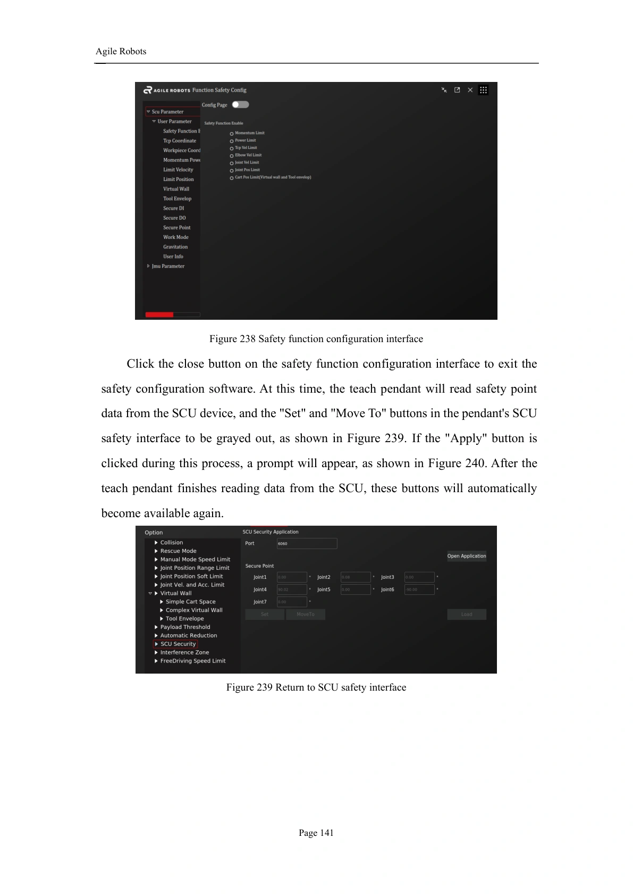



```
Agile Robots 
Page 141 
 
 
Figure 238 Safety function configuration interface 
Click the close button on the safety function configuration interface to exit the 
safety configuration software. At this time, the teach pendant will read safety point 
data from the SCU device, and the "Set" and "Move To" buttons in the pendant's SCU 
safety interface to be grayed out, as shown in Figure 239. If the "Apply" button is 
clicked during this process, a prompt will appear, as shown in Figure 240. After the 
teach pendant finishes reading data from the SCU, these buttons will automatically 
become available again. 
 
Figure 239 Return to SCU safety interface
```



**Original document cross-references:** [PDF 145](pages-145-216.md#pdf-page-145) · [PDF 146](pages-145-216.md#pdf-page-146)

## PDF page 146

**Source:** Industrial Teaching Pendant Software User Manual\_V3.3.0\_EN\_20260204.pdf, original pdf page 146. [Open the corresponding PDF reading-copy page](https://1292444914-files.gitbook.io/~/files/v0/b/gitbook-x-prod.appspot.com/o/spaces%2FtgOfPnscWebs1eh82EKq%2Fuploads%2FaMlfTDpCBu5LV2qkhkqC%2Findustrial-teaching-pendant-software-user-manual-v3-3-0-en-20260204-pp-145-150.pdf?alt=media#page=2).



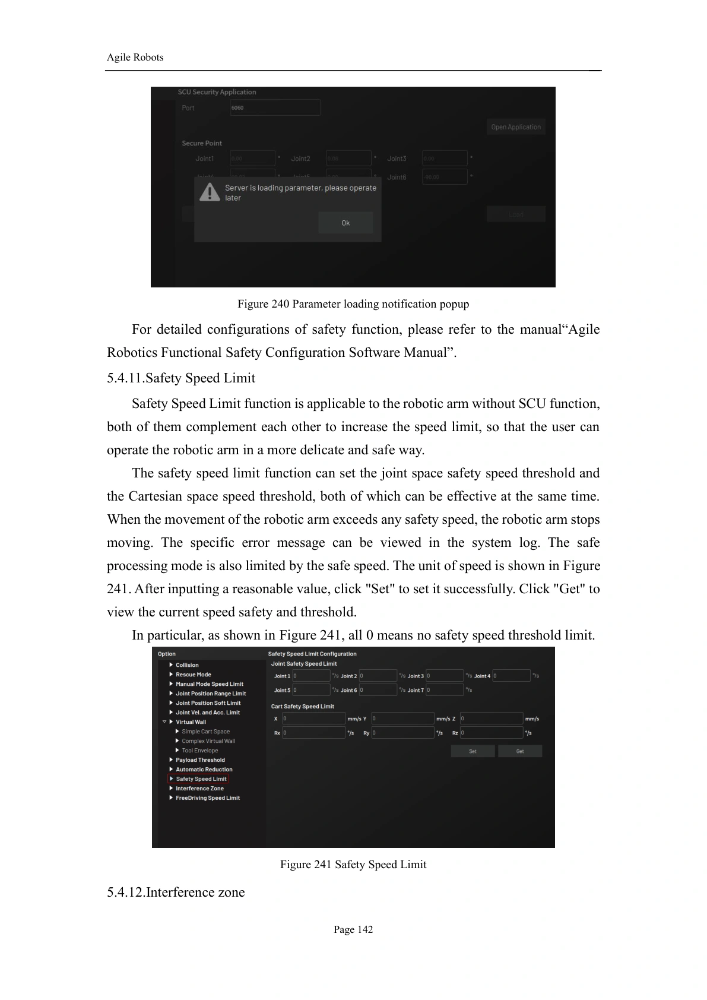



```
Agile Robots 
Page 142 
 
 
Figure 240 Parameter loading notification popup 
For detailed configurations of safety function, please refer to the manual“Agile 
Robotics Functional Safety Configuration Software Manual”. 
5.4.11.Safety Speed Limit 
Safety Speed Limit function is applicable to the robotic arm without SCU function, 
both of them complement each other to increase the speed limit, so that the user can 
operate the robotic arm in a more delicate and safe way. 
The safety speed limit function can set the joint space safety speed threshold and 
the Cartesian space speed threshold, both of which can be effective at the same time. 
When the movement of the robotic arm exceeds any safety speed, the robotic arm stops 
moving. The specific error message can be viewed in the system log. The safe 
processing mode is also limited by the safe speed. The unit of speed is shown in Figure 
241. After inputting a reasonable value, click "Set" to set it successfully. Click "Get" to 
view the current speed safety and threshold. 
In particular, as shown in Figure 241, all 0 means no safety speed threshold limit. 
 
Figure 241 Safety Speed Limit 
5.4.12.Interference zone
```



**Original document cross-references:** [PDF 146](pages-145-216.md#pdf-page-146)

## PDF page 147

**Source:** Industrial Teaching Pendant Software User Manual\_V3.3.0\_EN\_20260204.pdf, original pdf page 147. [Open the corresponding PDF reading-copy page](https://1292444914-files.gitbook.io/~/files/v0/b/gitbook-x-prod.appspot.com/o/spaces%2FtgOfPnscWebs1eh82EKq%2Fuploads%2FaMlfTDpCBu5LV2qkhkqC%2Findustrial-teaching-pendant-software-user-manual-v3-3-0-en-20260204-pp-145-150.pdf?alt=media#page=3).



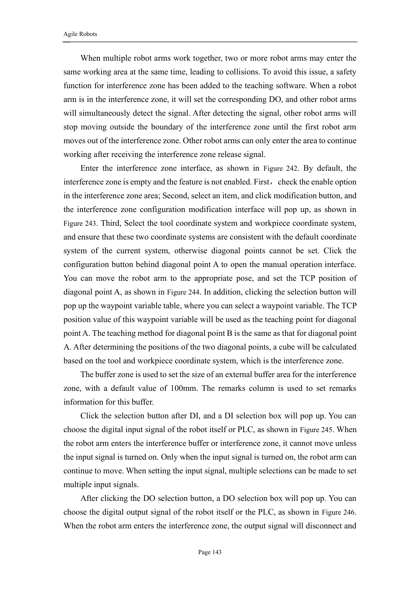



```
Agile Robots 
Page 143 
 
When multiple robot arms work together, two or more robot arms may enter the 
same working area at the same time, leading to collisions. To avoid this issue, a safety 
function for interference zone has been added to the teaching software. When a robot 
arm is in the interference zone, it will set the corresponding DO, and other robot arms 
will simultaneously detect the signal. After detecting the signal, other robot arms will 
stop moving outside the boundary of the interference zone until the first robot arm 
moves out of the interference zone. Other robot arms can only enter the area to continue 
working after receiving the interference zone release signal. 
Enter the interference zone interface, as shown in Figure 242. By default, the 
interference zone is empty and the feature is not enabled. First，check the enable option 
in the interference zone area; Second, select an item, and click modification button, and 
the interference zone configuration modification interface will pop up, as shown in 
Figure 243. Third, Select the tool coordinate system and workpiece coordinate system, 
and ensure that these two coordinate systems are consistent with the default coordinate 
system of the current system, otherwise diagonal points cannot be set. Click the 
configuration button behind diagonal point A to open the manual operation interface. 
You can move the robot arm to the appropriate pose, and set the TCP position of 
diagonal point A, as shown in Figure 244. In addition, clicking the selection button will 
pop up the waypoint variable table, where you can select a waypoint variable. The TCP 
position value of this waypoint variable will be used as the teaching point for diagonal 
point A. The teaching method for diagonal point B is the same as that for diagonal point 
A. After determining the positions of the two diagonal points, a cube will be calculated 
based on the tool and workpiece coordinate system, which is the interference zone. 
The buffer zone is used to set the size of an external buffer area for the interference 
zone, with a default value of 100mm. The remarks column is used to set remarks 
information for this buffer. 
Click the selection button after DI, and a DI selection box will pop up. You can 
choose the digital input signal of the robot itself or PLC, as shown in Figure 245. When 
the robot arm enters the interference buffer or interference zone, it cannot move unless 
the input signal is turned on. Only when the input signal is turned on, the robot arm can 
continue to move. When setting the input signal, multiple selections can be made to set 
multiple input signals. 
After clicking the DO selection button, a DO selection box will pop up. You can 
choose the digital output signal of the robot itself or the PLC, as shown in Figure 246. 
When the robot arm enters the interference zone, the output signal will disconnect and
```



**Original document cross-references:** [PDF 148](pages-145-216.md#pdf-page-148) · [PDF 149](pages-145-216.md#pdf-page-149) · [PDF 150](pages-145-216.md#pdf-page-150)

## PDF page 148

**Source:** Industrial Teaching Pendant Software User Manual\_V3.3.0\_EN\_20260204.pdf, original pdf page 148. [Open the corresponding PDF reading-copy page](https://1292444914-files.gitbook.io/~/files/v0/b/gitbook-x-prod.appspot.com/o/spaces%2FtgOfPnscWebs1eh82EKq%2Fuploads%2FaMlfTDpCBu5LV2qkhkqC%2Findustrial-teaching-pendant-software-user-manual-v3-3-0-en-20260204-pp-145-150.pdf?alt=media#page=4).



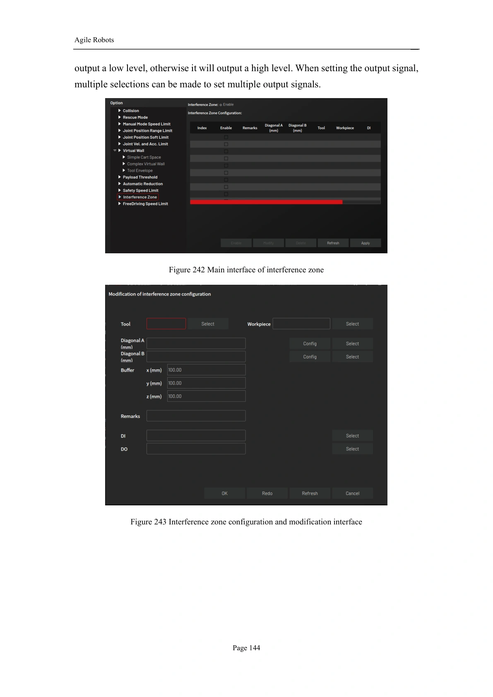



```
Agile Robots 
Page 144 
 
output a low level, otherwise it will output a high level. When setting the output signal, 
multiple selections can be made to set multiple output signals. 
 
Figure 242 Main interface of interference zone 
 
Figure 243 Interference zone configuration and modification interface
```



## PDF page 149

**Source:** Industrial Teaching Pendant Software User Manual\_V3.3.0\_EN\_20260204.pdf, original pdf page 149. [Open the corresponding PDF reading-copy page](https://1292444914-files.gitbook.io/~/files/v0/b/gitbook-x-prod.appspot.com/o/spaces%2FtgOfPnscWebs1eh82EKq%2Fuploads%2FaMlfTDpCBu5LV2qkhkqC%2Findustrial-teaching-pendant-software-user-manual-v3-3-0-en-20260204-pp-145-150.pdf?alt=media#page=5).



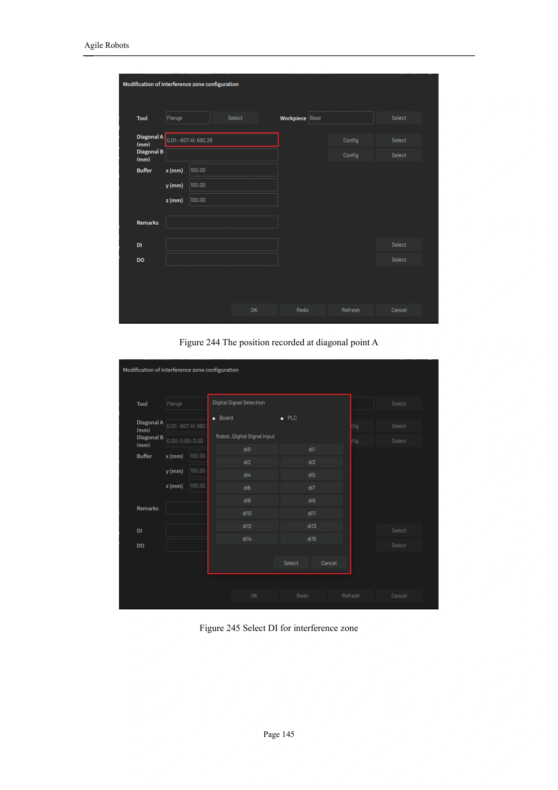



```
Agile Robots 
Page 145 
 
 
Figure 244 The position recorded at diagonal point A 
 
Figure 245 Select DI for interference zone
```



## PDF page 150

**Source:** Industrial Teaching Pendant Software User Manual\_V3.3.0\_EN\_20260204.pdf, original pdf page 150. [Open the corresponding PDF reading-copy page](https://1292444914-files.gitbook.io/~/files/v0/b/gitbook-x-prod.appspot.com/o/spaces%2FtgOfPnscWebs1eh82EKq%2Fuploads%2FaMlfTDpCBu5LV2qkhkqC%2Findustrial-teaching-pendant-software-user-manual-v3-3-0-en-20260204-pp-145-150.pdf?alt=media#page=6).



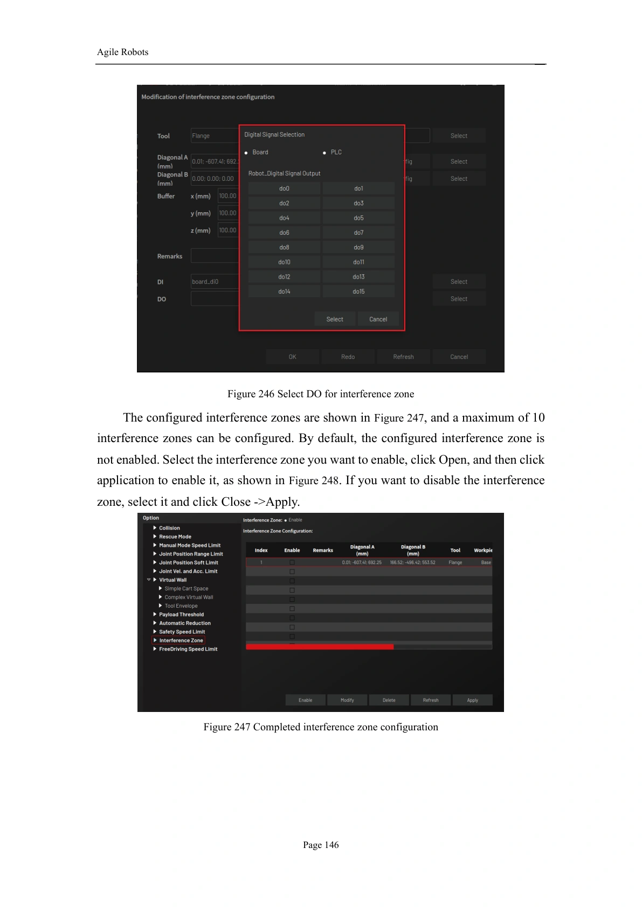



```
Agile Robots 
Page 146 
 
 
Figure 246 Select DO for interference zone 
The configured interference zones are shown in Figure 247, and a maximum of 10 
interference zones can be configured. By default, the configured interference zone is 
not enabled. Select the interference zone you want to enable, click Open, and then click 
application to enable it, as shown in Figure 248. If you want to disable the interference 
zone, select it and click Close ->Apply. 
 
Figure 247 Completed interference zone configuration
```



**Original document cross-references:** [PDF 150](pages-145-216.md#pdf-page-150) · [PDF 151](pages-145-216.md#pdf-page-151)

## PDF page 151

**Source:** Industrial Teaching Pendant Software User Manual\_V3.3.0\_EN\_20260204.pdf, original pdf page 151. [Open the corresponding PDF reading-copy page](https://1292444914-files.gitbook.io/~/files/v0/b/gitbook-x-prod.appspot.com/o/spaces%2FtgOfPnscWebs1eh82EKq%2Fuploads%2F3rffINHNLUPY7TDJlJnr%2Findustrial-teaching-pendant-software-user-manual-v3-3-0-en-20260204-pp-151-154.pdf?alt=media#page=1).



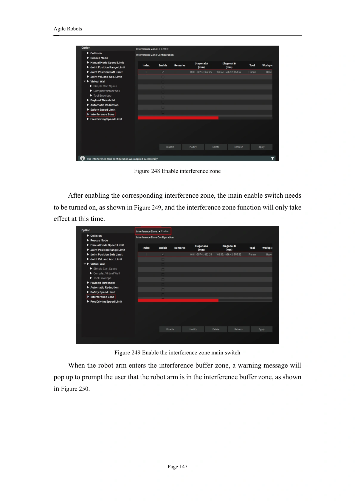



```
Agile Robots 
Page 147 
 
 
Figure 248 Enable interference zone 
 
After enabling the corresponding interference zone, the main enable switch needs 
to be turned on, as shown in Figure 249, and the interference zone function will only take 
effect at this time.  
 
Figure 249 Enable the interference zone main switch 
When the robot arm enters the interference buffer zone, a warning message will 
pop up to prompt the user that the robot arm is in the interference buffer zone, as shown 
in Figure 250.
```



**Original document cross-references:** [PDF 151](pages-145-216.md#pdf-page-151) · [PDF 152](pages-145-216.md#pdf-page-152)

## PDF page 152

**Source:** Industrial Teaching Pendant Software User Manual\_V3.3.0\_EN\_20260204.pdf, original pdf page 152. [Open the corresponding PDF reading-copy page](https://1292444914-files.gitbook.io/~/files/v0/b/gitbook-x-prod.appspot.com/o/spaces%2FtgOfPnscWebs1eh82EKq%2Fuploads%2F3rffINHNLUPY7TDJlJnr%2Findustrial-teaching-pendant-software-user-manual-v3-3-0-en-20260204-pp-151-154.pdf?alt=media#page=2).



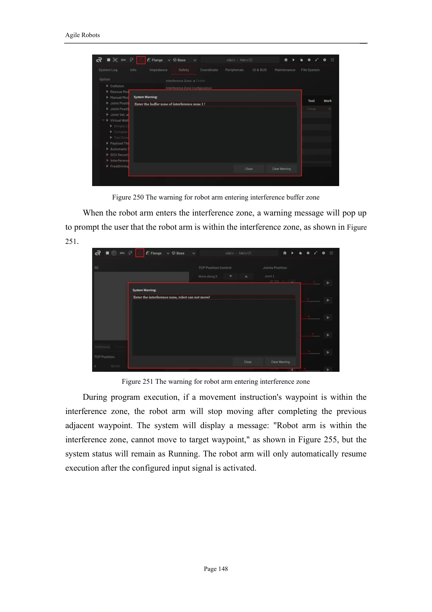



```
Agile Robots 
Page 148 
 
 
Figure 250 The warning for robot arm entering interference buffer zone 
When the robot arm enters the interference zone, a warning message will pop up 
to prompt the user that the robot arm is within the interference zone, as shown in Figure 
251. 
 
Figure 251 The warning for robot arm entering interference zone 
During program execution, if a movement instruction's waypoint is within the 
interference zone, the robot arm will stop moving after completing the previous 
adjacent waypoint. The system will display a message: "Robot arm is within the 
interference zone, cannot move to target waypoint," as shown in Figure 255, but the 
system status will remain as Running. The robot arm will only automatically resume 
execution after the configured input signal is activated.
```



**Original document cross-references:** [PDF 152](pages-145-216.md#pdf-page-152)

## PDF page 153

**Source:** Industrial Teaching Pendant Software User Manual\_V3.3.0\_EN\_20260204.pdf, original pdf page 153. [Open the corresponding PDF reading-copy page](https://1292444914-files.gitbook.io/~/files/v0/b/gitbook-x-prod.appspot.com/o/spaces%2FtgOfPnscWebs1eh82EKq%2Fuploads%2F3rffINHNLUPY7TDJlJnr%2Findustrial-teaching-pendant-software-user-manual-v3-3-0-en-20260204-pp-151-154.pdf?alt=media#page=3).



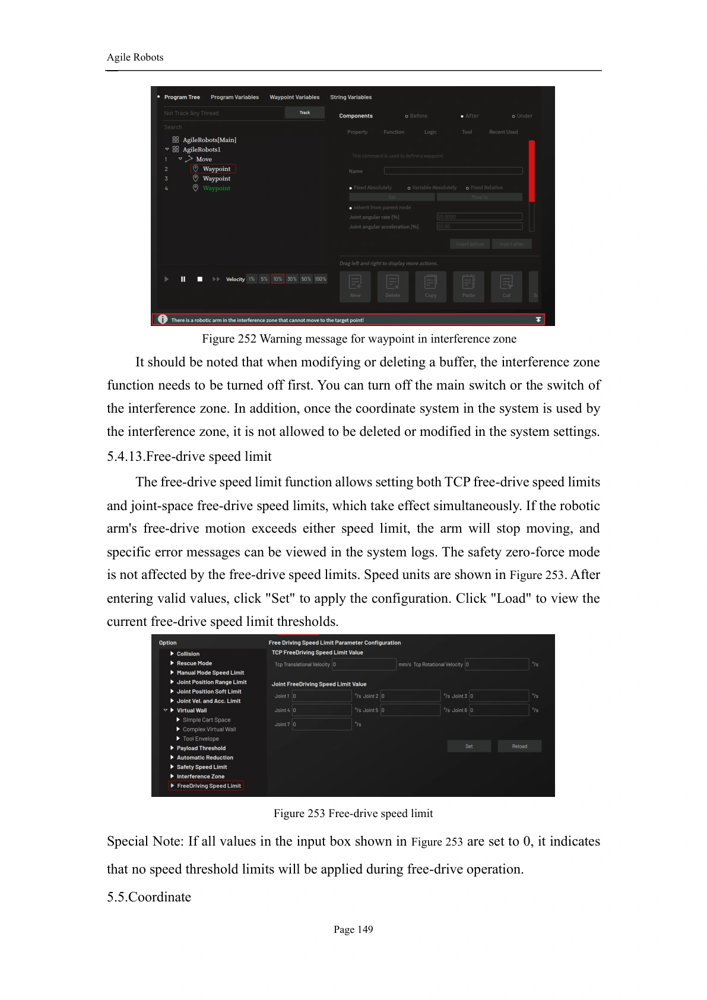



```
Agile Robots 
Page 149 
 
 
Figure 252 Warning message for waypoint in interference zone 
It should be noted that when modifying or deleting a buffer, the interference zone 
function needs to be turned off first. You can turn off the main switch or the switch of 
the interference zone. In addition, once the coordinate system in the system is used by 
the interference zone, it is not allowed to be deleted or modified in the system settings. 
5.4.13.Free-drive speed limit 
The free-drive speed limit function allows setting both TCP free-drive speed limits 
and joint-space free-drive speed limits, which take effect simultaneously. If the robotic 
arm's free-drive motion exceeds either speed limit, the arm will stop moving, and 
specific error messages can be viewed in the system logs. The safety zero-force mode 
is not affected by the free-drive speed limits. Speed units are shown in Figure 253. After 
entering valid values, click "Set" to apply the configuration. Click "Load" to view the 
current free-drive speed limit thresholds. 
 
Figure 253 Free-drive speed limit 
Special Note: If all values in the input box shown in Figure 253 are set to 0, it indicates 
that no speed threshold limits will be applied during free-drive operation. 
5.5.Coordinate
```



**Original document cross-references:** [PDF 153](pages-145-216.md#pdf-page-153)

## PDF page 154

**Source:** Industrial Teaching Pendant Software User Manual\_V3.3.0\_EN\_20260204.pdf, original pdf page 154. [Open the corresponding PDF reading-copy page](https://1292444914-files.gitbook.io/~/files/v0/b/gitbook-x-prod.appspot.com/o/spaces%2FtgOfPnscWebs1eh82EKq%2Fuploads%2F3rffINHNLUPY7TDJlJnr%2Findustrial-teaching-pendant-software-user-manual-v3-3-0-en-20260204-pp-151-154.pdf?alt=media#page=4).



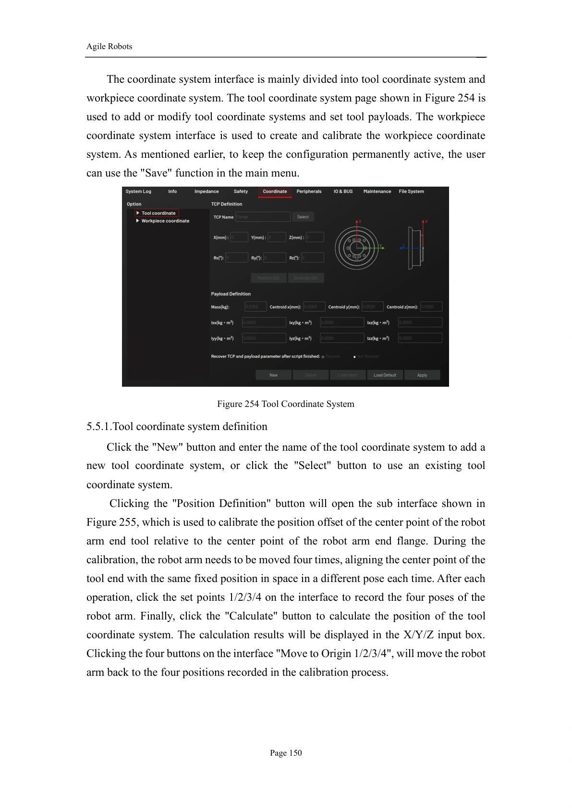



```
Agile Robots 
Page 150 
 
 
The coordinate system interface is mainly divided into tool coordinate system and 
workpiece coordinate system. The tool coordinate system page shown in Figure 254 is 
used to add or modify tool coordinate systems and set tool payloads. The workpiece 
coordinate system interface is used to create and calibrate the workpiece coordinate 
system. As mentioned earlier, to keep the configuration permanently active, the user 
can use the "Save" function in the main menu.  
 
Figure 254 Tool Coordinate System 
5.5.1.Tool coordinate system definition  
Click the "New" button and enter the name of the tool coordinate system to add a 
new tool coordinate system, or click the "Select" button to use an existing tool 
coordinate system.  
Clicking the "Position Definition" button will open the sub interface shown in 
Figure 255, which is used to calibrate the position offset of the center point of the robot 
arm end tool relative to the center point of the robot arm end flange. During the 
calibration, the robot arm needs to be moved four times, aligning the center point of the 
tool end with the same fixed position in space in a different pose each time. After each 
operation, click the set points 1/2/3/4 on the interface to record the four poses of the 
robot arm. Finally, click the "Calculate" button to calculate the position of the tool 
coordinate system. The calculation results will be displayed in the X/Y/Z input box. 
Clicking the four buttons on the interface "Move to Origin 1/2/3/4", will move the robot 
arm back to the four positions recorded in the calibration process.
```



**Original document cross-references:** [PDF 154](pages-145-216.md#pdf-page-154) · [PDF 155](pages-145-216.md#pdf-page-155)

## PDF page 155

**Source:** Industrial Teaching Pendant Software User Manual\_V3.3.0\_EN\_20260204.pdf, original pdf page 155. [Open the corresponding PDF reading-copy page](https://1292444914-files.gitbook.io/~/files/v0/b/gitbook-x-prod.appspot.com/o/spaces%2FtgOfPnscWebs1eh82EKq%2Fuploads%2FN0XNYQihbVUwDZS94zIP%2Findustrial-teaching-pendant-software-user-manual-v3-3-0-en-20260204-pp-155-161.pdf?alt=media#page=1).



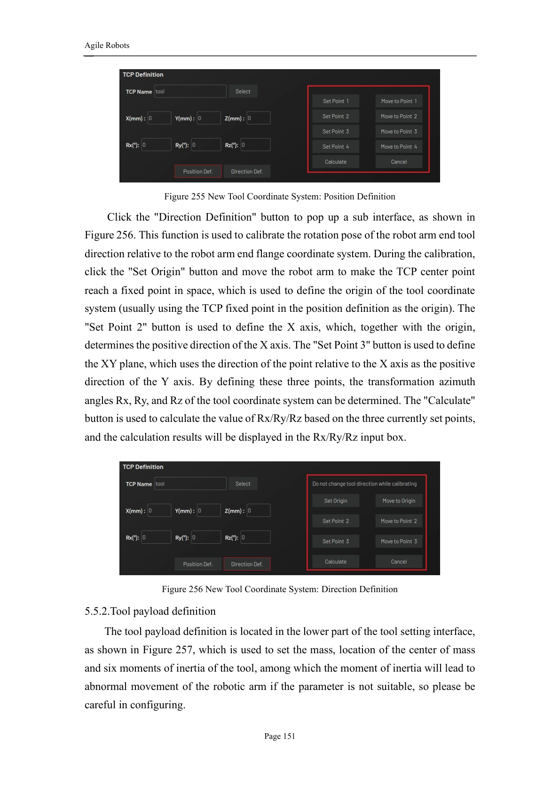



```
Agile Robots 
Page 151 
 
 
Figure 255 New Tool Coordinate System: Position Definition 
Click the "Direction Definition" button to pop up a sub interface, as shown in 
Figure 256. This function is used to calibrate the rotation pose of the robot arm end tool 
direction relative to the robot arm end flange coordinate system. During the calibration, 
click the "Set Origin" button and move the robot arm to make the TCP center point 
reach a fixed point in space, which is used to define the origin of the tool coordinate 
system (usually using the TCP fixed point in the position definition as the origin). The 
"Set Point 2" button is used to define the X axis, which, together with the origin, 
determines the positive direction of the X axis. The "Set Point 3" button is used to define 
the XY plane, which uses the direction of the point relative to the X axis as the positive 
direction of the Y axis. By defining these three points, the transformation azimuth 
angles Rx, Ry, and Rz of the tool coordinate system can be determined. The "Calculate" 
button is used to calculate the value of Rx/Ry/Rz based on the three currently set points, 
and the calculation results will be displayed in the Rx/Ry/Rz input box.  
 
 
Figure 256 New Tool Coordinate System: Direction Definition  
5.5.2.Tool payload definition  
 
The tool payload definition is located in the lower part of the tool setting interface, 
as shown in Figure 257, which is used to set the mass, location of the center of mass 
and six moments of inertia of the tool, among which the moment of inertia will lead to 
abnormal movement of the robotic arm if the parameter is not suitable, so please be 
careful in configuring.
```



**Original document cross-references:** [PDF 155](pages-145-216.md#pdf-page-155) · [PDF 156](pages-145-216.md#pdf-page-156)

## PDF page 156

**Source:** Industrial Teaching Pendant Software User Manual\_V3.3.0\_EN\_20260204.pdf, original pdf page 156. [Open the corresponding PDF reading-copy page](https://1292444914-files.gitbook.io/~/files/v0/b/gitbook-x-prod.appspot.com/o/spaces%2FtgOfPnscWebs1eh82EKq%2Fuploads%2FN0XNYQihbVUwDZS94zIP%2Findustrial-teaching-pendant-software-user-manual-v3-3-0-en-20260204-pp-155-161.pdf?alt=media#page=2).



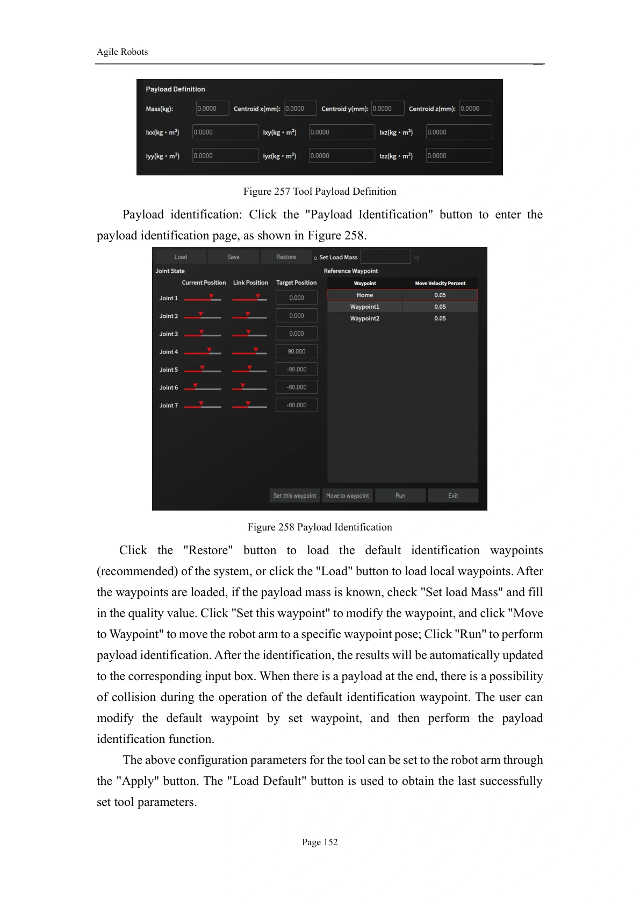



```
Agile Robots 
Page 152 
 
 
Figure 257 Tool Payload Definition 
Payload identification: Click the "Payload Identification" button to enter the 
payload identification page, as shown in Figure 258.  
 
Figure 258 Payload Identification 
 
Click the "Restore" button to load the default identification waypoints 
(recommended) of the system, or click the "Load" button to load local waypoints. After 
the waypoints are loaded, if the payload mass is known, check "Set load Mass" and fill 
in the quality value. Click "Set this waypoint" to modify the waypoint, and click "Move 
to Waypoint" to move the robot arm to a specific waypoint pose; Click "Run" to perform 
payload identification. After the identification, the results will be automatically updated 
to the corresponding input box. When there is a payload at the end, there is a possibility 
of collision during the operation of the default identification waypoint. The user can 
modify the default waypoint by set waypoint, and then perform the payload 
identification function.  
The above configuration parameters for the tool can be set to the robot arm through 
the "Apply" button. The "Load Default" button is used to obtain the last successfully 
set tool parameters.
```



**Original document cross-references:** [PDF 156](pages-145-216.md#pdf-page-156)

## PDF page 157

**Source:** Industrial Teaching Pendant Software User Manual\_V3.3.0\_EN\_20260204.pdf, original pdf page 157. [Open the corresponding PDF reading-copy page](https://1292444914-files.gitbook.io/~/files/v0/b/gitbook-x-prod.appspot.com/o/spaces%2FtgOfPnscWebs1eh82EKq%2Fuploads%2FN0XNYQihbVUwDZS94zIP%2Findustrial-teaching-pendant-software-user-manual-v3-3-0-en-20260204-pp-155-161.pdf?alt=media#page=3).



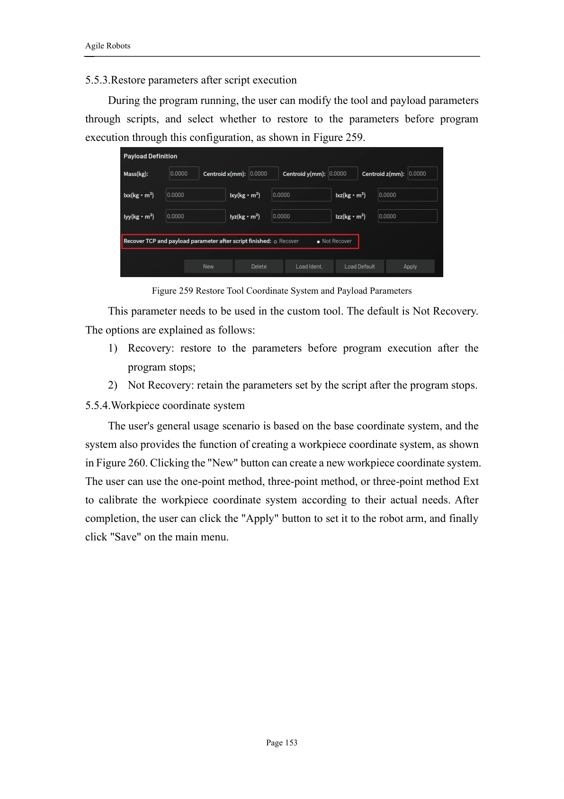



```
Agile Robots 
Page 153 
 
5.5.3.Restore parameters after script execution  
During the program running, the user can modify the tool and payload parameters 
through scripts, and select whether to restore to the parameters before program 
execution through this configuration, as shown in Figure 259.  
 
Figure 259 Restore Tool Coordinate System and Payload Parameters 
This parameter needs to be used in the custom tool. The default is Not Recovery. 
The options are explained as follows:  
1)  Recovery: restore to the parameters before program execution after the 
program stops;  
2)  Not Recovery: retain the parameters set by the script after the program stops.  
5.5.4.Workpiece coordinate system  
The user's general usage scenario is based on the base coordinate system, and the 
system also provides the function of creating a workpiece coordinate system, as shown 
in Figure 260. Clicking the "New" button can create a new workpiece coordinate system. 
The user can use the one-point method, three-point method, or three-point method Ext 
to calibrate the workpiece coordinate system according to their actual needs. After 
completion, the user can click the "Apply" button to set it to the robot arm, and finally 
click "Save" on the main menu.
```



**Original document cross-references:** [PDF 157](pages-145-216.md#pdf-page-157) · [PDF 158](pages-145-216.md#pdf-page-158)

## PDF page 158

**Source:** Industrial Teaching Pendant Software User Manual\_V3.3.0\_EN\_20260204.pdf, original pdf page 158. [Open the corresponding PDF reading-copy page](https://1292444914-files.gitbook.io/~/files/v0/b/gitbook-x-prod.appspot.com/o/spaces%2FtgOfPnscWebs1eh82EKq%2Fuploads%2FN0XNYQihbVUwDZS94zIP%2Findustrial-teaching-pendant-software-user-manual-v3-3-0-en-20260204-pp-155-161.pdf?alt=media#page=4).



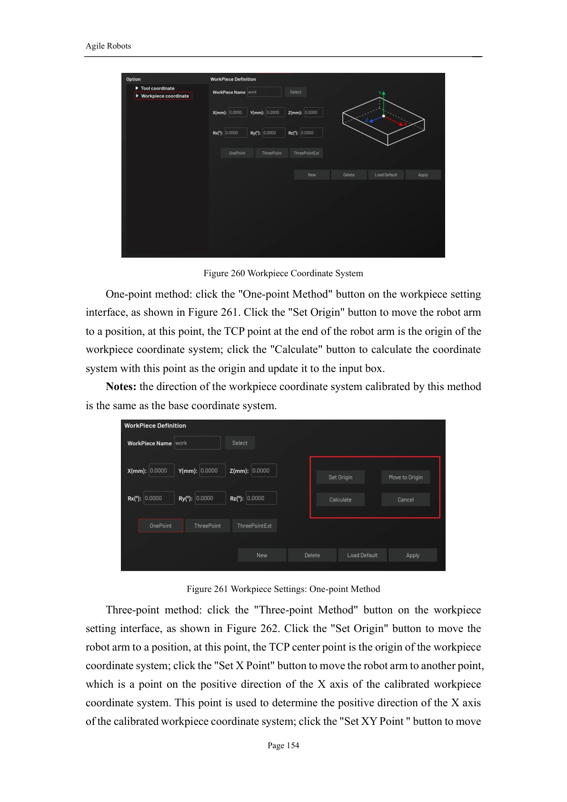



```
Agile Robots 
Page 154 
 
 
Figure 260 Workpiece Coordinate System 
One-point method: click the "One-point Method" button on the workpiece setting 
interface, as shown in Figure 261. Click the "Set Origin" button to move the robot arm 
to a position, at this point, the TCP point at the end of the robot arm is the origin of the 
workpiece coordinate system; click the "Calculate" button to calculate the coordinate 
system with this point as the origin and update it to the input box.  
Notes: the direction of the workpiece coordinate system calibrated by this method 
is the same as the base coordinate system.  
 
Figure 261 Workpiece Settings: One-point Method 
Three-point method: click the "Three-point Method" button on the workpiece 
setting interface, as shown in Figure 262. Click the "Set Origin" button to move the 
robot arm to a position, at this point, the TCP center point is the origin of the workpiece 
coordinate system; click the "Set X Point" button to move the robot arm to another point, 
which is a point on the positive direction of the X axis of the calibrated workpiece 
coordinate system. This point is used to determine the positive direction of the X axis 
of the calibrated workpiece coordinate system; click the "Set XY Point " button to move
```



**Original document cross-references:** [PDF 158](pages-145-216.md#pdf-page-158) · [PDF 159](pages-145-216.md#pdf-page-159)

## PDF page 159

**Source:** Industrial Teaching Pendant Software User Manual\_V3.3.0\_EN\_20260204.pdf, original pdf page 159. [Open the corresponding PDF reading-copy page](https://1292444914-files.gitbook.io/~/files/v0/b/gitbook-x-prod.appspot.com/o/spaces%2FtgOfPnscWebs1eh82EKq%2Fuploads%2FN0XNYQihbVUwDZS94zIP%2Findustrial-teaching-pendant-software-user-manual-v3-3-0-en-20260204-pp-155-161.pdf?alt=media#page=5).



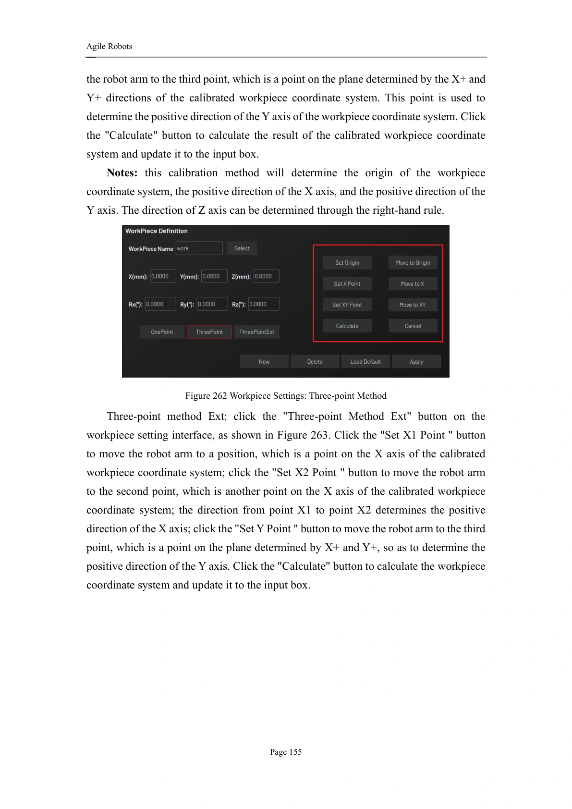



```
Agile Robots 
Page 155 
 
the robot arm to the third point, which is a point on the plane determined by the X+ and 
Y+ directions of the calibrated workpiece coordinate system. This point is used to 
determine the positive direction of the Y axis of the workpiece coordinate system. Click 
the "Calculate" button to calculate the result of the calibrated workpiece coordinate 
system and update it to the input box.  
Notes: this calibration method will determine the origin of the workpiece 
coordinate system, the positive direction of the X axis, and the positive direction of the 
Y axis. The direction of Z axis can be determined through the right-hand rule.  
 
Figure 262 Workpiece Settings: Three-point Method 
Three-point method Ext: click the "Three-point Method Ext" button on the 
workpiece setting interface, as shown in Figure 263. Click the "Set X1 Point " button 
to move the robot arm to a position, which is a point on the X axis of the calibrated 
workpiece coordinate system; click the "Set X2 Point " button to move the robot arm 
to the second point, which is another point on the X axis of the calibrated workpiece 
coordinate system; the direction from point X1 to point X2 determines the positive 
direction of the X axis; click the "Set Y Point " button to move the robot arm to the third 
point, which is a point on the plane determined by X+ and Y+, so as to determine the 
positive direction of the Y axis. Click the "Calculate" button to calculate the workpiece 
coordinate system and update it to the input box.
```



**Original document cross-references:** [PDF 160](pages-145-216.md#pdf-page-160)

## PDF page 160

**Source:** Industrial Teaching Pendant Software User Manual\_V3.3.0\_EN\_20260204.pdf, original pdf page 160. [Open the corresponding PDF reading-copy page](https://1292444914-files.gitbook.io/~/files/v0/b/gitbook-x-prod.appspot.com/o/spaces%2FtgOfPnscWebs1eh82EKq%2Fuploads%2FN0XNYQihbVUwDZS94zIP%2Findustrial-teaching-pendant-software-user-manual-v3-3-0-en-20260204-pp-155-161.pdf?alt=media#page=6).



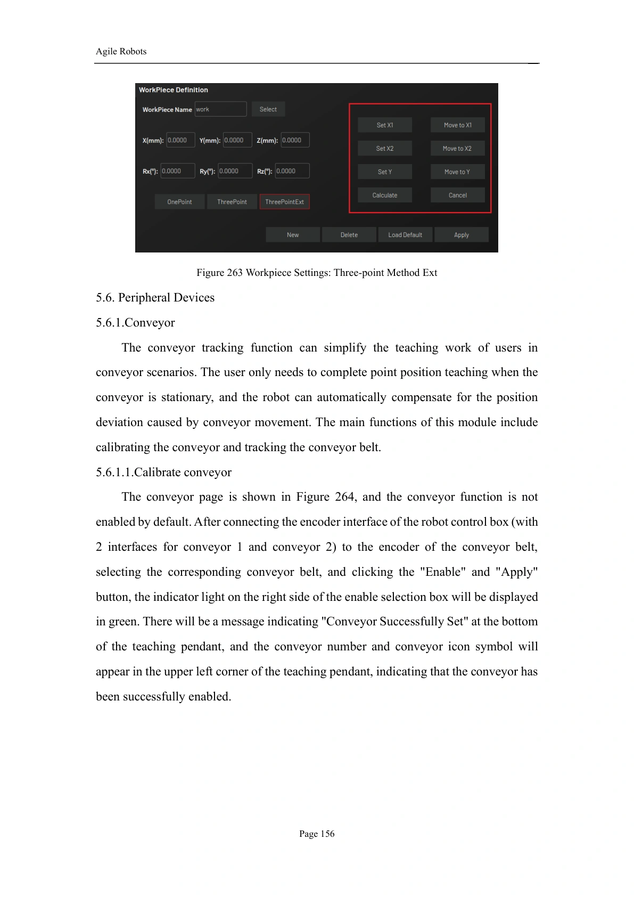



```
Agile Robots 
Page 156 
 
 
Figure 263 Workpiece Settings: Three-point Method Ext 
5.6. Peripheral Devices   
5.6.1.Conveyor  
The conveyor tracking function can simplify the teaching work of users in 
conveyor scenarios. The user only needs to complete point position teaching when the 
conveyor is stationary, and the robot can automatically compensate for the position 
deviation caused by conveyor movement. The main functions of this module include 
calibrating the conveyor and tracking the conveyor belt.  
5.6.1.1.Calibrate conveyor  
The conveyor page is shown in Figure 264, and the conveyor function is not 
enabled by default. After connecting the encoder interface of the robot control box (with 
2 interfaces for conveyor 1 and conveyor 2) to the encoder of the conveyor belt, 
selecting the corresponding conveyor belt, and clicking the "Enable" and "Apply" 
button, the indicator light on the right side of the enable selection box will be displayed 
in green. There will be a message indicating "Conveyor Successfully Set" at the bottom 
of the teaching pendant, and the conveyor number and conveyor icon symbol will 
appear in the upper left corner of the teaching pendant, indicating that the conveyor has 
been successfully enabled.
```



**Original document cross-references:** [PDF 161](pages-145-216.md#pdf-page-161)

## PDF page 161

**Source:** Industrial Teaching Pendant Software User Manual\_V3.3.0\_EN\_20260204.pdf, original pdf page 161. [Open the corresponding PDF reading-copy page](https://1292444914-files.gitbook.io/~/files/v0/b/gitbook-x-prod.appspot.com/o/spaces%2FtgOfPnscWebs1eh82EKq%2Fuploads%2FN0XNYQihbVUwDZS94zIP%2Findustrial-teaching-pendant-software-user-manual-v3-3-0-en-20260204-pp-155-161.pdf?alt=media#page=7).



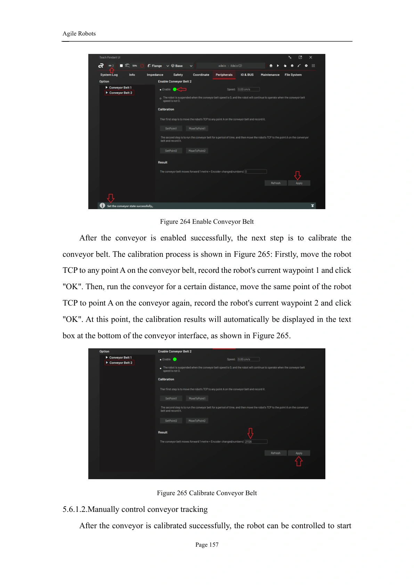



```
Agile Robots 
Page 157 
 
 
Figure 264 Enable Conveyor Belt 
After the conveyor is enabled successfully, the next step is to calibrate the 
conveyor belt. The calibration process is shown in Figure 265: Firstly, move the robot 
TCP to any point A on the conveyor belt, record the robot's current waypoint 1 and click 
"OK". Then, run the conveyor for a certain distance, move the same point of the robot 
TCP to point A on the conveyor again, record the robot's current waypoint 2 and click 
"OK". At this point, the calibration results will automatically be displayed in the text 
box at the bottom of the conveyor interface, as shown in Figure 265.  
 
Figure 265 Calibrate Conveyor Belt 
5.6.1.2.Manually control conveyor tracking  
After the conveyor is calibrated successfully, the robot can be controlled to start
```



**Original document cross-references:** [PDF 161](pages-145-216.md#pdf-page-161)

## PDF page 162

**Source:** Industrial Teaching Pendant Software User Manual\_V3.3.0\_EN\_20260204.pdf, original pdf page 162. [Open the corresponding PDF reading-copy page](https://1292444914-files.gitbook.io/~/files/v0/b/gitbook-x-prod.appspot.com/o/spaces%2FtgOfPnscWebs1eh82EKq%2Fuploads%2FmOIcjHG6BaZxyxh0MX3B%2Findustrial-teaching-pendant-software-user-manual-v3-3-0-en-20260204-pp-162-169.pdf?alt=media#page=1).



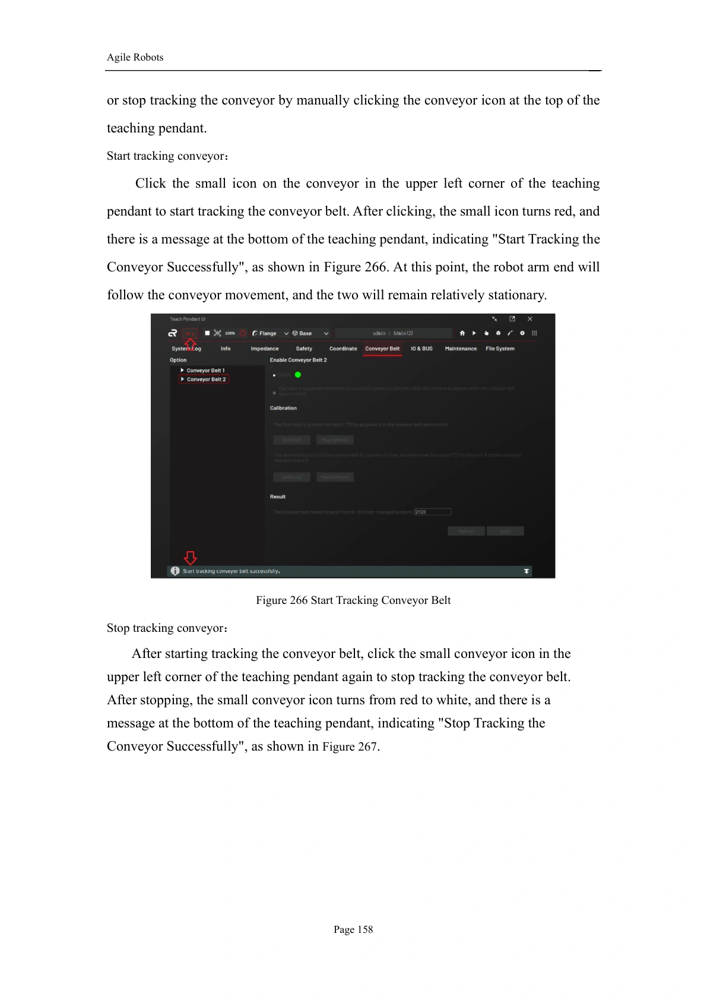



```
Agile Robots 
Page 158 
 
or stop tracking the conveyor by manually clicking the conveyor icon at the top of the 
teaching pendant.  
Start tracking conveyor：  
Click the small icon on the conveyor in the upper left corner of the teaching 
pendant to start tracking the conveyor belt. After clicking, the small icon turns red, and 
there is a message at the bottom of the teaching pendant, indicating "Start Tracking the 
Conveyor Successfully", as shown in Figure 266. At this point, the robot arm end will 
follow the conveyor movement, and the two will remain relatively stationary.  
 
Figure 266 Start Tracking Conveyor Belt 
Stop tracking conveyor：  
After starting tracking the conveyor belt, click the small conveyor icon in the 
upper left corner of the teaching pendant again to stop tracking the conveyor belt. 
After stopping, the small conveyor icon turns from red to white, and there is a 
message at the bottom of the teaching pendant, indicating "Stop Tracking the 
Conveyor Successfully", as shown in Figure 267.
```



**Original document cross-references:** [PDF 162](pages-145-216.md#pdf-page-162) · [PDF 163](pages-145-216.md#pdf-page-163)

## PDF page 163

**Source:** Industrial Teaching Pendant Software User Manual\_V3.3.0\_EN\_20260204.pdf, original pdf page 163. [Open the corresponding PDF reading-copy page](https://1292444914-files.gitbook.io/~/files/v0/b/gitbook-x-prod.appspot.com/o/spaces%2FtgOfPnscWebs1eh82EKq%2Fuploads%2FmOIcjHG6BaZxyxh0MX3B%2Findustrial-teaching-pendant-software-user-manual-v3-3-0-en-20260204-pp-162-169.pdf?alt=media#page=2).



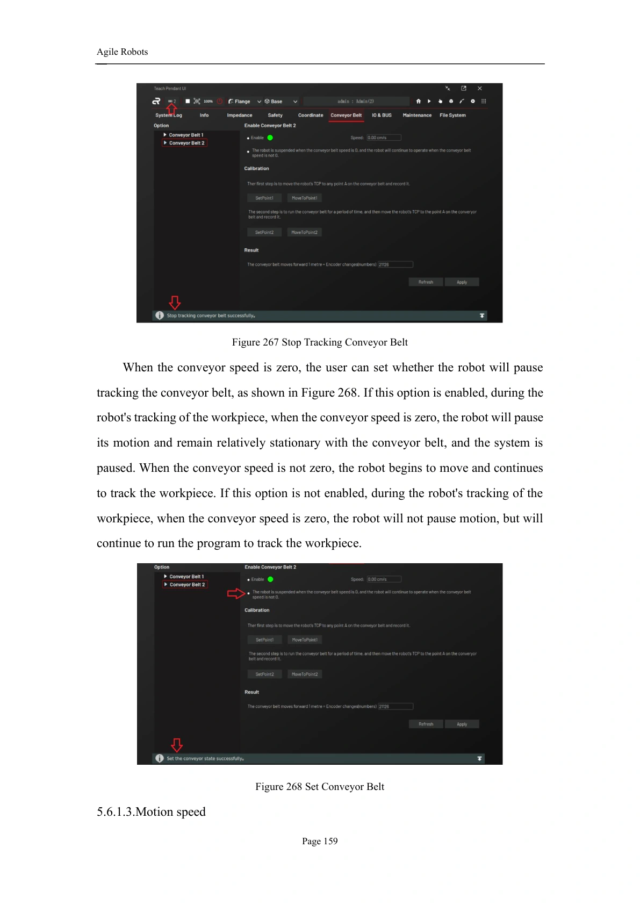



```
Agile Robots 
Page 159 
 
 
Figure 267 Stop Tracking Conveyor Belt 
When the conveyor speed is zero, the user can set whether the robot will pause 
tracking the conveyor belt, as shown in Figure 268. If this option is enabled, during the 
robot's tracking of the workpiece, when the conveyor speed is zero, the robot will pause 
its motion and remain relatively stationary with the conveyor belt, and the system is 
paused. When the conveyor speed is not zero, the robot begins to move and continues 
to track the workpiece. If this option is not enabled, during the robot's tracking of the 
workpiece, when the conveyor speed is zero, the robot will not pause motion, but will 
continue to run the program to track the workpiece.  
 
Figure 268 Set Conveyor Belt 
5.6.1.3.Motion speed
```



**Original document cross-references:** [PDF 163](pages-145-216.md#pdf-page-163)

## PDF page 164

**Source:** Industrial Teaching Pendant Software User Manual\_V3.3.0\_EN\_20260204.pdf, original pdf page 164. [Open the corresponding PDF reading-copy page](https://1292444914-files.gitbook.io/~/files/v0/b/gitbook-x-prod.appspot.com/o/spaces%2FtgOfPnscWebs1eh82EKq%2Fuploads%2FmOIcjHG6BaZxyxh0MX3B%2Findustrial-teaching-pendant-software-user-manual-v3-3-0-en-20260204-pp-162-169.pdf?alt=media#page=3).



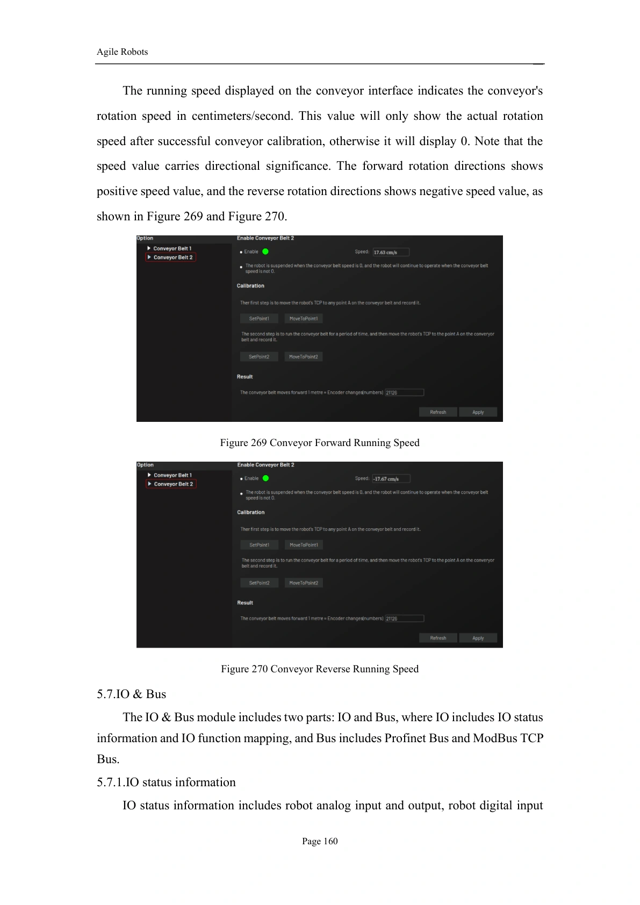



```
Agile Robots 
Page 160 
 
The running speed displayed on the conveyor interface indicates the conveyor's 
rotation speed in centimeters/second. This value will only show the actual rotation 
speed after successful conveyor calibration, otherwise it will display 0. Note that the 
speed value carries directional significance. The forward rotation directions shows 
positive speed value, and the reverse rotation directions shows negative speed value, as 
shown in Figure 269 and Figure 270.  
 
Figure 269 Conveyor Forward Running Speed 
 
Figure 270 Conveyor Reverse Running Speed 
5.7.IO & Bus  
The IO & Bus module includes two parts: IO and Bus, where IO includes IO status 
information and IO function mapping, and Bus includes Profinet Bus and ModBus TCP 
Bus.  
 
  
5.7.1.IO status information  
IO status information includes robot analog input and output, robot digital input
```



**Original document cross-references:** [PDF 164](pages-145-216.md#pdf-page-164)

## PDF page 165

**Source:** Industrial Teaching Pendant Software User Manual\_V3.3.0\_EN\_20260204.pdf, original pdf page 165. [Open the corresponding PDF reading-copy page](https://1292444914-files.gitbook.io/~/files/v0/b/gitbook-x-prod.appspot.com/o/spaces%2FtgOfPnscWebs1eh82EKq%2Fuploads%2FmOIcjHG6BaZxyxh0MX3B%2Findustrial-teaching-pendant-software-user-manual-v3-3-0-en-20260204-pp-162-169.pdf?alt=media#page=4).



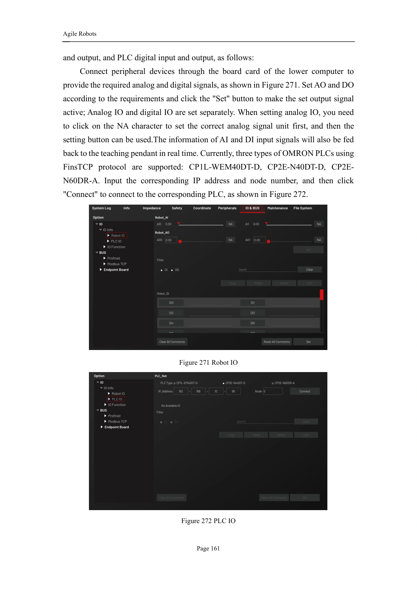



```
Agile Robots 
Page 161 
 
and output, and PLC digital input and output, as follows:  
Connect peripheral devices through the board card of the lower computer to 
provide the required analog and digital signals, as shown in Figure 271. Set AO and DO 
according to the requirements and click the "Set" button to make the set output signal 
active; Analog IO and digital IO are set separately. When setting analog IO, you need 
to click on the NA character to set the correct analog signal unit first, and then the 
setting button can be used.The information of AI and DI input signals will also be fed 
back to the teaching pendant in real time. Currently, three types of OMRON PLCs using 
FinsTCP protocol are supported: CP1L-WEM40DT-D, CP2E-N40DT-D, CP2E-
N60DR-A. Input the corresponding IP address and node number, and then click 
"Connect" to connect to the corresponding PLC, as shown in Figure 272. 
 
Figure 271 Robot IO 
 
Figure 272 PLC IO
```



**Original document cross-references:** [PDF 165](pages-145-216.md#pdf-page-165)

## PDF page 166

**Source:** Industrial Teaching Pendant Software User Manual\_V3.3.0\_EN\_20260204.pdf, original pdf page 166. [Open the corresponding PDF reading-copy page](https://1292444914-files.gitbook.io/~/files/v0/b/gitbook-x-prod.appspot.com/o/spaces%2FtgOfPnscWebs1eh82EKq%2Fuploads%2FmOIcjHG6BaZxyxh0MX3B%2Findustrial-teaching-pendant-software-user-manual-v3-3-0-en-20260204-pp-162-169.pdf?alt=media#page=5).



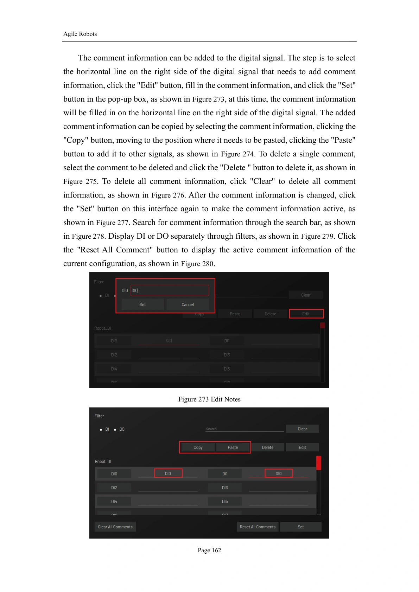



```
Agile Robots 
Page 162 
 
The comment information can be added to the digital signal. The step is to select 
the horizontal line on the right side of the digital signal that needs to add comment 
information, click the "Edit" button, fill in the comment information, and click the "Set" 
button in the pop-up box, as shown in Figure 273, at this time, the comment information 
will be filled in on the horizontal line on the right side of the digital signal. The added 
comment information can be copied by selecting the comment information, clicking the 
"Copy" button, moving to the position where it needs to be pasted, clicking the "Paste" 
button to add it to other signals, as shown in Figure 274. To delete a single comment, 
select the comment to be deleted and click the "Delete " button to delete it, as shown in 
Figure 275. To delete all comment information, click "Clear" to delete all comment 
information, as shown in Figure 276. After the comment information is changed, click 
the "Set" button on this interface again to make the comment information active, as 
shown in Figure 277. Search for comment information through the search bar, as shown 
in Figure 278. Display DI or DO separately through filters, as shown in Figure 279. Click 
the "Reset All Comment" button to display the active comment information of the 
current configuration, as shown in Figure 280.  
 
Figure 273 Edit Notes
```



**Original document cross-references:** [PDF 166](pages-145-216.md#pdf-page-166) · [PDF 167](pages-145-216.md#pdf-page-167) · [PDF 168](pages-145-216.md#pdf-page-168)

## PDF page 167

**Source:** Industrial Teaching Pendant Software User Manual\_V3.3.0\_EN\_20260204.pdf, original pdf page 167. [Open the corresponding PDF reading-copy page](https://1292444914-files.gitbook.io/~/files/v0/b/gitbook-x-prod.appspot.com/o/spaces%2FtgOfPnscWebs1eh82EKq%2Fuploads%2FmOIcjHG6BaZxyxh0MX3B%2Findustrial-teaching-pendant-software-user-manual-v3-3-0-en-20260204-pp-162-169.pdf?alt=media#page=6).



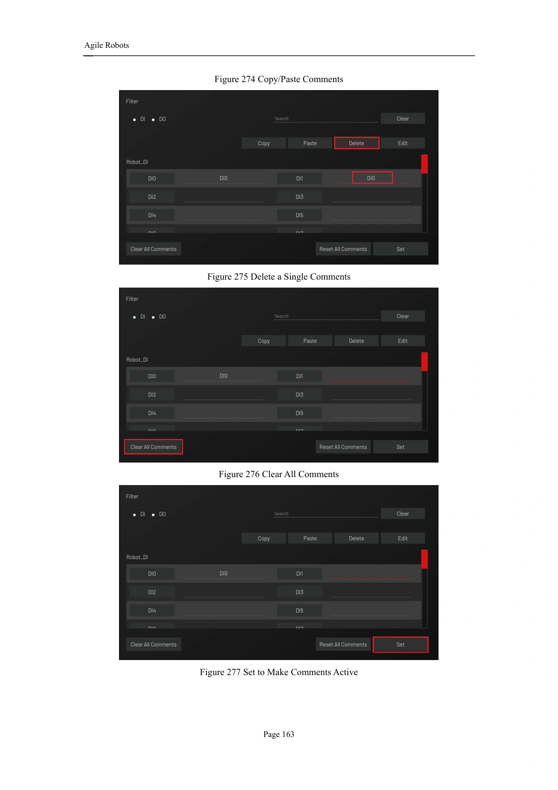



```
Agile Robots 
Page 163 
 
Figure 274 Copy/Paste Comments 
 
Figure 275 Delete a Single Comments 
 
Figure 276 Clear All Comments 
 
Figure 277 Set to Make Comments Active
```



## PDF page 168

**Source:** Industrial Teaching Pendant Software User Manual\_V3.3.0\_EN\_20260204.pdf, original pdf page 168. [Open the corresponding PDF reading-copy page](https://1292444914-files.gitbook.io/~/files/v0/b/gitbook-x-prod.appspot.com/o/spaces%2FtgOfPnscWebs1eh82EKq%2Fuploads%2FmOIcjHG6BaZxyxh0MX3B%2Findustrial-teaching-pendant-software-user-manual-v3-3-0-en-20260204-pp-162-169.pdf?alt=media#page=7).



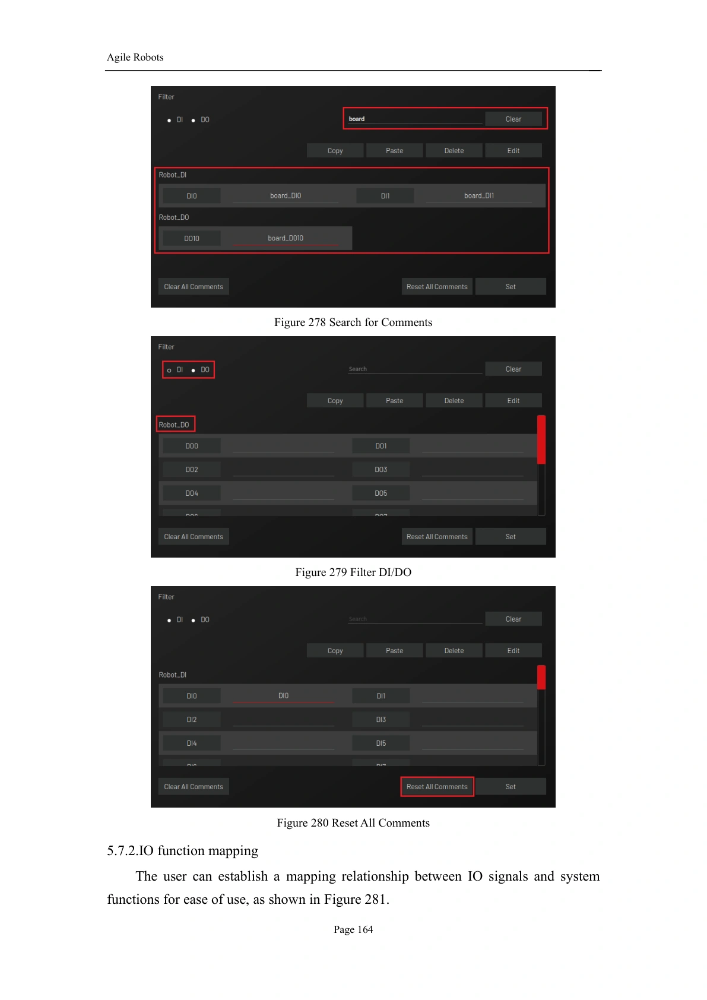



```
Agile Robots 
Page 164 
 
 
Figure 278 Search for Comments 
 
Figure 279 Filter DI/DO 
 
Figure 280 Reset All Comments 
5.7.2.IO function mapping  
The user can establish a mapping relationship between IO signals and system 
functions for ease of use, as shown in Figure 281.
```



**Original document cross-references:** [PDF 169](pages-145-216.md#pdf-page-169)

## PDF page 169

**Source:** Industrial Teaching Pendant Software User Manual\_V3.3.0\_EN\_20260204.pdf, original pdf page 169. [Open the corresponding PDF reading-copy page](https://1292444914-files.gitbook.io/~/files/v0/b/gitbook-x-prod.appspot.com/o/spaces%2FtgOfPnscWebs1eh82EKq%2Fuploads%2FmOIcjHG6BaZxyxh0MX3B%2Findustrial-teaching-pendant-software-user-manual-v3-3-0-en-20260204-pp-162-169.pdf?alt=media#page=8).



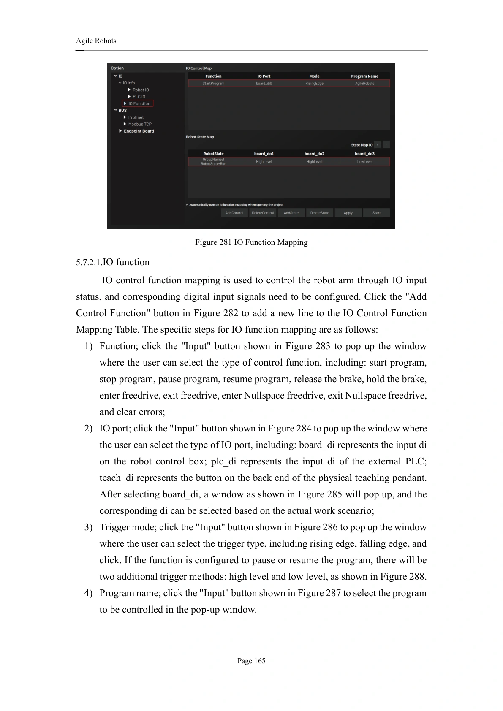



```
Agile Robots 
Page 165 
 
 
Figure 281 IO Function Mapping 
5.7.2.1.IO function  
IO control function mapping is used to control the robot arm through IO input 
status, and corresponding digital input signals need to be configured. Click the "Add 
Control Function" button in Figure 282 to add a new line to the IO Control Function 
Mapping Table. The specific steps for IO function mapping are as follows:  
1)  Function; click the "Input" button shown in Figure 283 to pop up the window 
where the user can select the type of control function, including: start program, 
stop program, pause program, resume program, release the brake, hold the brake, 
enter freedrive, exit freedrive, enter Nullspace freedrive, exit Nullspace freedrive, 
and clear errors;  
2)  IO port; click the "Input" button shown in Figure 284 to pop up the window where 
the user can select the type of IO port, including: board_di represents the input di 
on the robot control box; plc_di represents the input di of the external PLC; 
teach_di represents the button on the back end of the physical teaching pendant. 
After selecting board_di, a window as shown in Figure 285 will pop up, and the 
corresponding di can be selected based on the actual work scenario;  
3)  Trigger mode; click the "Input" button shown in Figure 286 to pop up the window 
where the user can select the trigger type, including rising edge, falling edge, and 
click. If the function is configured to pause or resume the program, there will be 
two additional trigger methods: high level and low level, as shown in Figure 288.  
4)  Program name; click the "Input" button shown in Figure 287 to select the program 
to be controlled in the pop-up window.
```



**Original document cross-references:** [PDF 170](pages-145-216.md#pdf-page-170) · [PDF 171](pages-145-216.md#pdf-page-171) · [PDF 172](pages-145-216.md#pdf-page-172) · [PDF 173](pages-145-216.md#pdf-page-173)

## PDF page 170

**Source:** Industrial Teaching Pendant Software User Manual\_V3.3.0\_EN\_20260204.pdf, original pdf page 170. [Open the corresponding PDF reading-copy page](https://1292444914-files.gitbook.io/~/files/v0/b/gitbook-x-prod.appspot.com/o/spaces%2FtgOfPnscWebs1eh82EKq%2Fuploads%2FuRUSjwUC9FcfWMvo5Efk%2Findustrial-teaching-pendant-software-user-manual-v3-3-0-en-20260204-pp-170-175.pdf?alt=media#page=1).



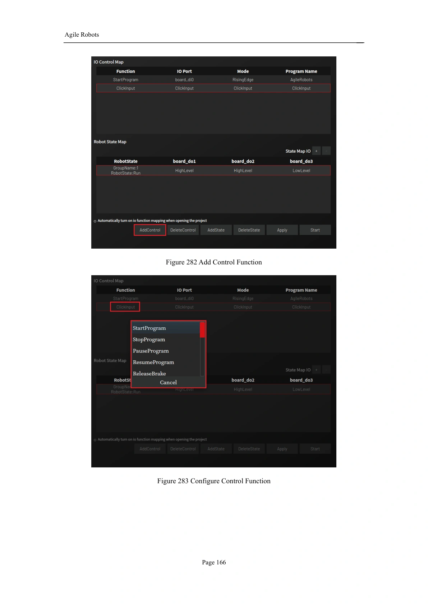



```
Agile Robots 
Page 166 
 
 
Figure 282 Add Control Function 
 
Figure 283 Configure Control Function
```



## PDF page 171

**Source:** Industrial Teaching Pendant Software User Manual\_V3.3.0\_EN\_20260204.pdf, original pdf page 171. [Open the corresponding PDF reading-copy page](https://1292444914-files.gitbook.io/~/files/v0/b/gitbook-x-prod.appspot.com/o/spaces%2FtgOfPnscWebs1eh82EKq%2Fuploads%2FuRUSjwUC9FcfWMvo5Efk%2Findustrial-teaching-pendant-software-user-manual-v3-3-0-en-20260204-pp-170-175.pdf?alt=media#page=2).



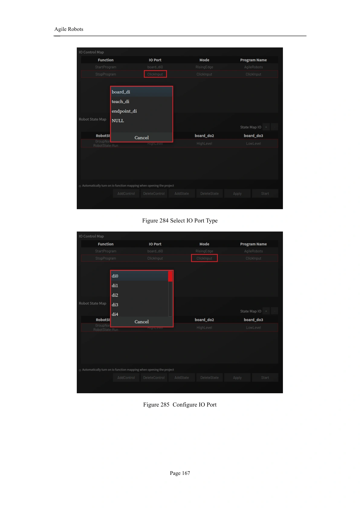



```
Agile Robots 
Page 167 
 
 
Figure 284 Select IO Port Type 
 
Figure 285  Configure IO Port
```



## PDF page 172

**Source:** Industrial Teaching Pendant Software User Manual\_V3.3.0\_EN\_20260204.pdf, original pdf page 172. [Open the corresponding PDF reading-copy page](https://1292444914-files.gitbook.io/~/files/v0/b/gitbook-x-prod.appspot.com/o/spaces%2FtgOfPnscWebs1eh82EKq%2Fuploads%2FuRUSjwUC9FcfWMvo5Efk%2Findustrial-teaching-pendant-software-user-manual-v3-3-0-en-20260204-pp-170-175.pdf?alt=media#page=3).



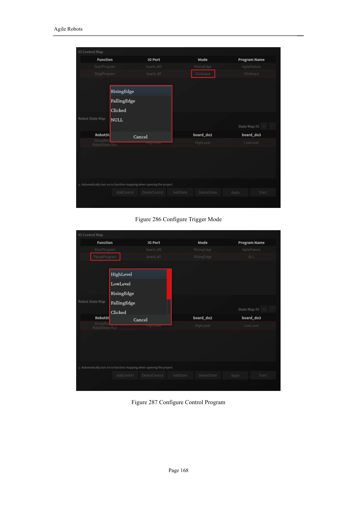



```
Agile Robots 
Page 168 
 
 
Figure 286 Configure Trigger Mode 
 
Figure 287 Configure Control Program
```



## PDF page 173

**Source:** Industrial Teaching Pendant Software User Manual\_V3.3.0\_EN\_20260204.pdf, original pdf page 173. [Open the corresponding PDF reading-copy page](https://1292444914-files.gitbook.io/~/files/v0/b/gitbook-x-prod.appspot.com/o/spaces%2FtgOfPnscWebs1eh82EKq%2Fuploads%2FuRUSjwUC9FcfWMvo5Efk%2Findustrial-teaching-pendant-software-user-manual-v3-3-0-en-20260204-pp-170-175.pdf?alt=media#page=4).



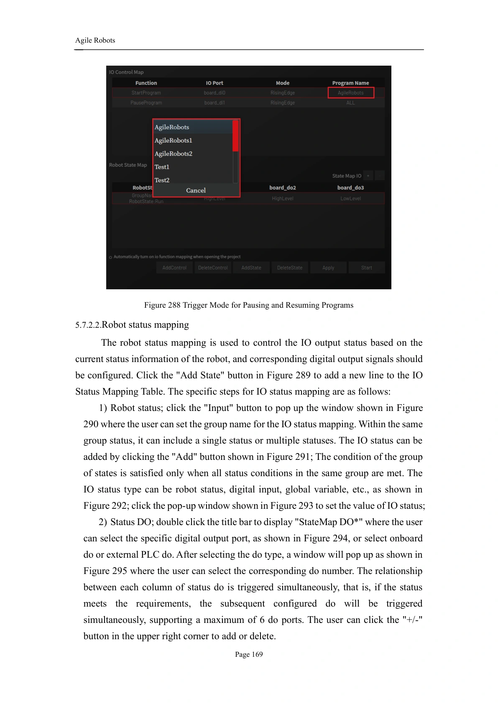



```
Agile Robots 
Page 169 
 
 
Figure 288 Trigger Mode for Pausing and Resuming Programs 
5.7.2.2.Robot status mapping  
The robot status mapping is used to control the IO output status based on the 
current status information of the robot, and corresponding digital output signals should 
be configured. Click the "Add State" button in Figure 289 to add a new line to the IO 
Status Mapping Table. The specific steps for IO status mapping are as follows:  
1)  Robot status; click the "Input" button to pop up the window shown in Figure 
290 where the user can set the group name for the IO status mapping. Within the same 
group status, it can include a single status or multiple statuses. The IO status can be 
added by clicking the "Add" button shown in Figure 291; The condition of the group 
of states is satisfied only when all status conditions in the same group are met. The 
IO status type can be robot status, digital input, global variable, etc., as shown in 
Figure 292; click the pop-up window shown in Figure 293 to set the value of IO status;  
2)  Status DO; double click the title bar to display "StateMap DO*" where the user 
can select the specific digital output port, as shown in Figure 294, or select onboard 
do or external PLC do. After selecting the do type, a window will pop up as shown in 
Figure 295 where the user can select the corresponding do number. The relationship 
between each column of status do is triggered simultaneously, that is, if the status 
meets the requirements, the subsequent configured do will be triggered 
simultaneously, supporting a maximum of 6 do ports. The user can click the "+/-" 
button in the upper right corner to add or delete.
```



**Original document cross-references:** [PDF 174](pages-145-216.md#pdf-page-174) · [PDF 175](pages-145-216.md#pdf-page-175) · [PDF 176](pages-145-216.md#pdf-page-176) · [PDF 177](pages-145-216.md#pdf-page-177)

## PDF page 174

**Source:** Industrial Teaching Pendant Software User Manual\_V3.3.0\_EN\_20260204.pdf, original pdf page 174. [Open the corresponding PDF reading-copy page](https://1292444914-files.gitbook.io/~/files/v0/b/gitbook-x-prod.appspot.com/o/spaces%2FtgOfPnscWebs1eh82EKq%2Fuploads%2FuRUSjwUC9FcfWMvo5Efk%2Findustrial-teaching-pendant-software-user-manual-v3-3-0-en-20260204-pp-170-175.pdf?alt=media#page=5).



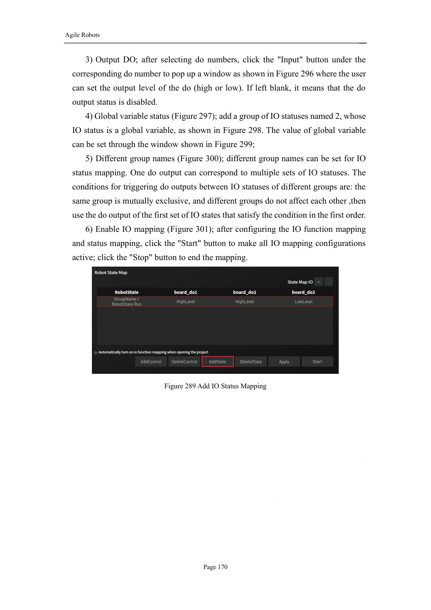



```
Agile Robots 
Page 170 
 
3)  Output DO; after selecting do numbers, click the "Input" button under the 
corresponding do number to pop up a window as shown in Figure 296 where the user 
can set the output level of the do (high or low). If left blank, it means that the do 
output status is disabled.  
4) Global variable status (Figure 297); add a group of IO statuses named 2, whose 
IO status is a global variable, as shown in Figure 298. The value of global variable 
can be set through the window shown in Figure 299;  
5)  Different group names (Figure 300); different group names can be set for IO 
status mapping. One do output can correspond to multiple sets of IO statuses. The 
conditions for triggering do outputs between IO statuses of different groups are: the 
same group is mutually exclusive, and different groups do not affect each other ,then 
use the do output of the first set of IO states that satisfy the condition in the first order.  
6) Enable IO mapping (Figure 301); after configuring the IO function mapping 
and status mapping, click the "Start" button to make all IO mapping configurations 
active; click the "Stop" button to end the mapping.  
 
Figure 289 Add IO Status Mapping
```



**Original document cross-references:** [PDF 178](pages-145-216.md#pdf-page-178) · [PDF 179](pages-145-216.md#pdf-page-179) · [PDF 180](pages-145-216.md#pdf-page-180)

## PDF page 175

**Source:** Industrial Teaching Pendant Software User Manual\_V3.3.0\_EN\_20260204.pdf, original pdf page 175. [Open the corresponding PDF reading-copy page](https://1292444914-files.gitbook.io/~/files/v0/b/gitbook-x-prod.appspot.com/o/spaces%2FtgOfPnscWebs1eh82EKq%2Fuploads%2FuRUSjwUC9FcfWMvo5Efk%2Findustrial-teaching-pendant-software-user-manual-v3-3-0-en-20260204-pp-170-175.pdf?alt=media#page=6).



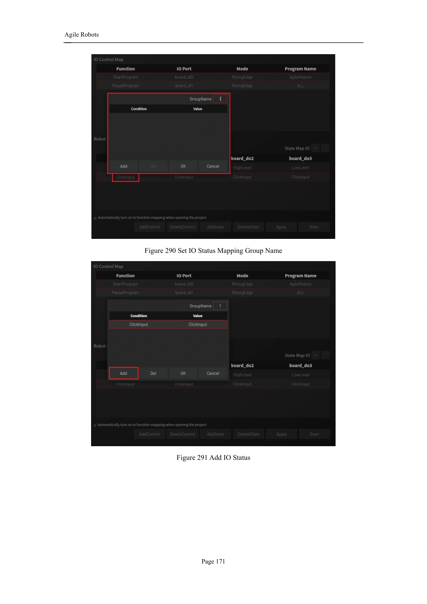



```
Agile Robots 
Page 171 
 
 
Figure 290 Set IO Status Mapping Group Name 
 
Figure 291 Add IO Status
```



## PDF page 176

**Source:** Industrial Teaching Pendant Software User Manual\_V3.3.0\_EN\_20260204.pdf, original pdf page 176. [Open the corresponding PDF reading-copy page](https://1292444914-files.gitbook.io/~/files/v0/b/gitbook-x-prod.appspot.com/o/spaces%2FtgOfPnscWebs1eh82EKq%2Fuploads%2FcHBNROK7Gb9rUbH9Ws3Y%2Findustrial-teaching-pendant-software-user-manual-v3-3-0-en-20260204-pp-176-180.pdf?alt=media#page=1).



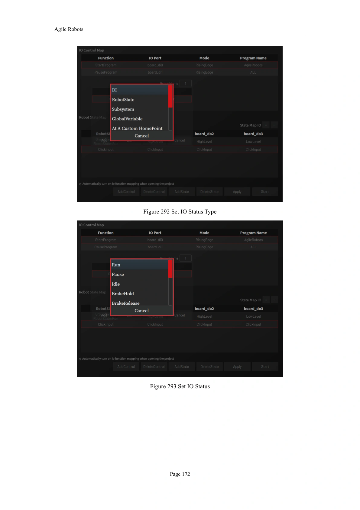



```
Agile Robots 
Page 172 
 
 
Figure 292 Set IO Status Type 
 
Figure 293 Set IO Status
```



## PDF page 177

**Source:** Industrial Teaching Pendant Software User Manual\_V3.3.0\_EN\_20260204.pdf, original pdf page 177. [Open the corresponding PDF reading-copy page](https://1292444914-files.gitbook.io/~/files/v0/b/gitbook-x-prod.appspot.com/o/spaces%2FtgOfPnscWebs1eh82EKq%2Fuploads%2FcHBNROK7Gb9rUbH9Ws3Y%2Findustrial-teaching-pendant-software-user-manual-v3-3-0-en-20260204-pp-176-180.pdf?alt=media#page=2).



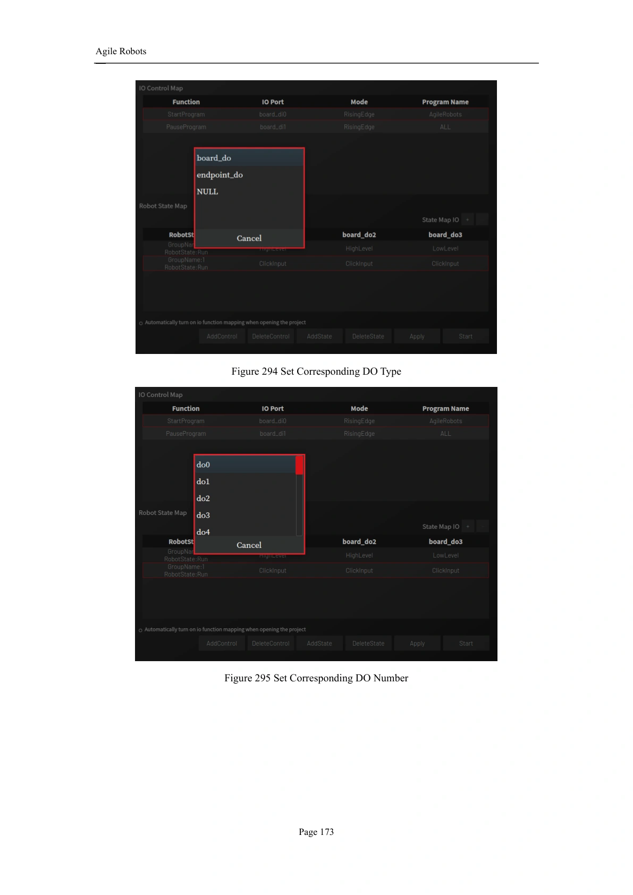



```
Agile Robots 
Page 173 
 
 
Figure 294 Set Corresponding DO Type 
 
Figure 295 Set Corresponding DO Number
```



## PDF page 178

**Source:** Industrial Teaching Pendant Software User Manual\_V3.3.0\_EN\_20260204.pdf, original pdf page 178. [Open the corresponding PDF reading-copy page](https://1292444914-files.gitbook.io/~/files/v0/b/gitbook-x-prod.appspot.com/o/spaces%2FtgOfPnscWebs1eh82EKq%2Fuploads%2FcHBNROK7Gb9rUbH9Ws3Y%2Findustrial-teaching-pendant-software-user-manual-v3-3-0-en-20260204-pp-176-180.pdf?alt=media#page=3).



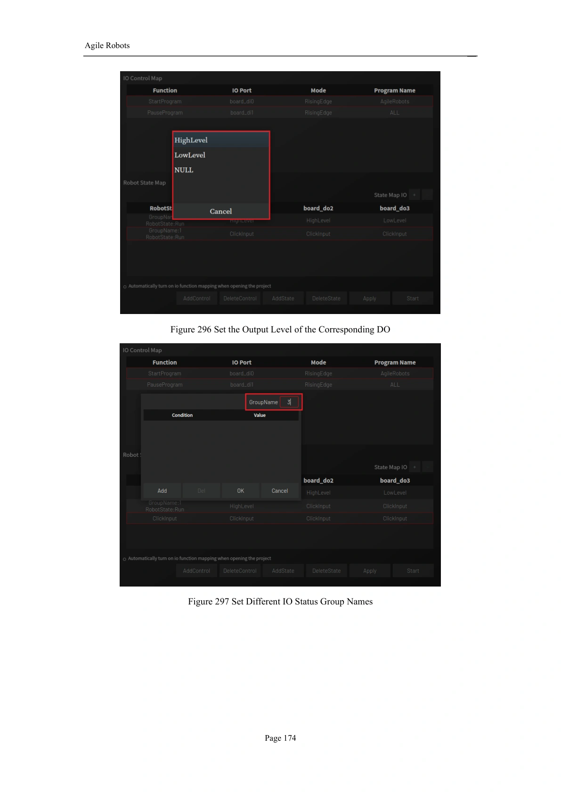



```
Agile Robots 
Page 174 
 
 
Figure 296 Set the Output Level of the Corresponding DO 
 
Figure 297 Set Different IO Status Group Names
```



## PDF page 179

**Source:** Industrial Teaching Pendant Software User Manual\_V3.3.0\_EN\_20260204.pdf, original pdf page 179. [Open the corresponding PDF reading-copy page](https://1292444914-files.gitbook.io/~/files/v0/b/gitbook-x-prod.appspot.com/o/spaces%2FtgOfPnscWebs1eh82EKq%2Fuploads%2FcHBNROK7Gb9rUbH9Ws3Y%2Findustrial-teaching-pendant-software-user-manual-v3-3-0-en-20260204-pp-176-180.pdf?alt=media#page=4).



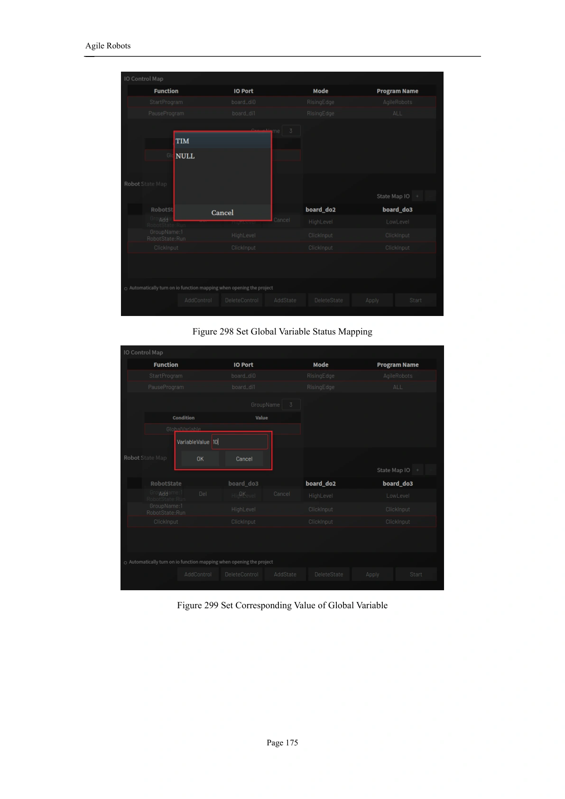



```
Agile Robots 
Page 175 
 
 
Figure 298 Set Global Variable Status Mapping 
 
Figure 299 Set Corresponding Value of Global Variable
```



## PDF page 180

**Source:** Industrial Teaching Pendant Software User Manual\_V3.3.0\_EN\_20260204.pdf, original pdf page 180. [Open the corresponding PDF reading-copy page](https://1292444914-files.gitbook.io/~/files/v0/b/gitbook-x-prod.appspot.com/o/spaces%2FtgOfPnscWebs1eh82EKq%2Fuploads%2FcHBNROK7Gb9rUbH9Ws3Y%2Findustrial-teaching-pendant-software-user-manual-v3-3-0-en-20260204-pp-176-180.pdf?alt=media#page=5).



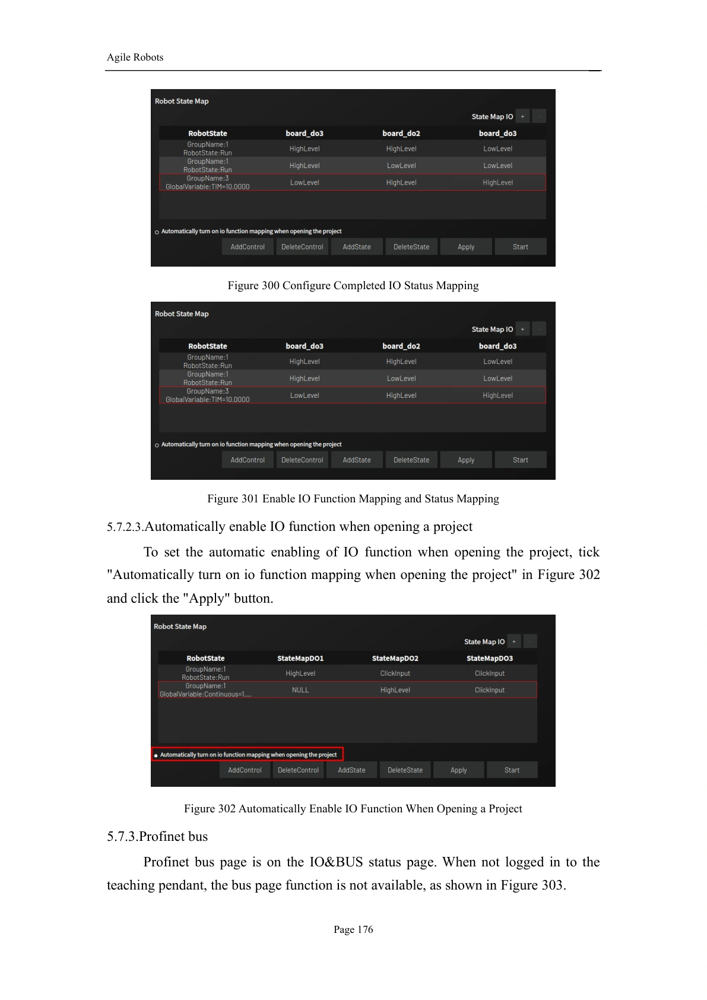



```
Agile Robots 
Page 176 
 
 
Figure 300 Configure Completed IO Status Mapping 
 
Figure 301 Enable IO Function Mapping and Status Mapping 
5.7.2.3.Automatically enable IO function when opening a project  
To set the automatic enabling of IO function when opening the project, tick 
"Automatically turn on io function mapping when opening the project" in Figure 302 
and click the "Apply" button.  
 
Figure 302 Automatically Enable IO Function When Opening a Project  
5.7.3.Profinet bus  
Profinet bus page is on the IO&BUS status page. When not logged in to the 
teaching pendant, the bus page function is not available, as shown in Figure 303.
```



**Original document cross-references:** [PDF 180](pages-145-216.md#pdf-page-180) · [PDF 181](pages-145-216.md#pdf-page-181)

## PDF page 181

**Source:** Industrial Teaching Pendant Software User Manual\_V3.3.0\_EN\_20260204.pdf, original pdf page 181. [Open the corresponding PDF reading-copy page](https://1292444914-files.gitbook.io/~/files/v0/b/gitbook-x-prod.appspot.com/o/spaces%2FtgOfPnscWebs1eh82EKq%2Fuploads%2FVhfRkQSsfq2rMC77U7De%2Findustrial-teaching-pendant-software-user-manual-v3-3-0-en-20260204-pp-181-188.pdf?alt=media#page=1).



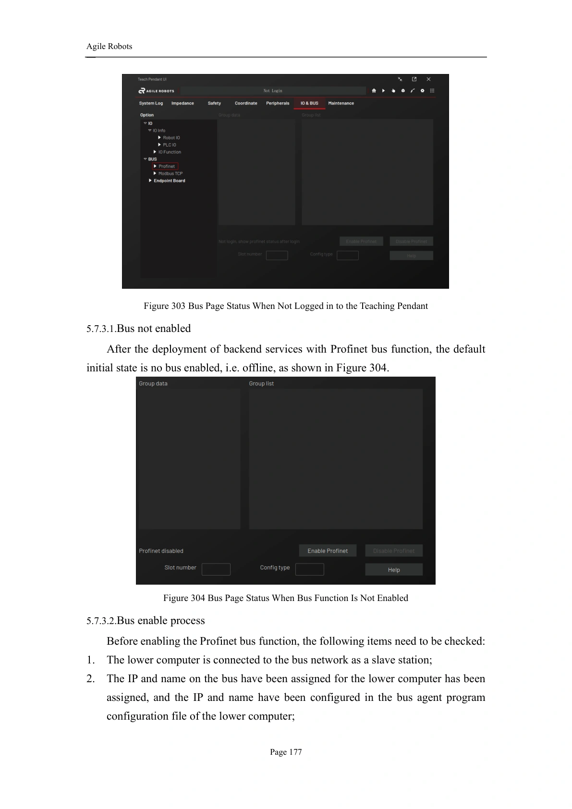



```
Agile Robots 
Page 177 
 
 
Figure 303 Bus Page Status When Not Logged in to the Teaching Pendant 
5.7.3.1.Bus not enabled  
After the deployment of backend services with Profinet bus function, the default 
initial state is no bus enabled, i.e. offline, as shown in Figure 304.  
 
Figure 304 Bus Page Status When Bus Function Is Not Enabled 
5.7.3.2.Bus enable process  
Before enabling the Profinet bus function, the following items need to be checked:  
1.  The lower computer is connected to the bus network as a slave station;  
2.  The IP and name on the bus have been assigned for the lower computer has been 
assigned, and the IP and name have been configured in the bus agent program 
configuration file of the lower computer;
```



**Original document cross-references:** [PDF 181](pages-145-216.md#pdf-page-181)

## PDF page 182

**Source:** Industrial Teaching Pendant Software User Manual\_V3.3.0\_EN\_20260204.pdf, original pdf page 182. [Open the corresponding PDF reading-copy page](https://1292444914-files.gitbook.io/~/files/v0/b/gitbook-x-prod.appspot.com/o/spaces%2FtgOfPnscWebs1eh82EKq%2Fuploads%2FVhfRkQSsfq2rMC77U7De%2Findustrial-teaching-pendant-software-user-manual-v3-3-0-en-20260204-pp-181-188.pdf?alt=media#page=2).



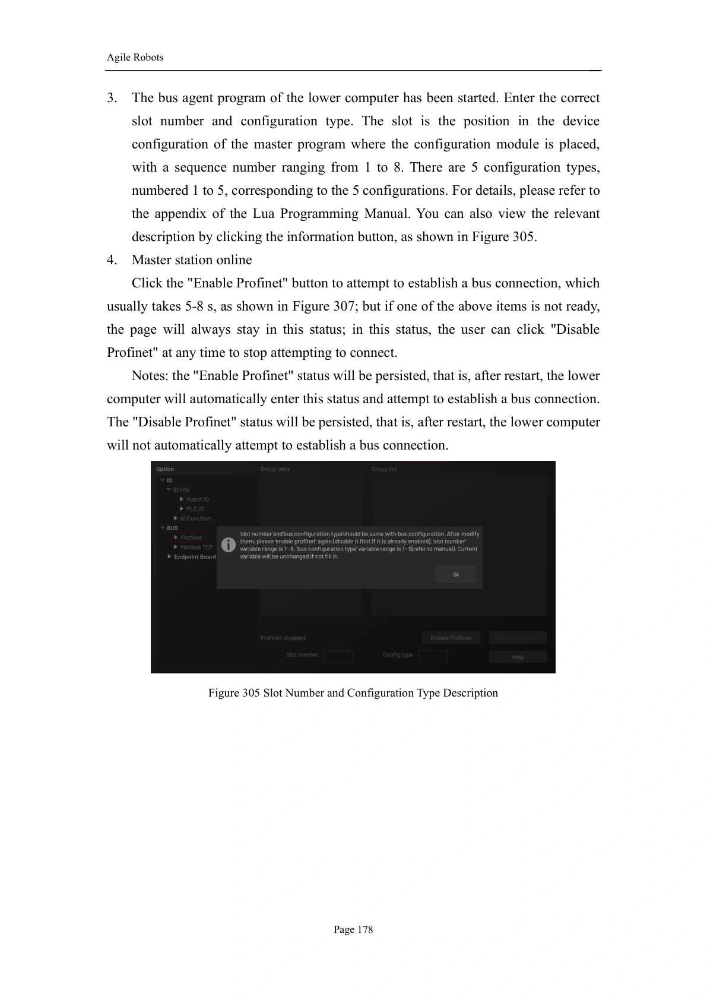



```
Agile Robots 
Page 178 
 
3.  The bus agent program of the lower computer has been started. Enter the correct 
slot number and configuration type. The slot is the position in the device 
configuration of the master program where the configuration module is placed, 
with a sequence number ranging from 1 to 8. There are 5 configuration types, 
numbered 1 to 5, corresponding to the 5 configurations. For details, please refer to 
the appendix of the Lua Programming Manual. You can also view the relevant 
description by clicking the information button, as shown in Figure 305. 
4.  Master station online  
Click the "Enable Profinet" button to attempt to establish a bus connection, which 
usually takes 5-8 s, as shown in Figure 307; but if one of the above items is not ready, 
the page will always stay in this status; in this status, the user can click "Disable 
Profinet" at any time to stop attempting to connect.  
Notes: the "Enable Profinet" status will be persisted, that is, after restart, the lower 
computer will automatically enter this status and attempt to establish a bus connection. 
The "Disable Profinet" status will be persisted, that is, after restart, the lower computer 
will not automatically attempt to establish a bus connection.  
 
Figure 305 Slot Number and Configuration Type Description
```



**Original document cross-references:** [PDF 182](pages-145-216.md#pdf-page-182) · [PDF 184](pages-145-216.md#pdf-page-184)

## PDF page 183

**Source:** Industrial Teaching Pendant Software User Manual\_V3.3.0\_EN\_20260204.pdf, original pdf page 183. [Open the corresponding PDF reading-copy page](https://1292444914-files.gitbook.io/~/files/v0/b/gitbook-x-prod.appspot.com/o/spaces%2FtgOfPnscWebs1eh82EKq%2Fuploads%2FVhfRkQSsfq2rMC77U7De%2Findustrial-teaching-pendant-software-user-manual-v3-3-0-en-20260204-pp-181-188.pdf?alt=media#page=3).



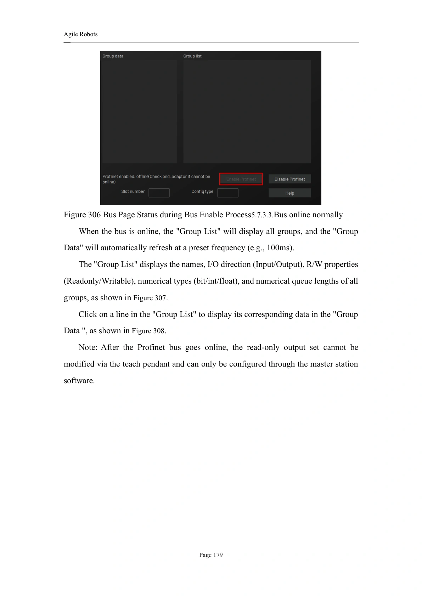



```
Agile Robots 
Page 179 
 
 
Figure 306 Bus Page Status during Bus Enable Process5.7.3.3.Bus online normally  
When the bus is online, the "Group List" will display all groups, and the "Group 
Data" will automatically refresh at a preset frequency (e.g., 100ms).  
The "Group List" displays the names, I/O direction (Input/Output), R/W properties 
(Readonly/Writable), numerical types (bit/int/float), and numerical queue lengths of all 
groups, as shown in Figure 307.  
Click on a line in the "Group List" to display its corresponding data in the "Group 
Data ", as shown in Figure 308.  
Note: After the Profinet bus goes online, the read-only output set cannot be 
modified via the teach pendant and can only be configured through the master station 
software.
```



**Original document cross-references:** [PDF 184](pages-145-216.md#pdf-page-184)

## PDF page 184

**Source:** Industrial Teaching Pendant Software User Manual\_V3.3.0\_EN\_20260204.pdf, original pdf page 184. [Open the corresponding PDF reading-copy page](https://1292444914-files.gitbook.io/~/files/v0/b/gitbook-x-prod.appspot.com/o/spaces%2FtgOfPnscWebs1eh82EKq%2Fuploads%2FVhfRkQSsfq2rMC77U7De%2Findustrial-teaching-pendant-software-user-manual-v3-3-0-en-20260204-pp-181-188.pdf?alt=media#page=4).



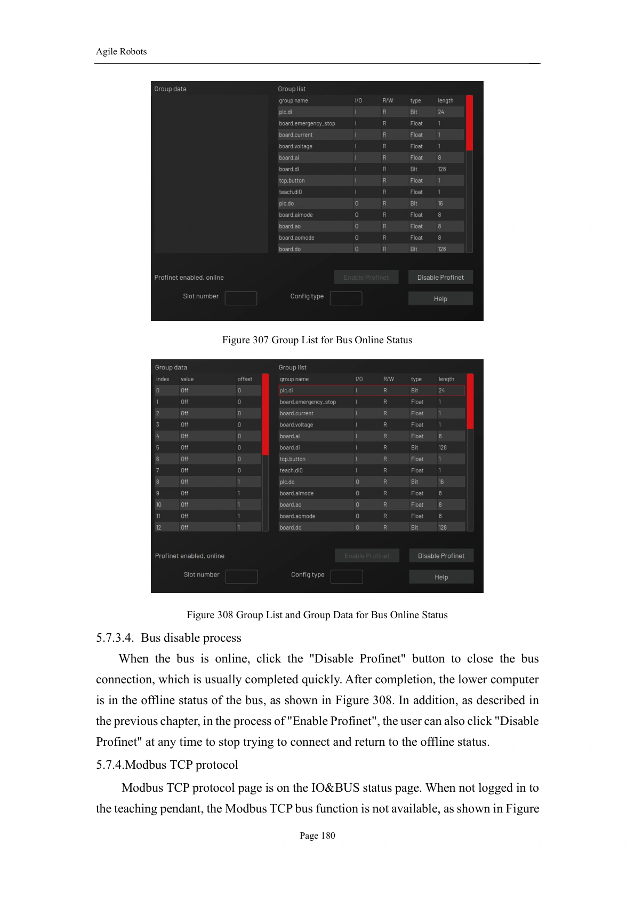



```
Agile Robots 
Page 180 
 
 
Figure 307 Group List for Bus Online Status 
 
Figure 308 Group List and Group Data for Bus Online Status 
5.7.3.4.  Bus disable process 
When the bus is online, click the "Disable Profinet" button to close the bus 
connection, which is usually completed quickly. After completion, the lower computer 
is in the offline status of the bus, as shown in Figure 308. In addition, as described in 
the previous chapter, in the process of "Enable Profinet", the user can also click "Disable 
Profinet" at any time to stop trying to connect and return to the offline status.  
5.7.4.Modbus TCP protocol  
Modbus TCP protocol page is on the IO&BUS status page. When not logged in to 
the teaching pendant, the Modbus TCP bus function is not available, as shown in Figure
```



**Original document cross-references:** [PDF 184](pages-145-216.md#pdf-page-184) · [PDF 185](pages-145-216.md#pdf-page-185)

## PDF page 185

**Source:** Industrial Teaching Pendant Software User Manual\_V3.3.0\_EN\_20260204.pdf, original pdf page 185. [Open the corresponding PDF reading-copy page](https://1292444914-files.gitbook.io/~/files/v0/b/gitbook-x-prod.appspot.com/o/spaces%2FtgOfPnscWebs1eh82EKq%2Fuploads%2FVhfRkQSsfq2rMC77U7De%2Findustrial-teaching-pendant-software-user-manual-v3-3-0-en-20260204-pp-181-188.pdf?alt=media#page=5).



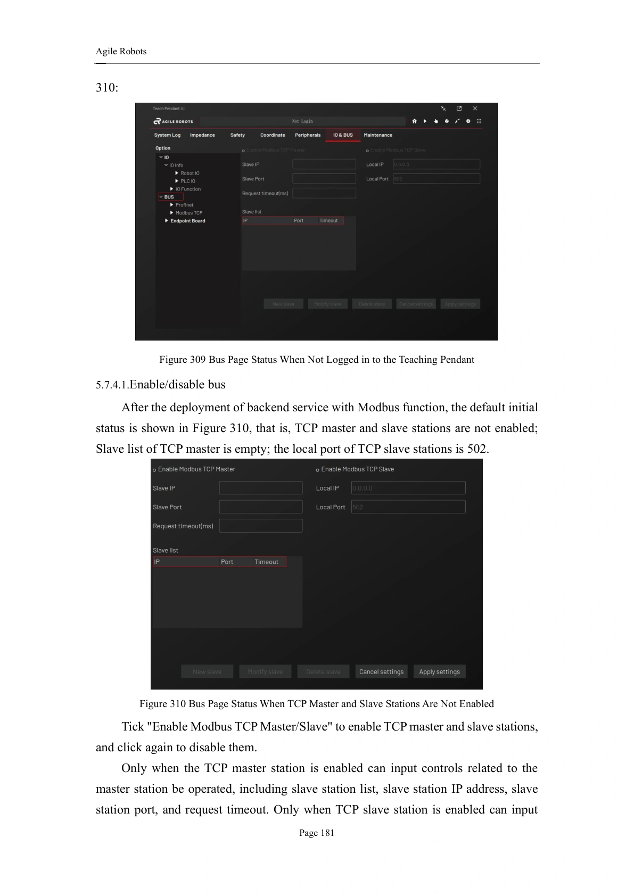



```
Agile Robots 
Page 181 
 
310:  
 
Figure 309 Bus Page Status When Not Logged in to the Teaching Pendant 
5.7.4.1.Enable/disable bus  
After the deployment of backend service with Modbus function, the default initial 
status is shown in Figure 310, that is, TCP master and slave stations are not enabled; 
Slave list of TCP master is empty; the local port of TCP slave stations is 502.  
 
Figure 310 Bus Page Status When TCP Master and Slave Stations Are Not Enabled 
Tick "Enable Modbus TCP Master/Slave" to enable TCP master and slave stations, 
and click again to disable them.  
Only when the TCP master station is enabled can input controls related to the 
master station be operated, including slave station list, slave station IP address, slave 
station port, and request timeout. Only when TCP slave station is enabled can input
```



**Original document cross-references:** [PDF 185](pages-145-216.md#pdf-page-185)

## PDF page 186

**Source:** Industrial Teaching Pendant Software User Manual\_V3.3.0\_EN\_20260204.pdf, original pdf page 186. [Open the corresponding PDF reading-copy page](https://1292444914-files.gitbook.io/~/files/v0/b/gitbook-x-prod.appspot.com/o/spaces%2FtgOfPnscWebs1eh82EKq%2Fuploads%2FVhfRkQSsfq2rMC77U7De%2Findustrial-teaching-pendant-software-user-manual-v3-3-0-en-20260204-pp-181-188.pdf?alt=media#page=6).



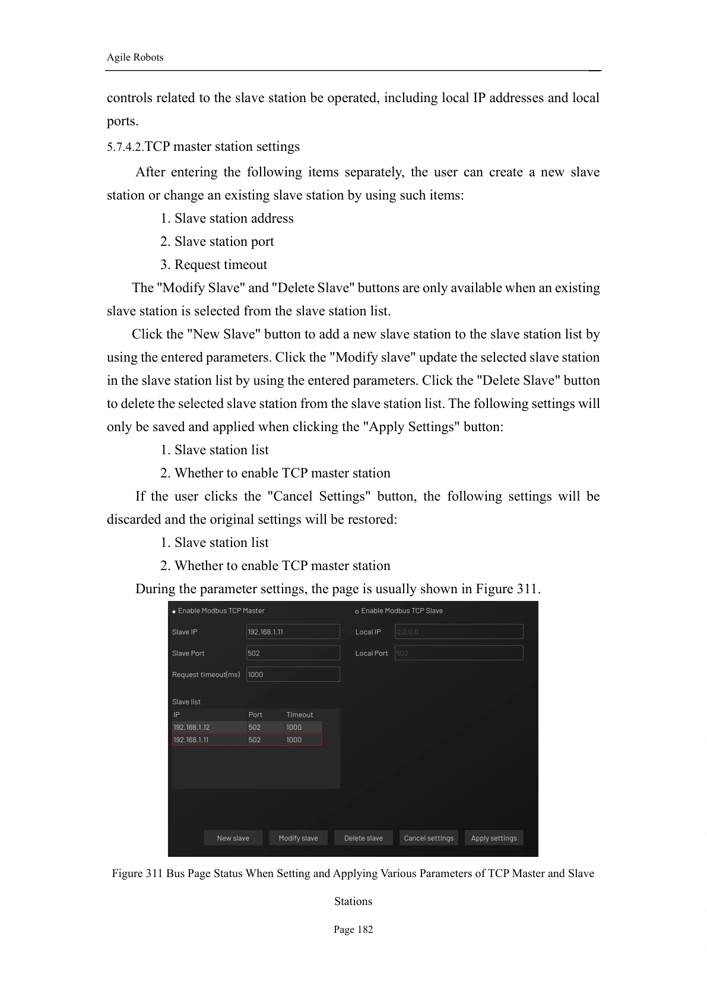



```
Agile Robots 
Page 182 
 
controls related to the slave station be operated, including local IP addresses and local 
ports.  
5.7.4.2.TCP master station settings  
After entering the following items separately, the user can create a new slave 
station or change an existing slave station by using such items:  
1. Slave station address  
2. Slave station port  
3. Request timeout  
The "Modify Slave" and "Delete Slave" buttons are only available when an existing 
slave station is selected from the slave station list.  
Click the "New Slave" button to add a new slave station to the slave station list by 
using the entered parameters. Click the "Modify slave" update the selected slave station 
in the slave station list by using the entered parameters. Click the "Delete Slave" button 
to delete the selected slave station from the slave station list. The following settings will 
only be saved and applied when clicking the "Apply Settings" button:  
1. Slave station list  
2. Whether to enable TCP master station  
If the user clicks the "Cancel Settings" button, the following settings will be 
discarded and the original settings will be restored:  
1. Slave station list  
2. Whether to enable TCP master station  
During the parameter settings, the page is usually shown in Figure 311.  
 
Figure 311 Bus Page Status When Setting and Applying Various Parameters of TCP Master and Slave 
Stations
```



**Original document cross-references:** [PDF 186](pages-145-216.md#pdf-page-186)

## PDF page 187

**Source:** Industrial Teaching Pendant Software User Manual\_V3.3.0\_EN\_20260204.pdf, original pdf page 187. [Open the corresponding PDF reading-copy page](https://1292444914-files.gitbook.io/~/files/v0/b/gitbook-x-prod.appspot.com/o/spaces%2FtgOfPnscWebs1eh82EKq%2Fuploads%2FVhfRkQSsfq2rMC77U7De%2Findustrial-teaching-pendant-software-user-manual-v3-3-0-en-20260204-pp-181-188.pdf?alt=media#page=7).







```
Agile Robots 
Page 183 
 
5.7.4.3.TCP slave station settings  
After entering any of the following items, the user can change existing settings by 
using such items:  
1. Local port  
2. Local IP address (usually not necessary to change)  
The following settings will only be saved and applied when clicking the "Apply 
Settings" button:  
1. Local port  
2. Local IP address  
3. Whether to enable TCP slave station  
If the user clicks the "Cancel Settings" button, the following settings will be 
discarded and the original settings will be restored:  
1. Local port  
2. Local IP address  
3. Whether to enable TCP slave station  
5.7.4.4.Apply settings  
As mentioned above, clicking the "Apply Settings" button will save and apply 
various settings for TCP master and slave stations.  
Regardless of whether the parameters have changed, clicking the "Apply Settings" 
button will restart the TCP master and slave stations, interrupting existing connections. 
Usually, this process takes fraction of a second.  
5.7.4.5.TCP master function  
As a TCP master station, the robot will automatically attempt to establish 
connections with each slave station in the slave station list repeatedly. In a normal 
connection status, the programming scripts can be used in the teaching pendant to read 
and write data from the slave station.  
5.7.4.6.TCP slave station function  
As a TCP slave station, it can simultaneously accept multiple connections from 
multiple master stations and handle read-write request from multiple master stations.  
5.7.5.End tool Interface  
Some types of robots are equipped with end tool interface, which support end 
board IO, DC voltage, and communication interface functions, as shown in Figure 312. 
The functions are introduced as follows:  
End board IO: it supports two channels of DI and DO, as shown in Figure 313,
```



**Original document cross-references:** [PDF 188](pages-145-216.md#pdf-page-188)

## PDF page 188

**Source:** Industrial Teaching Pendant Software User Manual\_V3.3.0\_EN\_20260204.pdf, original pdf page 188. [Open the corresponding PDF reading-copy page](https://1292444914-files.gitbook.io/~/files/v0/b/gitbook-x-prod.appspot.com/o/spaces%2FtgOfPnscWebs1eh82EKq%2Fuploads%2FVhfRkQSsfq2rMC77U7De%2Findustrial-teaching-pendant-software-user-manual-v3-3-0-en-20260204-pp-181-188.pdf?alt=media#page=8).



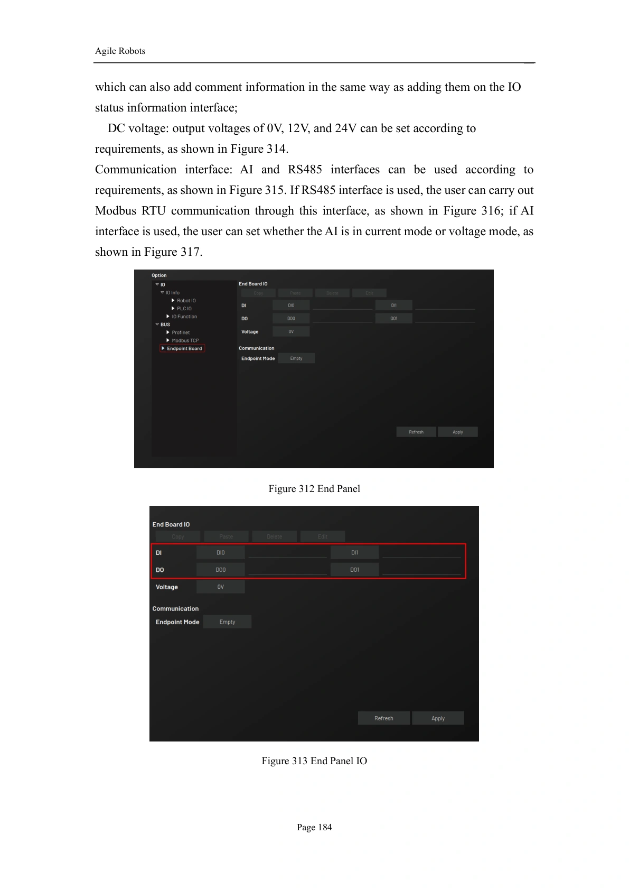



```
Agile Robots 
Page 184 
 
which can also add comment information in the same way as adding them on the IO 
status information interface;  
DC voltage: output voltages of 0V, 12V, and 24V can be set according to 
requirements, as shown in Figure 314. 
Communication interface: AI and RS485 interfaces can be used according to 
requirements, as shown in Figure 315. If RS485 interface is used, the user can carry out 
Modbus RTU communication through this interface, as shown in Figure 316; if AI 
interface is used, the user can set whether the AI is in current mode or voltage mode, as 
shown in Figure 317. 
 
Figure 312 End Panel 
 
Figure 313 End Panel IO
```



**Original document cross-references:** [PDF 189](pages-145-216.md#pdf-page-189) · [PDF 190](pages-145-216.md#pdf-page-190)

## PDF page 189

**Source:** Industrial Teaching Pendant Software User Manual\_V3.3.0\_EN\_20260204.pdf, original pdf page 189. [Open the corresponding PDF reading-copy page](https://1292444914-files.gitbook.io/~/files/v0/b/gitbook-x-prod.appspot.com/o/spaces%2FtgOfPnscWebs1eh82EKq%2Fuploads%2Fwd9Ur3poPuwOhwF5idnf%2Findustrial-teaching-pendant-software-user-manual-v3-3-0-en-20260204-pp-189-194.pdf?alt=media#page=1).



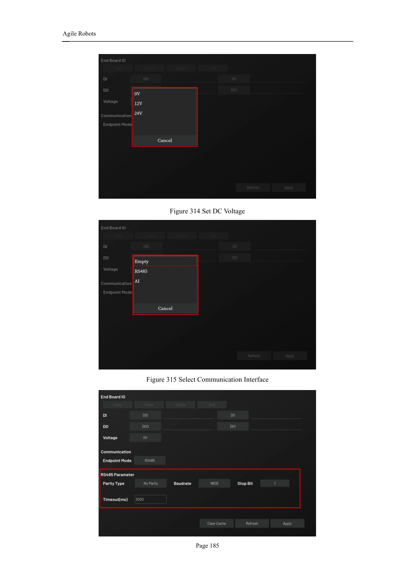



```
Agile Robots 
Page 185 
 
 
Figure 314 Set DC Voltage 
 
Figure 315 Select Communication Interface
```



## PDF page 190

**Source:** Industrial Teaching Pendant Software User Manual\_V3.3.0\_EN\_20260204.pdf, original pdf page 190. [Open the corresponding PDF reading-copy page](https://1292444914-files.gitbook.io/~/files/v0/b/gitbook-x-prod.appspot.com/o/spaces%2FtgOfPnscWebs1eh82EKq%2Fuploads%2Fwd9Ur3poPuwOhwF5idnf%2Findustrial-teaching-pendant-software-user-manual-v3-3-0-en-20260204-pp-189-194.pdf?alt=media#page=2).



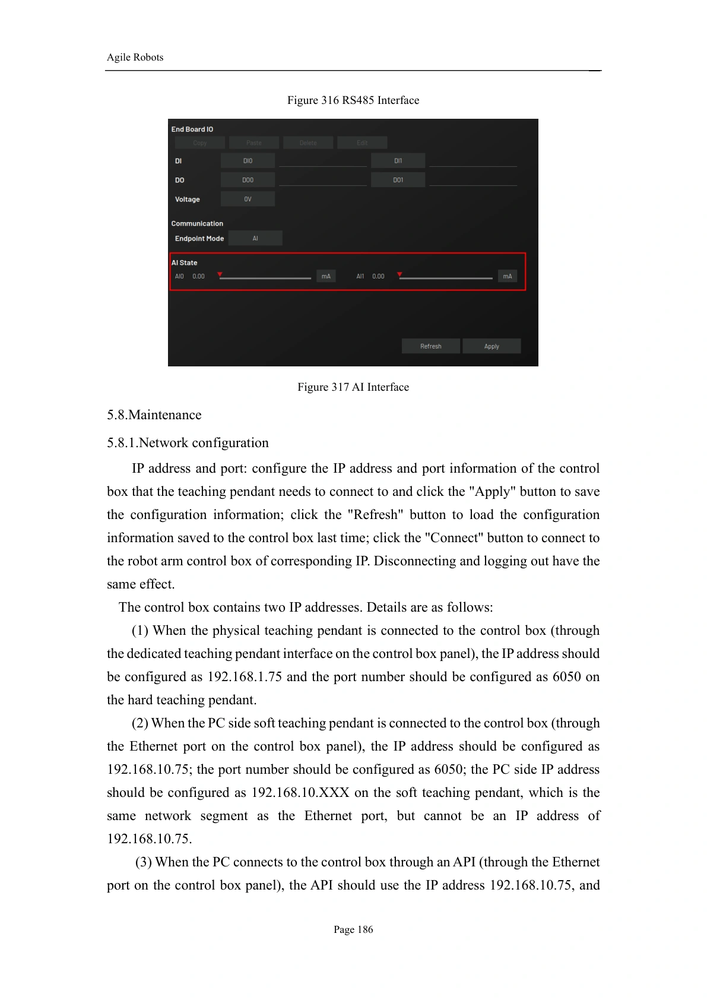



```
Agile Robots 
Page 186 
 
Figure 316 RS485 Interface 
 
Figure 317 AI Interface 
5.8.Maintenance  
5.8.1.Network configuration  
IP address and port: configure the IP address and port information of the control 
box that the teaching pendant needs to connect to and click the "Apply" button to save 
the configuration information; click the "Refresh" button to load the configuration 
information saved to the control box last time; click the "Connect" button to connect to 
the robot arm control box of corresponding IP. Disconnecting and logging out have the 
same effect.  
The control box contains two IP addresses. Details are as follows:  
(1) When the physical teaching pendant is connected to the control box (through 
the dedicated teaching pendant interface on the control box panel), the IP address should 
be configured as 192.168.1.75 and the port number should be configured as 6050 on 
the hard teaching pendant.  
(2) When the PC side soft teaching pendant is connected to the control box (through 
the Ethernet port on the control box panel), the IP address should be configured as 
192.168.10.75; the port number should be configured as 6050; the PC side IP address 
should be configured as 192.168.10.XXX on the soft teaching pendant, which is the 
same network segment as the Ethernet port, but cannot be an IP address of 
192.168.10.75.  
(3) When the PC connects to the control box through an API (through the Ethernet 
port on the control box panel), the API should use the IP address 192.168.10.75, and
```



## PDF page 191

**Source:** Industrial Teaching Pendant Software User Manual\_V3.3.0\_EN\_20260204.pdf, original pdf page 191. [Open the corresponding PDF reading-copy page](https://1292444914-files.gitbook.io/~/files/v0/b/gitbook-x-prod.appspot.com/o/spaces%2FtgOfPnscWebs1eh82EKq%2Fuploads%2Fwd9Ur3poPuwOhwF5idnf%2Findustrial-teaching-pendant-software-user-manual-v3-3-0-en-20260204-pp-189-194.pdf?alt=media#page=3).



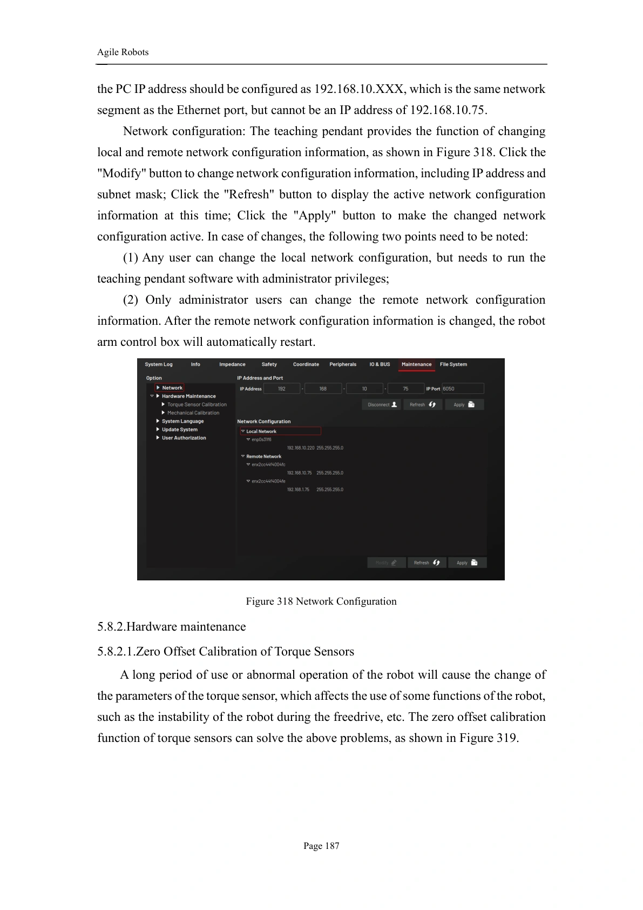



```
Agile Robots 
Page 187 
 
the PC IP address should be configured as 192.168.10.XXX, which is the same network 
segment as the Ethernet port, but cannot be an IP address of 192.168.10.75.  
Network configuration: The teaching pendant provides the function of changing 
local and remote network configuration information, as shown in Figure 318. Click the 
"Modify" button to change network configuration information, including IP address and 
subnet mask; Click the "Refresh" button to display the active network configuration 
information at this time; Click the "Apply" button to make the changed network 
configuration active. In case of changes, the following two points need to be noted:  
(1) Any user can change the local network configuration, but needs to run the 
teaching pendant software with administrator privileges;  
(2) Only administrator users can change the remote network configuration 
information. After the remote network configuration information is changed, the robot 
arm control box will automatically restart.  
 
Figure 318 Network Configuration 
5.8.2.Hardware maintenance 
5.8.2.1.Zero Offset Calibration of Torque Sensors  
A long period of use or abnormal operation of the robot will cause the change of 
the parameters of the torque sensor, which affects the use of some functions of the robot, 
such as the instability of the robot during the freedrive, etc. The zero offset calibration 
function of torque sensors can solve the above problems, as shown in Figure 319.
```



**Original document cross-references:** [PDF 191](pages-145-216.md#pdf-page-191) · [PDF 192](pages-145-216.md#pdf-page-192)

## PDF page 192

**Source:** Industrial Teaching Pendant Software User Manual\_V3.3.0\_EN\_20260204.pdf, original pdf page 192. [Open the corresponding PDF reading-copy page](https://1292444914-files.gitbook.io/~/files/v0/b/gitbook-x-prod.appspot.com/o/spaces%2FtgOfPnscWebs1eh82EKq%2Fuploads%2Fwd9Ur3poPuwOhwF5idnf%2Findustrial-teaching-pendant-software-user-manual-v3-3-0-en-20260204-pp-189-194.pdf?alt=media#page=4).



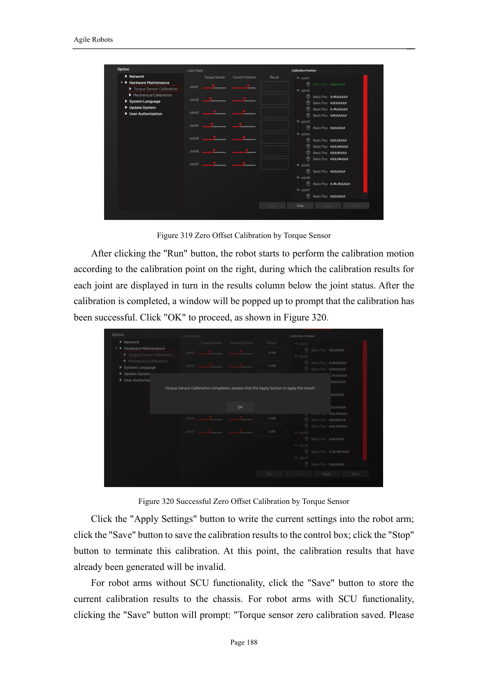



```
Agile Robots 
Page 188 
 
 
Figure 319 Zero Offset Calibration by Torque Sensor 
After clicking the "Run" button, the robot starts to perform the calibration motion 
according to the calibration point on the right, during which the calibration results for 
each joint are displayed in turn in the results column below the joint status. After the 
calibration is completed, a window will be popped up to prompt that the calibration has 
been successful. Click "OK" to proceed, as shown in Figure 320.  
 
Figure 320 Successful Zero Offset Calibration by Torque Sensor 
Click the "Apply Settings" button to write the current settings into the robot arm; 
click the "Save" button to save the calibration results to the control box; click the "Stop" 
button to terminate this calibration. At this point, the calibration results that have 
already been generated will be invalid.  
For robot arms without SCU functionality, click the "Save" button to store the 
current calibration results to the chassis. For robot arms with SCU functionality, 
clicking the "Save" button will prompt: "Torque sensor zero calibration saved. Please
```



**Original document cross-references:** [PDF 192](pages-145-216.md#pdf-page-192)

## PDF page 193

**Source:** Industrial Teaching Pendant Software User Manual\_V3.3.0\_EN\_20260204.pdf, original pdf page 193. [Open the corresponding PDF reading-copy page](https://1292444914-files.gitbook.io/~/files/v0/b/gitbook-x-prod.appspot.com/o/spaces%2FtgOfPnscWebs1eh82EKq%2Fuploads%2Fwd9Ur3poPuwOhwF5idnf%2Findustrial-teaching-pendant-software-user-manual-v3-3-0-en-20260204-pp-189-194.pdf?alt=media#page=5).



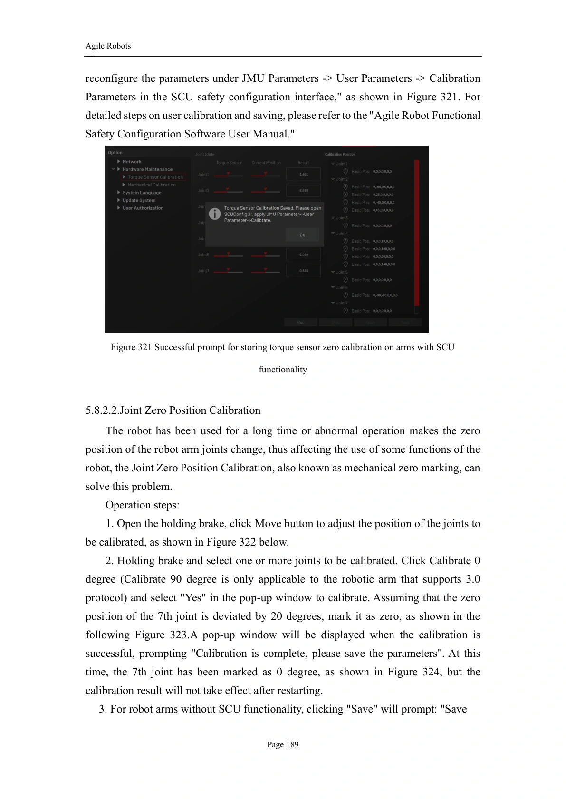



```
Agile Robots 
Page 189 
 
reconfigure the parameters under JMU Parameters -> User Parameters -> Calibration 
Parameters in the SCU safety configuration interface," as shown in Figure 321. For 
detailed steps on user calibration and saving, please refer to the "Agile Robot Functional 
Safety Configuration Software User Manual." 
 
Figure 321 Successful prompt for storing torque sensor zero calibration on arms with SCU 
functionality 
 
5.8.2.2.Joint Zero Position Calibration  
The robot has been used for a long time or abnormal operation makes the zero 
position of the robot arm joints change, thus affecting the use of some functions of the 
robot, the Joint Zero Position Calibration, also known as mechanical zero marking, can 
solve this problem. 
Operation steps: 
1. Open the holding brake, click Move button to adjust the position of the joints to 
be calibrated, as shown in Figure 322 below. 
2. Holding brake and select one or more joints to be calibrated. Click Calibrate 0 
degree (Calibrate 90 degree is only applicable to the robotic arm that supports 3.0 
protocol) and select "Yes" in the pop-up window to calibrate. Assuming that the zero 
position of the 7th joint is deviated by 20 degrees, mark it as zero, as shown in the 
following Figure 323.A pop-up window will be displayed when the calibration is 
successful, prompting "Calibration is complete, please save the parameters". At this 
time, the 7th joint has been marked as 0 degree, as shown in Figure 324, but the 
calibration result will not take effect after restarting.  
3. For robot arms without SCU functionality, clicking "Save" will prompt: "Save
```



**Original document cross-references:** [PDF 193](pages-145-216.md#pdf-page-193) · [PDF 194](pages-145-216.md#pdf-page-194) · [PDF 195](pages-145-216.md#pdf-page-195)

## PDF page 194

**Source:** Industrial Teaching Pendant Software User Manual\_V3.3.0\_EN\_20260204.pdf, original pdf page 194. [Open the corresponding PDF reading-copy page](https://1292444914-files.gitbook.io/~/files/v0/b/gitbook-x-prod.appspot.com/o/spaces%2FtgOfPnscWebs1eh82EKq%2Fuploads%2Fwd9Ur3poPuwOhwF5idnf%2Findustrial-teaching-pendant-software-user-manual-v3-3-0-en-20260204-pp-189-194.pdf?alt=media#page=6).



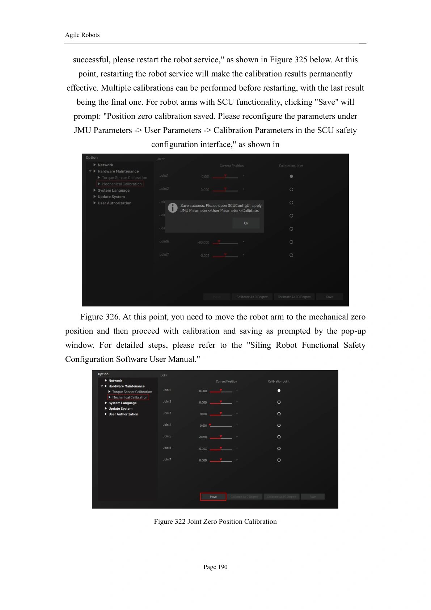



```
Agile Robots 
Page 190 
 
successful, please restart the robot service," as shown in Figure 325 below. At this 
point, restarting the robot service will make the calibration results permanently 
effective. Multiple calibrations can be performed before restarting, with the last result 
being the final one. For robot arms with SCU functionality, clicking "Save" will 
prompt: "Position zero calibration saved. Please reconfigure the parameters under 
JMU Parameters -> User Parameters -> Calibration Parameters in the SCU safety 
configuration interface," as shown in 
 
Figure 326. At this point, you need to move the robot arm to the mechanical zero 
position and then proceed with calibration and saving as prompted by the pop-up 
window. For detailed steps, please refer to the "Siling Robot Functional Safety 
Configuration Software User Manual." 
 
Figure 322 Joint Zero Position Calibration
```



**Original document cross-references:** [PDF 195](pages-145-216.md#pdf-page-195) · [PDF 196](pages-145-216.md#pdf-page-196)

## PDF page 195

**Source:** Industrial Teaching Pendant Software User Manual\_V3.3.0\_EN\_20260204.pdf, original pdf page 195. [Open the corresponding PDF reading-copy page](https://1292444914-files.gitbook.io/~/files/v0/b/gitbook-x-prod.appspot.com/o/spaces%2FtgOfPnscWebs1eh82EKq%2Fuploads%2F9yWTKiScTgrxfqh3Svto%2Findustrial-teaching-pendant-software-user-manual-v3-3-0-en-20260204-pp-195-200.pdf?alt=media#page=1).



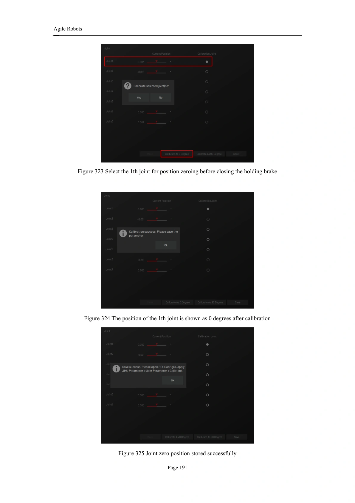



```
Agile Robots 
Page 191 
 
 
Figure 323 Select the 1th joint for position zeroing before closing the holding brake 
 
 
Figure 324 The position of the 1th joint is shown as 0 degrees after calibration 
 
Figure 325 Joint zero position stored successfully
```



## PDF page 196

**Source:** Industrial Teaching Pendant Software User Manual\_V3.3.0\_EN\_20260204.pdf, original pdf page 196. [Open the corresponding PDF reading-copy page](https://1292444914-files.gitbook.io/~/files/v0/b/gitbook-x-prod.appspot.com/o/spaces%2FtgOfPnscWebs1eh82EKq%2Fuploads%2F9yWTKiScTgrxfqh3Svto%2Findustrial-teaching-pendant-software-user-manual-v3-3-0-en-20260204-pp-195-200.pdf?alt=media#page=2).







```
Agile Robots 
Page 192 
 
 
Figure 326 Successful prompt for storing position zero calibration on arms with SCU functionality. 
5.8.3.System language  
There are currently three built-in system languages for the teaching pendant, 
Chinese, English, and Deutsch. As shown in Figure 327, select the language to be 
switched to and click the "Set" button to switch to that language. Click “Refresh” 
bottom to obtain the current teaching pendant language.  
 
Figure 327 System Language 
5.8.4.Parameter loading  
Parameter loading, save the connected robot arm algorithm and mechanical 
parameters to the robot arm joints, and load the parameters to the control box when 
needed, so that the robot arm can arbitrarily replace the same arm type with different 
control boxes. 
When saving and loading parameters, the robot arm should be in the state of closing 
the brake, click on the "Save Parameters" button, a confirmation pop-up box will appear, 
as shown in Figure 328, continue to click on the "Yes" button to start the parameter 
saving, there will be a progress bar to indicate the progress of saving, and the parameter 
processing log can be found in the parameter processing log area at the same time. 
During the saving process, a progress bar will indicate the saving progress, and at the 
same time, you can observe the saving status in the parameter processing log area, and
```



**Original document cross-references:** [PDF 196](pages-145-216.md#pdf-page-196) · [PDF 197](pages-145-216.md#pdf-page-197)

## PDF page 197

**Source:** Industrial Teaching Pendant Software User Manual\_V3.3.0\_EN\_20260204.pdf, original pdf page 197. [Open the corresponding PDF reading-copy page](https://1292444914-files.gitbook.io/~/files/v0/b/gitbook-x-prod.appspot.com/o/spaces%2FtgOfPnscWebs1eh82EKq%2Fuploads%2F9yWTKiScTgrxfqh3Svto%2Findustrial-teaching-pendant-software-user-manual-v3-3-0-en-20260204-pp-195-200.pdf?alt=media#page=3).







```
Agile Robots 
Page 193 
 
the successful saving is shown in Figure 329. 
Click the "Load Parameters" button, pop-up confirmation pop-up box, continue to 
click the "Yes" button to start parameter loading, as shown in Figure 330, the loading 
process will have a progress bar to indicate the progress of loading, in the parameter 
processing log area can be observed in the saving state, loading success! As shown in 
Figure 331. 
Note: This function is exclusively available for the Diana7_CS arm model. The 
parameter loading page will only be displayed when the system is in logged-in state and 
the active arm model is Diana7_CS. 
 
Figure 328 Save parameters 
 
Figure 329 Save parameters successfully 
 
Figure 330 Loading parameters
```



**Original document cross-references:** [PDF 197](pages-145-216.md#pdf-page-197) · [PDF 198](pages-145-216.md#pdf-page-198)

## PDF page 198

**Source:** Industrial Teaching Pendant Software User Manual\_V3.3.0\_EN\_20260204.pdf, original pdf page 198. [Open the corresponding PDF reading-copy page](https://1292444914-files.gitbook.io/~/files/v0/b/gitbook-x-prod.appspot.com/o/spaces%2FtgOfPnscWebs1eh82EKq%2Fuploads%2F9yWTKiScTgrxfqh3Svto%2Findustrial-teaching-pendant-software-user-manual-v3-3-0-en-20260204-pp-195-200.pdf?alt=media#page=4).







```
Agile Robots 
Page 194 
 
 
Figure 331 Load parameters successfully 
5.8.5.System upgrade  
In terms of System upgrade, provide the function of updating the version of the 
Teaching Pendant and the service of the slave computer, the upgrade can be carried out 
in two situations: logging in and logging out, the Teaching Pendant can be upgraded in 
the logout state, click "Select Upgrade Package", select the upgrade package and 
unpack and parse the package as shown in Figure 332, and when the parse is completed, 
as shown in Figure 333, the version information of the different modules in the package 
can be seen; click "Transfer Upgrade Package" to transfer the upgrade package to the 
Teaching Pendant, as shown in Figure 334, and after transmission is completed, the 
Teaching Pendant can be upgraded by restarting the control box through power off and 
restarting the control box. Click "Transfer Upgrade Package" to transfer the upgrade 
package to Teaching Pendant, as shown in Figure 334, after the transfer is completed, 
the upgrade of Teaching Pendant can be completed by restarting the control box through 
the power off. 
 
Figure 332 System upgrade when logging out-Select upgrade package-1
```



**Original document cross-references:** [PDF 198](pages-145-216.md#pdf-page-198) · [PDF 199](pages-145-216.md#pdf-page-199)

## PDF page 199

**Source:** Industrial Teaching Pendant Software User Manual\_V3.3.0\_EN\_20260204.pdf, original pdf page 199. [Open the corresponding PDF reading-copy page](https://1292444914-files.gitbook.io/~/files/v0/b/gitbook-x-prod.appspot.com/o/spaces%2FtgOfPnscWebs1eh82EKq%2Fuploads%2F9yWTKiScTgrxfqh3Svto%2Findustrial-teaching-pendant-software-user-manual-v3-3-0-en-20260204-pp-195-200.pdf?alt=media#page=5).







```
Agile Robots 
Page 195 
 
 
Figure 333 System upgrade when logging out-Select upgrade package-2 
 
Figure 334 System upgrade when logging out- Transfer Upgrade Package 
 
You can upgrade the Teaching Pendant and slave computer system under logging 
in. Click "Select Upgrade Package" to select the upgrade package and decompress and 
parse it, and the parse will be completed as shown in Figure 335; click " Transfer Upgrade 
Package" to transfer the upgrade package to the Teaching Pendant and slave computer. 
As shown in Figure 336, the upgrade of Teaching Pendant and slave computer system is 
completed by restarting the control box after transmission.
```



**Original document cross-references:** [PDF 200](pages-145-216.md#pdf-page-200)

## PDF page 200

**Source:** Industrial Teaching Pendant Software User Manual\_V3.3.0\_EN\_20260204.pdf, original pdf page 200. [Open the corresponding PDF reading-copy page](https://1292444914-files.gitbook.io/~/files/v0/b/gitbook-x-prod.appspot.com/o/spaces%2FtgOfPnscWebs1eh82EKq%2Fuploads%2F9yWTKiScTgrxfqh3Svto%2Findustrial-teaching-pendant-software-user-manual-v3-3-0-en-20260204-pp-195-200.pdf?alt=media#page=6).







```
Agile Robots 
Page 196 
 
 
Figure 335 System upgrade when logging in-Select upgrade package 
 
Figure 336 System upgrade when logging in- Transfer Upgrade Package 
When upgrade, you can choose to keep the configuration for upgrading, as shown 
in Figure 337, regardless of the upgrade package with or without the algorithm, 
machinery and control box configuration information, the original configuration will 
be retained when upgrading. If you choose to upgrade without retention of 
configuration, as shown in Figure 338, the selected upgrade package must contain 
algorithm, machinery and control box configuration, and the upgrade will not keep the 
original version of the algorithm, machinery and control box configuration, so if the 
configuration is missing, the system services may not be able to run after the upgrade. 
Regardless of whether the configuration is retained for the upgrade or not, the project 
is unconditionally retained.
```



**Original document cross-references:** [PDF 201](pages-145-216.md#pdf-page-201)

## PDF page 201

**Source:** Industrial Teaching Pendant Software User Manual\_V3.3.0\_EN\_20260204.pdf, original pdf page 201. [Open the corresponding PDF reading-copy page](https://1292444914-files.gitbook.io/~/files/v0/b/gitbook-x-prod.appspot.com/o/spaces%2FtgOfPnscWebs1eh82EKq%2Fuploads%2F02SsBv6KXlZh6ahZNQjZ%2Findustrial-teaching-pendant-software-user-manual-v3-3-0-en-20260204-pp-201-203.pdf?alt=media#page=1).







```
Agile Robots 
Page 197 
 
 
Figure 337 Upgrade with retaining configuration 
 
Figure 338 Upgrade without retaining configuration 
5.8.6.User management  
In terms of user management, provide management functions for login accounts, 
allow to add, modify, and delete users, as well as set the display format of user names 
when logging into the teaching pendant. In addition, you can also carry out user rights 
level management, import/export of user rights data, user card binding, card login and 
other operations.as shown in Figure 339.  
(1) Create new user: log in as an administrator account and click "Create New User", 
as shown in Figure 340. By default, a normal user will be created.  
(2) Modify user category: the user category created by default is normal user, and 
the administrator can modify new user categories. At present, there are three types of 
users in the system: Normal , Engineer , Admin. Select the user whose user level needs 
to be modified in the user management table, then select a new category in the user new 
category selection item, click the "Apply" button, at this time, it will prompt that the
```



**Original document cross-references:** [PDF 202](pages-145-216.md#pdf-page-202) · [PDF 203](pages-145-216.md#pdf-page-203)

## PDF page 202

**Source:** Industrial Teaching Pendant Software User Manual\_V3.3.0\_EN\_20260204.pdf, original pdf page 202. [Open the corresponding PDF reading-copy page](https://1292444914-files.gitbook.io/~/files/v0/b/gitbook-x-prod.appspot.com/o/spaces%2FtgOfPnscWebs1eh82EKq%2Fuploads%2F02SsBv6KXlZh6ahZNQjZ%2Findustrial-teaching-pendant-software-user-manual-v3-3-0-en-20260204-pp-201-203.pdf?alt=media#page=2).







```
Agile Robots 
Page 198 
 
user type has been updated. As shown in Figure 341, modify the user type to developer. 
Refer to Table 2 in Section 7.1 for user categories for different user categories.  
(3) Modify a user's password, name, and alias: log in as an administrator account, 
select the user who needs to be modified in the user management table, click the " 
Change Password" button, enter the current password in the current password input box, 
enter the new password twice in the new password input box, and click the "Apply" 
button, at this point, the user password will be reset successfully, as shown in Figure 
342; click the "Change Name" button, enter a new user name in the new user name 
input box, and click the "Apply" button to modify the user name, as shown in Figure 
343; click the "Change Alias" button, enter a new user alias in the new user alias input 
box, and click the "Apply" button to modify the user alias, as shown in Figure 344; 
(4) User name display: The user name display can be divided into two formats: user 
alias (user name) and user alias. If the user alias (user name) format is selected, the user 
list display format when logging into the teaching pendant is: user alias (user name), as 
shown in Figure 345; otherwise, when logging in, only the user alias will be displayed 
in the user list, as shown in Figure 346.  
(5) Delete user: log in as an administrator account, select the user to be deleted in 
the user management table, and click the "Remove User" button in the bottom right 
corner to complete the deletion, as shown in Figure 347. 
 
Figure 339 User Management
```



**Original document cross-references:** [PDF 203](pages-145-216.md#pdf-page-203) · [PDF 204](pages-145-216.md#pdf-page-204) · [PDF 205](pages-145-216.md#pdf-page-205) · [PDF 206](pages-145-216.md#pdf-page-206)

## PDF page 203

**Source:** Industrial Teaching Pendant Software User Manual\_V3.3.0\_EN\_20260204.pdf, original pdf page 203. [Open the corresponding PDF reading-copy page](https://1292444914-files.gitbook.io/~/files/v0/b/gitbook-x-prod.appspot.com/o/spaces%2FtgOfPnscWebs1eh82EKq%2Fuploads%2F02SsBv6KXlZh6ahZNQjZ%2Findustrial-teaching-pendant-software-user-manual-v3-3-0-en-20260204-pp-201-203.pdf?alt=media#page=3).







```
Agile Robots 
Page 199 
 
 
Figure 340 New User 
 
Figure 341 Modify User Category
```



## PDF page 204

**Source:** Industrial Teaching Pendant Software User Manual\_V3.3.0\_EN\_20260204.pdf, original pdf page 204. [Open the corresponding PDF reading-copy page](https://1292444914-files.gitbook.io/~/files/v0/b/gitbook-x-prod.appspot.com/o/spaces%2FtgOfPnscWebs1eh82EKq%2Fuploads%2FWHWjLJJyZq3Z7xEMJm2O%2Findustrial-teaching-pendant-software-user-manual-v3-3-0-en-20260204-pp-204-208.pdf?alt=media#page=1).







```
Agile Robots 
Page 200 
 
 
Figure 342 Reset User Password 
 
Figure 343 Modify User Name
```



## PDF page 205

**Source:** Industrial Teaching Pendant Software User Manual\_V3.3.0\_EN\_20260204.pdf, original pdf page 205. [Open the corresponding PDF reading-copy page](https://1292444914-files.gitbook.io/~/files/v0/b/gitbook-x-prod.appspot.com/o/spaces%2FtgOfPnscWebs1eh82EKq%2Fuploads%2FWHWjLJJyZq3Z7xEMJm2O%2Findustrial-teaching-pendant-software-user-manual-v3-3-0-en-20260204-pp-204-208.pdf?alt=media#page=2).







```
Agile Robots 
Page 201 
 
 
Figure 344 Modify User Alias 
 
Figure 345 User Alias (User Name) Display Format 
 
Figure 346 User Alias Display Format
```



## PDF page 206

**Source:** Industrial Teaching Pendant Software User Manual\_V3.3.0\_EN\_20260204.pdf, original pdf page 206. [Open the corresponding PDF reading-copy page](https://1292444914-files.gitbook.io/~/files/v0/b/gitbook-x-prod.appspot.com/o/spaces%2FtgOfPnscWebs1eh82EKq%2Fuploads%2FWHWjLJJyZq3Z7xEMJm2O%2Findustrial-teaching-pendant-software-user-manual-v3-3-0-en-20260204-pp-204-208.pdf?alt=media#page=3).







```
Agile Robots 
Page 202 
 
 
Figure 347 Delete User 
(6) Category level management 
The administrator can create five levels of category, and the various levels of 
category are shown below: 
Administrator privileges can perform all operations 
Level 5 users (level code 7) can switch screens, view programs, and view 
parameters. You can change your user password, user name, and user alias. 
Level 4 user (level code 6) has the following new privileges compared with level 
5 user: start-stop reset, power on/off, program menu recompile program/save. 
Level 3 users (level code 5) have the following new privileges compared with level 
4 users: point debugging, input/output switching status (IO), system log 
clearing/exporting, exporting from the main menu, clearing program from the 
programming menu. 
Level 2 user (level code 4) has the following new privileges compared with level 
3 
users: 
IO 
setting, 
parameter 
modification 
(impedance 
parameter 
modification/import/export), torque transducer zero marking, system language 
modification, new coordinate system, conveyor belt. 
Level 1 user (level code 3) has the following new privileges over the second-level 
user: new/delete program, program debugging. 
(7) Bind/Unbind Work Card 
It supports users to bind work card, after binding, you can directly swipe the card 
to log in. 
The specific steps to bind the work card are as follows: after selecting the user,
```



## PDF page 207

**Source:** Industrial Teaching Pendant Software User Manual\_V3.3.0\_EN\_20260204.pdf, original pdf page 207. [Open the corresponding PDF reading-copy page](https://1292444914-files.gitbook.io/~/files/v0/b/gitbook-x-prod.appspot.com/o/spaces%2FtgOfPnscWebs1eh82EKq%2Fuploads%2FWHWjLJJyZq3Z7xEMJm2O%2Findustrial-teaching-pendant-software-user-manual-v3-3-0-en-20260204-pp-204-208.pdf?alt=media#page=4).







```
Agile Robots 
Page 203 
 
click the button of binding the work card, and then swipe the card on the card reader to 
complete the operation of binding the user's card, and then there will be a successful 
prompt of binding the card on the teaching device. 
The specific steps to unbind work card are as follows: After selecting the user, 
click the button of unbind work card, and select "Yes" to unbind according to the 
prompts. 
Note: 1: 
1. When you delete a user, the card bound to that user will be unbound 
automatically. 
2. If you swipe a card that is not bound to a user when logging in to the 
demonstrator, you will be prompted with the message "Card number not registered". 3. 
3. If the user has not set a password, the user can only log in by swiping the card 
after binding the card, but cannot log in by password, and it will prompt "the user 
password is incorrect" if the user logs in by password. 4. 
4. A card can only bind one user at the same time. For example, if user1 binds 
card1, when user2 tries to bind card1, it will prompt "The card has been bound to 
another user: user1". At this time, you can first unbind user1 to card1, and then operate 
user2 to bind card1, or user2 to bind a new card. 
(8) Import/Export User Category 
Users can export user category to xml file or import from xml file, click "export" 
button, as shown in Figure 348 to export user information; click "import" button, as 
shown in Figure 349 and Figure 350 to import user information. 
 
 
Figure 348 User Category Export
```



**Original document cross-references:** [PDF 207](pages-145-216.md#pdf-page-207) · [PDF 208](pages-145-216.md#pdf-page-208)

## PDF page 208

**Source:** Industrial Teaching Pendant Software User Manual\_V3.3.0\_EN\_20260204.pdf, original pdf page 208. [Open the corresponding PDF reading-copy page](https://1292444914-files.gitbook.io/~/files/v0/b/gitbook-x-prod.appspot.com/o/spaces%2FtgOfPnscWebs1eh82EKq%2Fuploads%2FWHWjLJJyZq3Z7xEMJm2O%2Findustrial-teaching-pendant-software-user-manual-v3-3-0-en-20260204-pp-204-208.pdf?alt=media#page=5).







```
Agile Robots 
Page 204 
 
 
Figure 349 User Category Import 
 
Figure 350 Selecting an Import File 
(9) User Category management 
Users can customize all category names as shown on Figure 351.The customized 
category names will be updated in the user management category names, as shown as 
on Figure 352.
```



**Original document cross-references:** [PDF 209](pages-145-216.md#pdf-page-209)

## PDF page 209

**Source:** Industrial Teaching Pendant Software User Manual\_V3.3.0\_EN\_20260204.pdf, original pdf page 209. [Open the corresponding PDF reading-copy page](https://1292444914-files.gitbook.io/~/files/v0/b/gitbook-x-prod.appspot.com/o/spaces%2FtgOfPnscWebs1eh82EKq%2Fuploads%2Fxr0HxpO7HpdConS99s3b%2Findustrial-teaching-pendant-software-user-manual-v3-3-0-en-20260204-pp-209-214.pdf?alt=media#page=1).







```
Agile Robots 
Page 205 
 
 
Figure 351 Category management 
 
Figure 352 User management 
5.9.File System 
In the Teaching Pendant System Setup screen, click the [File System] tab to enter 
the [File System] screen shown in Figure 353 and Figure 354. In the textual project, the 
folders Backup, Log, Lua and Screenshot are the directory folders of the robot system 
itself. In the graphical project, the folders Backup, Log, Lua, Programs, Python, and 
Screenshot are the directory folders of the robot system itself. 
The file system also lists the disk folder structure of the local computer if the soft 
Teaching Pendant is used to log in, such as C:/ shown in Figure 353; if a USB flash 
drive is plugged into the local computer or the hard Teaching Pendant, the file system 
lists the disk letter of the USB flash drive, such as D:/ shown in Figure 354. 
In the main directory of the file system, the Backup folder stores all the backup 
files of the current project in the control box, as shown in Figure 355; the Log folder 
stores all the log files of the robotic arm, as shown in Figure 356; the Lua folder stores
```



**Original document cross-references:** [PDF 210](pages-145-216.md#pdf-page-210) · [PDF 211](pages-145-216.md#pdf-page-211)

## PDF page 210

**Source:** Industrial Teaching Pendant Software User Manual\_V3.3.0\_EN\_20260204.pdf, original pdf page 210. [Open the corresponding PDF reading-copy page](https://1292444914-files.gitbook.io/~/files/v0/b/gitbook-x-prod.appspot.com/o/spaces%2FtgOfPnscWebs1eh82EKq%2Fuploads%2Fxr0HxpO7HpdConS99s3b%2Findustrial-teaching-pendant-software-user-manual-v3-3-0-en-20260204-pp-209-214.pdf?alt=media#page=2).







```
Agile Robots 
Page 206 
 
the Lua program files of the current project, as shown in Figure 357; and the Programs 
folder exists the program files of the current graphical project in the format of xml files, 
as shown in Figure 358; Python folder exists the Python program files of the current 
graphical project, as shown in Figure 359; Screenshot folder stores all the screenshot 
files of the current control box, as shown in Figure 360. 
 
Figure 353 The main file system interface in textualized project 
 
 
Figure 354 The main file system interface in graphical project 
 
Figure 355 Backup Catalog
```



**Original document cross-references:** [PDF 211](pages-145-216.md#pdf-page-211) · [PDF 212](pages-145-216.md#pdf-page-212)

## PDF page 211

**Source:** Industrial Teaching Pendant Software User Manual\_V3.3.0\_EN\_20260204.pdf, original pdf page 211. [Open the corresponding PDF reading-copy page](https://1292444914-files.gitbook.io/~/files/v0/b/gitbook-x-prod.appspot.com/o/spaces%2FtgOfPnscWebs1eh82EKq%2Fuploads%2Fxr0HxpO7HpdConS99s3b%2Findustrial-teaching-pendant-software-user-manual-v3-3-0-en-20260204-pp-209-214.pdf?alt=media#page=3).







```
Agile Robots 
Page 207 
 
 
Figure 356 Log Catalog 
 
Figure 357 Lua Catalog 
 
 
Figure 358 Programs Catalog
```



## PDF page 212

**Source:** Industrial Teaching Pendant Software User Manual\_V3.3.0\_EN\_20260204.pdf, original pdf page 212. [Open the corresponding PDF reading-copy page](https://1292444914-files.gitbook.io/~/files/v0/b/gitbook-x-prod.appspot.com/o/spaces%2FtgOfPnscWebs1eh82EKq%2Fuploads%2Fxr0HxpO7HpdConS99s3b%2Findustrial-teaching-pendant-software-user-manual-v3-3-0-en-20260204-pp-209-214.pdf?alt=media#page=4).







```
Agile Robots 
Page 208 
 
 
Figure 359 Python Catalog 
 
 
Figure 360 Screenshot Catalog 
The file system provides users with the ability to create, delete, rename, copy and 
paste files (folders). For a detailed description of each function on the File System 
Toolbar, please refer to Table 2. 
Table 2 File System Toolbar 
Name 
Function 
Main directory 
After clicking the Home directory, you return to the top level 
directory of the file system. 
new folder 
Create a new folder in the current directory.  
Currently, only Lua folders in text-based projects, local 
computers, and USB flash drives are supported. 
New Program 
Create a new program in the current directory.  
Currently, this function only supports creating new programs in 
the Lua folder of text-based projects, and the Lua, Programs, and 
Python folders of graphical projects. 
Open 
If the selected file is a folder, open the folder in the file system.
```



**Original document cross-references:** [PDF 212](pages-145-216.md#pdf-page-212)

## PDF page 213

**Source:** Industrial Teaching Pendant Software User Manual\_V3.3.0\_EN\_20260204.pdf, original pdf page 213. [Open the corresponding PDF reading-copy page](https://1292444914-files.gitbook.io/~/files/v0/b/gitbook-x-prod.appspot.com/o/spaces%2FtgOfPnscWebs1eh82EKq%2Fuploads%2Fxr0HxpO7HpdConS99s3b%2Findustrial-teaching-pendant-software-user-manual-v3-3-0-en-20260204-pp-209-214.pdf?alt=media#page=5).







```
Agile Robots 
Page 209 
 
If the selected file is a file in the Lua or Python folder, click 
"Open" to open the file in the program editor. 
If the selected file is Programs xml file in the directory, click 
"Open" to jump directly to the program tree interface, and 
automatically select the program. 
if the selected file is a file in the Log or Screenshot directory, 
click "Open" to directly open the preview window, and you can 
preview the file. But it cannot be edited. 
On the local computer and USB flash drive, only the opening and 
previewing of Lua and Python program files, png picture files, 
text files in txt and log formats is supported. 
It should be noted that the file system will record the last time 
each working directory was opened. path of. When the directory is 
opened again in the top-level directory of the file system, it will 
jump directly to the last opened path, but the path will no longer 
be recorded after logging out of the teaching device. 
upper level 
Return to the previous directory. At most, return to the main 
directory of the file system. 
refresh 
When you switch the tabs on the teach pendant interface, the 
resource manager will automatically refresh the file tree. You can 
also click the "refresh" button to manually refresh the file tree. 
delete 
Select a file (folder), click the "Delete" button, and click "Yes" in 
the Delete confirmation box to delete the selected file (folder). All 
files and subfolders under the folder will be deleted. 
It should be noted that the deleted files (folders) will not enter the 
Recycle Bin, so the deleted files (folders) cannot be restored. 
Rename 
Rename the selected file (folder). 
Cut 
Select a file and click the "Cut" button to cut the file. The 
successfully cut file is moved to the clipboard. 
It should be noted that the file system only supports cutting of bin 
format backup files, Lua files, Python files, png image files, txt, 
and log format text files. 
copy 
Select a file and click the "Copy" button to copy the file. The 
successfully copied file is copied to the clipboard. 
It should be noted that the file system only supports copying 
backup files in bin format, Lua files, Python files, png image files, 
and text files in txt and log formats. 
Paste 
Copy the file in the clipboard to the current directory.
```



## PDF page 214

**Source:** Industrial Teaching Pendant Software User Manual\_V3.3.0\_EN\_20260204.pdf, original pdf page 214. [Open the corresponding PDF reading-copy page](https://1292444914-files.gitbook.io/~/files/v0/b/gitbook-x-prod.appspot.com/o/spaces%2FtgOfPnscWebs1eh82EKq%2Fuploads%2Fxr0HxpO7HpdConS99s3b%2Findustrial-teaching-pendant-software-user-manual-v3-3-0-en-20260204-pp-209-214.pdf?alt=media#page=6).







```
Agile Robots 
Page 210 
 
Note that the file system does not allow pasting files to the Log, 
Programs, and Screenshot directories. 
Eject the USB drive 
Select the USB drive in the file system and click the "Eject USB" 
button to safely eject the USB drive from the teach pendant. 
The Current Path in the File System screen displays the full path to the directory 
you are currently in, as shown in Figure 361. 
 
 
Figure 361 Current Path 
 
Meanwhile, the file system interface displays the name, size and modification date 
of the file (folder), as shown in Figure 362. It also supports sorting files (folders) by 
name, size and modification date, as shown in Figure 363, Figure 364 and Figure 365 
respectively. 
 
Figure 362 Properties of files (folders) 
 
 
Figure 363 Sort by name
```



**Original document cross-references:** [PDF 214](pages-145-216.md#pdf-page-214) · [PDF 215](pages-145-216.md#pdf-page-215)

## PDF page 215

**Source:** Industrial Teaching Pendant Software User Manual\_V3.3.0\_EN\_20260204.pdf, original pdf page 215. [Open the corresponding PDF reading-copy page](https://1292444914-files.gitbook.io/~/files/v0/b/gitbook-x-prod.appspot.com/o/spaces%2FtgOfPnscWebs1eh82EKq%2Fuploads%2FOVM46x91QLjBua1jiEVg%2Findustrial-teaching-pendant-software-user-manual-v3-3-0-en-20260204-pp-215-225.pdf?alt=media#page=1).







```
Agile Robots 
Page 211 
 
 
Figure 364 Sort by size 
 
 
Figure 365 Sort by modification date 
6.Main Menu Function  
 Click the icon 
 in the upper left corner of the teaching pendant to pop up a 
list of main menu functions, including: robot arm authorization activation, login and 
logout teaching pendant, import and export projects, save parameters, set user 
preferences, set custom homepoint, clear and recompile programs, Project Backup 
Management, restart robot services, shut down system, switch 3D models, and view 
robot version, activation and license information.  
6.1. Robot arm authorization activation  
When using the robot arm for the first time or after the authorization activation 
expires, clicking the "Login" button on the logout interface will pop up an activation prompt 
window as shown in Figure 366. Clicking the "Activate" button will open the "Activate Robot Arm"
```



**Original document cross-references:** [PDF 219](pages-217-286.md#pdf-page-219)

## PDF page 216

**Source:** Industrial Teaching Pendant Software User Manual\_V3.3.0\_EN\_20260204.pdf, original pdf page 216. [Open the corresponding PDF reading-copy page](https://1292444914-files.gitbook.io/~/files/v0/b/gitbook-x-prod.appspot.com/o/spaces%2FtgOfPnscWebs1eh82EKq%2Fuploads%2FOVM46x91QLjBua1jiEVg%2Findustrial-teaching-pendant-software-user-manual-v3-3-0-en-20260204-pp-215-225.pdf?alt=media#page=2).







```
Agile Robots 
Page 212 
 
dialog box, as shown in 
 
Figure 367. The time zone defaults to Asia/Shanghai, but other time zones can be selected from 
the dropdown list, as shown in 
 
Figure 368. After switching the time zone, the system time automatically adjusts 
to the corresponding time. 
Clicking the "Operator" input field allows you to enter the operator's name, as
```



**Original document cross-references:** [PDF 219](pages-217-286.md#pdf-page-219)
