# Industrial teaching pendant manual V3.3.0 — PDF pages 217–286


**Complete supplied source:** Industrial Teaching Pendant Software User Manual\_V3.3.0\_EN\_20260204.pdf · **Coverage:** 286 original PDF pages. [Return to the Agile Robots source library](../).


Every source page is retained in the original order. The **Original page** view preserves complete diagrams, photographs, tables, equations, connector orientation, notices and examples. The **Searchable text** view preserves native PDF text or the slide’s native text, embedded links and substantive speaker notes. Text extraction can retain reading-order/character defects; use the original image for exact layout, table columns and code indentation.


The pendant controls modes, enable state, tasks, I/O, calibration, safety-related configuration and peripheral equipment. A stopped arm does not prove that every output or process is de-energized. Apply the delivered hardware/software and safety procedures.


**Attribution:** the manufacturer and contributors identified in the supplied document. Original notices remain visible on every source page. Navigation, revision notes and the linked engineering explanations are OpenELAB editorial additions.

[Full document index](./) · This reading section contains original PDF pages **217–286**.

## Document navigation

| Source section / function                | Original page                            |
| ---------------------------------------- | ---------------------------------------- |
| 6.2.Logout and login                     | [PDF 221](pages-217-286.md#pdf-page-221) |
| 6.3.Import project                       | [PDF 223](pages-217-286.md#pdf-page-223) |
| 6.4.Export project                       | [PDF 230](pages-217-286.md#pdf-page-230) |
| 6.5. Save                                | [PDF 234](pages-217-286.md#pdf-page-234) |
| 6.6.Project backup management            | [PDF 235](pages-217-286.md#pdf-page-235) |
| 6.7.User preference settings             | [PDF 236](pages-217-286.md#pdf-page-236) |
| 6.8.Custom Homepoint                     | [PDF 249](pages-217-286.md#pdf-page-249) |
| 6.9.Franka API                           | [PDF 252](pages-217-286.md#pdf-page-252) |
| 6.10.Clear program and recompile program | [PDF 254](pages-217-286.md#pdf-page-254) |
| 6.11.Restart robot service               | [PDF 254](pages-217-286.md#pdf-page-254) |
| 6.12.System shutdown                     | [PDF 255](pages-217-286.md#pdf-page-255) |
| 6.13.Switch 3D model                     | [PDF 256](pages-217-286.md#pdf-page-256) |
| 6.14.About                               | [PDF 256](pages-217-286.md#pdf-page-256) |
| 7.Appendix                               | [PDF 259](pages-217-286.md#pdf-page-259) |
| 7.1.User category                        | [PDF 259](pages-217-286.md#pdf-page-259) |
| 7.2.Open source licensing                | [PDF 264](pages-217-286.md#pdf-page-264) |

## PDF page 217

**Source:** Industrial Teaching Pendant Software User Manual\_V3.3.0\_EN\_20260204.pdf, original pdf page 217. [Open the corresponding PDF reading-copy page](https://1292444914-files.gitbook.io/~/files/v0/b/gitbook-x-prod.appspot.com/o/spaces%2FtgOfPnscWebs1eh82EKq%2Fuploads%2FOVM46x91QLjBua1jiEVg%2Findustrial-teaching-pendant-software-user-manual-v3-3-0-en-20260204-pp-215-225.pdf?alt=media#page=3).



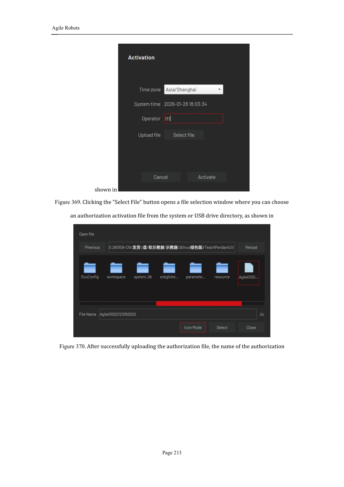



```
Agile Robots 
Page 213 
 
shown in 
 
Figure 369. Clicking the "Select File" button opens a file selection window where you can choose 
an authorization activation file from the system or USB drive directory, as shown in  
 
Figure 370. After successfully uploading the authorization file, the name of the authorization
```



**Original document cross-references:** [PDF 220](pages-217-286.md#pdf-page-220)

## PDF page 218

**Source:** Industrial Teaching Pendant Software User Manual\_V3.3.0\_EN\_20260204.pdf, original pdf page 218. [Open the corresponding PDF reading-copy page](https://1292444914-files.gitbook.io/~/files/v0/b/gitbook-x-prod.appspot.com/o/spaces%2FtgOfPnscWebs1eh82EKq%2Fuploads%2FOVM46x91QLjBua1jiEVg%2Findustrial-teaching-pendant-software-user-manual-v3-3-0-en-20260204-pp-215-225.pdf?alt=media#page=4).



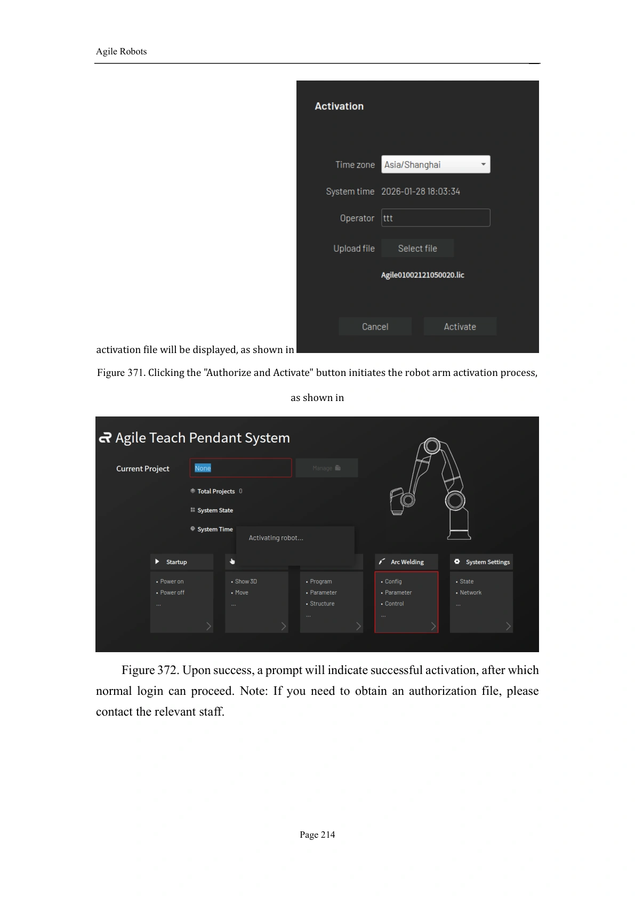



```
Agile Robots 
Page 214 
 
activation file will be displayed, as shown in 
 
Figure 371. Clicking the "Authorize and Activate" button initiates the robot arm activation process, 
as shown in 
 
Figure 372. Upon success, a prompt will indicate successful activation, after which 
normal login can proceed. Note: If you need to obtain an authorization file, please 
contact the relevant staff.
```



**Original document cross-references:** [PDF 221](pages-217-286.md#pdf-page-221)

## PDF page 219

**Source:** Industrial Teaching Pendant Software User Manual\_V3.3.0\_EN\_20260204.pdf, original pdf page 219. [Open the corresponding PDF reading-copy page](https://1292444914-files.gitbook.io/~/files/v0/b/gitbook-x-prod.appspot.com/o/spaces%2FtgOfPnscWebs1eh82EKq%2Fuploads%2FOVM46x91QLjBua1jiEVg%2Findustrial-teaching-pendant-software-user-manual-v3-3-0-en-20260204-pp-215-225.pdf?alt=media#page=5).



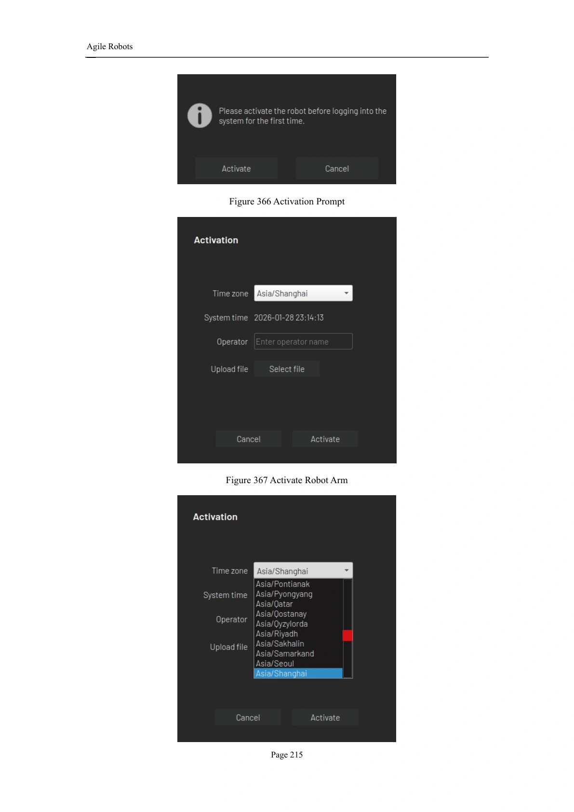



```
Agile Robots 
Page 215 
 
 
Figure 366 Activation Prompt 
 
Figure 367 Activate Robot Arm
```



## PDF page 220

**Source:** Industrial Teaching Pendant Software User Manual\_V3.3.0\_EN\_20260204.pdf, original pdf page 220. [Open the corresponding PDF reading-copy page](https://1292444914-files.gitbook.io/~/files/v0/b/gitbook-x-prod.appspot.com/o/spaces%2FtgOfPnscWebs1eh82EKq%2Fuploads%2FOVM46x91QLjBua1jiEVg%2Findustrial-teaching-pendant-software-user-manual-v3-3-0-en-20260204-pp-215-225.pdf?alt=media#page=6).



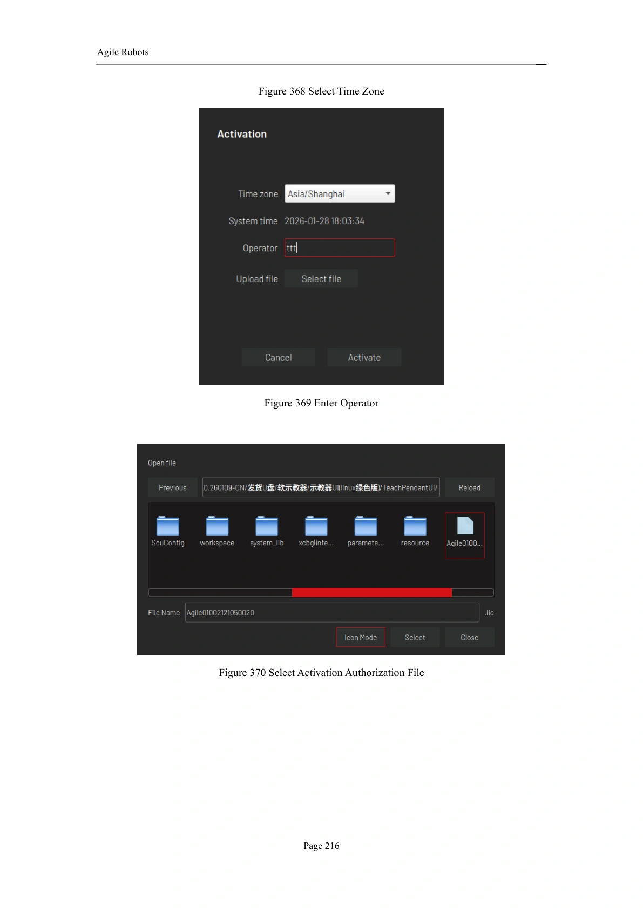



```
Agile Robots 
Page 216 
 
Figure 368 Select Time Zone 
 
Figure 369 Enter Operator 
 
 
Figure 370 Select Activation Authorization File
```



## PDF page 221

**Source:** Industrial Teaching Pendant Software User Manual\_V3.3.0\_EN\_20260204.pdf, original pdf page 221. [Open the corresponding PDF reading-copy page](https://1292444914-files.gitbook.io/~/files/v0/b/gitbook-x-prod.appspot.com/o/spaces%2FtgOfPnscWebs1eh82EKq%2Fuploads%2FOVM46x91QLjBua1jiEVg%2Findustrial-teaching-pendant-software-user-manual-v3-3-0-en-20260204-pp-215-225.pdf?alt=media#page=7).



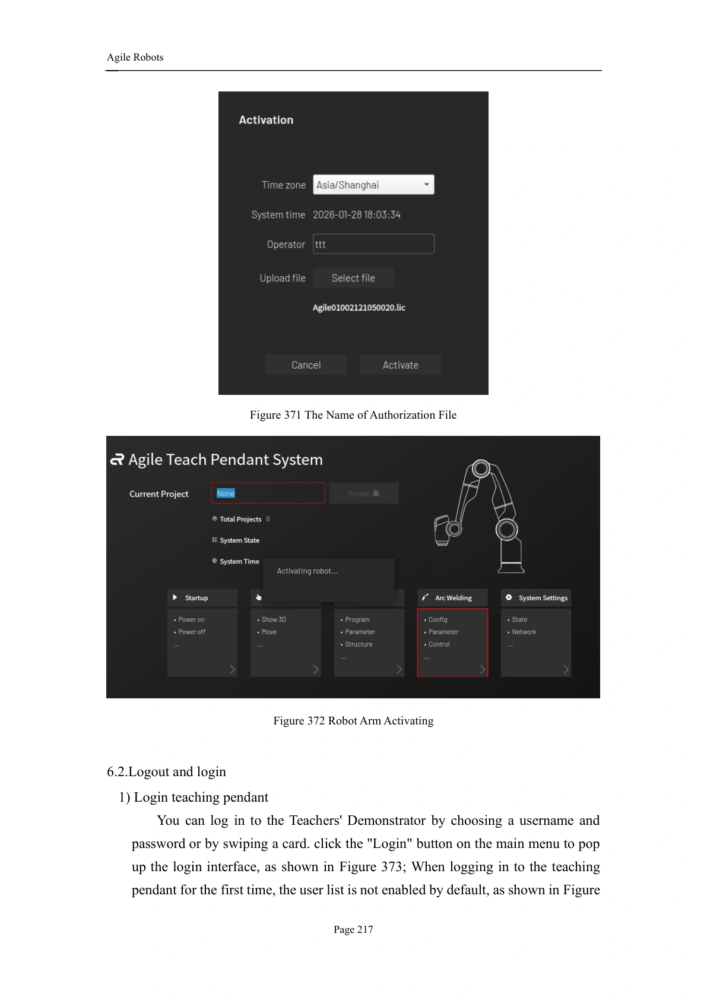



```
Agile Robots 
Page 217 
 
 
Figure 371 The Name of Authorization File 
 
Figure 372 Robot Arm Activating 
 
6.2.Logout and login  
1) Login teaching pendant  
You can log in to the Teachers' Demonstrator by choosing a username and 
password or by swiping a card. click the "Login" button on the main menu to pop 
up the login interface, as shown in Figure 373; When logging in to the teaching 
pendant for the first time, the user list is not enabled by default, as shown in Figure
```



**Original document cross-references:** [PDF 222](pages-217-286.md#pdf-page-222)

## PDF page 222

**Source:** Industrial Teaching Pendant Software User Manual\_V3.3.0\_EN\_20260204.pdf, original pdf page 222. [Open the corresponding PDF reading-copy page](https://1292444914-files.gitbook.io/~/files/v0/b/gitbook-x-prod.appspot.com/o/spaces%2FtgOfPnscWebs1eh82EKq%2Fuploads%2FOVM46x91QLjBua1jiEVg%2Findustrial-teaching-pendant-software-user-manual-v3-3-0-en-20260204-pp-215-225.pdf?alt=media#page=8).



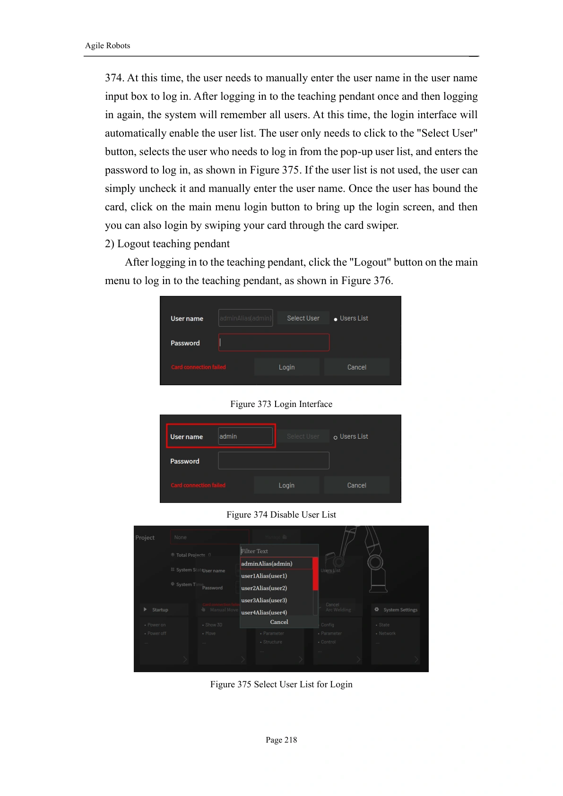



```
Agile Robots 
Page 218 
 
374. At this time, the user needs to manually enter the user name in the user name 
input box to log in. After logging in to the teaching pendant once and then logging 
in again, the system will remember all users. At this time, the login interface will 
automatically enable the user list. The user only needs to click to the "Select User" 
button, selects the user who needs to log in from the pop-up user list, and enters the 
password to log in, as shown in Figure 375. If the user list is not used, the user can 
simply uncheck it and manually enter the user name. Once the user has bound the 
card, click on the main menu login button to bring up the login screen, and then 
you can also login by swiping your card through the card swiper. 
2) Logout teaching pendant  
After logging in to the teaching pendant, click the "Logout" button on the main 
menu to log in to the teaching pendant, as shown in Figure 376.  
 
Figure 373 Login Interface 
 
Figure 374 Disable User List 
 
Figure 375 Select User List for Login
```



**Original document cross-references:** [PDF 222](pages-217-286.md#pdf-page-222) · [PDF 223](pages-217-286.md#pdf-page-223)

## PDF page 223

**Source:** Industrial Teaching Pendant Software User Manual\_V3.3.0\_EN\_20260204.pdf, original pdf page 223. [Open the corresponding PDF reading-copy page](https://1292444914-files.gitbook.io/~/files/v0/b/gitbook-x-prod.appspot.com/o/spaces%2FtgOfPnscWebs1eh82EKq%2Fuploads%2FOVM46x91QLjBua1jiEVg%2Findustrial-teaching-pendant-software-user-manual-v3-3-0-en-20260204-pp-215-225.pdf?alt=media#page=9).



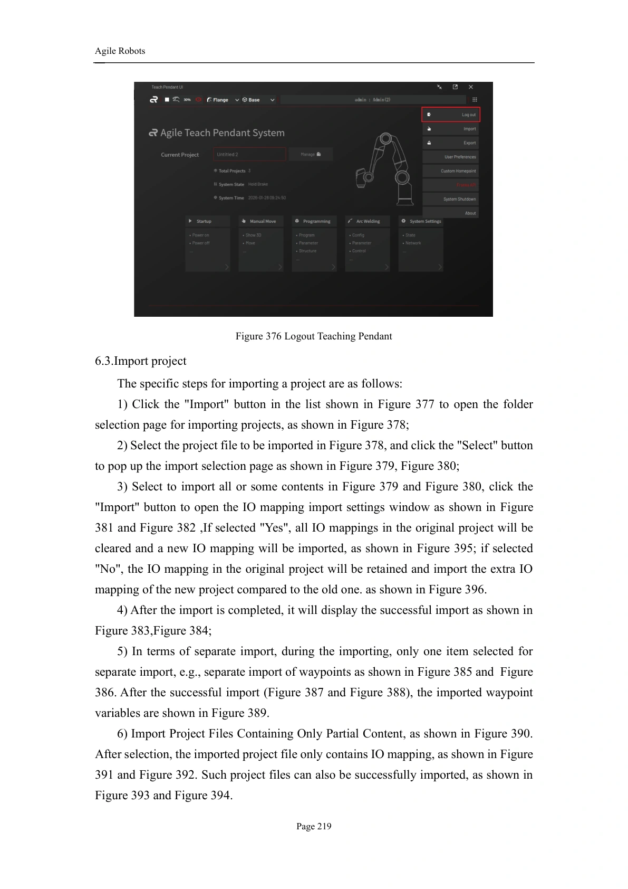



```
Agile Robots 
Page 219 
 
 
Figure 376 Logout Teaching Pendant 
6.3.Import project  
The specific steps for importing a project are as follows:  
1) Click the "Import" button in the list shown in Figure 377 to open the folder 
selection page for importing projects, as shown in Figure 378;  
2) Select the project file to be imported in Figure 378, and click the "Select" button 
to pop up the import selection page as shown in Figure 379, Figure 380;  
3) Select to import all or some contents in Figure 379 and Figure 380, click the 
"Import" button to open the IO mapping import settings window as shown in Figure 
381 and Figure 382 ,If selected "Yes", all IO mappings in the original project will be 
cleared and a new IO mapping will be imported, as shown in Figure 395; if selected 
"No", the IO mapping in the original project will be retained and import the extra IO 
mapping of the new project compared to the old one. as shown in Figure 396.  
4) After the import is completed, it will display the successful import as shown in 
Figure 383,Figure 384;  
5) In terms of separate import, during the importing, only one item selected for 
separate import, e.g., separate import of waypoints as shown in Figure 385 and  Figure 
386. After the successful import (Figure 387 and Figure 388), the imported waypoint 
variables are shown in Figure 389.  
6) Import Project Files Containing Only Partial Content, as shown in Figure 390. 
After selection, the imported project file only contains IO mapping, as shown in Figure 
391 and Figure 392. Such project files can also be successfully imported, as shown in 
Figure 393 and Figure 394.
```



**Original document cross-references:** [PDF 224](pages-217-286.md#pdf-page-224) · [PDF 225](pages-217-286.md#pdf-page-225) · [PDF 230](pages-217-286.md#pdf-page-230) · [PDF 226](pages-217-286.md#pdf-page-226) · [PDF 227](pages-217-286.md#pdf-page-227) · [PDF 228](pages-217-286.md#pdf-page-228) · [PDF 229](pages-217-286.md#pdf-page-229)

## PDF page 224

**Source:** Industrial Teaching Pendant Software User Manual\_V3.3.0\_EN\_20260204.pdf, original pdf page 224. [Open the corresponding PDF reading-copy page](https://1292444914-files.gitbook.io/~/files/v0/b/gitbook-x-prod.appspot.com/o/spaces%2FtgOfPnscWebs1eh82EKq%2Fuploads%2FOVM46x91QLjBua1jiEVg%2Findustrial-teaching-pendant-software-user-manual-v3-3-0-en-20260204-pp-215-225.pdf?alt=media#page=10).



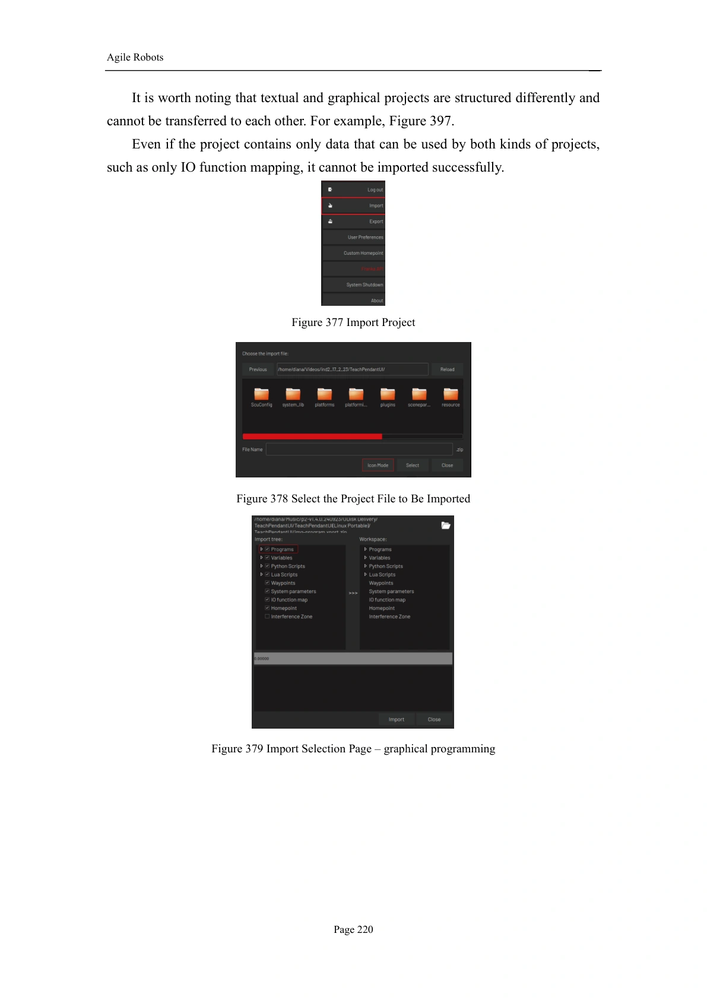



```
Agile Robots 
Page 220 
 
It is worth noting that textual and graphical projects are structured differently and 
cannot be transferred to each other. For example, Figure 397. 
Even if the project contains only data that can be used by both kinds of projects, 
such as only IO function mapping, it cannot be imported successfully. 
 
Figure 377 Import Project 
 
Figure 378 Select the Project File to Be Imported 
 
Figure 379 Import Selection Page – graphical programming
```



**Original document cross-references:** [PDF 230](pages-217-286.md#pdf-page-230)

## PDF page 225

**Source:** Industrial Teaching Pendant Software User Manual\_V3.3.0\_EN\_20260204.pdf, original pdf page 225. [Open the corresponding PDF reading-copy page](https://1292444914-files.gitbook.io/~/files/v0/b/gitbook-x-prod.appspot.com/o/spaces%2FtgOfPnscWebs1eh82EKq%2Fuploads%2FOVM46x91QLjBua1jiEVg%2Findustrial-teaching-pendant-software-user-manual-v3-3-0-en-20260204-pp-215-225.pdf?alt=media#page=11).



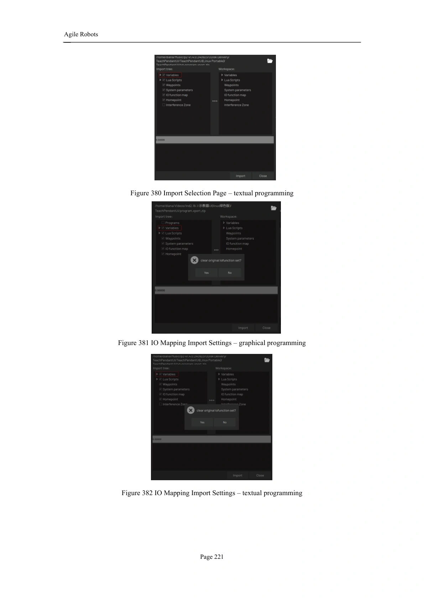



```
Agile Robots 
Page 221 
 
 
Figure 380 Import Selection Page – textual programming 
 
 
Figure 381 IO Mapping Import Settings – graphical programming 
 
Figure 382 IO Mapping Import Settings – textual programming
```



## PDF page 226

**Source:** Industrial Teaching Pendant Software User Manual\_V3.3.0\_EN\_20260204.pdf, original pdf page 226. [Open the corresponding PDF reading-copy page](https://1292444914-files.gitbook.io/~/files/v0/b/gitbook-x-prod.appspot.com/o/spaces%2FtgOfPnscWebs1eh82EKq%2Fuploads%2FyMeizlv26qZhHFHnP5NO%2Findustrial-teaching-pendant-software-user-manual-v3-3-0-en-20260204-pp-226-231.pdf?alt=media#page=1).



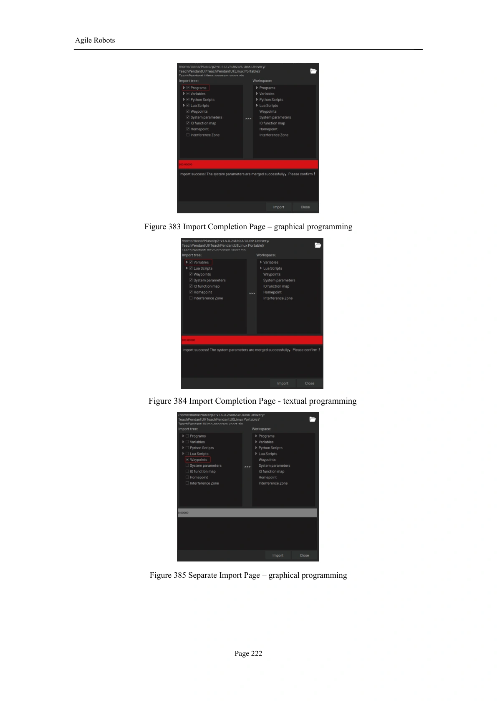



```
Agile Robots 
Page 222 
 
 
Figure 383 Import Completion Page – graphical programming 
 
Figure 384 Import Completion Page - textual programming 
 
Figure 385 Separate Import Page – graphical programming
```



## PDF page 227

**Source:** Industrial Teaching Pendant Software User Manual\_V3.3.0\_EN\_20260204.pdf, original pdf page 227. [Open the corresponding PDF reading-copy page](https://1292444914-files.gitbook.io/~/files/v0/b/gitbook-x-prod.appspot.com/o/spaces%2FtgOfPnscWebs1eh82EKq%2Fuploads%2FyMeizlv26qZhHFHnP5NO%2Findustrial-teaching-pendant-software-user-manual-v3-3-0-en-20260204-pp-226-231.pdf?alt=media#page=2).



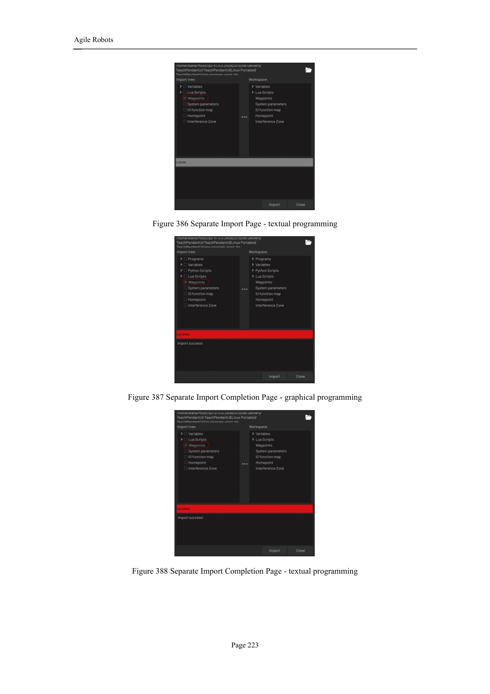



```
Agile Robots 
Page 223 
 
 
Figure 386 Separate Import Page - textual programming 
 
Figure 387 Separate Import Completion Page - graphical programming 
 
Figure 388 Separate Import Completion Page - textual programming
```



## PDF page 228

**Source:** Industrial Teaching Pendant Software User Manual\_V3.3.0\_EN\_20260204.pdf, original pdf page 228. [Open the corresponding PDF reading-copy page](https://1292444914-files.gitbook.io/~/files/v0/b/gitbook-x-prod.appspot.com/o/spaces%2FtgOfPnscWebs1eh82EKq%2Fuploads%2FyMeizlv26qZhHFHnP5NO%2Findustrial-teaching-pendant-software-user-manual-v3-3-0-en-20260204-pp-226-231.pdf?alt=media#page=3).



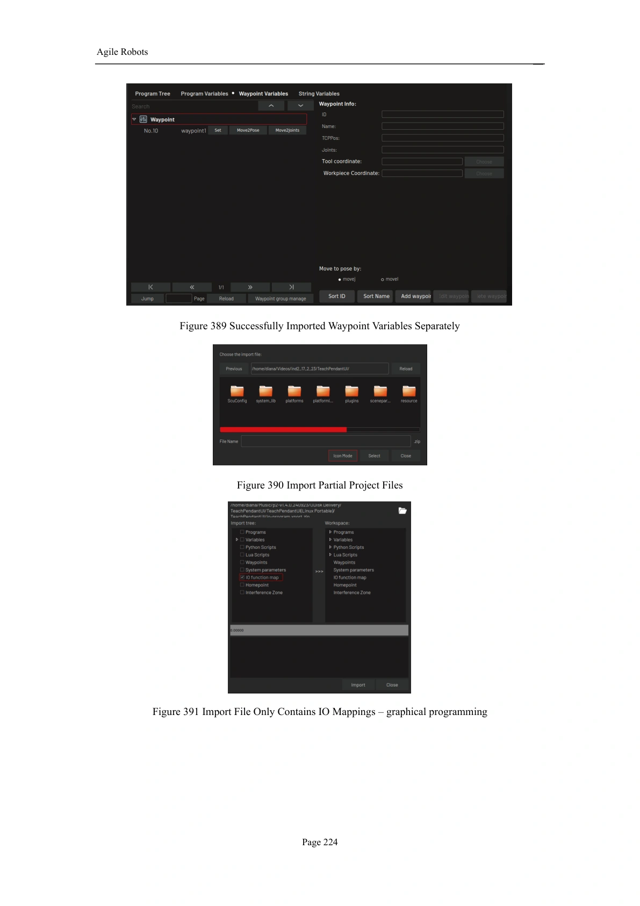



```
Agile Robots 
Page 224 
 
 
Figure 389 Successfully Imported Waypoint Variables Separately 
 
Figure 390 Import Partial Project Files 
 
Figure 391 Import File Only Contains IO Mappings – graphical programming
```



## PDF page 229

**Source:** Industrial Teaching Pendant Software User Manual\_V3.3.0\_EN\_20260204.pdf, original pdf page 229. [Open the corresponding PDF reading-copy page](https://1292444914-files.gitbook.io/~/files/v0/b/gitbook-x-prod.appspot.com/o/spaces%2FtgOfPnscWebs1eh82EKq%2Fuploads%2FyMeizlv26qZhHFHnP5NO%2Findustrial-teaching-pendant-software-user-manual-v3-3-0-en-20260204-pp-226-231.pdf?alt=media#page=4).



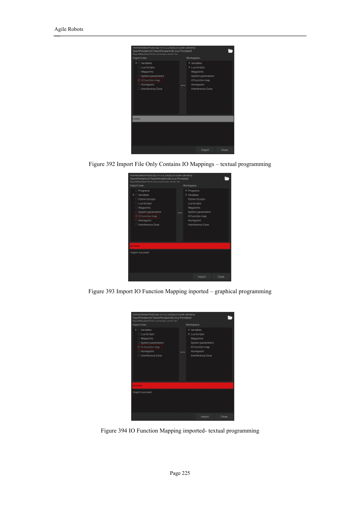



```
Agile Robots 
Page 225 
 
 
Figure 392 Import File Only Contains IO Mappings – textual programming 
 
Figure 393 Import IO Function Mapping inported – graphical programming 
 
 
Figure 394 IO Function Mapping imported- textual programming
```



## PDF page 230

**Source:** Industrial Teaching Pendant Software User Manual\_V3.3.0\_EN\_20260204.pdf, original pdf page 230. [Open the corresponding PDF reading-copy page](https://1292444914-files.gitbook.io/~/files/v0/b/gitbook-x-prod.appspot.com/o/spaces%2FtgOfPnscWebs1eh82EKq%2Fuploads%2FyMeizlv26qZhHFHnP5NO%2Findustrial-teaching-pendant-software-user-manual-v3-3-0-en-20260204-pp-226-231.pdf?alt=media#page=5).



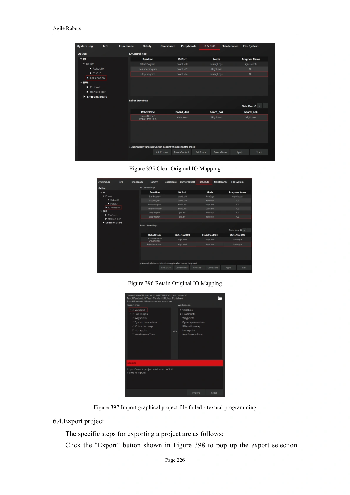



```
Agile Robots 
Page 226 
 
 
Figure 395 Clear Original IO Mapping 
 
Figure 396 Retain Original IO Mapping 
 
Figure 397 Import graphical project file failed - textual programming 
6.4.Export project  
The specific steps for exporting a project are as follows:  
Click the "Export" button shown in Figure 398 to pop up the export selection
```



**Original document cross-references:** [PDF 231](pages-217-286.md#pdf-page-231)

## PDF page 231

**Source:** Industrial Teaching Pendant Software User Manual\_V3.3.0\_EN\_20260204.pdf, original pdf page 231. [Open the corresponding PDF reading-copy page](https://1292444914-files.gitbook.io/~/files/v0/b/gitbook-x-prod.appspot.com/o/spaces%2FtgOfPnscWebs1eh82EKq%2Fuploads%2FyMeizlv26qZhHFHnP5NO%2Findustrial-teaching-pendant-software-user-manual-v3-3-0-en-20260204-pp-226-231.pdf?alt=media#page=6).



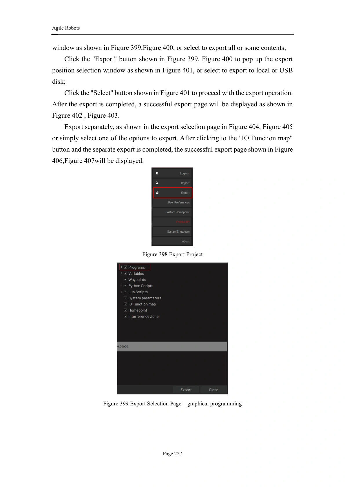



```
Agile Robots 
Page 227 
 
window as shown in Figure 399,Figure 400, or select to export all or some contents;  
Click the "Export" button shown in Figure 399, Figure 400 to pop up the export 
position selection window as shown in Figure 401, or select to export to local or USB 
disk;  
Click the "Select" button shown in Figure 401 to proceed with the export operation. 
After the export is completed, a successful export page will be displayed as shown in 
Figure 402 , Figure 403.  
Export separately, as shown in the export selection page in Figure 404, Figure 405 
or simply select one of the options to export. After clicking to the "IO Function map" 
button and the separate export is completed, the successful export page shown in Figure 
406,Figure 407will be displayed.  
 
Figure 398 Export Project 
 
Figure 399 Export Selection Page – graphical programming
```



**Original document cross-references:** [PDF 231](pages-217-286.md#pdf-page-231) · [PDF 232](pages-217-286.md#pdf-page-232) · [PDF 233](pages-217-286.md#pdf-page-233) · [PDF 234](pages-217-286.md#pdf-page-234)

## PDF page 232

**Source:** Industrial Teaching Pendant Software User Manual\_V3.3.0\_EN\_20260204.pdf, original pdf page 232. [Open the corresponding PDF reading-copy page](https://1292444914-files.gitbook.io/~/files/v0/b/gitbook-x-prod.appspot.com/o/spaces%2FtgOfPnscWebs1eh82EKq%2Fuploads%2FrQQCfTR9Obw3QlwfThoL%2Findustrial-teaching-pendant-software-user-manual-v3-3-0-en-20260204-pp-232-240.pdf?alt=media#page=1).



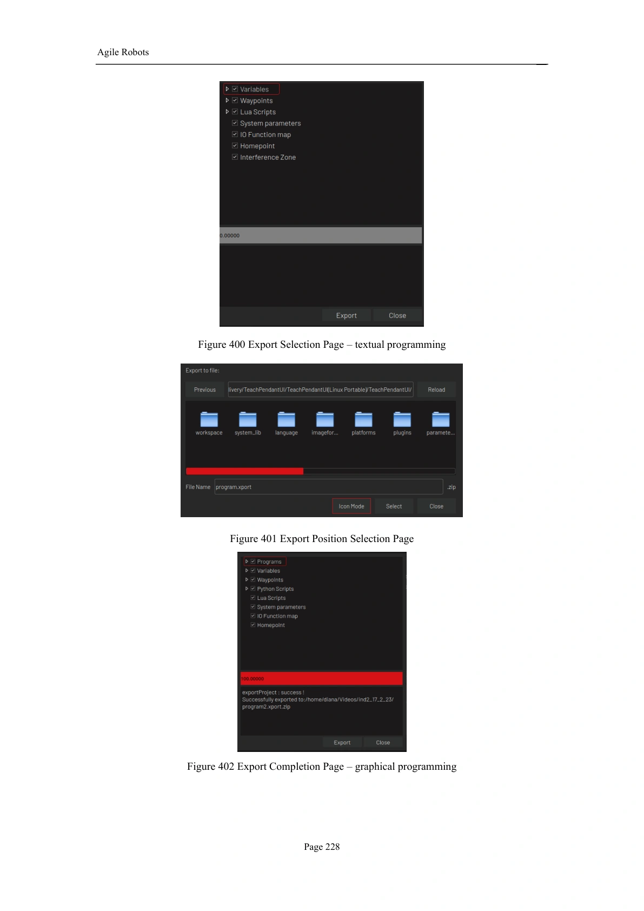



```
Agile Robots 
Page 228 
 
 
Figure 400 Export Selection Page – textual programming 
 
Figure 401 Export Position Selection Page 
 
Figure 402 Export Completion Page – graphical programming
```



## PDF page 233

**Source:** Industrial Teaching Pendant Software User Manual\_V3.3.0\_EN\_20260204.pdf, original pdf page 233. [Open the corresponding PDF reading-copy page](https://1292444914-files.gitbook.io/~/files/v0/b/gitbook-x-prod.appspot.com/o/spaces%2FtgOfPnscWebs1eh82EKq%2Fuploads%2FrQQCfTR9Obw3QlwfThoL%2Findustrial-teaching-pendant-software-user-manual-v3-3-0-en-20260204-pp-232-240.pdf?alt=media#page=2).



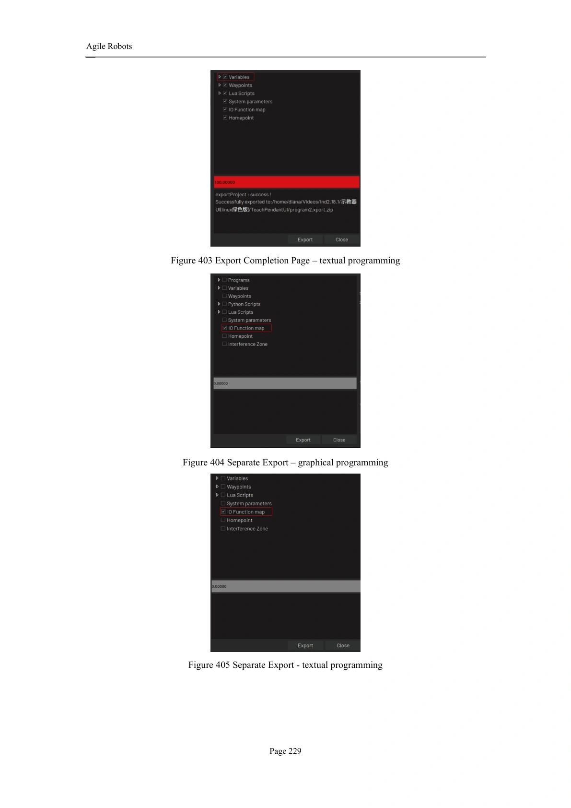



```
Agile Robots 
Page 229 
 
 
Figure 403 Export Completion Page – textual programming 
 
Figure 404 Separate Export – graphical programming 
 
Figure 405 Separate Export - textual programming
```



## PDF page 234

**Source:** Industrial Teaching Pendant Software User Manual\_V3.3.0\_EN\_20260204.pdf, original pdf page 234. [Open the corresponding PDF reading-copy page](https://1292444914-files.gitbook.io/~/files/v0/b/gitbook-x-prod.appspot.com/o/spaces%2FtgOfPnscWebs1eh82EKq%2Fuploads%2FrQQCfTR9Obw3QlwfThoL%2Findustrial-teaching-pendant-software-user-manual-v3-3-0-en-20260204-pp-232-240.pdf?alt=media#page=3).



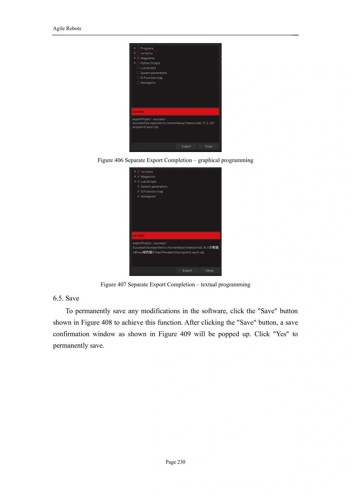



```
Agile Robots 
Page 230 
 
 
Figure 406 Separate Export Completion – graphical programming 
 
Figure 407 Separate Export Completion – textual programming 
6.5. Save  
To permanently save any modifications in the software, click the "Save" button 
shown in Figure 408 to achieve this function. After clicking the "Save" button, a save 
confirmation window as shown in Figure 409 will be popped up. Click "Yes" to 
permanently save.
```



**Original document cross-references:** [PDF 235](pages-217-286.md#pdf-page-235)

## PDF page 235

**Source:** Industrial Teaching Pendant Software User Manual\_V3.3.0\_EN\_20260204.pdf, original pdf page 235. [Open the corresponding PDF reading-copy page](https://1292444914-files.gitbook.io/~/files/v0/b/gitbook-x-prod.appspot.com/o/spaces%2FtgOfPnscWebs1eh82EKq%2Fuploads%2FrQQCfTR9Obw3QlwfThoL%2Findustrial-teaching-pendant-software-user-manual-v3-3-0-en-20260204-pp-232-240.pdf?alt=media#page=4).



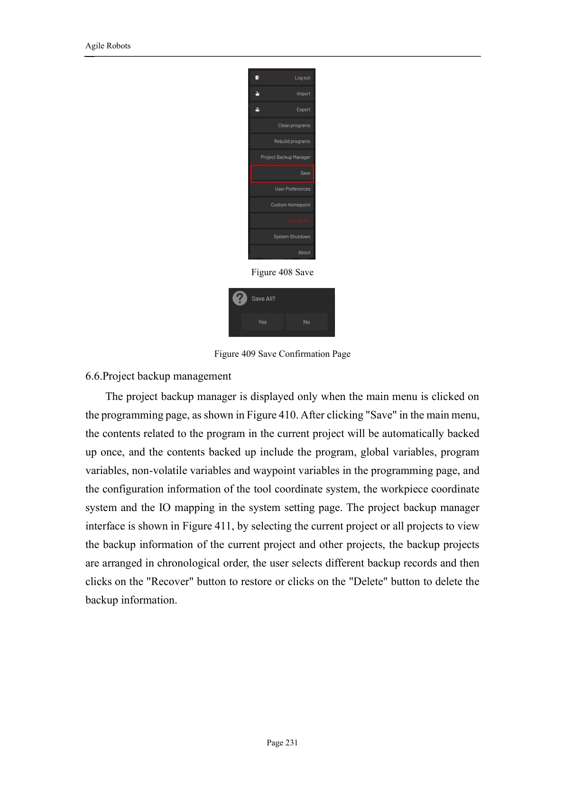



```
Agile Robots 
Page 231 
 
 
Figure 408 Save 
 
Figure 409 Save Confirmation Page 
6.6.Project backup management 
The project backup manager is displayed only when the main menu is clicked on 
the programming page, as shown in Figure 410. After clicking "Save" in the main menu, 
the contents related to the program in the current project will be automatically backed 
up once, and the contents backed up include the program, global variables, program 
variables, non-volatile variables and waypoint variables in the programming page, and 
the configuration information of the tool coordinate system, the workpiece coordinate 
system and the IO mapping in the system setting page. The project backup manager 
interface is shown in Figure 411, by selecting the current project or all projects to view 
the backup information of the current project and other projects, the backup projects 
are arranged in chronological order, the user selects different backup records and then 
clicks on the "Recover" button to restore or clicks on the "Delete" button to delete the 
backup information.
```



**Original document cross-references:** [PDF 236](pages-217-286.md#pdf-page-236)

## PDF page 236

**Source:** Industrial Teaching Pendant Software User Manual\_V3.3.0\_EN\_20260204.pdf, original pdf page 236. [Open the corresponding PDF reading-copy page](https://1292444914-files.gitbook.io/~/files/v0/b/gitbook-x-prod.appspot.com/o/spaces%2FtgOfPnscWebs1eh82EKq%2Fuploads%2FrQQCfTR9Obw3QlwfThoL%2Findustrial-teaching-pendant-software-user-manual-v3-3-0-en-20260204-pp-232-240.pdf?alt=media#page=5).



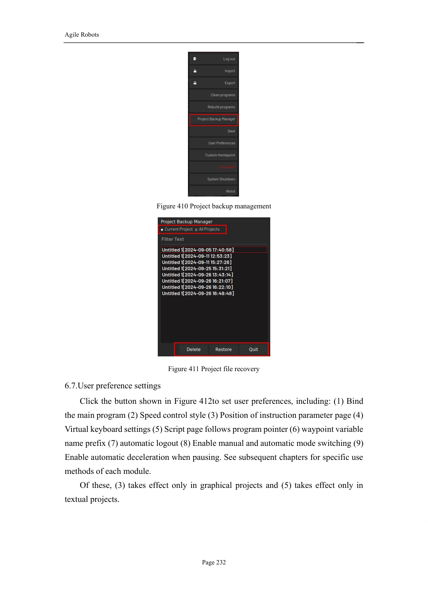



```
Agile Robots 
Page 232 
 
 
Figure 410 Project backup management 
 
Figure 411 Project file recovery 
6.7.User preference settings  
Click the button shown in Figure 412to set user preferences, including: (1) Bind 
the main program (2) Speed control style (3) Position of instruction parameter page (4) 
Virtual keyboard settings (5) Script page follows program pointer (6) waypoint variable 
name prefix (7) automatic logout (8) Enable manual and automatic mode switching (9) 
Enable automatic deceleration when pausing. See subsequent chapters for specific use 
methods of each module.  
Of these, (3) takes effect only in graphical projects and (5) takes effect only in 
textual projects.
```



**Original document cross-references:** [PDF 237](pages-217-286.md#pdf-page-237)

## PDF page 237

**Source:** Industrial Teaching Pendant Software User Manual\_V3.3.0\_EN\_20260204.pdf, original pdf page 237. [Open the corresponding PDF reading-copy page](https://1292444914-files.gitbook.io/~/files/v0/b/gitbook-x-prod.appspot.com/o/spaces%2FtgOfPnscWebs1eh82EKq%2Fuploads%2FrQQCfTR9Obw3QlwfThoL%2Findustrial-teaching-pendant-software-user-manual-v3-3-0-en-20260204-pp-232-240.pdf?alt=media#page=6).



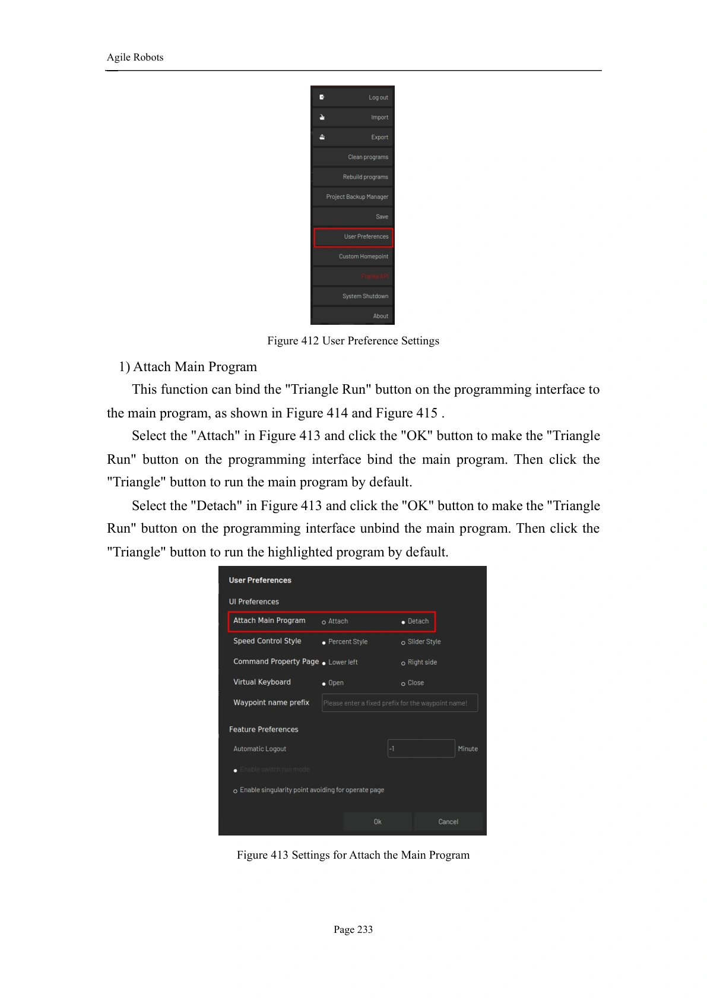



```
Agile Robots 
Page 233 
 
 
Figure 412 User Preference Settings 
1) Attach Main Program  
This function can bind the "Triangle Run" button on the programming interface to 
the main program, as shown in Figure 414 and Figure 415 . 
Select the "Attach" in Figure 413 and click the "OK" button to make the "Triangle 
Run" button on the programming interface bind the main program. Then click the 
"Triangle" button to run the main program by default.  
Select the "Detach" in Figure 413 and click the "OK" button to make the "Triangle 
Run" button on the programming interface unbind the main program. Then click the 
"Triangle" button to run the highlighted program by default.  
 
Figure 413 Settings for Attach the Main Program
```



**Original document cross-references:** [PDF 238](pages-217-286.md#pdf-page-238) · [PDF 237](pages-217-286.md#pdf-page-237)

## PDF page 238

**Source:** Industrial Teaching Pendant Software User Manual\_V3.3.0\_EN\_20260204.pdf, original pdf page 238. [Open the corresponding PDF reading-copy page](https://1292444914-files.gitbook.io/~/files/v0/b/gitbook-x-prod.appspot.com/o/spaces%2FtgOfPnscWebs1eh82EKq%2Fuploads%2FrQQCfTR9Obw3QlwfThoL%2Findustrial-teaching-pendant-software-user-manual-v3-3-0-en-20260204-pp-232-240.pdf?alt=media#page=7).



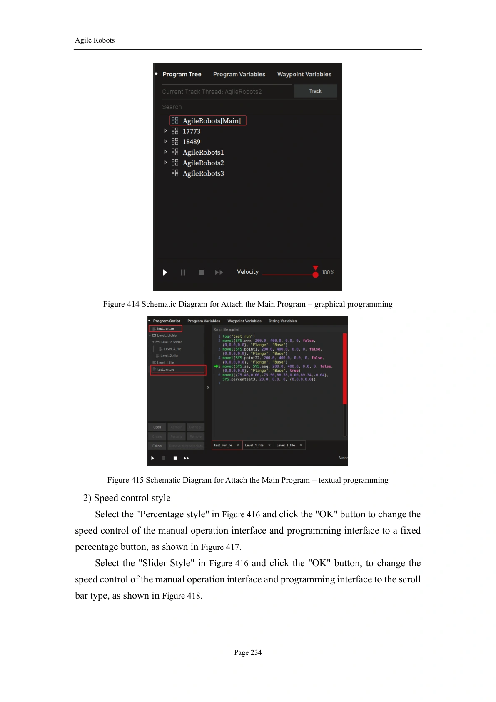



```
Agile Robots 
Page 234 
 
 
Figure 414 Schematic Diagram for Attach the Main Program – graphical programming 
 
Figure 415 Schematic Diagram for Attach the Main Program – textual programming 
2) Speed control style  
Select the "Percentage style" in Figure 416 and click the "OK" button to change the 
speed control of the manual operation interface and programming interface to a fixed 
percentage button, as shown in Figure 417.  
Select the "Slider Style" in Figure 416 and click the "OK" button, to change the 
speed control of the manual operation interface and programming interface to the scroll 
bar type, as shown in Figure 418.
```



**Original document cross-references:** [PDF 239](pages-217-286.md#pdf-page-239)

## PDF page 239

**Source:** Industrial Teaching Pendant Software User Manual\_V3.3.0\_EN\_20260204.pdf, original pdf page 239. [Open the corresponding PDF reading-copy page](https://1292444914-files.gitbook.io/~/files/v0/b/gitbook-x-prod.appspot.com/o/spaces%2FtgOfPnscWebs1eh82EKq%2Fuploads%2FrQQCfTR9Obw3QlwfThoL%2Findustrial-teaching-pendant-software-user-manual-v3-3-0-en-20260204-pp-232-240.pdf?alt=media#page=8).



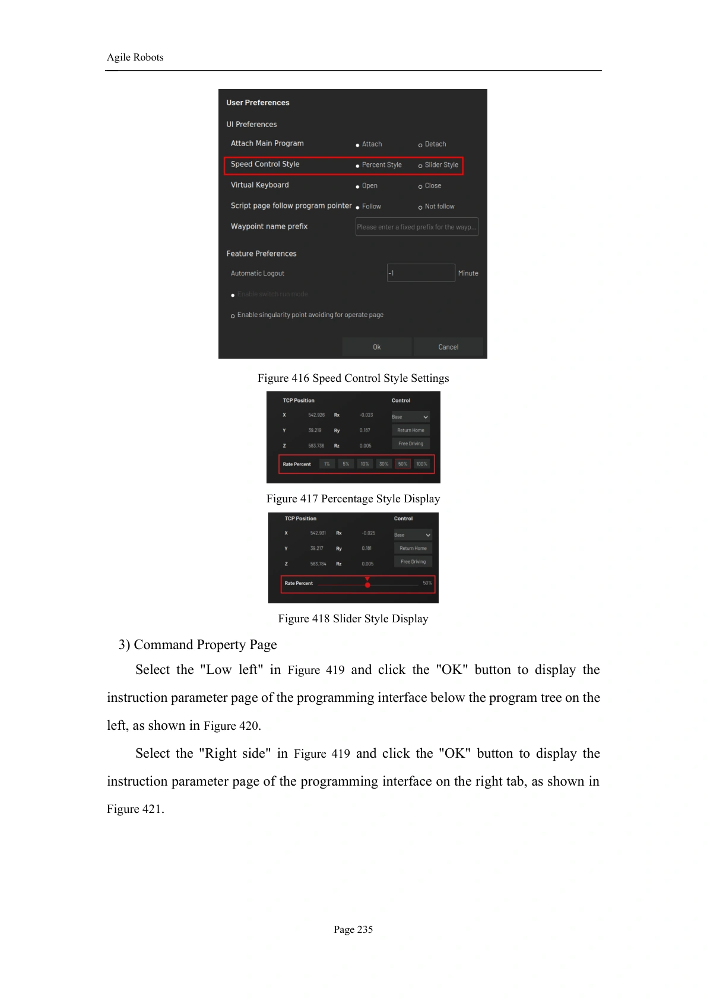



```
Agile Robots 
Page 235 
 
 
Figure 416 Speed Control Style Settings 
 
Figure 417 Percentage Style Display 
 
Figure 418 Slider Style Display 
3) Command Property Page  
Select the "Low left" in Figure 419 and click the "OK" button to display the 
instruction parameter page of the programming interface below the program tree on the 
left, as shown in Figure 420.  
Select the "Right side" in Figure 419 and click the "OK" button to display the 
instruction parameter page of the programming interface on the right tab, as shown in 
Figure 421.
```



**Original document cross-references:** [PDF 240](pages-217-286.md#pdf-page-240) · [PDF 241](pages-217-286.md#pdf-page-241)

## PDF page 240

**Source:** Industrial Teaching Pendant Software User Manual\_V3.3.0\_EN\_20260204.pdf, original pdf page 240. [Open the corresponding PDF reading-copy page](https://1292444914-files.gitbook.io/~/files/v0/b/gitbook-x-prod.appspot.com/o/spaces%2FtgOfPnscWebs1eh82EKq%2Fuploads%2FrQQCfTR9Obw3QlwfThoL%2Findustrial-teaching-pendant-software-user-manual-v3-3-0-en-20260204-pp-232-240.pdf?alt=media#page=9).



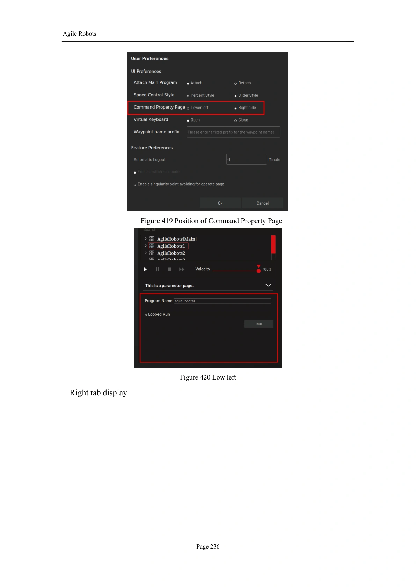



```
Agile Robots 
Page 236 
 
 
Figure 419 Position of Command Property Page 
 
Figure 420 Low left 
Right tab display
```



## PDF page 241

**Source:** Industrial Teaching Pendant Software User Manual\_V3.3.0\_EN\_20260204.pdf, original pdf page 241. [Open the corresponding PDF reading-copy page](https://1292444914-files.gitbook.io/~/files/v0/b/gitbook-x-prod.appspot.com/o/spaces%2FtgOfPnscWebs1eh82EKq%2Fuploads%2FOxPyxjs4kuZdchprmiID%2Findustrial-teaching-pendant-software-user-manual-v3-3-0-en-20260204-pp-241-247.pdf?alt=media#page=1).



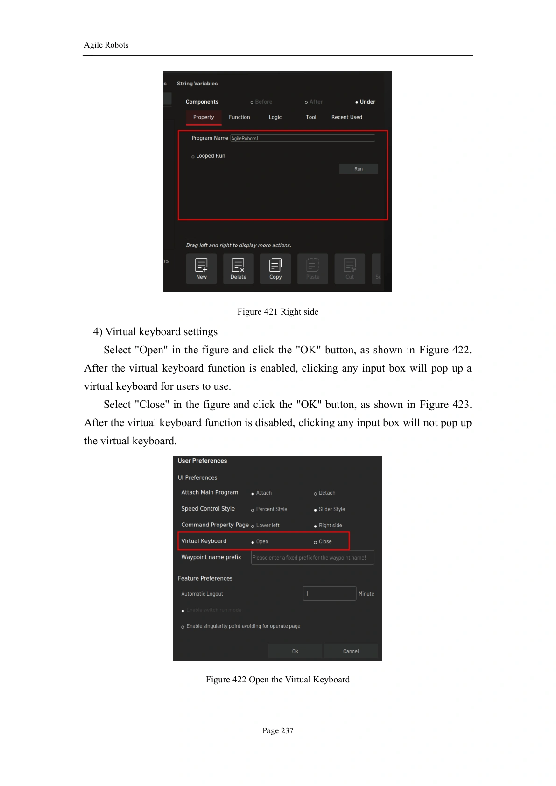



```
Agile Robots 
Page 237 
 
 
Figure 421 Right side 
4) Virtual keyboard settings  
Select "Open" in the figure and click the "OK" button, as shown in Figure 422. 
After the virtual keyboard function is enabled, clicking any input box will pop up a 
virtual keyboard for users to use.  
Select "Close" in the figure and click the "OK" button, as shown in Figure 423. 
After the virtual keyboard function is disabled, clicking any input box will not pop up 
the virtual keyboard.  
 
Figure 422 Open the Virtual Keyboard
```



**Original document cross-references:** [PDF 241](pages-217-286.md#pdf-page-241) · [PDF 242](pages-217-286.md#pdf-page-242)

## PDF page 242

**Source:** Industrial Teaching Pendant Software User Manual\_V3.3.0\_EN\_20260204.pdf, original pdf page 242. [Open the corresponding PDF reading-copy page](https://1292444914-files.gitbook.io/~/files/v0/b/gitbook-x-prod.appspot.com/o/spaces%2FtgOfPnscWebs1eh82EKq%2Fuploads%2FOxPyxjs4kuZdchprmiID%2Findustrial-teaching-pendant-software-user-manual-v3-3-0-en-20260204-pp-241-247.pdf?alt=media#page=2).



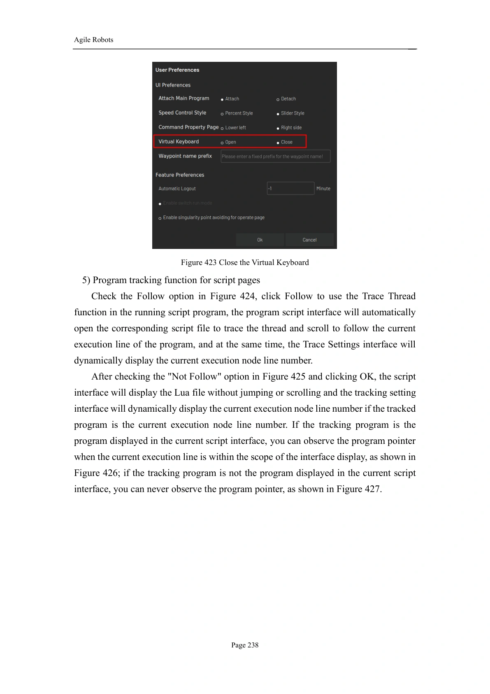



```
Agile Robots 
Page 238 
 
 
Figure 423 Close the Virtual Keyboard  
5) Program tracking function for script pages 
Check the Follow option in Figure 424, click Follow to use the Trace Thread 
function in the running script program, the program script interface will automatically 
open the corresponding script file to trace the thread and scroll to follow the current 
execution line of the program, and at the same time, the Trace Settings interface will 
dynamically display the current execution node line number. 
After checking the "Not Follow" option in Figure 425 and clicking OK, the script 
interface will display the Lua file without jumping or scrolling and the tracking setting 
interface will dynamically display the current execution node line number if the tracked 
program is the current execution node line number. If the tracking program is the 
program displayed in the current script interface, you can observe the program pointer 
when the current execution line is within the scope of the interface display, as shown in 
Figure 426; if the tracking program is not the program displayed in the current script 
interface, you can never observe the program pointer, as shown in Figure 427.
```



**Original document cross-references:** [PDF 243](pages-217-286.md#pdf-page-243) · [PDF 244](pages-217-286.md#pdf-page-244)

## PDF page 243

**Source:** Industrial Teaching Pendant Software User Manual\_V3.3.0\_EN\_20260204.pdf, original pdf page 243. [Open the corresponding PDF reading-copy page](https://1292444914-files.gitbook.io/~/files/v0/b/gitbook-x-prod.appspot.com/o/spaces%2FtgOfPnscWebs1eh82EKq%2Fuploads%2FOxPyxjs4kuZdchprmiID%2Findustrial-teaching-pendant-software-user-manual-v3-3-0-en-20260204-pp-241-247.pdf?alt=media#page=3).



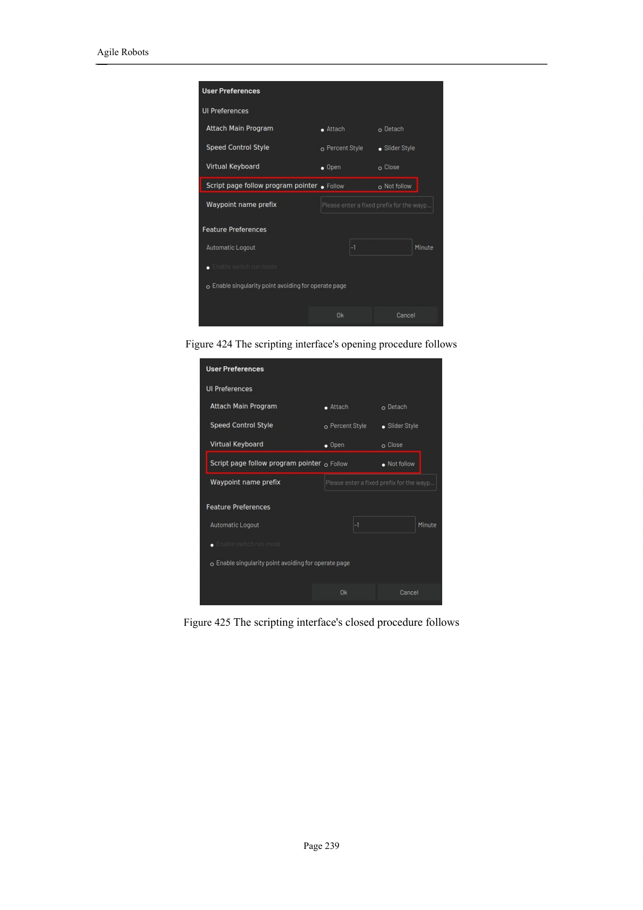



```
Agile Robots 
Page 239 
 
 
Figure 424 The scripting interface's opening procedure follows 
 
Figure 425 The scripting interface's closed procedure follows
```



## PDF page 244

**Source:** Industrial Teaching Pendant Software User Manual\_V3.3.0\_EN\_20260204.pdf, original pdf page 244. [Open the corresponding PDF reading-copy page](https://1292444914-files.gitbook.io/~/files/v0/b/gitbook-x-prod.appspot.com/o/spaces%2FtgOfPnscWebs1eh82EKq%2Fuploads%2FOxPyxjs4kuZdchprmiID%2Findustrial-teaching-pendant-software-user-manual-v3-3-0-en-20260204-pp-241-247.pdf?alt=media#page=4).



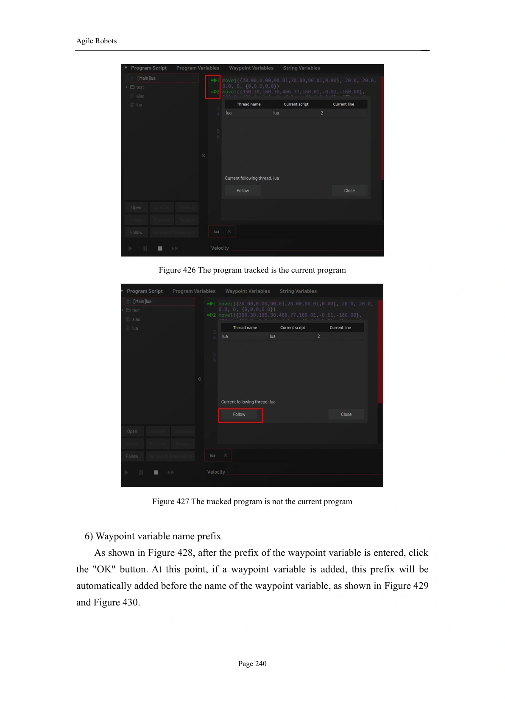



```
Agile Robots 
Page 240 
 
 
Figure 426 The program tracked is the current program 
 
Figure 427 The tracked program is not the current program 
 
6) Waypoint variable name prefix  
As shown in Figure 428, after the prefix of the waypoint variable is entered, click 
the "OK" button. At this point, if a waypoint variable is added, this prefix will be 
automatically added before the name of the waypoint variable, as shown in Figure 429 
and Figure 430.
```



**Original document cross-references:** [PDF 245](pages-217-286.md#pdf-page-245)

## PDF page 245

**Source:** Industrial Teaching Pendant Software User Manual\_V3.3.0\_EN\_20260204.pdf, original pdf page 245. [Open the corresponding PDF reading-copy page](https://1292444914-files.gitbook.io/~/files/v0/b/gitbook-x-prod.appspot.com/o/spaces%2FtgOfPnscWebs1eh82EKq%2Fuploads%2FOxPyxjs4kuZdchprmiID%2Findustrial-teaching-pendant-software-user-manual-v3-3-0-en-20260204-pp-241-247.pdf?alt=media#page=5).



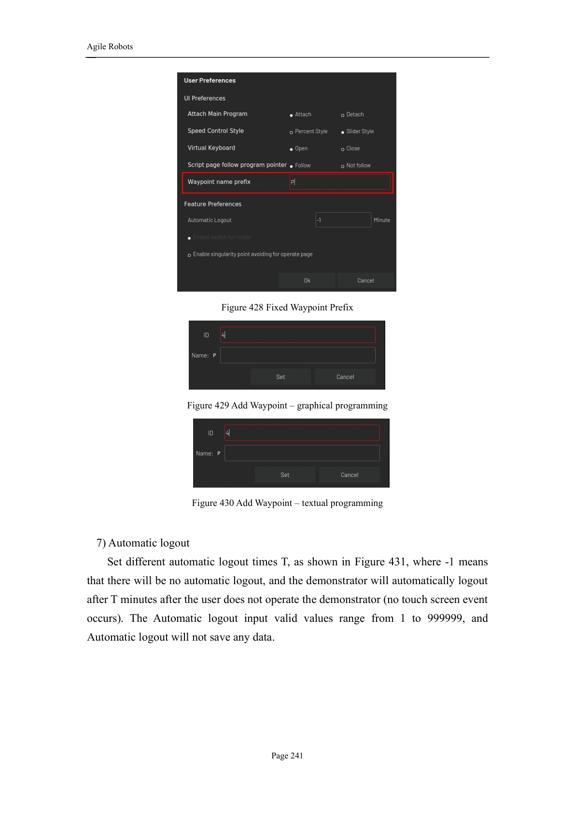



```
Agile Robots 
Page 241 
 
 
Figure 428 Fixed Waypoint Prefix 
 
Figure 429 Add Waypoint – graphical programming 
   
 
Figure 430 Add Waypoint – textual programming 
 
7) Automatic logout 
Set different automatic logout times T, as shown in Figure 431, where -1 means 
that there will be no automatic logout, and the demonstrator will automatically logout 
after T minutes after the user does not operate the demonstrator (no touch screen event 
occurs). The Automatic logout input valid values range from 1 to 999999, and 
Automatic logout will not save any data.
```



**Original document cross-references:** [PDF 246](pages-217-286.md#pdf-page-246)

## PDF page 246

**Source:** Industrial Teaching Pendant Software User Manual\_V3.3.0\_EN\_20260204.pdf, original pdf page 246. [Open the corresponding PDF reading-copy page](https://1292444914-files.gitbook.io/~/files/v0/b/gitbook-x-prod.appspot.com/o/spaces%2FtgOfPnscWebs1eh82EKq%2Fuploads%2FOxPyxjs4kuZdchprmiID%2Findustrial-teaching-pendant-software-user-manual-v3-3-0-en-20260204-pp-241-247.pdf?alt=media#page=6).



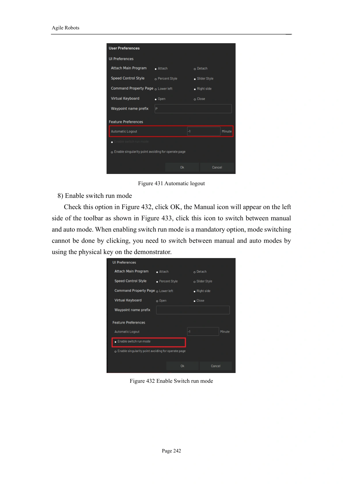



```
Agile Robots 
Page 242 
 
 
Figure 431 Automatic logout 
8) Enable switch run mode  
Check this option in Figure 432, click OK, the Manual icon will appear on the left 
side of the toolbar as shown in Figure 433, click this icon to switch between manual 
and auto mode. When enabling switch run mode is a mandatory option, mode switching 
cannot be done by clicking, you need to switch between manual and auto modes by 
using the physical key on the demonstrator. 
 
Figure 432 Enable Switch run mode
```



**Original document cross-references:** [PDF 246](pages-217-286.md#pdf-page-246) · [PDF 247](pages-217-286.md#pdf-page-247)

## PDF page 247

**Source:** Industrial Teaching Pendant Software User Manual\_V3.3.0\_EN\_20260204.pdf, original pdf page 247. [Open the corresponding PDF reading-copy page](https://1292444914-files.gitbook.io/~/files/v0/b/gitbook-x-prod.appspot.com/o/spaces%2FtgOfPnscWebs1eh82EKq%2Fuploads%2FOxPyxjs4kuZdchprmiID%2Findustrial-teaching-pendant-software-user-manual-v3-3-0-en-20260204-pp-241-247.pdf?alt=media#page=7).



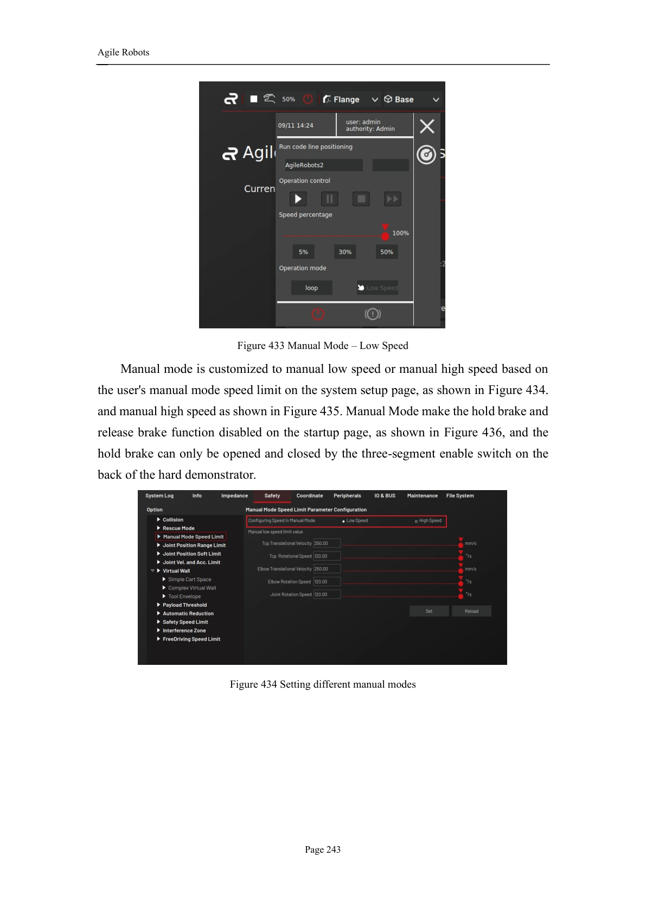



```
Agile Robots 
Page 243 
 
 
Figure 433 Manual Mode – Low Speed 
Manual mode is customized to manual low speed or manual high speed based on 
the user's manual mode speed limit on the system setup page, as shown in Figure 434. 
and manual high speed as shown in Figure 435. Manual Mode make the hold brake and 
release brake function disabled on the startup page, as shown in Figure 436, and the 
hold brake can only be opened and closed by the three-segment enable switch on the 
back of the hard demonstrator. 
 
Figure 434 Setting different manual modes
```



**Original document cross-references:** [PDF 247](pages-217-286.md#pdf-page-247) · [PDF 248](pages-217-286.md#pdf-page-248)

## PDF page 248

**Source:** Industrial Teaching Pendant Software User Manual\_V3.3.0\_EN\_20260204.pdf, original pdf page 248. [Open the corresponding PDF reading-copy page](https://1292444914-files.gitbook.io/~/files/v0/b/gitbook-x-prod.appspot.com/o/spaces%2FtgOfPnscWebs1eh82EKq%2Fuploads%2FuEKbzkgLqhBdpPhGqV21%2Findustrial-teaching-pendant-software-user-manual-v3-3-0-en-20260204-pp-248-257.pdf?alt=media#page=1).



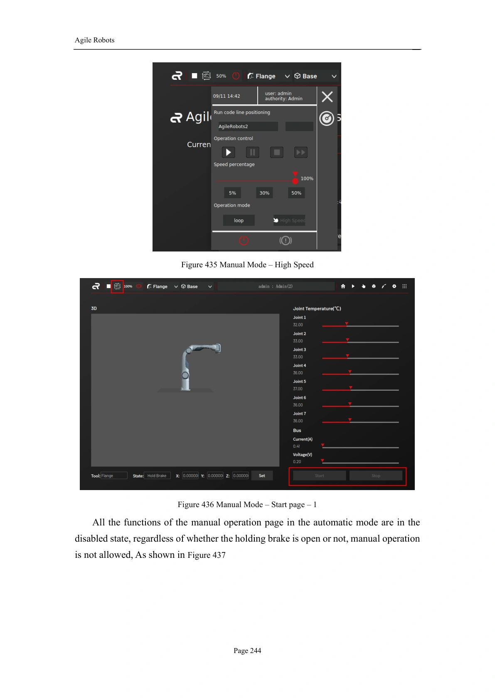



```
Agile Robots 
Page 244 
 
 
Figure 435 Manual Mode – High Speed 
 
Figure 436 Manual Mode – Start page – 1 
All the functions of the manual operation page in the automatic mode are in the 
disabled state, regardless of whether the holding brake is open or not, manual operation 
is not allowed, As shown in Figure 437
```



**Original document cross-references:** [PDF 249](pages-217-286.md#pdf-page-249)

## PDF page 249

**Source:** Industrial Teaching Pendant Software User Manual\_V3.3.0\_EN\_20260204.pdf, original pdf page 249. [Open the corresponding PDF reading-copy page](https://1292444914-files.gitbook.io/~/files/v0/b/gitbook-x-prod.appspot.com/o/spaces%2FtgOfPnscWebs1eh82EKq%2Fuploads%2FuEKbzkgLqhBdpPhGqV21%2Findustrial-teaching-pendant-software-user-manual-v3-3-0-en-20260204-pp-248-257.pdf?alt=media#page=2).



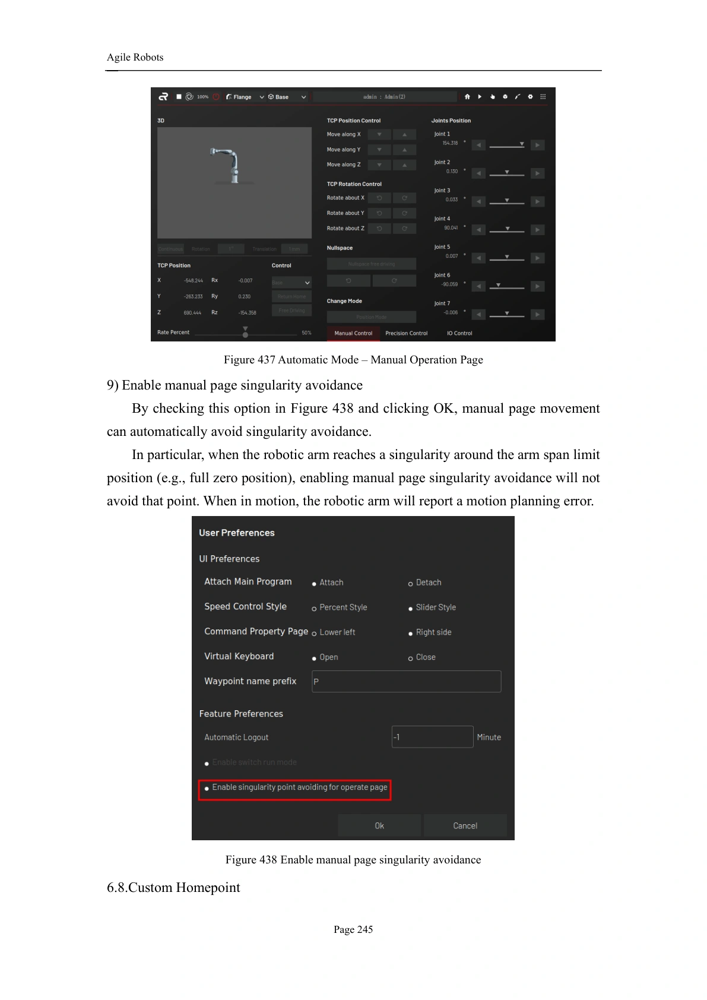



```
Agile Robots 
Page 245 
 
 
Figure 437 Automatic Mode – Manual Operation Page 
9) Enable manual page singularity avoidance 
By checking this option in Figure 438 and clicking OK, manual page movement 
can automatically avoid singularity avoidance. 
In particular, when the robotic arm reaches a singularity around the arm span limit 
position (e.g., full zero position), enabling manual page singularity avoidance will not 
avoid that point. When in motion, the robotic arm will report a motion planning error. 
 
Figure 438 Enable manual page singularity avoidance 
6.8.Custom Homepoint
```



**Original document cross-references:** [PDF 249](pages-217-286.md#pdf-page-249)

## PDF page 250

**Source:** Industrial Teaching Pendant Software User Manual\_V3.3.0\_EN\_20260204.pdf, original pdf page 250. [Open the corresponding PDF reading-copy page](https://1292444914-files.gitbook.io/~/files/v0/b/gitbook-x-prod.appspot.com/o/spaces%2FtgOfPnscWebs1eh82EKq%2Fuploads%2FuEKbzkgLqhBdpPhGqV21%2Findustrial-teaching-pendant-software-user-manual-v3-3-0-en-20260204-pp-248-257.pdf?alt=media#page=3).



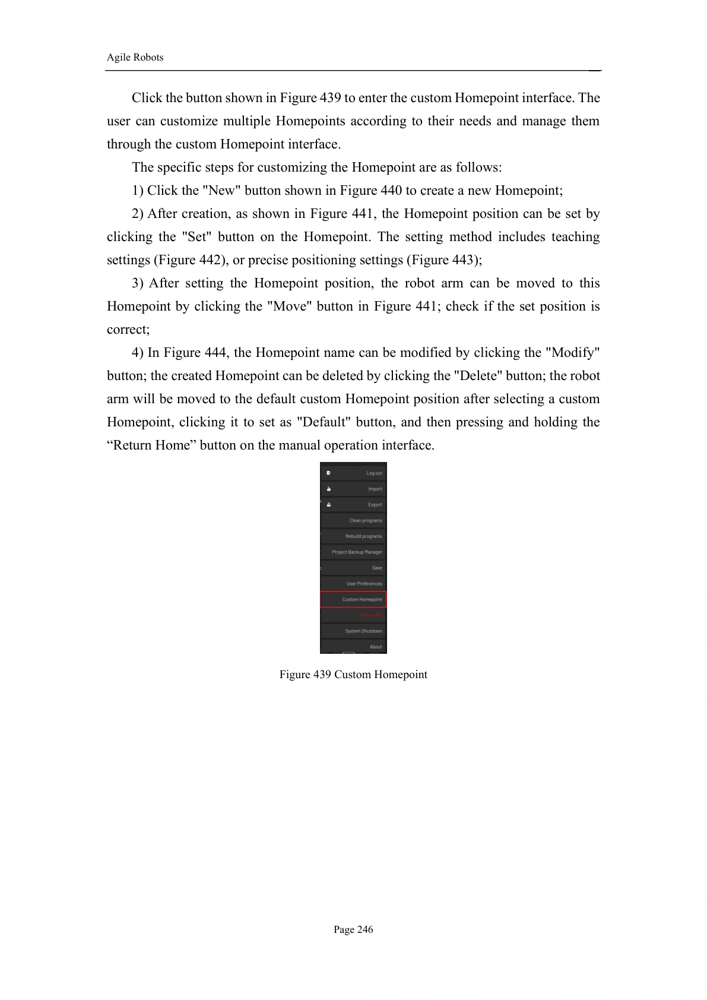



```
Agile Robots 
Page 246 
 
Click the button shown in Figure 439 to enter the custom Homepoint interface. The 
user can customize multiple Homepoints according to their needs and manage them 
through the custom Homepoint interface.  
The specific steps for customizing the Homepoint are as follows:  
1) Click the "New" button shown in Figure 440 to create a new Homepoint;  
2) After creation, as shown in Figure 441, the Homepoint position can be set by 
clicking the "Set" button on the Homepoint. The setting method includes teaching 
settings (Figure 442), or precise positioning settings (Figure 443);  
3) After setting the Homepoint position, the robot arm can be moved to this 
Homepoint by clicking the "Move" button in Figure 441; check if the set position is 
correct;  
4) In Figure 444, the Homepoint name can be modified by clicking the "Modify" 
button; the created Homepoint can be deleted by clicking the "Delete" button; the robot 
arm will be moved to the default custom Homepoint position after selecting a custom 
Homepoint, clicking it to set as "Default" button, and then pressing and holding the 
“Return Home” button on the manual operation interface.  
 
Figure 439 Custom Homepoint
```



**Original document cross-references:** [PDF 250](pages-217-286.md#pdf-page-250) · [PDF 251](pages-217-286.md#pdf-page-251) · [PDF 252](pages-217-286.md#pdf-page-252)

## PDF page 251

**Source:** Industrial Teaching Pendant Software User Manual\_V3.3.0\_EN\_20260204.pdf, original pdf page 251. [Open the corresponding PDF reading-copy page](https://1292444914-files.gitbook.io/~/files/v0/b/gitbook-x-prod.appspot.com/o/spaces%2FtgOfPnscWebs1eh82EKq%2Fuploads%2FuEKbzkgLqhBdpPhGqV21%2Findustrial-teaching-pendant-software-user-manual-v3-3-0-en-20260204-pp-248-257.pdf?alt=media#page=4).



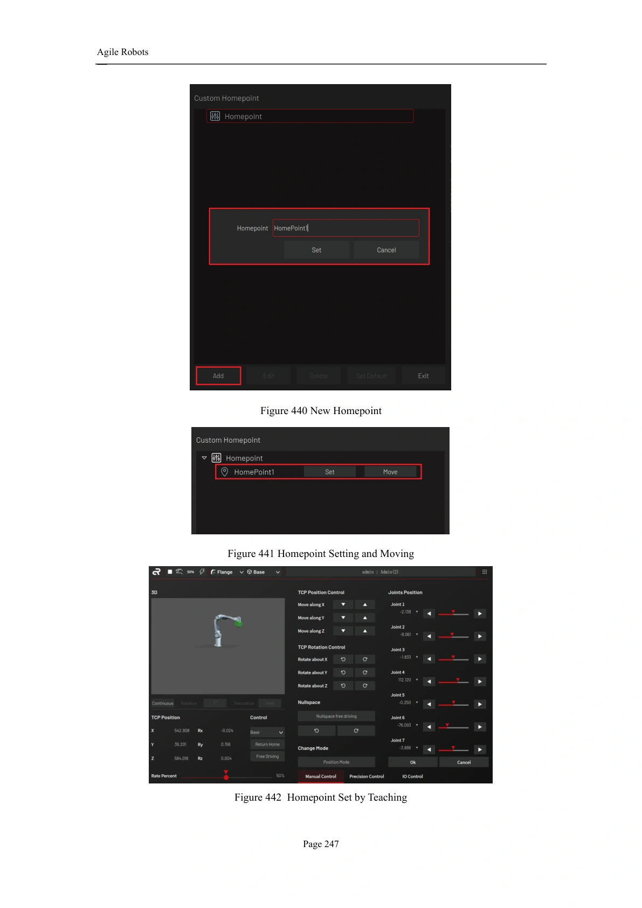



```
Agile Robots 
Page 247 
 
 
Figure 440 New Homepoint 
 
Figure 441 Homepoint Setting and Moving 
 
Figure 442  Homepoint Set by Teaching
```



## PDF page 252

**Source:** Industrial Teaching Pendant Software User Manual\_V3.3.0\_EN\_20260204.pdf, original pdf page 252. [Open the corresponding PDF reading-copy page](https://1292444914-files.gitbook.io/~/files/v0/b/gitbook-x-prod.appspot.com/o/spaces%2FtgOfPnscWebs1eh82EKq%2Fuploads%2FuEKbzkgLqhBdpPhGqV21%2Findustrial-teaching-pendant-software-user-manual-v3-3-0-en-20260204-pp-248-257.pdf?alt=media#page=5).



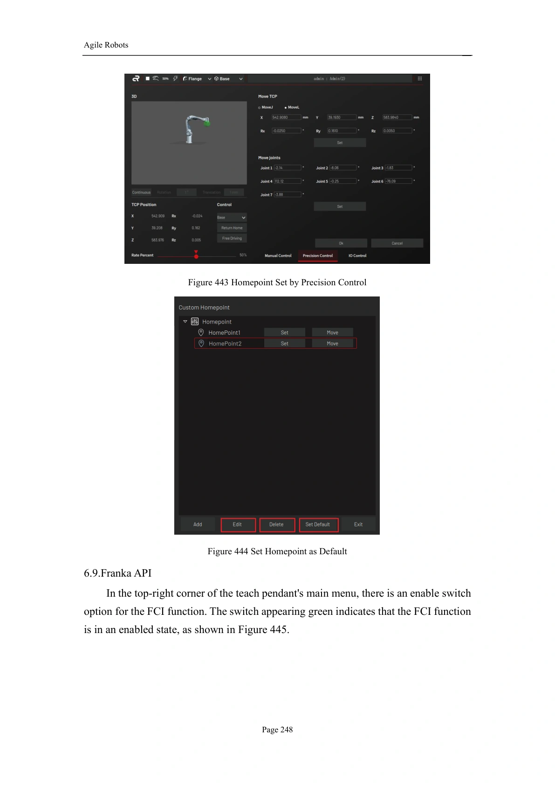



```
Agile Robots 
Page 248 
 
 
Figure 443 Homepoint Set by Precision Control 
 
Figure 444 Set Homepoint as Default 
6.9.Franka API 
In the top-right corner of the teach pendant's main menu, there is an enable switch 
option for the FCI function. The switch appearing green indicates that the FCI function 
is in an enabled state, as shown in Figure 445.
```



**Original document cross-references:** [PDF 253](pages-217-286.md#pdf-page-253)

## PDF page 253

**Source:** Industrial Teaching Pendant Software User Manual\_V3.3.0\_EN\_20260204.pdf, original pdf page 253. [Open the corresponding PDF reading-copy page](https://1292444914-files.gitbook.io/~/files/v0/b/gitbook-x-prod.appspot.com/o/spaces%2FtgOfPnscWebs1eh82EKq%2Fuploads%2FuEKbzkgLqhBdpPhGqV21%2Findustrial-teaching-pendant-software-user-manual-v3-3-0-en-20260204-pp-248-257.pdf?alt=media#page=6).



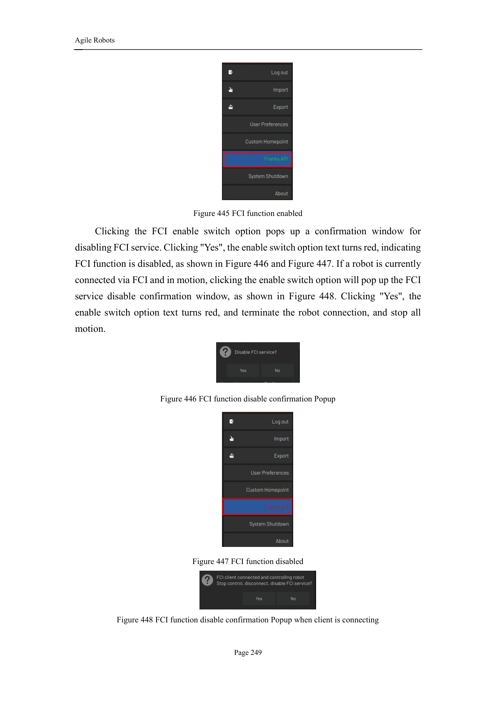



```
Agile Robots 
Page 249 
 
 
Figure 445 FCI function enabled 
Clicking the FCI enable switch option pops up a confirmation window for 
disabling FCI service. Clicking "Yes", the enable switch option text turns red, indicating 
FCI function is disabled, as shown in Figure 446 and Figure 447. If a robot is currently 
connected via FCI and in motion, clicking the enable switch option will pop up the FCI 
service disable confirmation window, as shown in Figure 448. Clicking "Yes", the 
enable switch option text turns red, and terminate the robot connection, and stop all 
motion. 
 
Figure 446 FCI function disable confirmation Popup 
 
Figure 447 FCI function disabled 
 
Figure 448 FCI function disable confirmation Popup when client is connecting
```



**Original document cross-references:** [PDF 253](pages-217-286.md#pdf-page-253)

## PDF page 254

**Source:** Industrial Teaching Pendant Software User Manual\_V3.3.0\_EN\_20260204.pdf, original pdf page 254. [Open the corresponding PDF reading-copy page](https://1292444914-files.gitbook.io/~/files/v0/b/gitbook-x-prod.appspot.com/o/spaces%2FtgOfPnscWebs1eh82EKq%2Fuploads%2FuEKbzkgLqhBdpPhGqV21%2Findustrial-teaching-pendant-software-user-manual-v3-3-0-en-20260204-pp-248-257.pdf?alt=media#page=7).



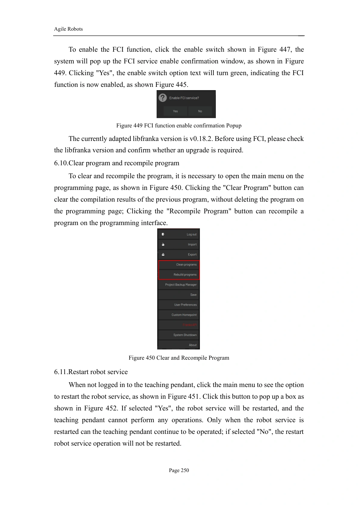



```
Agile Robots 
Page 250 
 
To enable the FCI function, click the enable switch shown in Figure 447, the 
system will pop up the FCI service enable confirmation window, as shown in Figure 
449. Clicking "Yes", the enable switch option text will turn green, indicating the FCI 
function is now enabled, as shown Figure 445. 
 
Figure 449 FCI function enable confirmation Popup 
The currently adapted libfranka version is v0.18.2. Before using FCI, please check 
the libfranka version and confirm whether an upgrade is required. 
6.10.Clear program and recompile program  
To clear and recompile the program, it is necessary to open the main menu on the 
programming page, as shown in Figure 450. Clicking the "Clear Program" button can 
clear the compilation results of the previous program, without deleting the program on 
the programming page; Clicking the "Recompile Program" button can recompile a 
program on the programming interface.  
 
Figure 450 Clear and Recompile Program 
6.11.Restart robot service  
When not logged in to the teaching pendant, click the main menu to see the option 
to restart the robot service, as shown in Figure 451. Click this button to pop up a box as 
shown in Figure 452. If selected "Yes", the robot service will be restarted, and the 
teaching pendant cannot perform any operations. Only when the robot service is 
restarted can the teaching pendant continue to be operated; if selected "No", the restart 
robot service operation will not be restarted.
```



**Original document cross-references:** [PDF 253](pages-217-286.md#pdf-page-253) · [PDF 254](pages-217-286.md#pdf-page-254) · [PDF 255](pages-217-286.md#pdf-page-255)

## PDF page 255

**Source:** Industrial Teaching Pendant Software User Manual\_V3.3.0\_EN\_20260204.pdf, original pdf page 255. [Open the corresponding PDF reading-copy page](https://1292444914-files.gitbook.io/~/files/v0/b/gitbook-x-prod.appspot.com/o/spaces%2FtgOfPnscWebs1eh82EKq%2Fuploads%2FuEKbzkgLqhBdpPhGqV21%2Findustrial-teaching-pendant-software-user-manual-v3-3-0-en-20260204-pp-248-257.pdf?alt=media#page=8).



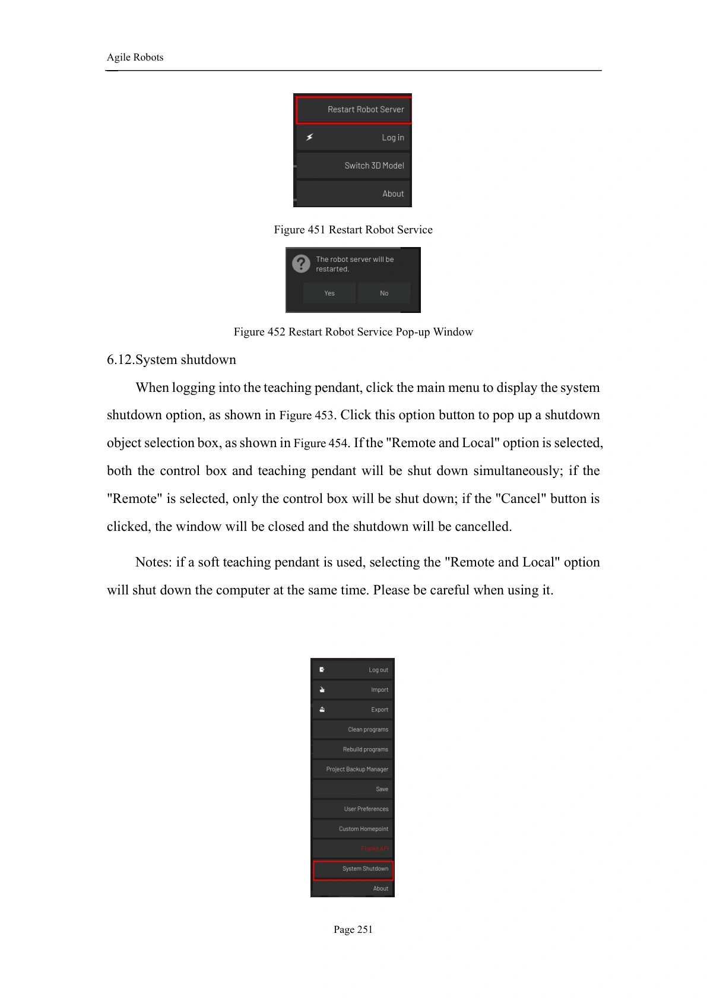



```
Agile Robots 
Page 251 
 
 
Figure 451 Restart Robot Service 
 
Figure 452 Restart Robot Service Pop-up Window 
6.12.System shutdown  
When logging into the teaching pendant, click the main menu to display the system 
shutdown option, as shown in Figure 453. Click this option button to pop up a shutdown 
object selection box, as shown in Figure 454. If the "Remote and Local" option is selected, 
both the control box and teaching pendant will be shut down simultaneously; if the 
"Remote" is selected, only the control box will be shut down; if the "Cancel" button is 
clicked, the window will be closed and the shutdown will be cancelled.  
Notes: if a soft teaching pendant is used, selecting the "Remote and Local" option 
will shut down the computer at the same time. Please be careful when using it.
```



**Original document cross-references:** [PDF 256](pages-217-286.md#pdf-page-256)

## PDF page 256

**Source:** Industrial Teaching Pendant Software User Manual\_V3.3.0\_EN\_20260204.pdf, original pdf page 256. [Open the corresponding PDF reading-copy page](https://1292444914-files.gitbook.io/~/files/v0/b/gitbook-x-prod.appspot.com/o/spaces%2FtgOfPnscWebs1eh82EKq%2Fuploads%2FuEKbzkgLqhBdpPhGqV21%2Findustrial-teaching-pendant-software-user-manual-v3-3-0-en-20260204-pp-248-257.pdf?alt=media#page=9).



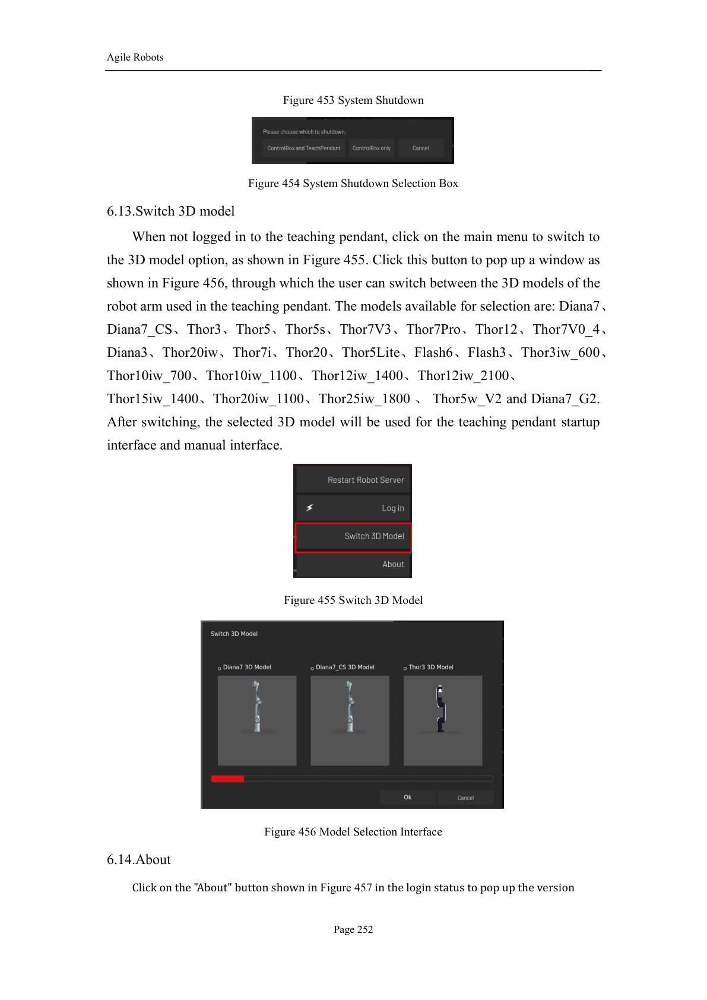



```
Agile Robots 
Page 252 
 
Figure 453 System Shutdown  
 
Figure 454 System Shutdown Selection Box 
6.13.Switch 3D model  
When not logged in to the teaching pendant, click on the main menu to switch to 
the 3D model option, as shown in Figure 455. Click this button to pop up a window as 
shown in Figure 456, through which the user can switch between the 3D models of the 
robot arm used in the teaching pendant. The models available for selection are: Diana7、
Diana7_CS、Thor3、Thor5、Thor5s、Thor7V3、Thor7Pro、Thor12、Thor7V0_4、
Diana3、Thor20iw、Thor7i、Thor20、Thor5Lite、Flash6、Flash3、Thor3iw_600、
Thor10iw_700、Thor10iw_1100、Thor12iw_1400、Thor12iw_2100、
Thor15iw_1400、Thor20iw_1100、Thor25iw_1800 、 Thor5w_V2 and Diana7_G2. 
After switching, the selected 3D model will be used for the teaching pendant startup 
interface and manual interface.  
 
Figure 455 Switch 3D Model 
 
Figure 456 Model Selection Interface 
6.14.About  
Click on the "About" button shown in Figure 457 in the login status to pop up the version
```



**Original document cross-references:** [PDF 256](pages-217-286.md#pdf-page-256) · [PDF 257](pages-217-286.md#pdf-page-257)

## PDF page 257

**Source:** Industrial Teaching Pendant Software User Manual\_V3.3.0\_EN\_20260204.pdf, original pdf page 257. [Open the corresponding PDF reading-copy page](https://1292444914-files.gitbook.io/~/files/v0/b/gitbook-x-prod.appspot.com/o/spaces%2FtgOfPnscWebs1eh82EKq%2Fuploads%2FuEKbzkgLqhBdpPhGqV21%2Findustrial-teaching-pendant-software-user-manual-v3-3-0-en-20260204-pp-248-257.pdf?alt=media#page=10).



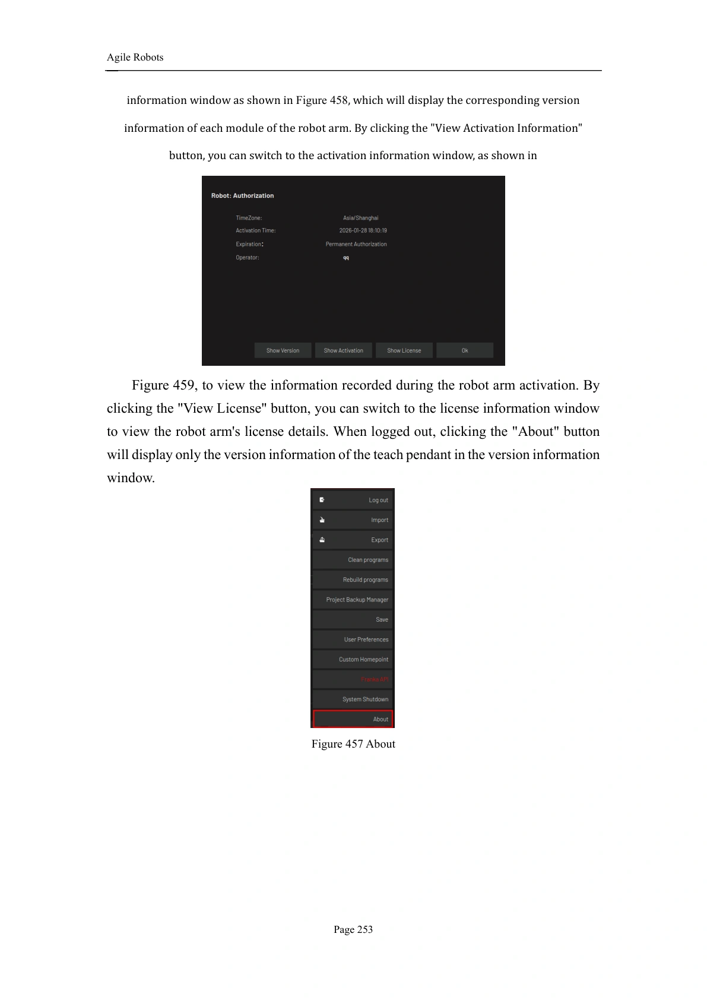



```
Agile Robots 
Page 253 
 
information window as shown in Figure 458, which will display the corresponding version 
information of each module of the robot arm. By clicking the "View Activation Information" 
button, you can switch to the activation information window, as shown in 
 
Figure 459, to view the information recorded during the robot arm activation. By 
clicking the "View License" button, you can switch to the license information window 
to view the robot arm's license details. When logged out, clicking the "About" button 
will display only the version information of the teach pendant in the version information 
window. 
 
Figure 457 About
```



**Original document cross-references:** [PDF 258](pages-217-286.md#pdf-page-258)

## PDF page 258

**Source:** Industrial Teaching Pendant Software User Manual\_V3.3.0\_EN\_20260204.pdf, original pdf page 258. [Open the corresponding PDF reading-copy page](https://1292444914-files.gitbook.io/~/files/v0/b/gitbook-x-prod.appspot.com/o/spaces%2FtgOfPnscWebs1eh82EKq%2Fuploads%2FrDnjVHuBYq3nFMHT9quu%2Findustrial-teaching-pendant-software-user-manual-v3-3-0-en-20260204-pp-258-286.pdf?alt=media#page=1).



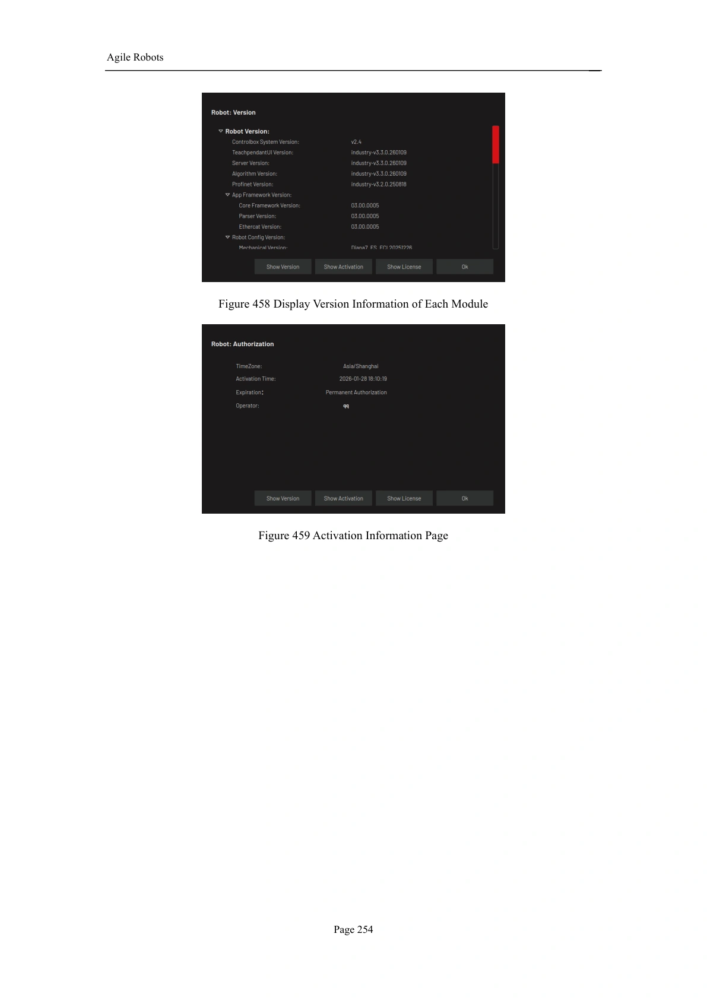



```
Agile Robots 
Page 254 
 
 
Figure 458 Display Version Information of Each Module  
 
Figure 459 Activation Information Page
```



## PDF page 259

**Source:** Industrial Teaching Pendant Software User Manual\_V3.3.0\_EN\_20260204.pdf, original pdf page 259. [Open the corresponding PDF reading-copy page](https://1292444914-files.gitbook.io/~/files/v0/b/gitbook-x-prod.appspot.com/o/spaces%2FtgOfPnscWebs1eh82EKq%2Fuploads%2FrDnjVHuBYq3nFMHT9quu%2Findustrial-teaching-pendant-software-user-manual-v3-3-0-en-20260204-pp-258-286.pdf?alt=media#page=2).



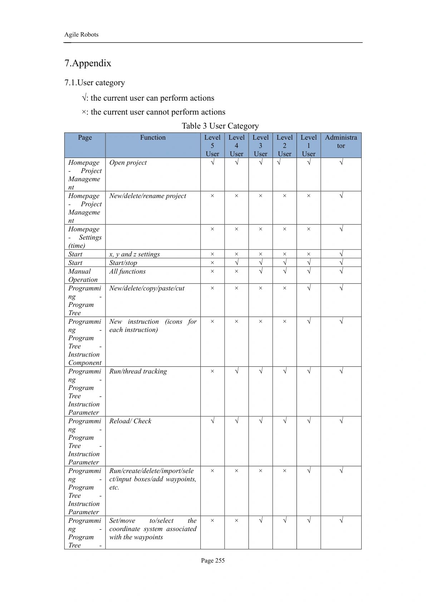



```
Agile Robots 
Page 255 
 
7.Appendix  
7.1.User category  
√: the current user can perform actions  
×: the current user cannot perform actions  
Table 3 User Category 
Page  
Function  
Level
5 
User  
Level
4 
User 
Level
3 
User 
Level
2 
User 
Level
1 
User 
Administra
tor  
Homepage 
- 
Project 
Manageme
nt  
Open project  
√  
√  
√  
√  
√  
√  
Homepage 
- 
Project 
Manageme
nt  
New/delete/rename project  
×  
×  
×  
×  
×  
√  
Homepage 
- 
Settings 
(time)  
 
×  
×  
×  
×  
×  
√  
Start  
x, y and z settings  
×  
×  
×  
×  
×  
√  
Start  
Start/stop  
×  
√  
√  
√  
√  
√  
Manual 
Operation  
All functions  
×  
×  
√  
√  
√  
√  
Programmi
ng 
- 
Program 
Tree  
New/delete/copy/paste/cut  
×  
×  
×  
×  
√  
√  
Programmi
ng 
- 
Program 
Tree 
- 
Instruction 
Component  
New instruction (icons for 
each instruction)  
×  
×  
×  
×  
√  
√  
Programmi
ng 
- 
Program 
Tree 
- 
Instruction 
Parameter  
Run/thread tracking 
×  
√  
√  
√  
√  
√  
Programmi
ng 
- 
Program 
Tree 
- 
Instruction 
Parameter  
Reload/ Check 
 
√  
√  
√  
√  
√  
√  
Programmi
ng 
- 
Program 
Tree 
- 
Instruction 
Parameter  
Run/create/delete/import/sele
ct/input boxes/add waypoints, 
etc.  
×  
×  
×  
×  
√  
√  
Programmi
ng 
- 
Program 
Tree 
- 
Set/move 
to/select 
the 
coordinate system associated 
with the waypoints 
×  
×  
√  
√  
√  
√
```



## PDF page 260

**Source:** Industrial Teaching Pendant Software User Manual\_V3.3.0\_EN\_20260204.pdf, original pdf page 260. [Open the corresponding PDF reading-copy page](https://1292444914-files.gitbook.io/~/files/v0/b/gitbook-x-prod.appspot.com/o/spaces%2FtgOfPnscWebs1eh82EKq%2Fuploads%2FrDnjVHuBYq3nFMHT9quu%2Findustrial-teaching-pendant-software-user-manual-v3-3-0-en-20260204-pp-258-286.pdf?alt=media#page=3).



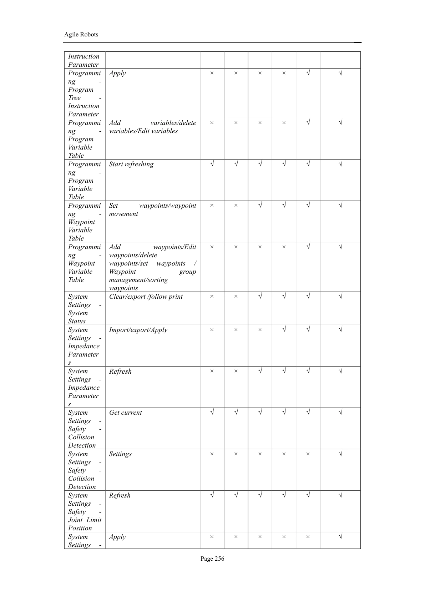



```
Agile Robots 
Page 256 
 
Instruction 
Parameter  
Programmi
ng 
- 
Program 
Tree 
- 
Instruction 
Parameter  
Apply  
×  
×  
×  
×  
√  
√  
Programmi
ng 
- 
Program 
Variable 
Table  
Add 
variables/delete 
variables/Edit variables 
×  
×  
×  
×  
√  
√  
Programmi
ng 
- 
Program 
Variable 
Table 
Start refreshing 
√  
√  
√  
√  
√  
√  
Programmi
ng 
- 
Waypoint 
Variable 
Table  
Set 
waypoints/waypoint 
movement  
×  
×  
√  
√  
√  
√  
Programmi
ng 
- 
Waypoint 
Variable 
Table  
Add 
waypoints/Edit 
waypoints/delete 
waypoints/set 
waypoints 
/ 
Waypoint 
group 
management/sorting 
waypoints 
×  
×  
×  
×  
√  
√  
System 
Settings 
- 
System 
Status  
Clear/export /follow print 
×  
×  
√  
√  
√  
√  
System 
Settings 
- 
Impedance 
Parameter
s  
Import/export/Apply 
×  
×  
×  
√  
√  
√  
System 
Settings 
- 
Impedance 
Parameter
s  
Refresh 
×  
×  
√  
√  
√  
√  
System 
Settings 
- 
Safety 
- 
Collision 
Detection  
Get current  
√  
√  
√  
√  
√  
√  
System 
Settings 
- 
Safety 
- 
Collision 
Detection  
Settings  
×  
×  
×  
×  
×  
√  
System 
Settings 
- 
Safety 
- 
Joint Limit 
Position  
Refresh  
√  
√  
√  
√  
√  
√  
System 
Settings 
- 
Apply  
×  
×  
×  
×  
×  
√
```



## PDF page 261

**Source:** Industrial Teaching Pendant Software User Manual\_V3.3.0\_EN\_20260204.pdf, original pdf page 261. [Open the corresponding PDF reading-copy page](https://1292444914-files.gitbook.io/~/files/v0/b/gitbook-x-prod.appspot.com/o/spaces%2FtgOfPnscWebs1eh82EKq%2Fuploads%2FrDnjVHuBYq3nFMHT9quu%2Findustrial-teaching-pendant-software-user-manual-v3-3-0-en-20260204-pp-258-286.pdf?alt=media#page=4).







```
Agile Robots 
Page 257 
 
Safety 
- 
Joint Limit 
Position  
System 
Settings 
- 
Safety 
- 
Soft Limit  
Refresh  
√  
√  
√  
√  
√  
√  
System 
Settings 
- 
Safety 
- 
Soft Limit  
Apply  
×  
×  
×  
×  
×  
√  
System 
Settings 
- 
Safety 
- 
Joint 
Velocity 
and 
Acceleratio
n Limits  
Refresh  
√  
√  
√  
√  
√  
√  
System 
Settings 
- 
Safety 
- 
Joint 
Velocity 
and 
Acceleratio
n Limits  
Apply  
×  
×  
×  
×  
×  
√  
System 
Settings 
- 
Safety 
- 
Virtual 
Wall  
Get current mode  
√  
√  
√  
√  
√  
√  
System 
Settings 
- 
Safety 
- 
Virtual 
Wall  
Apply  
×  
×  
×  
×  
×  
√  
System 
Settings 
- 
Safety 
- 
Simple 
Virtual 
Wall  
Refresh  
√  
√  
√  
√  
√  
√  
System 
Settings 
- 
Safety 
- 
Simple 
Virtual 
Wall  
Apply  
×  
×  
×  
×  
×  
√  
System 
Settings 
- 
Safety 
- 
Complex 
Virtual 
Wall  
Load 
√  
√  
√  
√  
√  
√  
System 
Settings 
- 
Safety 
- 
Complex 
Virtual 
New/Delete/Copy/Paste/Set/A
pply 
×  
×  
×  
×  
×  
√
```



## PDF page 262

**Source:** Industrial Teaching Pendant Software User Manual\_V3.3.0\_EN\_20260204.pdf, original pdf page 262. [Open the corresponding PDF reading-copy page](https://1292444914-files.gitbook.io/~/files/v0/b/gitbook-x-prod.appspot.com/o/spaces%2FtgOfPnscWebs1eh82EKq%2Fuploads%2FrDnjVHuBYq3nFMHT9quu%2Findustrial-teaching-pendant-software-user-manual-v3-3-0-en-20260204-pp-258-286.pdf?alt=media#page=5).



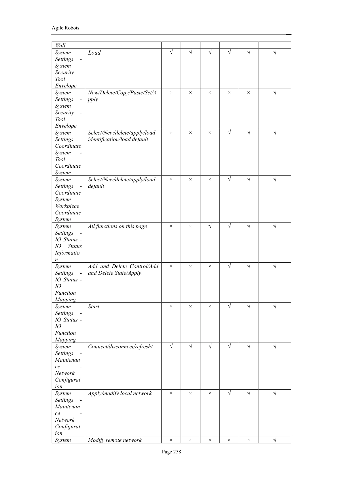



```
Agile Robots 
Page 258 
 
Wall  
System 
Settings 
- 
System 
Security 
- 
Tool 
Envelope 
Load 
√  
√  
√  
√  
√  
√  
System 
Settings 
- 
System 
Security 
- 
Tool 
Envelope 
New/Delete/Copy/Paste/Set/A
pply 
×  
×  
×  
×  
×  
√  
System 
Settings 
- 
Coordinate 
System 
- 
Tool 
Coordinate 
System  
Select/New/delete/apply/load 
identification/load default  
×  
×  
×  
√  
√  
√  
System 
Settings 
- 
Coordinate 
System 
- 
Workpiece 
Coordinate 
System  
Select/New/delete/apply/load 
default  
×  
×  
×  
√  
√  
√  
System 
Settings 
- 
IO Status - 
IO 
Status 
Informatio
n  
All functions on this page  
×  
×  
√  
√  
√  
√  
System 
Settings 
- 
IO Status - 
IO 
Function 
Mapping  
Add and Delete Control/Add 
and Delete State/Apply  
×  
×  
×  
√  
√  
√  
System 
Settings 
- 
IO Status - 
IO 
Function 
Mapping  
Start  
×  
×  
×  
√  
√  
√  
System 
Settings 
- 
Maintenan
ce 
- 
Network 
Configurat
ion  
Connect/disconnect/refresh/ 
√  
√  
√  
√  
√  
√  
System 
Settings 
- 
Maintenan
ce 
- 
Network 
Configurat
ion  
Apply/modify local network  
×  
×  
×  
√  
√  
√  
System 
Modify remote network  
×  
×  
×  
×  
×  
√
```



## PDF page 263

**Source:** Industrial Teaching Pendant Software User Manual\_V3.3.0\_EN\_20260204.pdf, original pdf page 263. [Open the corresponding PDF reading-copy page](https://1292444914-files.gitbook.io/~/files/v0/b/gitbook-x-prod.appspot.com/o/spaces%2FtgOfPnscWebs1eh82EKq%2Fuploads%2FrDnjVHuBYq3nFMHT9quu%2Findustrial-teaching-pendant-software-user-manual-v3-3-0-en-20260204-pp-258-286.pdf?alt=media#page=6).



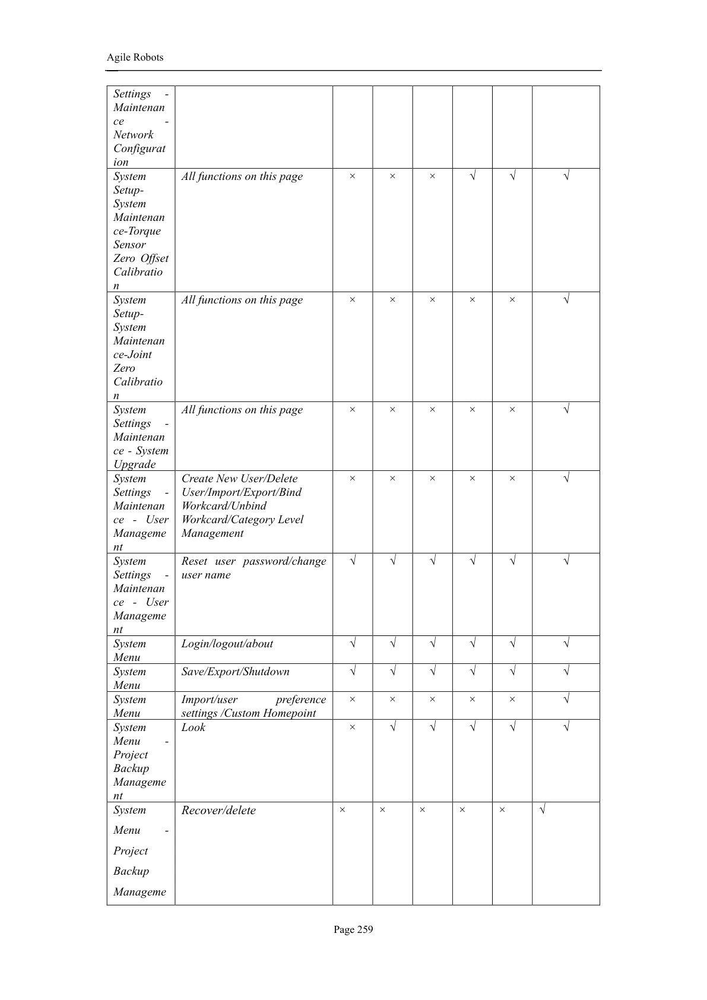



```
Agile Robots 
Page 259 
 
Settings 
- 
Maintenan
ce 
- 
Network 
Configurat
ion  
System 
Setup-
System 
Maintenan
ce-Torque 
Sensor 
Zero Offset 
Calibratio
n 
All functions on this page 
×  
×  
×  
√  
√  
√  
System 
Setup-
System 
Maintenan
ce-Joint 
Zero 
Calibratio
n 
All functions on this page 
×  
×  
×  
×  
×  
√  
System 
Settings 
- 
Maintenan
ce - System 
Upgrade  
All functions on this page  
×  
×  
×  
×  
×  
√  
System 
Settings 
- 
Maintenan
ce - User 
Manageme
nt  
Create New User/Delete 
User/Import/Export/Bind 
Workcard/Unbind 
Workcard/Category Level 
Management 
×  
×  
×  
×  
×  
√  
System 
Settings 
- 
Maintenan
ce - User 
Manageme
nt  
Reset user password/change 
user name  
√  
√  
√  
√  
√  
√  
System 
Menu  
Login/logout/about  
√  
√  
√  
√  
√  
√  
System 
Menu  
Save/Export/Shutdown 
√  
√  
√  
√  
√  
√  
System 
Menu  
Import/user 
preference 
settings /Custom Homepoint 
×  
×  
×  
×  
×  
√  
System 
Menu 
- 
Project 
Backup 
Manageme
nt 
Look 
×  
√  
√  
√  
√  
√  
System 
Menu 
- 
Project 
Backup 
Manageme
Recover/delete 
×  
×  
×  
×  
×  
√
```



## PDF page 264

**Source:** Industrial Teaching Pendant Software User Manual\_V3.3.0\_EN\_20260204.pdf, original pdf page 264. [Open the corresponding PDF reading-copy page](https://1292444914-files.gitbook.io/~/files/v0/b/gitbook-x-prod.appspot.com/o/spaces%2FtgOfPnscWebs1eh82EKq%2Fuploads%2FrDnjVHuBYq3nFMHT9quu%2Findustrial-teaching-pendant-software-user-manual-v3-3-0-en-20260204-pp-258-286.pdf?alt=media#page=7).



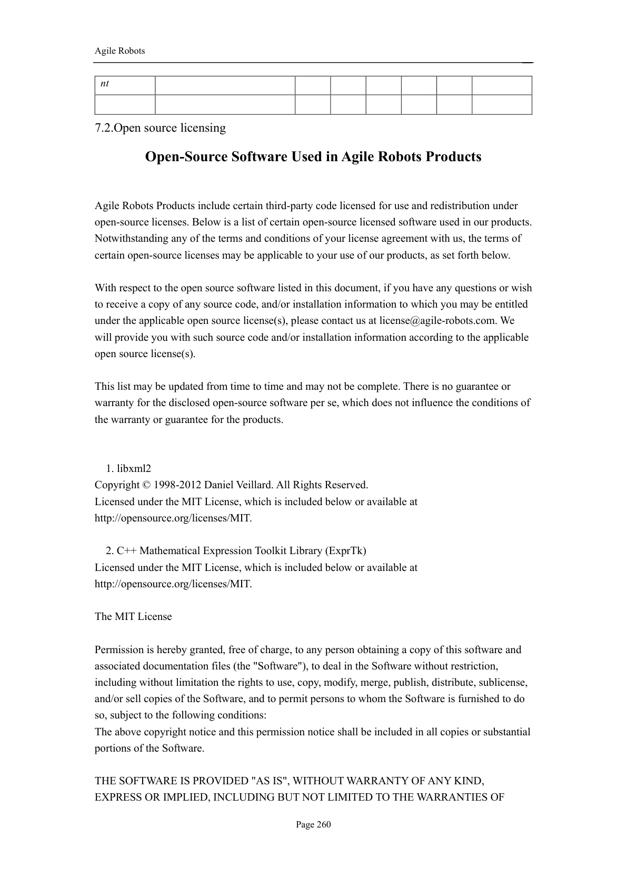



```
Agile Robots 
Page 260 
 
nt 
 
 
 
 
 
 
 
 
7.2.Open source licensing  
Open-Source Software Used in Agile Robots Products 
 
Agile Robots Products include certain third-party code licensed for use and redistribution under 
open-source licenses. Below is a list of certain open-source licensed software used in our products. 
Notwithstanding any of the terms and conditions of your license agreement with us, the terms of 
certain open-source licenses may be applicable to your use of our products, as set forth below. 
 
With respect to the open source software listed in this document, if you have any questions or wish 
to receive a copy of any source code, and/or installation information to which you may be entitled 
under the applicable open source license(s), please contact us at license@agile-robots.com. We 
will provide you with such source code and/or installation information according to the applicable 
open source license(s). 
 
This list may be updated from time to time and may not be complete. There is no guarantee or 
warranty for the disclosed open-source software per se, which does not influence the conditions of 
the warranty or guarantee for the products. 
 
 
    1. libxml2 
Copyright © 1998-2012 Daniel Veillard. All Rights Reserved. 
Licensed under the MIT License, which is included below or available at 
http://opensource.org/licenses/MIT. 
 
    2. C++ Mathematical Expression Toolkit Library (ExprTk) 
Licensed under the MIT License, which is included below or available at 
http://opensource.org/licenses/MIT. 
 
The MIT License 
 
Permission is hereby granted, free of charge, to any person obtaining a copy of this software and 
associated documentation files (the "Software"), to deal in the Software without restriction, 
including without limitation the rights to use, copy, modify, merge, publish, distribute, sublicense, 
and/or sell copies of the Software, and to permit persons to whom the Software is furnished to do 
so, subject to the following conditions: 
The above copyright notice and this permission notice shall be included in all copies or substantial 
portions of the Software. 
 
THE SOFTWARE IS PROVIDED "AS IS", WITHOUT WARRANTY OF ANY KIND, 
EXPRESS OR IMPLIED, INCLUDING BUT NOT LIMITED TO THE WARRANTIES OF
```



## PDF page 265

**Source:** Industrial Teaching Pendant Software User Manual\_V3.3.0\_EN\_20260204.pdf, original pdf page 265. [Open the corresponding PDF reading-copy page](https://1292444914-files.gitbook.io/~/files/v0/b/gitbook-x-prod.appspot.com/o/spaces%2FtgOfPnscWebs1eh82EKq%2Fuploads%2FrDnjVHuBYq3nFMHT9quu%2Findustrial-teaching-pendant-software-user-manual-v3-3-0-en-20260204-pp-258-286.pdf?alt=media#page=8).







```
Agile Robots 
Page 261 
 
MERCHANTABILITY, FITNESS FOR A PARTICULAR PURPOSE AND 
NONINFRINGEMENT. IN NO EVENT SHALL THE AUTHORS OR COPYRIGHT HOLDERS 
BE LIABLE FOR ANY CLAIM, DAMAGES OR OTHER LIABILITY, WHETHER IN AN 
ACTION OF CONTRACT, TORT OR OTHERWISE, ARISING FROM, OUT OF OR IN 
CONNECTION WITH THE SOFTWARE OR THE USE OR OTHER DEALINGS IN THE 
SOFTWARE. 
 
 
    3. Qt Core 
Copyright ©2017 The Qt Company Ltd. 
Licensed under GNU Lesser General Public License version 3, which supplements GNU General 
Public License Version 3, both licenses are displayed below. 
 
Qt GUI 
Copyright © 2017 The Qt Company Ltd. 
Licensed under GNU Lesser General Public License version 3, which supplements GNU General 
Public License Version 3, both licenses are displayed below. 
 
Qt Network 
Copyright © 2017 The Qt Company Ltd. 
Licensed under GNU Lesser General Public License version 3, which supplements GNU General 
Public License Version 3, both licenses are displayed below. 
 
Qt Widgets 
Copyright © 2017 The Qt Company Ltd. 
Licensed under GNU Lesser General Public License version 3, which supplements GNU General 
Public License Version 3, both licenses are displayed below. 
 
Qt 3D 
Copyright © 2017 The Qt Company Ltd. 
Licensed under GNU Lesser General Public License version 3, which supplements GNU General 
Public License Version 3, both licenses are displayed below. 
 
Qt Concurrent 
Copyright © 2017 The Qt Company Ltd. 
Licensed under GNU Lesser General Public License version 3, which supplements GNU General 
Public License Version 3, both licenses are displayed below. 
 
Qt Image Formats 
Copyright © 2017 The Qt Company Ltd. 
Licensed under GNU Lesser General Public License version 3, which supplements GNU General 
Public License Version 3, both licenses are displayed below. 
 
Qt SVG, Qt Xml
```



## PDF page 266

**Source:** Industrial Teaching Pendant Software User Manual\_V3.3.0\_EN\_20260204.pdf, original pdf page 266. [Open the corresponding PDF reading-copy page](https://1292444914-files.gitbook.io/~/files/v0/b/gitbook-x-prod.appspot.com/o/spaces%2FtgOfPnscWebs1eh82EKq%2Fuploads%2FrDnjVHuBYq3nFMHT9quu%2Findustrial-teaching-pendant-software-user-manual-v3-3-0-en-20260204-pp-258-286.pdf?alt=media#page=9).



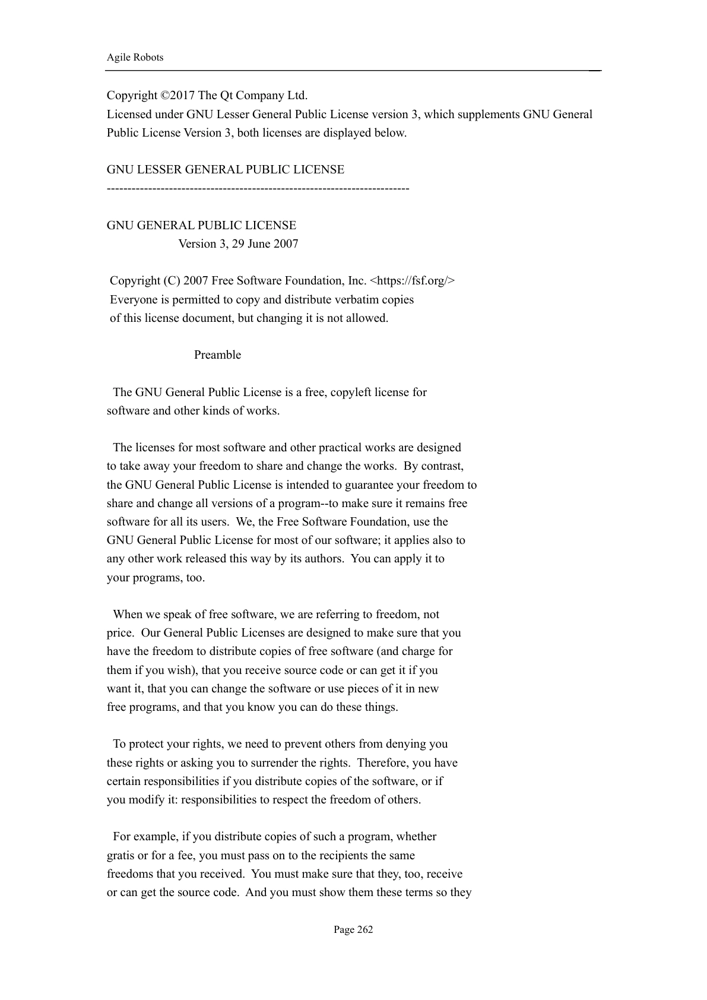



```
Agile Robots 
Page 262 
 
Copyright ©2017 The Qt Company Ltd. 
Licensed under GNU Lesser General Public License version 3, which supplements GNU General 
Public License Version 3, both licenses are displayed below. 
 
GNU LESSER GENERAL PUBLIC LICENSE 
------------------------------------------------------------------------- 
 
GNU GENERAL PUBLIC LICENSE 
                       Version 3, 29 June 2007 
 
 Copyright (C) 2007 Free Software Foundation, Inc. <https://fsf.org/> 
 Everyone is permitted to copy and distribute verbatim copies 
 of this license document, but changing it is not allowed. 
 
                            Preamble 
 
  The GNU General Public License is a free, copyleft license for 
software and other kinds of works. 
 
  The licenses for most software and other practical works are designed 
to take away your freedom to share and change the works.  By contrast, 
the GNU General Public License is intended to guarantee your freedom to 
share and change all versions of a program--to make sure it remains free 
software for all its users.  We, the Free Software Foundation, use the 
GNU General Public License for most of our software; it applies also to 
any other work released this way by its authors.  You can apply it to 
your programs, too. 
 
  When we speak of free software, we are referring to freedom, not 
price.  Our General Public Licenses are designed to make sure that you 
have the freedom to distribute copies of free software (and charge for 
them if you wish), that you receive source code or can get it if you 
want it, that you can change the software or use pieces of it in new 
free programs, and that you know you can do these things. 
 
  To protect your rights, we need to prevent others from denying you 
these rights or asking you to surrender the rights.  Therefore, you have 
certain responsibilities if you distribute copies of the software, or if 
you modify it: responsibilities to respect the freedom of others. 
 
  For example, if you distribute copies of such a program, whether 
gratis or for a fee, you must pass on to the recipients the same 
freedoms that you received.  You must make sure that they, too, receive 
or can get the source code.  And you must show them these terms so they
```



## PDF page 267

**Source:** Industrial Teaching Pendant Software User Manual\_V3.3.0\_EN\_20260204.pdf, original pdf page 267. [Open the corresponding PDF reading-copy page](https://1292444914-files.gitbook.io/~/files/v0/b/gitbook-x-prod.appspot.com/o/spaces%2FtgOfPnscWebs1eh82EKq%2Fuploads%2FrDnjVHuBYq3nFMHT9quu%2Findustrial-teaching-pendant-software-user-manual-v3-3-0-en-20260204-pp-258-286.pdf?alt=media#page=10).



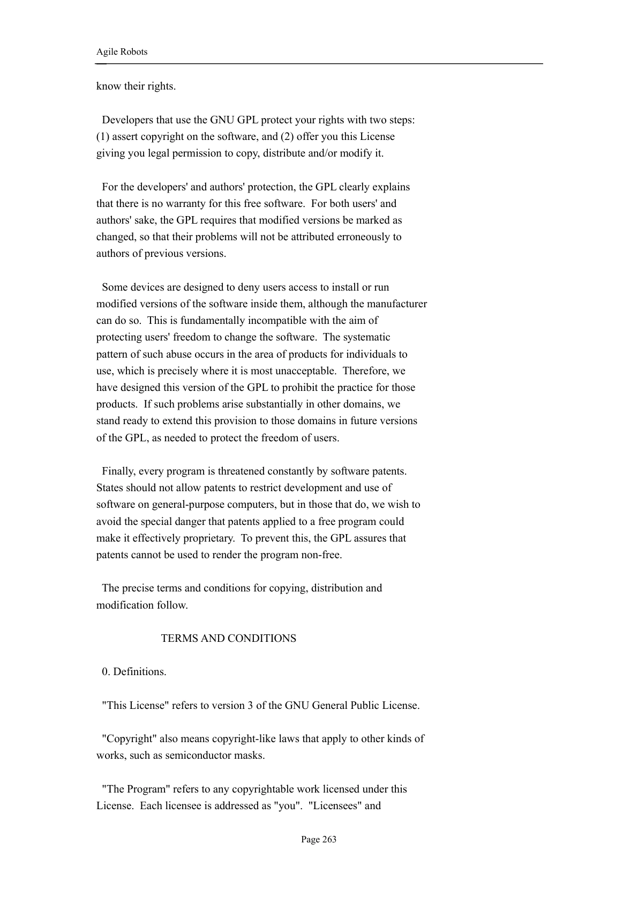



```
Agile Robots 
Page 263 
 
know their rights. 
 
  Developers that use the GNU GPL protect your rights with two steps: 
(1) assert copyright on the software, and (2) offer you this License 
giving you legal permission to copy, distribute and/or modify it. 
 
  For the developers' and authors' protection, the GPL clearly explains 
that there is no warranty for this free software.  For both users' and 
authors' sake, the GPL requires that modified versions be marked as 
changed, so that their problems will not be attributed erroneously to 
authors of previous versions. 
 
  Some devices are designed to deny users access to install or run 
modified versions of the software inside them, although the manufacturer 
can do so.  This is fundamentally incompatible with the aim of 
protecting users' freedom to change the software.  The systematic 
pattern of such abuse occurs in the area of products for individuals to 
use, which is precisely where it is most unacceptable.  Therefore, we 
have designed this version of the GPL to prohibit the practice for those 
products.  If such problems arise substantially in other domains, we 
stand ready to extend this provision to those domains in future versions 
of the GPL, as needed to protect the freedom of users. 
 
  Finally, every program is threatened constantly by software patents. 
States should not allow patents to restrict development and use of 
software on general-purpose computers, but in those that do, we wish to 
avoid the special danger that patents applied to a free program could 
make it effectively proprietary.  To prevent this, the GPL assures that 
patents cannot be used to render the program non-free. 
 
  The precise terms and conditions for copying, distribution and 
modification follow. 
 
                       TERMS AND CONDITIONS 
 
  0. Definitions. 
 
  "This License" refers to version 3 of the GNU General Public License. 
 
  "Copyright" also means copyright-like laws that apply to other kinds of 
works, such as semiconductor masks. 
 
  "The Program" refers to any copyrightable work licensed under this 
License.  Each licensee is addressed as "you".  "Licensees" and
```



## PDF page 268

**Source:** Industrial Teaching Pendant Software User Manual\_V3.3.0\_EN\_20260204.pdf, original pdf page 268. [Open the corresponding PDF reading-copy page](https://1292444914-files.gitbook.io/~/files/v0/b/gitbook-x-prod.appspot.com/o/spaces%2FtgOfPnscWebs1eh82EKq%2Fuploads%2FrDnjVHuBYq3nFMHT9quu%2Findustrial-teaching-pendant-software-user-manual-v3-3-0-en-20260204-pp-258-286.pdf?alt=media#page=11).



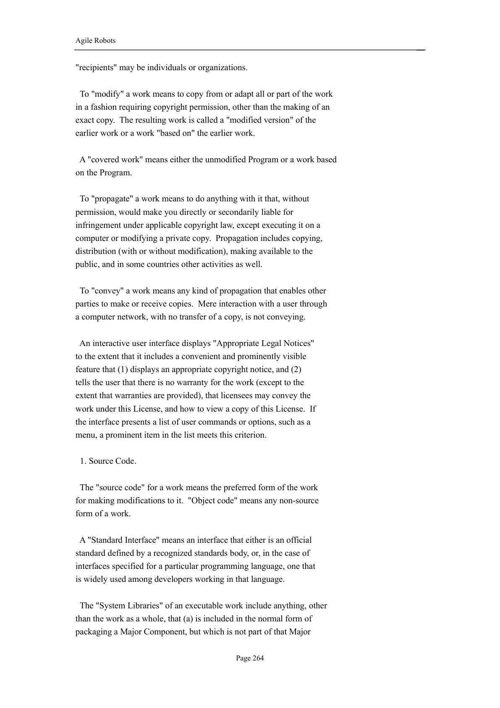



```
Agile Robots 
Page 264 
 
"recipients" may be individuals or organizations. 
 
  To "modify" a work means to copy from or adapt all or part of the work 
in a fashion requiring copyright permission, other than the making of an 
exact copy.  The resulting work is called a "modified version" of the 
earlier work or a work "based on" the earlier work. 
 
  A "covered work" means either the unmodified Program or a work based 
on the Program. 
 
  To "propagate" a work means to do anything with it that, without 
permission, would make you directly or secondarily liable for 
infringement under applicable copyright law, except executing it on a 
computer or modifying a private copy.  Propagation includes copying, 
distribution (with or without modification), making available to the 
public, and in some countries other activities as well. 
 
  To "convey" a work means any kind of propagation that enables other 
parties to make or receive copies.  Mere interaction with a user through 
a computer network, with no transfer of a copy, is not conveying. 
 
  An interactive user interface displays "Appropriate Legal Notices" 
to the extent that it includes a convenient and prominently visible 
feature that (1) displays an appropriate copyright notice, and (2) 
tells the user that there is no warranty for the work (except to the 
extent that warranties are provided), that licensees may convey the 
work under this License, and how to view a copy of this License.  If 
the interface presents a list of user commands or options, such as a 
menu, a prominent item in the list meets this criterion. 
 
  1. Source Code. 
 
  The "source code" for a work means the preferred form of the work 
for making modifications to it.  "Object code" means any non-source 
form of a work. 
 
  A "Standard Interface" means an interface that either is an official 
standard defined by a recognized standards body, or, in the case of 
interfaces specified for a particular programming language, one that 
is widely used among developers working in that language. 
 
  The "System Libraries" of an executable work include anything, other 
than the work as a whole, that (a) is included in the normal form of 
packaging a Major Component, but which is not part of that Major
```



## PDF page 269

**Source:** Industrial Teaching Pendant Software User Manual\_V3.3.0\_EN\_20260204.pdf, original pdf page 269. [Open the corresponding PDF reading-copy page](https://1292444914-files.gitbook.io/~/files/v0/b/gitbook-x-prod.appspot.com/o/spaces%2FtgOfPnscWebs1eh82EKq%2Fuploads%2FrDnjVHuBYq3nFMHT9quu%2Findustrial-teaching-pendant-software-user-manual-v3-3-0-en-20260204-pp-258-286.pdf?alt=media#page=12).







```
Agile Robots 
Page 265 
 
Component, and (b) serves only to enable use of the work with that 
Major Component, or to implement a Standard Interface for which an 
implementation is available to the public in source code form.  A 
"Major Component", in this context, means a major essential component 
(kernel, window system, and so on) of the specific operating system 
(if any) on which the executable work runs, or a compiler used to 
produce the work, or an object code interpreter used to run it. 
 
  The "Corresponding Source" for a work in object code form means all 
the source code needed to generate, install, and (for an executable 
work) run the object code and to modify the work, including scripts to 
control those activities.  However, it does not include the work's 
System Libraries, or general-purpose tools or generally available free 
programs which are used unmodified in performing those activities but 
which are not part of the work.  For example, Corresponding Source 
includes interface definition files associated with source files for 
the work, and the source code for shared libraries and dynamically 
linked subprograms that the work is specifically designed to require, 
such as by intimate data communication or control flow between those 
subprograms and other parts of the work. 
 
  The Corresponding Source need not include anything that users 
can regenerate automatically from other parts of the Corresponding 
Source. 
 
  The Corresponding Source for a work in source code form is that 
same work. 
 
  2. Basic Permissions. 
 
  All rights granted under this License are granted for the term of 
copyright on the Program, and are irrevocable provided the stated 
conditions are met.  This License explicitly affirms your unlimited 
permission to run the unmodified Program.  The output from running a 
covered work is covered by this License only if the output, given its 
content, constitutes a covered work.  This License acknowledges your 
rights of fair use or other equivalent, as provided by copyright law. 
 
  You may make, run and propagate covered works that you do not 
convey, without conditions so long as your license otherwise remains 
in force.  You may convey covered works to others for the sole purpose 
of having them make modifications exclusively for you, or provide you 
with facilities for running those works, provided that you comply with 
the terms of this License in conveying all material for which you do
```



## PDF page 270

**Source:** Industrial Teaching Pendant Software User Manual\_V3.3.0\_EN\_20260204.pdf, original pdf page 270. [Open the corresponding PDF reading-copy page](https://1292444914-files.gitbook.io/~/files/v0/b/gitbook-x-prod.appspot.com/o/spaces%2FtgOfPnscWebs1eh82EKq%2Fuploads%2FrDnjVHuBYq3nFMHT9quu%2Findustrial-teaching-pendant-software-user-manual-v3-3-0-en-20260204-pp-258-286.pdf?alt=media#page=13).







```
Agile Robots 
Page 266 
 
not control copyright.  Those thus making or running the covered works 
for you must do so exclusively on your behalf, under your direction 
and control, on terms that prohibit them from making any copies of 
your copyrighted material outside their relationship with you. 
 
  Conveying under any other circumstances is permitted solely under 
the conditions stated below.  Sublicensing is not allowed; section 10 
makes it unnecessary. 
 
  3. Protecting Users' Legal Rights From Anti-Circumvention Law. 
 
  No covered work shall be deemed part of an effective technological 
measure under any applicable law fulfilling obligations under article 
11 of the WIPO copyright treaty adopted on 20 December 1996, or 
similar laws prohibiting or restricting circumvention of such 
measures. 
 
  When you convey a covered work, you waive any legal power to forbid 
circumvention of technological measures to the extent such circumvention 
is effected by exercising rights under this License with respect to 
the covered work, and you disclaim any intention to limit operation or 
modification of the work as a means of enforcing, against the work's 
users, your or third parties' legal rights to forbid circumvention of 
technological measures. 
 
  4. Conveying Verbatim Copies. 
 
  You may convey verbatim copies of the Program's source code as you 
receive it, in any medium, provided that you conspicuously and 
appropriately publish on each copy an appropriate copyright notice; 
keep intact all notices stating that this License and any 
non-permissive terms added in accord with section 7 apply to the code; 
keep intact all notices of the absence of any warranty; and give all 
recipients a copy of this License along with the Program. 
 
  You may charge any price or no price for each copy that you convey, 
and you may offer support or warranty protection for a fee. 
 
  5. Conveying Modified Source Versions. 
 
  You may convey a work based on the Program, or the modifications to 
produce it from the Program, in the form of source code under the 
terms of section 4, provided that you also meet all of these conditions:
```



## PDF page 271

**Source:** Industrial Teaching Pendant Software User Manual\_V3.3.0\_EN\_20260204.pdf, original pdf page 271. [Open the corresponding PDF reading-copy page](https://1292444914-files.gitbook.io/~/files/v0/b/gitbook-x-prod.appspot.com/o/spaces%2FtgOfPnscWebs1eh82EKq%2Fuploads%2FrDnjVHuBYq3nFMHT9quu%2Findustrial-teaching-pendant-software-user-manual-v3-3-0-en-20260204-pp-258-286.pdf?alt=media#page=14).







```
Agile Robots 
Page 267 
 
    a) The work must carry prominent notices stating that you modified 
    it, and giving a relevant date. 
 
    b) The work must carry prominent notices stating that it is 
    released under this License and any conditions added under section 
    7.  This requirement modifies the requirement in section 4 to 
    "keep intact all notices". 
 
    c) You must license the entire work, as a whole, under this 
    License to anyone who comes into possession of a copy.  This 
    License will therefore apply, along with any applicable section 7 
    additional terms, to the whole of the work, and all its parts, 
    regardless of how they are packaged.  This License gives no 
    permission to license the work in any other way, but it does not 
    invalidate such permission if you have separately received it. 
 
    d) If the work has interactive user interfaces, each must display 
    Appropriate Legal Notices; however, if the Program has interactive 
    interfaces that do not display Appropriate Legal Notices, your 
    work need not make them do so. 
 
  A compilation of a covered work with other separate and independent 
works, which are not by their nature extensions of the covered work, 
and which are not combined with it such as to form a larger program, 
in or on a volume of a storage or distribution medium, is called an 
"aggregate" if the compilation and its resulting copyright are not 
used to limit the access or legal rights of the compilation's users 
beyond what the individual works permit.  Inclusion of a covered work 
in an aggregate does not cause this License to apply to the other 
parts of the aggregate. 
 
  6. Conveying Non-Source Forms. 
 
  You may convey a covered work in object code form under the terms 
of sections 4 and 5, provided that you also convey the 
machine-readable Corresponding Source under the terms of this License, 
in one of these ways: 
 
    a) Convey the object code in, or embodied in, a physical product 
    (including a physical distribution medium), accompanied by the 
    Corresponding Source fixed on a durable physical medium 
    customarily used for software interchange. 
 
    b) Convey the object code in, or embodied in, a physical product
```



## PDF page 272

**Source:** Industrial Teaching Pendant Software User Manual\_V3.3.0\_EN\_20260204.pdf, original pdf page 272. [Open the corresponding PDF reading-copy page](https://1292444914-files.gitbook.io/~/files/v0/b/gitbook-x-prod.appspot.com/o/spaces%2FtgOfPnscWebs1eh82EKq%2Fuploads%2FrDnjVHuBYq3nFMHT9quu%2Findustrial-teaching-pendant-software-user-manual-v3-3-0-en-20260204-pp-258-286.pdf?alt=media#page=15).







```
Agile Robots 
Page 268 
 
    (including a physical distribution medium), accompanied by a 
    written offer, valid for at least three years and valid for as 
    long as you offer spare parts or customer support for that product 
    model, to give anyone who possesses the object code either (1) a 
    copy of the Corresponding Source for all the software in the 
    product that is covered by this License, on a durable physical 
    medium customarily used for software interchange, for a price no 
    more than your reasonable cost of physically performing this 
    conveying of source, or (2) access to copy the 
    Corresponding Source from a network server at no charge. 
 
    c) Convey individual copies of the object code with a copy of the 
    written offer to provide the Corresponding Source.  This 
    alternative is allowed only occasionally and noncommercially, and 
    only if you received the object code with such an offer, in accord 
    with subsection 6b. 
 
    d) Convey the object code by offering access from a designated 
    place (gratis or for a charge), and offer equivalent access to the 
    Corresponding Source in the same way through the same place at no 
    further charge.  You need not require recipients to copy the 
    Corresponding Source along with the object code.  If the place to 
    copy the object code is a network server, the Corresponding Source 
    may be on a different server (operated by you or a third party) 
    that supports equivalent copying facilities, provided you maintain 
    clear directions next to the object code saying where to find the 
    Corresponding Source.  Regardless of what server hosts the 
    Corresponding Source, you remain obligated to ensure that it is 
    available for as long as needed to satisfy these requirements. 
 
    e) Convey the object code using peer-to-peer transmission, provided 
    you inform other peers where the object code and Corresponding 
    Source of the work are being offered to the general public at no 
    charge under subsection 6d. 
 
  A separable portion of the object code, whose source code is excluded 
from the Corresponding Source as a System Library, need not be 
included in conveying the object code work. 
 
  A "User Product" is either (1) a "consumer product", which means any 
tangible personal property which is normally used for personal, family, 
or household purposes, or (2) anything designed or sold for incorporation 
into a dwelling.  In determining whether a product is a consumer product, 
doubtful cases shall be resolved in favor of coverage.  For a particular
```



## PDF page 273

**Source:** Industrial Teaching Pendant Software User Manual\_V3.3.0\_EN\_20260204.pdf, original pdf page 273. [Open the corresponding PDF reading-copy page](https://1292444914-files.gitbook.io/~/files/v0/b/gitbook-x-prod.appspot.com/o/spaces%2FtgOfPnscWebs1eh82EKq%2Fuploads%2FrDnjVHuBYq3nFMHT9quu%2Findustrial-teaching-pendant-software-user-manual-v3-3-0-en-20260204-pp-258-286.pdf?alt=media#page=16).







```
Agile Robots 
Page 269 
 
product received by a particular user, "normally used" refers to a 
typical or common use of that class of product, regardless of the status 
of the particular user or of the way in which the particular user 
actually uses, or expects or is expected to use, the product.  A product 
is a consumer product regardless of whether the product has substantial 
commercial, industrial or non-consumer uses, unless such uses represent 
the only significant mode of use of the product. 
 
  "Installation Information" for a User Product means any methods, 
procedures, authorization keys, or other information required to install 
and execute modified versions of a covered work in that User Product from 
a modified version of its Corresponding Source.  The information must 
suffice to ensure that the continued functioning of the modified object 
code is in no case prevented or interfered with solely because 
modification has been made. 
 
  If you convey an object code work under this section in, or with, or 
specifically for use in, a User Product, and the conveying occurs as 
part of a transaction in which the right of possession and use of the 
User Product is transferred to the recipient in perpetuity or for a 
fixed term (regardless of how the transaction is characterized), the 
Corresponding Source conveyed under this section must be accompanied 
by the Installation Information.  But this requirement does not apply 
if neither you nor any third party retains the ability to install 
modified object code on the User Product (for example, the work has 
been installed in ROM). 
 
  The requirement to provide Installation Information does not include a 
requirement to continue to provide support service, warranty, or updates 
for a work that has been modified or installed by the recipient, or for 
the User Product in which it has been modified or installed.  Access to a 
network may be denied when the modification itself materially and 
adversely affects the operation of the network or violates the rules and 
protocols for communication across the network. 
 
  Corresponding Source conveyed, and Installation Information provided, 
in accord with this section must be in a format that is publicly 
documented (and with an implementation available to the public in 
source code form), and must require no special password or key for 
unpacking, reading or copying. 
 
  7. Additional Terms. 
 
  "Additional permissions" are terms that supplement the terms of this
```



## PDF page 274

**Source:** Industrial Teaching Pendant Software User Manual\_V3.3.0\_EN\_20260204.pdf, original pdf page 274. [Open the corresponding PDF reading-copy page](https://1292444914-files.gitbook.io/~/files/v0/b/gitbook-x-prod.appspot.com/o/spaces%2FtgOfPnscWebs1eh82EKq%2Fuploads%2FrDnjVHuBYq3nFMHT9quu%2Findustrial-teaching-pendant-software-user-manual-v3-3-0-en-20260204-pp-258-286.pdf?alt=media#page=17).







```
Agile Robots 
Page 270 
 
License by making exceptions from one or more of its conditions. 
Additional permissions that are applicable to the entire Program shall 
be treated as though they were included in this License, to the extent 
that they are valid under applicable law.  If additional permissions 
apply only to part of the Program, that part may be used separately 
under those permissions, but the entire Program remains governed by 
this License without regard to the additional permissions. 
 
  When you convey a copy of a covered work, you may at your option 
remove any additional permissions from that copy, or from any part of 
it.  (Additional permissions may be written to require their own 
removal in certain cases when you modify the work.)  You may place 
additional permissions on material, added by you to a covered work, 
for which you have or can give appropriate copyright permission. 
 
  Notwithstanding any other provision of this License, for material you 
add to a covered work, you may (if authorized by the copyright holders of 
that material) supplement the terms of this License with terms: 
 
    a) Disclaiming warranty or limiting liability differently from the 
    terms of sections 15 and 16 of this License; or 
 
    b) Requiring preservation of specified reasonable legal notices or 
    author attributions in that material or in the Appropriate Legal 
    Notices displayed by works containing it; or 
 
    c) Prohibiting misrepresentation of the origin of that material, or 
    requiring that modified versions of such material be marked in 
    reasonable ways as different from the original version; or 
 
    d) Limiting the use for publicity purposes of names of licensors or 
    authors of the material; or 
 
    e) Declining to grant rights under trademark law for use of some 
    trade names, trademarks, or service marks; or 
 
    f) Requiring indemnification of licensors and authors of that 
    material by anyone who conveys the material (or modified versions of 
    it) with contractual assumptions of liability to the recipient, for 
    any liability that these contractual assumptions directly impose on 
    those licensors and authors. 
 
  All other non-permissive additional terms are considered "further 
restrictions" within the meaning of section 10.  If the Program as you
```



## PDF page 275

**Source:** Industrial Teaching Pendant Software User Manual\_V3.3.0\_EN\_20260204.pdf, original pdf page 275. [Open the corresponding PDF reading-copy page](https://1292444914-files.gitbook.io/~/files/v0/b/gitbook-x-prod.appspot.com/o/spaces%2FtgOfPnscWebs1eh82EKq%2Fuploads%2FrDnjVHuBYq3nFMHT9quu%2Findustrial-teaching-pendant-software-user-manual-v3-3-0-en-20260204-pp-258-286.pdf?alt=media#page=18).







```
Agile Robots 
Page 271 
 
received it, or any part of it, contains a notice stating that it is 
governed by this License along with a term that is a further 
restriction, you may remove that term.  If a license document contains 
a further restriction but permits relicensing or conveying under this 
License, you may add to a covered work material governed by the terms 
of that license document, provided that the further restriction does 
not survive such relicensing or conveying. 
 
  If you add terms to a covered work in accord with this section, you 
must place, in the relevant source files, a statement of the 
additional terms that apply to those files, or a notice indicating 
where to find the applicable terms. 
 
  Additional terms, permissive or non-permissive, may be stated in the 
form of a separately written license, or stated as exceptions; 
the above requirements apply either way. 
 
  8. Termination. 
 
  You may not propagate or modify a covered work except as expressly 
provided under this License.  Any attempt otherwise to propagate or 
modify it is void, and will automatically terminate your rights under 
this License (including any patent licenses granted under the third 
paragraph of section 11). 
 
  However, if you cease all violation of this License, then your 
license from a particular copyright holder is reinstated (a) 
provisionally, unless and until the copyright holder explicitly and 
finally terminates your license, and (b) permanently, if the copyright 
holder fails to notify you of the violation by some reasonable means 
prior to 60 days after the cessation. 
 
  Moreover, your license from a particular copyright holder is 
reinstated permanently if the copyright holder notifies you of the 
violation by some reasonable means, this is the first time you have 
received notice of violation of this License (for any work) from that 
copyright holder, and you cure the violation prior to 30 days after 
your receipt of the notice. 
 
  Termination of your rights under this section does not terminate the 
licenses of parties who have received copies or rights from you under 
this License.  If your rights have been terminated and not permanently 
reinstated, you do not qualify to receive new licenses for the same 
material under section 10.
```



## PDF page 276

**Source:** Industrial Teaching Pendant Software User Manual\_V3.3.0\_EN\_20260204.pdf, original pdf page 276. [Open the corresponding PDF reading-copy page](https://1292444914-files.gitbook.io/~/files/v0/b/gitbook-x-prod.appspot.com/o/spaces%2FtgOfPnscWebs1eh82EKq%2Fuploads%2FrDnjVHuBYq3nFMHT9quu%2Findustrial-teaching-pendant-software-user-manual-v3-3-0-en-20260204-pp-258-286.pdf?alt=media#page=19).







```
Agile Robots 
Page 272 
 
 
  9. Acceptance Not Required for Having Copies. 
 
  You are not required to accept this License in order to receive or 
run a copy of the Program.  Ancillary propagation of a covered work 
occurring solely as a consequence of using peer-to-peer transmission 
to receive a copy likewise does not require acceptance.  However, 
nothing other than this License grants you permission to propagate or 
modify any covered work.  These actions infringe copyright if you do 
not accept this License.  Therefore, by modifying or propagating a 
covered work, you indicate your acceptance of this License to do so. 
 
  10. Automatic Licensing of Downstream Recipients. 
 
  Each time you convey a covered work, the recipient automatically 
receives a license from the original licensors, to run, modify and 
propagate that work, subject to this License.  You are not responsible 
for enforcing compliance by third parties with this License. 
 
  An "entity transaction" is a transaction transferring control of an 
organization, or substantially all assets of one, or subdividing an 
organization, or merging organizations.  If propagation of a covered 
work results from an entity transaction, each party to that 
transaction who receives a copy of the work also receives whatever 
licenses to the work the party's predecessor in interest had or could 
give under the previous paragraph, plus a right to possession of the 
Corresponding Source of the work from the predecessor in interest, if 
the predecessor has it or can get it with reasonable efforts. 
 
  You may not impose any further restrictions on the exercise of the 
rights granted or affirmed under this License.  For example, you may 
not impose a license fee, royalty, or other charge for exercise of 
rights granted under this License, and you may not initiate litigation 
(including a cross-claim or counterclaim in a lawsuit) alleging that 
any patent claim is infringed by making, using, selling, offering for 
sale, or importing the Program or any portion of it. 
 
  11. Patents. 
 
  A "contributor" is a copyright holder who authorizes use under this 
License of the Program or a work on which the Program is based.  The 
work thus licensed is called the contributor's "contributor version". 
 
  A contributor's "essential patent claims" are all patent claims
```



## PDF page 277

**Source:** Industrial Teaching Pendant Software User Manual\_V3.3.0\_EN\_20260204.pdf, original pdf page 277. [Open the corresponding PDF reading-copy page](https://1292444914-files.gitbook.io/~/files/v0/b/gitbook-x-prod.appspot.com/o/spaces%2FtgOfPnscWebs1eh82EKq%2Fuploads%2FrDnjVHuBYq3nFMHT9quu%2Findustrial-teaching-pendant-software-user-manual-v3-3-0-en-20260204-pp-258-286.pdf?alt=media#page=20).







```
Agile Robots 
Page 273 
 
owned or controlled by the contributor, whether already acquired or 
hereafter acquired, that would be infringed by some manner, permitted 
by this License, of making, using, or selling its contributor version, 
but do not include claims that would be infringed only as a 
consequence of further modification of the contributor version.  For 
purposes of this definition, "control" includes the right to grant 
patent sublicenses in a manner consistent with the requirements of 
this License. 
 
  Each contributor grants you a non-exclusive, worldwide, royalty-free 
patent license under the contributor's essential patent claims, to 
make, use, sell, offer for sale, import and otherwise run, modify and 
propagate the contents of its contributor version. 
 
  In the following three paragraphs, a "patent license" is any express 
agreement or commitment, however denominated, not to enforce a patent 
(such as an express permission to practice a patent or covenant not to 
sue for patent infringement).  To "grant" such a patent license to a 
party means to make such an agreement or commitment not to enforce a 
patent against the party. 
 
  If you convey a covered work, knowingly relying on a patent license, 
and the Corresponding Source of the work is not available for anyone 
to copy, free of charge and under the terms of this License, through a 
publicly available network server or other readily accessible means, 
then you must either (1) cause the Corresponding Source to be so 
available, or (2) arrange to deprive yourself of the benefit of the 
patent license for this particular work, or (3) arrange, in a manner 
consistent with the requirements of this License, to extend the patent 
license to downstream recipients.  "Knowingly relying" means you have 
actual knowledge that, but for the patent license, your conveying the 
covered work in a country, or your recipient's use of the covered work 
in a country, would infringe one or more identifiable patents in that 
country that you have reason to believe are valid. 
 
  If, pursuant to or in connection with a single transaction or 
arrangement, you convey, or propagate by procuring conveyance of, a 
covered work, and grant a patent license to some of the parties 
receiving the covered work authorizing them to use, propagate, modify 
or convey a specific copy of the covered work, then the patent license 
you grant is automatically extended to all recipients of the covered 
work and works based on it. 
 
  A patent license is "discriminatory" if it does not include within
```



## PDF page 278

**Source:** Industrial Teaching Pendant Software User Manual\_V3.3.0\_EN\_20260204.pdf, original pdf page 278. [Open the corresponding PDF reading-copy page](https://1292444914-files.gitbook.io/~/files/v0/b/gitbook-x-prod.appspot.com/o/spaces%2FtgOfPnscWebs1eh82EKq%2Fuploads%2FrDnjVHuBYq3nFMHT9quu%2Findustrial-teaching-pendant-software-user-manual-v3-3-0-en-20260204-pp-258-286.pdf?alt=media#page=21).







```
Agile Robots 
Page 274 
 
the scope of its coverage, prohibits the exercise of, or is 
conditioned on the non-exercise of one or more of the rights that are 
specifically granted under this License.  You may not convey a covered 
work if you are a party to an arrangement with a third party that is 
in the business of distributing software, under which you make payment 
to the third party based on the extent of your activity of conveying 
the work, and under which the third party grants, to any of the 
parties who would receive the covered work from you, a discriminatory 
patent license (a) in connection with copies of the covered work 
conveyed by you (or copies made from those copies), or (b) primarily 
for and in connection with specific products or compilations that 
contain the covered work, unless you entered into that arrangement, 
or that patent license was granted, prior to 28 March 2007. 
 
  Nothing in this License shall be construed as excluding or limiting 
any implied license or other defenses to infringement that may 
otherwise be available to you under applicable patent law. 
 
  12. No Surrender of Others' Freedom. 
 
  If conditions are imposed on you (whether by court order, agreement or 
otherwise) that contradict the conditions of this License, they do not 
excuse you from the conditions of this License.  If you cannot convey a 
covered work so as to satisfy simultaneously your obligations under this 
License and any other pertinent obligations, then as a consequence you may 
not convey it at all.  For example, if you agree to terms that obligate you 
to collect a royalty for further conveying from those to whom you convey 
the Program, the only way you could satisfy both those terms and this 
License would be to refrain entirely from conveying the Program. 
 
  13. Use with the GNU Affero General Public License. 
 
  Notwithstanding any other provision of this License, you have 
permission to link or combine any covered work with a work licensed 
under version 3 of the GNU Affero General Public License into a single 
combined work, and to convey the resulting work.  The terms of this 
License will continue to apply to the part which is the covered work, 
but the special requirements of the GNU Affero General Public License, 
section 13, concerning interaction through a network will apply to the 
combination as such. 
 
  14. Revised Versions of this License. 
 
  The Free Software Foundation may publish revised and/or new versions of
```



## PDF page 279

**Source:** Industrial Teaching Pendant Software User Manual\_V3.3.0\_EN\_20260204.pdf, original pdf page 279. [Open the corresponding PDF reading-copy page](https://1292444914-files.gitbook.io/~/files/v0/b/gitbook-x-prod.appspot.com/o/spaces%2FtgOfPnscWebs1eh82EKq%2Fuploads%2FrDnjVHuBYq3nFMHT9quu%2Findustrial-teaching-pendant-software-user-manual-v3-3-0-en-20260204-pp-258-286.pdf?alt=media#page=22).







```
Agile Robots 
Page 275 
 
the GNU General Public License from time to time.  Such new versions will 
be similar in spirit to the present version, but may differ in detail to 
address new problems or concerns. 
 
  Each version is given a distinguishing version number.  If the 
Program specifies that a certain numbered version of the GNU General 
Public License "or any later version" applies to it, you have the 
option of following the terms and conditions either of that numbered 
version or of any later version published by the Free Software 
Foundation.  If the Program does not specify a version number of the 
GNU General Public License, you may choose any version ever published 
by the Free Software Foundation. 
 
  If the Program specifies that a proxy can decide which future 
versions of the GNU General Public License can be used, that proxy's 
public statement of acceptance of a version permanently authorizes you 
to choose that version for the Program. 
 
  Later license versions may give you additional or different 
permissions.  However, no additional obligations are imposed on any 
author or copyright holder as a result of your choosing to follow a 
later version. 
 
  15. Disclaimer of Warranty. 
 
  THERE IS NO WARRANTY FOR THE PROGRAM, TO THE EXTENT PERMITTED BY 
APPLICABLE LAW.  EXCEPT WHEN OTHERWISE STATED IN WRITING THE 
COPYRIGHT HOLDERS AND/OR OTHER PARTIES PROVIDE THE PROGRAM "AS IS" 
WITHOUT WARRANTY OF ANY KIND, EITHER EXPRESSED OR IMPLIED, INCLUDING, 
BUT NOT LIMITED TO, THE IMPLIED WARRANTIES OF MERCHANTABILITY AND 
FITNESS FOR A PARTICULAR PURPOSE. THE ENTIRE RISK AS TO THE QUALITY AND 
PERFORMANCE OF THE PROGRAM IS WITH YOU.  SHOULD THE PROGRAM PROVE 
DEFECTIVE, YOU ASSUME THE COST OF ALL NECESSARY SERVICING, REPAIR OR 
CORRECTION. 
 
  16. Limitation of Liability. 
 
  IN NO EVENT UNLESS REQUIRED BY APPLICABLE LAW OR AGREED TO IN 
WRITING WILL ANY COPYRIGHT HOLDER, OR ANY OTHER PARTY WHO MODIFIES 
AND/OR CONVEYS THE PROGRAM AS PERMITTED ABOVE, BE LIABLE TO YOU FOR 
DAMAGES, INCLUDING ANY GENERAL, SPECIAL, INCIDENTAL OR CONSEQUENTIAL 
DAMAGES ARISING OUT OF THE USE OR INABILITY TO USE THE PROGRAM 
(INCLUDING BUT NOT LIMITED TO LOSS OF DATA OR DATA BEING RENDERED 
INACCURATE OR LOSSES SUSTAINED BY YOU OR THIRD PARTIES OR A FAILURE OF
```



## PDF page 280

**Source:** Industrial Teaching Pendant Software User Manual\_V3.3.0\_EN\_20260204.pdf, original pdf page 280. [Open the corresponding PDF reading-copy page](https://1292444914-files.gitbook.io/~/files/v0/b/gitbook-x-prod.appspot.com/o/spaces%2FtgOfPnscWebs1eh82EKq%2Fuploads%2FrDnjVHuBYq3nFMHT9quu%2Findustrial-teaching-pendant-software-user-manual-v3-3-0-en-20260204-pp-258-286.pdf?alt=media#page=23).







```
Agile Robots 
Page 276 
 
THE PROGRAM TO OPERATE WITH ANY OTHER PROGRAMS), EVEN IF SUCH 
HOLDER OR OTHER PARTY HAS BEEN ADVISED OF THE POSSIBILITY OF SUCH 
DAMAGES. 
 
  17. Interpretation of Sections 15 and 16. 
 
  If the disclaimer of warranty and limitation of liability provided 
above cannot be given local legal effect according to their terms, 
reviewing courts shall apply local law that most closely approximates 
an absolute waiver of all civil liability in connection with the 
Program, unless a warranty or assumption of liability accompanies a 
copy of the Program in return for a fee. 
 
                     END OF TERMS AND CONDITIONS 
 
            How to Apply These Terms to Your New Programs 
 
  If you develop a new program, and you want it to be of the greatest 
possible use to the public, the best way to achieve this is to make it 
free software which everyone can redistribute and change under these terms. 
 
  To do so, attach the following notices to the program.  It is safest 
to attach them to the start of each source file to most effectively 
state the exclusion of warranty; and each file should have at least 
the "copyright" line and a pointer to where the full notice is found. 
 
    <one line to give the program's name and a brief idea of what it does.> 
    Copyright (C) <year>  <name of author> 
 
    This program is free software: you can redistribute it and/or modify 
    it under the terms of the GNU General Public License as published by 
    the Free Software Foundation, either version 3 of the License, or 
    (at your option) any later version. 
 
    This program is distributed in the hope that it will be useful, 
    but WITHOUT ANY WARRANTY; without even the implied warranty of 
    MERCHANTABILITY or FITNESS FOR A PARTICULAR PURPOSE.  See the 
    GNU General Public License for more details. 
 
    You should have received a copy of the GNU General Public License 
    along with this program.  If not, see <https://www.gnu.org/licenses/>. 
 
Also add information on how to contact you by electronic and paper mail.
```



## PDF page 281

**Source:** Industrial Teaching Pendant Software User Manual\_V3.3.0\_EN\_20260204.pdf, original pdf page 281. [Open the corresponding PDF reading-copy page](https://1292444914-files.gitbook.io/~/files/v0/b/gitbook-x-prod.appspot.com/o/spaces%2FtgOfPnscWebs1eh82EKq%2Fuploads%2FrDnjVHuBYq3nFMHT9quu%2Findustrial-teaching-pendant-software-user-manual-v3-3-0-en-20260204-pp-258-286.pdf?alt=media#page=24).







```
Agile Robots 
Page 277 
 
  If the program does terminal interaction, make it output a short 
notice like this when it starts in an interactive mode: 
 
    <program>  Copyright (C) <year>  <name of author> 
    This program comes with ABSOLUTELY NO WARRANTY; for details type `show w'.  
    This is free software, and you are welcome to redistribute it under certain conditions; type 
`show c' for details. 
 
The hypothetical commands `show w' and `show c' should show the appropriate parts of the 
General Public License.  Of course, your program's commands might be different; for a GUI 
interface, you would use an "about box". 
 
  You should also get your employer (if you work as a programmer) or school, if any, to sign a 
"copyright disclaimer" for the program, if necessary. 
For more information on this, and how to apply and follow the GNU GPL, see 
<https://www.gnu.org/licenses/>. 
 
  The GNU General Public License does not permit incorporating your program into proprietary 
programs.  If your program is a subroutine library, you may consider it more useful to permit 
linking proprietary applications with the library.  If this is what you want to do, use the GNU 
Lesser General Public License instead of this License. But first, please read 
<https://www.gnu.org/licenses/why-not-lgpl.html>. 
 
------------------------------------------------------------------------- 
 
GNU LESSER GENERAL PUBLIC LICENSE 
                        
Version 3, 29 June 2007 
 
 Copyright (C) 2007 Free Software Foundation, Inc. <https://fsf.org/> 
 Everyone is permitted to copy and distribute verbatim copies 
 of this license document, but changing it is not allowed. 
 
  This version of the GNU Lesser General Public License incorporates  
the terms and conditions of version 3 of the GNU General Public 
License, supplemented by the additional permissions listed below. 
 
  0. Additional Definitions. 
 
  As used herein, "this License" refers to version 3 of the GNU Lesser General Public License, and 
the "GNU GPL" refers to version 3 of the GNU General Public License. 
 
  "The Library" refers to a covered work governed by this License, other than an Application or a 
Combined Work as defined below.
```



## PDF page 282

**Source:** Industrial Teaching Pendant Software User Manual\_V3.3.0\_EN\_20260204.pdf, original pdf page 282. [Open the corresponding PDF reading-copy page](https://1292444914-files.gitbook.io/~/files/v0/b/gitbook-x-prod.appspot.com/o/spaces%2FtgOfPnscWebs1eh82EKq%2Fuploads%2FrDnjVHuBYq3nFMHT9quu%2Findustrial-teaching-pendant-software-user-manual-v3-3-0-en-20260204-pp-258-286.pdf?alt=media#page=25).







```
Agile Robots 
Page 278 
 
 
  An "Application" is any work that makes use of an interface provided 
by the Library, but which is not otherwise based on the Library. 
Defining a subclass of a class defined by the Library is deemed a mode of using an interface 
provided by the Library. 
 
  A "Combined Work" is a work produced by combining or linking an Application with the 
Library.  The particular version of the Library with which the Combined Work was made is also 
called the "Linked Version". 
 
  The "Minimal Corresponding Source" for a Combined Work means the Corresponding Source 
for the Combined Work, excluding any source code for portions of the Combined Work that, 
considered in isolation, are based on the Application, and not on the Linked Version. 
 
  The "Corresponding Application Code" for a Combined Work means the 
object code and/or source code for the Application, including any data 
and utility programs needed for reproducing the Combined Work from the 
Application, but excluding the System Libraries of the Combined Work. 
 
  1. Exception to Section 3 of the GNU GPL. 
 
  You may convey a covered work under sections 3 and 4 of this License 
without being bound by section 3 of the GNU GPL. 
 
  2. Conveying Modified Versions. 
 
  If you modify a copy of the Library, and, in your modifications, a 
facility refers to a function or data to be supplied by an Application 
that uses the facility (other than as an argument passed when the 
facility is invoked), then you may convey a copy of the modified 
version: 
 
   a) under this License, provided that you make a good faith effort to 
   ensure that, in the event an Application does not supply the 
   function or data, the facility still operates, and performs 
   whatever part of its purpose remains meaningful, or 
 
   b) under the GNU GPL, with none of the additional permissions of 
   this License applicable to that copy. 
 
  3. Object Code Incorporating Material from Library Header Files. 
 
  The object code form of an Application may incorporate material from 
a header file that is part of the Library.  You may convey such object
```



## PDF page 283

**Source:** Industrial Teaching Pendant Software User Manual\_V3.3.0\_EN\_20260204.pdf, original pdf page 283. [Open the corresponding PDF reading-copy page](https://1292444914-files.gitbook.io/~/files/v0/b/gitbook-x-prod.appspot.com/o/spaces%2FtgOfPnscWebs1eh82EKq%2Fuploads%2FrDnjVHuBYq3nFMHT9quu%2Findustrial-teaching-pendant-software-user-manual-v3-3-0-en-20260204-pp-258-286.pdf?alt=media#page=26).







```
Agile Robots 
Page 279 
 
code under terms of your choice, provided that, if the incorporated 
material is not limited to numerical parameters, data structure 
layouts and accessors, or small macros, inline functions and templates 
(ten or fewer lines in length), you do both of the following: 
 
   a) Give prominent notice with each copy of the object code that the 
   Library is used in it and that the Library and its use are 
   covered by this License. 
 
   b) Accompany the object code with a copy of the GNU GPL and this license 
   document. 
 
  4. Combined Works. 
 
  You may convey a Combined Work under terms of your choice that, taken together, effectively 
do not restrict modification of the portions of the Library contained in the Combined Work and 
reverse engineering for debugging such modifications, if you also do each of the following: 
 
   a) Give prominent notice with each copy of the Combined Work that the Library is used in it and 
that the Library and its use are covered by this License. 
 
   b) Accompany the Combined Work with a copy of the GNU GPL and this license 
   document. 
 
   c) For a Combined Work that displays copyright notices during execution, include the copyright 
notice for the Library among these notices, as well as a reference directing the user to the copies of 
the GNU GPL and this license document. 
 
   d) Do one of the following: 
 
       0) Convey the Minimal Corresponding Source under the terms of this 
       License, and the Corresponding Application Code in a form 
       suitable for, and under terms that permit, the user to 
       recombine or relink the Application with a modified version of 
       the Linked Version to produce a modified Combined Work, in the 
       manner specified by section 6 of the GNU GPL for conveying 
       Corresponding Source. 
 
       1) Use a suitable shared library mechanism for linking with the 
       Library.  A suitable mechanism is one that (a) uses at run time 
       a copy of the Library already present on the user's computer 
       system, and (b) will operate properly with a modified version 
       of the Library that is interface-compatible with the Linked 
       Version.
```



## PDF page 284

**Source:** Industrial Teaching Pendant Software User Manual\_V3.3.0\_EN\_20260204.pdf, original pdf page 284. [Open the corresponding PDF reading-copy page](https://1292444914-files.gitbook.io/~/files/v0/b/gitbook-x-prod.appspot.com/o/spaces%2FtgOfPnscWebs1eh82EKq%2Fuploads%2FrDnjVHuBYq3nFMHT9quu%2Findustrial-teaching-pendant-software-user-manual-v3-3-0-en-20260204-pp-258-286.pdf?alt=media#page=27).







```
Agile Robots 
Page 280 
 
 
   e) Provide Installation Information, but only if you would otherwise 
   be required to provide such information under section 6 of the 
   GNU GPL, and only to the extent that such information is 
   necessary to install and execute a modified version of the 
   Combined Work produced by recombining or relinking the 
   Application with a modified version of the Linked Version. (If 
   you use option 4d0, the Installation Information must accompany 
   the Minimal Corresponding Source and Corresponding Application 
   Code. If you use option 4d1, you must provide the Installation 
   Information in the manner specified by section 6 of the GNU GPL 
   for conveying Corresponding Source.) 
 
  5. Combined Libraries. 
 
  You may place library facilities that are a work based on the 
Library side by side in a single library together with other library 
facilities that are not Applications and are not covered by this 
License, and convey such a combined library under terms of your 
choice, if you do both of the following: 
 
   a) Accompany the combined library with a copy of the same work based 
   on the Library, uncombined with any other library facilities, 
   conveyed under the terms of this License. 
 
   b) Give prominent notice with the combined library that part of it 
   is a work based on the Library, and explaining where to find the 
   accompanying uncombined form of the same work. 
 
  6. Revised Versions of the GNU Lesser General Public License. 
 
  The Free Software Foundation may publish revised and/or new versions 
of the GNU Lesser General Public License from time to time. Such new 
versions will be similar in spirit to the present version, but may 
differ in detail to address new problems or concerns. 
 
  Each version is given a distinguishing version number. If the 
Library as you received it specifies that a certain numbered version 
of the GNU Lesser General Public License "or any later version" 
applies to it, you have the option of following the terms and 
conditions either of that published version or of any later version 
published by the Free Software Foundation. If the Library as you 
received it does not specify a version number of the GNU Lesser 
General Public License, you may choose any version of the GNU Lesser
```



## PDF page 285

**Source:** Industrial Teaching Pendant Software User Manual\_V3.3.0\_EN\_20260204.pdf, original pdf page 285. [Open the corresponding PDF reading-copy page](https://1292444914-files.gitbook.io/~/files/v0/b/gitbook-x-prod.appspot.com/o/spaces%2FtgOfPnscWebs1eh82EKq%2Fuploads%2FrDnjVHuBYq3nFMHT9quu%2Findustrial-teaching-pendant-software-user-manual-v3-3-0-en-20260204-pp-258-286.pdf?alt=media#page=28).







```
Agile Robots 
Page 281 
 
General Public License ever published by the Free Software Foundation. 
 
  If the Library as you received it specifies that a proxy can decide 
whether future versions of the GNU Lesser General Public License shall 
apply, that proxy's public statement of acceptance of any version is 
permanent authorization for you to choose that version for the 
Library. 
 
 
    4. minizip-ng 
Copyright © 1998-2010 Gilles Vollant, minizip-ng 3.0.6 from Nathan Moinvaziri. 
Licensed under the zlib License, which is included below or available at 
http://www.zlib.net/zlib_license.html. 
 
zlib License 
 
This software is provided 'as-is', without any express or implied warranty. In no event will the 
authors be held liable for any damages arising from the use of this software. 
 
Permission is granted to anyone to use this software for any purpose, including commercial 
applications, and to alter it and redistribute it freely, subject to the following restrictions: 
 
1. The origin of this software must not be misrepresented; you must not claim that you wrote the 
original software. If you use this software in a product, an acknowledgement in the product 
documentation would be appreciated but is not required. 
 
2. Altered source versions must be plainly marked as such, and must not be    misrepresented as 
being the original software. 
 
3. This notice may not be removed or altered from any source distribution. 
 
 
 
 
    5. Python 3.6.15 
Copyright © 2001-2021 Python Software Foundation; All Rights Reserved 
Licensed under the PSF License, which is included below or available at 
https://docs.python.org/3.6/license.html#terms-and-conditions-for-accessing-or-otherwise-using-
python. 
 
PSF LICENSE AGREEMENT FOR PYTHON 3.6.15 
 
1. This LICENSE AGREEMENT is between the Python Software Foundation ("PSF"), and the 
Individual or Organization ("Licensee") accessing and otherwise using Python 3.6.15 software in 
source or binary form and its associated documentation.
```



## PDF page 286

**Source:** Industrial Teaching Pendant Software User Manual\_V3.3.0\_EN\_20260204.pdf, original pdf page 286. [Open the corresponding PDF reading-copy page](https://1292444914-files.gitbook.io/~/files/v0/b/gitbook-x-prod.appspot.com/o/spaces%2FtgOfPnscWebs1eh82EKq%2Fuploads%2FrDnjVHuBYq3nFMHT9quu%2Findustrial-teaching-pendant-software-user-manual-v3-3-0-en-20260204-pp-258-286.pdf?alt=media#page=29).







```
Agile Robots 
Page 282 
 
 
2. Subject to the terms and conditions of this License Agreement, PSF hereby    grants Licensee a 
nonexclusive, royalty-free, world-wide license to reproduce,    analyze, test, perform and/or 
display publicly, prepare derivative works,    distribute, and otherwise use Python 3.6.15 alone or 
in any derivative version, provided, however, that PSF's License Agreement and PSF's notice of 
copyright, i.e., "Copyright © 2001-2021 Python Software Foundation; All Rights Reserved" are 
retained in Python 3.6.15 alone or in any derivative version prepared by Licensee. 
 
3. In the event Licensee prepares a derivative work that is based on or incorporates Python 3.6.15 
or any part thereof, and wants to make the derivative work available to others as provided herein, 
then Licensee hereby agrees to include in any such work a brief summary of the changes made to 
Python 3.6.15. 
 
4. PSF is making Python 3.6.15 available to Licensee on an "AS IS" basis. 
PSF MAKES NO REPRESENTATIONS OR WARRANTIES, EXPRESS OR IMPLIED. BY 
WAY OF EXAMPLE, BUT NOT LIMITATION, PSF MAKES NO AND DISCLAIMS ANY 
REPRESENTATION OR WARRANTY OF MERCHANTABILITY OR FITNESS FOR ANY 
PARTICULAR PURPOSE OR THAT THE USE OF PYTHON 3.6.15 WILL NOT INFRINGE 
ANY THIRD PARTY RIGHTS. 
 
5. PSF SHALL NOT BE LIABLE TO LICENSEE OR ANY OTHER USERS OF PYTHON 
3.6.15 FOR ANY INCIDENTAL, SPECIAL, OR CONSEQUENTIAL DAMAGES OR LOSS AS 
A RESULT OF MODIFYING, DISTRIBUTING, OR OTHERWISE USING PYTHON 3.6.15, 
OR ANY DERIVATIVE THEREOF, EVEN IF ADVISED OF THE POSSIBILITY THEREOF. 
 
6. This License Agreement will automatically terminate upon a material breach of its terms and 
conditions. 
 
7. Nothing in this License Agreement shall be deemed to create any relationship of agency, 
partnership, or joint venture between PSF and Licensee. This License   Agreement does not grant 
permission to use PSF trademarks or trade name in a   trademark sense to endorse or promote 
products or services of Licensee, or any   third party. 
 
8. By copying, installing or otherwise using Python 3.6.15, Licensee agrees to be bound by the 
terms and conditions of this License Agreement.
```


