# RCB2.1.1T-0.3KW controller manual V1.2 — complete reference


**Complete supplied source:** RCB2.1.1T-0.3KW Controller User Manual V1.2 EN.pdf · **Coverage:** 46 original PDF pages. [Return to the Agile Robots source library](./).


Every source page is retained in the original order. The **Original page** view preserves complete diagrams, photographs, tables, equations, connector orientation, notices and examples. The **Searchable text** view preserves native PDF text or the slide’s native text, embedded links and substantive speaker notes. Text extraction can retain reading-order/character defects; use the original image for exact layout, table columns and code indentation.


This RCB2.1.1T-0.3KW source is a separate controller revision and power range from CB-FS-3.2T. Preserve its terminal orientation, wiring diagrams, supply requirements and maintenance restrictions.


**Attribution:** the manufacturer and contributors identified in the supplied document. Original notices remain visible on every source page. Navigation, revision notes and the linked engineering explanations are OpenELAB editorial additions.

## Document navigation

| Source section / function                | Original page                                                                    |
| ---------------------------------------- | -------------------------------------------------------------------------------- |
| 1. SAFETY                                | [PDF 5](complete-rcb2-1-1t-0-3kw-controller-user-manual-v1-2-en.md#pdf-page-5)   |
| 1.1. SAFETY REGULATIONS                  | [PDF 5](complete-rcb2-1-1t-0-3kw-controller-user-manual-v1-2-en.md#pdf-page-5)   |
| 1.2. SAFETY SIGNS                        | [PDF 7](complete-rcb2-1-1t-0-3kw-controller-user-manual-v1-2-en.md#pdf-page-7)   |
| 1.3. PERSONNEL REQUIREMENTS              | [PDF 8](complete-rcb2-1-1t-0-3kw-controller-user-manual-v1-2-en.md#pdf-page-8)   |
| 1.4. PRECAUTIONS                         | [PDF 8](complete-rcb2-1-1t-0-3kw-controller-user-manual-v1-2-en.md#pdf-page-8)   |
| 1.5. EMERGENCY STOP                      | [PDF 11](complete-rcb2-1-1t-0-3kw-controller-user-manual-v1-2-en.md#pdf-page-11) |
| 2. SAFETY FUNCTIONS                      | [PDF 12](complete-rcb2-1-1t-0-3kw-controller-user-manual-v1-2-en.md#pdf-page-12) |
| 2.1. SAFETY LIMITS                       | [PDF 12](complete-rcb2-1-1t-0-3kw-controller-user-manual-v1-2-en.md#pdf-page-12) |
| 2.2. SAFETY STOP                         | [PDF 12](complete-rcb2-1-1t-0-3kw-controller-user-manual-v1-2-en.md#pdf-page-12) |
| 2.3. THREE-POSITION ENABLING             | [PDF 13](complete-rcb2-1-1t-0-3kw-controller-user-manual-v1-2-en.md#pdf-page-13) |
| 2.4. OPERATION MODES                     | [PDF 13](complete-rcb2-1-1t-0-3kw-controller-user-manual-v1-2-en.md#pdf-page-13) |
| 3. INTENDED USE AND PLACEMENT CONDITIONS | [PDF 14](complete-rcb2-1-1t-0-3kw-controller-user-manual-v1-2-en.md#pdf-page-14) |
| 4. TECHNICAL SPECIFICATIONS              | [PDF 15](complete-rcb2-1-1t-0-3kw-controller-user-manual-v1-2-en.md#pdf-page-15) |
| 4.1. TECHNICAL SPECIFICATIONS            | [PDF 15](complete-rcb2-1-1t-0-3kw-controller-user-manual-v1-2-en.md#pdf-page-15) |
| 4.2. DIMENSIONS                          | [PDF 16](complete-rcb2-1-1t-0-3kw-controller-user-manual-v1-2-en.md#pdf-page-16) |
| 5. CONTROLLER ELECTRICAL INTERFACES      | [PDF 18](complete-rcb2-1-1t-0-3kw-controller-user-manual-v1-2-en.md#pdf-page-18) |
| 5.1. POWER INTERFACE AND SWITCH X10      | [PDF 19](complete-rcb2-1-1t-0-3kw-controller-user-manual-v1-2-en.md#pdf-page-19) |
| 5.2. RS232/485 INTERFACE X11-12          | [PDF 19](complete-rcb2-1-1t-0-3kw-controller-user-manual-v1-2-en.md#pdf-page-19) |
| 5.3. USB INTERFACE X13                   | [PDF 20](complete-rcb2-1-1t-0-3kw-controller-user-manual-v1-2-en.md#pdf-page-20) |
| 5.4. EXTERNAL ENCODER INTERFACE X14      | [PDF 20](complete-rcb2-1-1t-0-3kw-controller-user-manual-v1-2-en.md#pdf-page-20) |
| 5.5. UNIVERSAL IO INTERFACE X15          | [PDF 20](complete-rcb2-1-1t-0-3kw-controller-user-manual-v1-2-en.md#pdf-page-20) |
| 5.6. TEACH PENDANT INTERFACE X18         | [PDF 29](complete-rcb2-1-1t-0-3kw-controller-user-manual-v1-2-en.md#pdf-page-29) |
| 5.7. ETHERNET INTERFACE X19              | [PDF 30](complete-rcb2-1-1t-0-3kw-controller-user-manual-v1-2-en.md#pdf-page-30) |
| 5.8. SAFETY INTERFACE X20                | [PDF 31](complete-rcb2-1-1t-0-3kw-controller-user-manual-v1-2-en.md#pdf-page-31) |
| 5.9. ROBOT ARM INTERFACE X21             | [PDF 36](complete-rcb2-1-1t-0-3kw-controller-user-manual-v1-2-en.md#pdf-page-36) |
| 5.10. INDICATORS                         | [PDF 37](complete-rcb2-1-1t-0-3kw-controller-user-manual-v1-2-en.md#pdf-page-37) |
| 6. TEACH PENDANT ELECTRICAL INTERFACES   | [PDF 38](complete-rcb2-1-1t-0-3kw-controller-user-manual-v1-2-en.md#pdf-page-38) |
| 7. UNPACKING AND USE                     | [PDF 39](complete-rcb2-1-1t-0-3kw-controller-user-manual-v1-2-en.md#pdf-page-39) |
| 7.1. UNPACKING                           | [PDF 39](complete-rcb2-1-1t-0-3kw-controller-user-manual-v1-2-en.md#pdf-page-39) |
| 7.2. QUICK START                         | [PDF 39](complete-rcb2-1-1t-0-3kw-controller-user-manual-v1-2-en.md#pdf-page-39) |
| 8. TRANSPORT                             | [PDF 40](complete-rcb2-1-1t-0-3kw-controller-user-manual-v1-2-en.md#pdf-page-40) |
| 9. MAINTENANCE, REPAIR, AND DISPOSAL     | [PDF 41](complete-rcb2-1-1t-0-3kw-controller-user-manual-v1-2-en.md#pdf-page-41) |
| 9.1. INSPECTION ITEM                     | [PDF 41](complete-rcb2-1-1t-0-3kw-controller-user-manual-v1-2-en.md#pdf-page-41) |
| 9.2. VISUAL INSPECTION                   | [PDF 42](complete-rcb2-1-1t-0-3kw-controller-user-manual-v1-2-en.md#pdf-page-42) |
| 9.3. FUNCTION INSPECTION                 | [PDF 42](complete-rcb2-1-1t-0-3kw-controller-user-manual-v1-2-en.md#pdf-page-42) |
| 9.4. CLEANING                            | [PDF 44](complete-rcb2-1-1t-0-3kw-controller-user-manual-v1-2-en.md#pdf-page-44) |
| 9.5. DISPOSAL                            | [PDF 44](complete-rcb2-1-1t-0-3kw-controller-user-manual-v1-2-en.md#pdf-page-44) |
| 10. DISCLAIMER                           | [PDF 45](complete-rcb2-1-1t-0-3kw-controller-user-manual-v1-2-en.md#pdf-page-45) |

## PDF page 1

**Source:** RCB2.1.1T-0.3KW Controller User Manual V1.2 EN.pdf, original pdf page 1. [Open the corresponding PDF reading-copy page](https://1292444914-files.gitbook.io/~/files/v0/b/gitbook-x-prod.appspot.com/o/spaces%2FtgOfPnscWebs1eh82EKq%2Fuploads%2FQ6BE5BIY0AjS7sw7K5NP%2Frcb2-1-1t-0-3kw-controller-user-manual-v1-2-en-pp-001-024.pdf?alt=media#page=1).



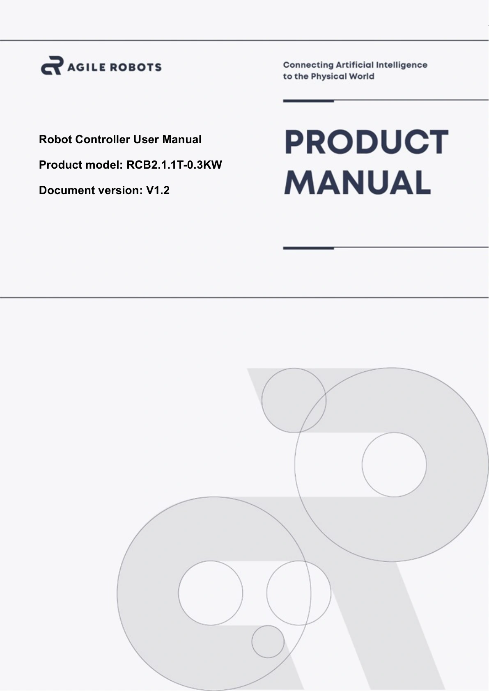



```
i 
 
 
Robot Controller User Manual 
Product model: RCB2.1.1T-0.3KW 
Document version: V1.2
```



## PDF page 2

**Source:** RCB2.1.1T-0.3KW Controller User Manual V1.2 EN.pdf, original pdf page 2. [Open the corresponding PDF reading-copy page](https://1292444914-files.gitbook.io/~/files/v0/b/gitbook-x-prod.appspot.com/o/spaces%2FtgOfPnscWebs1eh82EKq%2Fuploads%2FQ6BE5BIY0AjS7sw7K5NP%2Frcb2-1-1t-0-3kw-controller-user-manual-v1-2-en-pp-001-024.pdf?alt=media#page=2).



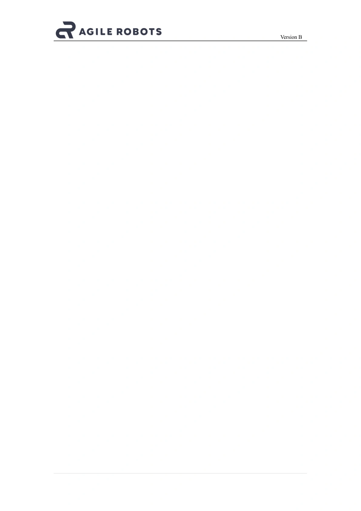



```
Version B
```



## PDF page 3

**Source:** RCB2.1.1T-0.3KW Controller User Manual V1.2 EN.pdf, original pdf page 3. [Open the corresponding PDF reading-copy page](https://1292444914-files.gitbook.io/~/files/v0/b/gitbook-x-prod.appspot.com/o/spaces%2FtgOfPnscWebs1eh82EKq%2Fuploads%2FQ6BE5BIY0AjS7sw7K5NP%2Frcb2-1-1t-0-3kw-controller-user-manual-v1-2-en-pp-001-024.pdf?alt=media#page=3).



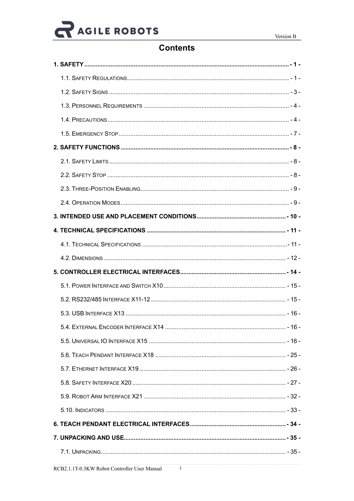



```
Version B 
RCB2.1.1T-0.3KW Robot Controller User Manual 
 i 
Contents 
1. SAFETY ............................................................................................................................ - 1 - 
1.1. SAFETY REGULATIONS .................................................................................................. - 1 - 
1.2. SAFETY SIGNS ............................................................................................................. - 3 - 
1.3. PERSONNEL REQUIREMENTS ........................................................................................ - 4 - 
1.4. PRECAUTIONS .............................................................................................................. - 4 - 
1.5. EMERGENCY STOP ....................................................................................................... - 7 - 
2. SAFETY FUNCTIONS ...................................................................................................... - 8 - 
2.1. SAFETY LIMITS ............................................................................................................. - 8 - 
2.2. SAFETY STOP .............................................................................................................. - 8 - 
2.3. THREE-POSITION ENABLING .......................................................................................... - 9 - 
2.4. OPERATION MODES ...................................................................................................... - 9 - 
3. INTENDED USE AND PLACEMENT CONDITIONS ...................................................... - 10 - 
4. TECHNICAL SPECIFICATIONS .................................................................................... - 11 - 
4.1. TECHNICAL SPECIFICATIONS ........................................................................................ - 11 - 
4.2. DIMENSIONS .............................................................................................................. - 12 - 
5. CONTROLLER ELECTRICAL INTERFACES ................................................................ - 14 - 
5.1. POWER INTERFACE AND SWITCH X10 .......................................................................... - 15 - 
5.2. RS232/485 INTERFACE X11-12 .................................................................................. - 15 - 
5.3. USB INTERFACE X13 ................................................................................................. - 16 - 
5.4. EXTERNAL ENCODER INTERFACE X14 ......................................................................... - 16 - 
5.5. UNIVERSAL IO INTERFACE X15 ................................................................................... - 16 - 
5.6. TEACH PENDANT INTERFACE X18 ............................................................................... - 25 - 
5.7. ETHERNET INTERFACE X19 ......................................................................................... - 26 - 
5.8. SAFETY INTERFACE X20 ............................................................................................. - 27 - 
5.9. ROBOT ARM INTERFACE X21 ...................................................................................... - 32 - 
5.10. INDICATORS ............................................................................................................. - 33 - 
6. TEACH PENDANT ELECTRICAL INTERFACES .......................................................... - 34 - 
7. UNPACKING AND USE .................................................................................................. - 35 - 
7.1. UNPACKING ................................................................................................................ - 35 -
```



**Original document cross-references:** [PDF 5](complete-rcb2-1-1t-0-3kw-controller-user-manual-v1-2-en.md#pdf-page-5) · [PDF 7](complete-rcb2-1-1t-0-3kw-controller-user-manual-v1-2-en.md#pdf-page-7) · [PDF 8](complete-rcb2-1-1t-0-3kw-controller-user-manual-v1-2-en.md#pdf-page-8) · [PDF 11](complete-rcb2-1-1t-0-3kw-controller-user-manual-v1-2-en.md#pdf-page-11) · [PDF 12](complete-rcb2-1-1t-0-3kw-controller-user-manual-v1-2-en.md#pdf-page-12) · [PDF 13](complete-rcb2-1-1t-0-3kw-controller-user-manual-v1-2-en.md#pdf-page-13) · [PDF 14](complete-rcb2-1-1t-0-3kw-controller-user-manual-v1-2-en.md#pdf-page-14) · [PDF 15](complete-rcb2-1-1t-0-3kw-controller-user-manual-v1-2-en.md#pdf-page-15) · [PDF 18](complete-rcb2-1-1t-0-3kw-controller-user-manual-v1-2-en.md#pdf-page-18) · [PDF 19](complete-rcb2-1-1t-0-3kw-controller-user-manual-v1-2-en.md#pdf-page-19) · [PDF 20](complete-rcb2-1-1t-0-3kw-controller-user-manual-v1-2-en.md#pdf-page-20) · [PDF 29](complete-rcb2-1-1t-0-3kw-controller-user-manual-v1-2-en.md#pdf-page-29) · [PDF 30](complete-rcb2-1-1t-0-3kw-controller-user-manual-v1-2-en.md#pdf-page-30) · [PDF 35](complete-rcb2-1-1t-0-3kw-controller-user-manual-v1-2-en.md#pdf-page-35) · [PDF 37](complete-rcb2-1-1t-0-3kw-controller-user-manual-v1-2-en.md#pdf-page-37) · [PDF 38](complete-rcb2-1-1t-0-3kw-controller-user-manual-v1-2-en.md#pdf-page-38) · [PDF 39](complete-rcb2-1-1t-0-3kw-controller-user-manual-v1-2-en.md#pdf-page-39)

## PDF page 4

**Source:** RCB2.1.1T-0.3KW Controller User Manual V1.2 EN.pdf, original pdf page 4. [Open the corresponding PDF reading-copy page](https://1292444914-files.gitbook.io/~/files/v0/b/gitbook-x-prod.appspot.com/o/spaces%2FtgOfPnscWebs1eh82EKq%2Fuploads%2FQ6BE5BIY0AjS7sw7K5NP%2Frcb2-1-1t-0-3kw-controller-user-manual-v1-2-en-pp-001-024.pdf?alt=media#page=4).



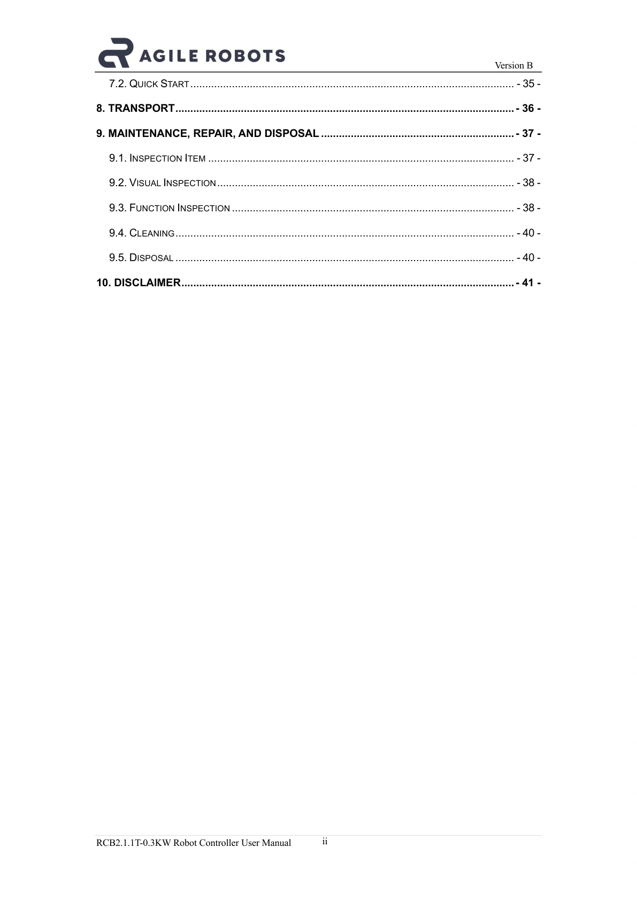



```
Version B 
RCB2.1.1T-0.3KW Robot Controller User Manual 
 ii 
7.2. QUICK START ............................................................................................................. - 35 - 
8. TRANSPORT .................................................................................................................. - 36 - 
9. MAINTENANCE, REPAIR, AND DISPOSAL ................................................................. - 37 - 
9.1. INSPECTION ITEM ....................................................................................................... - 37 - 
9.2. VISUAL INSPECTION .................................................................................................... - 38 - 
9.3. FUNCTION INSPECTION ............................................................................................... - 38 - 
9.4. CLEANING .................................................................................................................. - 40 - 
9.5. DISPOSAL .................................................................................................................. - 40 - 
10. DISCLAIMER ................................................................................................................ - 41 -
```



**Original document cross-references:** [PDF 39](complete-rcb2-1-1t-0-3kw-controller-user-manual-v1-2-en.md#pdf-page-39) · [PDF 40](complete-rcb2-1-1t-0-3kw-controller-user-manual-v1-2-en.md#pdf-page-40) · [PDF 41](complete-rcb2-1-1t-0-3kw-controller-user-manual-v1-2-en.md#pdf-page-41) · [PDF 42](complete-rcb2-1-1t-0-3kw-controller-user-manual-v1-2-en.md#pdf-page-42) · [PDF 44](complete-rcb2-1-1t-0-3kw-controller-user-manual-v1-2-en.md#pdf-page-44) · [PDF 45](complete-rcb2-1-1t-0-3kw-controller-user-manual-v1-2-en.md#pdf-page-45)

## PDF page 5

**Source:** RCB2.1.1T-0.3KW Controller User Manual V1.2 EN.pdf, original pdf page 5. [Open the corresponding PDF reading-copy page](https://1292444914-files.gitbook.io/~/files/v0/b/gitbook-x-prod.appspot.com/o/spaces%2FtgOfPnscWebs1eh82EKq%2Fuploads%2FQ6BE5BIY0AjS7sw7K5NP%2Frcb2-1-1t-0-3kw-controller-user-manual-v1-2-en-pp-001-024.pdf?alt=media#page=5).



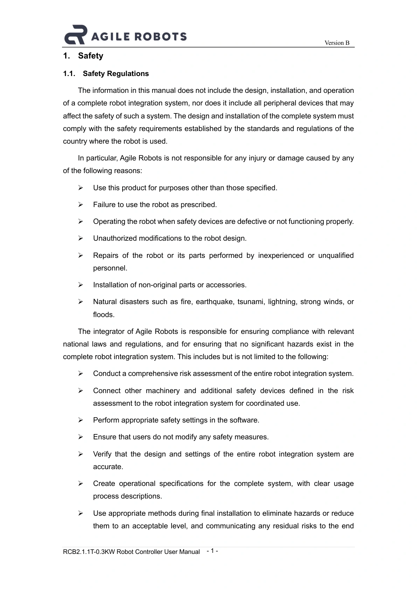



```
Version B 
RCB2.1.1T-0.3KW Robot Controller User Manual 
 
- 1 - 
1. Safety 
1.1. Safety Regulations 
The information in this manual does not include the design, installation, and operation 
of a complete robot integration system, nor does it include all peripheral devices that may 
affect the safety of such a system. The design and installation of the complete system must 
comply with the safety requirements established by the standards and regulations of the 
country where the robot is used. 
In particular, Agile Robots is not responsible for any injury or damage caused by any 
of the following reasons: 
Ø 
Use this product for purposes other than those specified. 
Ø 
Failure to use the robot as prescribed. 
Ø 
Operating the robot when safety devices are defective or not functioning properly. 
Ø 
Unauthorized modifications to the robot design. 
Ø 
Repairs of the robot or its parts performed by inexperienced or unqualified 
personnel. 
Ø 
Installation of non-original parts or accessories. 
Ø 
Natural disasters such as fire, earthquake, tsunami, lightning, strong winds, or 
floods. 
The integrator of Agile Robots is responsible for ensuring compliance with relevant 
national laws and regulations, and for ensuring that no significant hazards exist in the 
complete robot integration system. This includes but is not limited to the following: 
Ø 
Conduct a comprehensive risk assessment of the entire robot integration system. 
Ø 
Connect other machinery and additional safety devices defined in the risk 
assessment to the robot integration system for coordinated use. 
Ø 
Perform appropriate safety settings in the software. 
Ø 
Ensure that users do not modify any safety measures. 
Ø 
Verify that the design and settings of the entire robot integration system are 
accurate. 
Ø 
Create operational specifications for the complete system, with clear usage 
process descriptions. 
Ø 
Use appropriate methods during final installation to eliminate hazards or reduce 
them to an acceptable level, and communicating any residual risks to the end
```



## PDF page 6

**Source:** RCB2.1.1T-0.3KW Controller User Manual V1.2 EN.pdf, original pdf page 6. [Open the corresponding PDF reading-copy page](https://1292444914-files.gitbook.io/~/files/v0/b/gitbook-x-prod.appspot.com/o/spaces%2FtgOfPnscWebs1eh82EKq%2Fuploads%2FQ6BE5BIY0AjS7sw7K5NP%2Frcb2-1-1t-0-3kw-controller-user-manual-v1-2-en-pp-001-024.pdf?alt=media#page=6).



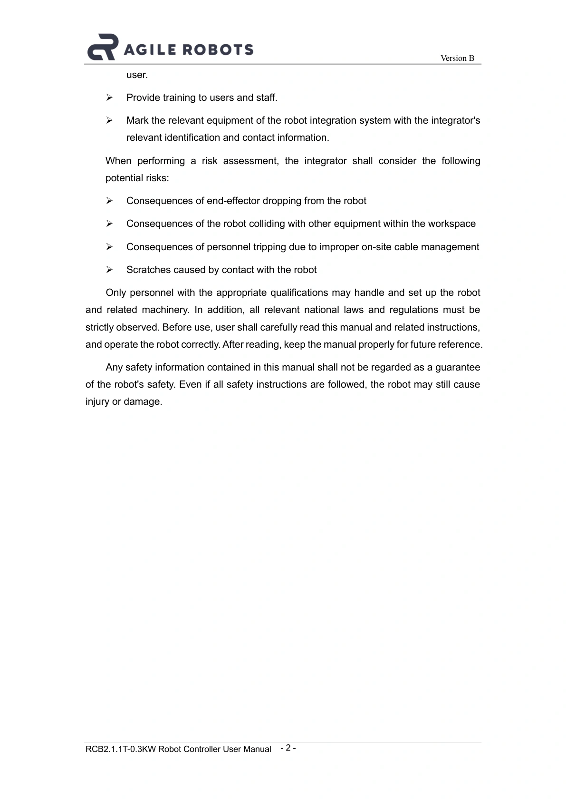



```
Version B 
RCB2.1.1T-0.3KW Robot Controller User Manual 
 
- 2 - 
user. 
Ø 
Provide training to users and staff. 
Ø 
Mark the relevant equipment of the robot integration system with the integrator's 
relevant identification and contact information. 
When performing a risk assessment, the integrator shall consider the following 
potential risks: 
Ø 
Consequences of end-effector dropping from the robot 
Ø 
Consequences of the robot colliding with other equipment within the workspace 
Ø 
Consequences of personnel tripping due to improper on-site cable management 
Ø 
Scratches caused by contact with the robot 
Only personnel with the appropriate qualifications may handle and set up the robot 
and related machinery. In addition, all relevant national laws and regulations must be 
strictly observed. Before use, user shall carefully read this manual and related instructions, 
and operate the robot correctly. After reading, keep the manual properly for future reference. 
Any safety information contained in this manual shall not be regarded as a guarantee 
of the robot's safety. Even if all safety instructions are followed, the robot may still cause 
injury or damage.
```



## PDF page 7

**Source:** RCB2.1.1T-0.3KW Controller User Manual V1.2 EN.pdf, original pdf page 7. [Open the corresponding PDF reading-copy page](https://1292444914-files.gitbook.io/~/files/v0/b/gitbook-x-prod.appspot.com/o/spaces%2FtgOfPnscWebs1eh82EKq%2Fuploads%2FQ6BE5BIY0AjS7sw7K5NP%2Frcb2-1-1t-0-3kw-controller-user-manual-v1-2-en-pp-001-024.pdf?alt=media#page=7).



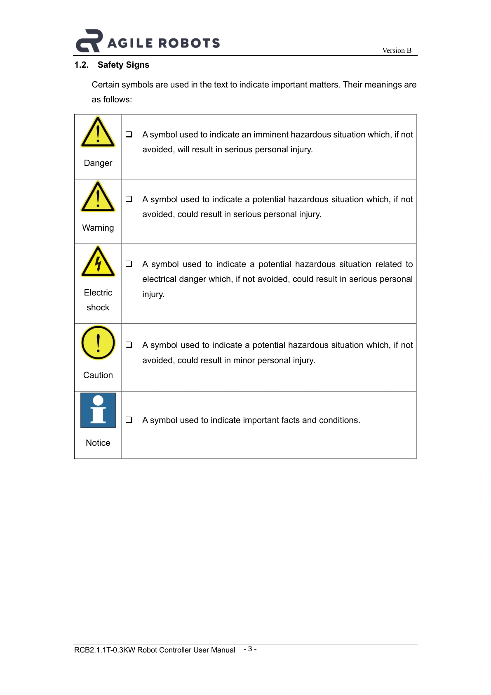



```
Version B 
RCB2.1.1T-0.3KW Robot Controller User Manual 
 
- 3 - 
1.2. Safety Signs 
Certain symbols are used in the text to indicate important matters. Their meanings are 
as follows: 
 
Danger 
q 
A symbol used to indicate an imminent hazardous situation which, if not 
avoided, will result in serious personal injury. 
 
Warning 
q 
A symbol used to indicate a potential hazardous situation which, if not 
avoided, could result in serious personal injury. 
 
Electric 
shock 
q 
A symbol used to indicate a potential hazardous situation related to 
electrical danger which, if not avoided, could result in serious personal 
injury. 
 
Caution 
q 
A symbol used to indicate a potential hazardous situation which, if not 
avoided, could result in minor personal injury. 
 
Notice 
q 
A symbol used to indicate important facts and conditions.
```



## PDF page 8

**Source:** RCB2.1.1T-0.3KW Controller User Manual V1.2 EN.pdf, original pdf page 8. [Open the corresponding PDF reading-copy page](https://1292444914-files.gitbook.io/~/files/v0/b/gitbook-x-prod.appspot.com/o/spaces%2FtgOfPnscWebs1eh82EKq%2Fuploads%2FQ6BE5BIY0AjS7sw7K5NP%2Frcb2-1-1t-0-3kw-controller-user-manual-v1-2-en-pp-001-024.pdf?alt=media#page=8).



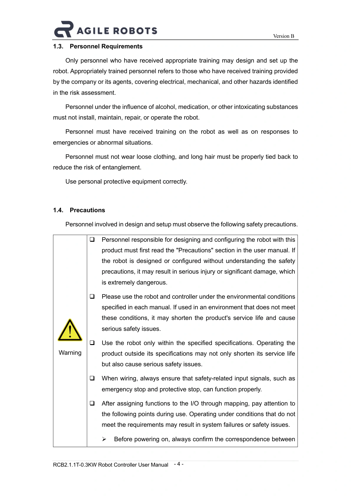



```
Version B 
RCB2.1.1T-0.3KW Robot Controller User Manual 
 
- 4 - 
1.3. Personnel Requirements 
Only personnel who have received appropriate training may design and set up the 
robot. Appropriately trained personnel refers to those who have received training provided 
by the company or its agents, covering electrical, mechanical, and other hazards identified 
in the risk assessment. 
Personnel under the influence of alcohol, medication, or other intoxicating substances 
must not install, maintain, repair, or operate the robot. 
Personnel must have received training on the robot as well as on responses to 
emergencies or abnormal situations. 
Personnel must not wear loose clothing, and long hair must be properly tied back to 
reduce the risk of entanglement. 
Use personal protective equipment correctly. 
 
1.4. Precautions 
Personnel involved in design and setup must observe the following safety precautions. 
 
Warning 
q 
Personnel responsible for designing and configuring the robot with this 
product must first read the "Precautions" section in the user manual. If 
the robot is designed or configured without understanding the safety 
precautions, it may result in serious injury or significant damage, which 
is extremely dangerous. 
q 
Please use the robot and controller under the environmental conditions 
specified in each manual. If used in an environment that does not meet 
these conditions, it may shorten the product's service life and cause 
serious safety issues. 
q 
Use the robot only within the specified specifications. Operating the 
product outside its specifications may not only shorten its service life 
but also cause serious safety issues. 
q 
When wiring, always ensure that safety-related input signals, such as 
emergency stop and protective stop, can function properly. 
q 
After assigning functions to the I/O through mapping, pay attention to 
the following points during use. Operating under conditions that do not 
meet the requirements may result in system failures or safety issues. 
Ø 
Before powering on, always confirm the correspondence between
```



## PDF page 9

**Source:** RCB2.1.1T-0.3KW Controller User Manual V1.2 EN.pdf, original pdf page 9. [Open the corresponding PDF reading-copy page](https://1292444914-files.gitbook.io/~/files/v0/b/gitbook-x-prod.appspot.com/o/spaces%2FtgOfPnscWebs1eh82EKq%2Fuploads%2FQ6BE5BIY0AjS7sw7K5NP%2Frcb2-1-1t-0-3kw-controller-user-manual-v1-2-en-pp-001-024.pdf?alt=media#page=9).



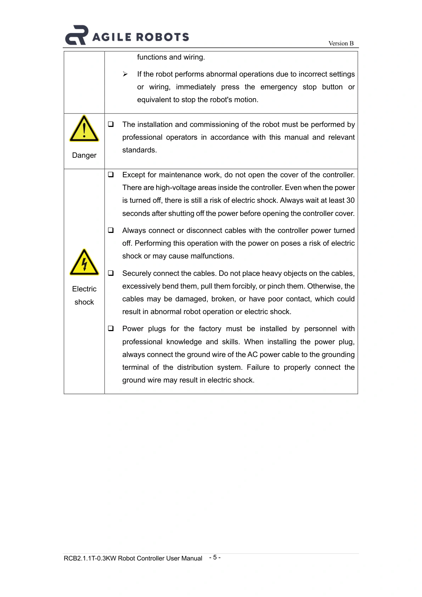



```
Version B 
RCB2.1.1T-0.3KW Robot Controller User Manual 
 
- 5 - 
functions and wiring. 
Ø 
If the robot performs abnormal operations due to incorrect settings 
or wiring, immediately press the emergency stop button or 
equivalent to stop the robot's motion. 
 
Danger 
q 
The installation and commissioning of the robot must be performed by 
professional operators in accordance with this manual and relevant 
standards. 
 
Electric 
shock 
q 
Except for maintenance work, do not open the cover of the controller. 
There are high-voltage areas inside the controller. Even when the power 
is turned off, there is still a risk of electric shock. Always wait at least 30 
seconds after shutting off the power before opening the controller cover. 
q 
Always connect or disconnect cables with the controller power turned 
off. Performing this operation with the power on poses a risk of electric 
shock or may cause malfunctions. 
q 
Securely connect the cables. Do not place heavy objects on the cables, 
excessively bend them, pull them forcibly, or pinch them. Otherwise, the 
cables may be damaged, broken, or have poor contact, which could 
result in abnormal robot operation or electric shock. 
q 
Power plugs for the factory must be installed by personnel with 
professional knowledge and skills. When installing the power plug, 
always connect the ground wire of the AC power cable to the grounding 
terminal of the distribution system. Failure to properly connect the 
ground wire may result in electric shock.
```



## PDF page 10

**Source:** RCB2.1.1T-0.3KW Controller User Manual V1.2 EN.pdf, original pdf page 10. [Open the corresponding PDF reading-copy page](https://1292444914-files.gitbook.io/~/files/v0/b/gitbook-x-prod.appspot.com/o/spaces%2FtgOfPnscWebs1eh82EKq%2Fuploads%2FQ6BE5BIY0AjS7sw7K5NP%2Frcb2-1-1t-0-3kw-controller-user-manual-v1-2-en-pp-001-024.pdf?alt=media#page=10).



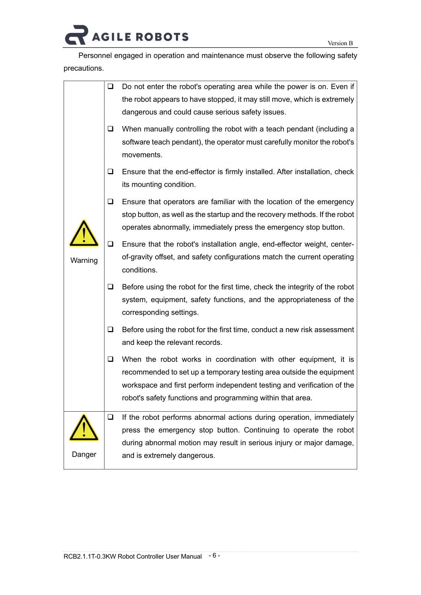



```
Version B 
RCB2.1.1T-0.3KW Robot Controller User Manual 
 
- 6 - 
Personnel engaged in operation and maintenance must observe the following safety 
precautions. 
 
Warning 
q 
Do not enter the robot's operating area while the power is on. Even if 
the robot appears to have stopped, it may still move, which is extremely 
dangerous and could cause serious safety issues. 
q 
When manually controlling the robot with a teach pendant (including a 
software teach pendant), the operator must carefully monitor the robot's 
movements. 
q 
Ensure that the end-effector is firmly installed. After installation, check 
its mounting condition. 
q 
Ensure that operators are familiar with the location of the emergency 
stop button, as well as the startup and the recovery methods. If the robot 
operates abnormally, immediately press the emergency stop button. 
q 
Ensure that the robot's installation angle, end-effector weight, center-
of-gravity offset, and safety configurations match the current operating 
conditions. 
q 
Before using the robot for the first time, check the integrity of the robot 
system, equipment, safety functions, and the appropriateness of the 
corresponding settings. 
q 
Before using the robot for the first time, conduct a new risk assessment 
and keep the relevant records. 
q 
When the robot works in coordination with other equipment, it is 
recommended to set up a temporary testing area outside the equipment 
workspace and first perform independent testing and verification of the 
robot's safety functions and programming within that area. 
 
Danger 
q 
If the robot performs abnormal actions during operation, immediately 
press the emergency stop button. Continuing to operate the robot 
during abnormal motion may result in serious injury or major damage, 
and is extremely dangerous.
```



## PDF page 11

**Source:** RCB2.1.1T-0.3KW Controller User Manual V1.2 EN.pdf, original pdf page 11. [Open the corresponding PDF reading-copy page](https://1292444914-files.gitbook.io/~/files/v0/b/gitbook-x-prod.appspot.com/o/spaces%2FtgOfPnscWebs1eh82EKq%2Fuploads%2FQ6BE5BIY0AjS7sw7K5NP%2Frcb2-1-1t-0-3kw-controller-user-manual-v1-2-en-pp-001-024.pdf?alt=media#page=11).



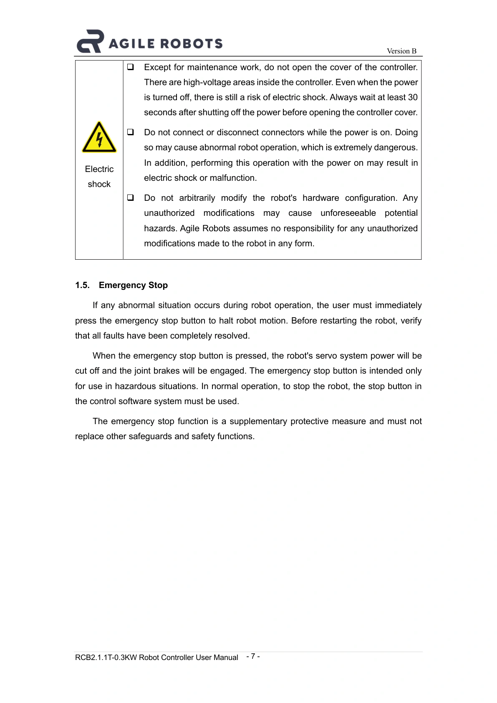



```
Version B 
RCB2.1.1T-0.3KW Robot Controller User Manual 
 
- 7 - 
 
Electric 
shock 
q 
Except for maintenance work, do not open the cover of the controller. 
There are high-voltage areas inside the controller. Even when the power 
is turned off, there is still a risk of electric shock. Always wait at least 30 
seconds after shutting off the power before opening the controller cover. 
q 
Do not connect or disconnect connectors while the power is on. Doing 
so may cause abnormal robot operation, which is extremely dangerous. 
In addition, performing this operation with the power on may result in 
electric shock or malfunction. 
q 
Do not arbitrarily modify the robot's hardware configuration. Any 
unauthorized modifications may cause unforeseeable potential 
hazards. Agile Robots assumes no responsibility for any unauthorized 
modifications made to the robot in any form. 
 
1.5. Emergency Stop 
If any abnormal situation occurs during robot operation, the user must immediately 
press the emergency stop button to halt robot motion. Before restarting the robot, verify 
that all faults have been completely resolved. 
When the emergency stop button is pressed, the robot's servo system power will be 
cut off and the joint brakes will be engaged. The emergency stop button is intended only 
for use in hazardous situations. In normal operation, to stop the robot, the stop button in 
the control software system must be used. 
The emergency stop function is a supplementary protective measure and must not 
replace other safeguards and safety functions.
```



## PDF page 12

**Source:** RCB2.1.1T-0.3KW Controller User Manual V1.2 EN.pdf, original pdf page 12. [Open the corresponding PDF reading-copy page](https://1292444914-files.gitbook.io/~/files/v0/b/gitbook-x-prod.appspot.com/o/spaces%2FtgOfPnscWebs1eh82EKq%2Fuploads%2FQ6BE5BIY0AjS7sw7K5NP%2Frcb2-1-1t-0-3kw-controller-user-manual-v1-2-en-pp-001-024.pdf?alt=media#page=12).



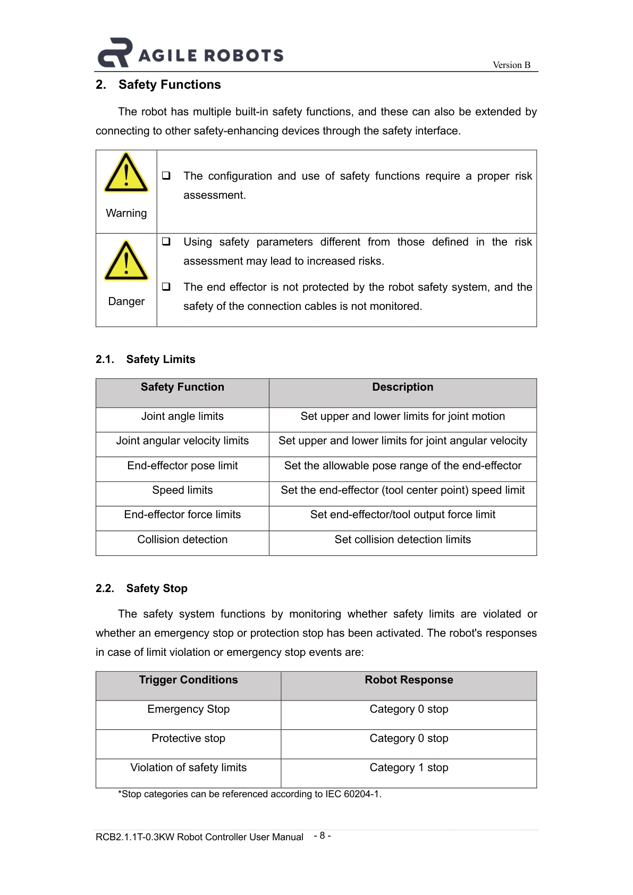



```
Version B 
RCB2.1.1T-0.3KW Robot Controller User Manual 
 
- 8 - 
2. Safety Functions 
The robot has multiple built-in safety functions, and these can also be extended by 
connecting to other safety-enhancing devices through the safety interface. 
 
Warning 
q 
The configuration and use of safety functions require a proper risk 
assessment. 
 
Danger 
q 
Using safety parameters different from those defined in the risk 
assessment may lead to increased risks. 
q 
The end effector is not protected by the robot safety system, and the 
safety of the connection cables is not monitored. 
 
2.1. Safety Limits 
Safety Function 
Description 
Joint angle limits 
Set upper and lower limits for joint motion 
Joint angular velocity limits 
Set upper and lower limits for joint angular velocity 
End-effector pose limit 
Set the allowable pose range of the end-effector 
Speed limits 
Set the end-effector (tool center point) speed limit 
End-effector force limits 
Set end-effector/tool output force limit 
Collision detection 
Set collision detection limits 
 
2.2. Safety Stop 
The safety system functions by monitoring whether safety limits are violated or 
whether an emergency stop or protection stop has been activated. The robot's responses 
in case of limit violation or emergency stop events are: 
Trigger Conditions 
Robot Response 
Emergency Stop 
Category 0 stop 
Protective stop 
Category 0 stop 
Violation of safety limits 
Category 1 stop 
*Stop categories can be referenced according to IEC 60204-1.
```



## PDF page 13

**Source:** RCB2.1.1T-0.3KW Controller User Manual V1.2 EN.pdf, original pdf page 13. [Open the corresponding PDF reading-copy page](https://1292444914-files.gitbook.io/~/files/v0/b/gitbook-x-prod.appspot.com/o/spaces%2FtgOfPnscWebs1eh82EKq%2Fuploads%2FQ6BE5BIY0AjS7sw7K5NP%2Frcb2-1-1t-0-3kw-controller-user-manual-v1-2-en-pp-001-024.pdf?alt=media#page=13).



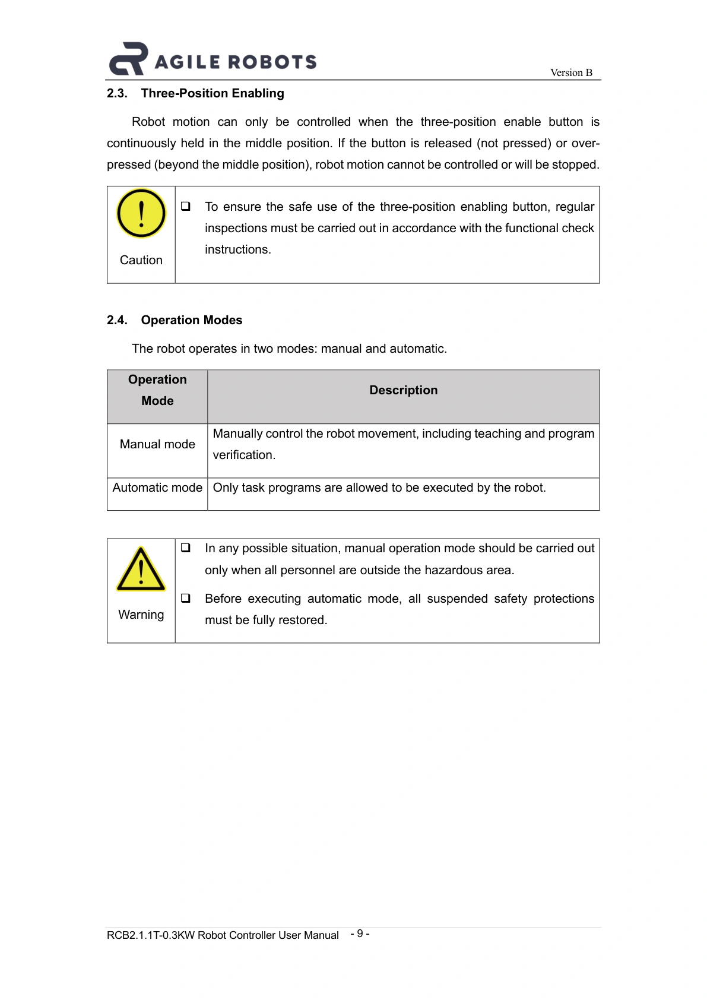



```
Version B 
RCB2.1.1T-0.3KW Robot Controller User Manual 
 
- 9 - 
2.3. Three-Position Enabling 
Robot motion can only be controlled when the three-position enable button is 
continuously held in the middle position. If the button is released (not pressed) or over-
pressed (beyond the middle position), robot motion cannot be controlled or will be stopped. 
 
Caution 
q 
To ensure the safe use of the three-position enabling button, regular 
inspections must be carried out in accordance with the functional check 
instructions. 
 
2.4. Operation Modes 
The robot operates in two modes: manual and automatic. 
Operation 
Mode 
Description 
Manual mode 
Manually control the robot movement, including teaching and program 
verification. 
Automatic mode Only task programs are allowed to be executed by the robot. 
 
 
Warning 
q 
In any possible situation, manual operation mode should be carried out 
only when all personnel are outside the hazardous area. 
q 
Before executing automatic mode, all suspended safety protections 
must be fully restored.
```



## PDF page 14

**Source:** RCB2.1.1T-0.3KW Controller User Manual V1.2 EN.pdf, original pdf page 14. [Open the corresponding PDF reading-copy page](https://1292444914-files.gitbook.io/~/files/v0/b/gitbook-x-prod.appspot.com/o/spaces%2FtgOfPnscWebs1eh82EKq%2Fuploads%2FQ6BE5BIY0AjS7sw7K5NP%2Frcb2-1-1t-0-3kw-controller-user-manual-v1-2-en-pp-001-024.pdf?alt=media#page=14).



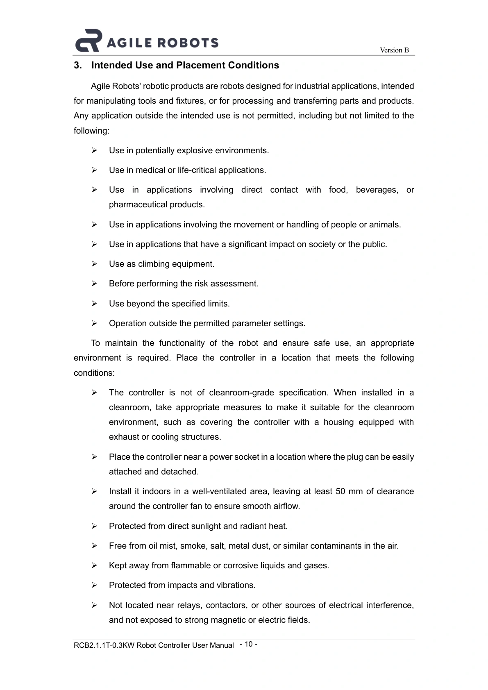



```
Version B 
RCB2.1.1T-0.3KW Robot Controller User Manual 
 
- 10 - 
3. Intended Use and Placement Conditions 
Agile Robots' robotic products are robots designed for industrial applications, intended 
for manipulating tools and fixtures, or for processing and transferring parts and products. 
Any application outside the intended use is not permitted, including but not limited to the 
following: 
Ø 
Use in potentially explosive environments. 
Ø 
Use in medical or life-critical applications. 
Ø 
Use in applications involving direct contact with food, beverages, or 
pharmaceutical products. 
Ø 
Use in applications involving the movement or handling of people or animals. 
Ø 
Use in applications that have a significant impact on society or the public. 
Ø 
Use as climbing equipment. 
Ø 
Before performing the risk assessment. 
Ø 
Use beyond the specified limits. 
Ø 
Operation outside the permitted parameter settings. 
To maintain the functionality of the robot and ensure safe use, an appropriate 
environment is required. Place the controller in a location that meets the following 
conditions: 
Ø 
The controller is not of cleanroom-grade specification. When installed in a 
cleanroom, take appropriate measures to make it suitable for the cleanroom 
environment, such as covering the controller with a housing equipped with 
exhaust or cooling structures. 
Ø 
Place the controller near a power socket in a location where the plug can be easily 
attached and detached. 
Ø 
Install it indoors in a well-ventilated area, leaving at least 50 mm of clearance 
around the controller fan to ensure smooth airflow. 
Ø 
Protected from direct sunlight and radiant heat. 
Ø 
Free from oil mist, smoke, salt, metal dust, or similar contaminants in the air. 
Ø 
Kept away from flammable or corrosive liquids and gases. 
Ø 
Protected from impacts and vibrations. 
Ø 
Not located near relays, contactors, or other sources of electrical interference, 
and not exposed to strong magnetic or electric fields.
```



## PDF page 15

**Source:** RCB2.1.1T-0.3KW Controller User Manual V1.2 EN.pdf, original pdf page 15. [Open the corresponding PDF reading-copy page](https://1292444914-files.gitbook.io/~/files/v0/b/gitbook-x-prod.appspot.com/o/spaces%2FtgOfPnscWebs1eh82EKq%2Fuploads%2FQ6BE5BIY0AjS7sw7K5NP%2Frcb2-1-1t-0-3kw-controller-user-manual-v1-2-en-pp-001-024.pdf?alt=media#page=15).



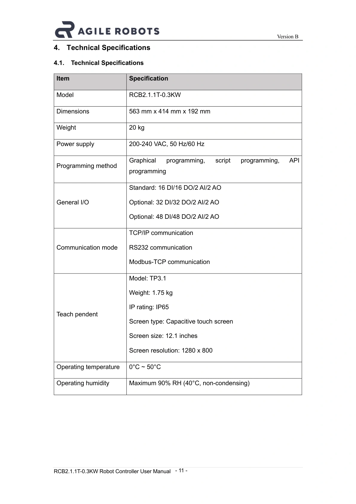



```
Version B 
RCB2.1.1T-0.3KW Robot Controller User Manual 
 
- 11 - 
4. Technical Specifications 
4.1. Technical Specifications 
Item 
Specification 
Model 
RCB2.1.1T-0.3KW 
Dimensions 
563 mm x 414 mm x 192 mm 
Weight 
20 kg 
Power supply 
200-240 VAC, 50 Hz/60 Hz 
Programming method 
Graphical 
programming, 
script 
programming, 
API 
programming 
General I/O 
Standard: 16 DI/16 DO/2 AI/2 AO 
Optional: 32 DI/32 DO/2 AI/2 AO 
Optional: 48 DI/48 DO/2 AI/2 AO 
Communication mode 
TCP/IP communication 
RS232 communication 
Modbus-TCP communication 
Teach pendent 
Model: TP3.1 
Weight: 1.75 kg 
IP rating: IP65 
Screen type: Capacitive touch screen 
Screen size: 12.1 inches 
Screen resolution: 1280 x 800 
Operating temperature 
0°C ~ 50°C 
Operating humidity 
Maximum 90% RH (40°C, non-condensing)
```



## PDF page 16

**Source:** RCB2.1.1T-0.3KW Controller User Manual V1.2 EN.pdf, original pdf page 16. [Open the corresponding PDF reading-copy page](https://1292444914-files.gitbook.io/~/files/v0/b/gitbook-x-prod.appspot.com/o/spaces%2FtgOfPnscWebs1eh82EKq%2Fuploads%2FQ6BE5BIY0AjS7sw7K5NP%2Frcb2-1-1t-0-3kw-controller-user-manual-v1-2-en-pp-001-024.pdf?alt=media#page=16).



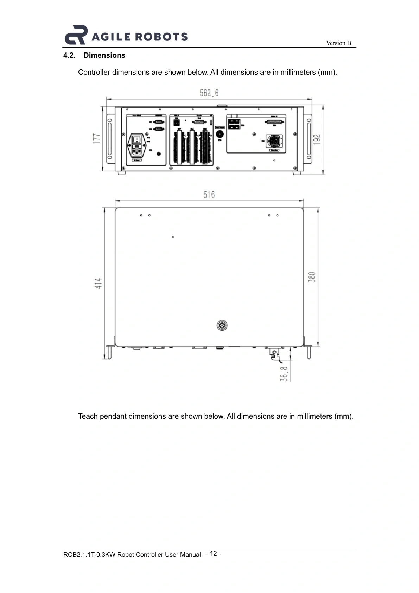



```
Version B 
RCB2.1.1T-0.3KW Robot Controller User Manual 
 
- 12 - 
4.2. Dimensions 
Controller dimensions are shown below. All dimensions are in millimeters (mm). 
 
 
Teach pendant dimensions are shown below. All dimensions are in millimeters (mm).
```



## PDF page 17

**Source:** RCB2.1.1T-0.3KW Controller User Manual V1.2 EN.pdf, original pdf page 17. [Open the corresponding PDF reading-copy page](https://1292444914-files.gitbook.io/~/files/v0/b/gitbook-x-prod.appspot.com/o/spaces%2FtgOfPnscWebs1eh82EKq%2Fuploads%2FQ6BE5BIY0AjS7sw7K5NP%2Frcb2-1-1t-0-3kw-controller-user-manual-v1-2-en-pp-001-024.pdf?alt=media#page=17).



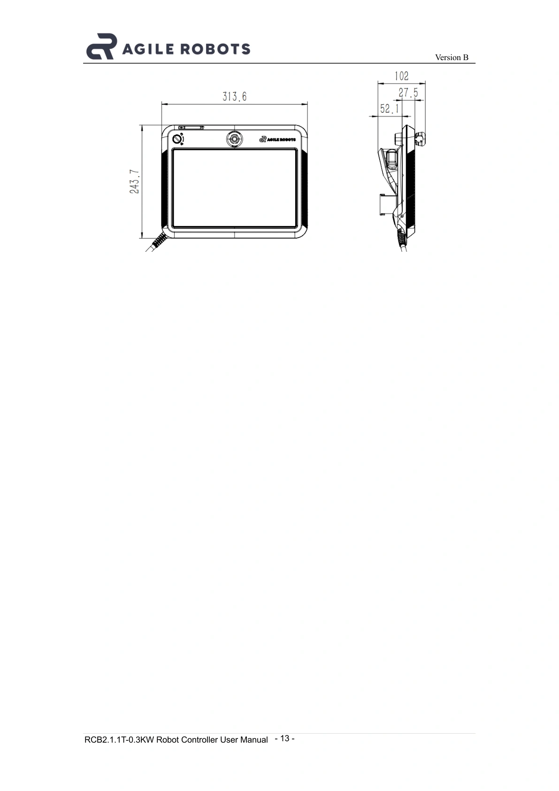



```
Version B 
RCB2.1.1T-0.3KW Robot Controller User Manual 
 
- 13 -
```



## PDF page 18

**Source:** RCB2.1.1T-0.3KW Controller User Manual V1.2 EN.pdf, original pdf page 18. [Open the corresponding PDF reading-copy page](https://1292444914-files.gitbook.io/~/files/v0/b/gitbook-x-prod.appspot.com/o/spaces%2FtgOfPnscWebs1eh82EKq%2Fuploads%2FQ6BE5BIY0AjS7sw7K5NP%2Frcb2-1-1t-0-3kw-controller-user-manual-v1-2-en-pp-001-024.pdf?alt=media#page=18).



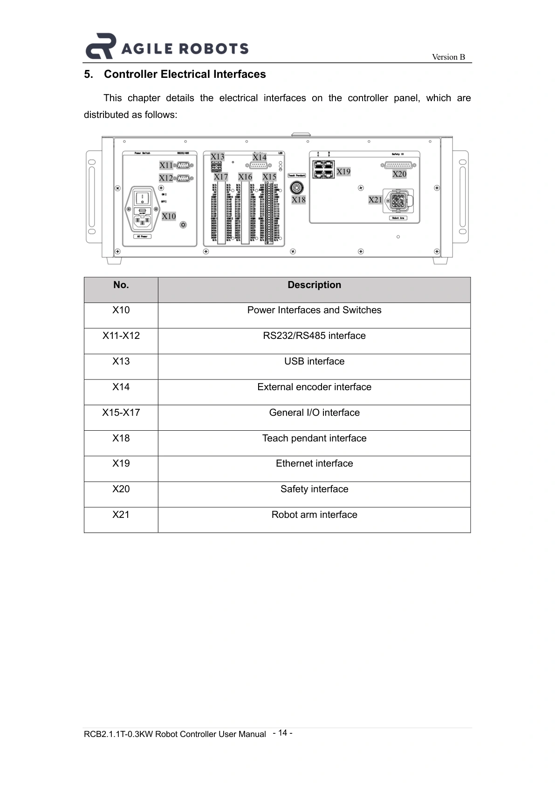



```
Version B 
RCB2.1.1T-0.3KW Robot Controller User Manual 
 
- 14 - 
5. Controller Electrical Interfaces 
This chapter details the electrical interfaces on the controller panel, which are 
distributed as follows: 
 
No. 
Description 
X10 
Power Interfaces and Switches 
X11-X12 
RS232/RS485 interface 
X13 
USB interface 
X14 
External encoder interface 
X15-X17 
General I/O interface 
X18 
Teach pendant interface 
X19 
Ethernet interface 
X20 
Safety interface 
X21 
Robot arm interface
```



## PDF page 19

**Source:** RCB2.1.1T-0.3KW Controller User Manual V1.2 EN.pdf, original pdf page 19. [Open the corresponding PDF reading-copy page](https://1292444914-files.gitbook.io/~/files/v0/b/gitbook-x-prod.appspot.com/o/spaces%2FtgOfPnscWebs1eh82EKq%2Fuploads%2FQ6BE5BIY0AjS7sw7K5NP%2Frcb2-1-1t-0-3kw-controller-user-manual-v1-2-en-pp-001-024.pdf?alt=media#page=19).



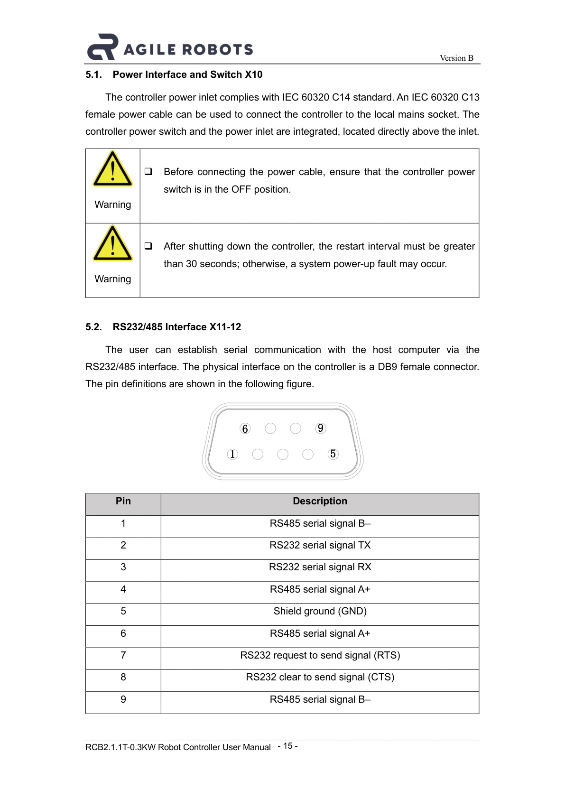



```
Version B 
RCB2.1.1T-0.3KW Robot Controller User Manual 
 
- 15 - 
5.1. Power Interface and Switch X10 
The controller power inlet complies with IEC 60320 C14 standard. An IEC 60320 C13 
female power cable can be used to connect the controller to the local mains socket. The 
controller power switch and the power inlet are integrated, located directly above the inlet. 
 
Warning 
q 
Before connecting the power cable, ensure that the controller power 
switch is in the OFF position. 
 
Warning 
q 
After shutting down the controller, the restart interval must be greater 
than 30 seconds; otherwise, a system power-up fault may occur. 
 
5.2. RS232/485 Interface X11-12 
The user can establish serial communication with the host computer via the 
RS232/485 interface. The physical interface on the controller is a DB9 female connector. 
The pin definitions are shown in the following figure. 
 
Pin 
Description 
1 
RS485 serial signal B– 
2 
RS232 serial signal TX 
3 
RS232 serial signal RX 
4 
RS485 serial signal A+ 
5 
Shield ground (GND) 
6 
RS485 serial signal A+ 
7 
RS232 request to send signal (RTS) 
8 
RS232 clear to send signal (CTS) 
9 
RS485 serial signal B– 
1 
5 
9 
6
```



## PDF page 20

**Source:** RCB2.1.1T-0.3KW Controller User Manual V1.2 EN.pdf, original pdf page 20. [Open the corresponding PDF reading-copy page](https://1292444914-files.gitbook.io/~/files/v0/b/gitbook-x-prod.appspot.com/o/spaces%2FtgOfPnscWebs1eh82EKq%2Fuploads%2FQ6BE5BIY0AjS7sw7K5NP%2Frcb2-1-1t-0-3kw-controller-user-manual-v1-2-en-pp-001-024.pdf?alt=media#page=20).



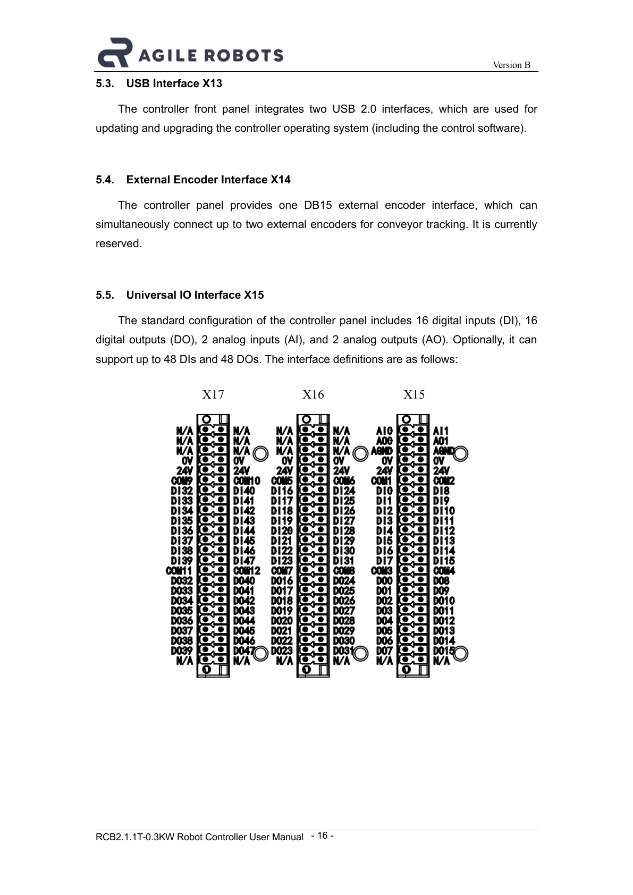



```
Version B 
RCB2.1.1T-0.3KW Robot Controller User Manual 
 
- 16 - 
5.3. USB Interface X13 
The controller front panel integrates two USB 2.0 interfaces, which are used for 
updating and upgrading the controller operating system (including the control software). 
 
5.4. External Encoder Interface X14 
The controller panel provides one DB15 external encoder interface, which can 
simultaneously connect up to two external encoders for conveyor tracking. It is currently 
reserved. 
 
5.5. Universal IO Interface X15 
The standard configuration of the controller panel includes 16 digital inputs (DI), 16 
digital outputs (DO), 2 analog inputs (AI), and 2 analog outputs (AO). Optionally, it can 
support up to 48 DIs and 48 DOs. The interface definitions are as follows: 
 
 
 
 
X15 
X16 
X17
```



## PDF page 21

**Source:** RCB2.1.1T-0.3KW Controller User Manual V1.2 EN.pdf, original pdf page 21. [Open the corresponding PDF reading-copy page](https://1292444914-files.gitbook.io/~/files/v0/b/gitbook-x-prod.appspot.com/o/spaces%2FtgOfPnscWebs1eh82EKq%2Fuploads%2FQ6BE5BIY0AjS7sw7K5NP%2Frcb2-1-1t-0-3kw-controller-user-manual-v1-2-en-pp-001-024.pdf?alt=media#page=21).



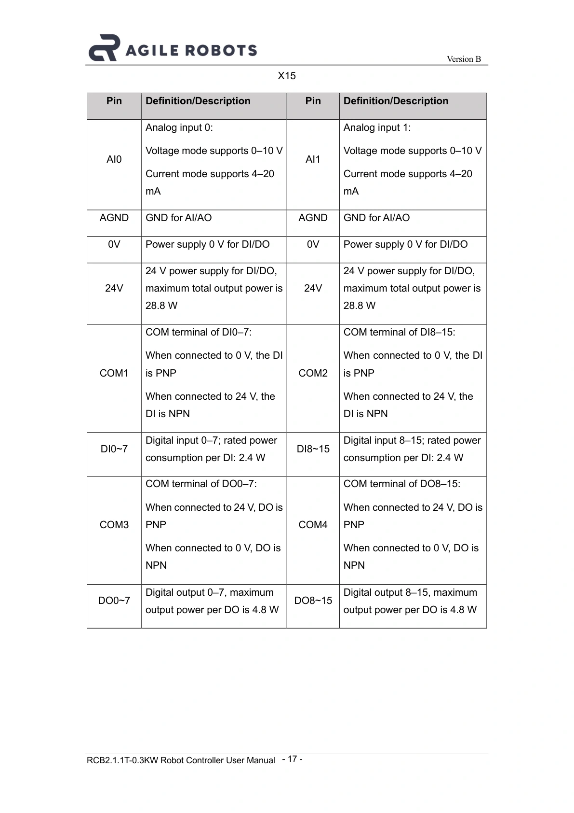



```
Version B 
RCB2.1.1T-0.3KW Robot Controller User Manual 
 
- 17 - 
X15 
Pin 
Definition/Description 
Pin 
Definition/Description 
AI0 
Analog input 0: 
Voltage mode supports 0–10 V 
Current mode supports 4–20 
mA 
AI1 
Analog input 1: 
Voltage mode supports 0–10 V 
Current mode supports 4–20 
mA 
AGND 
GND for AI/AO 
AGND 
GND for AI/AO 
0V 
Power supply 0 V for DI/DO 
0V 
Power supply 0 V for DI/DO 
24V 
24 V power supply for DI/DO, 
maximum total output power is 
28.8 W 
24V 
24 V power supply for DI/DO, 
maximum total output power is 
28.8 W 
COM1 
COM terminal of DI0–7: 
When connected to 0 V, the DI 
is PNP 
When connected to 24 V, the 
DI is NPN 
COM2 
COM terminal of DI8–15: 
When connected to 0 V, the DI 
is PNP 
When connected to 24 V, the 
DI is NPN 
DI0~7 
Digital input 0–7; rated power 
consumption per DI: 2.4 W 
DI8~15 
Digital input 8–15; rated power 
consumption per DI: 2.4 W 
COM3 
COM terminal of DO0–7: 
When connected to 24 V, DO is 
PNP 
When connected to 0 V, DO is 
NPN 
COM4 
COM terminal of DO8–15: 
When connected to 24 V, DO is 
PNP 
When connected to 0 V, DO is 
NPN 
DO0~7 
Digital output 0–7, maximum 
output power per DO is 4.8 W 
DO8~15 
Digital output 8–15, maximum 
output power per DO is 4.8 W
```



## PDF page 22

**Source:** RCB2.1.1T-0.3KW Controller User Manual V1.2 EN.pdf, original pdf page 22. [Open the corresponding PDF reading-copy page](https://1292444914-files.gitbook.io/~/files/v0/b/gitbook-x-prod.appspot.com/o/spaces%2FtgOfPnscWebs1eh82EKq%2Fuploads%2FQ6BE5BIY0AjS7sw7K5NP%2Frcb2-1-1t-0-3kw-controller-user-manual-v1-2-en-pp-001-024.pdf?alt=media#page=22).







```
Version B 
RCB2.1.1T-0.3KW Robot Controller User Manual 
 
- 18 - 
X16 
Pin 
Definition/Description 
Pin 
Definition/Description 
0V 
Power supply 0 V for DI/DO 
0V 
Power supply 0 V for DI/DO 
24V 
24 V power supply for DI/DO, 
maximum total output power is 
28.8 W 
24V 
24 V power supply for DI/DO, 
maximum total output power is 
28.8 W 
COM5 
COM terminal of DI 16–23 
When connected to 0 V, the DI 
is PNP 
When connected to 24 V, the 
DI is NPN 
COM6 
COM terminal of DI 24–31 
When connected to 0 V, the DI 
is PNP 
When connected to 24 V, the 
DI is NPN 
DI16~23 
Digital input 16–23; rated 
power consumption per DI: 
2.4 W 
DI24~31 
Digital input 24–31; rated 
power consumption per DI: 2.4 
W 
COM7 
COM terminal of DO16–23 
When connected to 24 V, DO is 
PNP 
When connected to 0 V, DO is 
NPN 
COM8 
COM terminal of DO24–31 
When connected to 24 V, DO is 
PNP 
When connected to 0 V, DO is 
NPN 
DO16~23 
Digital output 16–23, 
maximum output power per 
DO is 4.8 W 
DO24~31 
Digital output 24–31, 
maximum output power per 
DO is 4.8 W
```



## PDF page 23

**Source:** RCB2.1.1T-0.3KW Controller User Manual V1.2 EN.pdf, original pdf page 23. [Open the corresponding PDF reading-copy page](https://1292444914-files.gitbook.io/~/files/v0/b/gitbook-x-prod.appspot.com/o/spaces%2FtgOfPnscWebs1eh82EKq%2Fuploads%2FQ6BE5BIY0AjS7sw7K5NP%2Frcb2-1-1t-0-3kw-controller-user-manual-v1-2-en-pp-001-024.pdf?alt=media#page=23).



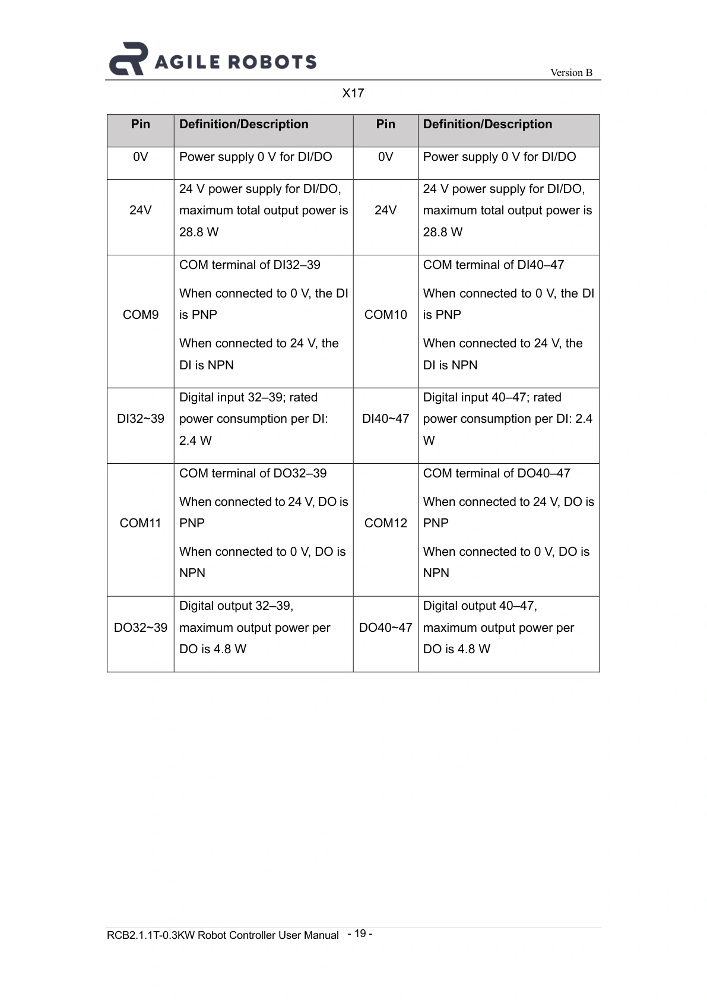



```
Version B 
RCB2.1.1T-0.3KW Robot Controller User Manual 
 
- 19 - 
X17 
Pin 
Definition/Description 
Pin 
Definition/Description 
0V 
Power supply 0 V for DI/DO 
0V 
Power supply 0 V for DI/DO 
24V 
24 V power supply for DI/DO, 
maximum total output power is 
28.8 W 
24V 
24 V power supply for DI/DO, 
maximum total output power is 
28.8 W 
COM9 
COM terminal of DI32–39 
When connected to 0 V, the DI 
is PNP 
When connected to 24 V, the 
DI is NPN 
COM10 
COM terminal of DI40–47 
When connected to 0 V, the DI 
is PNP 
When connected to 24 V, the 
DI is NPN 
DI32~39 
Digital input 32–39; rated 
power consumption per DI: 
2.4 W 
DI40~47 
Digital input 40–47; rated 
power consumption per DI: 2.4 
W 
COM11 
COM terminal of DO32–39 
When connected to 24 V, DO is 
PNP 
When connected to 0 V, DO is 
NPN 
COM12 
COM terminal of DO40–47 
When connected to 24 V, DO is 
PNP 
When connected to 0 V, DO is 
NPN 
DO32~39 
Digital output 32–39, 
maximum output power per 
DO is 4.8 W 
DO40~47 
Digital output 40–47, 
maximum output power per 
DO is 4.8 W
```



## PDF page 24

**Source:** RCB2.1.1T-0.3KW Controller User Manual V1.2 EN.pdf, original pdf page 24. [Open the corresponding PDF reading-copy page](https://1292444914-files.gitbook.io/~/files/v0/b/gitbook-x-prod.appspot.com/o/spaces%2FtgOfPnscWebs1eh82EKq%2Fuploads%2FQ6BE5BIY0AjS7sw7K5NP%2Frcb2-1-1t-0-3kw-controller-user-manual-v1-2-en-pp-001-024.pdf?alt=media#page=24).



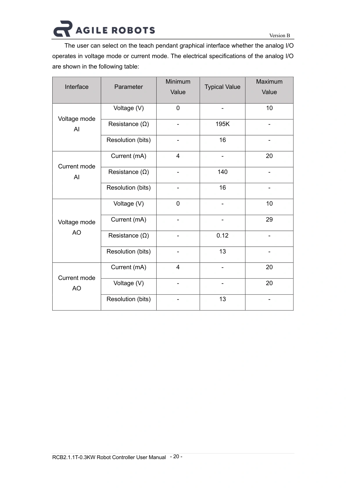



```
Version B 
RCB2.1.1T-0.3KW Robot Controller User Manual 
 
- 20 - 
The user can select on the teach pendant graphical interface whether the analog I/O 
operates in voltage mode or current mode. The electrical specifications of the analog I/O 
are shown in the following table: 
Interface 
Parameter 
Minimum 
Value 
Typical Value 
Maximum 
Value 
Voltage mode 
AI 
Voltage (V) 
0 
- 
10 
Resistance (Ω) 
- 
195K 
- 
Resolution (bits) 
- 
16 
- 
Current mode 
AI 
Current (mA) 
4 
- 
20 
Resistance (Ω) 
- 
140 
- 
Resolution (bits) 
- 
16 
- 
Voltage mode 
AO 
Voltage (V) 
0 
- 
10 
Current (mA) 
- 
- 
29 
Resistance (Ω) 
- 
0.12 
- 
Resolution (bits) 
- 
13 
- 
Current mode 
AO 
Current (mA) 
4 
- 
20 
Voltage (V) 
- 
- 
20 
Resolution (bits) 
- 
13 
-
```



## PDF page 25

**Source:** RCB2.1.1T-0.3KW Controller User Manual V1.2 EN.pdf, original pdf page 25. [Open the corresponding PDF reading-copy page](https://1292444914-files.gitbook.io/~/files/v0/b/gitbook-x-prod.appspot.com/o/spaces%2FtgOfPnscWebs1eh82EKq%2Fuploads%2FX3dNuY3FiNzdkUesJW6j%2Frcb2-1-1t-0-3kw-controller-user-manual-v1-2-en-pp-025-037.pdf?alt=media#page=1).



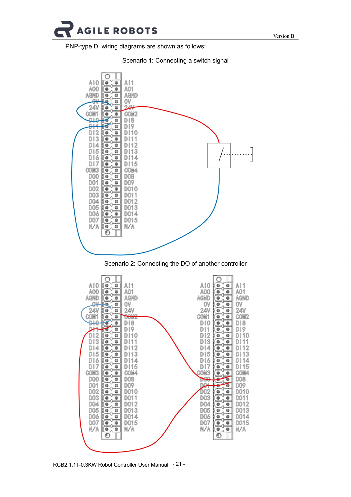



```
Version B 
RCB2.1.1T-0.3KW Robot Controller User Manual 
 
- 21 - 
PNP-type DI wiring diagrams are shown as follows: 
Scenario 1: Connecting a switch signal 
 
 
Scenario 2: Connecting the DO of another controller
```



## PDF page 26

**Source:** RCB2.1.1T-0.3KW Controller User Manual V1.2 EN.pdf, original pdf page 26. [Open the corresponding PDF reading-copy page](https://1292444914-files.gitbook.io/~/files/v0/b/gitbook-x-prod.appspot.com/o/spaces%2FtgOfPnscWebs1eh82EKq%2Fuploads%2FX3dNuY3FiNzdkUesJW6j%2Frcb2-1-1t-0-3kw-controller-user-manual-v1-2-en-pp-025-037.pdf?alt=media#page=2).



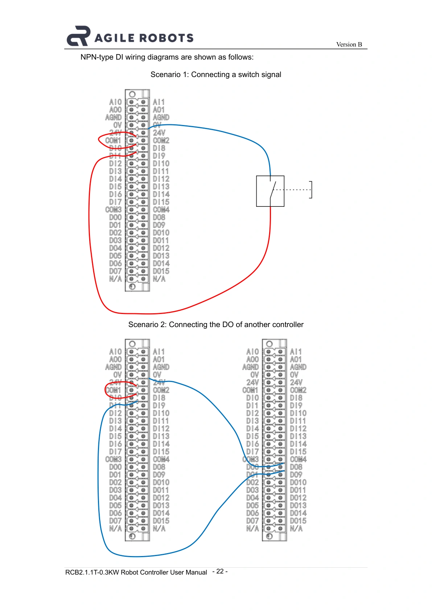



```
Version B 
RCB2.1.1T-0.3KW Robot Controller User Manual 
 
- 22 - 
NPN-type DI wiring diagrams are shown as follows: 
Scenario 1: Connecting a switch signal 
 
 
Scenario 2: Connecting the DO of another controller
```



## PDF page 27

**Source:** RCB2.1.1T-0.3KW Controller User Manual V1.2 EN.pdf, original pdf page 27. [Open the corresponding PDF reading-copy page](https://1292444914-files.gitbook.io/~/files/v0/b/gitbook-x-prod.appspot.com/o/spaces%2FtgOfPnscWebs1eh82EKq%2Fuploads%2FX3dNuY3FiNzdkUesJW6j%2Frcb2-1-1t-0-3kw-controller-user-manual-v1-2-en-pp-025-037.pdf?alt=media#page=3).



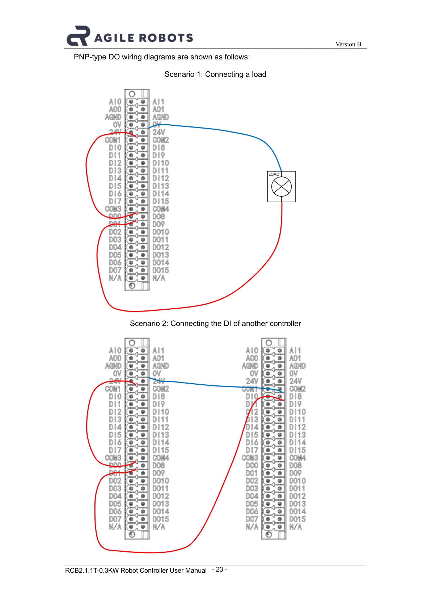



```
Version B 
RCB2.1.1T-0.3KW Robot Controller User Manual 
 
- 23 - 
PNP-type DO wiring diagrams are shown as follows: 
Scenario 1: Connecting a load 
 
 
Scenario 2: Connecting the DI of another controller
```



## PDF page 28

**Source:** RCB2.1.1T-0.3KW Controller User Manual V1.2 EN.pdf, original pdf page 28. [Open the corresponding PDF reading-copy page](https://1292444914-files.gitbook.io/~/files/v0/b/gitbook-x-prod.appspot.com/o/spaces%2FtgOfPnscWebs1eh82EKq%2Fuploads%2FX3dNuY3FiNzdkUesJW6j%2Frcb2-1-1t-0-3kw-controller-user-manual-v1-2-en-pp-025-037.pdf?alt=media#page=4).



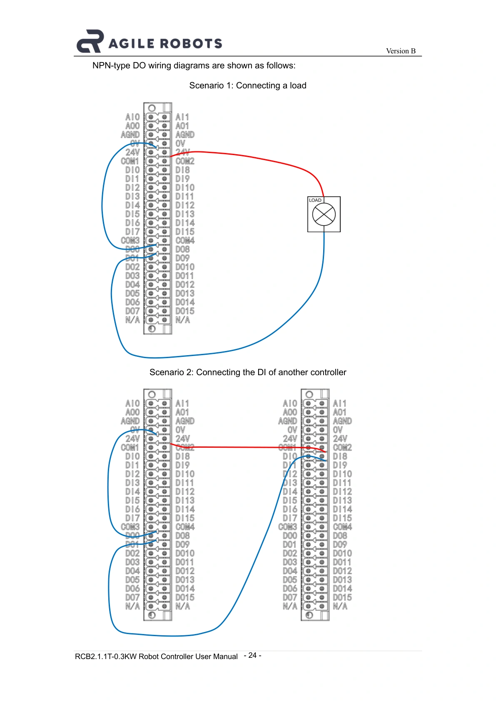



```
Version B 
RCB2.1.1T-0.3KW Robot Controller User Manual 
 
- 24 - 
NPN-type DO wiring diagrams are shown as follows: 
Scenario 1: Connecting a load 
 
 
Scenario 2: Connecting the DI of another controller
```



## PDF page 29

**Source:** RCB2.1.1T-0.3KW Controller User Manual V1.2 EN.pdf, original pdf page 29. [Open the corresponding PDF reading-copy page](https://1292444914-files.gitbook.io/~/files/v0/b/gitbook-x-prod.appspot.com/o/spaces%2FtgOfPnscWebs1eh82EKq%2Fuploads%2FX3dNuY3FiNzdkUesJW6j%2Frcb2-1-1t-0-3kw-controller-user-manual-v1-2-en-pp-025-037.pdf?alt=media#page=5).



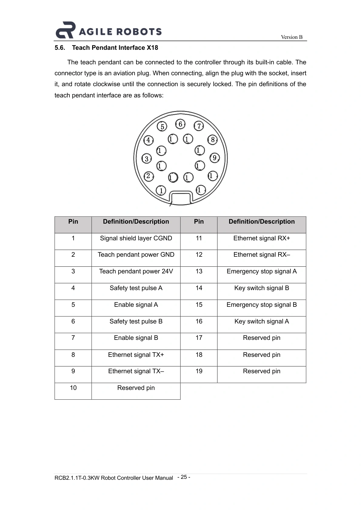



```
Version B 
RCB2.1.1T-0.3KW Robot Controller User Manual 
 
- 25 - 
5.6. Teach Pendant Interface X18 
The teach pendant can be connected to the controller through its built-in cable. The 
connector type is an aviation plug. When connecting, align the plug with the socket, insert 
it, and rotate clockwise until the connection is securely locked. The pin definitions of the 
teach pendant interface are as follows: 
 
Pin 
Definition/Description 
Pin 
Definition/Description 
1 
Signal shield layer CGND 
11 
Ethernet signal RX+ 
2 
Teach pendant power GND 
12 
Ethernet signal RX– 
3 
Teach pendant power 24V 
13 
Emergency stop signal A 
4 
Safety test pulse A 
14 
Key switch signal B 
5 
Enable signal A 
15 
Emergency stop signal B 
6 
Safety test pulse B 
16 
Key switch signal A 
7 
Enable signal B 
17 
Reserved pin 
8 
Ethernet signal TX+ 
18 
Reserved pin 
9 
Ethernet signal TX– 
19 
Reserved pin 
10 
Reserved pin 
 
 
 
 
 
1 
2 
3
4
5
6
7
8
9
1
1
1
1
1
1
1
1
1
1
```



## PDF page 30

**Source:** RCB2.1.1T-0.3KW Controller User Manual V1.2 EN.pdf, original pdf page 30. [Open the corresponding PDF reading-copy page](https://1292444914-files.gitbook.io/~/files/v0/b/gitbook-x-prod.appspot.com/o/spaces%2FtgOfPnscWebs1eh82EKq%2Fuploads%2FX3dNuY3FiNzdkUesJW6j%2Frcb2-1-1t-0-3kw-controller-user-manual-v1-2-en-pp-025-037.pdf?alt=media#page=6).



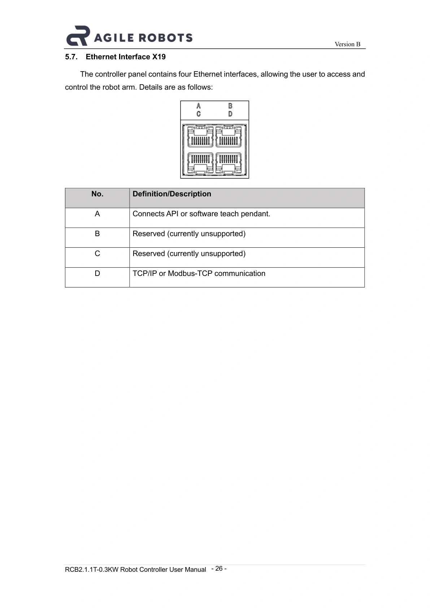



```
Version B 
RCB2.1.1T-0.3KW Robot Controller User Manual 
 
- 26 - 
5.7. Ethernet Interface X19 
The controller panel contains four Ethernet interfaces, allowing the user to access and 
control the robot arm. Details are as follows: 
 
No. 
Definition/Description 
A 
Connects API or software teach pendant. 
B 
Reserved (currently unsupported) 
C 
Reserved (currently unsupported) 
D 
TCP/IP or Modbus-TCP communication
```



## PDF page 31

**Source:** RCB2.1.1T-0.3KW Controller User Manual V1.2 EN.pdf, original pdf page 31. [Open the corresponding PDF reading-copy page](https://1292444914-files.gitbook.io/~/files/v0/b/gitbook-x-prod.appspot.com/o/spaces%2FtgOfPnscWebs1eh82EKq%2Fuploads%2FX3dNuY3FiNzdkUesJW6j%2Frcb2-1-1t-0-3kw-controller-user-manual-v1-2-en-pp-025-037.pdf?alt=media#page=7).



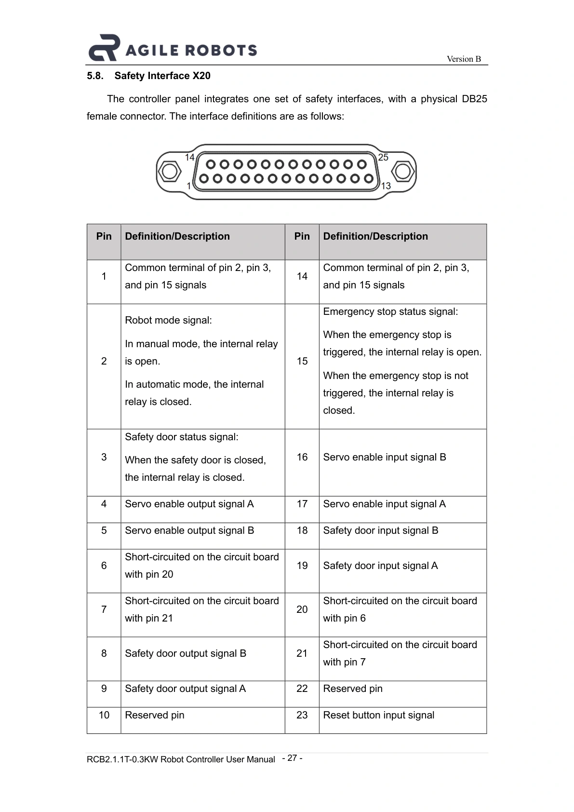



```
Version B 
RCB2.1.1T-0.3KW Robot Controller User Manual 
 
- 27 - 
5.8. Safety Interface X20 
The controller panel integrates one set of safety interfaces, with a physical DB25 
female connector. The interface definitions are as follows: 
 
Pin 
Definition/Description 
Pin 
Definition/Description 
1 
Common terminal of pin 2, pin 3, 
and pin 15 signals 
14 
Common terminal of pin 2, pin 3, 
and pin 15 signals 
2 
Robot mode signal: 
In manual mode, the internal relay 
is open. 
In automatic mode, the internal 
relay is closed. 
15 
Emergency stop status signal: 
When the emergency stop is 
triggered, the internal relay is open. 
When the emergency stop is not 
triggered, the internal relay is 
closed. 
3 
Safety door status signal: 
When the safety door is closed, 
the internal relay is closed. 
16 
Servo enable input signal B 
4 
Servo enable output signal A 
17 
Servo enable input signal A 
5 
Servo enable output signal B 
18 
Safety door input signal B 
6 
Short-circuited on the circuit board 
with pin 20 
19 
Safety door input signal A 
7 
Short-circuited on the circuit board 
with pin 21 
20 
Short-circuited on the circuit board 
with pin 6 
8 
Safety door output signal B 
21 
Short-circuited on the circuit board 
with pin 7 
9 
Safety door output signal A 
22 
Reserved pin 
10 
Reserved pin 
23 
Reset button input signal
```



## PDF page 32

**Source:** RCB2.1.1T-0.3KW Controller User Manual V1.2 EN.pdf, original pdf page 32. [Open the corresponding PDF reading-copy page](https://1292444914-files.gitbook.io/~/files/v0/b/gitbook-x-prod.appspot.com/o/spaces%2FtgOfPnscWebs1eh82EKq%2Fuploads%2FX3dNuY3FiNzdkUesJW6j%2Frcb2-1-1t-0-3kw-controller-user-manual-v1-2-en-pp-025-037.pdf?alt=media#page=8).



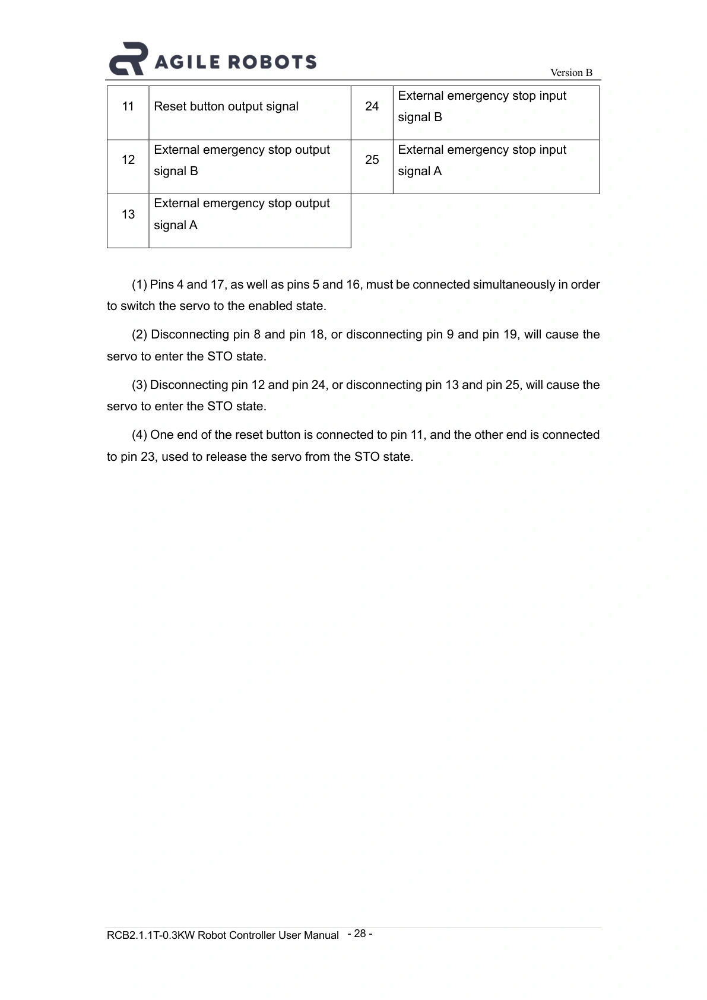



```
Version B 
RCB2.1.1T-0.3KW Robot Controller User Manual 
 
- 28 - 
11 
Reset button output signal 
24 
External emergency stop input 
signal B 
12 
External emergency stop output 
signal B 
25 
External emergency stop input 
signal A 
13 
External emergency stop output 
signal A 
 
(1) Pins 4 and 17, as well as pins 5 and 16, must be connected simultaneously in order 
to switch the servo to the enabled state. 
(2) Disconnecting pin 8 and pin 18, or disconnecting pin 9 and pin 19, will cause the 
servo to enter the STO state. 
(3) Disconnecting pin 12 and pin 24, or disconnecting pin 13 and pin 25, will cause the 
servo to enter the STO state. 
(4) One end of the reset button is connected to pin 11, and the other end is connected 
to pin 23, used to release the servo from the STO state.
```



## PDF page 33

**Source:** RCB2.1.1T-0.3KW Controller User Manual V1.2 EN.pdf, original pdf page 33. [Open the corresponding PDF reading-copy page](https://1292444914-files.gitbook.io/~/files/v0/b/gitbook-x-prod.appspot.com/o/spaces%2FtgOfPnscWebs1eh82EKq%2Fuploads%2FX3dNuY3FiNzdkUesJW6j%2Frcb2-1-1t-0-3kw-controller-user-manual-v1-2-en-pp-025-037.pdf?alt=media#page=9).



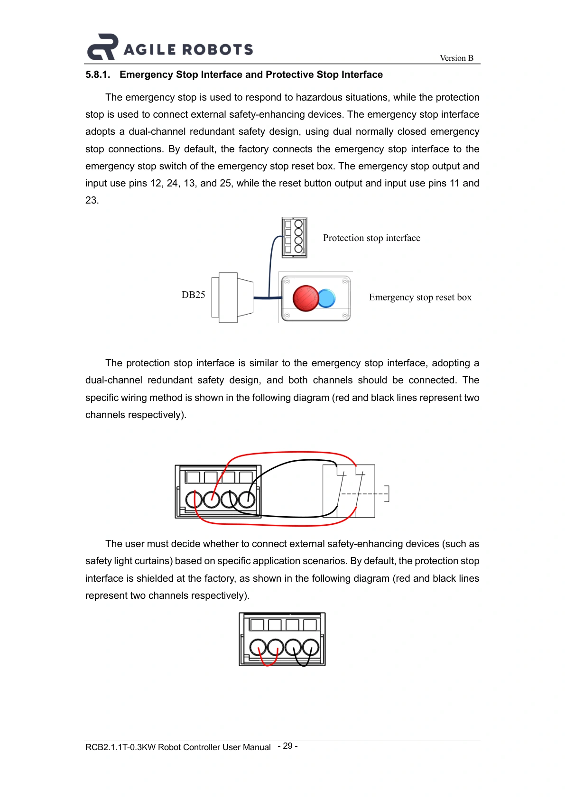



```
Version B 
RCB2.1.1T-0.3KW Robot Controller User Manual 
 
- 29 - 
5.8.1. Emergency Stop Interface and Protective Stop Interface 
The emergency stop is used to respond to hazardous situations, while the protection 
stop is used to connect external safety-enhancing devices. The emergency stop interface 
adopts a dual-channel redundant safety design, using dual normally closed emergency 
stop connections. By default, the factory connects the emergency stop interface to the 
emergency stop switch of the emergency stop reset box. The emergency stop output and 
input use pins 12, 24, 13, and 25, while the reset button output and input use pins 11 and 
23. 
 
 
The protection stop interface is similar to the emergency stop interface, adopting a 
dual-channel redundant safety design, and both channels should be connected. The 
specific wiring method is shown in the following diagram (red and black lines represent two 
channels respectively). 
 
 
The user must decide whether to connect external safety-enhancing devices (such as 
safety light curtains) based on specific application scenarios. By default, the protection stop 
interface is shielded at the factory, as shown in the following diagram (red and black lines 
represent two channels respectively). 
 
 
DB25 
Protection stop interface 
Emergency stop reset box
```



## PDF page 34

**Source:** RCB2.1.1T-0.3KW Controller User Manual V1.2 EN.pdf, original pdf page 34. [Open the corresponding PDF reading-copy page](https://1292444914-files.gitbook.io/~/files/v0/b/gitbook-x-prod.appspot.com/o/spaces%2FtgOfPnscWebs1eh82EKq%2Fuploads%2FX3dNuY3FiNzdkUesJW6j%2Frcb2-1-1t-0-3kw-controller-user-manual-v1-2-en-pp-025-037.pdf?alt=media#page=10).



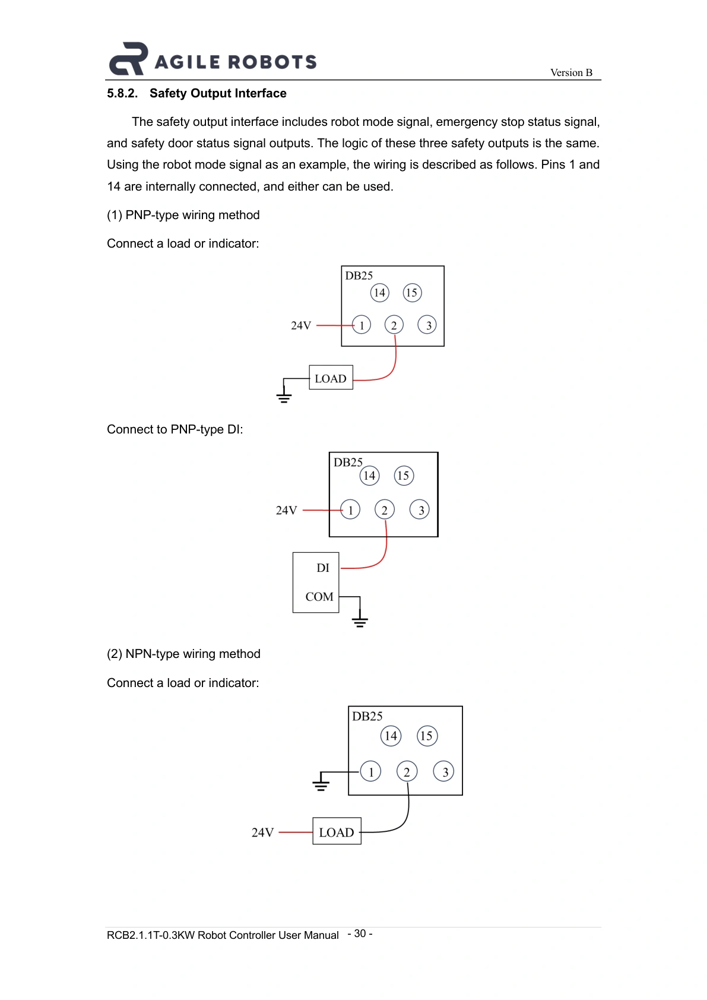



```
Version B 
RCB2.1.1T-0.3KW Robot Controller User Manual 
 
- 30 - 
5.8.2. Safety Output Interface 
The safety output interface includes robot mode signal, emergency stop status signal, 
and safety door status signal outputs. The logic of these three safety outputs is the same. 
Using the robot mode signal as an example, the wiring is described as follows. Pins 1 and 
14 are internally connected, and either can be used. 
(1) PNP-type wiring method 
Connect a load or indicator: 
 
Connect to PNP-type DI: 
 
(2) NPN-type wiring method 
Connect a load or indicator:
```



## PDF page 35

**Source:** RCB2.1.1T-0.3KW Controller User Manual V1.2 EN.pdf, original pdf page 35. [Open the corresponding PDF reading-copy page](https://1292444914-files.gitbook.io/~/files/v0/b/gitbook-x-prod.appspot.com/o/spaces%2FtgOfPnscWebs1eh82EKq%2Fuploads%2FX3dNuY3FiNzdkUesJW6j%2Frcb2-1-1t-0-3kw-controller-user-manual-v1-2-en-pp-025-037.pdf?alt=media#page=11).



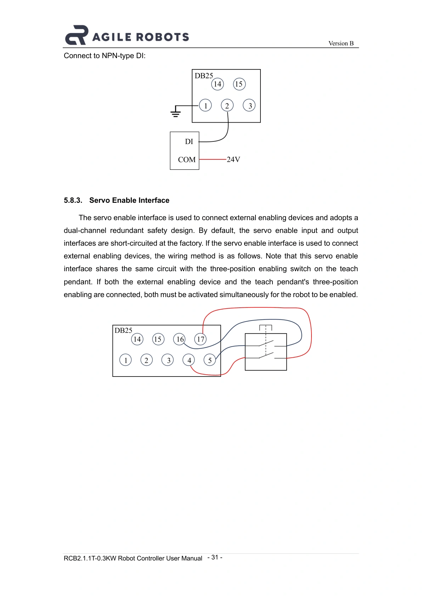



```
Version B 
RCB2.1.1T-0.3KW Robot Controller User Manual 
 
- 31 - 
Connect to NPN-type DI: 
 
 
5.8.3. Servo Enable Interface 
The servo enable interface is used to connect external enabling devices and adopts a 
dual-channel redundant safety design. By default, the servo enable input and output 
interfaces are short-circuited at the factory. If the servo enable interface is used to connect 
external enabling devices, the wiring method is as follows. Note that this servo enable 
interface shares the same circuit with the three-position enabling switch on the teach 
pendant. If both the external enabling device and the teach pendant's three-position 
enabling are connected, both must be activated simultaneously for the robot to be enabled.
```



## PDF page 36

**Source:** RCB2.1.1T-0.3KW Controller User Manual V1.2 EN.pdf, original pdf page 36. [Open the corresponding PDF reading-copy page](https://1292444914-files.gitbook.io/~/files/v0/b/gitbook-x-prod.appspot.com/o/spaces%2FtgOfPnscWebs1eh82EKq%2Fuploads%2FX3dNuY3FiNzdkUesJW6j%2Frcb2-1-1t-0-3kw-controller-user-manual-v1-2-en-pp-025-037.pdf?alt=media#page=12).



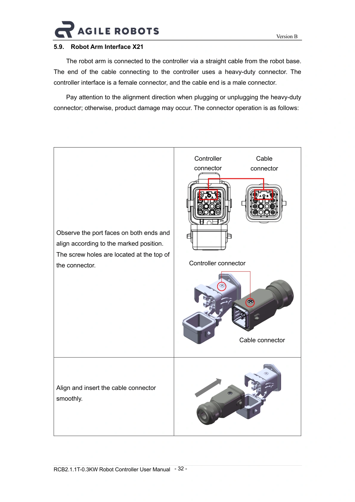



```
Version B 
RCB2.1.1T-0.3KW Robot Controller User Manual 
 
- 32 - 
5.9. Robot Arm Interface X21 
The robot arm is connected to the controller via a straight cable from the robot base. 
The end of the cable connecting to the controller uses a heavy-duty connector. The 
controller interface is a female connector, and the cable end is a male connector. 
Pay attention to the alignment direction when plugging or unplugging the heavy-duty 
connector; otherwise, product damage may occur. The connector operation is as follows: 
 
 
Observe the port faces on both ends and 
align according to the marked position. 
The screw holes are located at the top of 
the connector. 
 
 
 
Align and insert the cable connector 
smoothly. 
 
Controller 
connector 
Cable 
connector 
Controller connector 
Cable connector
```



## PDF page 37

**Source:** RCB2.1.1T-0.3KW Controller User Manual V1.2 EN.pdf, original pdf page 37. [Open the corresponding PDF reading-copy page](https://1292444914-files.gitbook.io/~/files/v0/b/gitbook-x-prod.appspot.com/o/spaces%2FtgOfPnscWebs1eh82EKq%2Fuploads%2FX3dNuY3FiNzdkUesJW6j%2Frcb2-1-1t-0-3kw-controller-user-manual-v1-2-en-pp-025-037.pdf?alt=media#page=13).



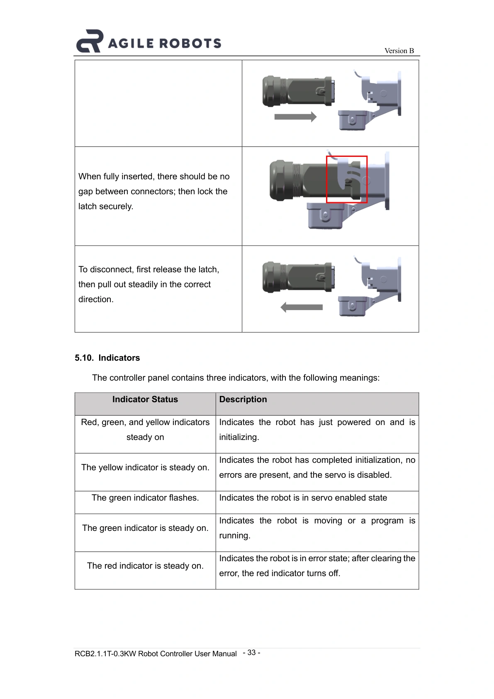



```
Version B 
RCB2.1.1T-0.3KW Robot Controller User Manual 
 
- 33 - 
 
When fully inserted, there should be no 
gap between connectors; then lock the 
latch securely. 
 
To disconnect, first release the latch, 
then pull out steadily in the correct 
direction. 
 
 
5.10. Indicators 
The controller panel contains three indicators, with the following meanings: 
Indicator Status 
Description 
Red, green, and yellow indicators 
steady on 
Indicates the robot has just powered on and is 
initializing. 
The yellow indicator is steady on. 
Indicates the robot has completed initialization, no 
errors are present, and the servo is disabled. 
The green indicator flashes. 
Indicates the robot is in servo enabled state 
The green indicator is steady on. 
Indicates the robot is moving or a program is 
running. 
The red indicator is steady on. 
Indicates the robot is in error state; after clearing the 
error, the red indicator turns off.
```



## PDF page 38

**Source:** RCB2.1.1T-0.3KW Controller User Manual V1.2 EN.pdf, original pdf page 38. [Open the corresponding PDF reading-copy page](https://1292444914-files.gitbook.io/~/files/v0/b/gitbook-x-prod.appspot.com/o/spaces%2FtgOfPnscWebs1eh82EKq%2Fuploads%2FNAquAGMcxiymTxxphnLa%2Frcb2-1-1t-0-3kw-controller-user-manual-v1-2-en-pp-038-046.pdf?alt=media#page=1).



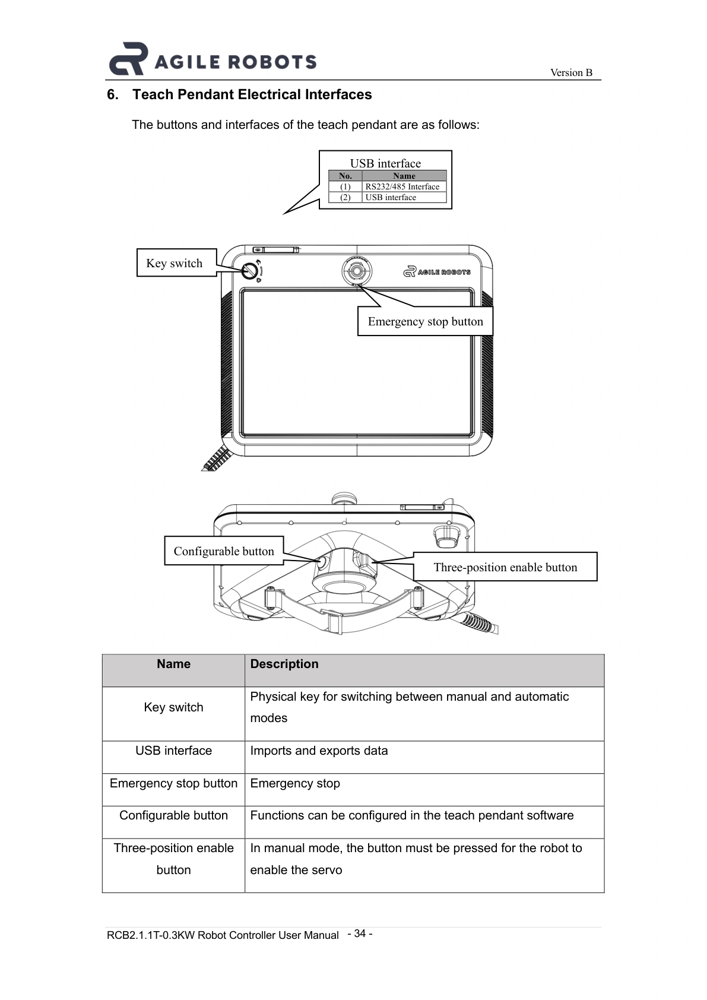



```
Version B 
RCB2.1.1T-0.3KW Robot Controller User Manual 
 
- 34 - 
6. Teach Pendant Electrical Interfaces 
The buttons and interfaces of the teach pendant are as follows: 
 
 
 
 
 
Name 
Description 
Key switch 
Physical key for switching between manual and automatic 
modes 
USB interface 
Imports and exports data 
Emergency stop button Emergency stop 
Configurable button 
Functions can be configured in the teach pendant software 
Three-position enable 
button 
In manual mode, the button must be pressed for the robot to 
enable the servo 
 
 
Key switch 
Emergency stop button 
USB interface 
No. 
Name 
(1) 
RS232/485 Interface 
(2) 
USB interface 
Three-position enable button 
Configurable button
```



## PDF page 39

**Source:** RCB2.1.1T-0.3KW Controller User Manual V1.2 EN.pdf, original pdf page 39. [Open the corresponding PDF reading-copy page](https://1292444914-files.gitbook.io/~/files/v0/b/gitbook-x-prod.appspot.com/o/spaces%2FtgOfPnscWebs1eh82EKq%2Fuploads%2FNAquAGMcxiymTxxphnLa%2Frcb2-1-1t-0-3kw-controller-user-manual-v1-2-en-pp-038-046.pdf?alt=media#page=2).



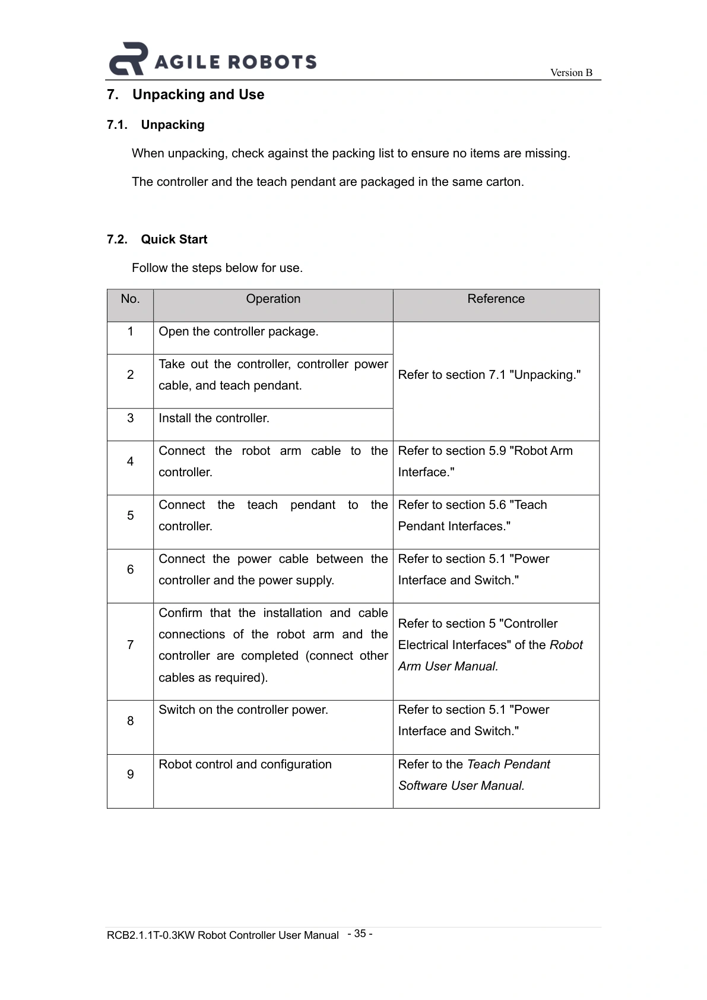



```
Version B 
RCB2.1.1T-0.3KW Robot Controller User Manual 
 
- 35 - 
7. Unpacking and Use 
7.1. Unpacking 
When unpacking, check against the packing list to ensure no items are missing. 
The controller and the teach pendant are packaged in the same carton. 
 
7.2. Quick Start 
Follow the steps below for use. 
No. 
Operation 
Reference 
1 
Open the controller package. 
Refer to section 7.1 "Unpacking." 
2 
Take out the controller, controller power 
cable, and teach pendant. 
3 
Install the controller. 
4 
Connect the robot arm cable to the 
controller. 
Refer to section 5.9 "Robot Arm 
Interface." 
5 
Connect the teach pendant to the 
controller. 
Refer to section 5.6 "Teach 
Pendant Interfaces." 
6 
Connect the power cable between the 
controller and the power supply. 
Refer to section 5.1 "Power 
Interface and Switch." 
7 
Confirm that the installation and cable 
connections of the robot arm and the 
controller are completed (connect other 
cables as required). 
Refer to section 5 "Controller 
Electrical Interfaces" of the Robot 
Arm User Manual. 
8 
Switch on the controller power. 
Refer to section 5.1 "Power 
Interface and Switch." 
9 
Robot control and configuration 
Refer to the Teach Pendant 
Software User Manual.
```



## PDF page 40

**Source:** RCB2.1.1T-0.3KW Controller User Manual V1.2 EN.pdf, original pdf page 40. [Open the corresponding PDF reading-copy page](https://1292444914-files.gitbook.io/~/files/v0/b/gitbook-x-prod.appspot.com/o/spaces%2FtgOfPnscWebs1eh82EKq%2Fuploads%2FNAquAGMcxiymTxxphnLa%2Frcb2-1-1t-0-3kw-controller-user-manual-v1-2-en-pp-038-046.pdf?alt=media#page=3).



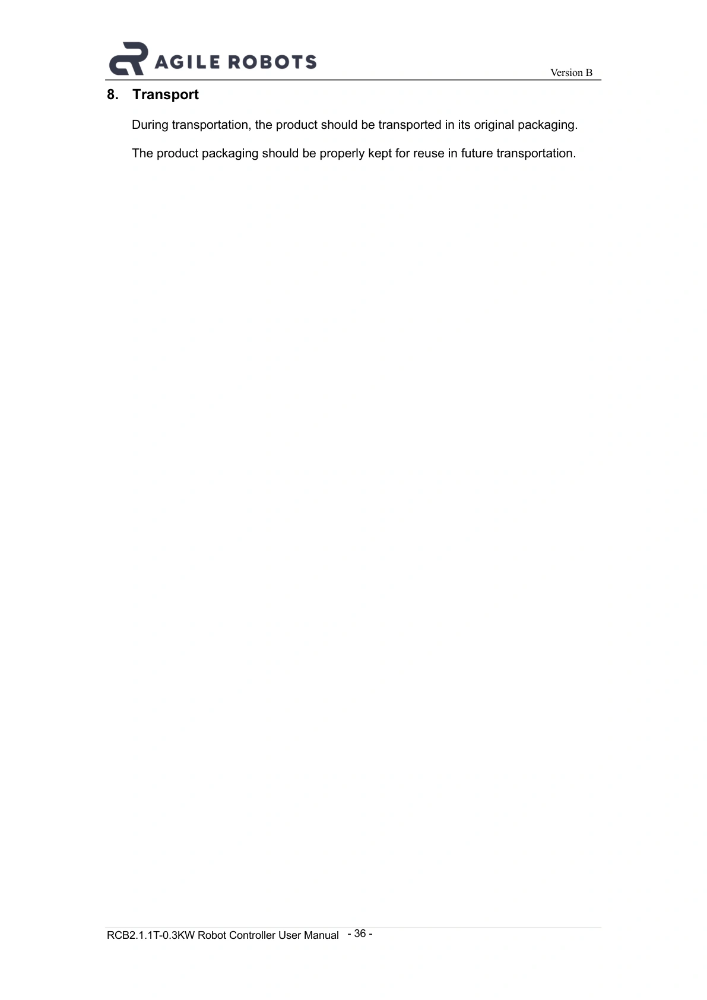



```
Version B 
RCB2.1.1T-0.3KW Robot Controller User Manual 
 
- 36 - 
8. Transport 
During transportation, the product should be transported in its original packaging. 
The product packaging should be properly kept for reuse in future transportation.
```



## PDF page 41

**Source:** RCB2.1.1T-0.3KW Controller User Manual V1.2 EN.pdf, original pdf page 41. [Open the corresponding PDF reading-copy page](https://1292444914-files.gitbook.io/~/files/v0/b/gitbook-x-prod.appspot.com/o/spaces%2FtgOfPnscWebs1eh82EKq%2Fuploads%2FNAquAGMcxiymTxxphnLa%2Frcb2-1-1t-0-3kw-controller-user-manual-v1-2-en-pp-038-046.pdf?alt=media#page=4).



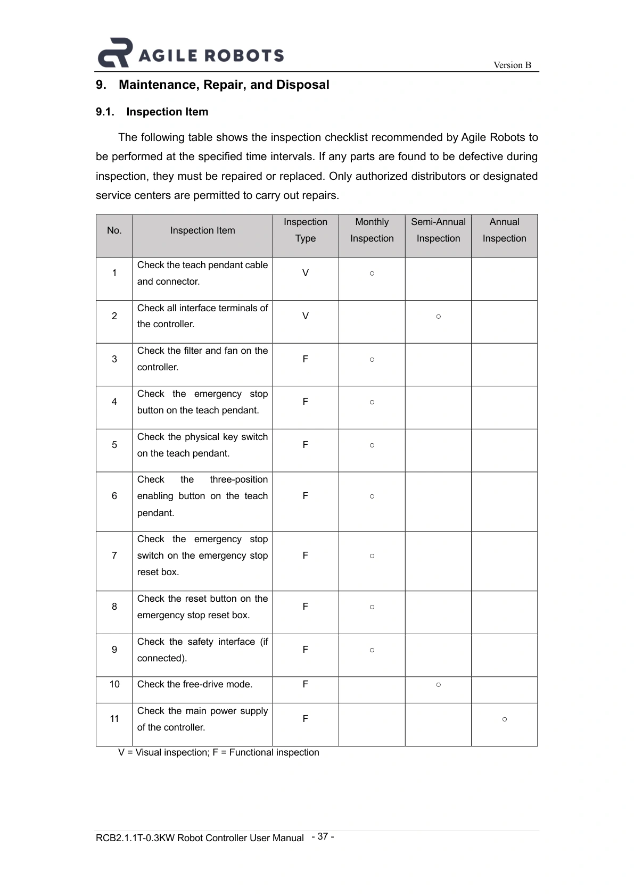



```
Version B 
RCB2.1.1T-0.3KW Robot Controller User Manual 
 
- 37 - 
9. Maintenance, Repair, and Disposal 
9.1. Inspection Item 
The following table shows the inspection checklist recommended by Agile Robots to 
be performed at the specified time intervals. If any parts are found to be defective during 
inspection, they must be repaired or replaced. Only authorized distributors or designated 
service centers are permitted to carry out repairs. 
No. 
Inspection Item 
Inspection 
Type 
Monthly 
Inspection 
Semi-Annual 
Inspection 
Annual 
Inspection 
1 
Check the teach pendant cable 
and connector. 
V 
○ 
 
 
2 
Check all interface terminals of 
the controller. 
V 
 
○ 
 
3 
Check the filter and fan on the 
controller. 
F 
○ 
 
 
4 
Check the emergency stop 
button on the teach pendant. 
F 
○ 
 
 
5 
Check the physical key switch 
on the teach pendant. 
F 
○ 
 
 
6 
Check 
the 
three-position 
enabling button on the teach 
pendant. 
F 
○ 
 
 
7 
Check the emergency stop 
switch on the emergency stop 
reset box. 
F 
○ 
 
 
8 
Check the reset button on the 
emergency stop reset box. 
F 
○ 
 
 
9 
Check the safety interface (if 
connected). 
F 
○ 
 
 
10 
Check the free-drive mode. 
F 
 
○ 
 
11 
Check the main power supply 
of the controller. 
F 
 
 
○ 
V = Visual inspection; F = Functional inspection
```



## PDF page 42

**Source:** RCB2.1.1T-0.3KW Controller User Manual V1.2 EN.pdf, original pdf page 42. [Open the corresponding PDF reading-copy page](https://1292444914-files.gitbook.io/~/files/v0/b/gitbook-x-prod.appspot.com/o/spaces%2FtgOfPnscWebs1eh82EKq%2Fuploads%2FNAquAGMcxiymTxxphnLa%2Frcb2-1-1t-0-3kw-controller-user-manual-v1-2-en-pp-038-046.pdf?alt=media#page=5).



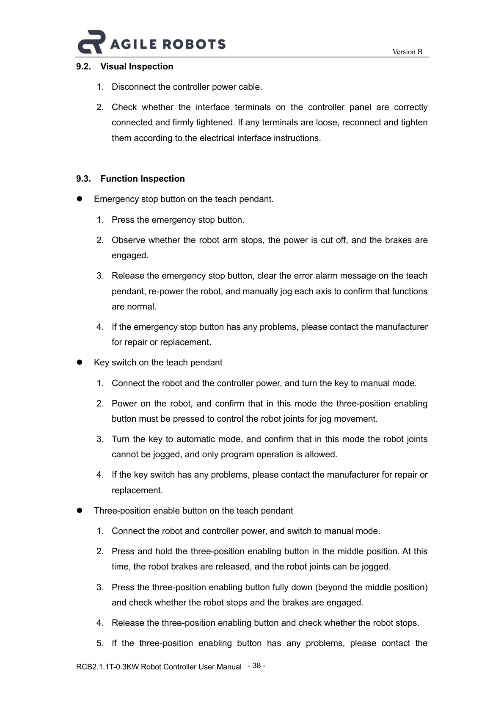



```
Version B 
RCB2.1.1T-0.3KW Robot Controller User Manual 
 
- 38 - 
9.2. Visual Inspection 
1. Disconnect the controller power cable. 
2. Check whether the interface terminals on the controller panel are correctly 
connected and firmly tightened. If any terminals are loose, reconnect and tighten 
them according to the electrical interface instructions. 
 
9.3. Function Inspection 
l 
Emergency stop button on the teach pendant. 
1. Press the emergency stop button. 
2. Observe whether the robot arm stops, the power is cut off, and the brakes are 
engaged. 
3. Release the emergency stop button, clear the error alarm message on the teach 
pendant, re-power the robot, and manually jog each axis to confirm that functions 
are normal. 
4. If the emergency stop button has any problems, please contact the manufacturer 
for repair or replacement. 
l 
Key switch on the teach pendant 
1. Connect the robot and the controller power, and turn the key to manual mode. 
2. Power on the robot, and confirm that in this mode the three-position enabling 
button must be pressed to control the robot joints for jog movement. 
3. Turn the key to automatic mode, and confirm that in this mode the robot joints 
cannot be jogged, and only program operation is allowed. 
4. If the key switch has any problems, please contact the manufacturer for repair or 
replacement. 
l 
Three-position enable button on the teach pendant 
1. Connect the robot and controller power, and switch to manual mode. 
2. Press and hold the three-position enabling button in the middle position. At this 
time, the robot brakes are released, and the robot joints can be jogged. 
3. Press the three-position enabling button fully down (beyond the middle position) 
and check whether the robot stops and the brakes are engaged. 
4. Release the three-position enabling button and check whether the robot stops. 
5. If the three-position enabling button has any problems, please contact the
```



## PDF page 43

**Source:** RCB2.1.1T-0.3KW Controller User Manual V1.2 EN.pdf, original pdf page 43. [Open the corresponding PDF reading-copy page](https://1292444914-files.gitbook.io/~/files/v0/b/gitbook-x-prod.appspot.com/o/spaces%2FtgOfPnscWebs1eh82EKq%2Fuploads%2FNAquAGMcxiymTxxphnLa%2Frcb2-1-1t-0-3kw-controller-user-manual-v1-2-en-pp-038-046.pdf?alt=media#page=6).



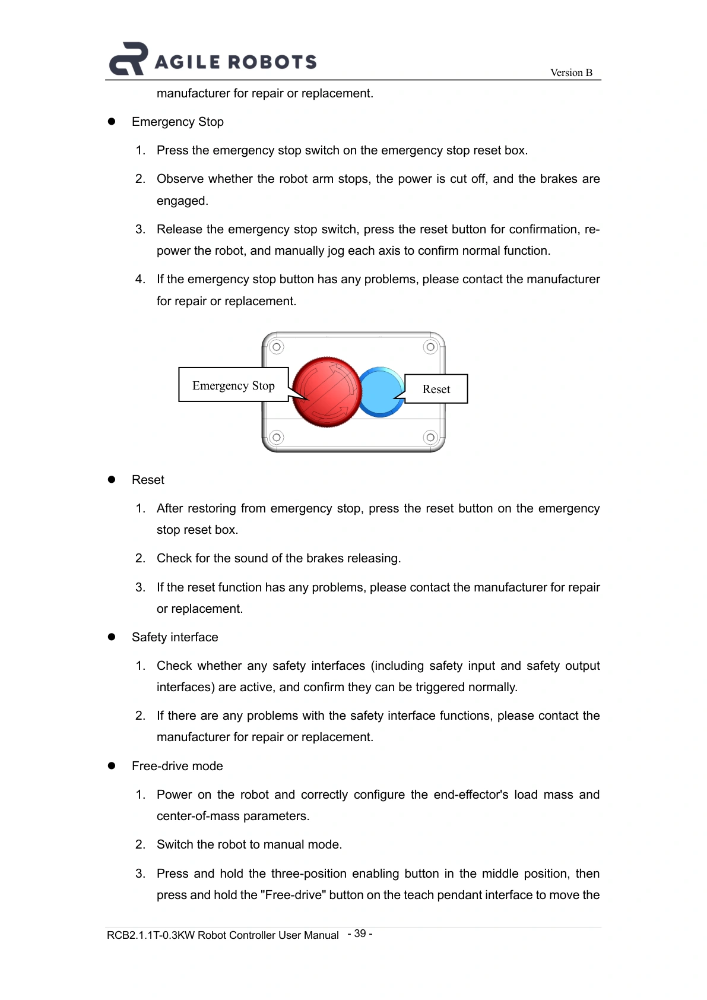



```
Version B 
RCB2.1.1T-0.3KW Robot Controller User Manual 
 
- 39 - 
manufacturer for repair or replacement. 
l 
Emergency Stop 
1. Press the emergency stop switch on the emergency stop reset box. 
2. Observe whether the robot arm stops, the power is cut off, and the brakes are 
engaged. 
3. Release the emergency stop switch, press the reset button for confirmation, re-
power the robot, and manually jog each axis to confirm normal function. 
4. If the emergency stop button has any problems, please contact the manufacturer 
for repair or replacement. 
 
l 
Reset 
1. After restoring from emergency stop, press the reset button on the emergency 
stop reset box. 
2. Check for the sound of the brakes releasing. 
3. If the reset function has any problems, please contact the manufacturer for repair 
or replacement. 
l 
Safety interface 
1. Check whether any safety interfaces (including safety input and safety output 
interfaces) are active, and confirm they can be triggered normally. 
2. If there are any problems with the safety interface functions, please contact the 
manufacturer for repair or replacement. 
l 
Free-drive mode 
1. Power on the robot and correctly configure the end-effector's load mass and 
center-of-mass parameters. 
2. Switch the robot to manual mode. 
3. Press and hold the three-position enabling button in the middle position, then 
press and hold the "Free-drive" button on the teach pendant interface to move the 
Emergency Stop 
Reset
```



## PDF page 44

**Source:** RCB2.1.1T-0.3KW Controller User Manual V1.2 EN.pdf, original pdf page 44. [Open the corresponding PDF reading-copy page](https://1292444914-files.gitbook.io/~/files/v0/b/gitbook-x-prod.appspot.com/o/spaces%2FtgOfPnscWebs1eh82EKq%2Fuploads%2FNAquAGMcxiymTxxphnLa%2Frcb2-1-1t-0-3kw-controller-user-manual-v1-2-en-pp-038-046.pdf?alt=media#page=7).



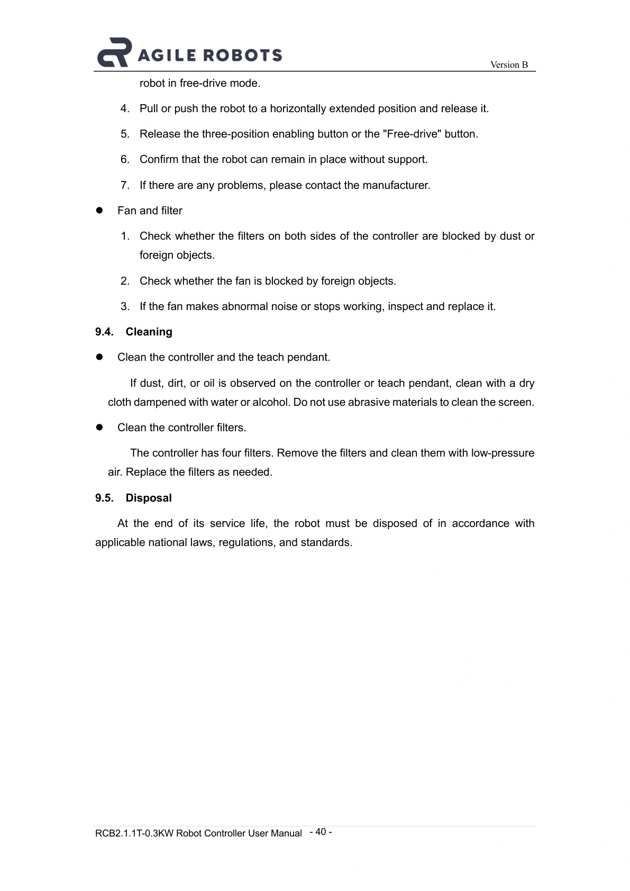



```
Version B 
RCB2.1.1T-0.3KW Robot Controller User Manual 
 
- 40 - 
robot in free-drive mode.  
4. Pull or push the robot to a horizontally extended position and release it. 
5. Release the three-position enabling button or the "Free-drive" button. 
6. Confirm that the robot can remain in place without support. 
7. If there are any problems, please contact the manufacturer. 
l 
Fan and filter 
1. Check whether the filters on both sides of the controller are blocked by dust or 
foreign objects. 
2. Check whether the fan is blocked by foreign objects. 
3. If the fan makes abnormal noise or stops working, inspect and replace it. 
9.4. Cleaning 
l 
Clean the controller and the teach pendant. 
If dust, dirt, or oil is observed on the controller or teach pendant, clean with a dry 
cloth dampened with water or alcohol. Do not use abrasive materials to clean the screen. 
l 
Clean the controller filters. 
The controller has four filters. Remove the filters and clean them with low-pressure 
air. Replace the filters as needed. 
9.5. Disposal 
At the end of its service life, the robot must be disposed of in accordance with 
applicable national laws, regulations, and standards.
```



## PDF page 45

**Source:** RCB2.1.1T-0.3KW Controller User Manual V1.2 EN.pdf, original pdf page 45. [Open the corresponding PDF reading-copy page](https://1292444914-files.gitbook.io/~/files/v0/b/gitbook-x-prod.appspot.com/o/spaces%2FtgOfPnscWebs1eh82EKq%2Fuploads%2FNAquAGMcxiymTxxphnLa%2Frcb2-1-1t-0-3kw-controller-user-manual-v1-2-en-pp-038-046.pdf?alt=media#page=8).



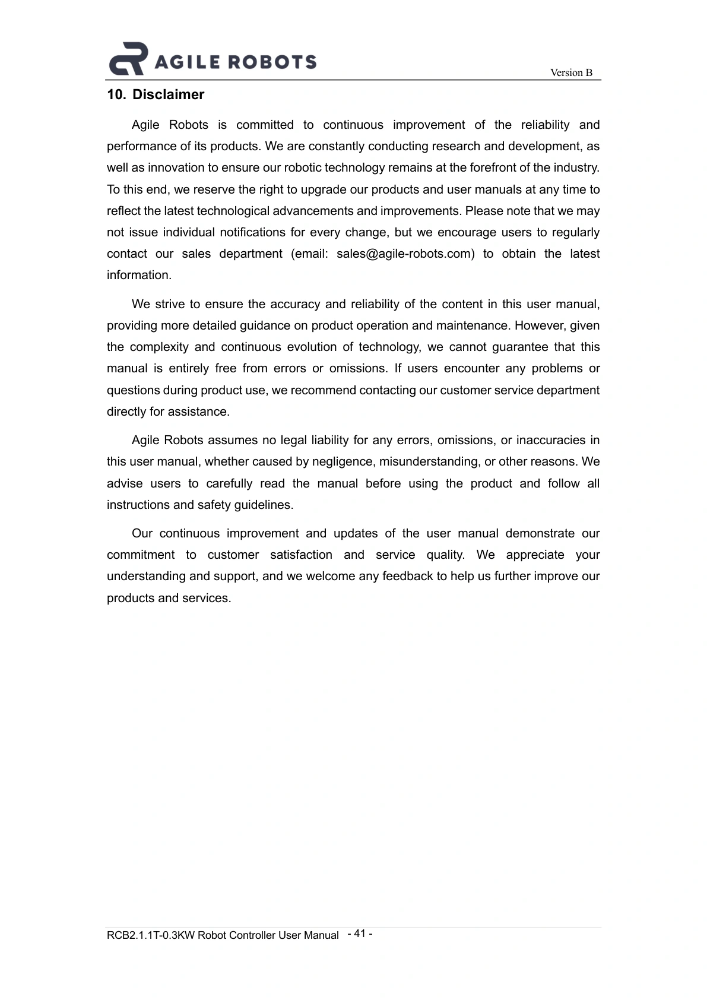



```
Version B 
RCB2.1.1T-0.3KW Robot Controller User Manual 
 
- 41 - 
10. Disclaimer 
Agile Robots is committed to continuous improvement of the reliability and 
performance of its products. We are constantly conducting research and development, as 
well as innovation to ensure our robotic technology remains at the forefront of the industry. 
To this end, we reserve the right to upgrade our products and user manuals at any time to 
reflect the latest technological advancements and improvements. Please note that we may 
not issue individual notifications for every change, but we encourage users to regularly 
contact our sales department (email: sales@agile-robots.com) to obtain the latest 
information. 
We strive to ensure the accuracy and reliability of the content in this user manual, 
providing more detailed guidance on product operation and maintenance. However, given 
the complexity and continuous evolution of technology, we cannot guarantee that this 
manual is entirely free from errors or omissions. If users encounter any problems or 
questions during product use, we recommend contacting our customer service department 
directly for assistance. 
Agile Robots assumes no legal liability for any errors, omissions, or inaccuracies in 
this user manual, whether caused by negligence, misunderstanding, or other reasons. We 
advise users to carefully read the manual before using the product and follow all 
instructions and safety guidelines.  
Our continuous improvement and updates of the user manual demonstrate our 
commitment to customer satisfaction and service quality. We appreciate your 
understanding and support, and we welcome any feedback to help us further improve our 
products and services.
```



## PDF page 46

**Source:** RCB2.1.1T-0.3KW Controller User Manual V1.2 EN.pdf, original pdf page 46. [Open the corresponding PDF reading-copy page](https://1292444914-files.gitbook.io/~/files/v0/b/gitbook-x-prod.appspot.com/o/spaces%2FtgOfPnscWebs1eh82EKq%2Fuploads%2FNAquAGMcxiymTxxphnLa%2Frcb2-1-1t-0-3kw-controller-user-manual-v1-2-en-pp-038-046.pdf?alt=media#page=9).



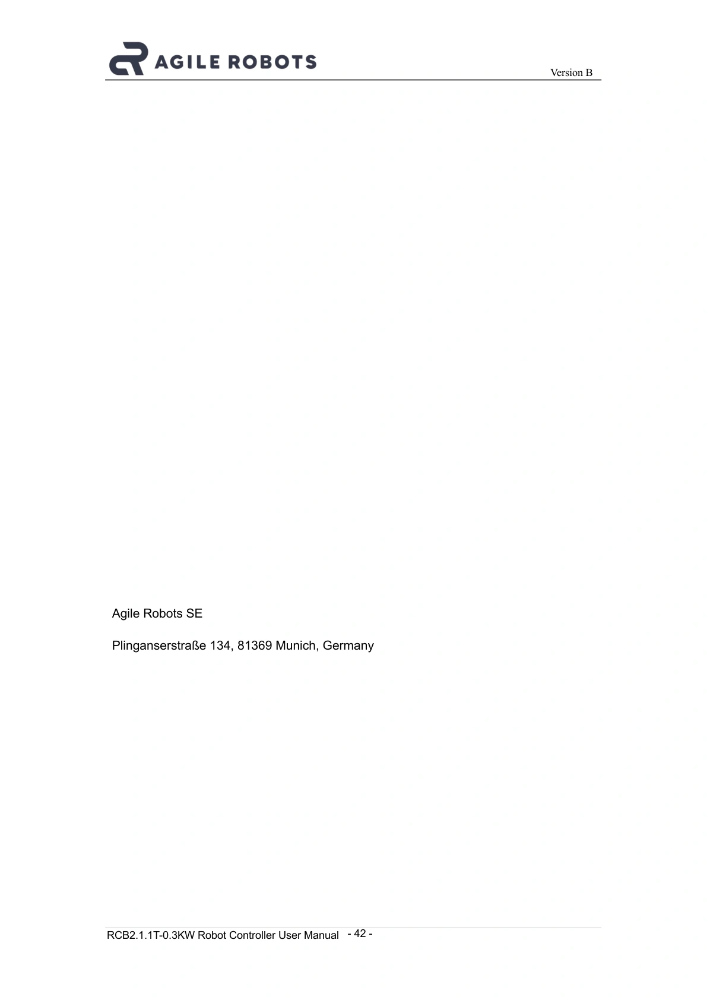



```
Version B 
RCB2.1.1T-0.3KW Robot Controller User Manual 
 
- 42 - 
 
 
 
 
 
 
 
 
 
 
 
 
 
 
 
 
 
 
Agile Robots SE 
Plinganserstraße 134, 81369 Munich, Germany
```


