# Safety configuration manual V3.3.0 — complete reference


**Complete supplied source:** Safety Function Configuration Software User Manual\_V3.3.0\_EN\_20260204.pdf · **Coverage:** 53 original PDF pages. [Return to the Agile Robots source library](./).


Every source page is retained in the original order. The **Original page** view preserves complete diagrams, photographs, tables, equations, connector orientation, notices and examples. The **Searchable text** view preserves native PDF text or the slide’s native text, embedded links and substantive speaker notes. Text extraction can retain reading-order/character defects; use the original image for exact layout, table columns and code indentation.


Changing a safety parameter is a safety-system modification, not a connectivity test. Preserve the complete SCU/JMU versions, units, checksums, authorized roles, validation, restart and acceptance requirements. Software settings alone are not a validated robot-cell safety function.


**Attribution:** the manufacturer and contributors identified in the supplied document. Original notices remain visible on every source page. Navigation, revision notes and the linked engineering explanations are OpenELAB editorial additions.

## Document navigation

| Source section / function                       | Original page                                                                                           |
| ----------------------------------------------- | ------------------------------------------------------------------------------------------------------- |
| 1. Overview                                     | [PDF 3](complete-safety-function-configuration-software-user-manual-v3-3-0-en-20260204.md#pdf-page-3)   |
| 2. Teach Pendant Safety Function Parameters     | [PDF 3](complete-safety-function-configuration-software-user-manual-v3-3-0-en-20260204.md#pdf-page-3)   |
| 2.1. SCU and JMU Version Numbers                | [PDF 3](complete-safety-function-configuration-software-user-manual-v3-3-0-en-20260204.md#pdf-page-3)   |
| 2.2. SCU Safety Interface                       | [PDF 4](complete-safety-function-configuration-software-user-manual-v3-3-0-en-20260204.md#pdf-page-4)   |
| 3. Safety Function Configuration                | [PDF 7](complete-safety-function-configuration-software-user-manual-v3-3-0-en-20260204.md#pdf-page-7)   |
| 3.1. Main Menu of Safety Function Configuration | [PDF 7](complete-safety-function-configuration-software-user-manual-v3-3-0-en-20260204.md#pdf-page-7)   |
| 3.2. Main Menu Option Functions                 | [PDF 10](complete-safety-function-configuration-software-user-manual-v3-3-0-en-20260204.md#pdf-page-10) |
| 3.2.1. Unlock                                   | [PDF 10](complete-safety-function-configuration-software-user-manual-v3-3-0-en-20260204.md#pdf-page-10) |
| 3.2.2. Lock                                     | [PDF 11](complete-safety-function-configuration-software-user-manual-v3-3-0-en-20260204.md#pdf-page-11) |
| 3.2.3. Apply                                    | [PDF 12](complete-safety-function-configuration-software-user-manual-v3-3-0-en-20260204.md#pdf-page-12) |
| 3.2.4. Apply Current Page                       | [PDF 13](complete-safety-function-configuration-software-user-manual-v3-3-0-en-20260204.md#pdf-page-13) |
| 3.2.5. Signature                                | [PDF 13](complete-safety-function-configuration-software-user-manual-v3-3-0-en-20260204.md#pdf-page-13) |
| 3.2.6. Save Device                              | [PDF 14](complete-safety-function-configuration-software-user-manual-v3-3-0-en-20260204.md#pdf-page-14) |
| 3.2.7. Load from Device                         | [PDF 15](complete-safety-function-configuration-software-user-manual-v3-3-0-en-20260204.md#pdf-page-15) |
| 3.2.8. Load Current Page                        | [PDF 17](complete-safety-function-configuration-software-user-manual-v3-3-0-en-20260204.md#pdf-page-17) |
| 3.2.9. Save to Local                            | [PDF 19](complete-safety-function-configuration-software-user-manual-v3-3-0-en-20260204.md#pdf-page-19) |
| 3.2.10. Load from Local                         | [PDF 20](complete-safety-function-configuration-software-user-manual-v3-3-0-en-20260204.md#pdf-page-20) |
| 3.2.11. Switch Language                         | [PDF 21](complete-safety-function-configuration-software-user-manual-v3-3-0-en-20260204.md#pdf-page-21) |
| 3.2.12. User Settings                           | [PDF 21](complete-safety-function-configuration-software-user-manual-v3-3-0-en-20260204.md#pdf-page-21) |
| 3.2.13. About                                   | [PDF 22](complete-safety-function-configuration-software-user-manual-v3-3-0-en-20260204.md#pdf-page-22) |
| 3.3. SCU User Configuration                     | [PDF 22](complete-safety-function-configuration-software-user-manual-v3-3-0-en-20260204.md#pdf-page-22) |
| 3.3.1. Safety Function Enable                   | [PDF 22](complete-safety-function-configuration-software-user-manual-v3-3-0-en-20260204.md#pdf-page-22) |
| 3.3.2. Tool Coordinate System                   | [PDF 23](complete-safety-function-configuration-software-user-manual-v3-3-0-en-20260204.md#pdf-page-23) |
| 3.3.3. Workpiece Coordinate System              | [PDF 25](complete-safety-function-configuration-software-user-manual-v3-3-0-en-20260204.md#pdf-page-25) |
| 3.3.4. Momentum and Power                       | [PDF 27](complete-safety-function-configuration-software-user-manual-v3-3-0-en-20260204.md#pdf-page-27) |
| 3.3.5. Speed Limits                             | [PDF 28](complete-safety-function-configuration-software-user-manual-v3-3-0-en-20260204.md#pdf-page-28) |
| 3.3.6. Joint Position Limits                    | [PDF 30](complete-safety-function-configuration-software-user-manual-v3-3-0-en-20260204.md#pdf-page-30) |
| 3.3.7. Virtual Walls                            | [PDF 33](complete-safety-function-configuration-software-user-manual-v3-3-0-en-20260204.md#pdf-page-33) |
| 3.3.8. Tool Envelope                            | [PDF 35](complete-safety-function-configuration-software-user-manual-v3-3-0-en-20260204.md#pdf-page-35) |
| 3.3.9. SI Safety SI                             | [PDF 37](complete-safety-function-configuration-software-user-manual-v3-3-0-en-20260204.md#pdf-page-37) |
| 3.3.10. SO Safety SO                            | [PDF 40](complete-safety-function-configuration-software-user-manual-v3-3-0-en-20260204.md#pdf-page-40) |
| 3.3.11. Safety Position                         | [PDF 43](complete-safety-function-configuration-software-user-manual-v3-3-0-en-20260204.md#pdf-page-43) |
| 3.3.12. Operating Mode                          | [PDF 44](complete-safety-function-configuration-software-user-manual-v3-3-0-en-20260204.md#pdf-page-44) |
| 3.3.13. Gravity Direction                       | [PDF 44](complete-safety-function-configuration-software-user-manual-v3-3-0-en-20260204.md#pdf-page-44) |
| 3.3.14. User Information                        | [PDF 46](complete-safety-function-configuration-software-user-manual-v3-3-0-en-20260204.md#pdf-page-46) |
| 3.4. JMU User Configuration                     | [PDF 47](complete-safety-function-configuration-software-user-manual-v3-3-0-en-20260204.md#pdf-page-47) |
| 3.4.1. Calibration                              | [PDF 47](complete-safety-function-configuration-software-user-manual-v3-3-0-en-20260204.md#pdf-page-47) |

## PDF page 1

**Source:** Safety Function Configuration Software User Manual\_V3.3.0\_EN\_20260204.pdf, original pdf page 1. [Open the corresponding PDF reading-copy page](https://1292444914-files.gitbook.io/~/files/v0/b/gitbook-x-prod.appspot.com/o/spaces%2FtgOfPnscWebs1eh82EKq%2Fuploads%2FdwU654a6Z3fW5StcwPHe%2Fsafety-function-configuration-software-user-manual-v3-3-0-en-20260204-pp-001-016.pdf?alt=media#page=1).



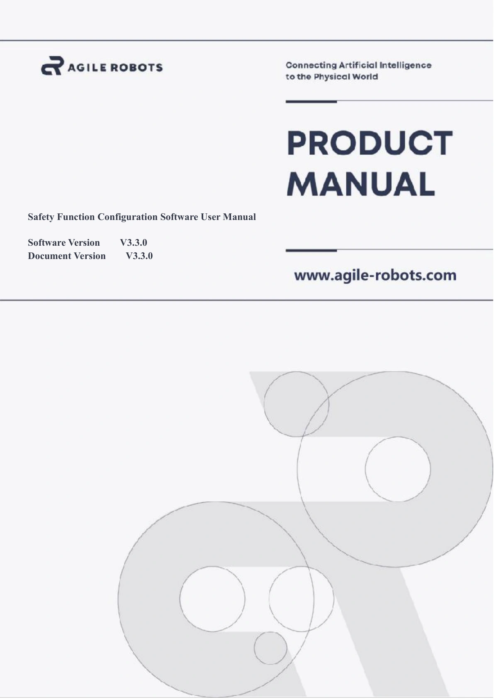



```
北京思灵机器人科技有限责任公司 
1
 
Safety Function Configuration Software User Manual 
 
Software Version        V3.3.0 
Document Version        V3.3.0
```



## PDF page 2

**Source:** Safety Function Configuration Software User Manual\_V3.3.0\_EN\_20260204.pdf, original pdf page 2. [Open the corresponding PDF reading-copy page](https://1292444914-files.gitbook.io/~/files/v0/b/gitbook-x-prod.appspot.com/o/spaces%2FtgOfPnscWebs1eh82EKq%2Fuploads%2FdwU654a6Z3fW5StcwPHe%2Fsafety-function-configuration-software-user-manual-v3-3-0-en-20260204-pp-001-016.pdf?alt=media#page=2).



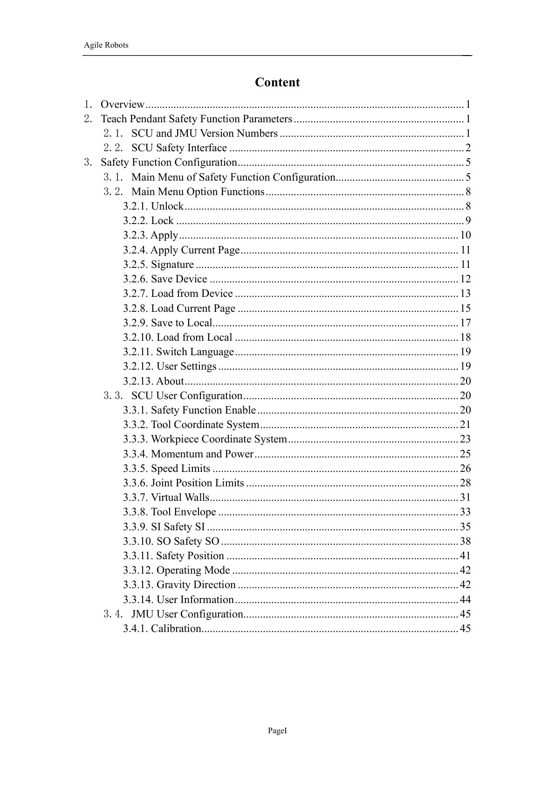



```
Agile Robots 
PageI 
 
Content 
1. Overview .................................................................................................................. 1 
2. Teach Pendant Safety Function Parameters ............................................................. 1 
2.1. SCU and JMU Version Numbers .................................................................. 1 
2.2. SCU Safety Interface .................................................................................... 2 
3. Safety Function Configuration ................................................................................. 5 
3.1. Main Menu of Safety Function Configuration.............................................. 5 
3.2. Main Menu Option Functions ....................................................................... 8 
3.2.1. Unlock .................................................................................................... 8 
3.2.2. Lock ....................................................................................................... 9 
3.2.3. Apply .................................................................................................... 10 
3.2.4. Apply Current Page .............................................................................. 11 
3.2.5. Signature .............................................................................................. 11 
3.2.6. Save Device ......................................................................................... 12 
3.2.7. Load from Device ................................................................................ 13 
3.2.8. Load Current Page ............................................................................... 15 
3.2.9. Save to Local........................................................................................ 17 
3.2.10. Load from Local ................................................................................ 18 
3.2.11. Switch Language ................................................................................ 19 
3.2.12. User Settings ...................................................................................... 19 
3.2.13. About .................................................................................................. 20 
3.3. SCU User Configuration ............................................................................. 20 
3.3.1. Safety Function Enable ........................................................................ 20 
3.3.2. Tool Coordinate System ....................................................................... 21 
3.3.3. Workpiece Coordinate System ............................................................. 23 
3.3.4. Momentum and Power ......................................................................... 25 
3.3.5. Speed Limits ........................................................................................ 26 
3.3.6. Joint Position Limits ............................................................................ 28 
3.3.7. Virtual Walls ......................................................................................... 31 
3.3.8. Tool Envelope ...................................................................................... 33 
3.3.9. SI Safety SI .......................................................................................... 35 
3.3.10. SO Safety SO ..................................................................................... 38 
3.3.11. Safety Position ................................................................................... 41 
3.3.12. Operating Mode ................................................................................. 42 
3.3.13. Gravity Direction ............................................................................... 42 
3.3.14. User Information ................................................................................ 44 
3.4. JMU User Configuration............................................................................. 45 
3.4.1. Calibration............................................................................................ 45
```



**Original document cross-references:** [PDF 3](complete-safety-function-configuration-software-user-manual-v3-3-0-en-20260204.md#pdf-page-3) · [PDF 4](complete-safety-function-configuration-software-user-manual-v3-3-0-en-20260204.md#pdf-page-4) · [PDF 7](complete-safety-function-configuration-software-user-manual-v3-3-0-en-20260204.md#pdf-page-7) · [PDF 10](complete-safety-function-configuration-software-user-manual-v3-3-0-en-20260204.md#pdf-page-10) · [PDF 11](complete-safety-function-configuration-software-user-manual-v3-3-0-en-20260204.md#pdf-page-11) · [PDF 12](complete-safety-function-configuration-software-user-manual-v3-3-0-en-20260204.md#pdf-page-12) · [PDF 13](complete-safety-function-configuration-software-user-manual-v3-3-0-en-20260204.md#pdf-page-13) · [PDF 14](complete-safety-function-configuration-software-user-manual-v3-3-0-en-20260204.md#pdf-page-14) · [PDF 15](complete-safety-function-configuration-software-user-manual-v3-3-0-en-20260204.md#pdf-page-15) · [PDF 17](complete-safety-function-configuration-software-user-manual-v3-3-0-en-20260204.md#pdf-page-17) · [PDF 19](complete-safety-function-configuration-software-user-manual-v3-3-0-en-20260204.md#pdf-page-19) · [PDF 20](complete-safety-function-configuration-software-user-manual-v3-3-0-en-20260204.md#pdf-page-20) · [PDF 21](complete-safety-function-configuration-software-user-manual-v3-3-0-en-20260204.md#pdf-page-21) · [PDF 22](complete-safety-function-configuration-software-user-manual-v3-3-0-en-20260204.md#pdf-page-22) · [PDF 23](complete-safety-function-configuration-software-user-manual-v3-3-0-en-20260204.md#pdf-page-23) · [PDF 25](complete-safety-function-configuration-software-user-manual-v3-3-0-en-20260204.md#pdf-page-25) · [PDF 27](complete-safety-function-configuration-software-user-manual-v3-3-0-en-20260204.md#pdf-page-27) · [PDF 28](complete-safety-function-configuration-software-user-manual-v3-3-0-en-20260204.md#pdf-page-28) · [PDF 30](complete-safety-function-configuration-software-user-manual-v3-3-0-en-20260204.md#pdf-page-30) · [PDF 33](complete-safety-function-configuration-software-user-manual-v3-3-0-en-20260204.md#pdf-page-33) · [PDF 35](complete-safety-function-configuration-software-user-manual-v3-3-0-en-20260204.md#pdf-page-35) · [PDF 37](complete-safety-function-configuration-software-user-manual-v3-3-0-en-20260204.md#pdf-page-37) · [PDF 40](complete-safety-function-configuration-software-user-manual-v3-3-0-en-20260204.md#pdf-page-40) · [PDF 43](complete-safety-function-configuration-software-user-manual-v3-3-0-en-20260204.md#pdf-page-43) · [PDF 44](complete-safety-function-configuration-software-user-manual-v3-3-0-en-20260204.md#pdf-page-44) · [PDF 46](complete-safety-function-configuration-software-user-manual-v3-3-0-en-20260204.md#pdf-page-46) · [PDF 47](complete-safety-function-configuration-software-user-manual-v3-3-0-en-20260204.md#pdf-page-47)

## PDF page 3

**Source:** Safety Function Configuration Software User Manual\_V3.3.0\_EN\_20260204.pdf, original pdf page 3. [Open the corresponding PDF reading-copy page](https://1292444914-files.gitbook.io/~/files/v0/b/gitbook-x-prod.appspot.com/o/spaces%2FtgOfPnscWebs1eh82EKq%2Fuploads%2FdwU654a6Z3fW5StcwPHe%2Fsafety-function-configuration-software-user-manual-v3-3-0-en-20260204-pp-001-016.pdf?alt=media#page=3).



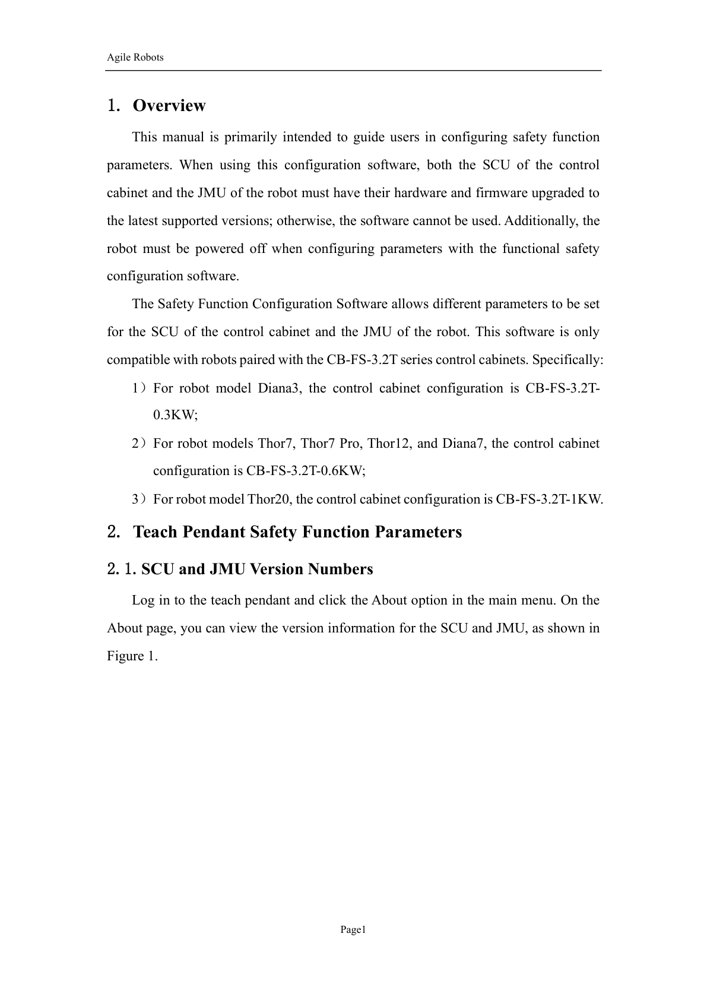



```
Agile Robots 
Page1 
1. Overview 
This manual is primarily intended to guide users in configuring safety function 
parameters. When using this configuration software, both the SCU of the control 
cabinet and the JMU of the robot must have their hardware and firmware upgraded to 
the latest supported versions; otherwise, the software cannot be used. Additionally, the 
robot must be powered off when configuring parameters with the functional safety 
configuration software. 
The Safety Function Configuration Software allows different parameters to be set 
for the SCU of the control cabinet and the JMU of the robot. This software is only 
compatible with robots paired with the CB-FS-3.2T series control cabinets. Specifically: 
1）For robot model Diana3, the control cabinet configuration is CB-FS-3.2T-
0.3KW; 
2）For robot models Thor7, Thor7 Pro, Thor12, and Diana7, the control cabinet 
configuration is CB-FS-3.2T-0.6KW; 
3）For robot model Thor20, the control cabinet configuration is CB-FS-3.2T-1KW. 
2. Teach Pendant Safety Function Parameters 
2.1. SCU and JMU Version Numbers 
Log in to the teach pendant and click the About option in the main menu. On the 
About page, you can view the version information for the SCU and JMU, as shown in 
Figure 1.
```



## PDF page 4

**Source:** Safety Function Configuration Software User Manual\_V3.3.0\_EN\_20260204.pdf, original pdf page 4. [Open the corresponding PDF reading-copy page](https://1292444914-files.gitbook.io/~/files/v0/b/gitbook-x-prod.appspot.com/o/spaces%2FtgOfPnscWebs1eh82EKq%2Fuploads%2FdwU654a6Z3fW5StcwPHe%2Fsafety-function-configuration-software-user-manual-v3-3-0-en-20260204-pp-001-016.pdf?alt=media#page=4).



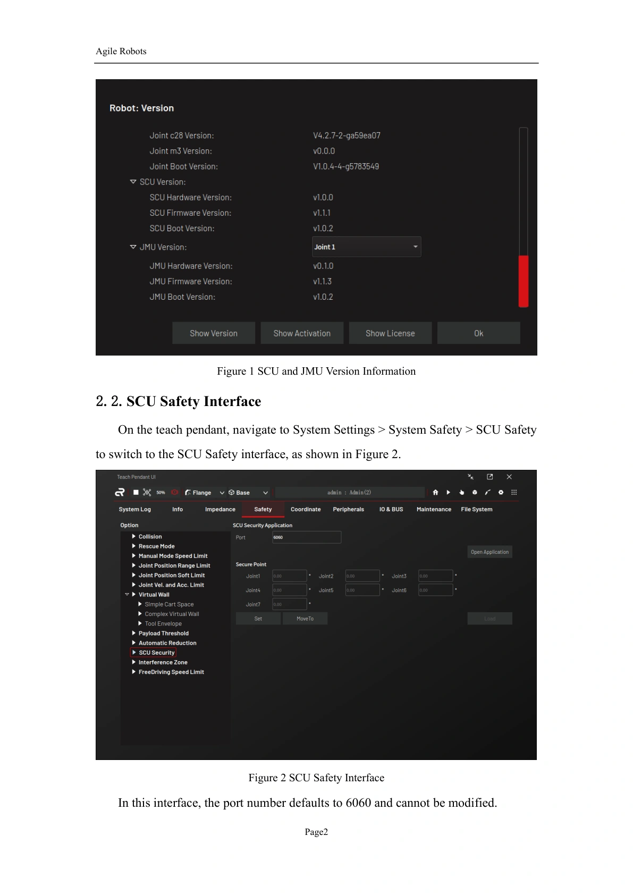



```
Agile Robots 
Page2 
 
Figure 1 SCU and JMU Version Information 
2.2. SCU Safety Interface 
On the teach pendant, navigate to System Settings > System Safety > SCU Safety 
to switch to the SCU Safety interface, as shown in Figure 2. 
 
Figure 2 SCU Safety Interface 
In this interface, the port number defaults to 6060 and cannot be modified.
```



## PDF page 5

**Source:** Safety Function Configuration Software User Manual\_V3.3.0\_EN\_20260204.pdf, original pdf page 5. [Open the corresponding PDF reading-copy page](https://1292444914-files.gitbook.io/~/files/v0/b/gitbook-x-prod.appspot.com/o/spaces%2FtgOfPnscWebs1eh82EKq%2Fuploads%2FdwU654a6Z3fW5StcwPHe%2Fsafety-function-configuration-software-user-manual-v3-3-0-en-20260204-pp-001-016.pdf?alt=media#page=5).



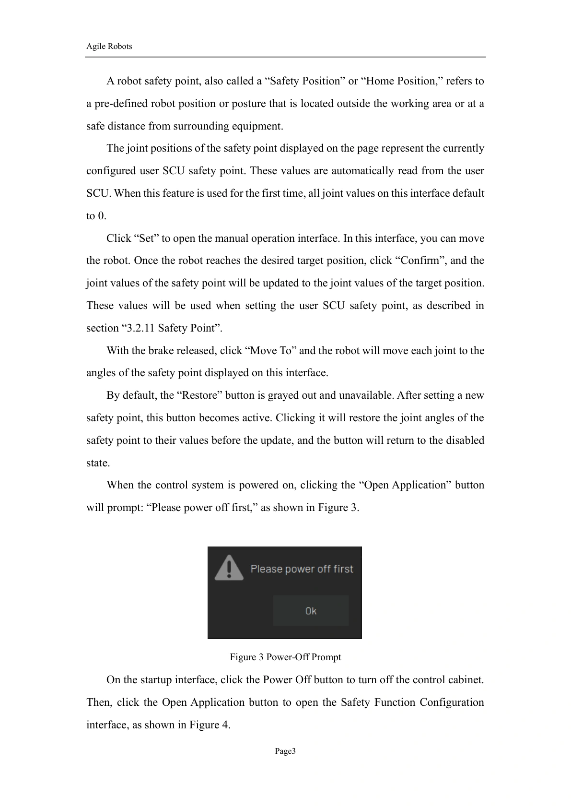



```
Agile Robots 
Page3 
A robot safety point, also called a “Safety Position” or “Home Position,” refers to 
a pre-defined robot position or posture that is located outside the working area or at a 
safe distance from surrounding equipment. 
The joint positions of the safety point displayed on the page represent the currently 
configured user SCU safety point. These values are automatically read from the user 
SCU. When this feature is used for the first time, all joint values on this interface default 
to 0. 
Click “Set” to open the manual operation interface. In this interface, you can move 
the robot. Once the robot reaches the desired target position, click “Confirm”, and the 
joint values of the safety point will be updated to the joint values of the target position. 
These values will be used when setting the user SCU safety point, as described in 
section “3.2.11 Safety Point”. 
With the brake released, click “Move To” and the robot will move each joint to the 
angles of the safety point displayed on this interface. 
By default, the “Restore” button is grayed out and unavailable. After setting a new 
safety point, this button becomes active. Clicking it will restore the joint angles of the 
safety point to their values before the update, and the button will return to the disabled 
state. 
When the control system is powered on, clicking the “Open Application” button 
will prompt: “Please power off first,” as shown in Figure 3. 
 
 
Figure 3 Power-Off Prompt 
On the startup interface, click the Power Off button to turn off the control cabinet. 
Then, click the Open Application button to open the Safety Function Configuration 
interface, as shown in Figure 4.
```



## PDF page 6

**Source:** Safety Function Configuration Software User Manual\_V3.3.0\_EN\_20260204.pdf, original pdf page 6. [Open the corresponding PDF reading-copy page](https://1292444914-files.gitbook.io/~/files/v0/b/gitbook-x-prod.appspot.com/o/spaces%2FtgOfPnscWebs1eh82EKq%2Fuploads%2FdwU654a6Z3fW5StcwPHe%2Fsafety-function-configuration-software-user-manual-v3-3-0-en-20260204-pp-001-016.pdf?alt=media#page=6).



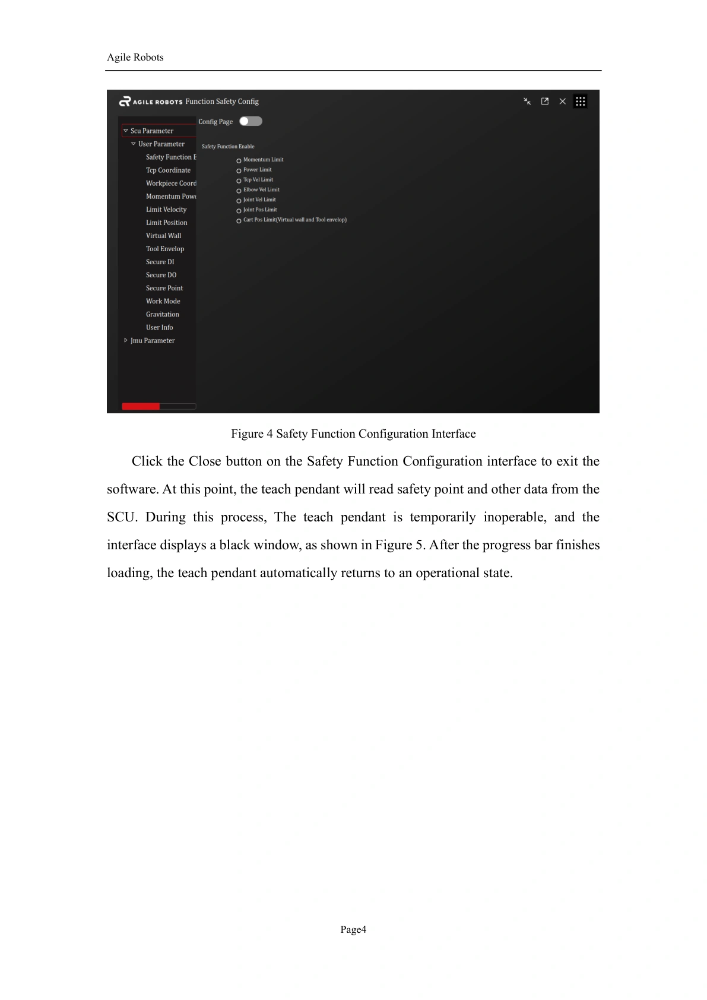



```
Agile Robots 
Page4 
 
Figure 4 Safety Function Configuration Interface 
Click the Close button on the Safety Function Configuration interface to exit the 
software. At this point, the teach pendant will read safety point and other data from the 
SCU. During this process, The teach pendant is temporarily inoperable, and the 
interface displays a black window, as shown in Figure 5. After the progress bar finishes 
loading, the teach pendant automatically returns to an operational state.
```



## PDF page 7

**Source:** Safety Function Configuration Software User Manual\_V3.3.0\_EN\_20260204.pdf, original pdf page 7. [Open the corresponding PDF reading-copy page](https://1292444914-files.gitbook.io/~/files/v0/b/gitbook-x-prod.appspot.com/o/spaces%2FtgOfPnscWebs1eh82EKq%2Fuploads%2FdwU654a6Z3fW5StcwPHe%2Fsafety-function-configuration-software-user-manual-v3-3-0-en-20260204-pp-001-016.pdf?alt=media#page=7).



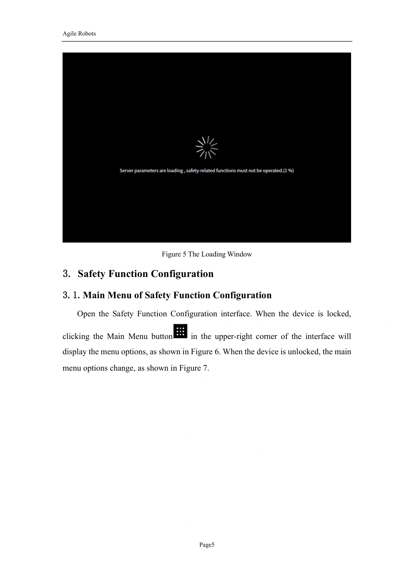



```
Agile Robots 
Page5 
 
Figure 5 The Loading Window 
3. Safety Function Configuration 
3.1. Main Menu of Safety Function Configuration 
Open the Safety Function Configuration interface. When the device is locked, 
clicking the Main Menu button
 in the upper-right corner of the interface will 
display the menu options, as shown in Figure 6. When the device is unlocked, the main 
menu options change, as shown in Figure 7.
```



## PDF page 8

**Source:** Safety Function Configuration Software User Manual\_V3.3.0\_EN\_20260204.pdf, original pdf page 8. [Open the corresponding PDF reading-copy page](https://1292444914-files.gitbook.io/~/files/v0/b/gitbook-x-prod.appspot.com/o/spaces%2FtgOfPnscWebs1eh82EKq%2Fuploads%2FdwU654a6Z3fW5StcwPHe%2Fsafety-function-configuration-software-user-manual-v3-3-0-en-20260204-pp-001-016.pdf?alt=media#page=8).



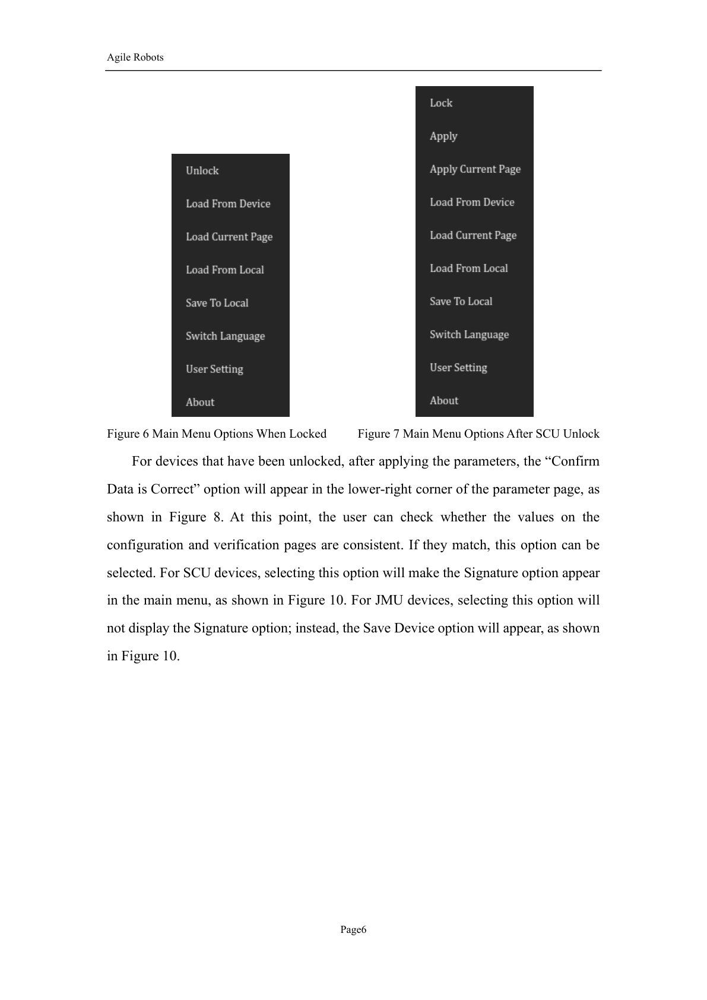



```
Agile Robots 
Page6 
                                        
 
Figure 6 Main Menu Options When Locked          Figure 7 Main Menu Options After SCU Unlock 
For devices that have been unlocked, after applying the parameters, the “Confirm 
Data is Correct” option will appear in the lower-right corner of the parameter page, as 
shown in Figure 8. At this point, the user can check whether the values on the 
configuration and verification pages are consistent. If they match, this option can be 
selected. For SCU devices, selecting this option will make the Signature option appear 
in the main menu, as shown in Figure 10. For JMU devices, selecting this option will 
not display the Signature option; instead, the Save Device option will appear, as shown 
in Figure 10.
```



## PDF page 9

**Source:** Safety Function Configuration Software User Manual\_V3.3.0\_EN\_20260204.pdf, original pdf page 9. [Open the corresponding PDF reading-copy page](https://1292444914-files.gitbook.io/~/files/v0/b/gitbook-x-prod.appspot.com/o/spaces%2FtgOfPnscWebs1eh82EKq%2Fuploads%2FdwU654a6Z3fW5StcwPHe%2Fsafety-function-configuration-software-user-manual-v3-3-0-en-20260204-pp-001-016.pdf?alt=media#page=9).



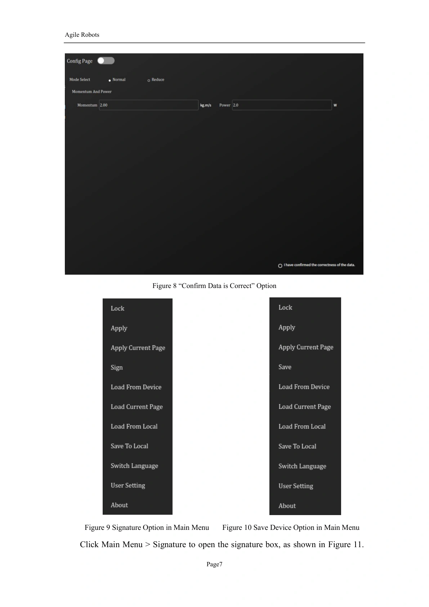



```
Agile Robots 
Page7 
 
Figure 8 “Confirm Data is Correct” Option 
                                                   
 
Figure 9 Signature Option in Main Menu       Figure 10 Save Device Option in Main Menu 
Click Main Menu > Signature to open the signature box, as shown in Figure 11.
```



## PDF page 10

**Source:** Safety Function Configuration Software User Manual\_V3.3.0\_EN\_20260204.pdf, original pdf page 10. [Open the corresponding PDF reading-copy page](https://1292444914-files.gitbook.io/~/files/v0/b/gitbook-x-prod.appspot.com/o/spaces%2FtgOfPnscWebs1eh82EKq%2Fuploads%2FdwU654a6Z3fW5StcwPHe%2Fsafety-function-configuration-software-user-manual-v3-3-0-en-20260204-pp-001-016.pdf?alt=media#page=10).



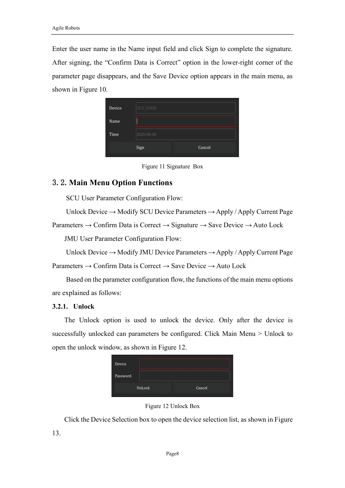



```
Agile Robots 
Page8 
Enter the user name in the Name input field and click Sign to complete the signature. 
After signing, the “Confirm Data is Correct” option in the lower-right corner of the 
parameter page disappears, and the Save Device option appears in the main menu, as 
shown in Figure 10. 
 
Figure 11 Signature  Box 
3.2. Main Menu Option Functions 
SCU User Parameter Configuration Flow: 
Unlock Device → Modify SCU Device Parameters → Apply / Apply Current Page 
Parameters → Confirm Data is Correct → Signature → Save Device → Auto Lock   
       JMU User Parameter Configuration Flow: 
Unlock Device → Modify JMU Device Parameters → Apply / Apply Current Page 
Parameters → Confirm Data is Correct → Save Device → Auto Lock 
Based on the parameter configuration flow, the functions of the main menu options 
are explained as follows: 
3.2.1. Unlock 
The Unlock option is used to unlock the device. Only after the device is 
successfully unlocked can parameters be configured. Click Main Menu > Unlock to 
open the unlock window, as shown in Figure 12. 
 
Figure 12 Unlock Box 
Click the Device Selection box to open the device selection list, as shown in Figure 
13.
```



## PDF page 11

**Source:** Safety Function Configuration Software User Manual\_V3.3.0\_EN\_20260204.pdf, original pdf page 11. [Open the corresponding PDF reading-copy page](https://1292444914-files.gitbook.io/~/files/v0/b/gitbook-x-prod.appspot.com/o/spaces%2FtgOfPnscWebs1eh82EKq%2Fuploads%2FdwU654a6Z3fW5StcwPHe%2Fsafety-function-configuration-software-user-manual-v3-3-0-en-20260204-pp-001-016.pdf?alt=media#page=11).



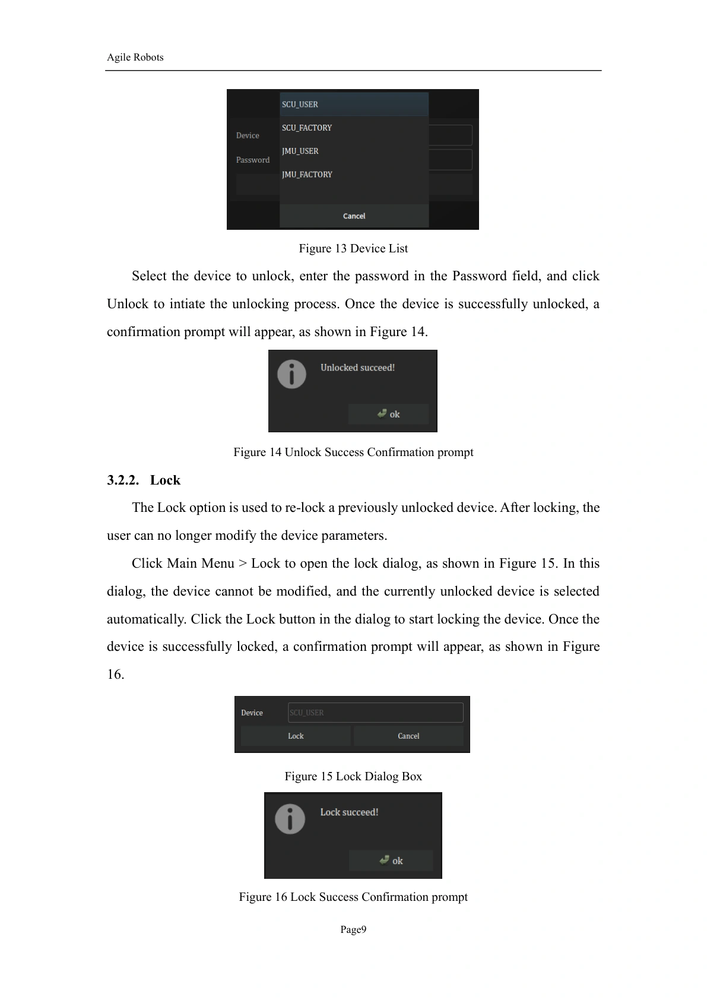



```
Agile Robots 
Page9 
 
Figure 13 Device List 
Select the device to unlock, enter the password in the Password field, and click 
Unlock to intiate the unlocking process. Once the device is successfully unlocked, a 
confirmation prompt will appear, as shown in Figure 14. 
 
Figure 14 Unlock Success Confirmation prompt 
3.2.2. Lock 
The Lock option is used to re-lock a previously unlocked device. After locking, the 
user can no longer modify the device parameters. 
Click Main Menu > Lock to open the lock dialog, as shown in Figure 15. In this 
dialog, the device cannot be modified, and the currently unlocked device is selected 
automatically. Click the Lock button in the dialog to start locking the device. Once the 
device is successfully locked, a confirmation prompt will appear, as shown in Figure 
16. 
 
Figure 15 Lock Dialog Box 
 
Figure 16 Lock Success Confirmation prompt
```



## PDF page 12

**Source:** Safety Function Configuration Software User Manual\_V3.3.0\_EN\_20260204.pdf, original pdf page 12. [Open the corresponding PDF reading-copy page](https://1292444914-files.gitbook.io/~/files/v0/b/gitbook-x-prod.appspot.com/o/spaces%2FtgOfPnscWebs1eh82EKq%2Fuploads%2FdwU654a6Z3fW5StcwPHe%2Fsafety-function-configuration-software-user-manual-v3-3-0-en-20260204-pp-001-016.pdf?alt=media#page=12).



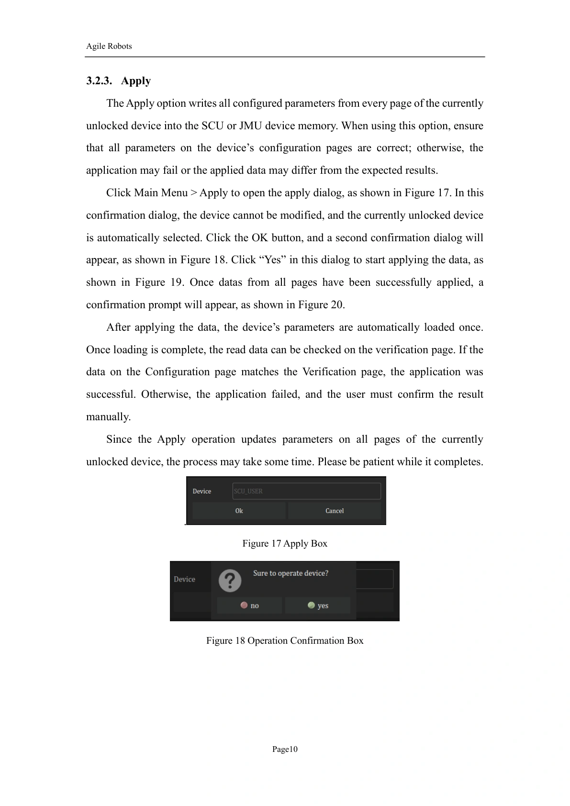



```
Agile Robots 
Page10 
3.2.3. Apply 
The Apply option writes all configured parameters from every page of the currently 
unlocked device into the SCU or JMU device memory. When using this option, ensure 
that all parameters on the device’s configuration pages are correct; otherwise, the 
application may fail or the applied data may differ from the expected results. 
Click Main Menu > Apply to open the apply dialog, as shown in Figure 17. In this 
confirmation dialog, the device cannot be modified, and the currently unlocked device 
is automatically selected. Click the OK button, and a second confirmation dialog will 
appear, as shown in Figure 18. Click “Yes” in this dialog to start applying the data, as 
shown in Figure 19. Once datas from all pages have been successfully applied, a 
confirmation prompt will appear, as shown in Figure 20. 
After applying the data, the device’s parameters are automatically loaded once. 
Once loading is complete, the read data can be checked on the verification page. If the 
data on the Configuration page matches the Verification page, the application was 
successful. Otherwise, the application failed, and the user must confirm the result 
manually. 
Since the Apply operation updates parameters on all pages of the currently 
unlocked device, the process may take some time. Please be patient while it completes. 
.
 
Figure 17 Apply Box 
 
Figure 18 Operation Confirmation Box
```



## PDF page 13

**Source:** Safety Function Configuration Software User Manual\_V3.3.0\_EN\_20260204.pdf, original pdf page 13. [Open the corresponding PDF reading-copy page](https://1292444914-files.gitbook.io/~/files/v0/b/gitbook-x-prod.appspot.com/o/spaces%2FtgOfPnscWebs1eh82EKq%2Fuploads%2FdwU654a6Z3fW5StcwPHe%2Fsafety-function-configuration-software-user-manual-v3-3-0-en-20260204-pp-001-016.pdf?alt=media#page=13).



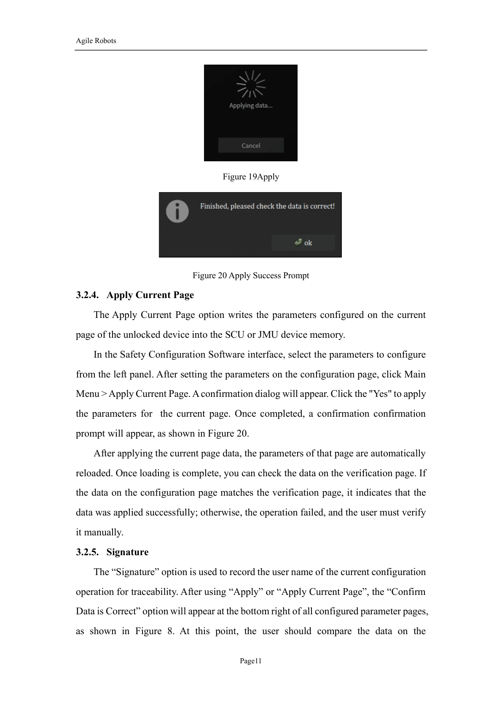



```
Agile Robots 
Page11 
 
Figure 19Apply 
 
Figure 20 Apply Success Prompt 
3.2.4. Apply Current Page 
The Apply Current Page option writes the parameters configured on the current 
page of the unlocked device into the SCU or JMU device memory. 
In the Safety Configuration Software interface, select the parameters to configure 
from the left panel. After setting the parameters on the configuration page, click Main 
Menu > Apply Current Page. A confirmation dialog will appear. Click the "Yes" to apply 
the parameters for  the current page. Once completed, a confirmation confirmation 
prompt will appear, as shown in Figure 20. 
After applying the current page data, the parameters of that page are automatically 
reloaded. Once loading is complete, you can check the data on the verification page. If 
the data on the configuration page matches the verification page, it indicates that the 
data was applied successfully; otherwise, the operation failed, and the user must verify 
it manually. 
3.2.5. Signature 
The “Signature” option is used to record the user name of the current configuration 
operation for traceability. After using “Apply” or “Apply Current Page”, the “Confirm 
Data is Correct” option will appear at the bottom right of all configured parameter pages, 
as shown in Figure 8. At this point, the user should compare the data on the
```



## PDF page 14

**Source:** Safety Function Configuration Software User Manual\_V3.3.0\_EN\_20260204.pdf, original pdf page 14. [Open the corresponding PDF reading-copy page](https://1292444914-files.gitbook.io/~/files/v0/b/gitbook-x-prod.appspot.com/o/spaces%2FtgOfPnscWebs1eh82EKq%2Fuploads%2FdwU654a6Z3fW5StcwPHe%2Fsafety-function-configuration-software-user-manual-v3-3-0-en-20260204-pp-001-016.pdf?alt=media#page=14).



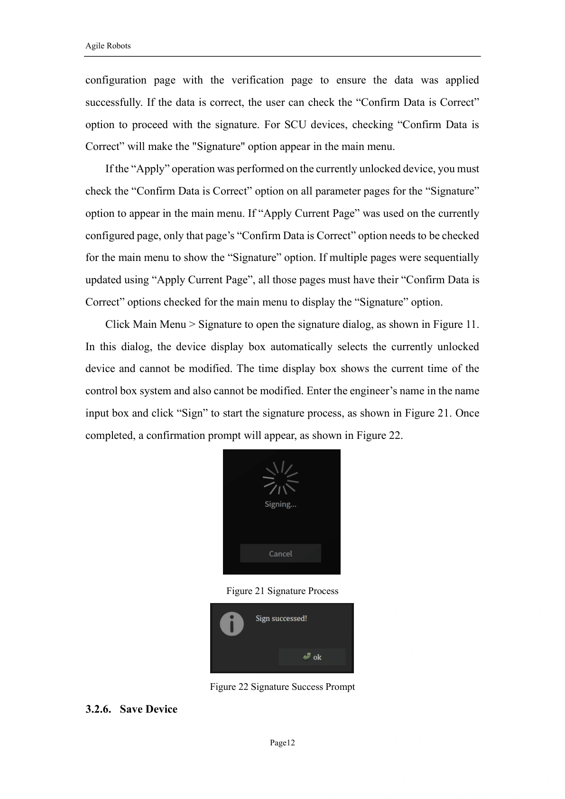



```
Agile Robots 
Page12 
configuration page with the verification page to ensure the data was applied 
successfully. If the data is correct, the user can check the “Confirm Data is Correct” 
option to proceed with the signature. For SCU devices, checking “Confirm Data is 
Correct” will make the "Signature" option appear in the main menu. 
If the “Apply” operation was performed on the currently unlocked device, you must 
check the “Confirm Data is Correct” option on all parameter pages for the “Signature” 
option to appear in the main menu. If “Apply Current Page” was used on the currently 
configured page, only that page’s “Confirm Data is Correct” option needs to be checked 
for the main menu to show the “Signature” option. If multiple pages were sequentially 
updated using “Apply Current Page”, all those pages must have their “Confirm Data is 
Correct” options checked for the main menu to display the “Signature” option. 
Click Main Menu > Signature to open the signature dialog, as shown in Figure 11. 
In this dialog, the device display box automatically selects the currently unlocked 
device and cannot be modified. The time display box shows the current time of the 
control box system and also cannot be modified. Enter the engineer’s name in the name 
input box and click “Sign” to start the signature process, as shown in Figure 21. Once 
completed, a confirmation prompt will appear, as shown in Figure 22. 
 
Figure 21 Signature Process 
 
Figure 22 Signature Success Prompt 
3.2.6. Save Device
```



## PDF page 15

**Source:** Safety Function Configuration Software User Manual\_V3.3.0\_EN\_20260204.pdf, original pdf page 15. [Open the corresponding PDF reading-copy page](https://1292444914-files.gitbook.io/~/files/v0/b/gitbook-x-prod.appspot.com/o/spaces%2FtgOfPnscWebs1eh82EKq%2Fuploads%2FdwU654a6Z3fW5StcwPHe%2Fsafety-function-configuration-software-user-manual-v3-3-0-en-20260204-pp-001-016.pdf?alt=media#page=15).



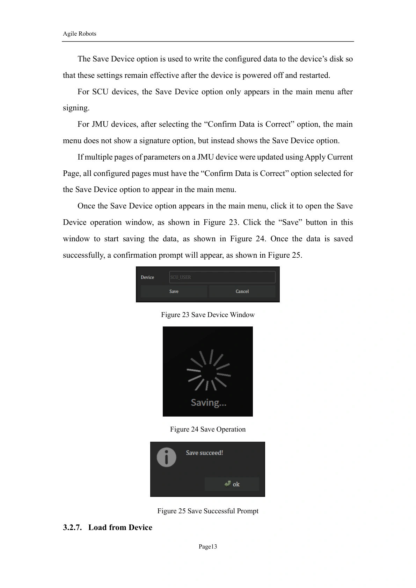



```
Agile Robots 
Page13 
The Save Device option is used to write the configured data to the device’s disk so 
that these settings remain effective after the device is powered off and restarted. 
For SCU devices, the Save Device option only appears in the main menu after 
signing. 
For JMU devices, after selecting the “Confirm Data is Correct” option, the main 
menu does not show a signature option, but instead shows the Save Device option. 
If multiple pages of parameters on a JMU device were updated using Apply Current 
Page, all configured pages must have the “Confirm Data is Correct” option selected for 
the Save Device option to appear in the main menu. 
Once the Save Device option appears in the main menu, click it to open the Save 
Device operation window, as shown in Figure 23. Click the “Save” button in this 
window to start saving the data, as shown in Figure 24. Once the data is saved 
successfully, a confirmation prompt will appear, as shown in Figure 25. 
 
Figure 23 Save Device Window 
 
Figure 24 Save Operation 
 
Figure 25 Save Successful Prompt 
3.2.7. Load from Device
```



## PDF page 16

**Source:** Safety Function Configuration Software User Manual\_V3.3.0\_EN\_20260204.pdf, original pdf page 16. [Open the corresponding PDF reading-copy page](https://1292444914-files.gitbook.io/~/files/v0/b/gitbook-x-prod.appspot.com/o/spaces%2FtgOfPnscWebs1eh82EKq%2Fuploads%2FdwU654a6Z3fW5StcwPHe%2Fsafety-function-configuration-software-user-manual-v3-3-0-en-20260204-pp-001-016.pdf?alt=media#page=16).



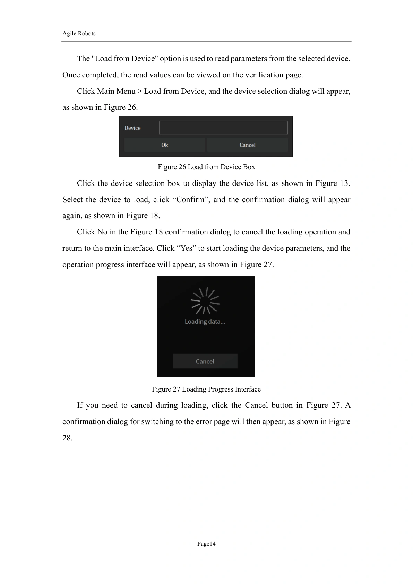



```
Agile Robots 
Page14 
The "Load from Device" option is used to read parameters from the selected device. 
Once completed, the read values can be viewed on the verification page. 
Click Main Menu > Load from Device, and the device selection dialog will appear, 
as shown in Figure 26. 
 
Figure 26 Load from Device Box 
Click the device selection box to display the device list, as shown in Figure 13. 
Select the device to load, click “Confirm”, and the confirmation dialog will appear 
again, as shown in Figure 18. 
Click No in the Figure 18 confirmation dialog to cancel the loading operation and 
return to the main interface. Click “Yes” to start loading the device parameters, and the 
operation progress interface will appear, as shown in Figure 27. 
 
Figure 27 Loading Progress Interface 
If you need to cancel during loading, click the Cancel button in Figure 27. A 
confirmation dialog for switching to the error page will then appear, as shown in Figure 
28.
```



## PDF page 17

**Source:** Safety Function Configuration Software User Manual\_V3.3.0\_EN\_20260204.pdf, original pdf page 17. [Open the corresponding PDF reading-copy page](https://1292444914-files.gitbook.io/~/files/v0/b/gitbook-x-prod.appspot.com/o/spaces%2FtgOfPnscWebs1eh82EKq%2Fuploads%2FzfjoAW2R4HBxx71v6seQ%2Fsafety-function-configuration-software-user-manual-v3-3-0-en-20260204-pp-017-024.pdf?alt=media#page=1).



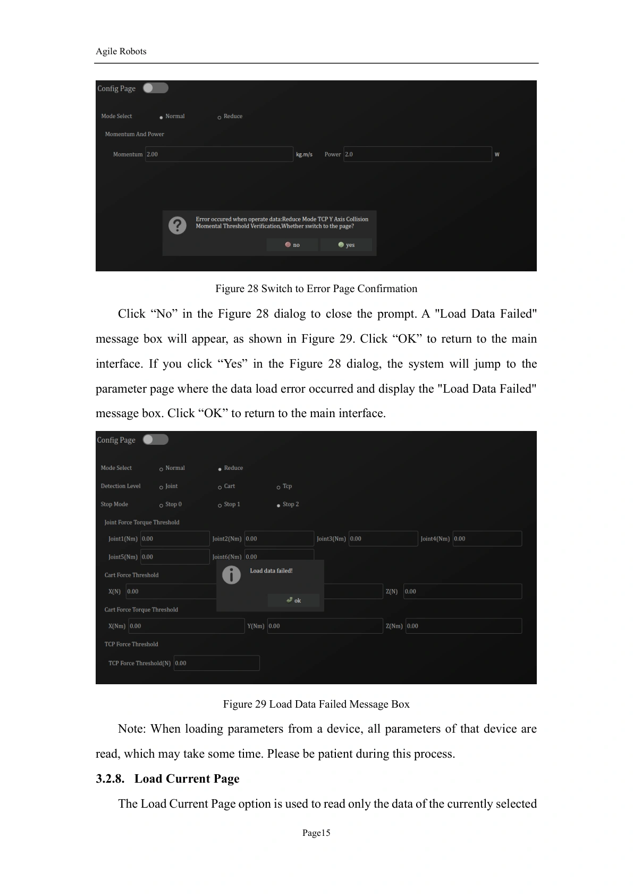



```
Agile Robots 
Page15 
 
Figure 28 Switch to Error Page Confirmation 
Click “No” in the Figure 28 dialog to close the prompt. A "Load Data Failed" 
message box will appear, as shown in Figure 29. Click “OK” to return to the main 
interface. If you click “Yes” in the Figure 28 dialog, the system will jump to the 
parameter page where the data load error occurred and display the "Load Data Failed" 
message box. Click “OK” to return to the main interface. 
 
Figure 29 Load Data Failed Message Box 
Note: When loading parameters from a device, all parameters of that device are 
read, which may take some time. Please be patient during this process. 
3.2.8. Load Current Page 
The Load Current Page option is used to read only the data of the currently selected
```



## PDF page 18

**Source:** Safety Function Configuration Software User Manual\_V3.3.0\_EN\_20260204.pdf, original pdf page 18. [Open the corresponding PDF reading-copy page](https://1292444914-files.gitbook.io/~/files/v0/b/gitbook-x-prod.appspot.com/o/spaces%2FtgOfPnscWebs1eh82EKq%2Fuploads%2FzfjoAW2R4HBxx71v6seQ%2Fsafety-function-configuration-software-user-manual-v3-3-0-en-20260204-pp-017-024.pdf?alt=media#page=2).



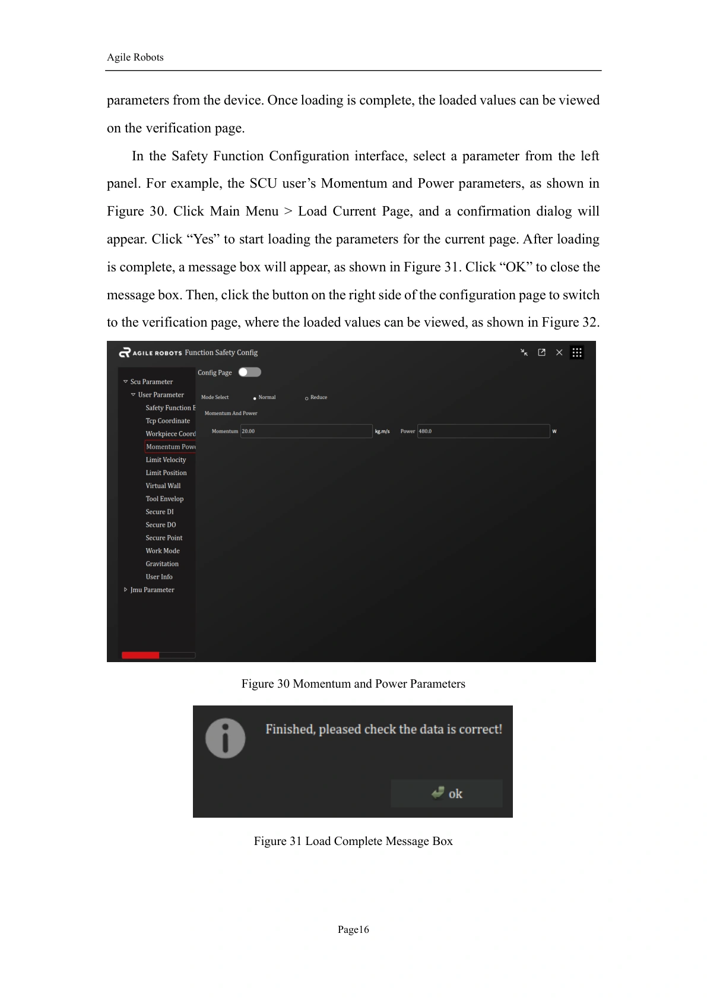



```
Agile Robots 
Page16 
parameters from the device. Once loading is complete, the loaded values can be viewed 
on the verification page. 
In the Safety Function Configuration interface, select a parameter from the left 
panel. For example, the SCU user’s Momentum and Power parameters, as shown in 
Figure 30. Click Main Menu > Load Current Page, and a confirmation dialog will 
appear. Click “Yes” to start loading the parameters for the current page. After loading 
is complete, a message box will appear, as shown in Figure 31. Click “OK” to close the 
message box. Then, click the button on the right side of the configuration page to switch 
to the verification page, where the loaded values can be viewed, as shown in Figure 32. 
 
Figure 30 Momentum and Power Parameters 
 
Figure 31 Load Complete Message Box
```



## PDF page 19

**Source:** Safety Function Configuration Software User Manual\_V3.3.0\_EN\_20260204.pdf, original pdf page 19. [Open the corresponding PDF reading-copy page](https://1292444914-files.gitbook.io/~/files/v0/b/gitbook-x-prod.appspot.com/o/spaces%2FtgOfPnscWebs1eh82EKq%2Fuploads%2FzfjoAW2R4HBxx71v6seQ%2Fsafety-function-configuration-software-user-manual-v3-3-0-en-20260204-pp-017-024.pdf?alt=media#page=3).



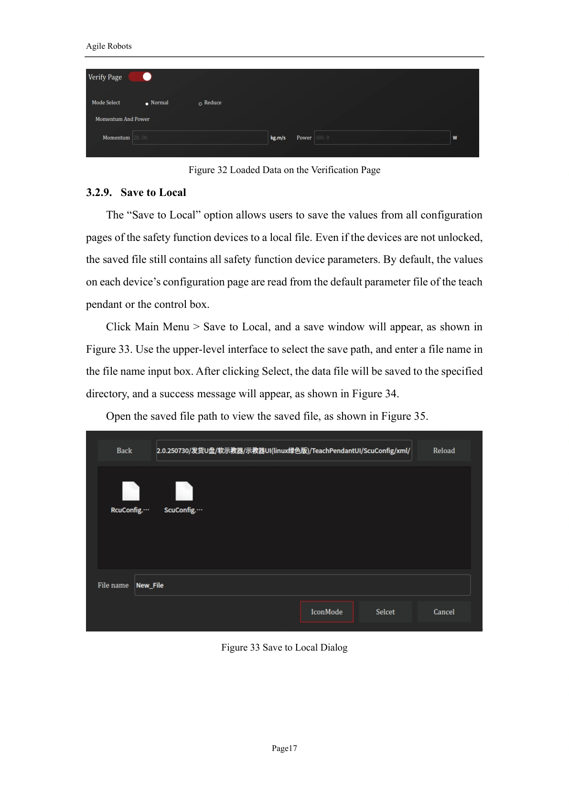



```
Agile Robots 
Page17 
 
Figure 32 Loaded Data on the Verification Page 
3.2.9. Save to Local 
The “Save to Local” option allows users to save the values from all configuration 
pages of the safety function devices to a local file. Even if the devices are not unlocked, 
the saved file still contains all safety function device parameters. By default, the values 
on each device’s configuration page are read from the default parameter file of the teach 
pendant or the control box. 
Click Main Menu > Save to Local, and a save window will appear, as shown in 
Figure 33. Use the upper-level interface to select the save path, and enter a file name in 
the file name input box. After clicking Select, the data file will be saved to the specified 
directory, and a success message will appear, as shown in Figure 34. 
Open the saved file path to view the saved file, as shown in Figure 35. 
 
Figure 33 Save to Local Dialog
```



## PDF page 20

**Source:** Safety Function Configuration Software User Manual\_V3.3.0\_EN\_20260204.pdf, original pdf page 20. [Open the corresponding PDF reading-copy page](https://1292444914-files.gitbook.io/~/files/v0/b/gitbook-x-prod.appspot.com/o/spaces%2FtgOfPnscWebs1eh82EKq%2Fuploads%2FzfjoAW2R4HBxx71v6seQ%2Fsafety-function-configuration-software-user-manual-v3-3-0-en-20260204-pp-017-024.pdf?alt=media#page=4).



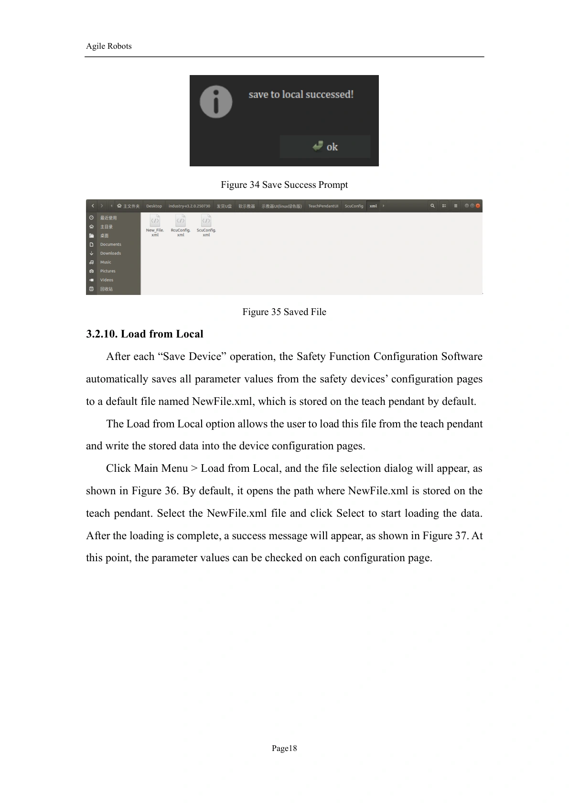



```
Agile Robots 
Page18 
 
Figure 34 Save Success Prompt 
 
Figure 35 Saved File 
3.2.10. Load from Local 
After each “Save Device” operation, the Safety Function Configuration Software 
automatically saves all parameter values from the safety devices’ configuration pages 
to a default file named NewFile.xml, which is stored on the teach pendant by default. 
The Load from Local option allows the user to load this file from the teach pendant 
and write the stored data into the device configuration pages. 
Click Main Menu > Load from Local, and the file selection dialog will appear, as 
shown in Figure 36. By default, it opens the path where NewFile.xml is stored on the 
teach pendant. Select the NewFile.xml file and click Select to start loading the data. 
After the loading is complete, a success message will appear, as shown in Figure 37. At 
this point, the parameter values can be checked on each configuration page.
```



## PDF page 21

**Source:** Safety Function Configuration Software User Manual\_V3.3.0\_EN\_20260204.pdf, original pdf page 21. [Open the corresponding PDF reading-copy page](https://1292444914-files.gitbook.io/~/files/v0/b/gitbook-x-prod.appspot.com/o/spaces%2FtgOfPnscWebs1eh82EKq%2Fuploads%2FzfjoAW2R4HBxx71v6seQ%2Fsafety-function-configuration-software-user-manual-v3-3-0-en-20260204-pp-017-024.pdf?alt=media#page=5).



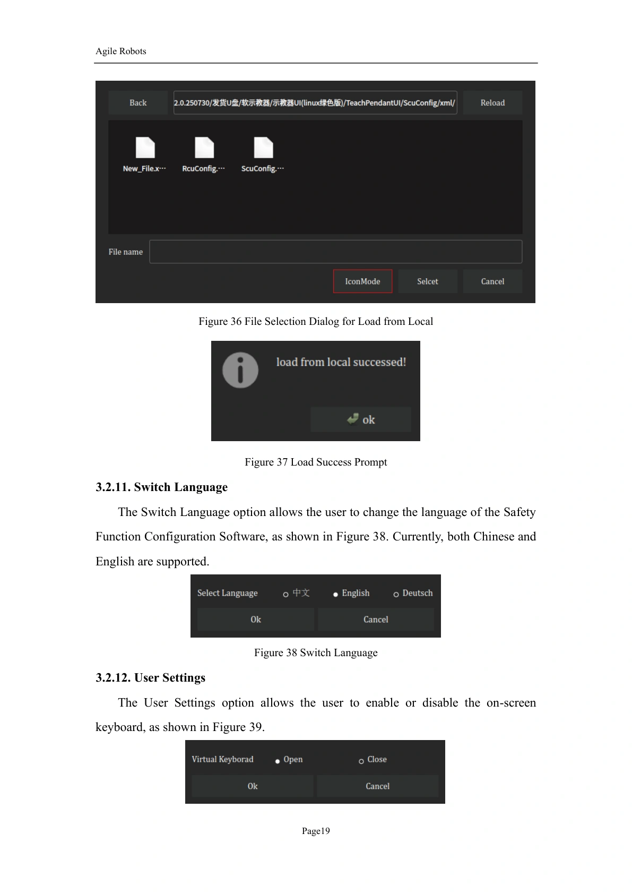



```
Agile Robots 
Page19 
 
Figure 36 File Selection Dialog for Load from Local 
 
Figure 37 Load Success Prompt 
3.2.11. Switch Language 
The Switch Language option allows the user to change the language of the Safety 
Function Configuration Software, as shown in Figure 38. Currently, both Chinese and 
English are supported. 
 
Figure 38 Switch Language 
3.2.12. User Settings 
The User Settings option allows the user to enable or disable the on-screen 
keyboard, as shown in Figure 39.
```



## PDF page 22

**Source:** Safety Function Configuration Software User Manual\_V3.3.0\_EN\_20260204.pdf, original pdf page 22. [Open the corresponding PDF reading-copy page](https://1292444914-files.gitbook.io/~/files/v0/b/gitbook-x-prod.appspot.com/o/spaces%2FtgOfPnscWebs1eh82EKq%2Fuploads%2FzfjoAW2R4HBxx71v6seQ%2Fsafety-function-configuration-software-user-manual-v3-3-0-en-20260204-pp-017-024.pdf?alt=media#page=6).



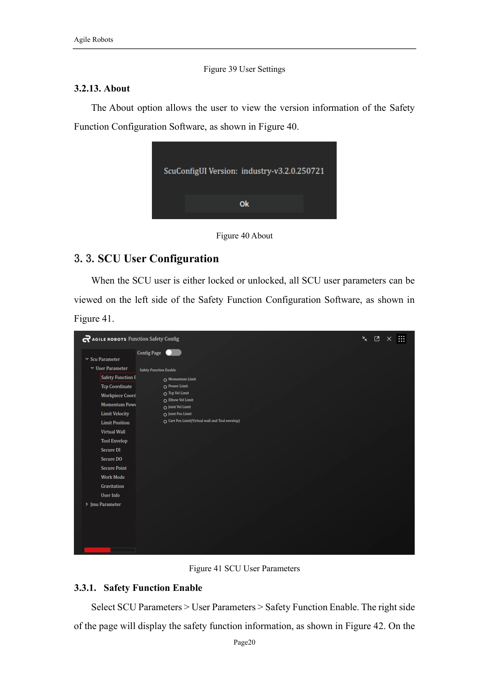



```
Agile Robots 
Page20 
Figure 39 User Settings 
3.2.13. About 
The About option allows the user to view the version information of the Safety 
Function Configuration Software, as shown in Figure 40. 
 
Figure 40 About 
3.3. SCU User Configuration 
When the SCU user is either locked or unlocked, all SCU user parameters can be 
viewed on the left side of the Safety Function Configuration Software, as shown in 
Figure 41. 
 
Figure 41 SCU User Parameters 
3.3.1. Safety Function Enable 
Select SCU Parameters > User Parameters > Safety Function Enable. The right side 
of the page will display the safety function information, as shown in Figure 42. On the
```



## PDF page 23

**Source:** Safety Function Configuration Software User Manual\_V3.3.0\_EN\_20260204.pdf, original pdf page 23. [Open the corresponding PDF reading-copy page](https://1292444914-files.gitbook.io/~/files/v0/b/gitbook-x-prod.appspot.com/o/spaces%2FtgOfPnscWebs1eh82EKq%2Fuploads%2FzfjoAW2R4HBxx71v6seQ%2Fsafety-function-configuration-software-user-manual-v3-3-0-en-20260204-pp-017-024.pdf?alt=media#page=7).



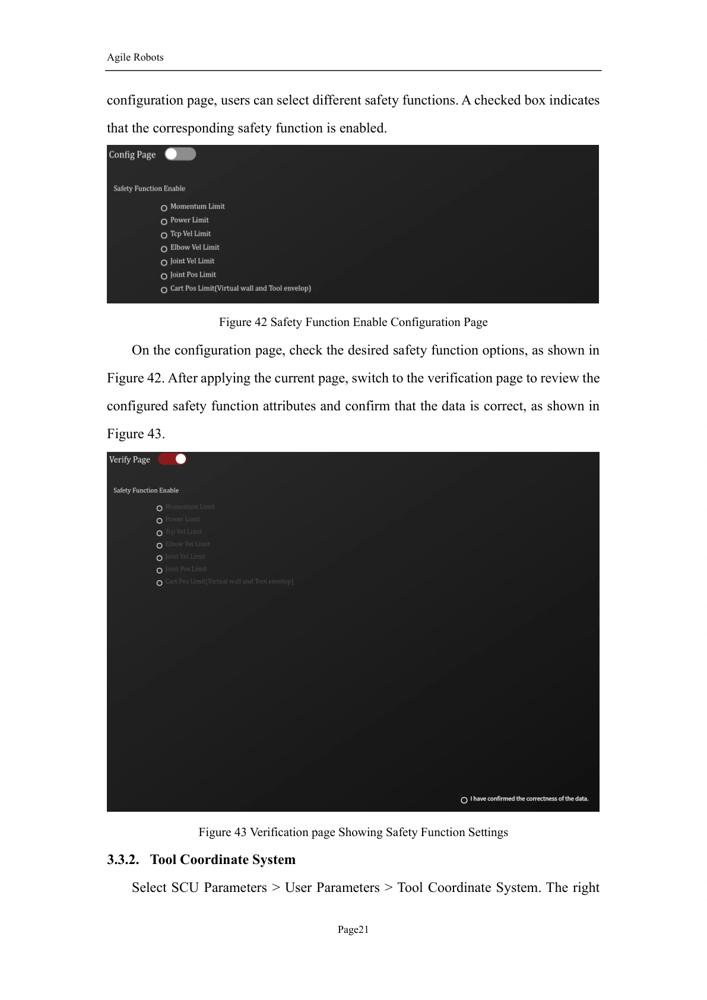



```
Agile Robots 
Page21 
configuration page, users can select different safety functions. A checked box indicates 
that the corresponding safety function is enabled. 
 
Figure 42 Safety Function Enable Configuration Page 
On the configuration page, check the desired safety function options, as shown in 
Figure 42. After applying the current page, switch to the verification page to review the 
configured safety function attributes and confirm that the data is correct, as shown in 
Figure 43. 
 
Figure 43 Verification page Showing Safety Function Settings 
3.3.2. Tool Coordinate System 
Select SCU Parameters > User Parameters > Tool Coordinate System. The right
```



## PDF page 24

**Source:** Safety Function Configuration Software User Manual\_V3.3.0\_EN\_20260204.pdf, original pdf page 24. [Open the corresponding PDF reading-copy page](https://1292444914-files.gitbook.io/~/files/v0/b/gitbook-x-prod.appspot.com/o/spaces%2FtgOfPnscWebs1eh82EKq%2Fuploads%2FzfjoAW2R4HBxx71v6seQ%2Fsafety-function-configuration-software-user-manual-v3-3-0-en-20260204-pp-017-024.pdf?alt=media#page=8).



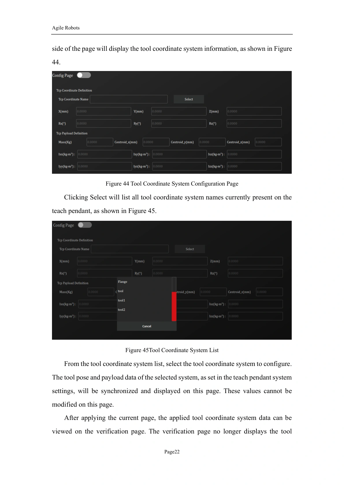



```
Agile Robots 
Page22 
side of the page will display the tool coordinate system information, as shown in Figure 
44. 
 
Figure 44 Tool Coordinate System Configuration Page 
Clicking Select will list all tool coordinate system names currently present on the 
teach pendant, as shown in Figure 45. 
 
Figure 45Tool Coordinate System List 
From the tool coordinate system list, select the tool coordinate system to configure. 
The tool pose and payload data of the selected system, as set in the teach pendant system 
settings, will be synchronized and displayed on this page. These values cannot be 
modified on this page. 
After applying the current page, the applied tool coordinate system data can be 
viewed on the verification page. The verification page no longer displays the tool
```



## PDF page 25

**Source:** Safety Function Configuration Software User Manual\_V3.3.0\_EN\_20260204.pdf, original pdf page 25. [Open the corresponding PDF reading-copy page](https://1292444914-files.gitbook.io/~/files/v0/b/gitbook-x-prod.appspot.com/o/spaces%2FtgOfPnscWebs1eh82EKq%2Fuploads%2FyHU5yvIzRy0OPkkGEETL%2Fsafety-function-configuration-software-user-manual-v3-3-0-en-20260204-pp-025-032.pdf?alt=media#page=1).



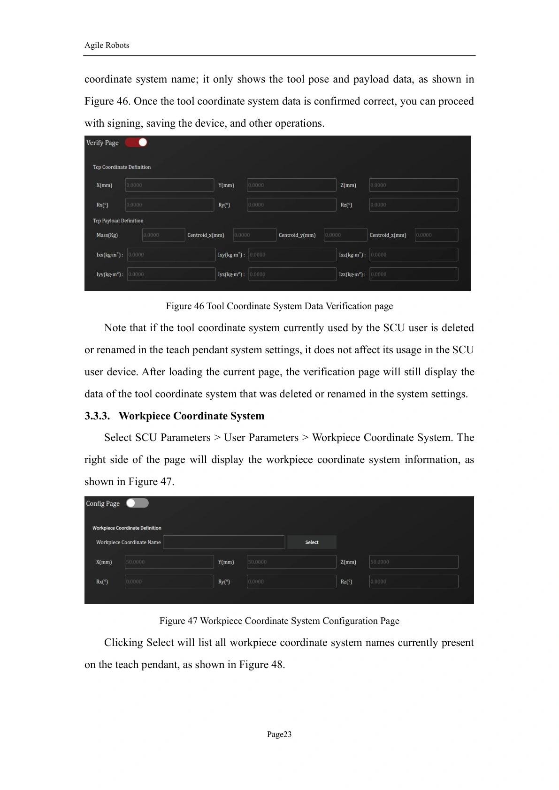



```
Agile Robots 
Page23 
coordinate system name; it only shows the tool pose and payload data, as shown in 
Figure 46. Once the tool coordinate system data is confirmed correct, you can proceed 
with signing, saving the device, and other operations. 
 
Figure 46 Tool Coordinate System Data Verification page 
Note that if the tool coordinate system currently used by the SCU user is deleted 
or renamed in the teach pendant system settings, it does not affect its usage in the SCU 
user device. After loading the current page, the verification page will still display the 
data of the tool coordinate system that was deleted or renamed in the system settings. 
3.3.3. Workpiece Coordinate System 
Select SCU Parameters > User Parameters > Workpiece Coordinate System. The 
right side of the page will display the workpiece coordinate system information, as 
shown in Figure 47. 
 
Figure 47 Workpiece Coordinate System Configuration Page 
Clicking Select will list all workpiece coordinate system names currently present 
on the teach pendant, as shown in Figure 48.
```



## PDF page 26

**Source:** Safety Function Configuration Software User Manual\_V3.3.0\_EN\_20260204.pdf, original pdf page 26. [Open the corresponding PDF reading-copy page](https://1292444914-files.gitbook.io/~/files/v0/b/gitbook-x-prod.appspot.com/o/spaces%2FtgOfPnscWebs1eh82EKq%2Fuploads%2FyHU5yvIzRy0OPkkGEETL%2Fsafety-function-configuration-software-user-manual-v3-3-0-en-20260204-pp-025-032.pdf?alt=media#page=2).



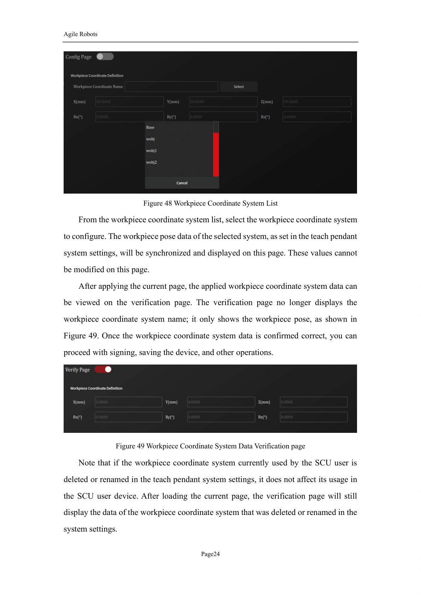



```
Agile Robots 
Page24 
 
Figure 48 Workpiece Coordinate System List 
From the workpiece coordinate system list, select the workpiece coordinate system 
to configure. The workpiece pose data of the selected system, as set in the teach pendant 
system settings, will be synchronized and displayed on this page. These values cannot 
be modified on this page. 
After applying the current page, the applied workpiece coordinate system data can 
be viewed on the verification page. The verification page no longer displays the 
workpiece coordinate system name; it only shows the workpiece pose, as shown in 
Figure 49. Once the workpiece coordinate system data is confirmed correct, you can 
proceed with signing, saving the device, and other operations. 
 
Figure 49 Workpiece Coordinate System Data Verification page 
Note that if the workpiece coordinate system currently used by the SCU user is 
deleted or renamed in the teach pendant system settings, it does not affect its usage in 
the SCU user device. After loading the current page, the verification page will still 
display the data of the workpiece coordinate system that was deleted or renamed in the 
system settings.
```



## PDF page 27

**Source:** Safety Function Configuration Software User Manual\_V3.3.0\_EN\_20260204.pdf, original pdf page 27. [Open the corresponding PDF reading-copy page](https://1292444914-files.gitbook.io/~/files/v0/b/gitbook-x-prod.appspot.com/o/spaces%2FtgOfPnscWebs1eh82EKq%2Fuploads%2FyHU5yvIzRy0OPkkGEETL%2Fsafety-function-configuration-software-user-manual-v3-3-0-en-20260204-pp-025-032.pdf?alt=media#page=3).



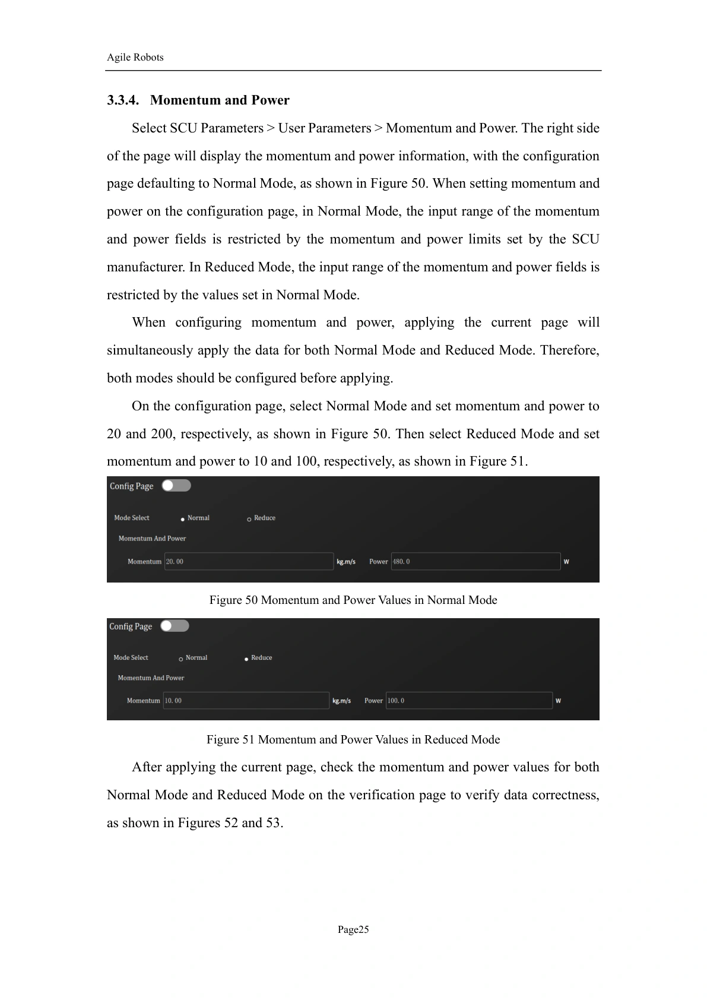



```
Agile Robots 
Page25 
3.3.4. Momentum and Power 
Select SCU Parameters > User Parameters > Momentum and Power. The right side 
of the page will display the momentum and power information, with the configuration 
page defaulting to Normal Mode, as shown in Figure 50. When setting momentum and 
power on the configuration page, in Normal Mode, the input range of the momentum 
and power fields is restricted by the momentum and power limits set by the SCU 
manufacturer. In Reduced Mode, the input range of the momentum and power fields is 
restricted by the values set in Normal Mode. 
When configuring momentum and power, applying the current page will 
simultaneously apply the data for both Normal Mode and Reduced Mode. Therefore, 
both modes should be configured before applying. 
On the configuration page, select Normal Mode and set momentum and power to 
20 and 200, respectively, as shown in Figure 50. Then select Reduced Mode and set 
momentum and power to 10 and 100, respectively, as shown in Figure 51. 
 
Figure 50 Momentum and Power Values in Normal Mode 
 
Figure 51 Momentum and Power Values in Reduced Mode 
After applying the current page, check the momentum and power values for both 
Normal Mode and Reduced Mode on the verification page to verify data correctness, 
as shown in Figures 52 and 53.
```



## PDF page 28

**Source:** Safety Function Configuration Software User Manual\_V3.3.0\_EN\_20260204.pdf, original pdf page 28. [Open the corresponding PDF reading-copy page](https://1292444914-files.gitbook.io/~/files/v0/b/gitbook-x-prod.appspot.com/o/spaces%2FtgOfPnscWebs1eh82EKq%2Fuploads%2FyHU5yvIzRy0OPkkGEETL%2Fsafety-function-configuration-software-user-manual-v3-3-0-en-20260204-pp-025-032.pdf?alt=media#page=4).



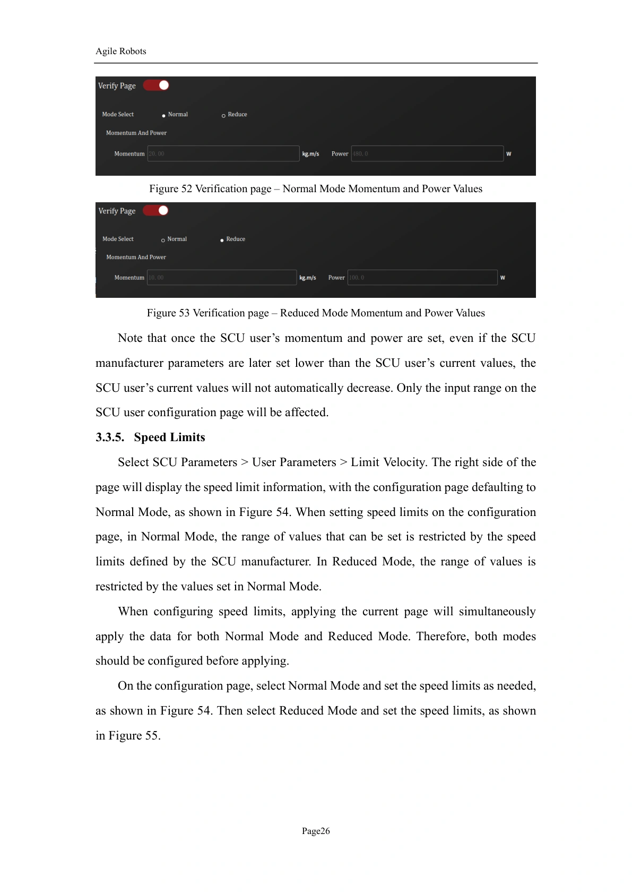



```
Agile Robots 
Page26 
 
Figure 52 Verification page – Normal Mode Momentum and Power Values 
 
Figure 53 Verification page – Reduced Mode Momentum and Power Values 
Note that once the SCU user’s momentum and power are set, even if the SCU 
manufacturer parameters are later set lower than the SCU user’s current values, the 
SCU user’s current values will not automatically decrease. Only the input range on the 
SCU user configuration page will be affected. 
3.3.5. Speed Limits 
Select SCU Parameters > User Parameters > Limit Velocity. The right side of the 
page will display the speed limit information, with the configuration page defaulting to 
Normal Mode, as shown in Figure 54. When setting speed limits on the configuration 
page, in Normal Mode, the range of values that can be set is restricted by the speed 
limits defined by the SCU manufacturer. In Reduced Mode, the range of values is 
restricted by the values set in Normal Mode. 
When configuring speed limits, applying the current page will simultaneously 
apply the data for both Normal Mode and Reduced Mode. Therefore, both modes 
should be configured before applying. 
On the configuration page, select Normal Mode and set the speed limits as needed, 
as shown in Figure 54. Then select Reduced Mode and set the speed limits, as shown 
in Figure 55.
```



## PDF page 29

**Source:** Safety Function Configuration Software User Manual\_V3.3.0\_EN\_20260204.pdf, original pdf page 29. [Open the corresponding PDF reading-copy page](https://1292444914-files.gitbook.io/~/files/v0/b/gitbook-x-prod.appspot.com/o/spaces%2FtgOfPnscWebs1eh82EKq%2Fuploads%2FyHU5yvIzRy0OPkkGEETL%2Fsafety-function-configuration-software-user-manual-v3-3-0-en-20260204-pp-025-032.pdf?alt=media#page=5).



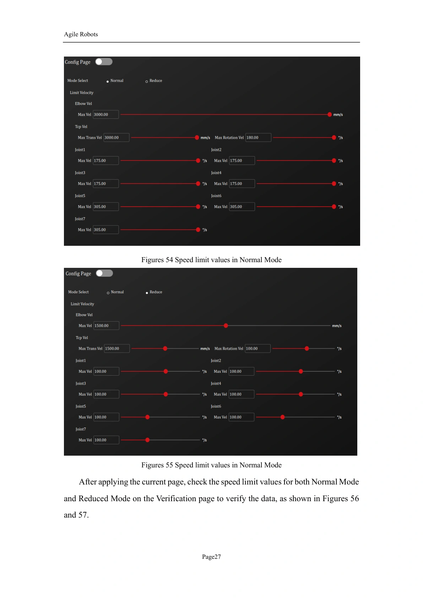



```
Agile Robots 
Page27 
 
Figures 54 Speed limit values in Normal Mode 
 
Figures 55 Speed limit values in Normal Mode 
After applying the current page, check the speed limit values for both Normal Mode 
and Reduced Mode on the Verification page to verify the data, as shown in Figures 56 
and 57.
```



## PDF page 30

**Source:** Safety Function Configuration Software User Manual\_V3.3.0\_EN\_20260204.pdf, original pdf page 30. [Open the corresponding PDF reading-copy page](https://1292444914-files.gitbook.io/~/files/v0/b/gitbook-x-prod.appspot.com/o/spaces%2FtgOfPnscWebs1eh82EKq%2Fuploads%2FyHU5yvIzRy0OPkkGEETL%2Fsafety-function-configuration-software-user-manual-v3-3-0-en-20260204-pp-025-032.pdf?alt=media#page=6).



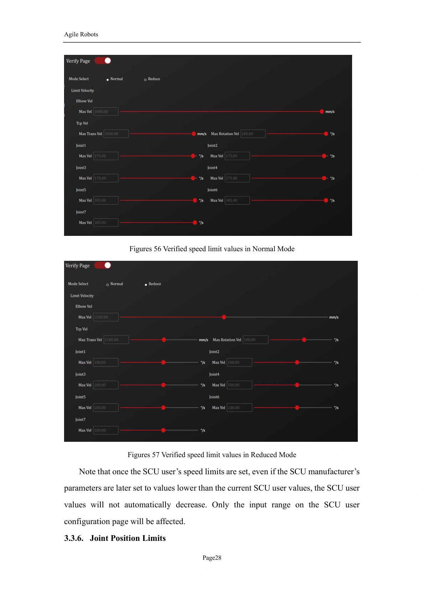



```
Agile Robots 
Page28 
 
Figures 56 Verified speed limit values in Normal Mode 
 
Figures 57 Verified speed limit values in Reduced Mode 
Note that once the SCU user’s speed limits are set, even if the SCU manufacturer’s 
parameters are later set to values lower than the current SCU user values, the SCU user 
values will not automatically decrease. Only the input range on the SCU user 
configuration page will be affected. 
3.3.6. Joint Position Limits
```



## PDF page 31

**Source:** Safety Function Configuration Software User Manual\_V3.3.0\_EN\_20260204.pdf, original pdf page 31. [Open the corresponding PDF reading-copy page](https://1292444914-files.gitbook.io/~/files/v0/b/gitbook-x-prod.appspot.com/o/spaces%2FtgOfPnscWebs1eh82EKq%2Fuploads%2FyHU5yvIzRy0OPkkGEETL%2Fsafety-function-configuration-software-user-manual-v3-3-0-en-20260204-pp-025-032.pdf?alt=media#page=7).



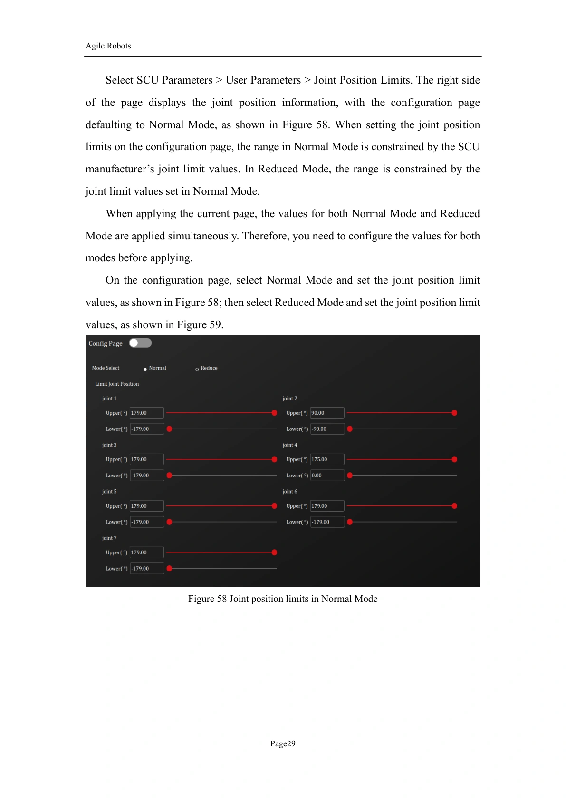



```
Agile Robots 
Page29 
Select SCU Parameters > User Parameters > Joint Position Limits. The right side 
of the page displays the joint position information, with the configuration page 
defaulting to Normal Mode, as shown in Figure 58. When setting the joint position 
limits on the configuration page, the range in Normal Mode is constrained by the SCU 
manufacturer’s joint limit values. In Reduced Mode, the range is constrained by the 
joint limit values set in Normal Mode. 
When applying the current page, the values for both Normal Mode and Reduced 
Mode are applied simultaneously. Therefore, you need to configure the values for both 
modes before applying. 
On the configuration page, select Normal Mode and set the joint position limit 
values, as shown in Figure 58; then select Reduced Mode and set the joint position limit 
values, as shown in Figure 59. 
 
Figure 58 Joint position limits in Normal Mode
```



## PDF page 32

**Source:** Safety Function Configuration Software User Manual\_V3.3.0\_EN\_20260204.pdf, original pdf page 32. [Open the corresponding PDF reading-copy page](https://1292444914-files.gitbook.io/~/files/v0/b/gitbook-x-prod.appspot.com/o/spaces%2FtgOfPnscWebs1eh82EKq%2Fuploads%2FyHU5yvIzRy0OPkkGEETL%2Fsafety-function-configuration-software-user-manual-v3-3-0-en-20260204-pp-025-032.pdf?alt=media#page=8).



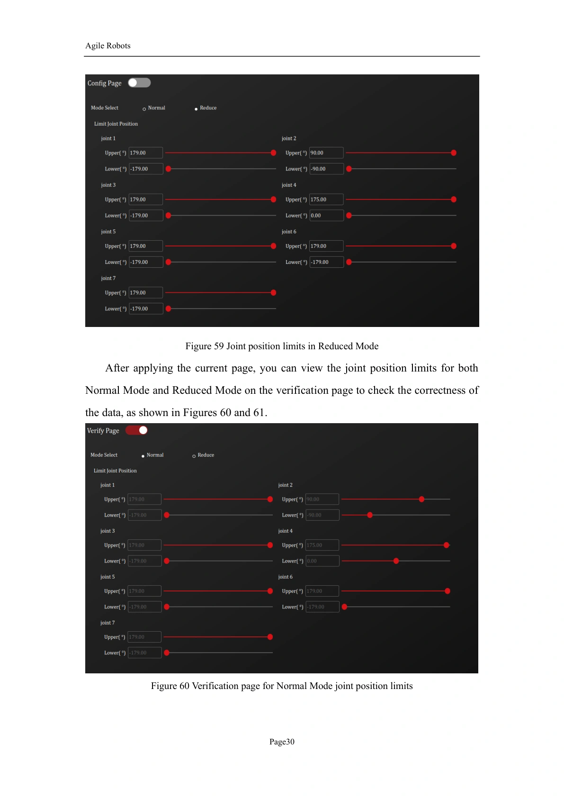



```
Agile Robots 
Page30 
 
Figure 59 Joint position limits in Reduced Mode 
After applying the current page, you can view the joint position limits for both 
Normal Mode and Reduced Mode on the verification page to check the correctness of 
the data, as shown in Figures 60 and 61. 
 
Figure 60 Verification page for Normal Mode joint position limits
```



## PDF page 33

**Source:** Safety Function Configuration Software User Manual\_V3.3.0\_EN\_20260204.pdf, original pdf page 33. [Open the corresponding PDF reading-copy page](https://1292444914-files.gitbook.io/~/files/v0/b/gitbook-x-prod.appspot.com/o/spaces%2FtgOfPnscWebs1eh82EKq%2Fuploads%2F9fyQ2VX5WCZZkwVnGHL7%2Fsafety-function-configuration-software-user-manual-v3-3-0-en-20260204-pp-033-038.pdf?alt=media#page=1).



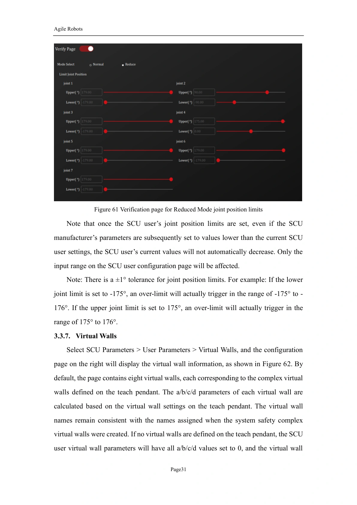



```
Agile Robots 
Page31 
 
Figure 61 Verification page for Reduced Mode joint position limits 
Note that once the SCU user’s joint position limits are set, even if the SCU 
manufacturer’s parameters are subsequently set to values lower than the current SCU 
user settings, the SCU user’s current values will not automatically decrease. Only the 
input range on the SCU user configuration page will be affected. 
Note: There is a ±1° tolerance for joint position limits. For example: If the lower 
joint limit is set to -175°, an over-limit will actually trigger in the range of -175° to -
176°. If the upper joint limit is set to 175°, an over-limit will actually trigger in the 
range of 175° to 176°. 
3.3.7. Virtual Walls 
Select SCU Parameters > User Parameters > Virtual Walls, and the configuration 
page on the right will display the virtual wall information, as shown in Figure 62. By 
default, the page contains eight virtual walls, each corresponding to the complex virtual 
walls defined on the teach pendant. The a/b/c/d parameters of each virtual wall are 
calculated based on the virtual wall settings on the teach pendant. The virtual wall 
names remain consistent with the names assigned when the system safety complex 
virtual walls were created. If no virtual walls are defined on the teach pendant, the SCU 
user virtual wall parameters will have all a/b/c/d values set to 0, and the virtual wall
```



## PDF page 34

**Source:** Safety Function Configuration Software User Manual\_V3.3.0\_EN\_20260204.pdf, original pdf page 34. [Open the corresponding PDF reading-copy page](https://1292444914-files.gitbook.io/~/files/v0/b/gitbook-x-prod.appspot.com/o/spaces%2FtgOfPnscWebs1eh82EKq%2Fuploads%2F9fyQ2VX5WCZZkwVnGHL7%2Fsafety-function-configuration-software-user-manual-v3-3-0-en-20260204-pp-033-038.pdf?alt=media#page=2).



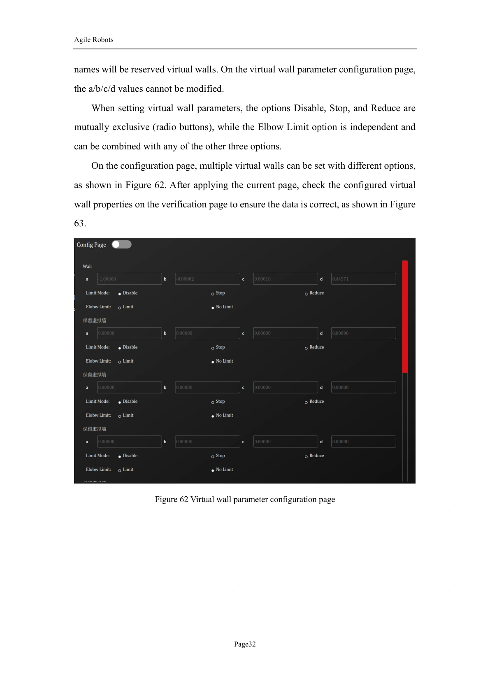



```
Agile Robots 
Page32 
names will be reserved virtual walls. On the virtual wall parameter configuration page, 
the a/b/c/d values cannot be modified. 
When setting virtual wall parameters, the options Disable, Stop, and Reduce are 
mutually exclusive (radio buttons), while the Elbow Limit option is independent and 
can be combined with any of the other three options. 
On the configuration page, multiple virtual walls can be set with different options, 
as shown in Figure 62. After applying the current page, check the configured virtual 
wall properties on the verification page to ensure the data is correct, as shown in Figure 
63. 
 
Figure 62 Virtual wall parameter configuration page
```



## PDF page 35

**Source:** Safety Function Configuration Software User Manual\_V3.3.0\_EN\_20260204.pdf, original pdf page 35. [Open the corresponding PDF reading-copy page](https://1292444914-files.gitbook.io/~/files/v0/b/gitbook-x-prod.appspot.com/o/spaces%2FtgOfPnscWebs1eh82EKq%2Fuploads%2F9fyQ2VX5WCZZkwVnGHL7%2Fsafety-function-configuration-software-user-manual-v3-3-0-en-20260204-pp-033-038.pdf?alt=media#page=3).



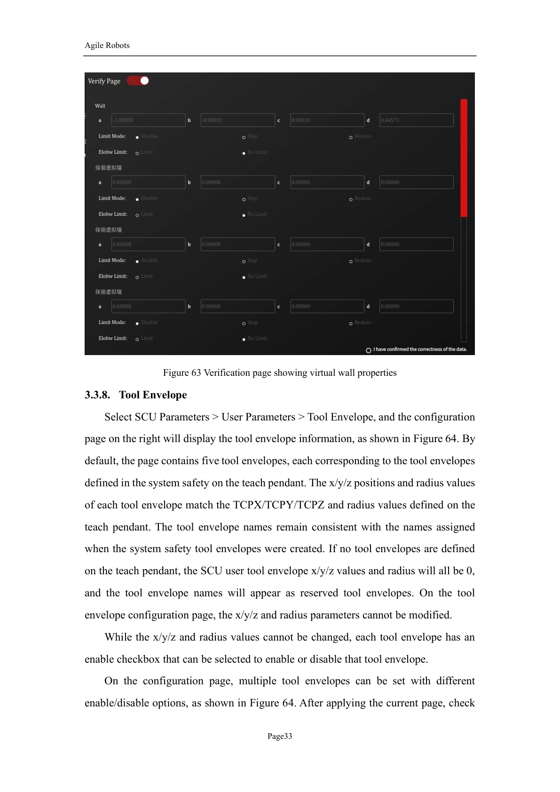



```
Agile Robots 
Page33 
 
Figure 63 Verification page showing virtual wall properties 
3.3.8. Tool Envelope 
Select SCU Parameters > User Parameters > Tool Envelope, and the configuration 
page on the right will display the tool envelope information, as shown in Figure 64. By 
default, the page contains five tool envelopes, each corresponding to the tool envelopes 
defined in the system safety on the teach pendant. The x/y/z positions and radius values 
of each tool envelope match the TCPX/TCPY/TCPZ and radius values defined on the 
teach pendant. The tool envelope names remain consistent with the names assigned 
when the system safety tool envelopes were created. If no tool envelopes are defined 
on the teach pendant, the SCU user tool envelope x/y/z values and radius will all be 0, 
and the tool envelope names will appear as reserved tool envelopes. On the tool 
envelope configuration page, the x/y/z and radius parameters cannot be modified. 
While the x/y/z and radius values cannot be changed, each tool envelope has an 
enable checkbox that can be selected to enable or disable that tool envelope. 
On the configuration page, multiple tool envelopes can be set with different 
enable/disable options, as shown in Figure 64. After applying the current page, check
```



## PDF page 36

**Source:** Safety Function Configuration Software User Manual\_V3.3.0\_EN\_20260204.pdf, original pdf page 36. [Open the corresponding PDF reading-copy page](https://1292444914-files.gitbook.io/~/files/v0/b/gitbook-x-prod.appspot.com/o/spaces%2FtgOfPnscWebs1eh82EKq%2Fuploads%2F9fyQ2VX5WCZZkwVnGHL7%2Fsafety-function-configuration-software-user-manual-v3-3-0-en-20260204-pp-033-038.pdf?alt=media#page=4).



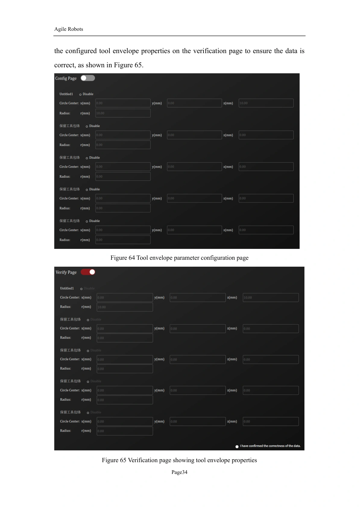



```
Agile Robots 
Page34 
the configured tool envelope properties on the verification page to ensure the data is 
correct, as shown in Figure 65. 
 
Figure 64 Tool envelope parameter configuration page 
 
Figure 65 Verification page showing tool envelope properties
```



## PDF page 37

**Source:** Safety Function Configuration Software User Manual\_V3.3.0\_EN\_20260204.pdf, original pdf page 37. [Open the corresponding PDF reading-copy page](https://1292444914-files.gitbook.io/~/files/v0/b/gitbook-x-prod.appspot.com/o/spaces%2FtgOfPnscWebs1eh82EKq%2Fuploads%2F9fyQ2VX5WCZZkwVnGHL7%2Fsafety-function-configuration-software-user-manual-v3-3-0-en-20260204-pp-033-038.pdf?alt=media#page=5).



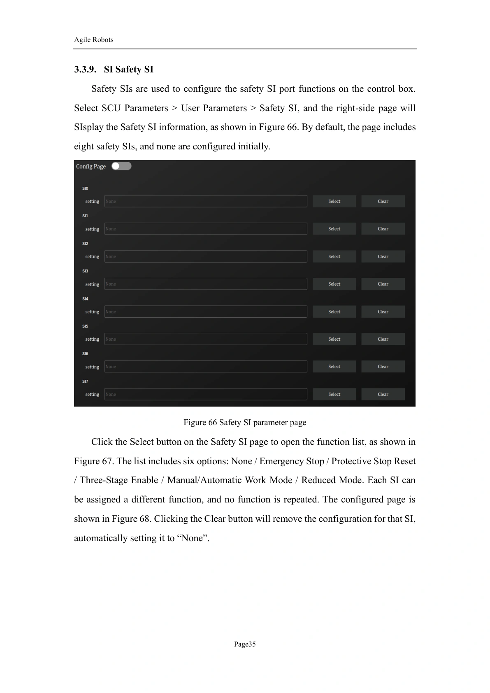



```
Agile Robots 
Page35 
3.3.9. SI Safety SI 
Safety SIs are used to configure the safety SI port functions on the control box. 
Select SCU Parameters > User Parameters > Safety SI, and the right-side page will 
SIsplay the Safety SI information, as shown in Figure 66. By default, the page includes 
eight safety SIs, and none are configured initially. 
 
Figure 66 Safety SI parameter page 
Click the Select button on the Safety SI page to open the function list, as shown in 
Figure 67. The list includes six options: None / Emergency Stop / Protective Stop Reset 
/ Three-Stage Enable / Manual/Automatic Work Mode / Reduced Mode. Each SI can 
be assigned a different function, and no function is repeated. The configured page is 
shown in Figure 68. Clicking the Clear button will remove the configuration for that SI, 
automatically setting it to “None”.
```



## PDF page 38

**Source:** Safety Function Configuration Software User Manual\_V3.3.0\_EN\_20260204.pdf, original pdf page 38. [Open the corresponding PDF reading-copy page](https://1292444914-files.gitbook.io/~/files/v0/b/gitbook-x-prod.appspot.com/o/spaces%2FtgOfPnscWebs1eh82EKq%2Fuploads%2F9fyQ2VX5WCZZkwVnGHL7%2Fsafety-function-configuration-software-user-manual-v3-3-0-en-20260204-pp-033-038.pdf?alt=media#page=6).



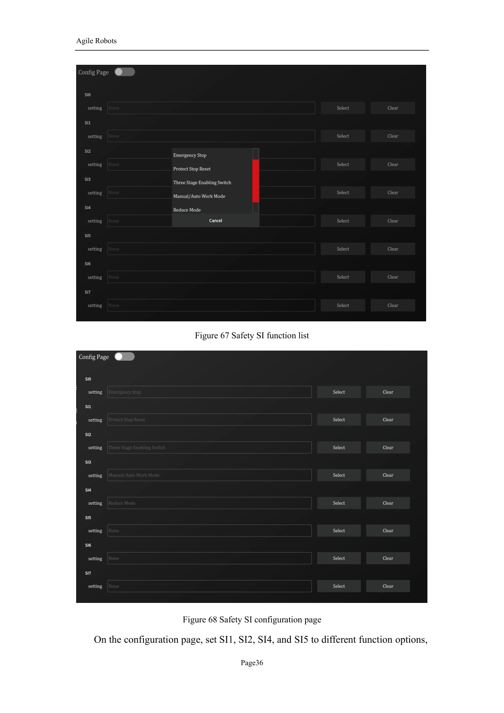



```
Agile Robots 
Page36 
 
Figure 67 Safety SI function list 
 
Figure 68 Safety SI configuration page 
On the configuration page, set SI1, SI2, SI4, and SI5 to different function options,
```



## PDF page 39

**Source:** Safety Function Configuration Software User Manual\_V3.3.0\_EN\_20260204.pdf, original pdf page 39. [Open the corresponding PDF reading-copy page](https://1292444914-files.gitbook.io/~/files/v0/b/gitbook-x-prod.appspot.com/o/spaces%2FtgOfPnscWebs1eh82EKq%2Fuploads%2FKs0XWt2Ek924WSLFAP2b%2Fsafety-function-configuration-software-user-manual-v3-3-0-en-20260204-pp-039-044.pdf?alt=media#page=1).



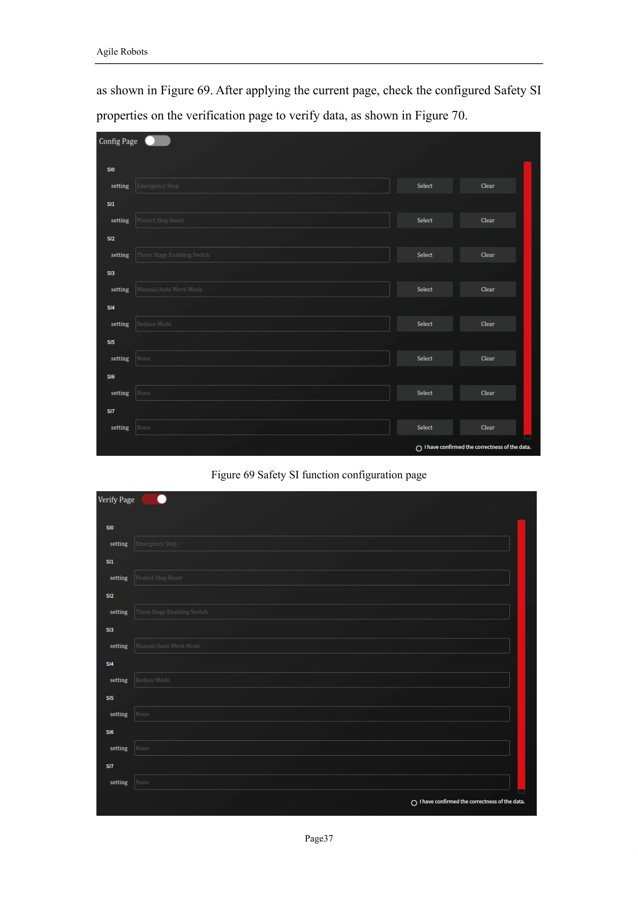



```
Agile Robots 
Page37 
as shown in Figure 69. After applying the current page, check the configured Safety SI 
properties on the verification page to verify data, as shown in Figure 70. 
 
Figure 69 Safety SI function configuration page
```



## PDF page 40

**Source:** Safety Function Configuration Software User Manual\_V3.3.0\_EN\_20260204.pdf, original pdf page 40. [Open the corresponding PDF reading-copy page](https://1292444914-files.gitbook.io/~/files/v0/b/gitbook-x-prod.appspot.com/o/spaces%2FtgOfPnscWebs1eh82EKq%2Fuploads%2FKs0XWt2Ek924WSLFAP2b%2Fsafety-function-configuration-software-user-manual-v3-3-0-en-20260204-pp-039-044.pdf?alt=media#page=2).



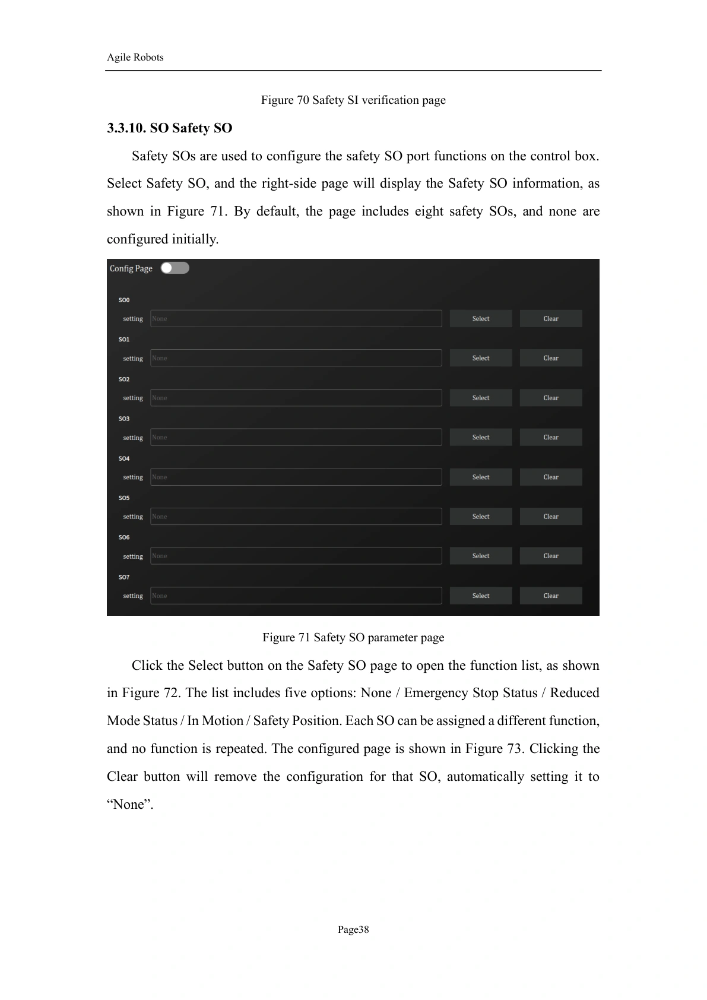



```
Agile Robots 
Page38 
Figure 70 Safety SI verification page 
3.3.10. SO Safety SO 
Safety SOs are used to configure the safety SO port functions on the control box. 
Select Safety SO, and the right-side page will display the Safety SO information, as 
shown in Figure 71. By default, the page includes eight safety SOs, and none are 
configured initially. 
 
Figure 71 Safety SO parameter page 
Click the Select button on the Safety SO page to open the function list, as shown 
in Figure 72. The list includes five options: None / Emergency Stop Status / Reduced 
Mode Status / In Motion / Safety Position. Each SO can be assigned a different function, 
and no function is repeated. The configured page is shown in Figure 73. Clicking the 
Clear button will remove the configuration for that SO, automatically setting it to 
“None”.
```



## PDF page 41

**Source:** Safety Function Configuration Software User Manual\_V3.3.0\_EN\_20260204.pdf, original pdf page 41. [Open the corresponding PDF reading-copy page](https://1292444914-files.gitbook.io/~/files/v0/b/gitbook-x-prod.appspot.com/o/spaces%2FtgOfPnscWebs1eh82EKq%2Fuploads%2FKs0XWt2Ek924WSLFAP2b%2Fsafety-function-configuration-software-user-manual-v3-3-0-en-20260204-pp-039-044.pdf?alt=media#page=3).



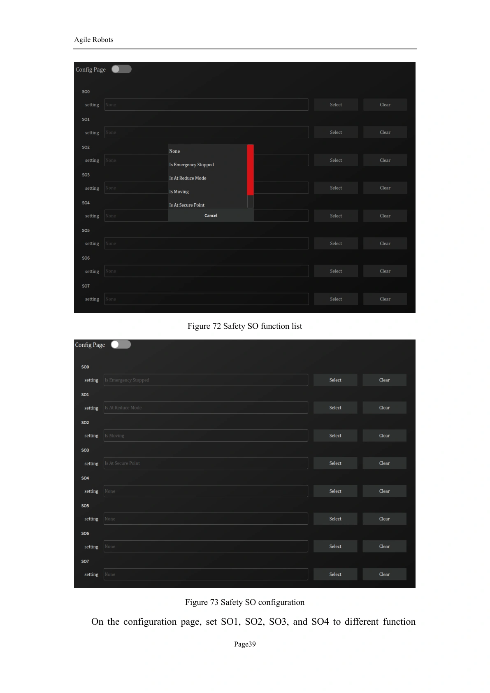



```
Agile Robots 
Page39 
 
Figure 72 Safety SO function list 
 
Figure 73 Safety SO configuration 
On the configuration page, set SO1, SO2, SO3, and SO4 to different function
```



## PDF page 42

**Source:** Safety Function Configuration Software User Manual\_V3.3.0\_EN\_20260204.pdf, original pdf page 42. [Open the corresponding PDF reading-copy page](https://1292444914-files.gitbook.io/~/files/v0/b/gitbook-x-prod.appspot.com/o/spaces%2FtgOfPnscWebs1eh82EKq%2Fuploads%2FKs0XWt2Ek924WSLFAP2b%2Fsafety-function-configuration-software-user-manual-v3-3-0-en-20260204-pp-039-044.pdf?alt=media#page=4).



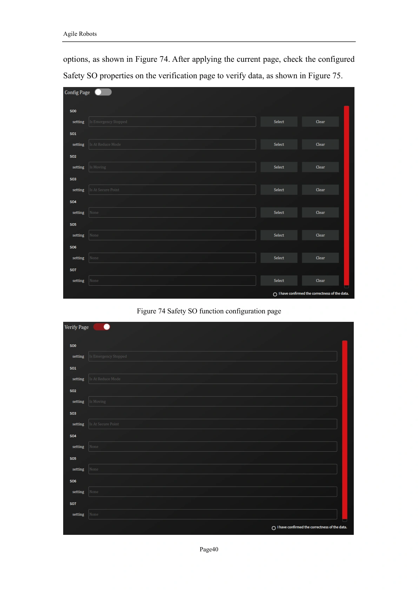



```
Agile Robots 
Page40 
options, as shown in Figure 74. After applying the current page, check the configured 
Safety SO properties on the verification page to verify data, as shown in Figure 75. 
 
Figure 74 Safety SO function configuration page
```



## PDF page 43

**Source:** Safety Function Configuration Software User Manual\_V3.3.0\_EN\_20260204.pdf, original pdf page 43. [Open the corresponding PDF reading-copy page](https://1292444914-files.gitbook.io/~/files/v0/b/gitbook-x-prod.appspot.com/o/spaces%2FtgOfPnscWebs1eh82EKq%2Fuploads%2FKs0XWt2Ek924WSLFAP2b%2Fsafety-function-configuration-software-user-manual-v3-3-0-en-20260204-pp-039-044.pdf?alt=media#page=5).



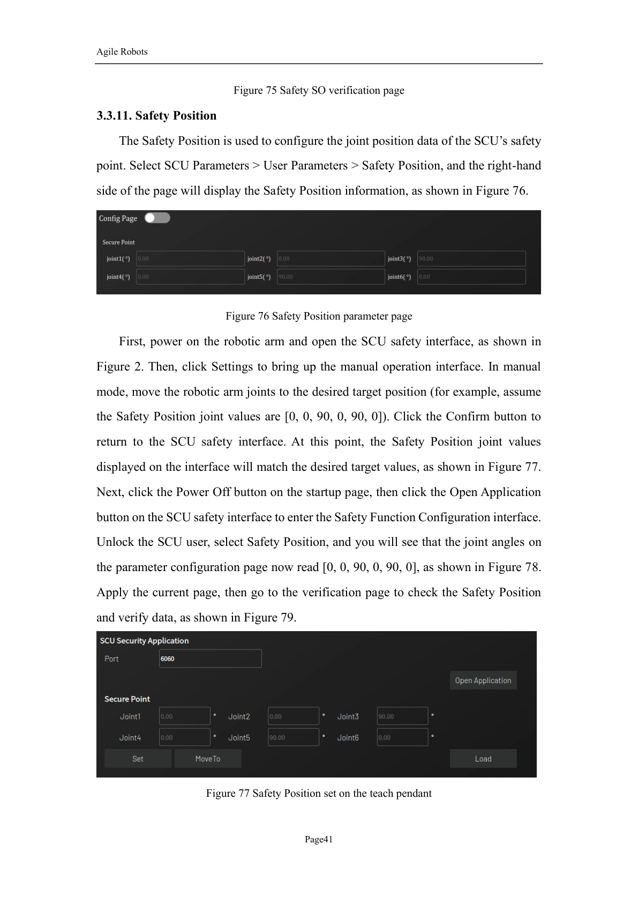



```
Agile Robots 
Page41 
Figure 75 Safety SO verification page 
3.3.11. Safety Position 
The Safety Position is used to configure the joint position data of the SCU’s safety 
point. Select SCU Parameters > User Parameters > Safety Position, and the right-hand 
side of the page will display the Safety Position information, as shown in Figure 76. 
 
Figure 76 Safety Position parameter page 
First, power on the robotic arm and open the SCU safety interface, as shown in 
Figure 2. Then, click Settings to bring up the manual operation interface. In manual 
mode, move the robotic arm joints to the desired target position (for example, assume 
the Safety Position joint values are [0, 0, 90, 0, 90, 0]). Click the Confirm button to 
return to the SCU safety interface. At this point, the Safety Position joint values 
displayed on the interface will match the desired target values, as shown in Figure 77. 
Next, click the Power Off button on the startup page, then click the Open Application 
button on the SCU safety interface to enter the Safety Function Configuration interface. 
Unlock the SCU user, select Safety Position, and you will see that the joint angles on 
the parameter configuration page now read [0, 0, 90, 0, 90, 0], as shown in Figure 78. 
Apply the current page, then go to the verification page to check the Safety Position 
and verify data, as shown in Figure 79. 
 
Figure 77 Safety Position set on the teach pendant
```



## PDF page 44

**Source:** Safety Function Configuration Software User Manual\_V3.3.0\_EN\_20260204.pdf, original pdf page 44. [Open the corresponding PDF reading-copy page](https://1292444914-files.gitbook.io/~/files/v0/b/gitbook-x-prod.appspot.com/o/spaces%2FtgOfPnscWebs1eh82EKq%2Fuploads%2FKs0XWt2Ek924WSLFAP2b%2Fsafety-function-configuration-software-user-manual-v3-3-0-en-20260204-pp-039-044.pdf?alt=media#page=6).



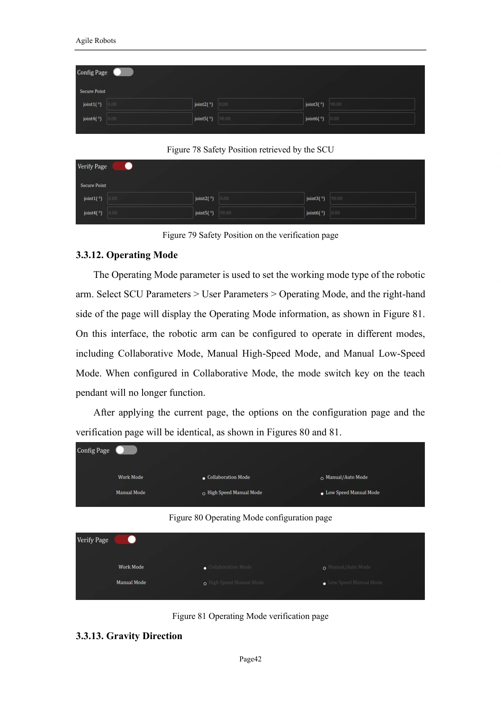



```
Agile Robots 
Page42 
 
Figure 78 Safety Position retrieved by the SCU 
 
Figure 79 Safety Position on the verification page 
3.3.12. Operating Mode 
The Operating Mode parameter is used to set the working mode type of the robotic 
arm. Select SCU Parameters > User Parameters > Operating Mode, and the right-hand 
side of the page will display the Operating Mode information, as shown in Figure 81. 
On this interface, the robotic arm can be configured to operate in different modes, 
including Collaborative Mode, Manual High-Speed Mode, and Manual Low-Speed 
Mode. When configured in Collaborative Mode, the mode switch key on the teach 
pendant will no longer function. 
After applying the current page, the options on the configuration page and the 
verification page will be identical, as shown in Figures 80 and 81. 
 
Figure 80 Operating Mode configuration page 
 
Figure 81 Operating Mode verification page 
3.3.13. Gravity Direction
```



## PDF page 45

**Source:** Safety Function Configuration Software User Manual\_V3.3.0\_EN\_20260204.pdf, original pdf page 45. [Open the corresponding PDF reading-copy page](https://1292444914-files.gitbook.io/~/files/v0/b/gitbook-x-prod.appspot.com/o/spaces%2FtgOfPnscWebs1eh82EKq%2Fuploads%2FkAJOsaZPlrzVAELifAPS%2Fsafety-function-configuration-software-user-manual-v3-3-0-en-20260204-pp-045-051.pdf?alt=media#page=1).



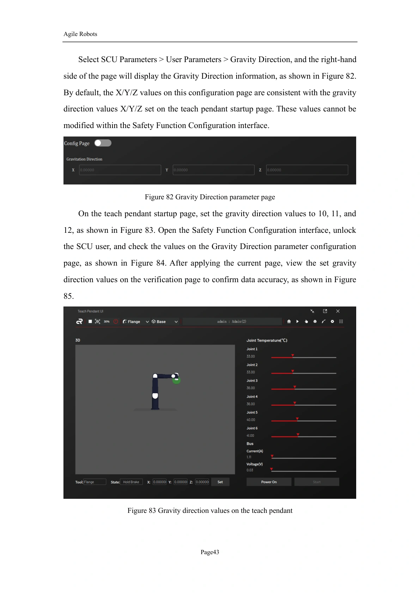



```
Agile Robots 
Page43 
Select SCU Parameters > User Parameters > Gravity Direction, and the right-hand 
side of the page will display the Gravity Direction information, as shown in Figure 82. 
By default, the X/Y/Z values on this configuration page are consistent with the gravity 
direction values X/Y/Z set on the teach pendant startup page. These values cannot be 
modified within the Safety Function Configuration interface. 
 
Figure 82 Gravity Direction parameter page 
On the teach pendant startup page, set the gravity direction values to 10, 11, and 
12, as shown in Figure 83. Open the Safety Function Configuration interface, unlock 
the SCU user, and check the values on the Gravity Direction parameter configuration 
page, as shown in Figure 84. After applying the current page, view the set gravity 
direction values on the verification page to confirm data accuracy, as shown in Figure 
85. 
 
Figure 83 Gravity direction values on the teach pendant
```



## PDF page 46

**Source:** Safety Function Configuration Software User Manual\_V3.3.0\_EN\_20260204.pdf, original pdf page 46. [Open the corresponding PDF reading-copy page](https://1292444914-files.gitbook.io/~/files/v0/b/gitbook-x-prod.appspot.com/o/spaces%2FtgOfPnscWebs1eh82EKq%2Fuploads%2FkAJOsaZPlrzVAELifAPS%2Fsafety-function-configuration-software-user-manual-v3-3-0-en-20260204-pp-045-051.pdf?alt=media#page=2).



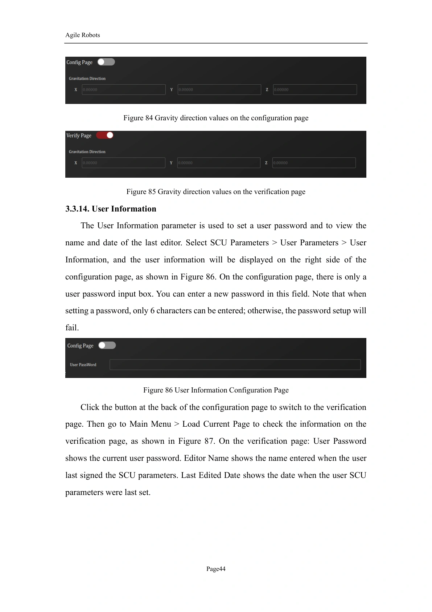



```
Agile Robots 
Page44 
 
Figure 84 Gravity direction values on the configuration page 
 
Figure 85 Gravity direction values on the verification page 
3.3.14. User Information 
The User Information parameter is used to set a user password and to view the 
name and date of the last editor. Select SCU Parameters > User Parameters > User 
Information, and the user information will be displayed on the right side of the 
configuration page, as shown in Figure 86. On the configuration page, there is only a 
user password input box. You can enter a new password in this field. Note that when 
setting a password, only 6 characters can be entered; otherwise, the password setup will 
fail. 
 
Figure 86 User Information Configuration Page 
Click the button at the back of the configuration page to switch to the verification 
page. Then go to Main Menu > Load Current Page to check the information on the 
verification page, as shown in Figure 87. On the verification page: User Password 
shows the current user password. Editor Name shows the name entered when the user 
last signed the SCU parameters. Last Edited Date shows the date when the user SCU 
parameters were last set.
```



## PDF page 47

**Source:** Safety Function Configuration Software User Manual\_V3.3.0\_EN\_20260204.pdf, original pdf page 47. [Open the corresponding PDF reading-copy page](https://1292444914-files.gitbook.io/~/files/v0/b/gitbook-x-prod.appspot.com/o/spaces%2FtgOfPnscWebs1eh82EKq%2Fuploads%2FkAJOsaZPlrzVAELifAPS%2Fsafety-function-configuration-software-user-manual-v3-3-0-en-20260204-pp-045-051.pdf?alt=media#page=3).



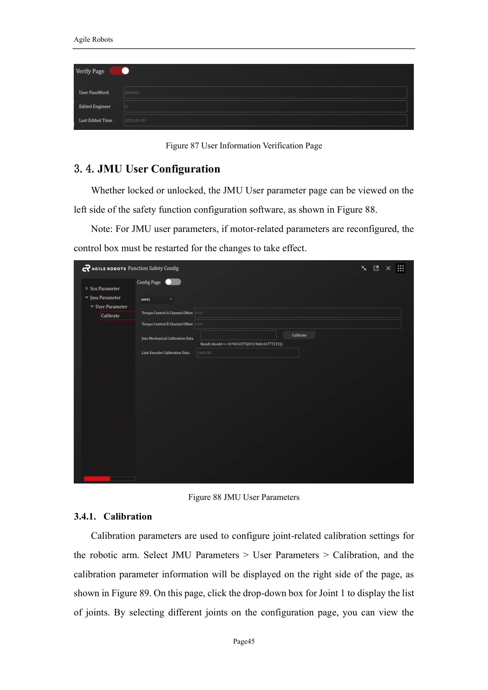



```
Agile Robots 
Page45 
 
Figure 87 User Information Verification Page 
3.4. JMU User Configuration 
Whether locked or unlocked, the JMU User parameter page can be viewed on the 
left side of the safety function configuration software, as shown in Figure 88. 
Note: For JMU user parameters, if motor-related parameters are reconfigured, the 
control box must be restarted for the changes to take effect. 
 
Figure 88 JMU User Parameters 
3.4.1. Calibration 
Calibration parameters are used to configure joint-related calibration settings for 
the robotic arm. Select JMU Parameters > User Parameters > Calibration, and the 
calibration parameter information will be displayed on the right side of the page, as 
shown in Figure 89. On this page, click the drop-down box for Joint 1 to display the list 
of joints. By selecting different joints on the configuration page, you can view the
```



## PDF page 48

**Source:** Safety Function Configuration Software User Manual\_V3.3.0\_EN\_20260204.pdf, original pdf page 48. [Open the corresponding PDF reading-copy page](https://1292444914-files.gitbook.io/~/files/v0/b/gitbook-x-prod.appspot.com/o/spaces%2FtgOfPnscWebs1eh82EKq%2Fuploads%2FkAJOsaZPlrzVAELifAPS%2Fsafety-function-configuration-software-user-manual-v3-3-0-en-20260204-pp-045-051.pdf?alt=media#page=4).



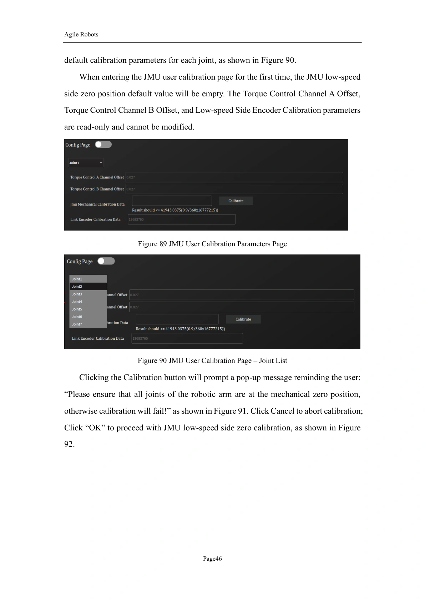



```
Agile Robots 
Page46 
default calibration parameters for each joint, as shown in Figure 90. 
When entering the JMU user calibration page for the first time, the JMU low-speed 
side zero position default value will be empty. The Torque Control Channel A Offset, 
Torque Control Channel B Offset, and Low-speed Side Encoder Calibration parameters 
are read-only and cannot be modified. 
 
Figure 89 JMU User Calibration Parameters Page 
 
Figure 90 JMU User Calibration Page – Joint List 
Clicking the Calibration button will prompt a pop-up message reminding the user: 
“Please ensure that all joints of the robotic arm are at the mechanical zero position, 
otherwise calibration will fail!” as shown in Figure 91. Click Cancel to abort calibration; 
Click “OK” to proceed with JMU low-speed side zero calibration, as shown in Figure 
92.
```



## PDF page 49

**Source:** Safety Function Configuration Software User Manual\_V3.3.0\_EN\_20260204.pdf, original pdf page 49. [Open the corresponding PDF reading-copy page](https://1292444914-files.gitbook.io/~/files/v0/b/gitbook-x-prod.appspot.com/o/spaces%2FtgOfPnscWebs1eh82EKq%2Fuploads%2FkAJOsaZPlrzVAELifAPS%2Fsafety-function-configuration-software-user-manual-v3-3-0-en-20260204-pp-045-051.pdf?alt=media#page=5).



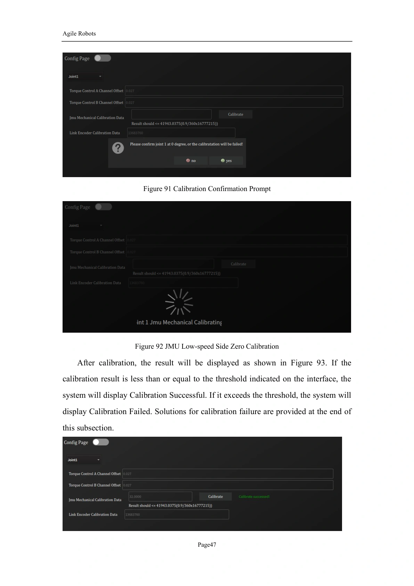



```
Agile Robots 
Page47 
 
Figure 91 Calibration Confirmation Prompt 
 
Figure 92 JMU Low-speed Side Zero Calibration 
After calibration, the result will be displayed as shown in Figure 93. If the 
calibration result is less than or equal to the threshold indicated on the interface, the 
system will display Calibration Successful. If it exceeds the threshold, the system will 
display Calibration Failed. Solutions for calibration failure are provided at the end of 
this subsection.
```



## PDF page 50

**Source:** Safety Function Configuration Software User Manual\_V3.3.0\_EN\_20260204.pdf, original pdf page 50. [Open the corresponding PDF reading-copy page](https://1292444914-files.gitbook.io/~/files/v0/b/gitbook-x-prod.appspot.com/o/spaces%2FtgOfPnscWebs1eh82EKq%2Fuploads%2FkAJOsaZPlrzVAELifAPS%2Fsafety-function-configuration-software-user-manual-v3-3-0-en-20260204-pp-045-051.pdf?alt=media#page=6).



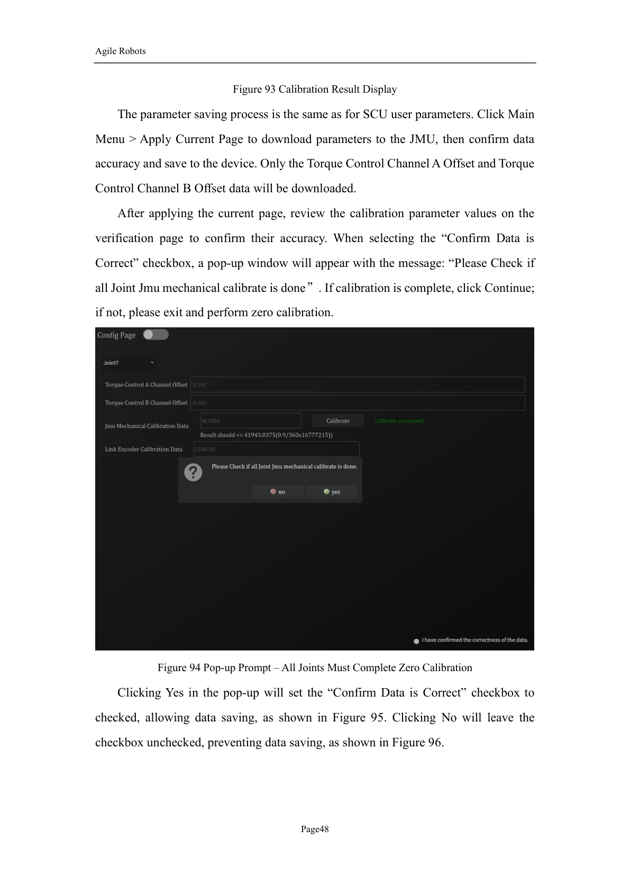



```
Agile Robots 
Page48 
Figure 93 Calibration Result Display 
The parameter saving process is the same as for SCU user parameters. Click Main 
Menu > Apply Current Page to download parameters to the JMU, then confirm data 
accuracy and save to the device. Only the Torque Control Channel A Offset and Torque 
Control Channel B Offset data will be downloaded. 
After applying the current page, review the calibration parameter values on the 
verification page to confirm their accuracy. When selecting the “Confirm Data is 
Correct” checkbox, a pop-up window will appear with the message: “Please Check if 
all Joint Jmu mechanical calibrate is done”. If calibration is complete, click Continue; 
if not, please exit and perform zero calibration.  
 
Figure 94 Pop-up Prompt – All Joints Must Complete Zero Calibration 
Clicking Yes in the pop-up will set the “Confirm Data is Correct” checkbox to 
checked, allowing data saving, as shown in Figure 95. Clicking No will leave the 
checkbox unchecked, preventing data saving, as shown in Figure 96.
```



## PDF page 51

**Source:** Safety Function Configuration Software User Manual\_V3.3.0\_EN\_20260204.pdf, original pdf page 51. [Open the corresponding PDF reading-copy page](https://1292444914-files.gitbook.io/~/files/v0/b/gitbook-x-prod.appspot.com/o/spaces%2FtgOfPnscWebs1eh82EKq%2Fuploads%2FkAJOsaZPlrzVAELifAPS%2Fsafety-function-configuration-software-user-manual-v3-3-0-en-20260204-pp-045-051.pdf?alt=media#page=7).







```
Agile Robots 
Page49 
 
Figure 95 All Joints Zero Calibration Confirmed 
 
Figure 96 Zero Calibration Not Confirmed 
The JMU must be calibrated before leaving the factory. After calibration, the results
```



## PDF page 52

**Source:** Safety Function Configuration Software User Manual\_V3.3.0\_EN\_20260204.pdf, original pdf page 52. [Open the corresponding PDF reading-copy page](https://1292444914-files.gitbook.io/~/files/v0/b/gitbook-x-prod.appspot.com/o/spaces%2FtgOfPnscWebs1eh82EKq%2Fuploads%2F13UG1qd3HjOpQPDBfEml%2Fsafety-function-configuration-software-user-manual-v3-3-0-en-20260204-pp-052-053.pdf?alt=media#page=1).







```
Agile Robots 
Page50 
are loaded each time you log in via the main menu. 
If the robotic arm performs torque sensor zero calibration or mechanical zero 
calibration on the teach pendant, the robotic arm will display a pop-up prompting the 
user to reconfigure the JMU parameters, as shown in Figures 97 and 98. Only after 
reconfiguring JMU parameters will the zero Calibration results take effect. 
 
Figure 97 Torque Sensor Zero Storage Prompt 
 
Figure 98 Mechanical Zero Storage Prompt 
If JMU low-speed side zero calibration fails, try the following steps:
```



## PDF page 53

**Source:** Safety Function Configuration Software User Manual\_V3.3.0\_EN\_20260204.pdf, original pdf page 53. [Open the corresponding PDF reading-copy page](https://1292444914-files.gitbook.io/~/files/v0/b/gitbook-x-prod.appspot.com/o/spaces%2FtgOfPnscWebs1eh82EKq%2Fuploads%2F13UG1qd3HjOpQPDBfEml%2Fsafety-function-configuration-software-user-manual-v3-3-0-en-20260204-pp-052-053.pdf?alt=media#page=2).







```
Agile Robots 
Page51 
1. Check whether the robotic arm is at the mechanical zero position. If not, move 
it to the mechanical zero position, then reopen the SCU safety configuration page and 
perform calibration again. 
2. Repeat calibration several times for the failed joint. 
3. Use the teach pendant to recalibrate the mechanical zero position and torque 
sensor zero position, then reopen the SCU safety configuration page and perform 
calibration again. 
If the above steps do not resolve the issue, please contact after-sales support.
```


