# Thor 3 arm manual V1.9 — complete reference


**Complete supplied source:** Thor3 Robot Arm User Manual V1.9 EN.pdf · **Coverage:** 34 original PDF pages. [Return to the Agile Robots source library](./).


Every source page is retained in the original order. The **Original page** view preserves complete diagrams, photographs, tables, equations, connector orientation, notices and examples. The **Searchable text** view preserves native PDF text or the slide’s native text, embedded links and substantive speaker notes. Text extraction can retain reading-order/character defects; use the original image for exact layout, table columns and code indentation.


Use only the exact model, hardware/controller and software revision covered by the source. Manufacturer examples involving motion, enabling, safety configuration, I/O, calibration, updates or resets require the complete applicable procedure and qualified personnel. No robot, SDK or process-equipment test was run.


**Attribution:** the manufacturer and contributors identified in the supplied document. Original notices remain visible on every source page. Navigation, revision notes and the linked engineering explanations are OpenELAB editorial additions.

## Document navigation

| Source section / function                | Original page                                                         |
| ---------------------------------------- | --------------------------------------------------------------------- |
| 1. SAFETY                                | [PDF 5](complete-thor3-robot-arm-user-manual-v1-9-en.md#pdf-page-5)   |
| 1.1. SAFETY REGULATIONS                  | [PDF 5](complete-thor3-robot-arm-user-manual-v1-9-en.md#pdf-page-5)   |
| 1.2. SAFETY SIGNS                        | [PDF 7](complete-thor3-robot-arm-user-manual-v1-9-en.md#pdf-page-7)   |
| 1.3. PERSONNEL REQUIREMENTS              | [PDF 8](complete-thor3-robot-arm-user-manual-v1-9-en.md#pdf-page-8)   |
| 1.4. PRECAUTIONS                         | [PDF 8](complete-thor3-robot-arm-user-manual-v1-9-en.md#pdf-page-8)   |
| 1.5. EMERGENCY STOP                      | [PDF 11](complete-thor3-robot-arm-user-manual-v1-9-en.md#pdf-page-11) |
| 1.6. NON-ELECTRIC DRIVE                  | [PDF 11](complete-thor3-robot-arm-user-manual-v1-9-en.md#pdf-page-11) |
| 2. SAFETY FUNCTIONS                      | [PDF 12](complete-thor3-robot-arm-user-manual-v1-9-en.md#pdf-page-12) |
| 2.1. SAFETY LIMITS                       | [PDF 12](complete-thor3-robot-arm-user-manual-v1-9-en.md#pdf-page-12) |
| 2.2. SAFETY STOP                         | [PDF 12](complete-thor3-robot-arm-user-manual-v1-9-en.md#pdf-page-12) |
| 3. INTENDED USE AND PLACEMENT CONDITIONS | [PDF 13](complete-thor3-robot-arm-user-manual-v1-9-en.md#pdf-page-13) |
| 4. TECHNICAL SPECIFICATIONS              | [PDF 14](complete-thor3-robot-arm-user-manual-v1-9-en.md#pdf-page-14) |
| 5. ROBOT ARM COMPOSITION                 | [PDF 15](complete-thor3-robot-arm-user-manual-v1-9-en.md#pdf-page-15) |
| 6. HOME POSITION AND JOINT POSE          | [PDF 16](complete-thor3-robot-arm-user-manual-v1-9-en.md#pdf-page-16) |
| 7. ROBOT ARM DIMENSIONS                  | [PDF 17](complete-thor3-robot-arm-user-manual-v1-9-en.md#pdf-page-17) |
| 8. ROBOT WORKSPACE                       | [PDF 18](complete-thor3-robot-arm-user-manual-v1-9-en.md#pdf-page-18) |
| 9. ROBOT INSTALLATION                    | [PDF 19](complete-thor3-robot-arm-user-manual-v1-9-en.md#pdf-page-19) |
| 9.1. ROBOT ARM MOUNTING AND FIXATION     | [PDF 19](complete-thor3-robot-arm-user-manual-v1-9-en.md#pdf-page-19) |
| 9.2. END-EFFECTOR MOUNTING AND FIXATION  | [PDF 21](complete-thor3-robot-arm-user-manual-v1-9-en.md#pdf-page-21) |
| 10. ELECTRICAL INTERFACES                | [PDF 22](complete-thor3-robot-arm-user-manual-v1-9-en.md#pdf-page-22) |
| 10.1. ROBOT ARM CABLE                    | [PDF 22](complete-thor3-robot-arm-user-manual-v1-9-en.md#pdf-page-22) |
| 11. UNPACKING AND USE                    | [PDF 23](complete-thor3-robot-arm-user-manual-v1-9-en.md#pdf-page-23) |
| 11.1. UNPACKING                          | [PDF 23](complete-thor3-robot-arm-user-manual-v1-9-en.md#pdf-page-23) |
| 11.2. QUICK START                        | [PDF 23](complete-thor3-robot-arm-user-manual-v1-9-en.md#pdf-page-23) |
| 12. TRANSPORT                            | [PDF 24](complete-thor3-robot-arm-user-manual-v1-9-en.md#pdf-page-24) |
| 13. MAINTENANCE, REPAIR, AND DISPOSAL    | [PDF 25](complete-thor3-robot-arm-user-manual-v1-9-en.md#pdf-page-25) |
| 13.1. INSPECTION ITEMS                   | [PDF 25](complete-thor3-robot-arm-user-manual-v1-9-en.md#pdf-page-25) |
| 13.2. VISUAL INSPECTION                  | [PDF 25](complete-thor3-robot-arm-user-manual-v1-9-en.md#pdf-page-25) |
| 13.3. FUNCTION INSPECTION                | [PDF 25](complete-thor3-robot-arm-user-manual-v1-9-en.md#pdf-page-25) |
| 13.4. REPLACING THE BATTERY              | [PDF 26](complete-thor3-robot-arm-user-manual-v1-9-en.md#pdf-page-26) |
| 13.5. CLEANING                           | [PDF 32](complete-thor3-robot-arm-user-manual-v1-9-en.md#pdf-page-32) |
| 13.6. DISPOSAL                           | [PDF 32](complete-thor3-robot-arm-user-manual-v1-9-en.md#pdf-page-32) |
| 14. DISCLAIMER                           | [PDF 33](complete-thor3-robot-arm-user-manual-v1-9-en.md#pdf-page-33) |

## PDF page 1

**Source:** Thor3 Robot Arm User Manual V1.9 EN.pdf, original pdf page 1. [Open the corresponding PDF reading-copy page](https://1292444914-files.gitbook.io/~/files/v0/b/gitbook-x-prod.appspot.com/o/spaces%2FtgOfPnscWebs1eh82EKq%2Fuploads%2FMLzy8vOwWCb6K4qvjw3W%2Fthor3-robot-arm-user-manual-v1-9-en-pp-001-018.pdf?alt=media#page=1).



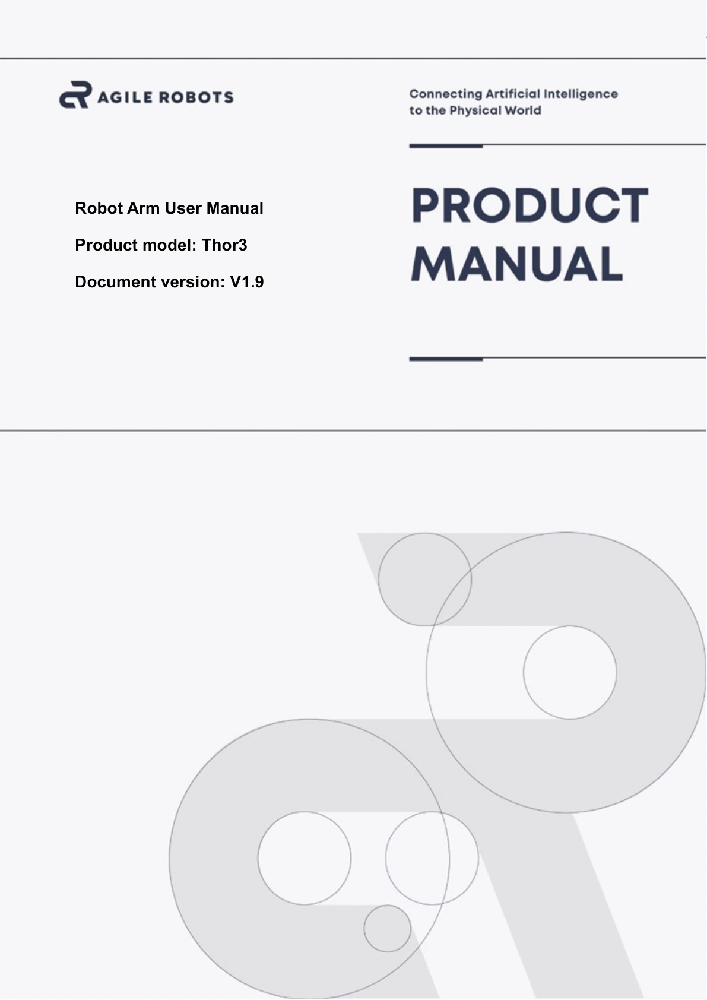



```
i 
 
 
Robot Arm User Manual 
Product model: Thor3 
Document version: V1.9
```



## PDF page 2

**Source:** Thor3 Robot Arm User Manual V1.9 EN.pdf, original pdf page 2. [Open the corresponding PDF reading-copy page](https://1292444914-files.gitbook.io/~/files/v0/b/gitbook-x-prod.appspot.com/o/spaces%2FtgOfPnscWebs1eh82EKq%2Fuploads%2FMLzy8vOwWCb6K4qvjw3W%2Fthor3-robot-arm-user-manual-v1-9-en-pp-001-018.pdf?alt=media#page=2).







No native selectable text is present on this page. The complete original artwork or screenshot remains in the Original page view.



## PDF page 3

**Source:** Thor3 Robot Arm User Manual V1.9 EN.pdf, original pdf page 3. [Open the corresponding PDF reading-copy page](https://1292444914-files.gitbook.io/~/files/v0/b/gitbook-x-prod.appspot.com/o/spaces%2FtgOfPnscWebs1eh82EKq%2Fuploads%2FMLzy8vOwWCb6K4qvjw3W%2Fthor3-robot-arm-user-manual-v1-9-en-pp-001-018.pdf?alt=media#page=3).



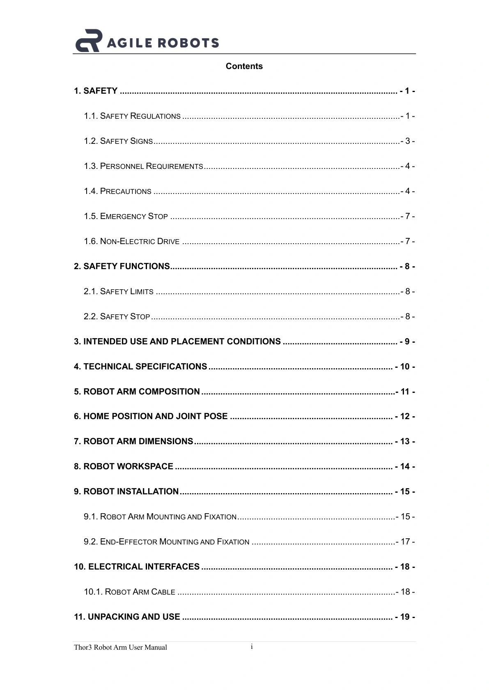



```
Thor3 Robot Arm User Manual  
i 
Contents 
1. SAFETY .................................................................................................................... - 1 - 
1.1. SAFETY REGULATIONS ........................................................................................... - 1 - 
1.2. SAFETY SIGNS ....................................................................................................... - 3 - 
1.3. PERSONNEL REQUIREMENTS .................................................................................. - 4 - 
1.4. PRECAUTIONS ....................................................................................................... - 4 - 
1.5. EMERGENCY STOP ................................................................................................ - 7 - 
1.6. NON-ELECTRIC DRIVE ........................................................................................... - 7 - 
2. SAFETY FUNCTIONS ............................................................................................... - 8 - 
2.1. SAFETY LIMITS ...................................................................................................... - 8 - 
2.2. SAFETY STOP ........................................................................................................ - 8 - 
3. INTENDED USE AND PLACEMENT CONDITIONS ................................................ - 9 - 
4. TECHNICAL SPECIFICATIONS ............................................................................. - 10 - 
5. ROBOT ARM COMPOSITION ................................................................................. - 11 - 
6. HOME POSITION AND JOINT POSE .................................................................... - 12 - 
7. ROBOT ARM DIMENSIONS ................................................................................... - 13 - 
8. ROBOT WORKSPACE ........................................................................................... - 14 - 
9. ROBOT INSTALLATION ......................................................................................... - 15 - 
9.1. ROBOT ARM MOUNTING AND FIXATION .................................................................. - 15 - 
9.2. END-EFFECTOR MOUNTING AND FIXATION ............................................................ - 17 - 
10. ELECTRICAL INTERFACES ................................................................................ - 18 - 
10.1. ROBOT ARM CABLE ........................................................................................... - 18 - 
11. UNPACKING AND USE ........................................................................................ - 19 -
```



**Original document cross-references:** [PDF 5](complete-thor3-robot-arm-user-manual-v1-9-en.md#pdf-page-5) · [PDF 7](complete-thor3-robot-arm-user-manual-v1-9-en.md#pdf-page-7) · [PDF 8](complete-thor3-robot-arm-user-manual-v1-9-en.md#pdf-page-8) · [PDF 11](complete-thor3-robot-arm-user-manual-v1-9-en.md#pdf-page-11) · [PDF 12](complete-thor3-robot-arm-user-manual-v1-9-en.md#pdf-page-12) · [PDF 13](complete-thor3-robot-arm-user-manual-v1-9-en.md#pdf-page-13) · [PDF 14](complete-thor3-robot-arm-user-manual-v1-9-en.md#pdf-page-14) · [PDF 15](complete-thor3-robot-arm-user-manual-v1-9-en.md#pdf-page-15) · [PDF 16](complete-thor3-robot-arm-user-manual-v1-9-en.md#pdf-page-16) · [PDF 17](complete-thor3-robot-arm-user-manual-v1-9-en.md#pdf-page-17) · [PDF 18](complete-thor3-robot-arm-user-manual-v1-9-en.md#pdf-page-18) · [PDF 19](complete-thor3-robot-arm-user-manual-v1-9-en.md#pdf-page-19) · [PDF 20](complete-thor3-robot-arm-user-manual-v1-9-en.md#pdf-page-20) · [PDF 22](complete-thor3-robot-arm-user-manual-v1-9-en.md#pdf-page-22) · [PDF 23](complete-thor3-robot-arm-user-manual-v1-9-en.md#pdf-page-23)

## PDF page 4

**Source:** Thor3 Robot Arm User Manual V1.9 EN.pdf, original pdf page 4. [Open the corresponding PDF reading-copy page](https://1292444914-files.gitbook.io/~/files/v0/b/gitbook-x-prod.appspot.com/o/spaces%2FtgOfPnscWebs1eh82EKq%2Fuploads%2FMLzy8vOwWCb6K4qvjw3W%2Fthor3-robot-arm-user-manual-v1-9-en-pp-001-018.pdf?alt=media#page=4).



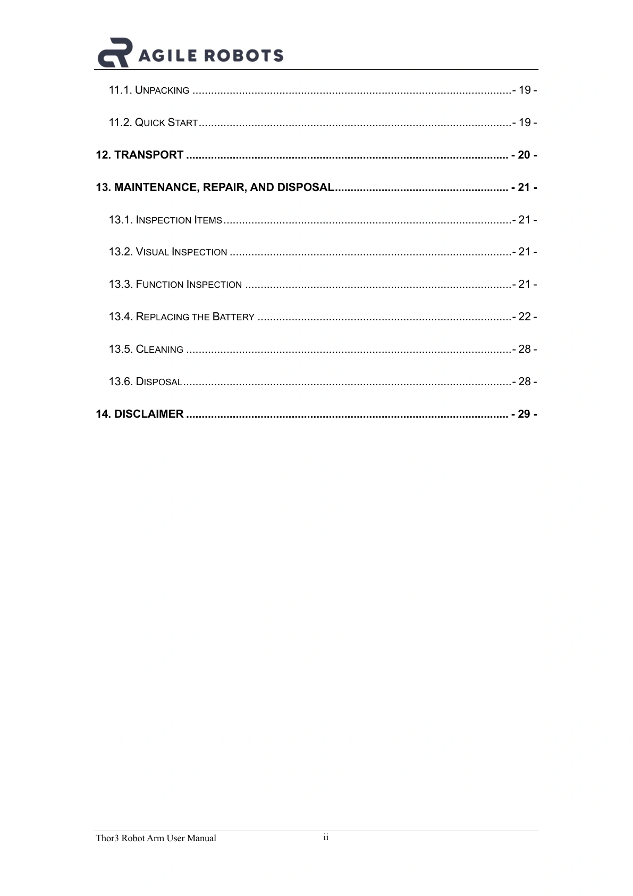



```
Thor3 Robot Arm User Manual  
ii 
11.1. UNPACKING ....................................................................................................... - 19 - 
11.2. QUICK START ..................................................................................................... - 19 - 
12. TRANSPORT ........................................................................................................ - 20 - 
13. MAINTENANCE, REPAIR, AND DISPOSAL ........................................................ - 21 - 
13.1. INSPECTION ITEMS ............................................................................................. - 21 - 
13.2. VISUAL INSPECTION ........................................................................................... - 21 - 
13.3. FUNCTION INSPECTION ...................................................................................... - 21 - 
13.4. REPLACING THE BATTERY .................................................................................. - 22 - 
13.5. CLEANING ......................................................................................................... - 28 - 
13.6. DISPOSAL .......................................................................................................... - 28 - 
14. DISCLAIMER ........................................................................................................ - 29 -
```



**Original document cross-references:** [PDF 23](complete-thor3-robot-arm-user-manual-v1-9-en.md#pdf-page-23) · [PDF 24](complete-thor3-robot-arm-user-manual-v1-9-en.md#pdf-page-24) · [PDF 25](complete-thor3-robot-arm-user-manual-v1-9-en.md#pdf-page-25) · [PDF 26](complete-thor3-robot-arm-user-manual-v1-9-en.md#pdf-page-26) · [PDF 32](complete-thor3-robot-arm-user-manual-v1-9-en.md#pdf-page-32) · [PDF 33](complete-thor3-robot-arm-user-manual-v1-9-en.md#pdf-page-33)

## PDF page 5

**Source:** Thor3 Robot Arm User Manual V1.9 EN.pdf, original pdf page 5. [Open the corresponding PDF reading-copy page](https://1292444914-files.gitbook.io/~/files/v0/b/gitbook-x-prod.appspot.com/o/spaces%2FtgOfPnscWebs1eh82EKq%2Fuploads%2FMLzy8vOwWCb6K4qvjw3W%2Fthor3-robot-arm-user-manual-v1-9-en-pp-001-018.pdf?alt=media#page=5).



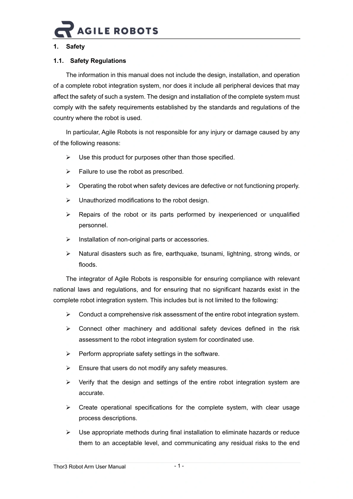



```
Thor3 Robot Arm User Manual  
 
- 1 - 
1. 
Safety 
1.1. Safety Regulations 
The information in this manual does not include the design, installation, and operation 
of a complete robot integration system, nor does it include all peripheral devices that may 
affect the safety of such a system. The design and installation of the complete system must 
comply with the safety requirements established by the standards and regulations of the 
country where the robot is used. 
In particular, Agile Robots is not responsible for any injury or damage caused by any 
of the following reasons: 
Ø 
Use this product for purposes other than those specified. 
Ø 
Failure to use the robot as prescribed. 
Ø 
Operating the robot when safety devices are defective or not functioning properly. 
Ø 
Unauthorized modifications to the robot design. 
Ø 
Repairs of the robot or its parts performed by inexperienced or unqualified 
personnel. 
Ø 
Installation of non-original parts or accessories. 
Ø 
Natural disasters such as fire, earthquake, tsunami, lightning, strong winds, or 
floods. 
The integrator of Agile Robots is responsible for ensuring compliance with relevant 
national laws and regulations, and for ensuring that no significant hazards exist in the 
complete robot integration system. This includes but is not limited to the following: 
Ø 
Conduct a comprehensive risk assessment of the entire robot integration system. 
Ø 
Connect other machinery and additional safety devices defined in the risk 
assessment to the robot integration system for coordinated use. 
Ø 
Perform appropriate safety settings in the software. 
Ø 
Ensure that users do not modify any safety measures. 
Ø 
Verify that the design and settings of the entire robot integration system are 
accurate. 
Ø 
Create operational specifications for the complete system, with clear usage 
process descriptions. 
Ø 
Use appropriate methods during final installation to eliminate hazards or reduce 
them to an acceptable level, and communicating any residual risks to the end
```



## PDF page 6

**Source:** Thor3 Robot Arm User Manual V1.9 EN.pdf, original pdf page 6. [Open the corresponding PDF reading-copy page](https://1292444914-files.gitbook.io/~/files/v0/b/gitbook-x-prod.appspot.com/o/spaces%2FtgOfPnscWebs1eh82EKq%2Fuploads%2FMLzy8vOwWCb6K4qvjw3W%2Fthor3-robot-arm-user-manual-v1-9-en-pp-001-018.pdf?alt=media#page=6).



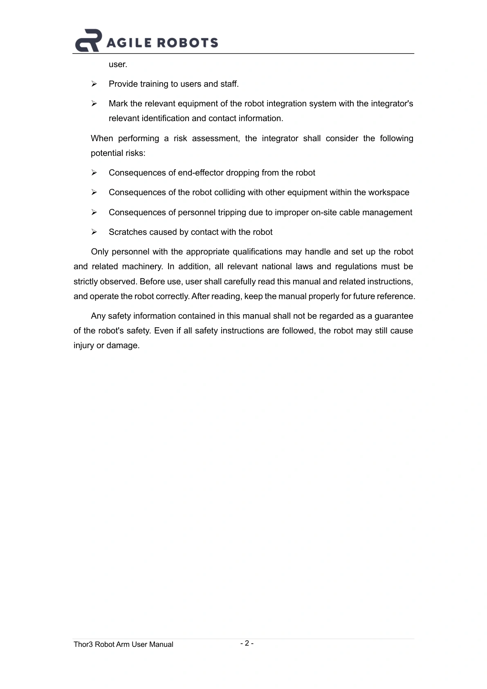



```
Thor3 Robot Arm User Manual  
 
- 2 - 
user. 
Ø 
Provide training to users and staff. 
Ø 
Mark the relevant equipment of the robot integration system with the integrator's 
relevant identification and contact information. 
When performing a risk assessment, the integrator shall consider the following 
potential risks: 
Ø 
Consequences of end-effector dropping from the robot 
Ø 
Consequences of the robot colliding with other equipment within the workspace 
Ø 
Consequences of personnel tripping due to improper on-site cable management 
Ø 
Scratches caused by contact with the robot 
Only personnel with the appropriate qualifications may handle and set up the robot 
and related machinery. In addition, all relevant national laws and regulations must be 
strictly observed. Before use, user shall carefully read this manual and related instructions, 
and operate the robot correctly. After reading, keep the manual properly for future reference. 
Any safety information contained in this manual shall not be regarded as a guarantee 
of the robot's safety. Even if all safety instructions are followed, the robot may still cause 
injury or damage.
```



## PDF page 7

**Source:** Thor3 Robot Arm User Manual V1.9 EN.pdf, original pdf page 7. [Open the corresponding PDF reading-copy page](https://1292444914-files.gitbook.io/~/files/v0/b/gitbook-x-prod.appspot.com/o/spaces%2FtgOfPnscWebs1eh82EKq%2Fuploads%2FMLzy8vOwWCb6K4qvjw3W%2Fthor3-robot-arm-user-manual-v1-9-en-pp-001-018.pdf?alt=media#page=7).



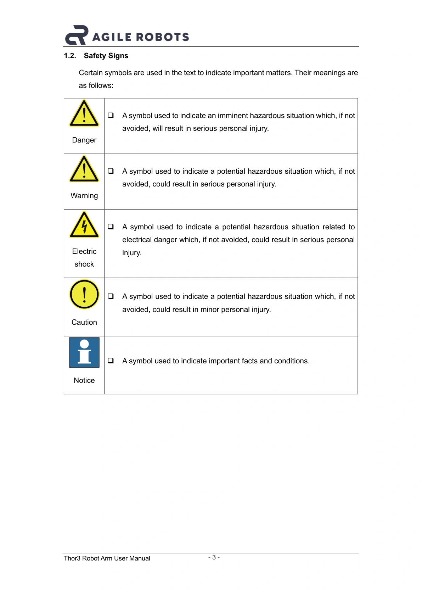



```
Thor3 Robot Arm User Manual  
 
- 3 - 
1.2. Safety Signs 
Certain symbols are used in the text to indicate important matters. Their meanings are 
as follows: 
 
Danger 
q 
A symbol used to indicate an imminent hazardous situation which, if not 
avoided, will result in serious personal injury. 
 
Warning 
q 
A symbol used to indicate a potential hazardous situation which, if not 
avoided, could result in serious personal injury. 
 
Electric 
shock 
q 
A symbol used to indicate a potential hazardous situation related to 
electrical danger which, if not avoided, could result in serious personal 
injury. 
 
Caution 
q 
A symbol used to indicate a potential hazardous situation which, if not 
avoided, could result in minor personal injury. 
 
Notice 
q 
A symbol used to indicate important facts and conditions.
```



## PDF page 8

**Source:** Thor3 Robot Arm User Manual V1.9 EN.pdf, original pdf page 8. [Open the corresponding PDF reading-copy page](https://1292444914-files.gitbook.io/~/files/v0/b/gitbook-x-prod.appspot.com/o/spaces%2FtgOfPnscWebs1eh82EKq%2Fuploads%2FMLzy8vOwWCb6K4qvjw3W%2Fthor3-robot-arm-user-manual-v1-9-en-pp-001-018.pdf?alt=media#page=8).



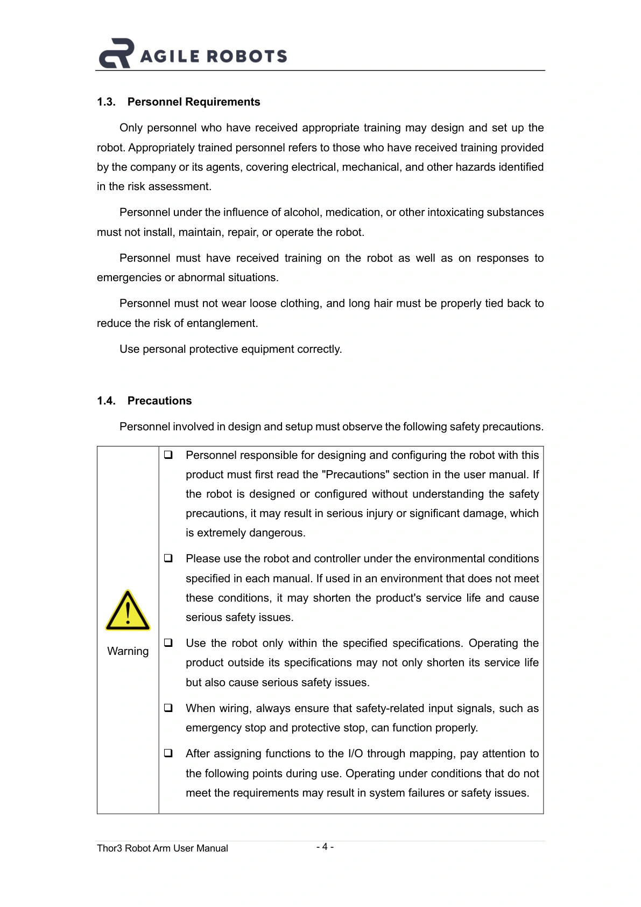



```
Thor3 Robot Arm User Manual  
 
- 4 - 
 
1.3. Personnel Requirements 
Only personnel who have received appropriate training may design and set up the 
robot. Appropriately trained personnel refers to those who have received training provided 
by the company or its agents, covering electrical, mechanical, and other hazards identified 
in the risk assessment. 
Personnel under the influence of alcohol, medication, or other intoxicating substances 
must not install, maintain, repair, or operate the robot. 
Personnel must have received training on the robot as well as on responses to 
emergencies or abnormal situations. 
Personnel must not wear loose clothing, and long hair must be properly tied back to 
reduce the risk of entanglement. 
Use personal protective equipment correctly. 
 
1.4. Precautions 
Personnel involved in design and setup must observe the following safety precautions. 
 
Warning 
q 
Personnel responsible for designing and configuring the robot with this 
product must first read the "Precautions" section in the user manual. If 
the robot is designed or configured without understanding the safety 
precautions, it may result in serious injury or significant damage, which 
is extremely dangerous. 
q 
Please use the robot and controller under the environmental conditions 
specified in each manual. If used in an environment that does not meet 
these conditions, it may shorten the product's service life and cause 
serious safety issues. 
q 
Use the robot only within the specified specifications. Operating the 
product outside its specifications may not only shorten its service life 
but also cause serious safety issues. 
q 
When wiring, always ensure that safety-related input signals, such as 
emergency stop and protective stop, can function properly. 
q 
After assigning functions to the I/O through mapping, pay attention to 
the following points during use. Operating under conditions that do not 
meet the requirements may result in system failures or safety issues.
```



## PDF page 9

**Source:** Thor3 Robot Arm User Manual V1.9 EN.pdf, original pdf page 9. [Open the corresponding PDF reading-copy page](https://1292444914-files.gitbook.io/~/files/v0/b/gitbook-x-prod.appspot.com/o/spaces%2FtgOfPnscWebs1eh82EKq%2Fuploads%2FMLzy8vOwWCb6K4qvjw3W%2Fthor3-robot-arm-user-manual-v1-9-en-pp-001-018.pdf?alt=media#page=9).



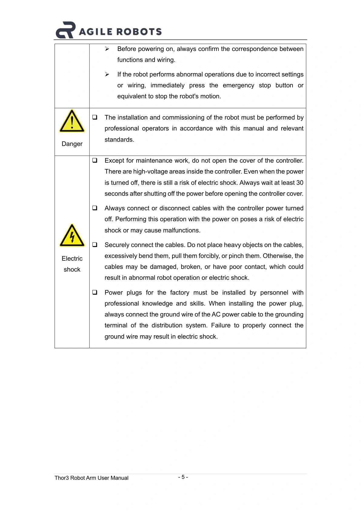



```
Thor3 Robot Arm User Manual  
 
- 5 - 
Ø 
Before powering on, always confirm the correspondence between 
functions and wiring. 
Ø 
If the robot performs abnormal operations due to incorrect settings 
or wiring, immediately press the emergency stop button or 
equivalent to stop the robot's motion. 
 
Danger 
q 
The installation and commissioning of the robot must be performed by 
professional operators in accordance with this manual and relevant 
standards. 
 
Electric 
shock 
q 
Except for maintenance work, do not open the cover of the controller. 
There are high-voltage areas inside the controller. Even when the power 
is turned off, there is still a risk of electric shock. Always wait at least 30 
seconds after shutting off the power before opening the controller cover. 
q 
Always connect or disconnect cables with the controller power turned 
off. Performing this operation with the power on poses a risk of electric 
shock or may cause malfunctions. 
q 
Securely connect the cables. Do not place heavy objects on the cables, 
excessively bend them, pull them forcibly, or pinch them. Otherwise, the 
cables may be damaged, broken, or have poor contact, which could 
result in abnormal robot operation or electric shock. 
q 
Power plugs for the factory must be installed by personnel with 
professional knowledge and skills. When installing the power plug, 
always connect the ground wire of the AC power cable to the grounding 
terminal of the distribution system. Failure to properly connect the 
ground wire may result in electric shock.
```



## PDF page 10

**Source:** Thor3 Robot Arm User Manual V1.9 EN.pdf, original pdf page 10. [Open the corresponding PDF reading-copy page](https://1292444914-files.gitbook.io/~/files/v0/b/gitbook-x-prod.appspot.com/o/spaces%2FtgOfPnscWebs1eh82EKq%2Fuploads%2FMLzy8vOwWCb6K4qvjw3W%2Fthor3-robot-arm-user-manual-v1-9-en-pp-001-018.pdf?alt=media#page=10).



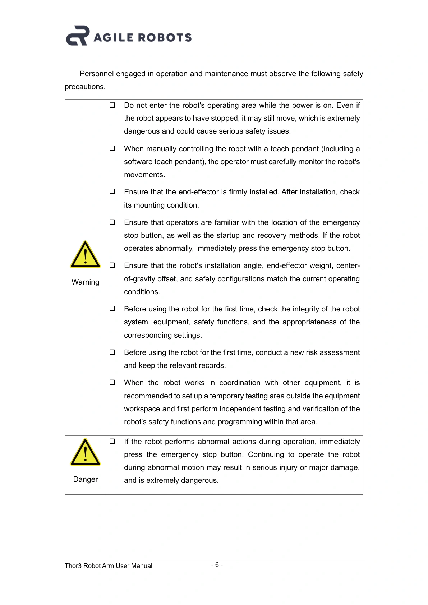



```
Thor3 Robot Arm User Manual  
 
- 6 - 
 
Personnel engaged in operation and maintenance must observe the following safety 
precautions. 
 
Warning 
q 
Do not enter the robot's operating area while the power is on. Even if 
the robot appears to have stopped, it may still move, which is extremely 
dangerous and could cause serious safety issues. 
q 
When manually controlling the robot with a teach pendant (including a 
software teach pendant), the operator must carefully monitor the robot's 
movements. 
q 
Ensure that the end-effector is firmly installed. After installation, check 
its mounting condition. 
q 
Ensure that operators are familiar with the location of the emergency 
stop button, as well as the startup and recovery methods. If the robot 
operates abnormally, immediately press the emergency stop button. 
q 
Ensure that the robot's installation angle, end-effector weight, center-
of-gravity offset, and safety configurations match the current operating 
conditions. 
q 
Before using the robot for the first time, check the integrity of the robot 
system, equipment, safety functions, and the appropriateness of the 
corresponding settings. 
q 
Before using the robot for the first time, conduct a new risk assessment 
and keep the relevant records. 
q 
When the robot works in coordination with other equipment, it is 
recommended to set up a temporary testing area outside the equipment 
workspace and first perform independent testing and verification of the 
robot's safety functions and programming within that area. 
 
Danger 
q 
If the robot performs abnormal actions during operation, immediately 
press the emergency stop button. Continuing to operate the robot 
during abnormal motion may result in serious injury or major damage, 
and is extremely dangerous.
```



## PDF page 11

**Source:** Thor3 Robot Arm User Manual V1.9 EN.pdf, original pdf page 11. [Open the corresponding PDF reading-copy page](https://1292444914-files.gitbook.io/~/files/v0/b/gitbook-x-prod.appspot.com/o/spaces%2FtgOfPnscWebs1eh82EKq%2Fuploads%2FMLzy8vOwWCb6K4qvjw3W%2Fthor3-robot-arm-user-manual-v1-9-en-pp-001-018.pdf?alt=media#page=11).



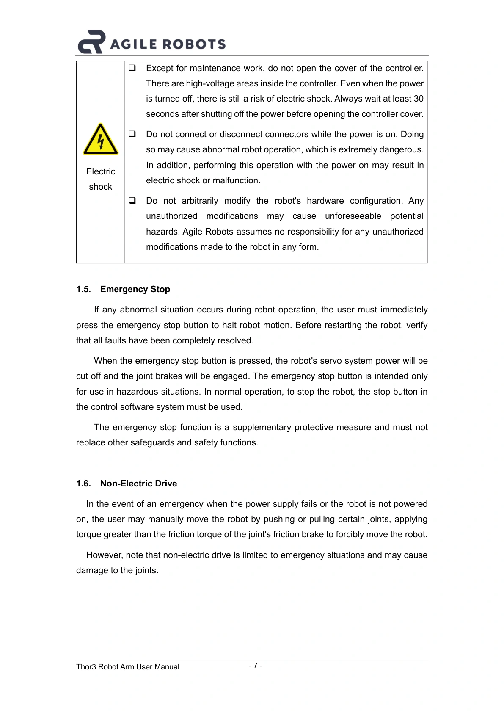



```
Thor3 Robot Arm User Manual  
 
- 7 - 
 
Electric 
shock 
q 
Except for maintenance work, do not open the cover of the controller. 
There are high-voltage areas inside the controller. Even when the power 
is turned off, there is still a risk of electric shock. Always wait at least 30 
seconds after shutting off the power before opening the controller cover. 
q 
Do not connect or disconnect connectors while the power is on. Doing 
so may cause abnormal robot operation, which is extremely dangerous. 
In addition, performing this operation with the power on may result in 
electric shock or malfunction. 
q 
Do not arbitrarily modify the robot's hardware configuration. Any 
unauthorized modifications may cause unforeseeable potential 
hazards. Agile Robots assumes no responsibility for any unauthorized 
modifications made to the robot in any form. 
 
1.5. Emergency Stop 
If any abnormal situation occurs during robot operation, the user must immediately 
press the emergency stop button to halt robot motion. Before restarting the robot, verify 
that all faults have been completely resolved. 
When the emergency stop button is pressed, the robot's servo system power will be 
cut off and the joint brakes will be engaged. The emergency stop button is intended only 
for use in hazardous situations. In normal operation, to stop the robot, the stop button in 
the control software system must be used. 
The emergency stop function is a supplementary protective measure and must not 
replace other safeguards and safety functions. 
 
1.6. Non-Electric Drive 
In the event of an emergency when the power supply fails or the robot is not powered 
on, the user may manually move the robot by pushing or pulling certain joints, applying 
torque greater than the friction torque of the joint's friction brake to forcibly move the robot. 
However, note that non-electric drive is limited to emergency situations and may cause 
damage to the joints.
```



## PDF page 12

**Source:** Thor3 Robot Arm User Manual V1.9 EN.pdf, original pdf page 12. [Open the corresponding PDF reading-copy page](https://1292444914-files.gitbook.io/~/files/v0/b/gitbook-x-prod.appspot.com/o/spaces%2FtgOfPnscWebs1eh82EKq%2Fuploads%2FMLzy8vOwWCb6K4qvjw3W%2Fthor3-robot-arm-user-manual-v1-9-en-pp-001-018.pdf?alt=media#page=12).



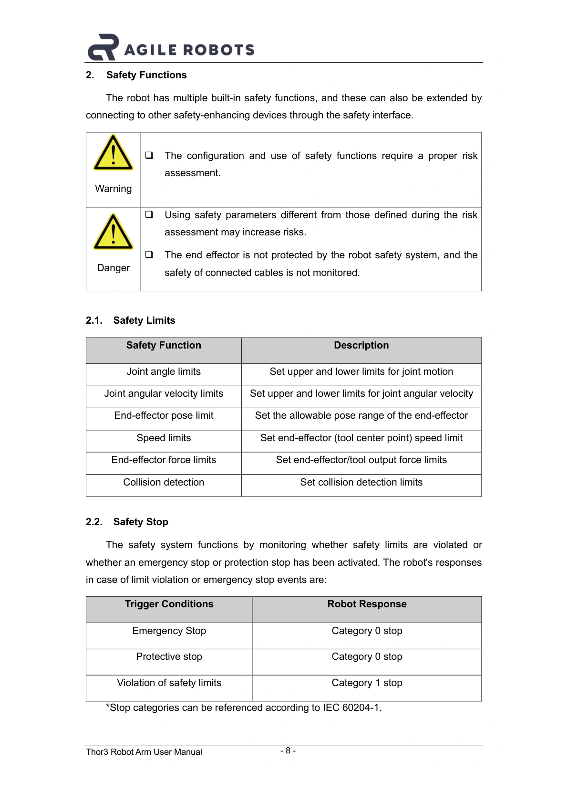



```
Thor3 Robot Arm User Manual  
 
- 8 - 
2. 
Safety Functions 
The robot has multiple built-in safety functions, and these can also be extended by 
connecting to other safety-enhancing devices through the safety interface. 
 
Warning 
q 
The configuration and use of safety functions require a proper risk 
assessment. 
 
Danger 
q 
Using safety parameters different from those defined during the risk 
assessment may increase risks. 
q 
The end effector is not protected by the robot safety system, and the 
safety of connected cables is not monitored. 
 
2.1. Safety Limits 
Safety Function 
Description 
Joint angle limits 
Set upper and lower limits for joint motion 
Joint angular velocity limits 
Set upper and lower limits for joint angular velocity 
End-effector pose limit 
Set the allowable pose range of the end-effector 
Speed limits 
Set end-effector (tool center point) speed limit 
End-effector force limits 
Set end-effector/tool output force limits 
Collision detection 
Set collision detection limits 
 
2.2. Safety Stop 
The safety system functions by monitoring whether safety limits are violated or 
whether an emergency stop or protection stop has been activated. The robot's responses 
in case of limit violation or emergency stop events are: 
Trigger Conditions 
Robot Response 
Emergency Stop 
Category 0 stop 
Protective stop 
Category 0 stop 
Violation of safety limits 
Category 1 stop 
*Stop categories can be referenced according to IEC 60204-1.
```



## PDF page 13

**Source:** Thor3 Robot Arm User Manual V1.9 EN.pdf, original pdf page 13. [Open the corresponding PDF reading-copy page](https://1292444914-files.gitbook.io/~/files/v0/b/gitbook-x-prod.appspot.com/o/spaces%2FtgOfPnscWebs1eh82EKq%2Fuploads%2FMLzy8vOwWCb6K4qvjw3W%2Fthor3-robot-arm-user-manual-v1-9-en-pp-001-018.pdf?alt=media#page=13).



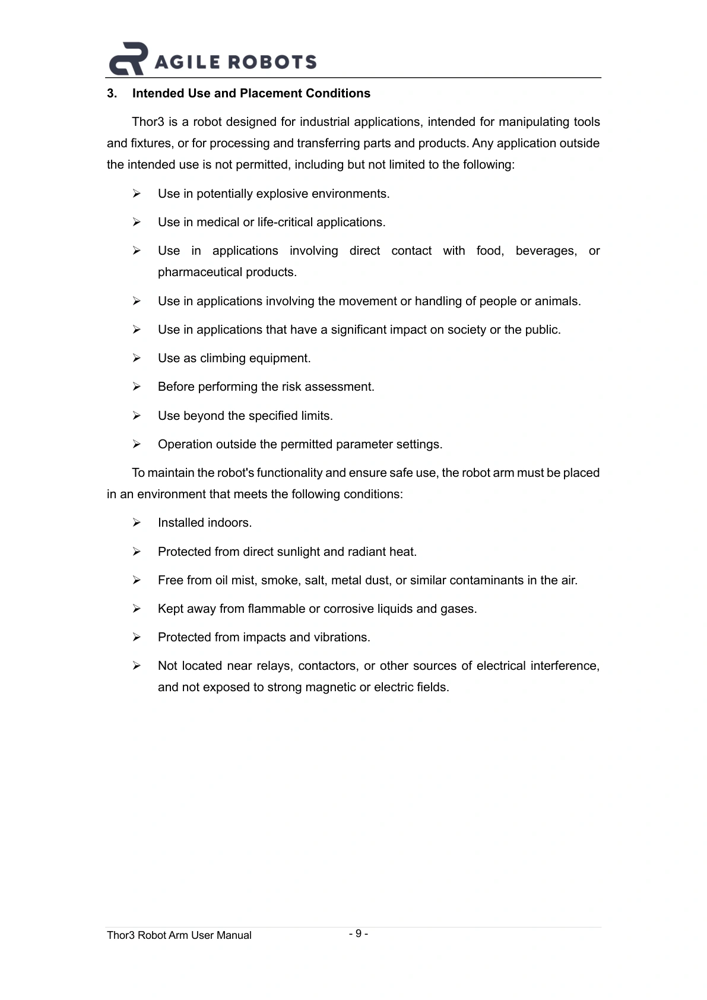



```
Thor3 Robot Arm User Manual  
 
- 9 - 
3. 
Intended Use and Placement Conditions 
Thor3 is a robot designed for industrial applications, intended for manipulating tools 
and fixtures, or for processing and transferring parts and products. Any application outside 
the intended use is not permitted, including but not limited to the following: 
Ø 
Use in potentially explosive environments. 
Ø 
Use in medical or life-critical applications. 
Ø 
Use in applications involving direct contact with food, beverages, or 
pharmaceutical products. 
Ø 
Use in applications involving the movement or handling of people or animals. 
Ø 
Use in applications that have a significant impact on society or the public. 
Ø 
Use as climbing equipment. 
Ø 
Before performing the risk assessment. 
Ø 
Use beyond the specified limits. 
Ø 
Operation outside the permitted parameter settings. 
To maintain the robot's functionality and ensure safe use, the robot arm must be placed 
in an environment that meets the following conditions: 
Ø 
Installed indoors. 
Ø 
Protected from direct sunlight and radiant heat. 
Ø 
Free from oil mist, smoke, salt, metal dust, or similar contaminants in the air. 
Ø 
Kept away from flammable or corrosive liquids and gases. 
Ø 
Protected from impacts and vibrations. 
Ø 
Not located near relays, contactors, or other sources of electrical interference, 
and not exposed to strong magnetic or electric fields.
```



## PDF page 14

**Source:** Thor3 Robot Arm User Manual V1.9 EN.pdf, original pdf page 14. [Open the corresponding PDF reading-copy page](https://1292444914-files.gitbook.io/~/files/v0/b/gitbook-x-prod.appspot.com/o/spaces%2FtgOfPnscWebs1eh82EKq%2Fuploads%2FMLzy8vOwWCb6K4qvjw3W%2Fthor3-robot-arm-user-manual-v1-9-en-pp-001-018.pdf?alt=media#page=14).



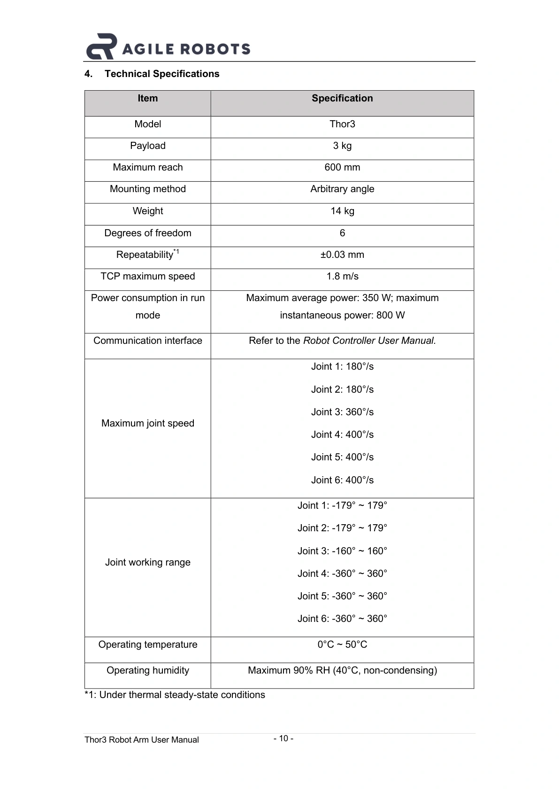



```
Thor3 Robot Arm User Manual  
 
- 10 - 
4. 
Technical Specifications 
Item 
Specification 
Model 
Thor3 
Payload 
3 kg 
Maximum reach 
600 mm 
Mounting method 
Arbitrary angle 
Weight 
14 kg 
Degrees of freedom 
6 
Repeatability*1 
±0.03 mm 
TCP maximum speed 
1.8 m/s 
Power consumption in run 
mode 
Maximum average power: 350 W; maximum 
instantaneous power: 800 W 
Communication interface 
Refer to the Robot Controller User Manual. 
Maximum joint speed 
Joint 1: 180°/s 
Joint 2: 180°/s 
Joint 3: 360°/s 
Joint 4: 400°/s 
Joint 5: 400°/s 
Joint 6: 400°/s 
Joint working range 
Joint 1: -179° ~ 179° 
Joint 2: -179° ~ 179° 
Joint 3: -160° ~ 160° 
Joint 4: -360° ~ 360° 
Joint 5: -360° ~ 360° 
Joint 6: -360° ~ 360° 
Operating temperature 
0°C ~ 50°C 
Operating humidity 
Maximum 90% RH (40°C, non-condensing) 
*1: Under thermal steady-state conditions
```



## PDF page 15

**Source:** Thor3 Robot Arm User Manual V1.9 EN.pdf, original pdf page 15. [Open the corresponding PDF reading-copy page](https://1292444914-files.gitbook.io/~/files/v0/b/gitbook-x-prod.appspot.com/o/spaces%2FtgOfPnscWebs1eh82EKq%2Fuploads%2FMLzy8vOwWCb6K4qvjw3W%2Fthor3-robot-arm-user-manual-v1-9-en-pp-001-018.pdf?alt=media#page=15).



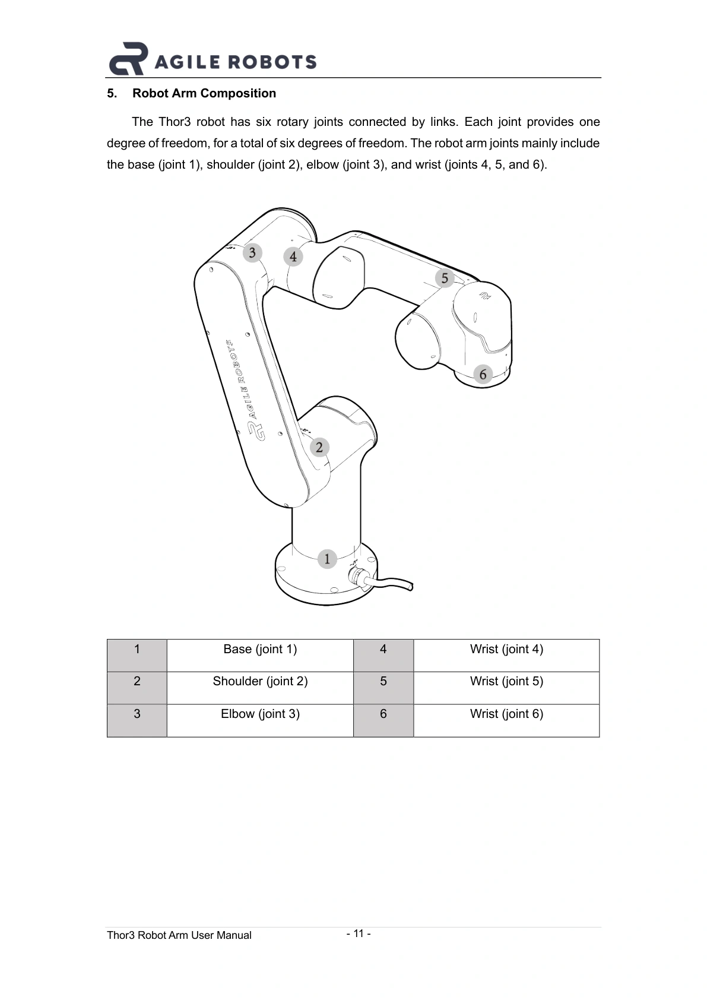



```
Thor3 Robot Arm User Manual  
 
- 11 - 
5. 
Robot Arm Composition 
The Thor3 robot has six rotary joints connected by links. Each joint provides one 
degree of freedom, for a total of six degrees of freedom. The robot arm joints mainly include 
the base (joint 1), shoulder (joint 2), elbow (joint 3), and wrist (joints 4, 5, and 6). 
 
1 
Base (joint 1) 
4 
Wrist (joint 4) 
2 
Shoulder (joint 2) 
5 
Wrist (joint 5) 
3 
Elbow (joint 3) 
6 
Wrist (joint 6)
```



## PDF page 16

**Source:** Thor3 Robot Arm User Manual V1.9 EN.pdf, original pdf page 16. [Open the corresponding PDF reading-copy page](https://1292444914-files.gitbook.io/~/files/v0/b/gitbook-x-prod.appspot.com/o/spaces%2FtgOfPnscWebs1eh82EKq%2Fuploads%2FMLzy8vOwWCb6K4qvjw3W%2Fthor3-robot-arm-user-manual-v1-9-en-pp-001-018.pdf?alt=media#page=16).



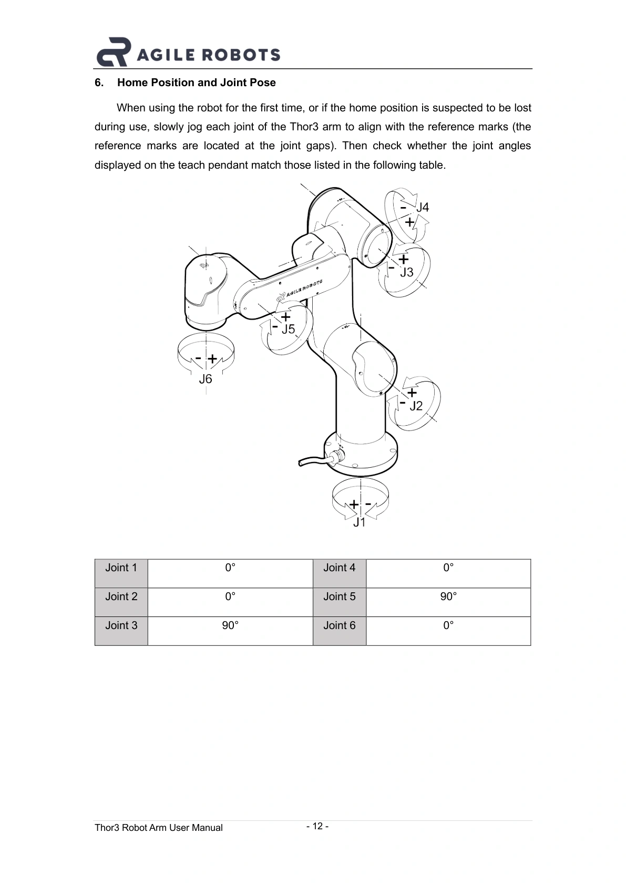



```
Thor3 Robot Arm User Manual  
 
- 12 - 
6. 
Home Position and Joint Pose 
When using the robot for the first time, or if the home position is suspected to be lost 
during use, slowly jog each joint of the Thor3 arm to align with the reference marks (the 
reference marks are located at the joint gaps). Then check whether the joint angles 
displayed on the teach pendant match those listed in the following table. 
 
Joint 1 
0° 
Joint 4 
0° 
Joint 2 
0° 
Joint 5 
90° 
Joint 3 
90° 
Joint 6 
0°
```



## PDF page 17

**Source:** Thor3 Robot Arm User Manual V1.9 EN.pdf, original pdf page 17. [Open the corresponding PDF reading-copy page](https://1292444914-files.gitbook.io/~/files/v0/b/gitbook-x-prod.appspot.com/o/spaces%2FtgOfPnscWebs1eh82EKq%2Fuploads%2FMLzy8vOwWCb6K4qvjw3W%2Fthor3-robot-arm-user-manual-v1-9-en-pp-001-018.pdf?alt=media#page=17).



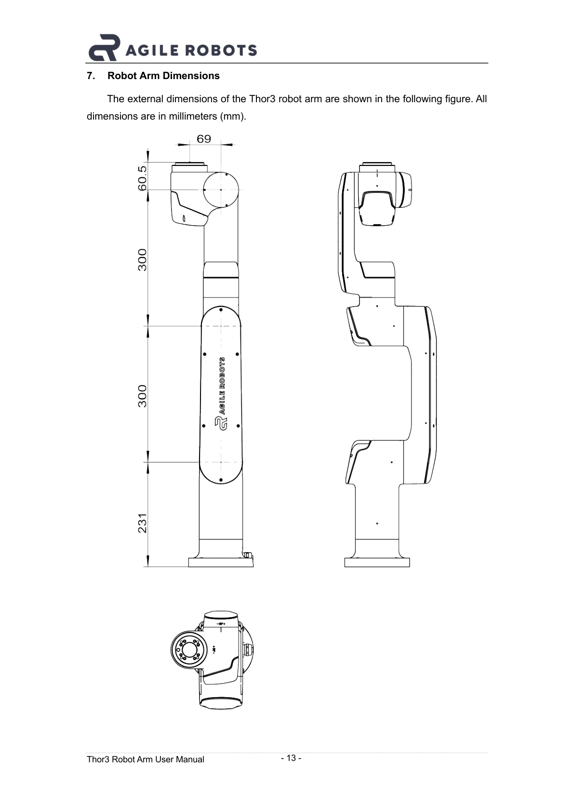



```
Thor3 Robot Arm User Manual  
 
- 13 - 
7. 
Robot Arm Dimensions 
The external dimensions of the Thor3 robot arm are shown in the following figure. All 
dimensions are in millimeters (mm).
```



## PDF page 18

**Source:** Thor3 Robot Arm User Manual V1.9 EN.pdf, original pdf page 18. [Open the corresponding PDF reading-copy page](https://1292444914-files.gitbook.io/~/files/v0/b/gitbook-x-prod.appspot.com/o/spaces%2FtgOfPnscWebs1eh82EKq%2Fuploads%2FMLzy8vOwWCb6K4qvjw3W%2Fthor3-robot-arm-user-manual-v1-9-en-pp-001-018.pdf?alt=media#page=18).



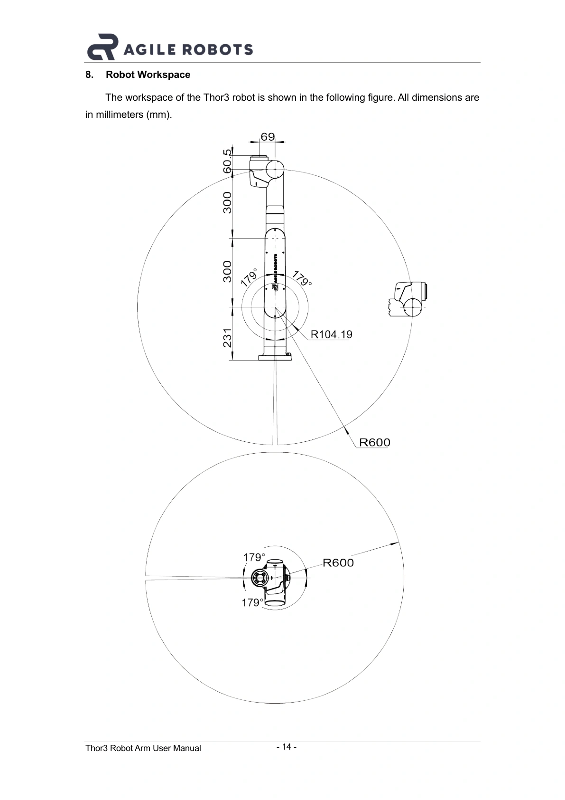



```
Thor3 Robot Arm User Manual  
 
- 14 - 
8. 
Robot Workspace 
The workspace of the Thor3 robot is shown in the following figure. All dimensions are 
in millimeters (mm).
```



## PDF page 19

**Source:** Thor3 Robot Arm User Manual V1.9 EN.pdf, original pdf page 19. [Open the corresponding PDF reading-copy page](https://1292444914-files.gitbook.io/~/files/v0/b/gitbook-x-prod.appspot.com/o/spaces%2FtgOfPnscWebs1eh82EKq%2Fuploads%2F9nsqGEkHbH7zQmbBo158%2Fthor3-robot-arm-user-manual-v1-9-en-pp-019-028.pdf?alt=media#page=1).



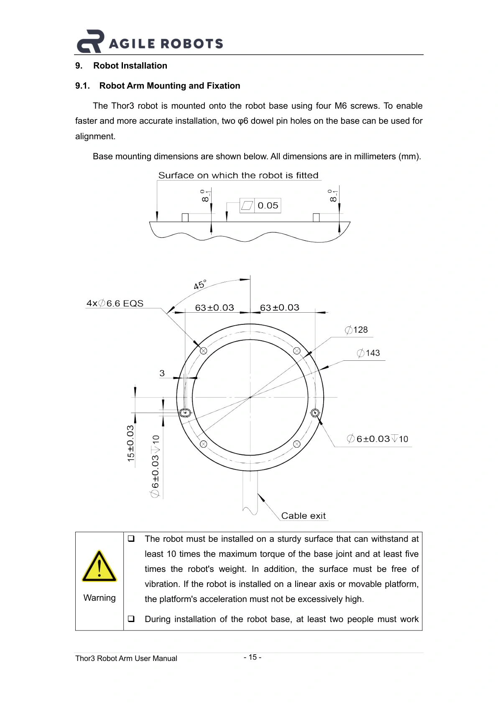



```
Thor3 Robot Arm User Manual  
 
- 15 - 
9. 
Robot Installation 
9.1. Robot Arm Mounting and Fixation 
The Thor3 robot is mounted onto the robot base using four M6 screws. To enable 
faster and more accurate installation, two φ6 dowel pin holes on the base can be used for 
alignment. 
Base mounting dimensions are shown below. All dimensions are in millimeters (mm). 
 
 
Warning 
q 
The robot must be installed on a sturdy surface that can withstand at 
least 10 times the maximum torque of the base joint and at least five 
times the robot's weight. In addition, the surface must be free of 
vibration. If the robot is installed on a linear axis or movable platform, 
the platform's acceleration must not be excessively high. 
q 
During installation of the robot base, at least two people must work
```



## PDF page 20

**Source:** Thor3 Robot Arm User Manual V1.9 EN.pdf, original pdf page 20. [Open the corresponding PDF reading-copy page](https://1292444914-files.gitbook.io/~/files/v0/b/gitbook-x-prod.appspot.com/o/spaces%2FtgOfPnscWebs1eh82EKq%2Fuploads%2F9nsqGEkHbH7zQmbBo158%2Fthor3-robot-arm-user-manual-v1-9-en-pp-019-028.pdf?alt=media#page=2).



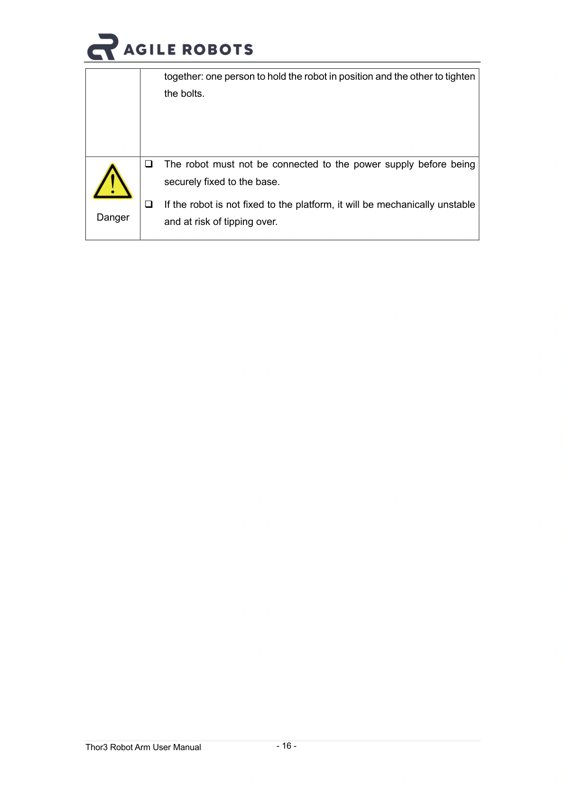



```
Thor3 Robot Arm User Manual  
 
- 16 - 
together: one person to hold the robot in position and the other to tighten 
the bolts. 
 
Danger 
q 
The robot must not be connected to the power supply before being 
securely fixed to the base. 
q 
If the robot is not fixed to the platform, it will be mechanically unstable 
and at risk of tipping over.
```



## PDF page 21

**Source:** Thor3 Robot Arm User Manual V1.9 EN.pdf, original pdf page 21. [Open the corresponding PDF reading-copy page](https://1292444914-files.gitbook.io/~/files/v0/b/gitbook-x-prod.appspot.com/o/spaces%2FtgOfPnscWebs1eh82EKq%2Fuploads%2F9nsqGEkHbH7zQmbBo158%2Fthor3-robot-arm-user-manual-v1-9-en-pp-019-028.pdf?alt=media#page=3).



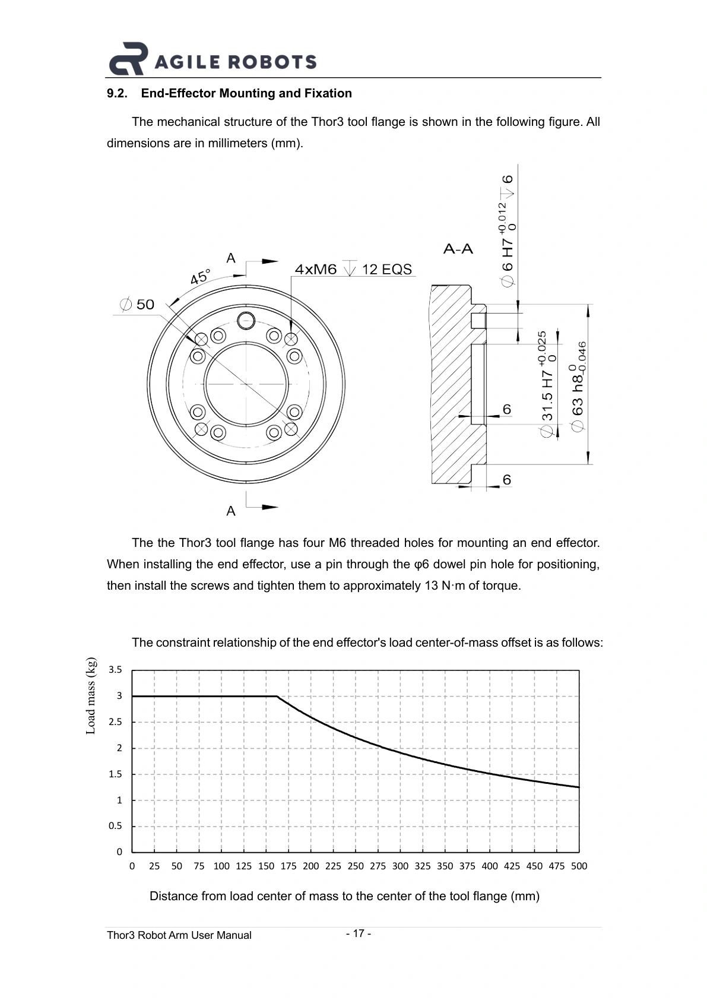



```
Thor3 Robot Arm User Manual  
 
- 17 - 
9.2. End-Effector Mounting and Fixation 
The mechanical structure of the Thor3 tool flange is shown in the following figure. All 
dimensions are in millimeters (mm). 
 
The the Thor3 tool flange has four M6 threaded holes for mounting an end effector. 
When installing the end effector, use a pin through the φ6 dowel pin hole for positioning, 
then install the screws and tighten them to approximately 13 N·m of torque. 
 
The constraint relationship of the end effector's load center-of-mass offset is as follows: 
 
Distance from load center of mass to the center of the tool flange (mm) 
0
0.5
1
1.5
2
2.5
3
3.5
0
25
50
75
100 125 150 175 200 225 250 275 300 325 350 375 400 425 450 475 500
Load mass (kg)
```



## PDF page 22

**Source:** Thor3 Robot Arm User Manual V1.9 EN.pdf, original pdf page 22. [Open the corresponding PDF reading-copy page](https://1292444914-files.gitbook.io/~/files/v0/b/gitbook-x-prod.appspot.com/o/spaces%2FtgOfPnscWebs1eh82EKq%2Fuploads%2F9nsqGEkHbH7zQmbBo158%2Fthor3-robot-arm-user-manual-v1-9-en-pp-019-028.pdf?alt=media#page=4).



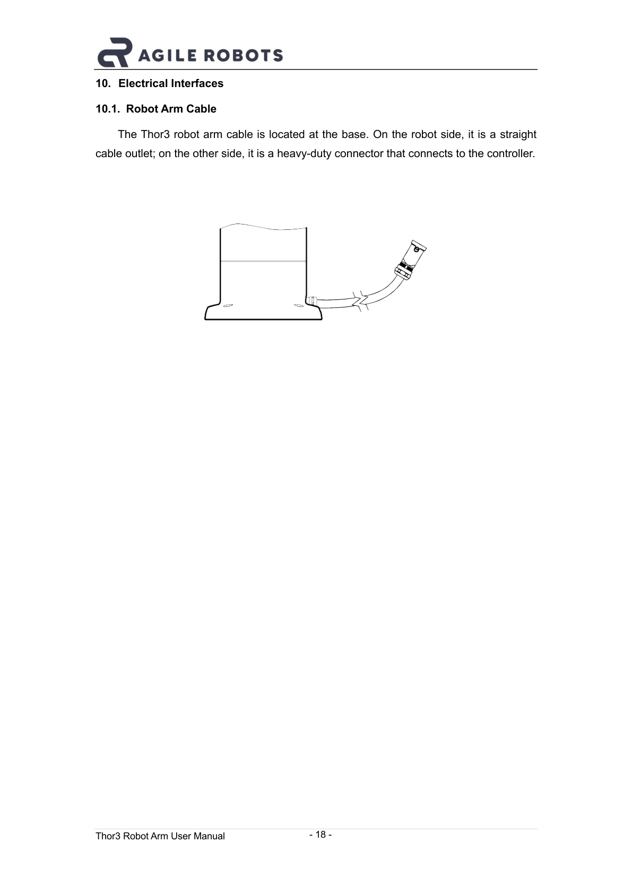



```
Thor3 Robot Arm User Manual  
 
- 18 - 
10. Electrical Interfaces 
10.1. Robot Arm Cable 
The Thor3 robot arm cable is located at the base. On the robot side, it is a straight 
cable outlet; on the other side, it is a heavy-duty connector that connects to the controller.
```



## PDF page 23

**Source:** Thor3 Robot Arm User Manual V1.9 EN.pdf, original pdf page 23. [Open the corresponding PDF reading-copy page](https://1292444914-files.gitbook.io/~/files/v0/b/gitbook-x-prod.appspot.com/o/spaces%2FtgOfPnscWebs1eh82EKq%2Fuploads%2F9nsqGEkHbH7zQmbBo158%2Fthor3-robot-arm-user-manual-v1-9-en-pp-019-028.pdf?alt=media#page=5).



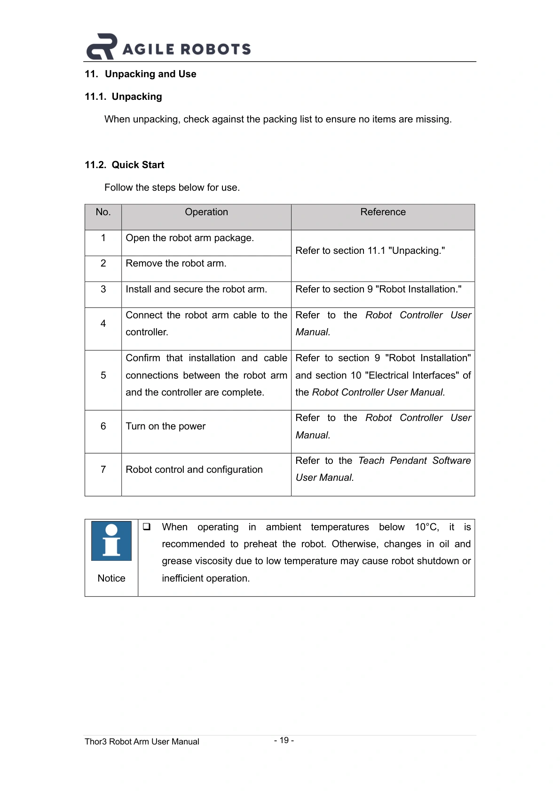



```
Thor3 Robot Arm User Manual  
 
- 19 - 
11. Unpacking and Use 
11.1. Unpacking 
When unpacking, check against the packing list to ensure no items are missing. 
 
11.2. Quick Start 
Follow the steps below for use. 
No. 
Operation 
Reference 
1 
Open the robot arm package. 
Refer to section 11.1 "Unpacking." 
2 
Remove the robot arm. 
3 
Install and secure the robot arm. 
Refer to section 9 "Robot Installation." 
4 
Connect the robot arm cable to the 
controller. 
Refer to the Robot Controller User 
Manual. 
5 
Confirm that installation and cable 
connections between the robot arm 
and the controller are complete. 
Refer to section 9 "Robot Installation" 
and section 10 "Electrical Interfaces" of 
the Robot Controller User Manual. 
6 
Turn on the power 
Refer to the Robot Controller User 
Manual. 
7 
Robot control and configuration 
Refer to the Teach Pendant Software 
User Manual. 
 
 
Notice 
q 
When operating in ambient temperatures below 10°C, it is 
recommended to preheat the robot. Otherwise, changes in oil and 
grease viscosity due to low temperature may cause robot shutdown or 
inefficient operation.
```



## PDF page 24

**Source:** Thor3 Robot Arm User Manual V1.9 EN.pdf, original pdf page 24. [Open the corresponding PDF reading-copy page](https://1292444914-files.gitbook.io/~/files/v0/b/gitbook-x-prod.appspot.com/o/spaces%2FtgOfPnscWebs1eh82EKq%2Fuploads%2F9nsqGEkHbH7zQmbBo158%2Fthor3-robot-arm-user-manual-v1-9-en-pp-019-028.pdf?alt=media#page=6).



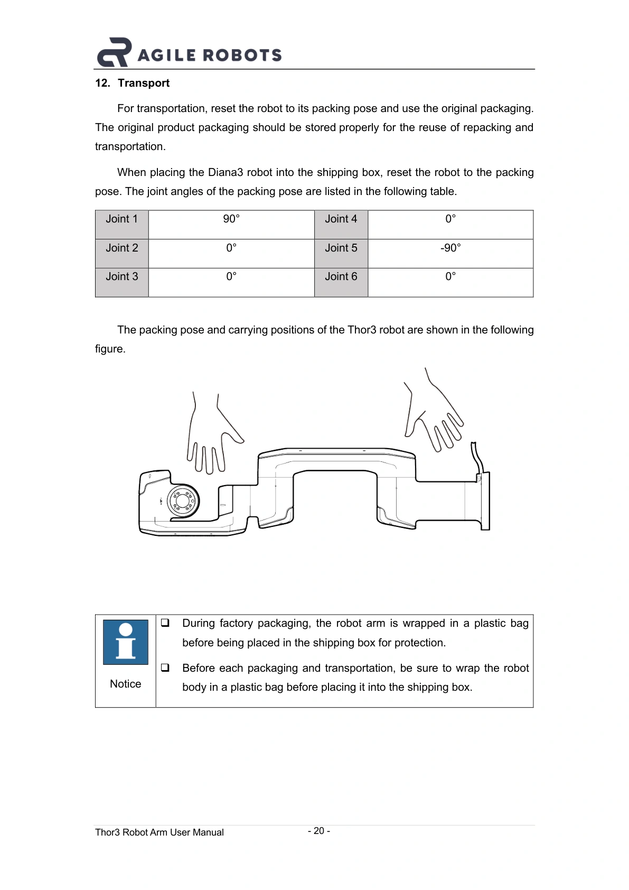



```
Thor3 Robot Arm User Manual  
 
- 20 - 
12. Transport 
For transportation, reset the robot to its packing pose and use the original packaging. 
The original product packaging should be stored properly for the reuse of repacking and 
transportation. 
When placing the Diana3 robot into the shipping box, reset the robot to the packing 
pose. The joint angles of the packing pose are listed in the following table. 
Joint 1 
90° 
Joint 4 
0° 
Joint 2 
0° 
Joint 5 
-90° 
Joint 3 
0° 
Joint 6 
0° 
 
The packing pose and carrying positions of the Thor3 robot are shown in the following 
figure. 
 
 
 
 
Notice 
q 
During factory packaging, the robot arm is wrapped in a plastic bag 
before being placed in the shipping box for protection. 
q 
Before each packaging and transportation, be sure to wrap the robot 
body in a plastic bag before placing it into the shipping box.
```



## PDF page 25

**Source:** Thor3 Robot Arm User Manual V1.9 EN.pdf, original pdf page 25. [Open the corresponding PDF reading-copy page](https://1292444914-files.gitbook.io/~/files/v0/b/gitbook-x-prod.appspot.com/o/spaces%2FtgOfPnscWebs1eh82EKq%2Fuploads%2F9nsqGEkHbH7zQmbBo158%2Fthor3-robot-arm-user-manual-v1-9-en-pp-019-028.pdf?alt=media#page=7).



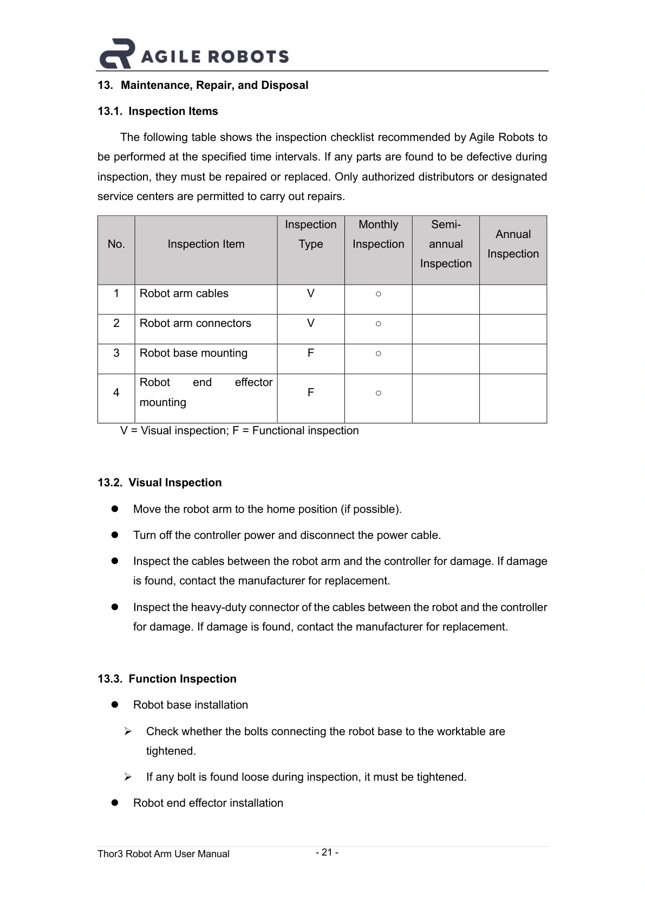



```
Thor3 Robot Arm User Manual  
 
- 21 - 
13. Maintenance, Repair, and Disposal 
13.1. Inspection Items 
The following table shows the inspection checklist recommended by Agile Robots to 
be performed at the specified time intervals. If any parts are found to be defective during 
inspection, they must be repaired or replaced. Only authorized distributors or designated 
service centers are permitted to carry out repairs. 
No. 
Inspection Item 
Inspection 
Type 
Monthly 
Inspection 
Semi-
annual 
Inspection 
Annual 
Inspection 
1 
Robot arm cables 
V 
○ 
 
 
2 
Robot arm connectors 
V 
○ 
 
 
3 
Robot base mounting 
F 
○ 
 
 
4 
Robot 
end 
effector 
mounting 
F 
○ 
 
 
V = Visual inspection; F = Functional inspection 
 
13.2. Visual Inspection 
l 
Move the robot arm to the home position (if possible). 
l 
Turn off the controller power and disconnect the power cable. 
l 
Inspect the cables between the robot arm and the controller for damage. If damage 
is found, contact the manufacturer for replacement. 
l 
Inspect the heavy-duty connector of the cables between the robot and the controller 
for damage. If damage is found, contact the manufacturer for replacement. 
 
13.3. Function Inspection 
l 
Robot base installation 
Ø 
Check whether the bolts connecting the robot base to the worktable are 
tightened. 
Ø 
If any bolt is found loose during inspection, it must be tightened. 
l 
Robot end effector installation
```



## PDF page 26

**Source:** Thor3 Robot Arm User Manual V1.9 EN.pdf, original pdf page 26. [Open the corresponding PDF reading-copy page](https://1292444914-files.gitbook.io/~/files/v0/b/gitbook-x-prod.appspot.com/o/spaces%2FtgOfPnscWebs1eh82EKq%2Fuploads%2F9nsqGEkHbH7zQmbBo158%2Fthor3-robot-arm-user-manual-v1-9-en-pp-019-028.pdf?alt=media#page=8).



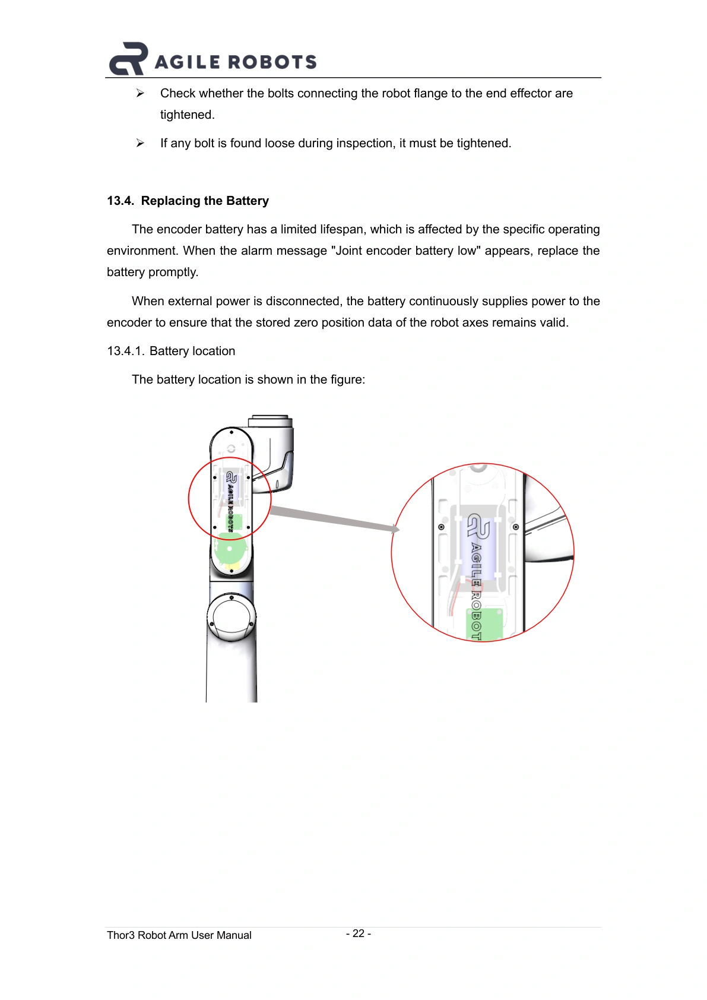



```
Thor3 Robot Arm User Manual  
 
- 22 - 
Ø 
Check whether the bolts connecting the robot flange to the end effector are 
tightened. 
Ø 
If any bolt is found loose during inspection, it must be tightened. 
 
13.4. Replacing the Battery 
The encoder battery has a limited lifespan, which is affected by the specific operating 
environment. When the alarm message "Joint encoder battery low" appears, replace the 
battery promptly. 
When external power is disconnected, the battery continuously supplies power to the 
encoder to ensure that the stored zero position data of the robot axes remains valid. 
13.4.1. Battery location 
The battery location is shown in the figure:
```



## PDF page 27

**Source:** Thor3 Robot Arm User Manual V1.9 EN.pdf, original pdf page 27. [Open the corresponding PDF reading-copy page](https://1292444914-files.gitbook.io/~/files/v0/b/gitbook-x-prod.appspot.com/o/spaces%2FtgOfPnscWebs1eh82EKq%2Fuploads%2F9nsqGEkHbH7zQmbBo158%2Fthor3-robot-arm-user-manual-v1-9-en-pp-019-028.pdf?alt=media#page=9).



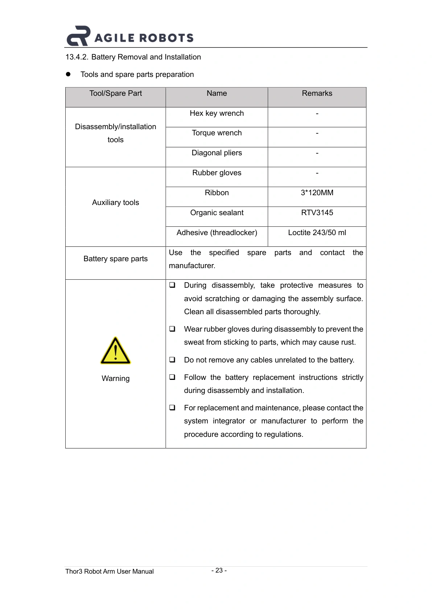



```
Thor3 Robot Arm User Manual  
 
- 23 - 
13.4.2. Battery Removal and Installation 
l 
Tools and spare parts preparation 
Tool/Spare Part 
Name 
Remarks 
Disassembly/installation 
tools 
Hex key wrench 
- 
Torque wrench  
- 
Diagonal pliers 
- 
Auxiliary tools 
Rubber gloves 
- 
Ribbon 
3*120MM 
Organic sealant 
RTV3145 
Adhesive (threadlocker) 
Loctite 243/50 ml 
Battery spare parts 
Use the specified spare parts and contact the 
manufacturer. 
 
Warning 
q 
During disassembly, take protective measures to 
avoid scratching or damaging the assembly surface. 
Clean all disassembled parts thoroughly. 
q 
Wear rubber gloves during disassembly to prevent the 
sweat from sticking to parts, which may cause rust. 
q 
Do not remove any cables unrelated to the battery. 
q 
Follow the battery replacement instructions strictly 
during disassembly and installation. 
q 
For replacement and maintenance, please contact the 
system integrator or manufacturer to perform the 
procedure according to regulations.
```



## PDF page 28

**Source:** Thor3 Robot Arm User Manual V1.9 EN.pdf, original pdf page 28. [Open the corresponding PDF reading-copy page](https://1292444914-files.gitbook.io/~/files/v0/b/gitbook-x-prod.appspot.com/o/spaces%2FtgOfPnscWebs1eh82EKq%2Fuploads%2F9nsqGEkHbH7zQmbBo158%2Fthor3-robot-arm-user-manual-v1-9-en-pp-019-028.pdf?alt=media#page=10).



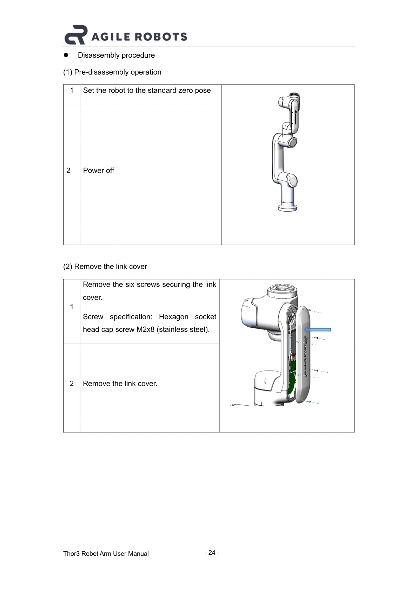



```
Thor3 Robot Arm User Manual  
 
- 24 - 
l 
Disassembly procedure 
(1) Pre-disassembly operation 
1 
Set the robot to the standard zero pose 
 
2 
Power off 
 
(2) Remove the link cover 
1 
Remove the six screws securing the link 
cover. 
 
 
Screw specification: Hexagon socket 
head cap screw M2x8 (stainless steel). 
2 
Remove the link cover.
```



## PDF page 29

**Source:** Thor3 Robot Arm User Manual V1.9 EN.pdf, original pdf page 29. [Open the corresponding PDF reading-copy page](https://1292444914-files.gitbook.io/~/files/v0/b/gitbook-x-prod.appspot.com/o/spaces%2FtgOfPnscWebs1eh82EKq%2Fuploads%2FjIVEgkroCPGYfAWoHJON%2Fthor3-robot-arm-user-manual-v1-9-en-pp-029-034.pdf?alt=media#page=1).



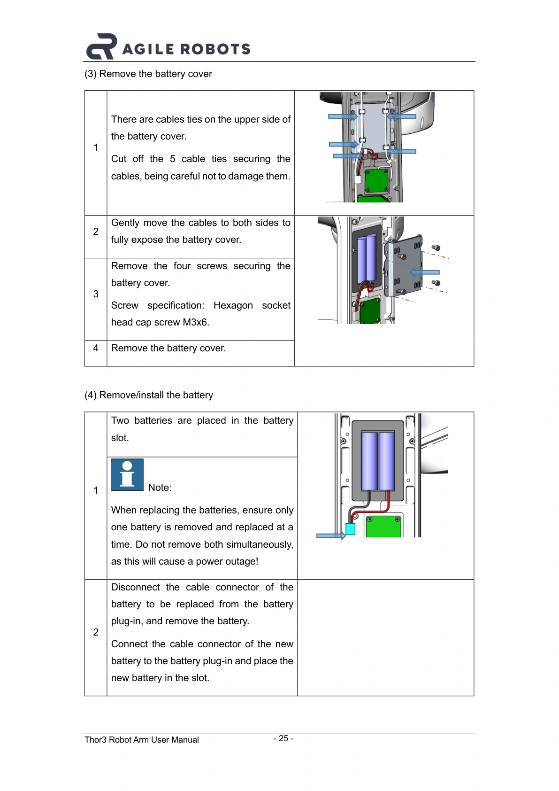



```
Thor3 Robot Arm User Manual  
 
- 25 - 
(3) Remove the battery cover 
1 
There are cables ties on the upper side of 
the battery cover. 
Cut off the 5 cable ties securing the 
cables, being careful not to damage them. 
 
2 
Gently move the cables to both sides to 
fully expose the battery cover. 
 
3 
Remove the four screws securing the 
battery cover. 
Screw specification: Hexagon socket 
head cap screw M3x6. 
4 
Remove the battery cover. 
 
(4) Remove/install the battery 
1 
Two batteries are placed in the battery 
slot. 
 
 Note: 
When replacing the batteries, ensure only 
one battery is removed and replaced at a 
time. Do not remove both simultaneously, 
as this will cause a power outage! 
2 
Disconnect the cable connector of the 
battery to be replaced from the battery 
plug-in, and remove the battery. 
Connect the cable connector of the new 
battery to the battery plug-in and place the 
new battery in the slot.
```



## PDF page 30

**Source:** Thor3 Robot Arm User Manual V1.9 EN.pdf, original pdf page 30. [Open the corresponding PDF reading-copy page](https://1292444914-files.gitbook.io/~/files/v0/b/gitbook-x-prod.appspot.com/o/spaces%2FtgOfPnscWebs1eh82EKq%2Fuploads%2FjIVEgkroCPGYfAWoHJON%2Fthor3-robot-arm-user-manual-v1-9-en-pp-029-034.pdf?alt=media#page=2).



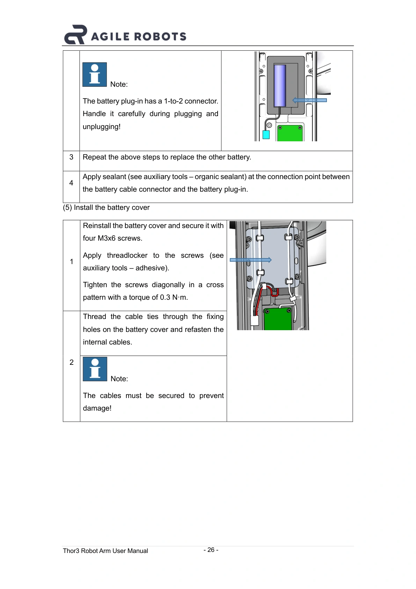



```
Thor3 Robot Arm User Manual  
 
- 26 - 
 Note: 
The battery plug-in has a 1-to-2 connector. 
Handle it carefully during plugging and 
unplugging! 
 
3 
Repeat the above steps to replace the other battery. 
4 
Apply sealant (see auxiliary tools – organic sealant) at the connection point between 
the battery cable connector and the battery plug-in. 
(5) Install the battery cover 
1 
Reinstall the battery cover and secure it with 
four M3x6 screws. 
Apply threadlocker to the screws (see 
auxiliary tools – adhesive). 
Tighten the screws diagonally in a cross 
pattern with a torque of 0.3 N·m. 
 
2 
Thread the cable ties through the fixing 
holes on the battery cover and refasten the 
internal cables. 
 Note: 
The cables must be secured to prevent 
damage!
```



## PDF page 31

**Source:** Thor3 Robot Arm User Manual V1.9 EN.pdf, original pdf page 31. [Open the corresponding PDF reading-copy page](https://1292444914-files.gitbook.io/~/files/v0/b/gitbook-x-prod.appspot.com/o/spaces%2FtgOfPnscWebs1eh82EKq%2Fuploads%2FjIVEgkroCPGYfAWoHJON%2Fthor3-robot-arm-user-manual-v1-9-en-pp-029-034.pdf?alt=media#page=3).



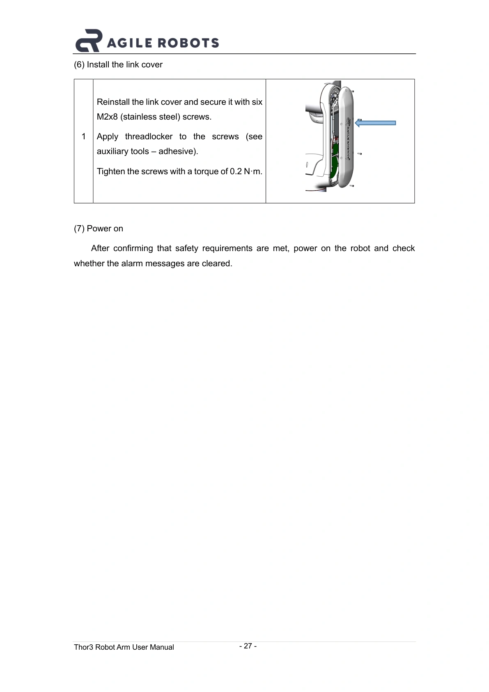



```
Thor3 Robot Arm User Manual  
 
- 27 - 
(6) Install the link cover 
1 
Reinstall the link cover and secure it with six 
M2x8 (stainless steel) screws. 
Apply threadlocker to the screws (see 
auxiliary tools – adhesive). 
Tighten the screws with a torque of 0.2 N·m. 
 
 
(7) Power on 
After confirming that safety requirements are met, power on the robot and check 
whether the alarm messages are cleared.
```



## PDF page 32

**Source:** Thor3 Robot Arm User Manual V1.9 EN.pdf, original pdf page 32. [Open the corresponding PDF reading-copy page](https://1292444914-files.gitbook.io/~/files/v0/b/gitbook-x-prod.appspot.com/o/spaces%2FtgOfPnscWebs1eh82EKq%2Fuploads%2FjIVEgkroCPGYfAWoHJON%2Fthor3-robot-arm-user-manual-v1-9-en-pp-029-034.pdf?alt=media#page=4).



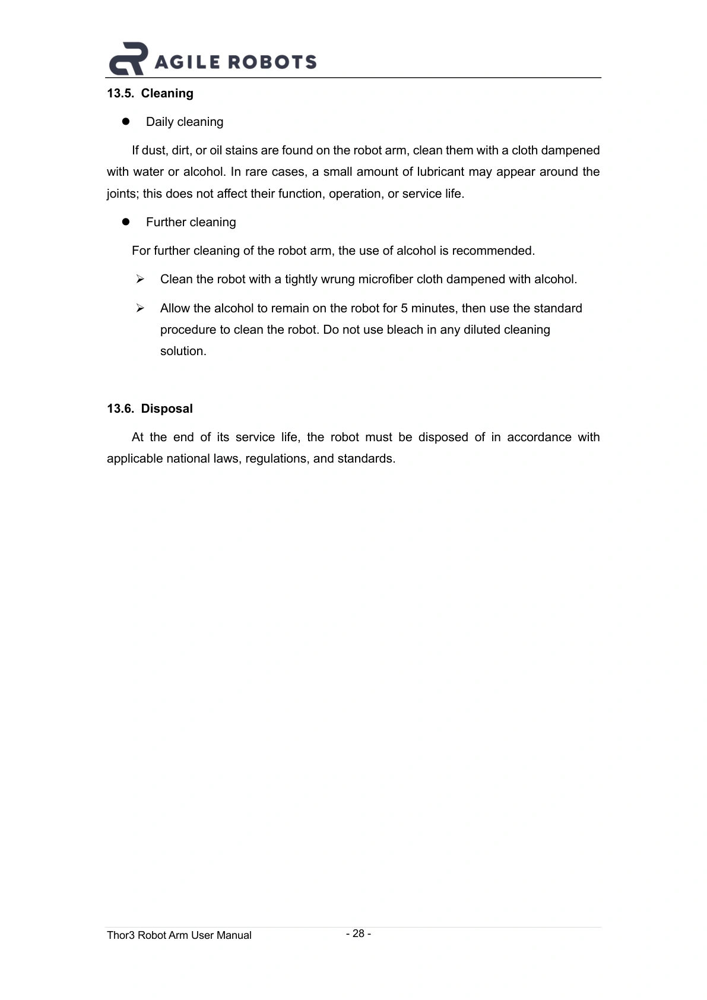



```
Thor3 Robot Arm User Manual  
 
- 28 - 
13.5. Cleaning 
l 
Daily cleaning 
If dust, dirt, or oil stains are found on the robot arm, clean them with a cloth dampened 
with water or alcohol. In rare cases, a small amount of lubricant may appear around the 
joints; this does not affect their function, operation, or service life. 
l 
Further cleaning 
For further cleaning of the robot arm, the use of alcohol is recommended. 
Ø 
Clean the robot with a tightly wrung microfiber cloth dampened with alcohol. 
Ø 
Allow the alcohol to remain on the robot for 5 minutes, then use the standard 
procedure to clean the robot. Do not use bleach in any diluted cleaning 
solution. 
 
13.6. Disposal 
At the end of its service life, the robot must be disposed of in accordance with 
applicable national laws, regulations, and standards.
```



## PDF page 33

**Source:** Thor3 Robot Arm User Manual V1.9 EN.pdf, original pdf page 33. [Open the corresponding PDF reading-copy page](https://1292444914-files.gitbook.io/~/files/v0/b/gitbook-x-prod.appspot.com/o/spaces%2FtgOfPnscWebs1eh82EKq%2Fuploads%2FjIVEgkroCPGYfAWoHJON%2Fthor3-robot-arm-user-manual-v1-9-en-pp-029-034.pdf?alt=media#page=5).



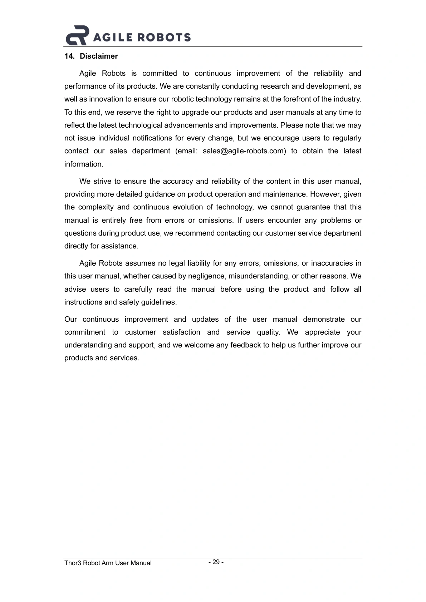



```
Thor3 Robot Arm User Manual  
 
- 29 - 
14. Disclaimer 
Agile Robots is committed to continuous improvement of the reliability and 
performance of its products. We are constantly conducting research and development, as 
well as innovation to ensure our robotic technology remains at the forefront of the industry. 
To this end, we reserve the right to upgrade our products and user manuals at any time to 
reflect the latest technological advancements and improvements. Please note that we may 
not issue individual notifications for every change, but we encourage users to regularly 
contact our sales department (email: sales@agile-robots.com) to obtain the latest 
information. 
We strive to ensure the accuracy and reliability of the content in this user manual, 
providing more detailed guidance on product operation and maintenance. However, given 
the complexity and continuous evolution of technology, we cannot guarantee that this 
manual is entirely free from errors or omissions. If users encounter any problems or 
questions during product use, we recommend contacting our customer service department 
directly for assistance. 
Agile Robots assumes no legal liability for any errors, omissions, or inaccuracies in 
this user manual, whether caused by negligence, misunderstanding, or other reasons. We 
advise users to carefully read the manual before using the product and follow all 
instructions and safety guidelines.  
Our continuous improvement and updates of the user manual demonstrate our 
commitment to customer satisfaction and service quality. We appreciate your 
understanding and support, and we welcome any feedback to help us further improve our 
products and services.
```



## PDF page 34

**Source:** Thor3 Robot Arm User Manual V1.9 EN.pdf, original pdf page 34. [Open the corresponding PDF reading-copy page](https://1292444914-files.gitbook.io/~/files/v0/b/gitbook-x-prod.appspot.com/o/spaces%2FtgOfPnscWebs1eh82EKq%2Fuploads%2FjIVEgkroCPGYfAWoHJON%2Fthor3-robot-arm-user-manual-v1-9-en-pp-029-034.pdf?alt=media#page=6).



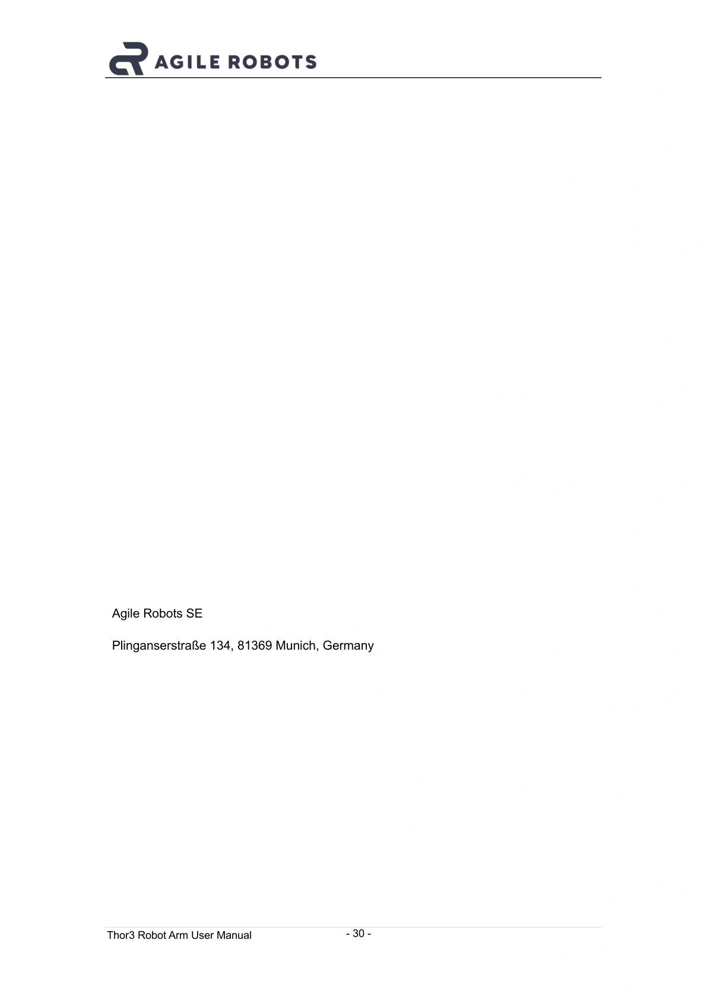



```
Thor3 Robot Arm User Manual  
 
- 30 - 
 
 
 
 
 
 
 
 
 
 
 
 
 
 
 
 
 
 
Agile Robots SE 
Plinganserstraße 134, 81369 Munich, Germany
```


