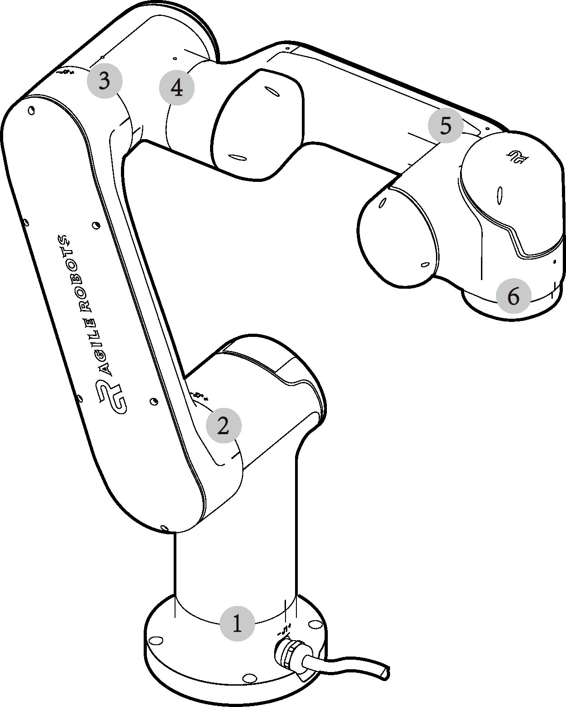

# Thor 3: hardware, controller and first connection


**Model:** Thor 3 · **Scope:** Supplied Thor3 Robot Arm User Manual V1.9 EN.pdf

No separate exact OpenELAB product/SKU match was verified. This is a manufacturer-document reference; no substitute store URL or SKU is asserted.

[Manufacturer product information](https://www.agile-robots.com/en/products/thor-series/)


## Product overview

A compact six-axis arm for light assembly and handling. It uses the RCB controller route in the supplied series/controller documentation, rather than the CB-FS route used by larger Thor models.

_Source: Thor3 Robot Arm User Manual V1.9 EN.pdf, PDF p. 15. Illustration for identification; not a mounting template or proof of application safety._

## Applications

Industrial tool/fixture manipulation, assembly, inspection and part transfer within the exact robot's rated load and workspace. The arm manual excludes medical/life-critical use, handling people/animals and operation before risk assessment. A robot with collision detection does not certify a complete collaborative workcell.

## Specifications

| Parameter                                       | Value and scope                                            |
| ----------------------------------------------- | ---------------------------------------------------------- |
| Payload / maximum reach                         | 3 kg / 600 mm                                              |
| Axes / arm mass                                 | 6 / 14 kg                                                  |
| Repeatability                                   | ±0.03 mm, thermal steady state                             |
| Maximum TCP speed                               | 1.8 m/s; capability, not initial operating setting         |
| Protection / environment                        | IP20 (series brochure); 0–50 °C, indoor integration        |
| Run-mode power, average / instantaneous maximum | 350 / 800 W; arm specification, not controller mains input |
| Controller route                                | RCB2.1.1T-0.3KW                                            |

Sources: [Thor3 Robot Arm User Manual V1.9 EN.pdf, PDF p. 14](source-library/); [AR-ThorSeries-Productflyer-SCREEN-en.pdf, supplied brochure, specification table](source-library/). The RCB controller requires 200–240 V AC. The 110–240 V CB-FS range and the generic training slide are not Thor 3 mains specifications. Thor 3 has six joint entries, even when a training screenshot shows a seven-axis Diana.

## Hardware and connections

The base uses **four M6 screws and two Ø6 positioning-pin holes**; the end-effector mounting uses **four M6 flange holes; Ø6 locating pin; approximately 13 N·m tool-fastener torque**. These are different joints: the stated tool torque is not a base-bolt torque. Follow the drawing for screw length, engagement, locating orientation and reaction loads. Mount before power, with qualified assistance and a stable vibration-free foundation. The manual calls for a foundation able to resist at least ten times the base-joint maximum torque and five times robot weight; this does not replace the integrator's structural assessment.

The supplied Thor 3 manual documents its arm cable and flange teaching button. The series brochure shows no integrated end-effector electrical interface for Thor 3. Use a separately documented tool/interface arrangement; do not copy the powered eight-pin port from Thor 7.

Sources: [Thor3 Robot Arm User Manual V1.9 EN.pdf, PDF pp. 19–21; PDF pp. 22–23](source-library/). Connect the arm only to its matched [controller](rcb-controller.md), with power isolated and grounding, cable retention, stop chain and tool load verified. Do not hot-plug the arm cable or bridge safety inputs to make startup succeed.

## Software and development resources

Use the [Agile Robots development route](development/) for the delivered Industrial V3.3 software. The C/C++ and Python APIs use **6 joint values** for this model and SI units; pendant Lua uses mm, ms and degrees. Obtain the matching manufacturer SDK/native library and license terms; no public manufacturer-controlled Industrial API repository/package was verified. Do not install a similarly named PyPI package or AgileX UGV SDK.

A six-axis Thor Industrial API workflow does not establish support for the seven-axis Diana FCI adaptation.

## Complete source coverage and engineering details

The supplied material is now readable inside the wiki. The complete readers retain every original page, drawing, table, example and notice; the guidance below explains how to use them for this model or workflow.

| Complete in-wiki source                                                                                             | Coverage     |
| ------------------------------------------------------------------------------------------------------------------- | ------------ |
| [Thor 3 arm manual V1.9](source-library/complete-thor3-robot-arm-user-manual-v1-9-en.md)                            | 34 PDF pages |
| [Thor series product flyer](source-library/complete-ar-thorseries-productflyer-screen-en.md)                        | 5 PDF pages  |
| [RCB2.1.1T-0.3KW controller manual V1.2](source-library/complete-rcb2-1-1t-0-3kw-controller-user-manual-v1-2-en.md) | 46 PDF pages |

### Thor 3 revision scope

Use the Thor 3 V1.9 arm manual and the separate RCB2.1.1T-0.3KW controller manual together. The controller input range and battery/service procedure differ from the larger-arm CB-FS branch.

### Mounting, loads and mechanical data

Use the exact arm's base and flange drawings, not a family photograph or a generic training fastener table. The full manual retains the permitted mounting orientations, mounting load requirements, fastener schedule, joint distribution, working envelope and load information. Record tool mass, center of gravity, overhang, cable forces and the actual installation orientation before accepting a payload application. Payload mass alone does not describe every permitted combination of reach and moment.

The source chapters retain joint ranges, speeds, environmental limits, installation dimensions, cable-routing and maintenance requirements. Transfer the documented model and units into simulation and planning configuration, then check joint count, order and frame conventions against the delivered controller. A simulated model loading successfully is not a check of the real controller's limits or dynamics.

### Electrical interfaces and control ownership

Keep the arm load cable, controller power input, flange tool power, general I/O and protective circuits distinct. The connector drawings and complete pin tables are in the exact arm/controller reader. Read them from the specified connector view; a matching pin count or wire color does not establish compatibility. Determine the peripheral's current budget and the correct source/sink arrangement before connecting it. Verify NPN/PNP roles and return paths rather than wiring from a screenshot alone.

Teaching, free-drive, nullspace, impedance, return-home and packaging-position controls have different effects. A free-drive mode still needs correct gravity/tool parameters and a supported load. A mode selector or percentage speed setting alone does not validate a safe working envelope. Confirm who owns control, the applicable enabling device, the protective circuit state and the attended stop arrangement before any motion-capable action.

### Operation and maintenance acceptance

Retain the packaging, matched arm/controller identity and source-specific transport posture. Before a transport or service procedure, support the tool/load and follow the required shutdown, isolation and handling instructions. Brake release, zero calibration and battery replacement are not generic fault-clearing steps. The inspection, cleaning, transport, repair, disposal and certificate appendices are included in the complete reader.

| Acceptance area | Record before powered work                                                                                |
| --------------- | --------------------------------------------------------------------------------------------------------- |
| Identity        | Exact arm/controller labels, revision, software, cable and force-sensor option                            |
| Mechanics       | Source drawing, mounting fasteners/torque, orientation, load/center of gravity and clear working envelope |
| Electrical      | Approved supply, protective earth, connector view, tool power/current and I/O mapping                     |
| Programming     | Correct joint count/order, base/tool/workpiece transforms and version-matched API context                 |
| Recovery        | Fault evidence, authorized reset procedure, supported load and stop/restart responsibilities              |

This record is supplementary engineering guidance. It does not replace the manufacturer's complete installation and robot-cell safety procedures.

### Source chapter map

| Source section              | Full detail                                                                          |
| --------------------------- | ------------------------------------------------------------------------------------ |
| 1. SAFETY                   | [PDF 5](source-library/complete-thor3-robot-arm-user-manual-v1-9-en.md#pdf-page-5)   |
| 1.1. SAFETY REGULATIONS     | [PDF 5](source-library/complete-thor3-robot-arm-user-manual-v1-9-en.md#pdf-page-5)   |
| 1.2. SAFETY SIGNS           | [PDF 7](source-library/complete-thor3-robot-arm-user-manual-v1-9-en.md#pdf-page-7)   |
| 1.3. PERSONNEL REQUIREMENTS | [PDF 8](source-library/complete-thor3-robot-arm-user-manual-v1-9-en.md#pdf-page-8)   |
| 1.4. PRECAUTIONS            | [PDF 8](source-library/complete-thor3-robot-arm-user-manual-v1-9-en.md#pdf-page-8)   |
| 1.5. EMERGENCY STOP         | [PDF 11](source-library/complete-thor3-robot-arm-user-manual-v1-9-en.md#pdf-page-11) |
| 1.6. NON-ELECTRIC DRIVE     | [PDF 11](source-library/complete-thor3-robot-arm-user-manual-v1-9-en.md#pdf-page-11) |
| 2. SAFETY FUNCTIONS         | [PDF 12](source-library/complete-thor3-robot-arm-user-manual-v1-9-en.md#pdf-page-12) |

## Getting started

1. With power isolated, record arm/controller labels and serials, cable, tool, mounting orientation and manuals. Verify the controller variant above and the documented supply before connection.
2. Have the integrator complete mechanical, protective-earth, stop/enabling-device and tool/load acceptance. Keep the work envelope clear and retain the initial settings.
3. Follow [system startup and first connection](development/system-startup.md): use the physical pendant or controller **Ethernet A** for the supplied PC UI route. Factory PC-controller address is `192.168.10.75`; the physical pendant has a different documented network address. Changed delivery settings take precedence.
4. Log in with the assigned account. Inspect the **Startup** information and **About** page for the robot model, joint count, software, controller/SCU/JMU and status. Leave Power On/Start, brake release, jog, Home, Free Drive, task execution and output toggles inactive for this checkpoint.
5. Compare the displayed pose/tool/load and gravity direction with the installation record. Investigate a mismatch before enabling. Save the version/status record, not a copied calibration or packaging pose.

**Expected result:** the correct Thor 3 and RCB2.1.1T-0.3KW are identified, with 6 joint entries and a recorded UI/software status, without commanded arm motion. A connected UI does not prove the stop chain or a real-time interface has passed acceptance. Sources: [Industrial Teaching Pendant Software User Manual\_V3.3.0\_EN\_20260204.pdf, PDF pp. 11–13, 190–191](source-library/); [EN\_1\_System\_Startup.pptx, 15 September 2025, slides 3–4, 9, 17](source-library/).

## Troubleshooting and FAQs

**PC UI cannot connect:** inspect Ethernet A, the delivered address, link indicators, a unique host address on the same subnet and local routing/VPN conflicts. Do not assign the controller's own address to the PC. See [fault isolation](development/troubleshooting.md).

**An instruction assumes seven joints or a CB-FS safety tool:** stop and select the six-axis/RCB controller documentation. The supplied CB-FS SCU/JMU configuration software scope does not include this RCB system.

**Error or speed-limit stop:** preserve the exact error/status and logs, stop the activity, and resolve the cause with the responsible operator. Do not disable collision detection, free-drive limits or safety functions as a connectivity fix.

## Downloads and technical documents

| Resource                                                           | Purpose                                                                    |
| ------------------------------------------------------------------ | -------------------------------------------------------------------------- |
| [Thor3 Robot Arm User Manual V1.9 EN.pdf](source-library/)         | Exact arm manual, mounting/workspace/load diagrams and source page numbers |
| [RCB2.1.1T-0.3KW controller guide](rcb-controller.md)              | Mains, network and safety-interface scope                                  |
| [Industrial C/C++ and Python API](development/industrial-api.md)   | Version, units, joint count and state-only example                         |
| [Coordinates, payload and tools](development/coordinates-tools.md) | TCP/workpiece frames and tooling acceptance                                |

[Current manufacturer model/series information](https://www.agile-robots.com/en/products/thor-series/)

## References and validation

Reviewed 22 November 2026. Documentation/source review only. SDK installation, compilation, robot communication, calibration, simulation, welding and physical safety tests: **not run**. RS485 polarity/description conflicts, undocumented tool adapters and unmatched SDK packages block their respective wiring/control procedures; the identification workflow above does not require those operations.
