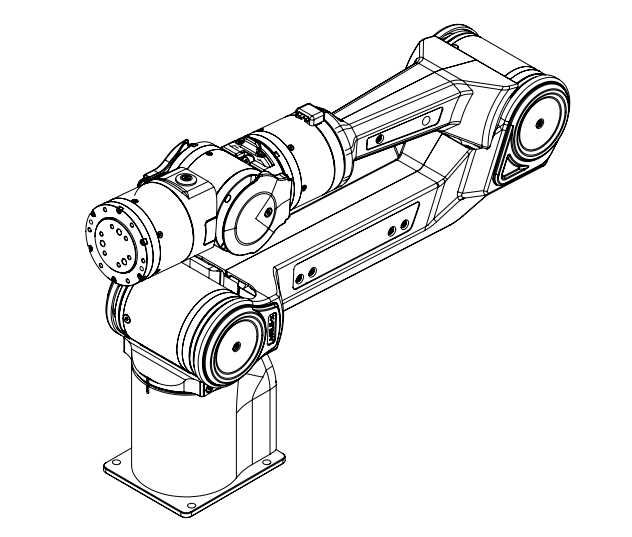
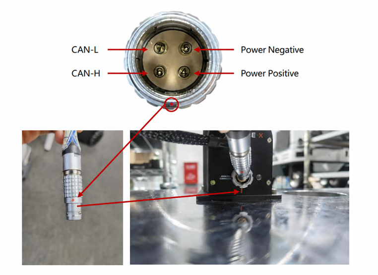
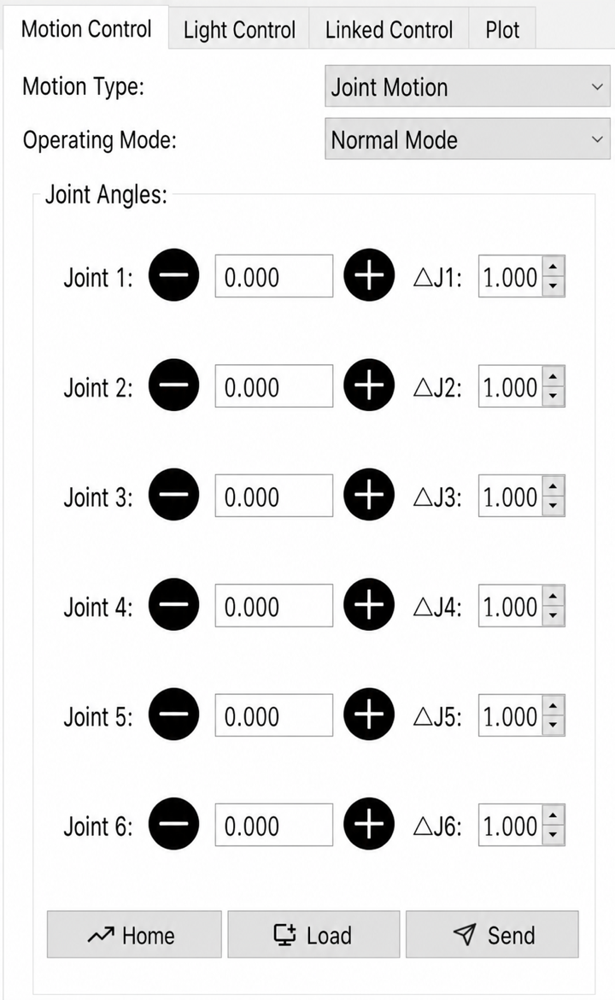
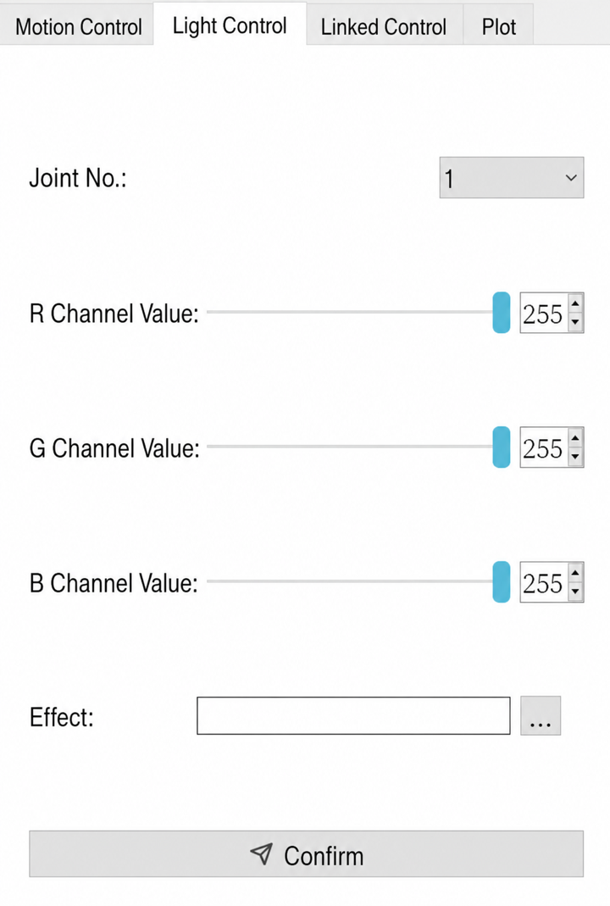
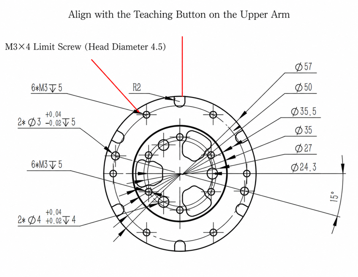

# PiPER-H User Manual


[**View PiPER-H on OpenELAB**](https://openelab.io/products/agilex-piper-h-robotic-arm)

**Product model/family:** PiPER-H · **OpenELAB SKU:** `Agilex-PiPER-H`


### AgileX PiPER-H Robotic Arm for AI Research



Version update notes:

| serial number | Version | date      | Modified by | Reviewer     | Remark                      |
| ------------- | ------- | --------- | ----------- | ------------ | --------------------------- |
| 1             | V.1.0.0 | 2026/1/5  | Dennis      | 
​ 
 | File creation               |
| 2             | V.1.1.0 | 2026/1/25 | Dennis      | 
​ 
 | Final draft of the document |

## **Important security information** 

This chapter contains important safety information that every individual or organization must read and understand before using the device, especially before first powering it on. It is crucial to strictly adhere to and follow all assembly instructions and guidelines in this manual. Pay particular attention to the text associated with warning labels. Always obtain and read the PiPER-H User Manual before using the device. For any questions regarding its use, please contact support@agilex.ai.

> **Warning sign: ⚠** This indicates a potentially dangerous situation that, if not avoided, could result in personal injury, property damage, and serious equipment damage.

> WARNING ⚠ : Songling Robotics will not be liable for any damage, alteration, or modification to the robotic arm in any way. Songling Robotics is not responsible for any damage to the robotic arm or any other equipment caused by programming errors or operational malfunctions.

Limitation of Liability: By using this robotic arm, you acknowledge that you have read, understood, accepted, and agreed to all terms and conditions of the user manual and safety information. The user agrees to be responsible for their own actions and all consequences arising therefrom. The user agrees to use the robotic arm only for legitimate purposes and agrees to these terms and any related policies or guidelines that Songling Robotics may establish. During the use of the robotic arm, please strictly comply with and implement the requirements, including but not limited to the user manual and safety information. Songling Robotics will not be liable for any personal injury, accidents, property damage, legal disputes, or conflicts of interest caused by violations of the instructions or force majeure. The robotic arm is not suitable for use by persons under the age of 18 or other persons without full civil capacity. Please prevent such persons from contacting this product, and exercise extra caution when operating the product in the presence of such persons.

The information in this manual does not cover the design, installation, and operation of a complete robotic arm application system, nor does it cover all peripheral equipment that may affect the safety of this complete system. The design and use of this complete system must comply with the safety requirements established in the standards and specifications of the country where the robotic arm is installed.

Robotic arm integrators and end customers have a responsibility to ensure compliance with relevant regulations and applicable laws and regulations, and to ensure that there are no significant dangers in complete robotic arm application scenarios.

This includes, but is not limited to, the following:

1. **Validity**

* Conduct a risk assessment for the complete robotic arm system.
* Connect together additional safety equipment for other machinery as defined in the risk assessment.
* Confirm that the entire robotic arm system, including both software and hardware, is designed and installed accurately.
* The functions of this robotic arm require integrators and end customers to conduct safety assessments in accordance with relevant regulations and feasible laws and regulations to ensure that the developed robotic arm does not pose any major dangers or safety hazards in practical applications.
* The potential safety risks were known before operating and using the equipment.
* Ensure that users do not modify any security measures.
* Collect all documents in the technical documentation; including the risk assessment and this manual.

2. **environment**

* For first-time users, please read this manual carefully to understand the basic operating procedures and specifications.
* Choose a relatively open area for use. The robotic arm itself does not come with any automatic obstacle avoidance or sensing sensors.
* Use in ambient temperatures ranging from -20℃ to 50℃.
* If the robotic arm is not individually customized with an IP protection rating, its waterproof and dustproof capability is IP22.

3. **examine**

* Ensure that the robotic arm is free of any obvious abnormalities.
* Ensure the wiring harness is properly connected before use.

4. **operate**

* Ensure the surrounding area is relatively open during operation.
* Operate within line of sight.
* The maximum load capacity of the robotic arm is 2KG. When using it, ensure that the effective load does not exceed 2KG.
* If the device malfunctions, please stop using it immediately to avoid causing further damage.
* If the equipment malfunctions, please contact the relevant technical personnel and do not attempt to handle it yourself.
* Please use the device in an environment that meets the IP protection requirements, according to the device's IP protection level.

5. **Usage Warning ⚠ :**

* Ensure that the robotic arm and tool/end effector are always correctly and securely fixed in place.
* When it is unavoidable to enter the workspace of the robotic arm, goggles and protective equipment must be worn.
* Ensure that the robotic arm has enough space to move freely.
* Please do not wear loose clothing when operating the robotic arm. Please ensure that long hair is tied back when operating the robotic arm.
* Do not use the robotic arm if it is damaged or malfunctioning.
* If the host computer software displays an error message, please immediately perform an emergency stop and contact relevant technical personnel.
* Ensure that the head, face, or other body parts remain outside the reach of the operating or soon-to-be-operational robotic arm.
* Do not modify the robotic arm. Modifications to the robotic arm may cause unforeseen dangers for the integrator.
* Do not expose the robotic arm to a permanent magnetic field. Strong magnetic fields can damage the robotic arm.
* The robotic arm generates heat during operation. Do not operate or touch the robotic arm while it is in operation or immediately after operation, as prolonged contact may cause discomfort. Disconnect the power and wait one hour for the robotic arm to cool down.
* Connecting different machines may exacerbate existing hazards or introduce new ones. Always conduct a comprehensive risk assessment of the entire installation. Depending on the risk assessment, different functional safety levels may apply; therefore, always select the highest performance level when different safety and emergency stop performance levels are required. Always read and understand the manuals for all equipment used in the installation.
* The robotic arm is not suitable for use by persons under the age of 18 or other persons who do not have full civil capacity.

## 1. Introduction to Robotic Arms 

This six-DOF robotic arm is designed specifically for education and research, consumer applications, and industrial automation. With a 2kg payload capacity, it is suitable for various research and industrial applications, including humanoid robots, automated assembly, and automated material handling. Six rotary joints provide comprehensive operational flexibility, ensuring high precision and repeatability. The robotic arm features a modular design for easy maintenance and upgrades. An intuitive user interface simplifies programming and operation, allowing even non-experts to quickly learn and use it. It can be widely applied in scientific research, education, automotive manufacturing, electronics assembly, food processing, laboratory automation, and medical equipment operation.

### 1.1 Product List 

 

| name                                        | quantity |
| ------------------------------------------- | -------- |
| 6-DOF robotic arm PIPER-H                   | 1        |
| Power adapter (adapter + power cord)        | 1        |
| Communication module (USB to CAN converter) | 1        |
| aviation plug                               | 1        |
| Base fixing screws                          | 4        |
| Base installation wrench                    | 1        |

### 1.2 Performance Parameters 

| Parameter type                                                                                                                                                                                                                                         | project                                                       | index                                                                                             |
| ------------------------------------------------------------------------------------------------------------------------------------------------------------------------------------------------------------------------------------------------------ | ------------------------------------------------------------- | ------------------------------------------------------------------------------------------------- |
| 
​ 

​ 

 

​ 

​ 

 

 

 

 

Structural parameters

 

 

 

 

 

 

 

 

 

 
      | Degrees of freedom                                            | 6                                                                                                 |
| Payload                                                                                                                                                                                                                                                | 2KG                                                           |                                                                                                   |
| Main unit weight                                                                                                                                                                                                                                       | 4.5KG                                                         |                                                                                                   |
| Repeatability                                                                                                                                                                                                                                          | ±.0.1mm                                                       |                                                                                                   |
| Working radius                                                                                                                                                                                                                                         | 636.65mm                                                      |                                                                                                   |
| Standard supply voltage                                                                                                                                                                                                                                | DC24V                                                         |                                                                                                   |
| Power consumption                                                                                                                                                                                                                                      | Maximum power consumption ≤120W; Total power consumption ≤40W |                                                                                                   |
| Material                                                                                                                                                                                                                                               | Aluminum alloy frame, plastic shell                           |                                                                                                   |
| controller                                                                                                                                                                                                                                             | integrated                                                    |                                                                                                   |
| Communication methods                                                                                                                                                                                                                                  | CAN                                                           |                                                                                                   |
| Control method                                                                                                                                                                                                                                         | Drag-and-drop teaching/offline trajectory/API/host computer   |                                                                                                   |
| External Interface                                                                                                                                                                                                                                     | Power interface \*1, CAN interface \*1                        |                                                                                                   |
| Base installation dimensions                                                                                                                                                                                                                           | 70mm\*_70mm\*_&#x4D;5\*4                                      |                                                                                                   |
| Work environment                                                                                                                                                                                                                                       | Temperature: -20-50℃, Humidity: 25%-85%, Non-condensing       |                                                                                                   |
| noise                                                                                                                                                                                                                                                  | <60dB                                                         |                                                                                                   |
| Install                                                                                                                                                                                                                                                | Countertop installation                                       |                                                                                                   |
| 
​ 

​ 

​ 

Motion parameters
                                                                                                                                                                                           | Joint range of motion                                         | 
J1:±154°

J2:0°~195°

J3: -175°~0°

J4:±127°

J5:±89.5°

J6:±170°
 |
| 
 
                                                                                                                                                                                                                                            | Maximum joint speed                                           | 
J1:180°/s

J2:195°/s

J3:180°/s

J4:225°/s

J5:225°/s

J6:225°/s
  |
| Note: The above data represents test results of the Songling robotic arm under controlled testing conditions. Results may vary to varying degrees under different environments and usage methods; please refer to actual user experience for accuracy. |                                                               |                                                                                                   |

> **Special note: The power supply voltage for the robotic arm must not exceed 26V, otherwise the circuit will be damaged. If an external power supply is used, the voltage must be stabilized and the current must not be less than 10A.**

| Two-finger gripper parameters (optional) | 
 
                                                    |
| ---------------------------------------- | -------------------------------------------------------------- |
| Main unit weight                         | 500g                                                           |
| accuracy                                 | ±.0.5mm                                                        |
| Opening and closing spacing              | 0-100mm                                                        |
| Rated clamping force                     | 40N                                                            |
| Maximum clamping force                   | 50N                                                            |
| Power supply voltage                     | DC24V                                                          |
| Power consumption                        | Maximum power consumption ≤ 50W; Total power consumption ≤ 30W |
| Contact surface material                 | rubber                                                         |
| controller                               | integrated                                                     |
| Communication methods                    | CAN                                                            |
| Control method                           | Drag-and-drop teaching/offline trajectory/API/host computer    |
| External Interface                       | Power interface \* 1, CAN interface \* 1                       |
| Installation method                      | Flange installation                                            |
| Work environment                         | Temperature: -20-50℃, Humidity: 25%-85%, Non-condensing        |
| noise                                    | <60dB                                                          |
| Teach pendant parameters (optional)      | 
 
                                                    |
| Main unit weight                         | 550g                                                           |
| accuracy                                 | ±.0.5mm                                                        |
| Opening and closing spacing              | 0-100mm                                                        |
| Rated clamping force                     | 40N (force control, force feedback)                            |
| Maximum clamping force                   | 50N (force control, force feedback)                            |
| Power supply voltage                     | DC24V                                                          |
| Power consumption                        | Maximum power consumption ≤ 50W; Total power consumption ≤ 30W |
| Contact surface material                 | rubber                                                         |
| controller                               | integrated                                                     |
| Communication methods                    | CAN                                                            |
| Control method                           | Drag-and-drop teaching/offline trajectory/API/host computer    |
| External Interface                       | Power interface \* 1, CAN interface \* 1                       |
| Installation method                      | Flange installation                                            |
| Work environment                         | Temperature: -20-50℃, Humidity: 25%-85%, Non-condensing        |
| noise                                    | <60dB                                                          |

Modified DH

| **Link** | **d (mm)** | **a (mm)** | **alpha (radians)** | **offset (radians)** |
| -------- | ---------- | ---------- | ------------------- | -------------------- |
| L(1)     | 123        | 0          | 0                   | 0                    |
| L(2)     | 0.0        | 0.0        | -pi/2               | -pi\*172.22/180      |
| L(3)     | 0.0        | 285.03     | 0.0                 | -102.78/180\*pi      |
| L(4)     | 255.75     | -21.98     | ​pi/2               | 0                    |
| L(5)     | 0          | 0          | -pi/2               | 0                    |
| L(6)     | 96.3       | 0.0        | pi/2                | 0                    |

## 2. Basic Introduction 

This robotic arm features 6 degrees of freedom, a 2k end effector load, and 6 rotary joints providing comprehensive operational flexibility, ensuring high precision and repeatability. Its lightweight design allows for rapid movement while maintaining high load capacity, making it widely applicable for real-world data acquisition in embodied intelligence scenarios.

### 2.1 Electrical Interface Description 

This robotic arm accessory includes an aviation plug, a USB to CAN module, a data cable, an adapter, and an XT30 2+2 interface reserved for the end effector motor. Please refer to the following instructions for specific usage.

**2.1.1 Diagram of electrical interface on the arm base:**

​ 

| 1 | Power supply and communication ports | 2           | Status indicator lights |
| - | ------------------------------------ | ----------- | ----------------------- |
| 3 | Main controller - J2 connector       | 4           | Power supply positive   |
| 5 | Power supply negative                | 6           | CAN-H                   |
| 7 | CAN-L                                | 
 
 | 
 
             |

> Note: The red dot should face the same direction as the red dot on the cable below. The textured part of the connector is a retractable area under stress. When installing, align the red dot downwards with the protrusion and insert it directly. To remove, press down on the textured part and pull it out. The installation method is shown in the figure below:

Instructions for the indicator lights at position 2 of the electrical panel:

| Indicator light color | Status Description                                                                                                                              |
| --------------------- | ----------------------------------------------------------------------------------------------------------------------------------------------- |
| Green light flashing  | The robotic arm is operating normally.                                                                                                          |
| Green light always on | Main controller initialization startup state                                                                                                    |
| Red light flashing    | A flashing red light indicates a robotic arm malfunction or that the robotic arm has entered upgrade mode; the former requires troubleshooting. |

Explanation of the teaching indicator lights for the robotic arm's end joints:

| Teach indicator light colors | Status Description                                                            |
| ---------------------------- | ----------------------------------------------------------------------------- |
| No lights                    | Robotic arm drag teaching stop state / Robotic arm drag recording end state   |
| Green light always on        | The robotic arm enters the drag teaching trajectory recording state.          |
| Green light flashing         | The robotic arm enters the state of reproducing the drag teaching trajectory. |

**Robotic arm main control CAN matching resistor adjustment dial:**

The master control CAN matching resistor lever is mainly used in situations where one master arm controls multiple slave arms:

No adjustment is required for single-arm use.

The factory default setting is 1 on (downward) and 2 off (upward), with a default resistance of 60 ohms.

When there are more than two arms, one of the arms opens 1 (downward) and closes 2 (upward), while the other arms 12 are all closed (upward).

**2.1.2 Instructions for terminal connection appliances:**

The end effector has a reserved XT30 2+2 interface: power and CAN definitions are shown in the diagram below. Voltage: 24V; Current: 2A MAX. End effector CAN communication is only compatible with Songling's proprietary devices. Unauthorized connection to other CAN devices is strictly prohibited and may cause uncontrollable damage.

**2.1.3 Power-on Instructions:**

The robotic arm needs to be operated in the following AG sequence when powered on for the first time:

1\. First, plug in the J2 connector of A;

2\. Connect the CAN cable of aviation connector B;

3\. Connect the C-type XT30 connector correctly;

4\. Insert the D-type aviation connector with the red dot facing down;

5\. Plug in adapter E;

6\. Check and confirm that the AC plug of adapter E is plugged in and powered on. Wait for the indicator light on the appliance panel to flash green.

7\. Plug the USB cable into the computer to use it.

Note: The red dot should face the same direction as the red dot on the cable below. The textured part of the connector is a retractable area that can be pushed back under force. When installing, simply align the red dot downwards with the protrusion and insert it directly. When removing, press down on the textured part and then pull it out.

### 2.2 Description of the Robotic Arm Coordinate System 

#### 2.2.1 Origin Coordinate System (consistent with the standard version of PIPER) 

The origin of PIPER-H (x:0, y:0, z:0) is located at the center of the circle shown in the diagram.

#### 2.2.2 User Coordinate System 

The user coordinate system is the robot arm base coordinate system (coordinate system 1 in the diagram).

#### 2.2.3 Singular Locations 

① The J1 axis and the J4 axis are coaxial.

② The J4 axis and the J6 axis are coaxial.

③ The J1 axis and the J6 axis are coaxial.

#### 2.2.4 Zero Point Setting 

Align joint J1 with the base scale, lower joints J2 and J3 naturally to their limit positions, raise joint J5 to its limit position, and rotate joint J4 clockwise to its limit position while facing the robotic arm. Joint J6 is currently at zero point. Click to set all zero points.

### 2.3 Load curve of robotic arm 

 

Robotic arm end-effector load curve

### 2.4 Mechanical Installation Instructions 

#### 2.4.1 Base Installation Instructions 

The robotic arm base is installed using screws. The base has four pre-drilled M5 threaded holes, and four M5 screws are included in the accessory package for securing with the included hex tool. The hole spacing is 70mm. If you need to design corresponding structural components for connection to mobile devices or fixed platforms, you can design the hole spacing to be 70mm.

#### 2.4.2 End-point tool installation instructions 

Other tools can be mounted on the end effector of the robotic arm via a flange. Optional accessories include a two-finger gripper and a teach pendant. The installation method is as follows: the two-finger gripper and the teach pendant are fixed to the end effector via the flange.

* Install and secure the robotic arm on the mounting platform, and remove the gripper, teach pendant, flange accessories, and flange and accessory bolts.
* As shown in the figure, the limit bolt (M3\*4, head diameter 4.5) is installed at the position shown in the figure, which is the upper left corner when looking at the J6 motor.
* After aligning the flange's limiting groove with the installed limiting bolts, tighten six M3 \* 8 countersunk head socket head cap bolts, as shown in the picture:

 

* After installing the flange, remove the jaw clamp and teach pendant. The back cover of the jaw clamp and teach pendant is designed with a foolproof structure. As shown in the figure, insert the jaw clamp and teach pendant and then tighten them with M3\*14 countersunk head screws.

 

* After installing the claw teach pendant, insert the power and communication cables from the accessory kit into J6 and the claw teach pendant.
* Connect the CAN cable to the robotic arm, and connect the USB to CAN module and the CAN cable according to the yellow lines corresponding to CAN-H and the blue lines corresponding to CAN-L. Connect the USB to CAN module to the computer via USB cable, and connect the CAN cable and adapter. Then power on the adapter.
* After powering on, observe the slow green flashing indicator light on the robotic arm base. Turn on the host computer; once communication is established between the host computer and the robotic arm, rotate the gripper and teach pendant to their limit positions as shown in the diagram. Click "Set J6 Joint Zero Point." After setting, enable the robotic arm. Operate the host computer to return the J6 joint to its zero point and check if the zero point markings on the J6 joint and the gripper teach pendant correspond. (See diagram).

 

#### 2.4.3 Desktop Installation Instructions 

#### 2.4.3 Desktop Installation Instructions 

The desktop mounting module is an optional component and is not included in the standard product. Please contact us to purchase it separately if needed. The dimensions are shown in the image below. Ensure the module is securely fixed before using the robotic arm.

#### 2.4.5 Instructions for Robotic Arm Installation 

Different settings are required for the robotic arm depending on the installation method. The installation method can be set through the motor configuration in the host computer, and different installation methods can be selected according to the installation location.

## 3. Connecting and preparing 

Lead out the CAN cable from the connector, and connect CAN\_H and CAN\_L of the CAN cable to the CAN\_TO\_USB adapter respectively ;

Connect the CAN\_TO\_USB port to the laptop's USB port. The connection diagram is shown in the figure.

The CAN\_H and CAN\_L lines need to be crimped to the center of the terminal, as shown in the figure below. After turning the screw, the terminal metal plate will press the wire harness downwards. After pressing, the terminal space should be as shown in the figure below, and the wire harness should not fall off when pulled forcefully.

#### 3.1 Instructions for using the teaching mode: 

The robotic arm's drag teaching status can be indicated by the button indicator light.

**3.1.1 Robotic arm status indicator lights:**

1. No light display: Robotic arm drag teaching stopped/robotic arm drag recording ended.
2. Green light constant: The robotic arm enters the drag teaching trajectory recording state.

3\. Green light flashing: The robotic arm enters the state of dragging and teaching trajectory reproduction.

**3.1.2 Switching between drag and drop modes:**

1\. Click the button: Used to switch between the drag teaching trajectory recording state and the drag recording end state.

2\. Double-click the button: Drag the teaching trajectory to reproduce the state.

**3.1.3 Instructions for Use:**

First, observe the status of the indicator lights.

1\. If the indicator light is off, click the button. The green light should stay on. You can then drag the robotic arm to enter the trajectory recording state and start trajectory recording.

2\. If the indicator light is off and there is a recorded operation trajectory, double-click the button. The green light will flash for 500ms, indicating that the trajectory reproduction state has been entered. The robotic arm will reproduce the recorded trajectory action once.

3\. If the light is constantly on, it means that trajectory recording is in progress. If you need to end the recording, you can click the button. At this time, the light should be off, indicating that the recording has ended. If you want to reproduce the trajectory, please follow step 2.

4\. If the light is flashing, it indicates that the trajectory is being reproduced.

> **Precautions:**
>
> 1\. During the trajectory reproduction process, users must maintain a safe distance from the robotic arm, pay attention to safety, and be careful to avoid being accidentally injured by the robotic arm.
>
> 2\. Each time the robotic arm enters the teaching trajectory recording state, it will clear the previously recorded trajectory, and the trajectory reproduction state will use the latest recorded trajectory as the reproduced trajectory.
>
> 3\. The maximum recording time for a trajectory is 3 minutes. Trajectories exceeding the maximum recording time are invalid.
>
> 4\. After using drag-and-drop teaching, ensure that the indicator light is always off or the drag-and-drop teaching is stopped.
>
> 5\. If further motion control or command control by the host computer is required, ensure that the indicator light is always off/drag teaching stopped, then switch the operation mode to standby mode via the host computer, and then switch the standby mode to CAN mode; the same applies to command control, send the control mode to standby mode, and then send the control mode to CAN control mode.

#### 3.2 Instructions for Cascading and Remote Operation of Robotic Arms: 

For cascaded control and remote operation of the two arms, the host computer needs to be used to set the master and slave modes of the two arms respectively. The following figure shows the linkage control area. If you need to achieve linkage of the two arms, you can configure the input and output status and offset value on this page and connect the USB to CAN of the two arms to the same computer.

## 4. Instructions for use of the host computer 

### 4.1 Introduction to ArmRobotUA 

Software download: (Usage method is the same as the standard version of Piper)

**Attachment:** [ArmRobotUA\_V1.5.0.251210\_beta (1).zip](https://agilexsupport.yuque.com/attachments/yuque/0/2026/zip/29291030/1769356543778-a6eec191-3387-489a-8b22-5c882c95f083.zip)

On a PC running Windows 7 or later, double-click to open the host computer software. This human-computer interaction software allows you to operate the robotic arm and read data fed back from the external network. The user interface is shown below:

Host computer software desktop icon

upper computer operation interface

Names of each function area on the host computer software panel

| Serial Number | name                              |
| ------------- | --------------------------------- |
| 1             | robotic arm communication button  |
| 2             | Vertical menu bar options         |
| 3             | Speed ​​percentage setting        |
| 4             | robotic arm enable button         |
| 5             | robotic arm emergency stop button |
| 6             | Window zoom and close buttons     |
| 7             | Operation function area           |
| 8             | 3D simulation model               |
| 9             | Track library function            |
| 10            | Robotic arm joint status          |
| 11            | robotic arm status bar            |

### 4.2 Robotic Arm Communication 

Clicking the robotic arm communication button in the upper left corner of the window will bring up a " Connect Robotic Arm " window. This window will automatically identify and display the CAN devices connected to the PC. Users can manually connect and disconnect selected CAN devices. If a connection is successful, the button will monitor and display the current status in real time based on the online status of the connected CAN devices.

robotic arm communication button

 

Robotic arm status display (left: online, right: offline)

### 4.3 Vertical Menu Bar 

Clicking on an option name on the left side of the window will switch to the corresponding name panel, where you can select the function you want to operate. The selected item will have a light blue background.

Vertical menu bar options

### 4.4 Speed ​​Percentage Setting 

After successfully connecting to the CAN device, users can operate the speed percentage setting at the top of the window to set the movement speed of the robotic arm. The value is a percentage of the maximum movement speed of the robotic arm.

Speed ​​percentage setting

### 4.5 Robotic Arm Enable Button 

After successfully connecting to the CAN device, the user can operate the robotic arm enable button at the top of the window, which displays the current status of the 6 joints. Clicking it will simultaneously reverse the position of the 6 joints.

robotic arm enable button

### 4.6 Robotic Arm Emergency Stop Button 

After successfully connecting to the CAN device, the user can operate the robotic arm emergency stop button at the top of the window. After pressing the emergency stop button, the robotic arm will immediately stop all movement. Pressing the button again will resume operation. After enabling, it can be used again.

.png>)

robotic arm emergency stop button

&#x20;

### 4.7 Window resize and close buttons 

The three buttons in the upper right corner are for minimizing the window, maximizing the window, and closing the window, respectively. Pressing them will perform the corresponding functions on the window.

Window zoom and close buttons

### 4.8 Operation Function Area 

The central area of ​​the window is the operation function area, which can be switched synchronously by \[ 2. Vertical menu bar options ] . Users can switch to different partitions according to their needs. For example, the figure below shows the motion control area, which can realize the actual joint control of the robotic arm.

Motion control area

Motion control offers the following different modes:

| Exercise        | Usage process                                                                                                                                                                                                                                                                                                                                                                         | Remark                                                                                                                                                                                                                                                                                                                                 |
| --------------- | ------------------------------------------------------------------------------------------------------------------------------------------------------------------------------------------------------------------------------------------------------------------------------------------------------------------------------------------------------------------------------------- | -------------------------------------------------------------------------------------------------------------------------------------------------------------------------------------------------------------------------------------------------------------------------------------------------------------------------------------- |
| Point movement  | 
Enter the end effector position of the robotic arm (x, y, z, rx, ry, rz), click Apply, and the robotic arm will move to the specified position;

You can also increase or decrease the xyz coordinate values ​​by clicking the xyz icon to change the coordinates of the end effector. <strong>Click Apply and the robotic arm will move to the specified point.</strong>
 | The input location may be an unreachable location. In this case, the robotic arm will not move and an error message will be displayed.                                                                                                                                                                                                 |
| Circular motion | 
Input three points: starting point (x, y, z, rx, ry, rz), midpoint (x, y, z, rx, ry, rz), and ending point (x, y, z, rx, ry, rz). The robotic arm will plan and perform circular motion based on these three points.

​ 
                                                                                                                                               | The input points or points in the trajectory planned by the circular motion may be unreachable. In this case, the robotic arm will not move and an abnormal prompt will be displayed.                                                                                                                                                  |
| Joint movement  | 
Enter the joint angle for each joint, click Apply, and the robotic arm's underlying system will respond and execute.

In addition, you can change the value by dragging the slider; <strong>note that you still need to click "Apply" for the change to take effect.</strong>
                                                                                             | If the issued joint angle exceeds the joint limit, the joint will not move; control must be issued within the joint limit.                                                                                                                                                                                                             |
| linear motion   | Input the position and orientation of the robotic arm (x, y, z, rx, ry, rz), and the robotic arm will move in a straight line to the specified point;                                                                                                                                                                                                                                 | If there are unreachable points between the input points or points in the trajectory planned by the straight line, the motion state may be unsolvable.                                                                                                                                                                                 |
| MIT control     | Select the target joint number, and input the robot arm joint angle, velocity, kp (position gain), kd (velocity gain), and joint torque.                                                                                                                                                                                                                                              | This mode allows direct control of the joint motor's position, speed, and torque. By adjusting relevant parameters (target speed, kp, kd, torque), mixed control of joint position, speed, and torque can be achieved. This mode is relatively dangerous; please contact technical support to confirm relevant information before use. |

### 4.9 Motion Control Area 

The robotic arm has a total of 6 joints, named from bottom to top as Joint 1 to Joint 6, which correspond to the 6 joint settings in the operation bar. Users can edit the joint degrees themselves or click the plus or minus buttons to perform joint operations on the robotic arm (unit: °).

Joint degree

The three buttons at the bottom are: ① Return to Zero, ② Load, and ③ Send. Button ① automatically sends the robot arm's initial factory position angle values; button ② fills the current degrees of the robot arm's six joints into the user editing field; and button ③ sends the degrees of the six joints in the user editing field to the robot arm. Actual usage may vary.

Joint buttons

The image below shows the lighting control area. If the joint light panel has been installed, it is possible to control the lighting of all six joints of the robotic arm.

Lighting control area

The top section shows the joint number and RGB channel, which are the light panels that the user needs to operate and the corresponding grayscale values ​​of the channels. The bottom section shows the actual calculated light color. Clicking the "Confirm" button will allow you to operate the light panel.

### 4.10 Interlocking Control Area 

The image below shows the linkage control area. If users need to achieve linkage between the two arms, they can configure the input/output status and offset values ​​on this page.

Linkage control area

### 4.11 Gripper Control Area (Only effective with grippers) 

The image below shows the gripper/teach pendant control area, where you can set the gripper enable status, spacing torque value, etc. The corresponding gripper values ​​will be fed back to the right side of the host computer.

gripper control area

### 4.12 Joint Setting Area 

The image below shows the joint settings area, where you can edit the maximum and minimum angles, maximum speeds, and maximum accelerations of the six joints of the robotic arm. The operation process is: \[Edit] - \[Save].

Joint setting area

### 4.13 Pace Setting Area 

The image below shows the speed setting area, where you can adjust the maximum linear velocity and angular velocity, as well as the maximum linear acceleration angle, at the end of the robotic arm. The "Initialize" button restores the factory settings.

Joint setting area

Initialize button

### 4.14 Collision Rating 

The image below shows the collision level settings. You can configure collision levels from 1 to 8 for the six joints of the robotic arm. The operation process is: \[Edit] - \[Save].

&#x20;

Collision level setting area

### 4.15 Joint Information 

The image below shows the joint information view, which allows you to view the joint movement and status information of the robotic arm.

&#x20;

&#x20;

### 4.16 Motor Settings 

The image below shows the motor settings, which allow you to configure the status (enable, disable), zero point setting, and error clearing for the six joint motors of the robotic arm.

&#x20;

Motor settings

### Version 4.17 upgrade 

The image below shows the page related to the robotic arm version upgrade. The upgrade steps are as follows:

① Check if any node information or similar text has been generated in the information display area (Area 1). If such text is present, it indicates that the robotic arm has entered the upgrade state normally. If the check is correct, the upgrade can proceed normally.

② Click the "Load Package" button (area 5), ​​select the firmware version configured for development (with the .bin extension), and after confirmation, the information area (area 4) will display the firmware package information selected by the user;

③ Click the "Start Upgrade" button (Area 6) and wait for the progress bar (Area 2) to complete. The normal time is about 2 to 3 minutes.

&#x20;

&#x20;

Upgrade Function Area

### 4.18 3D Simulation Model 

The right side of the window displays a real-time 3D simulation model of the robotic arm. The upper left corner shows the current real-time feedback coordinates and six joint degrees of the robotic arm. Below are three buttons: ① Help, ② View Restore, and ③ Settings. Button ① displays a pop-up window showing how to use the 3D area; button ② restores the initial 3D display view; and button ③ allows setting various parameters for the host computer. Actual experience may vary.

3D simulation model

### 4.19 Track Library 

Clicking the "Track Library" button below the vertical menu bar will bring up a pop-up window where users can customize and edit a complete robotic arm motion trajectory and run it.

Track Library Pop-up

① Import file: Import the local track library log file.

②Create: Create a brand new motion trajectory.

③ Delete: Delete the selected track.

④ Send: Send the selected trajectory to make the robotic arm run the trajectory once, multiple times, or in a loop.

⑤ Export File: Export the selected track to your local computer.

Meanwhile, users can double-click any track to enter a secondary menu and edit the specific content of the track (as shown in the figure below), and right-click to perform add, delete, modify, and query functions.

Track Library Second-Level Menu

### 4.20 Robotic Arm Joint Status Buttons 

Clicking the robotic arm joint status button in the lower left corner of the window will bring up a \[ Joint Status ] window (as shown below), which will monitor the status information of the six joints in real time. The button will monitor and display the current status based on the status of the connected joints (as shown below).

Joint Status Window

Real-time monitoring of joint status

### 4.21 Robotic Arm Status Bar

The robotic arm status bar in the lower right corner of the window will monitor the status information of the robotic arm in real time (as shown in the figure below).

robotic arm status bar

## 5. Secondary Development 

The robotic arm currently offers a Python-based SDK and ROS2 driver package for secondary development. Links are provided here; for detailed secondary development instructions, please refer to the GitHub link.

| Category                               | Link                                                                                                                                     |
| -------------------------------------- | ---------------------------------------------------------------------------------------------------------------------------------------- |
| SDK                                    | [https://github.com/agilexrobotics/pyAgxArm](https://github.com/agilexrobotics/pyAgxArm)                                                 |
| ROS2-HUMBLE                            | [https://github.com/agilexrobotics/agx\_arm\_ros](https://github.com/agilexrobotics/agx_arm_ros)                                         |
| URDF                                   | [https://github.com/agilexrobotics/agx\_arm\_urdf](https://github.com/agilexrobotics/agx_arm_urdf)                                       |
| MOVEIT2                                | [https://github.com/agilexrobotics/agx\_arm\_sim/tree/master/Moveit2](https://github.com/agilexrobotics/agx_arm_sim/tree/master/Moveit2) |
| 
GAZEBO

(Binds to MOVEIT2)
 | [https://github.com/agilexrobotics/agx\_arm\_sim/tree/master/Moveit2](https://github.com/agilexrobotics/agx_arm_sim/tree/master/Moveit2) |
| ISSAC SIM                              | [https://github.com/agilexrobotics/agx\_arm\_sim](https://github.com/agilexrobotics/agx_arm_sim)                                         |

## 6. Robotic Arm CAN Protocol 

The robotic arm provides a CAN interface for user development, through which users can control the robotic arm with commands.

The CAN communication standard used in the robotic arm is CAN2.0B, with a communication baud rate of 1000K and a message format of MOTOROLA (MSB).

For development using CAN commands, please contact Songling technical support to obtain the CAN protocol manual.

CAN Protocol Manual: [https://agilexsupport.yuque.com/staff-hso6mo/alxgtf/qii9wce225nvworv?singleDoc#7305](https://agilexsupport.yuque.com/staff-hso6mo/alxgtf/qii9wce225nvworv?singleDoc#7305) "Robotic Arm External Communication Protocol 2025010"

## 7. Maintenance and Care 

To ensure the robotic arm maintains high performance over a long period, maintenance and upkeep are essential. All maintenance and upkeep procedures must be performed strictly in accordance with the instructions in this manual. The purpose of maintenance and upkeep is to ensure the proper functioning of the robotic arm and its accessories.

### 7.1 Storage Instructions 

After use, the wire harness should be reset to zero and then the power should be turned off before storage. The harness should be tidied up to avoid tangling or excessive pulling.

Operating and storage environment requirements: Temperature: -20 - 50 ℃, Humidity: 25%-85%, non-condensing.

### 7.2 Maintenance Instructions 

Maintenance and upkeep must be performed when the robotic arm is powered off at zero point. After power is off, perform the following operations:

> **Note:** Cleaning the robotic arm: Use a wet wipe or dry cloth dampened with water to clean the robotic arm to remove dust, dirt, and oil stains. 
>
> Screw tightness check: Check if the screws are loose.
>
> Motor inspection: Inspect the motor and its structural components for damage or deformation.
>
> Cable inspection: Check that the power cable and CAN cable are secure and that the outer sheath is undamaged.

## 7.3 Emergency Handling 

### 7.3.1 Power outage 

In an emergency, the power can be cut off by directly plugging and unplugging the connector. Note that the robotic arm will become disabled and fall after power is cut off; take precautions to avoid damaging the robotic arm or the surrounding environment and personnel. Unplugging the connector is an emergency measure and is not intended to prevent injury.

### 7.3.2 Emergency Stop 

When connected to a host computer, the robotic arm's movements can be paused and resumed via the pause button on the host computer.

\
 

## 8-dimensional drawings 

### 8.1 Robotic Arm Dimensions 

3D STEP model: [https://agilexsupport.yuque.com/staff-hso6mo/alxgtf/glzd7a853owrmsk0?singleDoc#](https://agilexsupport.yuque.com/staff-hso6mo/alxgtf/glzd7a853owrmsk0?singleDoc)《PIPER-H Model File》

 

&#x20;

### 8.4 Base 

### 8.5 End mounting surface 

### 8.6 Flange Dimensions 

### 8.7 Gripper Dimensions 

### 8.8 Teach pendant dimensions 

### 8.9 G-type woodworking clamp dimensions: 

### Exploded view of 8.10 100mm gripper: 

### Development Resources

* [pyAgxArm Python SDK](https://github.com/agilexrobotics/pyAgxArm) — current official SDK for PiPER, PiPER-H, PiPER-L, and PiPER-X.
* [PiPER SDK repository](https://github.com/agilexrobotics/piper_sdk) — legacy and V2 Python interfaces, CAN setup, examples, and release history.
* [AgileX arm ROS 2 driver](https://github.com/agilexrobotics/agx_arm_ros/tree/ros2) — select the exact model with `arm_type:=piper`, `piper_h`, `piper_l`, or `piper_x`.
* [PiPER-series URDF, Xacro, and mesh resources](https://github.com/agilexrobotics/agx_arm_urdf) — separate official model directories are provided for PiPER, PiPER-H, PiPER-L, and PiPER-X.
* [PiPER-series firmware compatibility reference](https://github.com/agilexrobotics/pyAgxArm/blob/master/docs/piper/firmware_reference.md) — read the arm firmware first and choose the matching SDK driver; PiPER-X has additional version-specific joint-sign behavior. This page is a compatibility reference, not a firmware binary download.
