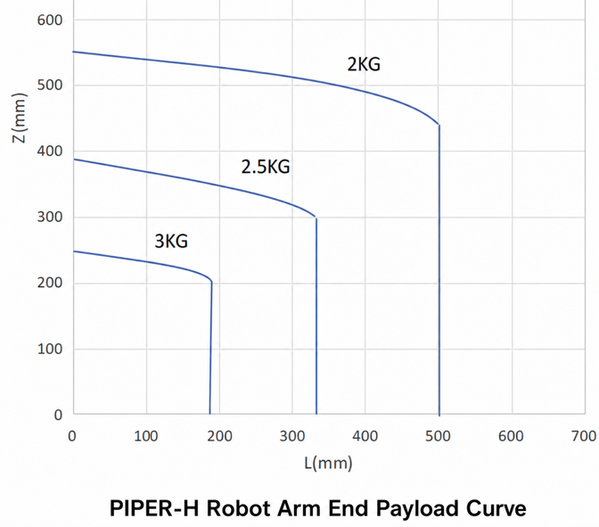
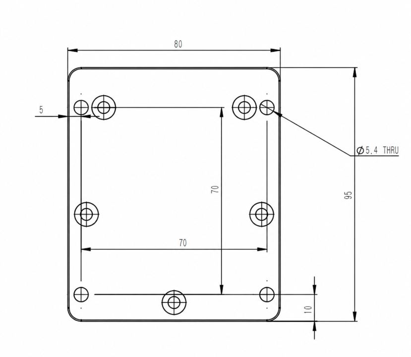
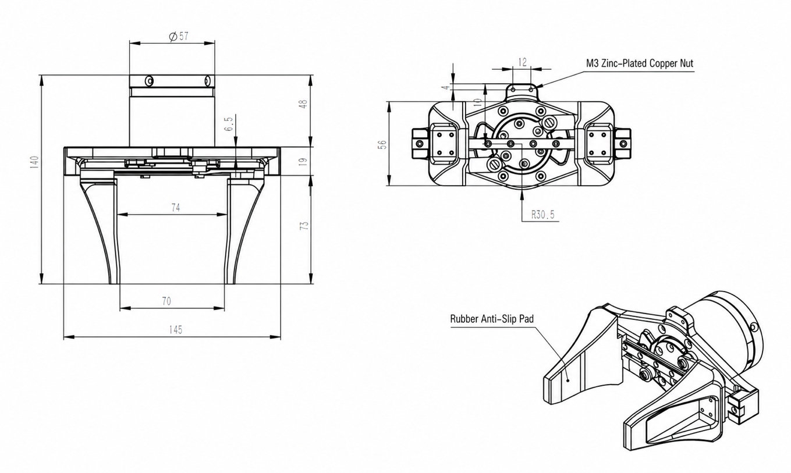
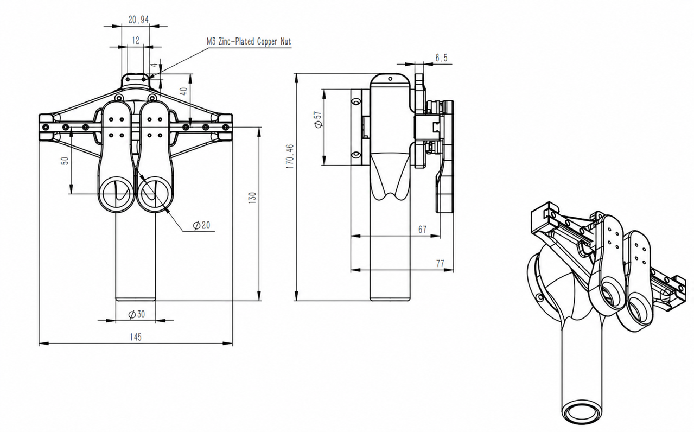
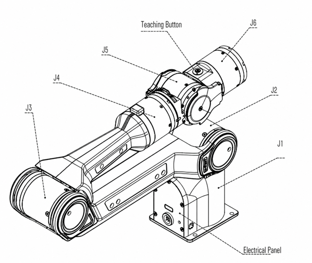
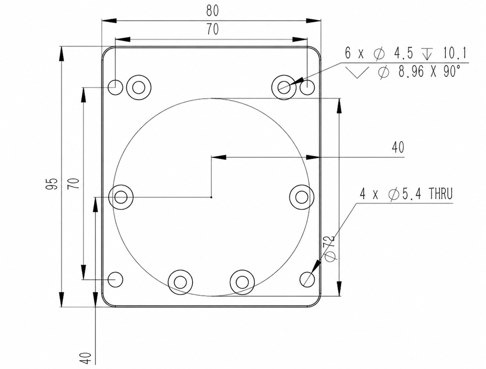
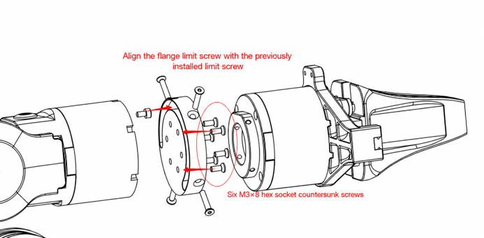
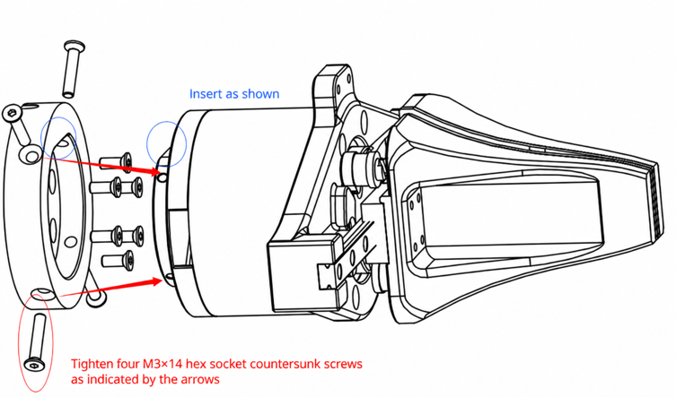
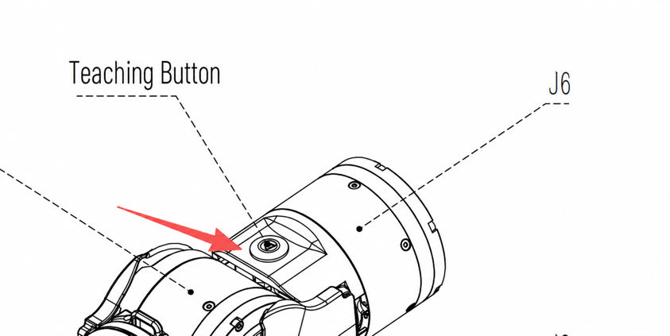
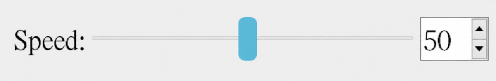

# AgileX PiPER-H: power, H-model limits and firmware-aware CAN logging


[**View AgileX PiPER-H robotic arm on OpenELAB**](https://openelab.io/products/agilex-piper-h-robotic-arm?variant=45885888725190)

**Model:** PiPER-H · **SKU:** `Agilex-PiPER-H` · **Option:** Default Title


## Product overview

The **AgileX PiPER-H** is a six-axis desktop arm with a 2 kg rated payload and different wrist travel from the standard PiPER. Use its own mechanical model, load curve and joint limits. This guide starts with supported mounting, the supplied 24 V power/CAN harness, firmware identification and a bounded joint-feedback log before enabling motion.

Select **`piper_h` / `ArmModel.PIPER_H`** in the current AgileX ROS 2 driver and Python SDK. The shared CAN transport does not make the standard PiPER, H, L, X or seven-axis NERO interchangeable. Gripper, teacher pendant and desktop fixture options need separate inventory and tool-mass accounting. [Official H manual, V1.1.0 January25, 2026](https://agilexsupport.yuque.com/staff-hso6mo/alxgtf/ay1awrn2hrhn1krg), [SDK model routing](https://github.com/agilexrobotics/pyAgxArm/blob/d90e234ba8e408cfa964b38aa9120b3131fc9f85/pyAgxArm/api/agx_arm_factory.py).


_Manufacturer image retained from the existing PiPER-H manual._

## Applications

PiPER-H suits manipulation research, supervised pick-and-place, instrument handling and leader–follower data collection where its model-specific reach and loading envelope fit the experiment. For a camera-guided task, keep camera-to-base calibration separate from the flange-to-tool transform. Replacing the gripper changes the tool transform and load; it does not change the base frame automatically.

A useful development sequence is stationary feedback → individual-joint direction checks → a small supervised trajectory → tool verification → perception-guided motion. Record firmware, calibration, tool mass and software commit with each result. A simulation trajectory or constant joint feedback is not a measured repeatability test.

## Specifications

| Parameter                   | PiPER-H reference                                            |
| --------------------------- | ------------------------------------------------------------ |
| Active axes / rated payload | 6 /2 kg                                                      |
| Arm mass / working radius   | 4.5 kg /636.65 mm                                            |
| Repeatability               | ±0.1 mm, manufacturer conditions                             |
| Supply                      | 24 V DC nominal; must not exceed26 V                         |
| Nonstandard external supply | Regulated, at least10 A current capability                   |
| Arm power reference         | ≤120 W maximum;≤40 W combined/typical figure in the H manual |
| Base interface              | Four M5 mounting positions, 70 × 70 mm pattern               |
| End auxiliary output        | 24 V, 2 A maximum                                            |
| Environment                 | −20 to 50 °C; 25–85% RH, noncondensing                       |
| Communication               | CAN; supplied USB-CAN adapter; 1 Mbit/s host setup           |

These are **H-model** values from the [official manual](https://agilexsupport.yuque.com/staff-hso6mo/alxgtf/ay1awrn2hrhn1krg). Keep the supplied adapter as the initial power reference; a 120 W specification is not permission to replace the stated10 A supply requirement with a calculated5 A adapter. The H manual gives nominal 24 V and a 26 V ceiling; this page does not infer a lower operating limit from another arm.

| Joint | H range         | Standard PiPER comparison | Published maximum speed |
| ----- | --------------- | ------------------------- | ----------------------- |
| J1    | −154° to 154°   | Same nominal range        | 180°/s                  |
| J2    | 0° to 195°      | Same nominal range        | 195°/s                  |
| J3    | −175° to 0°     | Same nominal range        | 180°/s                  |
| J4    | −127° to 127°   | Standard:±102°            | 225°/s                  |
| J5    | −89.5° to 89.5° | Standard:±75°             | 225°/s                  |
| J6    | −170° to 170°   | Standard:±120°            | 225°/s                  |

[H mechanical table](https://agilexsupport.yuque.com/staff-hso6mo/alxgtf/ay1awrn2hrhn1krg), [standard manual](https://agilexsupport.yuque.com/staff-hso6mo/alxgtf/apuyzk6ei2ubdrcn). The extra wrist travel is a configuration difference, not a reason to overwrite the controller's existing limits before identifying the received revision.



_Manufacturer H load curve retained. Its2.5 kg/3 kg curves describe restricted reach/height conditions; they are not a 3 kg full-workspace rating. Include tool, object, adapters and cable effects when assessing a load._

The optional two-finger gripper is listed at 500 g, 0–100 mm stroke, 40 N rated and 50 N maximum gripping force; the teacher device is listed at 550 g. Use the actual accessory model and its own parameters. A configured force and successful closure do not establish measured holding force on a slippery or fragile object.

## Hardware and connections

### Secure the base and identify the tool interface

With power isolated, fit all four mounting positions to a rigid support. Check thread engagement, table/fixture stiffness and access beneath the base. Use the supplied mounting hardware only where its engagement matches the actual stack. Keep the [separate desktop fixture guide](piper-desktop-fixture.md) with its installation; a clamp and an arm are separate components.

The H manual distinguishes base, end mounting surface, flange, gripper, pendant and woodworking-clamp drawings. Confirm the flange/key orientation and cable path before assembly. Keep cable slack clear of J4–J6 and check the intended envelope manually only as permitted by the manufacturer. Do not force a joint into a mechanical stop to diagnose a coordinate mismatch.



_Manufacturer base drawing retained; dimensions are a fabrication reference, not a specified tightening torque._

### Power/CAN orientation and end auxiliary connector

Use the H's keyed power/CAN harness. Match the red alignment marks on the aviation connector; release the sleeve to disconnect. In the manufacturer's base-panel figure, **4=power positive, 5=negative, 6=CAN-H, 7=CAN-L are drawing callouts**, not a seven-pin connector specification. The other labeled inter-joint socket is not a general-purpose expansion port.


_Manufacturer figure retained from the H manual. Follow its viewing direction and supplied harness rather than a mirrored solder-side view._

The end XT30 2+2 figure, in the published orientation, shows positive above negative and CAN-H left of CAN-L. Its supply is 24 V with a 2 A maximum. The H manual restricts the end CAN interface to AgileX-supported equipment; an arbitrary CAN peripheral needs explicit compatibility evidence. Do not attach it simply because its connector fits.


_Manufacturer connector diagram retained;_ [_current H electrical section_](https://agilexsupport.yuque.com/staff-hso6mo/alxgtf/ay1awrn2hrhn1krg)_._

For first power-on, complete the documented inter-joint connector, CAN wiring, XT30 and keyed base plug before applying adapter AC power. Verify the base indicator reaches its normal flashing-green state, then attach/identify the host USB adapter as shown in the H sequence. Steady green is described as controller initialization in the current H manual; do not diagnose it using another revision's indicator table.

Keep factory CAN matching-switch positions for a single arm. The H manual describes a particular delivered 60Ω matching arrangement and different multi-follower settings. Treat those as topology-specific instructions; neither an unpowered resistance reading nor the generic phrase“120Ω termination” justifies changing a powered arm's switch settings.

### Frames, zero and support when disabled

Use the H model for base/flange geometry and TCP calculations. The H zero-setting illustration differs from a generic“move every joint to zero” instruction. Writing encoder zeros changes the meaning of future motion. First check units, model, frame, tool offset and physical marks; follow the exact H calibration procedure only during a deliberate supported maintenance operation.

A disabled joint may move under gravity. Provide the specified support/posture before disabling or changing modes. Keep people and tools outside the arm's full swept volume and the gripper opening. Software E-stop, motor disable and removal of supply are different mechanisms; verify their actual behavior in the installation.

## Software and development resources

### Current SDK and firmware selection

The source reviewed here is **pyAgxArm `d90e234ba8e408cfa964b38aa9120b3131fc9f85`**. Use `ArmModel.PIPER_H`, the actual CAN device/backend and the upstream spelling **`firmeware_version`**. The firmware profile table is shared across the PiPER series, while H geometry/limits remain model-specific:

| Arm firmware                           | SDK profile                   |
| -------------------------------------- | ----------------------------- |
| ≤S-V1.8-2                              | `default` / `PiperFW.DEFAULT` |
| S-V1.8-3…S-V1.8-7                      | `v183`                        |
| S-V1.8-8                               | `v188`                        |
| ≥S-V1.8-9 within the published mapping | `v189`                        |

[Official firmware/model matrix](https://github.com/agilexrobotics/pyAgxArm/blob/d90e234ba8e408cfa964b38aa9120b3131fc9f85/docs/piper/firmware_reference.md). Read firmware before choosing a driver; in particular, MIT torque encoding and mode codes differ. Do not transplant a motor-gain/torque example across profiles. The source declares LGPL-3.0-only; preserve it and third-party notices when redistributing.

Linux uses SocketCAN; Windows requires the separate `agx_cando` plugin; macOS uses its documented serial-CAN backend. A virtual-machine USB attachment or serial device alone is not proof of a functioning CAN transport. The manufacturer CAN guide scopes its adapter support to the supplied device. [CAN/backend guide](https://github.com/agilexrobotics/pyAgxArm/blob/d90e234ba8e408cfa964b38aa9120b3131fc9f85/docs/can_user.md).

### ROS, URDF and simulation lanes

Current `agx_arm_ros` branch `ros2`, commit **`747d0722074d4cebc095d8d44f3ef68d2023ba6f`**, accepts `arm_type:=piper_h`. Its default auto-enable and command acceptance are both true. Use **`auto_enable:=false control_enabled:=false`** for initial feedback inspection. [Actual launch parameters](https://github.com/agilexrobotics/agx_arm_ros/blob/747d0722074d4cebc095d8d44f3ef68d2023ba6f/src/agx_arm_ctrl/launch/start_single_agx_arm.launch.py).

The separate `agx_arm_urdf` and `agx_arm_sim` resources provide model geometry, MoveIt and simulation assets. Initialize the driver repository's recorded submodules rather than advancing them to an unrelated remote head. For an older `piper_sdk` application, retain its API/units and firmware until migration is verified. Matching a six-joint count alone is insufficient.

## Getting started

### Read firmware and CAN state before motion

1. Record H model/SN, installed accessories, GUI/firmware versions and supply label. Secure/support the arm, leave it disabled and stop other control programs.
2. On Ubuntu 22.04/Python 3.10 install the basic tools and create a standalone environment:

```bash
sudo apt update
sudo apt install can-utils ethtool python3-venv
python3 -m venv ~/piper-h-env
source ~/piper-h-env/bin/activate
python -m pip install "git+https://github.com/agilexrobotics/pyAgxArm.git@d90e234ba8e408cfa964b38aa9120b3131fc9f85"
ip -details link show type can
```

3. Identify the supplied USB-CAN device by physical USB connection, then configure its actual interface. The example name `can0` must refer to this H arm:

```bash
sudo ip link set can0 down
sudo ip link set can0 type can bitrate 1000000
sudo ip link set can0 up
ip -details -statistics link show can0
timeout 5s candump -L can0
```

**Expected result:** 1 Mbit/s interface state and arm feedback frames without escalating errors. If there are no frames, inspect power/indicator, role, H/L and adapter matching before changing joint or zero settings. [Official adapter setup](https://github.com/agilexrobotics/pyAgxArm/blob/d90e234ba8e408cfa964b38aa9120b3131fc9f85/docs/can_user.md).

### Original H-specific stationary feedback log

Save as `piper_h_log.py`. This program queries firmware, selects its profile, then writes ten seconds of fresh six-joint feedback to a new CSV file. It does not enable motors or set joint/trajectory/calibration parameters. Keep the CSV distinct from a metrology or repeatability report.

```python
import csv
import math
from pathlib import Path
import time
from pyAgxArm import (AgxArmFactory, ArmModel, PiperFW,
                      create_agx_arm_config, resolve_firmware_profile)


def connect(profile):
    config = create_agx_arm_config(robot=ArmModel.PIPER_H,
                                  firmeware_version=profile,
                                  interface="socketcan", channel="can0")
    robot = AgxArmFactory.create_arm(config)
    robot.connect()
    return robot


probe = connect(PiperFW.DEFAULT)
try:
    firmware = probe.get_firmware(timeout=2.0)
finally:
    probe.disconnect()
if not firmware or not firmware.get("software_version"):
    raise SystemExit("Missing H firmware identity; inspect transport/GUI")
profile = resolve_firmware_profile(ArmModel.PIPER_H,
                                   firmware["software_version"])
print("firmware:", firmware, "profile:", profile)
output = Path("piper-h-feedback-" + str(time.time_ns()) + ".csv")
robot = connect(profile)
count = 0
last_stamp = None
try:
    with output.open("x", newline="") as stream:
        writer = csv.writer(stream)
        writer.writerow(["host_elapsed_s", "feedback_stamp_s", "feedback_hz",
                         "j1_rad", "j2_rad", "j3_rad", "j4_rad", "j5_rad", "j6_rad"])
        start = time.monotonic()
        while time.monotonic() - start < 10.0:
            sample = robot.get_joint_angles()
            if sample is not None and sample.timestamp != last_stamp:
                q = list(sample.msg)
                if len(q) != 6 or not all(math.isfinite(value) for value in q):
                    raise RuntimeError("Invalid H joint feedback")
                writer.writerow([time.monotonic()-start, sample.timestamp,
                                 sample.hz] + q)
                last_stamp = sample.timestamp
                count += 1
            time.sleep(0.05)
finally:
    robot.disconnect()
print("fresh samples:", count, "file:", output)
if count < 5:
    raise SystemExit("Too few fresh samples; inspect H role and CAN errors")
```

```bash
python piper_h_log.py
```

**Expected result:** identified firmware, a finite six-column angle vector in radians and repeated fresh samples over the bounded interval. Angle values can stay constant while the arm is still; the feedback timestamps must advance. Examine gaps before using the log for synchronization. The pin/transport setup, firmware query and `.msg/.timestamp/.hz` interfaces were checked against the [API](https://github.com/agilexrobotics/pyAgxArm/blob/d90e234ba8e408cfa964b38aa9120b3131fc9f85/docs/piper/piper_api.md) and implementation; program execution was not run.

### GUI, teaching and a small supervised motion

1. Connect the actual CAN adapter in ArmRobotUA and inspect all-joint feedback with enable left off. For standalone operation, confirm follower role; the manual's master/linkage configuration is a different command path.
2. Compare physical marks with the H zero diagram and verify configured H limits. Clear old trajectory/replay expectations before using the wrist teaching button.
3. Identify the GUI E-stop and the installation's physical stop/support procedure. Select a low speed percentage, enable only in the documented posture and make one small joint-space change well inside the verified range. Stop and check direction before any coordinated move.
4. For drag-teach, follow the H's button/indicator sequence for recording, stopping recording and replay. Keep the envelope clear for replay; a double press can have a different function from a single press. Do not switch unsupported modes at a nonzero posture or treat disable as position holding.
5. For a fitted gripper, verify model/zero/aperture without an object, then low-force contact with an appropriate test object. Record load and TCP before a pick operation.

The H manual's GUI coverage includes communication, menus, speed, enable/E-stop, joint/Cartesian motion, linkage, gripper, joint limits, Cartesian speed, collision settings, motor information, upgrades, 3D display and trajectory library. Use readback screenshots/configuration exports before changing settings. A collision setting is not a general obstacle detector. A3D preview must use H geometry and a real tool transform before it can inform physical execution.

### ROS 2 passive launch and application progression

Build the pinned ROS driver, dependencies and recorded submodules using the manufacturer's [ROS 2 setup](https://github.com/agilexrobotics/agx_arm_ros/blob/747d0722074d4cebc095d8d44f3ef68d2023ba6f/README_EN.md). Source the installed workspace in each terminal and start only the H model:

```bash
ros2 launch agx_arm_ctrl start_single_agx_arm.launch.py can_port:=can0 arm_type:=piper_h effector_type:=none auto_enable:=false control_enabled:=false
ros2 topic list -t
```

Inspect the advertised feedback topic/type in a second terminal. **Expected result:** H-model feedback without automatic enable or accepted control commands. Introduce a specific tool driver only after its identity and limits are known. For purely virtual work, use the H URDF/MoveIt model without starting the hardware node. Verify one planned path and its complete joint envelope before later enabling physical execution.

## Troubleshooting and FAQs

| Symptom                              | H-specific checks and recovery                                                                                                                            |
| ------------------------------------ | --------------------------------------------------------------------------------------------------------------------------------------------------------- |
| Joint range matches the standard arm | Confirm physical H nameplate, `PIPER_H`/`piper_h`, URDF and configured limits; do not expand limits blindly                                               |
| Green indicator remains steady       | Current H manual describes initialization; check startup/power/communication before declaring the arm healthy or applying another revision's LED meanings |
| No CAN frames                        | Supplied adapter, 1 Mbit/s, actual interface, H/L, power/indicator and role; inspect counters/termination without random switch changes                   |
| Feedback but no control              | Follower role, emergency/fault/enable states, command ownership and firmware; passive ROS flags intentionally reject commands                             |
| Firmware cannot be identified        | Use the matching GUI to read version; preserve the existing image/parameters and stop before selecting a guessed control profile                          |
| Gripper or hand does not respond     | Correct tool protocol/model, 24 V auxiliary limit and approved CAN device; mechanics alone do not prove bus compatibility                                 |
| Cartesian point is displaced         | H geometry, base/user frame, radians/degrees, metre/millimetre scale, TCP and joint-zero marks                                                            |
| Repeated overcurrent/stall           | Remove the load/obstruction, inspect driver feedback and thermal state; do not solve it by raising force/current limits                                   |
| Arm shifts when disabled             | Stop and restore specified support/posture; gravity behavior is separate from a communication fault                                                       |
| Old trajectory replays unexpectedly  | Stop the source, inspect teaching/replay state and library; verify empty/selected path before a new recording                                             |

For firmware recovery, back up the current version, settings, zeros and source commit. Use the exact H firmware/package and the manufacturer's upgrade/zero procedure; a shared PiPER-series SDK is not a firmware interchangeability claim. Do not interrupt a write or invent offsets. After recovery repeat firmware identification and stationary feedback before motion.

Maintenance belongs in the documented supported/zero posture with power isolated. Inspect fasteners, connectors, tool retention and cable wear. Follow specified cleaning/storage conditions and the manual's cooldown/service precautions; do not open motors or change lubrication as a routine software diagnostic. For power loss or E-stop, support the mechanism and inspect the cause before restoring control.

## Downloads and technical documents

| Resource                                                                                                                                                                 | Purpose and model boundary                                                                   |
| ------------------------------------------------------------------------------------------------------------------------------------------------------------------------ | -------------------------------------------------------------------------------------------- |
| [PiPER-H official manual](https://agilexsupport.yuque.com/staff-hso6mo/alxgtf/ay1awrn2hrhn1krg)                                                                          | V1.1.0 January25, 2026; H power/limits, installation, teaching, GUI, service and drawings    |
| [H manual Markdown export](https://agilexsupport.yuque.com/staff-hso6mo/alxgtf/ay1awrn2hrhn1krg/markdown?attachment=true)                                                | Readable manufacturer export, downloaded for source review                                   |
| [H CAD/model archive](https://agilexsupport.yuque.com/attachments/yuque/0/2026/tar/29291030/1769335599868-b7b30f4f-a08a-4714-967c-e383b09f5d32.tar)                      | Exact manufacturer-listed H mechanical model; not a firmware image                           |
| [H model resource page](https://agilexsupport.yuque.com/staff-hso6mo/alxgtf/glzd7a853owrmsk0)                                                                            | Provenance for the H model download                                                          |
| [H CAN reference page](https://agilexsupport.yuque.com/staff-hso6mo/alxgtf/lkvdwxrvwoymr3or)                                                                             | Manufacturer route to the shared external protocol                                           |
| [External CAN protocol](https://agilexsupport.yuque.com/staff-hso6mo/alxgtf/qii9wce225nvworv)                                                                            | Original linked protocol; use version-matched SDK encoders for development                   |
| [Pinned Python SDK archive](https://github.com/agilexrobotics/pyAgxArm/archive/d90e234ba8e408cfa964b38aa9120b3131fc9f85.zip)                                             | Current `PIPER_H` routing and API implementation                                             |
| [Firmware compatibility reference](https://github.com/agilexrobotics/pyAgxArm/blob/d90e234ba8e408cfa964b38aa9120b3131fc9f85/docs/piper/firmware_reference.md)            | Profile matrix, MIT encoding changes and shared versus variant behavior                      |
| [ROS 2 driver](https://github.com/agilexrobotics/agx_arm_ros/tree/747d0722074d4cebc095d8d44f3ef68d2023ba6f)                                                              | H model choice and explicit passive-start parameters                                         |
| [URDF/meshes](https://github.com/agilexrobotics/agx_arm_urdf) / [simulation](https://github.com/agilexrobotics/agx_arm_sim)                                              | Model-specific geometry, USD/MoveIt resources; verify H selection                            |
| [Original MoveIt2 source link](https://github.com/agilexrobotics/agx_arm_sim/tree/master/Moveit2)                                                                        | Retained manufacturer planning reference                                                     |
| [Original ArmRobotUA1.5.0.251210 beta ZIP](https://agilexsupport.yuque.com/attachments/yuque/0/2026/zip/29291030/1769356543778-a6eec191-3387-489a-8b22-5c882c95f083.zip) | Historical manual-linked Windows build; use the current release index for a new installation |

### Retained H mechanical and accessory drawings

The existing manual's H drawings remain useful for integration. Use their dimension text and the official archive; do not infer tolerances by scaling a rendered image.







_All figures above are manufacturer drawings retained from the existing H manual; accessory presence is determined by the actual order._

### Operating environment and inspection reference

These arms have no built-in automatic obstacle-avoidance sensing. The manufacturer's ordinary enclosure rating is **IP22 unless customized**; this does not qualify rain, washdown or conductive dust exposure. Use the stated −20 to +50 °C and 25–85% RH noncondensing environment. Keep people outside the complete arm/tool sweep, operate within sight and secure hair/clothing that could catch. The manufacturer excludes unsupervised use by people under 18 and requires the complete installation, including other machines and its stop arrangement, to be assessed separately.

Before operation, check base/tool fasteners, harness retention, jacket damage, deformed brackets and visible motor faults. Stop on abnormal motion or a controller error, preserve the diagnostic record and resolve the cause before clearing it. Do not modify protective measures or expose the arm to strong permanent magnetic fields. After demanding operation, isolate/support it and allow the manufacturer's stated **one-hour cooling interval** before handling hot joints. Clean only the exterior using a dry or lightly water-dampened cloth; do not flood connectors. The arm manual and diagrams remain part of the installation record, rather than a claim that a GUI stop or collision sensitivity makes a completed cell safe.

[Manufacturer operating and safety reference](https://agilexsupport.yuque.com/staff-hso6mo/alxgtf/ay1awrn2hrhn1krg).

### Arm and optional-tool reference details

The arm uses an aluminum-alloy frame with a plastic enclosure and an integrated controller. The manual reports noise below 60 dB under its stated conditions; this is not a measured result for the reader's installation. Optional gripper and teaching accessories have their own integrated controllers, rubber contact surfaces, CAN communication and flange mounting. Their listed 24 V supply, up-to-50 W maximum and 30 W comprehensive power figures are accessory specifications, not extra current available from an arbitrary host port. Keep the end-output limit above when choosing a tool.

Historical accessory tables describe a 500 g two-finger gripper and a 550 g teaching handle with ±0.5 mm stated accuracy. Some older English tables give a 0–100 mm opening for both, while newer Chinese teaching-handle tables give **0–70 mm**. Those values identify differing documentation/accessory revisions; read the actual handle label and matched drawing before choosing a stroke. The two-finger gripper's 0–100 mm opening is separate. Do not use arm joint travel as a tool-opening range.

[Manufacturer operating and safety reference](https://agilexsupport.yuque.com/staff-hso6mo/alxgtf/ay1awrn2hrhn1krg).

### Base indicators and harness reference

Keep the manufacturer's mating-view drawing with the cable. For the numbered PiPER/PiPER-H panel, 1 identifies the external power/communication connector, 2 the indicator, 3 the inter-joint connector, and 4/5/6/7 identify power positive, power negative, CAN-H and CAN-L in that drawing. They are **drawing labels, not a generic plug pin numbering standard**. Align the red marks and release the connector sleeve without pulling wires.

| Base indication | Meaning in the model manual                                                              | Next check                                                                                          |
| --------------- | ---------------------------------------------------------------------------------------- | --------------------------------------------------------------------------------------------------- |
| Green flashing  | Normal running indication                                                                | Verify fresh feedback and fault state before enabling                                               |
| Green steady    | H manual: main-controller initialization; older standard manual: abnormal power-on state | Allow boot, then inspect power/controller state if it persists; do not infer ready from green alone |
| Red flashing    | Fault or upgrade mode                                                                    | Read fault/version/mode and confirm whether an upgrade is intentionally active                      |

The end teaching light is a different indicator: off means stopped, steady green recording and flashing green playback. Preserve the factory single-arm termination: the manual illustrates switch 1 down/on and switch 2 up/off, described as a 60 Ω arrangement. Its multi-arm switch wording is topology-specific and translated ambiguously; obtain the matching topology diagram before changing it rather than converting that sentence into a universal CAN termination rule. External CAN is documented as CAN 2.0B, 1 Mbit/s, with Motorola/MSB field layout; the matched SDK's model/firmware encoder determines actual payload units.

[Manufacturer operating and safety reference](https://agilexsupport.yuque.com/staff-hso6mo/alxgtf/ay1awrn2hrhn1krg).

### PiPER-H modified-DH reference

The H manual gives the following modified-DH chain. Link offsets are millimeters; alpha and joint offsets are radians. Preserve the modified-DH convention and the H model: substituting these numbers into a standard-DH routine, or a standard PiPER URDF, changes the chain. An attached tool requires an additional flange-to-TCP transform.

| Link | d, mm  | a, mm  | alpha, rad | offset, rad  |
| ---- | ------ | ------ | ---------- | ------------ |
| L1   | 123    | 0      | 0          | 0            |
| L2   | 0      | 0      | −π/2       | −172.22π/180 |
| L3   | 0      | 285.03 | 0          | −102.78π/180 |
| L4   | 255.75 | −21.98 | π/2        | 0            |
| L5   | 0      | 0      | −π/2       | 0            |
| L6   | 96.3   | 0      | π/2        | 0            |

Compare a known supported pose with the matched controller feedback before external FK/IK work. The table supports a kinematic calculation; it is not a physical calibration, payload curve or collision check. [H manual, modified-DH table](https://agilexsupport.yuque.com/staff-hso6mo/alxgtf/ay1awrn2hrhn1krg).

### H GUI motion modes and ownership

The H manual's operation panel includes Joint, Point, Line, Circle and MIT modes. A Joint edit or slider is not sent until **Apply**. Point takes an endpoint pose; Line must have a reachable intermediate path; Circle uses start, intermediate and end poses. A reachable endpoint alone does not qualify the whole line or arc. MIT exposes joint position, velocity, kp, kd and torque and requires the exact firmware/protocol; it is unsuitable as a connection test. Keep the actual mode, limits and tool reference with saved targets.

For a two-arm configuration, the linkage page configures the input/output roles and offset, and the manual connects both USB-CAN adapters to the same computer. Identify adapters independently and align supported reference postures before coupling. A role/offset edit can cause tracking motion; it is distinct from opening the communications panel. For teaching-to-host transitions, the historical manual requires the illustrated zero/reference posture and stopped teaching indicator before the disable/re-enable/standby-to-CAN handoff. Do not switch a gravity-loaded arm at an arbitrary pose.

[Manufacturer operating and safety reference](https://agilexsupport.yuque.com/staff-hso6mo/alxgtf/ay1awrn2hrhn1krg).

### Detailed operating reference

The following model-specific operating details and native manufacturer illustrations complement the commissioning procedure above. GUI screenshots depict their documented release; current firmware, power and calibration requirements take precedence where versions differ. [Manufacturer manual](https://agilexsupport.yuque.com/staff-hso6mo/alxgtf/ay1awrn2hrhn1krg).

#### PiPER-H User Manual

This operating reference belongs to the exact arm model named on this page. Secure the base and tool, preserve the matching power/CAN connections and clear the entire reachable workspace before enabling. Record current mode, firmware, joint status, mounting orientation and tool configuration; begin with stationary observation, then one checked small motion. Keep the manufacturer diagrams below with their original model context and apply the current numerical/version corrections in Specifications and Software before using an older GUI illustration.

#### AgileX PiPER-H Robotic Arm for AI Research <a href="#agilex-piper-h-robotic-arm-for-ai-research" id="agilex-piper-h-robotic-arm-for-ai-research"></a>

This operating reference belongs to the exact arm model named on this page. Secure the base and tool, preserve the matching power/CAN connections and clear the entire reachable workspace before enabling. Record current mode, firmware, joint status, mounting orientation and tool configuration; begin with stationary observation, then one checked small motion. Keep the manufacturer diagrams below with their original model context and apply the current numerical/version corrections in Specifications and Software before using an older GUI illustration.

<details>

<summary>AgileX PiPER-H Robotic Arm for AI Research — manufacturer figures</summary>


</details>

#### Important security information <a href="#odniv" id="odniv"></a>

This operating reference belongs to the exact arm model named on this page. Secure the base and tool, preserve the matching power/CAN connections and clear the entire reachable workspace before enabling. Record current mode, firmware, joint status, mounting orientation and tool configuration; begin with stationary observation, then one checked small motion. Keep the manufacturer diagrams below with their original model context and apply the current numerical/version corrections in Specifications and Software before using an older GUI illustration.

#### 1. Introduction to Robotic Arms <a href="#sygvh" id="sygvh"></a>

This operating reference belongs to the exact arm model named on this page. Secure the base and tool, preserve the matching power/CAN connections and clear the entire reachable workspace before enabling. Record current mode, firmware, joint status, mounting orientation and tool configuration; begin with stationary observation, then one checked small motion. Keep the manufacturer diagrams below with their original model context and apply the current numerical/version corrections in Specifications and Software before using an older GUI illustration.

#### 1.1 Product List <a href="#xvxiq" id="xvxiq"></a>

Inventory the arm, supplied USB-CAN adapter, power adapter/cable, mounting hardware and tools against the ordered package. Optional gripper, teaching handle, dexterous hand and desktop fixture remain separate items unless listed. The model-specific Specifications table above distinguishes rated payload, reach, mass, joint travel/speed and accessory limits. Treat manufacturer repeatability/power/environment figures as conditions to verify in the actual setup, not measurements from this guide.

#### 1.2 Performance Parameters <a href="#mnuck" id="mnuck"></a>

Inventory the arm, supplied USB-CAN adapter, power adapter/cable, mounting hardware and tools against the ordered package. Optional gripper, teaching handle, dexterous hand and desktop fixture remain separate items unless listed. The model-specific Specifications table above distinguishes rated payload, reach, mass, joint travel/speed and accessory limits. Treat manufacturer repeatability/power/environment figures as conditions to verify in the actual setup, not measurements from this guide.

#### 2. Basic Introduction <a href="#ouh54" id="ouh54"></a>

This operating reference belongs to the exact arm model named on this page. Secure the base and tool, preserve the matching power/CAN connections and clear the entire reachable workspace before enabling. Record current mode, firmware, joint status, mounting orientation and tool configuration; begin with stationary observation, then one checked small motion. Keep the manufacturer diagrams below with their original model context and apply the current numerical/version corrections in Specifications and Software before using an older GUI illustration.

<details>

<summary>2. Basic Introduction — manufacturer figures</summary>



</details>

#### 2.1 Electrical Interface Description <a href="#e8e54" id="e8e54"></a>

The base external power/CAN harness, Ethernet where fitted and end accessory connector have different functions. The end XT30(2+2) supplies24 V up to 2 A and its CAN is reserved for supported AgileX accessories; it is not a general CAN expansion socket. Follow the illustrated mating viewpoint and keying, not wire color alone. Keep the internal/service CAN unused without manufacturer service instructions and remove power before changing an end tool.

<details>

<summary>2.1 Electrical Interface Description — manufacturer figures</summary>


</details>

#### 2.2 Description of the Robotic Arm Coordinate System <a href="#tzq88" id="tzq88"></a>

The illustrated origin belongs to the robot base; user coordinates in this manual refer to that base frame. A gripper TCP, external camera frame and workbench frame are different transforms. Record the selected tool and units with a pose; GUI degrees, SDK radians and millimeter/meter coordinates must be converted explicitly. Re-clamping the base or reversing a tool changes external geometry without changing the mechanical joint reference.

#### 2.2.1 Origin Coordinate System (consistent with the standard version of PIPER) <a href="#p1ela" id="p1ela"></a>

The H reference posture differs from the standard PiPER procedure. The H manual identifies J1 by its base scale, J2/J3 at their illustrated lowered reference, J5 at its raised reference and J4 at the indicated clockwise reference when viewed as shown; J6 is then referenced in that illustrated arrangement. These descriptions require the exact figure and model, supported links and a controlled maintenance procedure. They are not permission to drive joints into stops or press All Zero at the current pose. Recheck tool, mount and reported angles after an authorized calibration.

<details>

<summary>2.2.1 Origin Coordinate System (consistent with the standard version of PIPER) — manufacturer figures</summary>


</details>

#### 2.2.2 User Coordinate System <a href="#tj8in" id="tj8in"></a>

The illustrated origin belongs to the robot base; user coordinates in this manual refer to that base frame. A gripper TCP, external camera frame and workbench frame are different transforms. Record the selected tool and units with a pose; GUI degrees, SDK radians and millimeter/meter coordinates must be converted explicitly. Re-clamping the base or reversing a tool changes external geometry without changing the mechanical joint reference.

<details>

<summary>2.2.2 User Coordinate System — manufacturer figures</summary>

.png>)

</details>

#### 2.2.3 Singular Locations <a href="#vawd8" id="vawd8"></a>

The H manual illustrates singular alignments involving the J1/J4, J4/J6 and J1/J6 axes. Near such alignments, a small endpoint change can require a large joint change. Inspect the full joint solution and retreat through a checked joint-space path rather than increasing speed or limits to force Cartesian motion.

#### 2.2.4 Zero Point Setting <a href="#ecju1" id="ecju1"></a>

The H reference posture differs from the standard PiPER procedure. The H manual identifies J1 by its base scale, J2/J3 at their illustrated lowered reference, J5 at its raised reference and J4 at the indicated clockwise reference when viewed as shown; J6 is then referenced in that illustrated arrangement. These descriptions require the exact figure and model, supported links and a controlled maintenance procedure. They are not permission to drive joints into stops or press All Zero at the current pose. Recheck tool, mount and reported angles after an authorized calibration.

<details>

<summary>2.2.4 Zero Point Setting — manufacturer figures</summary>

.png>)

</details>

#### 2.3 Load curve of robotic arm <a href="#cgwnl" id="cgwnl"></a>

The H load curve contains restricted-reach examples above the nominal 2 kg rating; it is not a 3 kg all-workspace specification. Include tool/adapter mass and offset, and inspect the curve for the exact horizontal reach and posture. Higher reach increases moment even with the same object. A light first test cannot qualify the maximum curve, and dynamic acceleration adds a different load case.

<details>

<summary>2.3 Load curve of robotic arm — manufacturer figures</summary>


</details>

#### 2.4 Mechanical Installation Instructions <a href="#guu5a" id="guu5a"></a>

Use the dimensioned view for the identified bare-arm, tool-equipped, base or end-flange assembly. Keep its viewpoint, units and model revision with any fixture design; an axonometric picture is not a scale drawing. Check hole pattern, screw engagement, cable exit and the complete swept volume against the physical parts before machining. The numerical arm limits and actual tool transform remain separate from the drawing envelope.

#### 2.4.1 Base Installation Instructions <a href="#dwawn" id="dwawn"></a>

The arm base uses four M5 mounting positions on a 70 × 70 mm pattern. Support the arm while fitting it to a rigid plate and check both hole spacing and thread engagement against the drawing. Neither the notation M5 × 4 nor the base mass establishes screw length, tightening torque or allowable overturning moment. Inspect contact flatness and the underside of the mount before power; a mobile or inverted installation also needs the corresponding controller mounting setting.

<details>

<summary>2.4.1 Base Installation Instructions — manufacturer figures</summary>



</details>

#### 2.4.2 End-point tool installation instructions <a href="#wp2ga" id="wp2ga"></a>

For the illustrated PiPER-family flange revision, the locating screw is M3 × 4 with a 4.5 mm head, positioned at the upper-left of the J6 output in the drawing's viewpoint. Align the flange slot, use six M3 × 8 countersunk screws, then the keyed gripper/teaching accessory and its specified M3 × 14 countersunk screws. These sizes belong to that assembly; verify the delivered flange rather than mixing newer tool hardware. Connect its matching power/CAN lead only after mechanical fitting, with power off. Cable slack and the tool's full sweep must remain clear.

<details>

<summary>2.4.2 End-point tool installation instructions — manufacturer figures</summary>



.png>)



.png>)


</details>

#### 2.4.3 Desktop Installation Instructions <a href="#jmf5m" id="jmf5m"></a>

The desktop mounting module is optional; the bare-arm packing list does not imply it is supplied. Fit the arm to the matched module before clamping it to a sound, suitable bench, keep all clamp pads seated and preserve access to power/CAN release. Recheck rocking and cable interference after relocation. Changing the fixture location changes the external workcell transform even if joint zeros remain correct; redo the affected camera/workbench calibration.

#### 2.4.3 Desktop Installation Instructions <a href="#sp9cj" id="sp9cj"></a>

The desktop mounting module is optional; the bare-arm packing list does not imply it is supplied. Fit the arm to the matched module before clamping it to a sound, suitable bench, keep all clamp pads seated and preserve access to power/CAN release. Recheck rocking and cable interference after relocation. Changing the fixture location changes the external workcell transform even if joint zeros remain correct; redo the affected camera/workbench calibration.

<details>

<summary>2.4.3 Desktop Installation Instructions — manufacturer figures</summary>


</details>

#### 2.4.5 Instructions for Robotic Arm Installation <a href="#dlgkw" id="dlgkw"></a>

The mounting setting must describe the physical upright, side or inverted installation so gravity compensation and motion coordinates agree with the arm. Record the previous setting, select the actual orientation in motor/system configuration and confirm it before teaching or actuation. On NERO, the manual defines side mounting relative to the Ethernet-port direction at the reference pose. The arm supporting an orientation does not qualify every clamp or mobile base for it.

<details>

<summary>2.4.5 Instructions for Robotic Arm Installation — manufacturer figures</summary>


</details>

#### 3. Connecting and preparing <a href="#acbtv" id="acbtv"></a>

Use the external keyed harness and the supplied USB-CAN adapter, matching CAN\_H/yellow and CAN\_L/blue. Align the red marks before seating the base connector and clamp conductors under the terminal tab without loose strands. Select the actual adapter/channel and 1 Mbit/s configuration before connecting the GUI. Preserve factory termination for a single-arm topology; an empty feedback panel calls for adapter, power, mode and receive-counter checks before any enable or firmware update.

<details>

<summary>3. Connecting and preparing — manufacturer figures</summary>


</details>

#### 3.1 Instructions for using the teaching mode: <a href="#b2ata" id="b2ata"></a>

The end button distinguishes stopped/recording/playback: off means stopped, solid green records and flashing green replays. A single press toggles recording/stop; a double press from stopped replays the recorded path. Playback is motion, not a preview. Starting a new recording replaces the previous one; the manual's recording limit is 3 minutes and its replay indication flashes at about 500 ms intervals. Support and correctly configure the tool before entering teaching, clear the whole recorded path before replay and finish with the indicator off. Return through the documented standby/CAN mode transition before handing ownership back to the GUI/SDK; do not leave two modes issuing commands.

<details>

<summary>3.1 Instructions for using the teaching mode: — manufacturer figures</summary>



</details>

#### 3.2 Instructions for Cascading and Remote Operation of Robotic Arms: <a href="#ifedj" id="ifedj"></a>

Standalone control uses the appropriate follower role; a leader can reject ordinary commands or provide different feedback. For dual-arm work, identify each adapter/model, configure leader/follower roles and the intended joint/coordinate offsets before joining command paths. Start from nearby matched poses and verify signs with a small checked excursion. A role/offset change can immediately affect tracking; do not use it as a passive communication test or leave both arms as competing command sources.

<details>

<summary>3.2 Instructions for Cascading and Remote Operation of Robotic Arms: — manufacturer figures</summary>


</details>

#### 4. Instructions for use of the host computer <a href="#gxfbr" id="gxfbr"></a>

ArmRobotUA is the PC operator interface for the matching PiPER-family model/firmware. Install the manufacturer release rather than an unrelated robot GUI, connect the actual CAN adapter and record GUI/firmware versions together. The interface combines connection, mode selection, joint/Cartesian control, accessory settings, diagnostics and trajectory management; keep the status/feedback panels visible before enabling. A successful connection is separate from accepted mode, enabled joints and valid live feedback.

#### 4.1 Introduction to ArmRobotUA <a href="#oem47" id="oem47"></a>

ArmRobotUA is the PC operator interface for the matching PiPER-family model/firmware. Install the manufacturer release rather than an unrelated robot GUI, connect the actual CAN adapter and record GUI/firmware versions together. The interface combines connection, mode selection, joint/Cartesian control, accessory settings, diagnostics and trajectory management; keep the status/feedback panels visible before enabling. A successful connection is separate from accepted mode, enabled joints and valid live feedback.

<details>

<summary>4.1 Introduction to ArmRobotUA — manufacturer figures</summary>


</details>

#### 4.2 Robotic Arm Communication <a href="#pqvz3" id="pqvz3"></a>

Use the external keyed harness and the supplied USB-CAN adapter, matching CAN\_H/yellow and CAN\_L/blue. Align the red marks before seating the base connector and clamp conductors under the terminal tab without loose strands. Select the actual adapter/channel and 1 Mbit/s configuration before connecting the GUI. Preserve factory termination for a single-arm topology; an empty feedback panel calls for adapter, power, mode and receive-counter checks before any enable or firmware update.

<details>

<summary>4.2 Robotic Arm Communication — manufacturer figures</summary>


</details>

#### 4.3 Vertical Menu Bar <a href="#yanfw" id="yanfw"></a>

Use the mode/navigation panel to identify which subsystem currently owns control before editing a target. Connection, motion, tool configuration, diagnostics, upgrade and trajectories are separate pages. Preserve the current configuration and read feedback first; changing page, minimizing the window or closing a display is not automatically a physical stop. Confirm the active mode and operator stop action before a test.

<details>

<summary>4.3 Vertical Menu Bar — manufacturer figures</summary>


</details>

#### 4.4 Speed ​​Percentage Setting <a href="#bt73u" id="bt73u"></a>

The global speed percentage scales motion within the controller configuration; it does not redefine joint limits, guarantee braking distance or validate a recorded path. Begin at a low setting for commissioning, apply it only in the mode that accepts the change and verify actual behavior with a small checked movement. A trajectory or leader–follower mode may require returning to Web/GUI control before editing the setting.

<details>

<summary>4.4 Speed ​​Percentage Setting — manufacturer figures</summary>



</details>

#### 4.5 Robotic Arm Enable Button <a href="#ozkvk" id="ozkvk"></a>

Enable is an actuation-state change after communication succeeds, not a read-only health query. Check all joint states, faults, mounting and tool configuration first, then enable only in a clear supported setup. Disable can remove holding torque; support gravity-loaded links and a held object before using it. If a joint refuses enable, preserve the error and resolve the cause rather than repeatedly clearing it.

<details>

<summary>4.5 Robotic Arm Enable Button — manufacturer figures</summary>


</details>

#### 4.6 Robotic Arm Emergency Stop Button <a href="#c8zrd" id="c8zrd"></a>

The GUI stop/pause control is available only while its communication/control path works. Historical releases describe a toggle/re-enable sequence, so identify the exact installed behavior and inspect the queued trajectory/target before resuming; never assume a second click clears every pending action. It is not a safety-rated hardware-stop qualification. Power removal can drop the arm, so the complete installation needs a suitable support/stop arrangement.

<details>

<summary>4.6 Robotic Arm Emergency Stop Button — manufacturer figures</summary>

.png>)


</details>

#### 4.7 Window resize and close buttons <a href="#huhog" id="huhog"></a>

The window controls change the operator display size, visibility or application state. Minimizing or closing a window is not a substitute for the robot stop/disable procedure. Stop the active behavior, inspect mode/status and support the arm before ending a control session. Restore the view without hiding fault or feedback panels during commissioning; keep the operator stop control accessible.

<details>

<summary>4.7 Window resize and close buttons — manufacturer figures</summary>


</details>

#### 4.8 Operation Function Area <a href="#cjug3" id="cjug3"></a>

Use the mode/navigation panel to identify which subsystem currently owns control before editing a target. Connection, motion, tool configuration, diagnostics, upgrade and trajectories are separate pages. Preserve the current configuration and read feedback first; changing page, minimizing the window or closing a display is not automatically a physical stop. Confirm the active mode and operator stop action before a test.

<details>

<summary>4.8 Operation Function Area — manufacturer figures</summary>


</details>

#### 4.9 Motion Control Area <a href="#po7g9" id="po7g9"></a>

The six GUI joint fields are in degrees and follow J1 at the base through J6 at the wrist. Load reads the current pose into the edit fields; Send commands those fields; Return to Zero sends the factory initial pose and therefore moves the arm. Load before changing one field so stale values in other joints are not sent accidentally. Optional joint light-board controls select a joint and RGB values; lighting hardware is not implied by the bare arm. Keep display feedback separate from target entry.

<details>

<summary>4.9 Motion Control Area — manufacturer figures</summary>


</details>

#### 4.10 Interlocking Control Area <a href="#l3v1a" id="l3v1a"></a>

Standalone control uses the appropriate follower role; a leader can reject ordinary commands or provide different feedback. For dual-arm work, identify each adapter/model, configure leader/follower roles and the intended joint/coordinate offsets before joining command paths. Start from nearby matched poses and verify signs with a small checked excursion. A role/offset change can immediately affect tracking; do not use it as a passive communication test or leave both arms as competing command sources.

<details>

<summary>4.10 Interlocking Control Area — manufacturer figures</summary>


</details>

#### 4.11 Gripper Control Area (Only effective with grippers) <a href="#m2cb4" id="m2cb4"></a>

For the fitted supported gripper/teaching accessory, configure its enable state, opening/spacing and force/torque controls in the accessory panel, then compare feedback on the status side of the GUI. Do not send arm joint values to a gripper field or assume a force target proves object retention. Use a light compliant target first and inspect opening direction and contact. The tool model, firmware, ID and TCP/payload configuration must match the actual accessory.

<details>

<summary>4.11 Gripper Control Area (Only effective with grippers) — manufacturer figures</summary>


</details>

#### 4.12 Joint Setting Area <a href="#tsr2u" id="tsr2u"></a>

Record the existing minimum/maximum angle, speed and acceleration for every joint before editing. The GUI Edit→Save sequence writes settings; narrower workcell limits should remain within the physical model/firmware envelope. An IK failure or blocked path is not solved by widening limits. Verify one deliberate change and preserve a rollback copy; resetting defaults can remove application-specific restrictions.

<details>

<summary>4.12 Joint Setting Area — manufacturer figures</summary>


</details>

#### 4.13 Pace Setting Area <a href="#je1j0" id="je1j0"></a>

This panel limits endpoint linear/angular velocity and acceleration, separately from global speed percentage and individual joint limits. Record both units and values before editing. A Cartesian path can still require high joint speed near a singularity even when endpoint speed looks small. Initialize/Reset restores factory settings and may remove tuned application limits; do not press it as a harmless view refresh.

<details>

<summary>4.13 Pace Setting Area — manufacturer figures</summary>


</details>

#### 4.14 Collision Rating <a href="#ymhlh" id="ymhlh"></a>

Collision sensitivity is configured per joint and must be interpreted for the installed firmware. The historical GUI illustrates levels 1–8; newer material also includes0 as disabled. Do not copy a numeric setting across revisions without its definition. Keep sensitivity active as appropriate to the supported application, investigate recurrent triggers and verify tool mass/mount/zero before reducing sensitivity. This feature does not replace collision-free planning or certified personnel protection.

<details>

<summary>4.14 Collision Rating — manufacturer figures</summary>


</details>

#### 4.15 Joint Information <a href="#loov1" id="loov1"></a>

The joint-information/status view monitors connected joints in real time, while the overall status bar reports arm-level state. Confirm expected joint count, changing timestamps/feedback, temperatures and fault indicators before motion. A colored status button or a frozen3D pose alone is insufficient evidence of healthy communication. Preserve the fault/time/operating pose before clearing an error, and compare requested mode with reported mode when commands appear ignored.

<details>

<summary>4.15 Joint Information — manufacturer figures</summary>


</details>

#### 4.16 Motor Settings <a href="#x7vw8" id="x7vw8"></a>

Motor settings expose per-joint enable/disable, zero calibration and fault clearing. These actions have different consequences: disable can remove support, zero changes the joint reference and Clear Error does not remove a physical obstruction or overheating cause. Read/save joint information and faults first, support the arm before torque changes and use the model-specific calibration reference only when maintenance requires it.

<details>

<summary>4.16 Motor Settings — manufacturer figures</summary>


</details>

#### Version 4.17 upgrade <a href="#d9xif" id="d9xif"></a>

The historical ArmRobotUA upgrade workflow first checks recognized node information, then loads the matched .bin package, verifies its displayed identity and starts the upgrade while observing progress; the old reference gives roughly2–3 minutes, not a timeout guarantee. Support the arm because update mode can disable holding torque. Newer firmware/GUI releases can require additional zero/calibration procedures; use the exact matching update guide and preserve settings before starting. Re-query firmware and select its SDK profile before resuming, rather than applying an old motor-control example blindly.

<details>

<summary>Version 4.17 upgrade — manufacturer figures</summary>


</details>

#### 4.18 3D Simulation Model <a href="#isvkx" id="isvkx"></a>

The GUI model displays live reported pose and joint angles alongside the robot visualization. Help describes view controls; View Restore resets the camera view, not the physical arm; Settings changes display/application parameters. Compare visualization with actual supported joint feedback before relying on it. This display is not a collision checker or a dynamics/payload qualification, and it is distinct from the separate URDF/MoveIt/Gazebo environment.

<details>

<summary>4.18 3D Simulation Model — manufacturer figures</summary>


</details>

#### 4.19 Track Library <a href="#drr5e" id="drr5e"></a>

Create a separately named trajectory, load the current pose and add only checked points. Import loads a saved library; Export preserves it; Delete removes the selected entry. The secondary editor supports adding, deleting and changing individual points. Send/Run can execute once, a finite count or continuously depending on settings, so inspect the loop/count and every intermediate path before replay. Export a backup before edits, start with one short unloaded run and verify stop/resume behavior before considering repetition.

<details>

<summary>4.19 Track Library — manufacturer figures</summary>


</details>

#### 4.20 Robotic Arm Joint Status Buttons <a href="#kesuv" id="kesuv"></a>

The joint-information/status view monitors connected joints in real time, while the overall status bar reports arm-level state. Confirm expected joint count, changing timestamps/feedback, temperatures and fault indicators before motion. A colored status button or a frozen3D pose alone is insufficient evidence of healthy communication. Preserve the fault/time/operating pose before clearing an error, and compare requested mode with reported mode when commands appear ignored.

<details>

<summary>4.20 Robotic Arm Joint Status Buttons — manufacturer figures</summary>


</details>

#### 4.21 Robotic Arm Status Bar <a href="#id-4.21-robotic-arm-status-bar" id="id-4.21-robotic-arm-status-bar"></a>

The joint-information/status view monitors connected joints in real time, while the overall status bar reports arm-level state. Confirm expected joint count, changing timestamps/feedback, temperatures and fault indicators before motion. A colored status button or a frozen3D pose alone is insufficient evidence of healthy communication. Preserve the fault/time/operating pose before clearing an error, and compare requested mode with reported mode when commands appear ignored.

<details>

<summary>4.21 Robotic Arm Status Bar — manufacturer figures</summary>


</details>

#### 5. Secondary Development <a href="#a2lpk" id="a2lpk"></a>

Use the current model/firmware-specific SDK, CAN mapping and ROS description rather than copying another arm profile. The public implementation defines message units, version-dependent encoders/decoders and connection cleanup; raw protocol documents can be gated or older. Query firmware before selecting a profile, preserve the supplied CAN topology and begin with stationary fresh feedback. Keep original direct SDK/protocol/model downloads with the project revision and do not equate a source review with compilation or hardware validation.

#### 6. Robotic Arm CAN Protocol <a href="#wygk8" id="wygk8"></a>

Use the current model/firmware-specific SDK, CAN mapping and ROS description rather than copying another arm profile. The public implementation defines message units, version-dependent encoders/decoders and connection cleanup; raw protocol documents can be gated or older. Query firmware before selecting a profile, preserve the supplied CAN topology and begin with stationary fresh feedback. Keep original direct SDK/protocol/model downloads with the project revision and do not equate a source review with compilation or hardware validation.

#### 7. Maintenance and Care <a href="#aqikj" id="aqikj"></a>

Return through a checked path to the supported storage posture, stop the active mode and power down before cleaning or mechanical inspection. Do not reinterpret a storage instruction as routine recalibration of zero. Inspect fasteners, motor/bracket damage, cable jackets and connector retention; clean the exterior with a lightly dampened cloth without flooding openings. Keep the specified−20…50 °C and 25–85 %RH noncondensing environment where applicable, avoid strong magnetic fields and allow hot joints to cool before handling. Log wear or repeated faults before replacing parts.

#### 7.1 Storage Instructions <a href="#kxgqa" id="kxgqa"></a>

Return through a checked path to the supported storage posture, stop the active mode and power down before cleaning or mechanical inspection. Do not reinterpret a storage instruction as routine recalibration of zero. Inspect fasteners, motor/bracket damage, cable jackets and connector retention; clean the exterior with a lightly dampened cloth without flooding openings. Keep the specified−20…50 °C and 25–85 %RH noncondensing environment where applicable, avoid strong magnetic fields and allow hot joints to cool before handling. Log wear or repeated faults before replacing parts.

#### 7.2 Maintenance Instructions <a href="#xhbsh" id="xhbsh"></a>

Return through a checked path to the supported storage posture, stop the active mode and power down before cleaning or mechanical inspection. Do not reinterpret a storage instruction as routine recalibration of zero. Inspect fasteners, motor/bracket damage, cable jackets and connector retention; clean the exterior with a lightly dampened cloth without flooding openings. Keep the specified−20…50 °C and 25–85 %RH noncondensing environment where applicable, avoid strong magnetic fields and allow hot joints to cool before handling. Log wear or repeated faults before replacing parts.

#### 7.3 Emergency Handling <a href="#fqriz" id="fqriz"></a>

The manual describes power disconnection as an emergency measure and warns that the disabled arm can drop immediately. Plan support and access before actuation; never reach into the sweep merely to unplug a connector. GUI pause/stop depends on a live communication path and can preserve a trajectory for later resumption. Clear the workcell and inspect pending commands before restart. Neither power removal nor a PC toggle is a complete certified injury-prevention system.

#### 7.3.1 Power outage <a href="#hz7ht" id="hz7ht"></a>

The manual describes power disconnection as an emergency measure and warns that the disabled arm can drop immediately. Plan support and access before actuation; never reach into the sweep merely to unplug a connector. GUI pause/stop depends on a live communication path and can preserve a trajectory for later resumption. Clear the workcell and inspect pending commands before restart. Neither power removal nor a PC toggle is a complete certified injury-prevention system.

#### 7.3.2 Emergency Stop <a href="#i1cqe" id="i1cqe"></a>

The GUI stop/pause control is available only while its communication/control path works. Historical releases describe a toggle/re-enable sequence, so identify the exact installed behavior and inspect the queued trajectory/target before resuming; never assume a second click clears every pending action. It is not a safety-rated hardware-stop qualification. Power removal can drop the arm, so the complete installation needs a suitable support/stop arrangement.

#### 8-dimensional drawings <a href="#wkqun" id="wkqun"></a>

Use the dimensioned view for the identified bare-arm, tool-equipped, base or end-flange assembly. Keep its viewpoint, units and model revision with any fixture design; an axonometric picture is not a scale drawing. Check hole pattern, screw engagement, cable exit and the complete swept volume against the physical parts before machining. The numerical arm limits and actual tool transform remain separate from the drawing envelope.

#### 8.1 Robotic Arm Dimensions <a href="#sj0qk" id="sj0qk"></a>

Use the dimensioned view for the identified bare-arm, tool-equipped, base or end-flange assembly. Keep its viewpoint, units and model revision with any fixture design; an axonometric picture is not a scale drawing. Check hole pattern, screw engagement, cable exit and the complete swept volume against the physical parts before machining. The numerical arm limits and actual tool transform remain separate from the drawing envelope.

<details>

<summary>8.1 Robotic Arm Dimensions — manufacturer figures</summary>

.png>)

.png>)

</details>

#### 8.4 Base <a href="#dnp30" id="dnp30"></a>

Use the dimensioned view for the identified bare-arm, tool-equipped, base or end-flange assembly. Keep its viewpoint, units and model revision with any fixture design; an axonometric picture is not a scale drawing. Check hole pattern, screw engagement, cable exit and the complete swept volume against the physical parts before machining. The numerical arm limits and actual tool transform remain separate from the drawing envelope.

<details>

<summary>8.4 Base — manufacturer figures</summary>


</details>

#### 8.5 End mounting surface <a href="#wmnpr" id="wmnpr"></a>

Use the dimensioned view for the identified bare-arm, tool-equipped, base or end-flange assembly. Keep its viewpoint, units and model revision with any fixture design; an axonometric picture is not a scale drawing. Check hole pattern, screw engagement, cable exit and the complete swept volume against the physical parts before machining. The numerical arm limits and actual tool transform remain separate from the drawing envelope.

<details>

<summary>8.5 End mounting surface — manufacturer figures</summary>


</details>

#### 8.6 Flange Dimensions <a href="#y0qgc" id="y0qgc"></a>

Use the dimensioned view for the identified bare-arm, tool-equipped, base or end-flange assembly. Keep its viewpoint, units and model revision with any fixture design; an axonometric picture is not a scale drawing. Check hole pattern, screw engagement, cable exit and the complete swept volume against the physical parts before machining. The numerical arm limits and actual tool transform remain separate from the drawing envelope.

<details>

<summary>8.6 Flange Dimensions — manufacturer figures</summary>


</details>

#### 8.7 Gripper Dimensions <a href="#cx5ts" id="cx5ts"></a>

The illustrated optional tool is a separate fitted accessory, not part of every bare-arm order. Confirm its exact model, supply, firmware/device identity and mechanical flange before connection. The two-finger gripper and teaching handle have different opening ranges, mass and feedback roles. Include the tool in payload/TCP configuration and verify motion direction with a light test object before using it to retain anything.

<details>

<summary>8.7 Gripper Dimensions — manufacturer figures</summary>


</details>

#### 8.8 Teach pendant dimensions <a href="#xmhna" id="xmhna"></a>

The illustrated optional tool is a separate fitted accessory, not part of every bare-arm order. Confirm its exact model, supply, firmware/device identity and mechanical flange before connection. The two-finger gripper and teaching handle have different opening ranges, mass and feedback roles. Include the tool in payload/TCP configuration and verify motion direction with a light test object before using it to retain anything.

<details>

<summary>8.8 Teach pendant dimensions — manufacturer figures</summary>


</details>

#### 8.9 G-type woodworking clamp dimensions: <a href="#z4amv" id="z4amv"></a>

Use the dimensioned view for the identified bare-arm, tool-equipped, base or end-flange assembly. Keep its viewpoint, units and model revision with any fixture design; an axonometric picture is not a scale drawing. Check hole pattern, screw engagement, cable exit and the complete swept volume against the physical parts before machining. The numerical arm limits and actual tool transform remain separate from the drawing envelope.

<details>

<summary>8.9 G-type woodworking clamp dimensions: — manufacturer figures</summary>


</details>

#### Exploded view of 8.10 100 mm gripper: <a href="#zo9zh" id="zo9zh"></a>

The illustrated optional tool is a separate fitted accessory, not part of every bare-arm order. Confirm its exact model, supply, firmware/device identity and mechanical flange before connection. The two-finger gripper and teaching handle have different opening ranges, mass and feedback roles. Include the tool in payload/TCP configuration and verify motion direction with a light test object before using it to retain anything.

<details>

<summary>Exploded view of 8.10 100 mm gripper: — manufacturer figures</summary>


</details>

#### Development Resources <a href="#development-resources" id="development-resources"></a>

Use the current model/firmware-specific SDK, CAN mapping and ROS description rather than copying another arm profile. The public implementation defines message units, version-dependent encoders/decoders and connection cleanup; raw protocol documents can be gated or older. Query firmware before selecting a profile, preserve the supplied CAN topology and begin with stationary fresh feedback. Keep original direct SDK/protocol/model downloads with the project revision and do not equate a source review with compilation or hardware validation.

#### Additional model resources

The following direct resources retain the manufacturer/model context of the detailed manual. Select the package matching the installed hardware and firmware; a historical download is not an update recommendation.

* [https://agilexsupport.yuque.com/staff-hso6mo/alxgtf/qii9wce225nvworv?singleDoc#7305](https://agilexsupport.yuque.com/staff-hso6mo/alxgtf/qii9wce225nvworv?singleDoc#7305)
* [https://agilexsupport.yuque.com/staff-hso6mo/alxgtf/glzd7a853owrmsk0?singleDoc#](https://agilexsupport.yuque.com/staff-hso6mo/alxgtf/glzd7a853owrmsk0?singleDoc)
* [PiPER SDK repository](https://github.com/agilexrobotics/piper_sdk)
* [AgileX arm ROS 2 driver](https://github.com/agilexrobotics/agx_arm_ros/tree/ros2)
* [PiPER-series firmware compatibility reference](https://github.com/agilexrobotics/pyAgxArm/blob/master/docs/piper/firmware_reference.md)

## References and validation

Reviewed24 November2026: exact public `Agilex-PiPER-H` listing/catalog option, readable manufacturer H manual/model/CAN pages, current SDK source and firmware matrix, and actual ROS 2 launch flags. The original CSV logger was syntax-checked. **SDK installation, CAN communication, ROS builds, firmware updates, motion and physical measurements were not run.**

Related guides: [standard PiPER](piper-product-user-manual.md), [desktop fixture](piper-desktop-fixture.md), [NERO](nero-user-manual.md). Preserve the H-specific model, parameters and maintenance record when moving between these workflows.
