# RANGER MINI 3.0 USER MANUAL

### AgileX G2 Ranger Mini 3.0 Revolutionary Mobile Robot



.png>)

**RANGER MINI 3.0**

**AgileX Robotics Team**

**USER MANUAL V.1.0.1 2024.10**

### Document version

| No. | Version | Date      | Edited by | Reviewer | Notes                                                |
| --- | ------- | --------- | --------- | -------- | ---------------------------------------------------- |
| 1   | V1.0.0  | 2024/6/25 | Cynthia   |          | First version                                        |
| 2   | V1.0.1  | 2024/10/9 | Cynthia   |          | Corrected the unit of 361 frame BMS feedback voltage |

Before using the robot, any individual or organization must read and understand the manual. If you have any questions about it, please do not hesitate to contact us at [support@agilex.ai](mailto:support@agilex.ai). It is very important that you should follow and implement all instructions and guidelines in this manual. Please pay extra attention to the warnings.

### Important Safety Information

This manual does not cover the design, installation, and operation of a robotic application, nor does it include any equipment that may affect the safety of a robotic system. A robot system that uses the RANGER MINI 3.0 should be designed and used in compliance with the safety requirements and other standards of the corresponding countries.

Any users of the RANGER MINI 3.0 should comply with laws and regulations of relevant countries and ensure that there are no obvious hazards in the application of the RANGER MINI 3.0. This includes but is not limited to the following:

**Effectiveness and responsibility**

* Do a risk assessment of the robotic system that uses the RANGER MINI 3.0.
* The risk assessment should include additional safety equipment to other machinery.
* Please ensure that the equipment of the whole robotic system, including software and hardware, are designed, and installed correctly.
* The RANGER MINI 3.0 is not an autonomous mobile robot with anti-collision, anti-fall, biological approach warning, and other safety functions. These safety functions are expected to be developed and assessed by system integrators and end customers under relevant safety regulations and laws to ensure there are not any major dangers and potential safety hazards in their practical applications.
* Read all technical documents: including the risk assessment and this manual.
* Know the possible safety risks before using the RANGER MINI 3.0.

**Use Environment**

* For the first use, please read this manual carefully to understand the basic operation and operating specifications.
* Remote control operation should be in a relatively open area. The RANGER MINI 3.0 does not have any automatic obstacle avoidance sensors.
* Please use the RANGER MINI 3.0 under the ambient temperature of -10 ℃\~40℃.
* The RANGER MINI 3.0’s waterproof and dustproof level is IP54 if it is not customized.

**Check**

* Make sure each device is fully charged.
* Make sure the RANGER MINI 3.0 has no obvious abnormalities.
* Make sure the remote control has sufficient battery power.

### Precautions

**Operation Precautions**

* Ensure that the surrounding area is relatively open when operating the RANGER.
* Please do remote control within sight.
* The maximum load of the RANGER MINI 3.0 is 120 KG. Please ensure that the payload does not exceed 120 KG when using.
* When installing external equipment on the RANGER MINI 3.0, Please ensure their centroid location is at the RANGER MINI 3.0’s center of rotation.
* Please charge the RANGER MINI 3.0 in time after low-battery alarm.
* When the RANGER MINI 3.0 is abnormal, please stop using it immediately to avoid secondary injury.
* When the RANGER MINI 3.0 is abnormal, please contact the technical support immediately, and do not handle it without professional suggestion.
* Please use the RANGER MINI 3.0 in an environment that does not exceed its IP protection level.
* Do not push the RANGER MINI 3.0 directly.
* The current of the tail extension power supply does not exceed 15A, and the total power does not exceed 720w.

**Battery**

* The battery of RANGER MINI products is not fully charged when it leaves the factory. The specific battery voltage and power can be displayed through vol and batt on the RANGER MINI remote control.
* Please do not charge the battery after it is exhausted, please charge it in time when the low battery of the RANGER MINI remote control is less than 15%
* Static storage conditions: The optimal storage temperature is -10℃\~40℃. When the battery is not in use, it must be charged and discharged once every month, and then stored at full voltage. Do not store the battery Place in fire, or heat the battery. Do not store batteries at high temperatures.
* Charging: You must use the matching lithium battery charger for charging. Do not charge the battery below 0°C. Do not use non-original standard batteries, power supplies, and chargers.

**Usage environment**

* The operating temperature of RANGER MINI is -10°C\~40°C, please do not use it in an environment where the temperature is lower than -10°C and higher than 40°C
* Do not use it in an environment with corrosive or flammable gases or near flammable substances.
* Please do not use it around heating elements such as heaters or large winding resistors
* RANGER MINI is waterproof and dustproof rated IP54
* It is recommended that the altitude of the use environment should not exceed 1000M
* It is recommended that the temperature difference between day and night in the use environment does not exceed 25℃

**Safety**

* If you have any questions about the use process, please follow the relevant instruction manual or consult relevant technical personnel.
* Before using the equipment, pay attention to the on-site conditions to avoid improper operation that may cause personal safety problems.
* In case of emergency, press the emergency stop button to power off the equipment.
* Do not modify the internal equipment structure without technical support and permission
* When the equipment is abnormal, please stop using it immediately to avoid secondary injury
* When an abnormality occurs in the equipment, please contact the relevant technical personnel and do not handle it without authorization.

### 1 **Introduction to the RANGER MINI 3.0**

The RANGER MINI 3.0 is a programmable omnidirectional UGV (UNMANNED GROUND VEHICLE), which is a chassis with a modular design. Compared with the four-wheel differential chassis, the RANGER MINI 3.0 has obvious advantages when running on ordinary cement roads and asphalt roads. It not only has higher speed and load capacity, but also reduces the wear and tear on the structure and tires. It is also more stable and safer. Compared with Ackermann chassis, the RANGER MINI3.0 not only reduces the turning radius, but also can turn at 0 angle. The RANGER MINI 3.0 combines the advantages of differential chassis and Ackermann chassis, which is suitable for various complex terrains. What’s more, it can be equipped with stereo cameras, LiDAR, GNSS, IMU, manipulators and other equipment to be applied in fields such as unmanned inspection, security, scientific research, exploration and logistics.

#### **1.1 Product List**

| Name                            | Quantity |
| ------------------------------- | -------- |
| RANGER MINI 3 body              | ×1       |
| Battery charger (AC 220V)       | ×1       |
| Aviation plug male (4Pin)       | ×1       |
| FS remote controller (optional) | ×1       |
| USB to CAN communication module | ×1       |

#### **1.2 Specifications**

| Type         | Items                          | Parameters                                         |
| ------------ | ------------------------------ | -------------------------------------------------- |
| Mechanical   | Dimensions (mm)                | 720×500×345                                        |
| Mechanical   | Axle Track (mm)                | 494                                                |
| Mechanical   | Front/rear track (mm)          | 370                                                |
| Mechanical   | Total weight (Kg)              | 75                                                 |
| Mechanical   | Battery type                   | Lithium iron phosphate                             |
| Mechanical   | Battery parameters             | 48V24AH                                            |
| Mechanical   | Power drive motor              | 350W×4                                             |
| Mechanical   | Steering drive motor           | 100W×4                                             |
| Mechanical   | Parking type                   | Electronic brake                                   |
| Mechanical   | Steering type                  | 4 wheels steering                                  |
| Mechanical   | Suspension                     | Independent suspension                             |
| Mechanical   | Steering motor reduction ratio | 1:51                                               |
| Mechanical   | Steering motor encoder         | Dual Encoder                                       |
| Mechanical   | Drive motor reduction ratio    | 1:4.428                                            |
| Mechanical   | Drive motor sensor             | Encoder                                            |
| Performation | IP grade                       | IP54                                               |
| Performation | Maximum speed（km/h）            | 7.2                                                |
| Performation | Minimum turning radius (mm)    | 
0mm（Spin mode） 810mm（Ackermann model）
    |
| Performation | Maximum climbing abilitiy (°)  | 15° (25kg)                                         |
| Performation | Crossing width                 | 120mm                                              |
| Performation | Ground clearance (mm)          | 105                                                |
| Performation | Maximum endurance (h)          | 7                                                  |
| Performation | Maximum travel (km)            | 35                                                 |
| Performation | Charging time (h)              | 1.5                                                |
| Performation | Working temperature (℃)        | -10\~40                                            |
| Control      | Control mode                   | 
Remote control mode Command control mode
 |
| Control      | Remote controller              | 2.4G/limit distance 100M                           |
| Control      | Communication Interface        | CAN                                                |

#### **1.3 Required for Development**

The RANGER MINI 3.0 can be equipped with FS remote control when buying. Users can use it to control the 4WD chassis, complete mode switching, movement and steering. The RANGER MINI 3.0 has a standard CAN (Controller Area Network) communication interface to facilitate secondary development.

### **2 Basic Introduction**

This part is a basic introduction to the RANGER MINI 3.0, mobile robot chassis. After reading this part, users and developers can have an overall understanding about it. As shown in Figure 2.1 below, it is an overview of the RANGER MINI 3.0,.

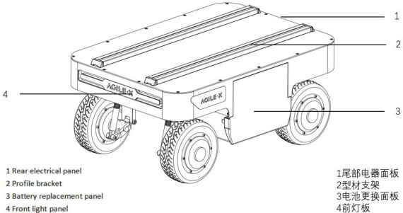

Figure 2.1 Overview of the RANGER MINI 3.0

The RANGER MINI 3.0 is based on a modular and intelligent design concept. It adopts a composite design of solid tires and swing arms on the power module, and has a powerful hub motor, which makes the RANGER MINI 3.0 swift passing ability and ground adaptability. It can move flexibly on different ground. The hub motor does not require complicated transmission design, making the RANGER MINI 3.0 smaller and more flexible. An open electrical interface and communication interface are configured at the rear of the RANGER MINI 3.0, which is convenient for users to carry out secondary development. The electrical interface adopts aviation waterproof connectors, which is not only conducive to the expansion and use, but also allows the RANGER MINI 3.0 to be used in some harsh environments. A standard aluminum extension bracket is installed on the RANGER MINI 3.0, which is convenient for users to carry external equipment.

.png>)

Figure 2.2 Gravity center of RANGER MINI 3.0

#### **2.1 Status of the RANGER MINI 3.0**

The user can check the status of the RANGER MINI 3.0 through its CAN message. Please refer to Table 2.1 for specific status.

| Status                      | Description                                                                                                                                                                                                                                                                                                                                                                                                   |
| --------------------------- | ------------------------------------------------------------------------------------------------------------------------------------------------------------------------------------------------------------------------------------------------------------------------------------------------------------------------------------------------------------------------------------------------------------- |
| Current Voltage             | The current battery voltage and powercan be viewed through vol and batt on the remote controller.                                                                                                                                                                                                                                                                                                             |
| Low Voltage Warning         | When the SOC (State of Charge) of the battery is lower than 15% through BMS feedback, the front and rear lights of the RANGER MINI 3.0 will flash as a reminder. When the battery power is detected lower than 10%, the chassis will actively cut off the power supply for external equipment and driver to protect the battery. At this time, the chassis will not move and accept external command control. |
| Detailed Status Information | Check by CAN message                                                                                                                                                                                                                                                                                                                                                                                          |

Table 2.1 Status Description Table for the RANGER

#### **2.2 Description of Electrical Interfaces**

.png>)

Figure 2.2 Back View of the RANGER MINI 3.0

The RANGER MINI 3.0 has a circular connector for expansion at its rear. The interface can be used to provide power for external equipment (the load current cannot exceed 15 A, and the voltage range is 46\~50 V) and transfer information through its CAN communication interface. Its pins

are defined in the figure below. Please note that its power supply is subject to internal control. When the battery voltage is lower than the safe level, it will actively cut off the power supply. Therefore, users need to pay attention to the low voltage alarm of the RANGER MINI 3.0 before reaching the critical voltage. Do not forget to charge the RANGER MINI 3.0 after use.

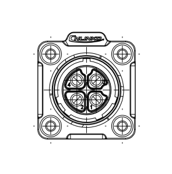

| Pin Number | Pin Type     | Function and Definition | Note                                                                                           |
| ---------- | ------------ | ----------------------- | ---------------------------------------------------------------------------------------------- |
| 1          | Power supply | VCC                     | 
Positive terminal. The voltage range is 46~50 V The load current cannot exceed 15 A.
 |
| 2          | Power supply | GND                     | Negative terminal                                                                              |
| 3          | CAN          | CAN\_H                  | CAN H (High)                                                                                   |
| 4          | CAN          | CAN\_L                  | CAN L (Low)                                                                                    |

Figure 2.3 Pin descriptions of the circular connector

#### **2.3 Remote Control Instructions**

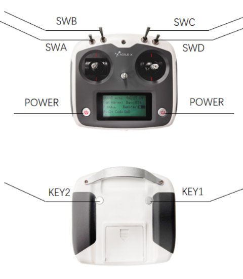

Figure 2.4 Introduction of the remote control

As shown in the figure above, the functions of the buttons are defined as follows: SWB is the control mode, switch to the top is the command control mode, dialed to the middle or down is the remote control mode; SWA is the light control switch, dialed to the bottom is to turn off the light (need SWB first enters the remote control mode); SWC controls the parking mode.When SWC is turned to the bottom, it is the parking mode, and the four-wheel four-steering is X-shaped at this time Locking.

SWD is the switch for Motion mode:

Moving SWD to the top is ① front and rear Ackerman mode (the left joystick controls the speed, and the right joystick controls the steering angle) + ② spin mode (the left joystick does not move, the right joystick controls the spin direction)

Moving SWD to the bottom is the tilt motion mode: the left joystick controls the speed, and the right joystick controls the steering angle (the maximum angle is 90°, which makes the RANGER MINI 3.0 move laterally);

**Voltage/current drive mode switching：**

Firstly, switch SWC to the bottom to let the robot enter parking mode. Then switch SWB to the bottom, and then switch SWC to the top to exit the parking mode.

**Zero point calibration:**

SWA=DOWN; SWB=UP; SWD=DOWN;

The four positions of the left joystick represent the four corresponding steering motors(For example：Left move to upper right refers to calibrat the upper right steering motor, and upper left refers to the upper left steering motor).

The right joystick adjusts the angle in the left and right directions.

And the left roller can adjust the positions in two directions cumulatively.

SWC is the sensitivity adjustment: DOWN→coarse adjustment MID→middle adjustment UP→fine adjustment

key1: Set the current position as zero point.

Pressing KEY1 in any case = forcibly clear all errors of the RANGER MINI 3.0.

**Attention! To be used only in special cases where safety is guaranteed.**

POWER is the power button. Press and hold it to power on.

**Basic operation process of remote control:**

**Before starting, you need to ensure that the wheels and chassis of RANGER MINI are parallel and facing forward.** After starting the RANGER MINI 3.0 mobile robot chassis normally, start the remote controller, switch the SWB to remote control mode, and then control the movement of the RANGER MINI platform through the remote controller.

**Remote control battery replacement instructions:**

The FS remote control uses 5(AA) batteries as its energy supply. When the remote control display interface Remoter is relatively low, it means that the battery power of the remote control is too low. At this time, you need to open the battery cover on the back of the remote control and replace the battery.

### **3 Usage and Development**

This part mainly introduces the basic operation and usage of the RANGER MINI 3.0, and how to carry out secondary development through the external CAN interface and the CAN bus protocol.

#### **3.1 Operation**

**Check**

Check the RANGER MINI 3.0 status

Check whether there is any obvious abnormality in the RANGER MINI 3.0; if so, please contact after-sales support;

When using it for the first time, check whether the e-stop switch(Q2) in the rear electrical panel is pressed, if pressed, please release it.

\*\*PAY ATTENTION：\*\*After the emergency stop button is released, you need to manually press key1 to clear the emergency stop error in remote control mode. In command mode, you need to clear the emergency stop error through the clear error command.

**Power on and off**

The Q3 button on the tail is a switch button. When pressed, the power is turned on and the robot is powered on.

**Charge**

Check the battery voltage, the normal voltage range is 45-54V, if the front light flashes, it means the battery voltage is too low, please charge it in time. This product is equipped with a 10A charger by default. Insert the plug of the charger into the Q4 charging socket on the back of the chassis, connect the charger to the power supply, and turn on the switch on the charger to enter the charging state.

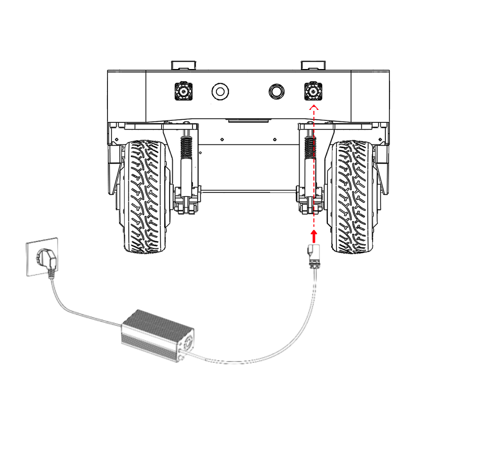

**Battery replacement**

RANGER MINI is equipped with a 48v24ah battery. During operation, when the battery power is too low, we can open the battery panel on the right side to quickly replace the battery.

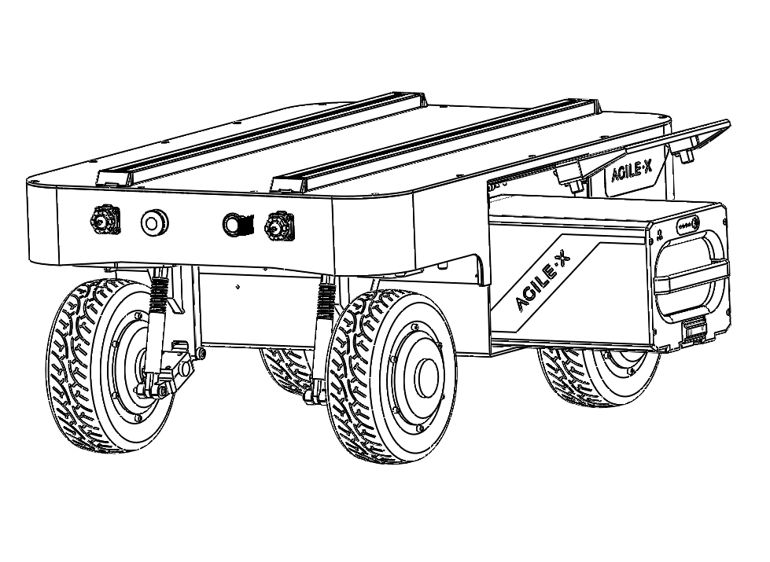

**Connection of the CAN Cable**

The 4WD chassis is shipped with an circular connector male head. The definition of its lines can refer to the figure below:

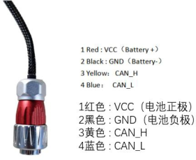

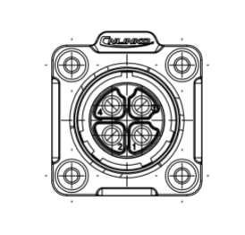

Figure 3.1 Overview of the circular connector

**Implementation of CAN command control**

Start the RANGER MINI 3.0normally, turn on the remote control, and then switch the SWB to the command control mode (move SWB to the top). At this time, the RANGER MINI 3.0 will accept commands from the CAN bus, and the host can also analyze the status of the RANGER MINI 3.0 using the feedbacked real-time data through the CAN bus. Refer to the CAN communication protocol for details. (By default, when the chassis is started and the remote control is not started.)

#### **3.2 CAN Communication Protocol**

The CAN communication protocol in this product is CAN2.0B standard, its communication baud rate is 500 K, and its message format is the MOTOROLA format. Through the external CAN interface, users can switch the control model and control the linear speed and steering angle of the RANGER. The RANGER MINI 3.0 will real-time feedback the current movement status information (including the integrated movement information of the vehicle and the detailed movement information of each wheel) and the system status information (including self-diagnostic error codes).

| Command               | System Status Feedback Command      |                |                                                                                   |                      |
| --------------------- | ----------------------------------- | -------------- | --------------------------------------------------------------------------------- | -------------------- |
| Node for sending      | Node for receiving                  | ID             | Period （ms）                                                                       | Receive timeout (ms) |
| Drive-by-wire chassis | Decision-making and control unit    | 0x211          | 20ms                                                                              | None                 |
| Data length           | 0x08                                |                |                                                                                   |                      |
| Byte                  | Meaning                             | Data type      | Note                                                                              |                      |
| byte \[0]             | Current vehicle status              | unsigned int8  | 
0x00 The system is normal 0x02 The system is abnormal
                   |                      |
| byte \[1]             | Control mode                        | unsigned int8  | 
0x00 Standby mode 0x01 Command control mode 0x03 Remote control mode
 |                      |
| byte \[2]             | High order byte of battery voltage  | unsigned int16 | Actual voltage X 10 (the unit is 0.1 V)                                           |                      |
| byte \[3]             | Low order byte of battery voltage   | unsigned int16 | Actual voltage X 10 (the unit is 0.1 V)                                           |                      |
| byte \[4]             | Highest order byte of error message | unsigned int32 | Refer to the error message table for details                                      |                      |
| byte \[5]             | High order byte of error message    | unsigned int32 | Refer to the error message table for details                                      |                      |
| byte \[6]             | Low order byte of error message     | unsigned int32 | Refer to the error message table for details                                      |                      |
| byte \[7]             | Lowest order byte of error message  | unsigned int32 | Refer to the error message table for details                                      |                      |

Table 1 Error message table

| Error message |          |                                                                             |
| ------------- | -------- | --------------------------------------------------------------------------- |
| Byte          | Bit      | Meaning                                                                     |
| byte \[4]     | bit \[0] | Reserved, the default value is 0.                                           |
| byte \[4]     | bit \[1] | Reserved, the default value is 0.                                           |
| byte \[4]     | bit \[2] | Reserved, the default value is 0.                                           |
| byte \[4]     | bit \[3] | Reserved, the default value is 0.                                           |
| byte \[4]     | bit \[4] | Reserved, the default value is 0.                                           |
| byte \[4]     | bit \[5] | Reserved, the default value is 0                                            |
| byte \[4]     | bit \[6] | Reserved, the default value is 0                                            |
| byte \[4]     | bit \[7] | Reserved, the default value is 0                                            |
| byte \[5]     | bit \[0] | Right front steering zero point calibration status (0: unfaulty; 1: faulty) |
| byte \[5]     | bit \[1] | Right rear steering zero point calibration status (0: unfaulty; 1: faulty)  |
| byte \[5]     | bit \[2] | Left rear steering zero point calibration status (0: unfaulty; 1: faulty)   |
| byte \[5]     | bit \[3] | Left front steering zero point calibration status (0: unfaulty; 1: faulty)  |
| byte \[5]     | bit \[4] | Steering calibration timeout (0: unfaulty; 1: faulty)                       |
| byte \[5]     | bit \[5] | Reserved, the default value is 0                                            |
| byte \[5]     | bit \[6] | Reserved, the default value is 0                                            |
| byte \[5]     | bit \[7] | Reserved, the default value is 0                                            |
| byte \[6]     | bit \[0] | Driver status (0: unfaulty; 1: faulty)                                      |
| byte \[6]     | bit \[1] | Reserved, the default value is 0                                            |
| byte \[6]     | bit \[2] | No. 5 motor driver communication status (0: unfaulty; 1: faulty)            |
| byte \[6]     | bit \[3] | No. 6 motor driver communication status (0: unfaulty; 1: faulty)            |
| byte \[6]     | bit \[4] | No. 7 motor driver communication status (0: unfaulty; 1: faulty)            |
| byte \[6]     | bit \[5] | No. 8 motor driver communication status (0: unfaulty; 1: faulty)            |
| byte \[6]     | bit \[6] | Over temperature protection status (0: normal; 1: triggered)                |
| byte \[6]     | bit \[7] | Over current protection status (0: normal; 1: triggered)                    |
| byte \[7]     | bit \[0] | Battery undervoltage status (0: normal; 1: triggered)                       |
| byte \[7]     | bit \[1] | Overvoltage protection (0: no fault 1: fault)                               |
| byte \[7]     | bit \[2] | Remote control lost connection protection status (0: normal; 1: triggered)  |
| byte \[7]     | bit \[3] | No. 1 motor driver communication status (0: unfaulty; 1: faulty)            |
| byte \[7]     | bit \[4] | No. 2 motor driver communication status (0: unfaulty; 1: faulty)            |
| byte \[7]     | bit \[5] | No. 3 motor driver communication status (0: unfaulty; 1: faulty)            |
| byte \[7]     | bit \[6] | No. 4 motor driver communication status (0: unfaulty; 1: faulty)            |
| byte \[7]     | bit \[7] | Emergency stop is triggered, (0: normal 1: trigger emergency stop)          |

The motion control feedback frame includes the current linear speed and steering angle of the vehicle.

The details of the protocol are as follows

| Command                     | Motion Control Feedback Command                                              |              |                                                       |                      |
| --------------------------- | ---------------------------------------------------------------------------- | ------------ | ----------------------------------------------------- | -------------------- |
| Node for sending            | Node for receiving                                                           | ID           | Period （ms）                                           | Receive timeout (ms) |
| Drive-by-wire chassis       | Decision-making and control unit                                             | 0x221        | 20ms                                                  | None                 |
| Data length                 | 0x08                                                                         |              |                                                       |                      |
| Byte                        | Meaning                                                                      | Data type    | Note                                                  |                      |
| 
byte [0] byte [1]
 | 
High order byte of speed Low order byte of speed
                   | signed int16 | 
Actual speed X 1000 (the unit is 0.001 m/s)
 |                      |
| 
byte [2] byte [3]
 | 
High order byte of spin speed Low order byte of spin speed
         | signed int16 | Angular velocity of chassis rotation, unit 0.001rad/s |                      |
| byte \[4]                   | Reserved                                                                     | -            | 0X00                                                  |                      |
| byte \[5]                   | Reserved                                                                     | -            | 0X00                                                  |                      |
| 
byte [6] byte [7]
 | 
High order byte of steering angle Low order byte of steering angle
 | signed int16 | Actual steering angle X 1000 (the unit is 0.001 rad)  |                      |

The motion control frame includes the linear speed control command and the steering angle control command. The details of the protocol are as follows:

| Command Motion Control Command   |                                                                              |              |                                                                                                                                                                                                                                     |                      |
| -------------------------------- | ---------------------------------------------------------------------------- | ------------ | ----------------------------------------------------------------------------------------------------------------------------------------------------------------------------------------------------------------------------------- | -------------------- |
| Node for sending                 | Node for receiving                                                           | ID           | Period （ms）                                                                                                                                                                                                                         | Receive timeout (ms) |
| Decision-making and control unit | Node for the chassis                                                         | 0x111        | 20ms                                                                                                                                                                                                                                | 500ms                |
| Data length                      | 0x08                                                                         |              |                                                                                                                                                                                                                                     |                      |
| Byte                             | Meaning                                                                      | Data type    | Note                                                                                                                                                                                                                                |                      |
| 
byte [0] byte [1]
      | 
High order byte of linear speed Low order byte of linear speed
     | signed int16 | 
Speed of the vehicle, whose unit is mm/s (valid value + -2000; valid value + -1000 when the steering angle > 20°; taking effect in front and rear Ackerman mode and oblique motion mode) Forward direction is positive
 |                      |
| 
byte [2] byte [3]
      | 
High order byte of spin speed Low order byte of spin speed
         | signed int16 | 
Angular velocity of chassis rotation, unit 0.001rad/s (Valid value +-3259, counterclockwise rotation is positive value)
                                                                                                   |                      |
| 
byte [4] byte [5]
      | Reserved                                                                     | -            | -                                                                                                                                                                                                                                   |                      |
| 
byte [6] byte [7]
      | 
High order byte of steering angle Low order byte of steering angle
 | signed int16 | 
Steering inner corner angle unit: 0.001rad (effective value front and rear Ackerman mode + -698, oblique mode + - 1571) Left turn direction is positive
                                                                   |                      |

As shown in Figure 3.2.1, when the RANGER MINI 3.0 is in front and rear Ackerman mode, the feedback steering angle is (α+β)/2, left steering is negative, and right steering is positive; the feedback speed is the average value of the four wheels’ speed (that is, the linear speed of the chassis), reversing is negative, and moving forward is positive. If you need to check the detailed steering angle and speed of each wheel, please refer to 0X271 and 0X281 feedback frames.

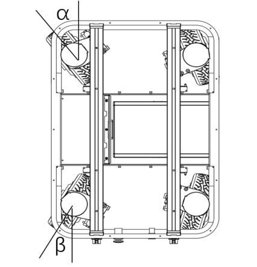

Figure 3.2.1 The Ackerman structure of the RANGER

As shown in Figure 3.2.2, when the RANGER MINI 3.0 is in oblique motion mode, the feedback steering angle is (α1+α2+α3+α4)/4, left steering is negative, and right steering is positive; the feedback linear speed is the average value of the four wheels’ speed, reversing is negative, and moving forward is positive. If you need to check the detailed steering angle and speed of each wheel, please refer to the 0x271 and 0x281 feedback frames.

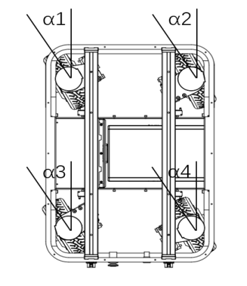

Figure 3.2.2 Wheels control of the RANGER MINI 3.0 in oblique motion mode

When the chassis is in the spin mode, the steering angle is a constant value , which cannot be changed. At this time, the feedback steering angle is the average value of the absolute values of α1, α2, α3, and α4. The spinning speed of the chassis can be changed by commands, and counterclockwise spinning is positive.

The mode setting frame is used to set the terminal control interface, and the details of the protocol are as follows.

| Command Control Command          |                      |               |                                                                                                |                      |
| -------------------------------- | -------------------- | ------------- | ---------------------------------------------------------------------------------------------- | -------------------- |
| Node for sending                 | Node for receiving   | ID            | Period （ms）                                                                                    | Receive timeout (ms) |
| Decision-making and control unit | Node for the chassis | 0x421         | None                                                                                           | None                 |
| Data length                      | 0x01                 |               |                                                                                                |                      |
| Byte                             | Meaning              | Data type     | Note                                                                                           |                      |
| byte \[0]                        | Control mode         | unsigned int8 | 
0x00 Standby mode 0x01 CAN command control mode Boot into standby mode by default
 |                      |

Control mode description: when the chassis is powered on and the remote control is not connected, the control mode is standby mode. At this time, the chassis only receives control mode commands and does not respond to other commands. To control the chassis using CAN, you need to switch control mode to CAN command control mode first. If the remote control is turned on, the remote control has the highest priority, which can block the control command and switch the control mode.

Current control and voltage control switching control command (**Note: the switching of voltage/current driving mode can only be completed in X-shaped parking**)

| Command Control command          |                      |               |                                                                                                                                                                                                                                                                                                                                                 |                      |
| -------------------------------- | -------------------- | ------------- | ----------------------------------------------------------------------------------------------------------------------------------------------------------------------------------------------------------------------------------------------------------------------------------------------------------------------------------------------- | -------------------- |
| Node for sending                 | Node for receiving   | ID            | Period （ms）                                                                                                                                                                                                                                                                                                                                     | Receive timeout (ms) |
| Decision-making and control unit | Node for the chassis | 0x423         | None                                                                                                                                                                                                                                                                                                                                            | None                 |
| Data length                      | 0x01                 |               |                                                                                                                                                                                                                                                                                                                                                 |                      |
| Byte                             | Meaning              | Data type     | Note                                                                                                                                                                                                                                                                                                                                            |                      |
| byte \[0]                        | Control mode         | unsigned int8 | 
0×00 The chassis enters current control mode (default power-on current control). In this state, the servo is relatively soft, and the noise reduction effect is good. 0×01 The chassis enters voltage control mode. In this state, the servo is relatively stiff, the noise is louder, and the obstacle-crossing ability is stronger.
 |                      |

The status setting frame is used to clear system errors, and the details of the protocol are as follows.

| Command Control Command          |                        |               |                                                                                                                                                                                                                                                                                                                                                                                                                                      |                      |
| -------------------------------- | ---------------------- | ------------- | ------------------------------------------------------------------------------------------------------------------------------------------------------------------------------------------------------------------------------------------------------------------------------------------------------------------------------------------------------------------------------------------------------------------------------------ | -------------------- |
| Node for sending                 | Node for receiving     | ID            | Period （ms）                                                                                                                                                                                                                                                                                                                                                                                                                          | Receive timeout (ms) |
| Decision-making and control unit | Node for the chassis   | 0x441         | None                                                                                                                                                                                                                                                                                                                                                                                                                                 | None                 |
| Data length                      | 0x01                   |               |                                                                                                                                                                                                                                                                                                                                                                                                                                      |                      |
| Byte                             | Meaning                | Data type     | Note                                                                                                                                                                                                                                                                                                                                                                                                                                 |                      |
| byte \[0]                        | Error clearing command | unsigned int8 | 
0x00 Clear all non-critical faults 0x01<del>0x08 Clear the communication faults of No. 1</del>8 motor drivers respectively 0x09 Clear the battery undervoltage fault and try to restore the power supply 0x0a Clear remote control signal loss fault 0x0b<del>0x0e Clear the steering calibration fault of No. 5</del>8 motors respectively 0x0f Clear over current fault 0x10 Clear over temperature fault
 |                      |

Sample data, the following data is only for testing, **command control mode needs to be enabled before use.**

1. The chassis moves forward at 0.15m/s

| byte \[0] | byte \[1] | byte \[2] | byte \[3] | byte \[4] | byte \[5] | byte \[6] | byte \[7] |
| --------- | --------- | --------- | --------- | --------- | --------- | --------- | --------- |
| 0x00      | 0x96      | 0x00      | 0x00      | 0x00      | 0x00      | 0x00      | 0x00      |

1. The chassis turns 10°

| byte \[0] | byte \[1] | byte \[2] | byte \[3] | byte \[4] | byte \[5] | byte \[6] | byte \[7] |
| --------- | --------- | --------- | --------- | --------- | --------- | --------- | --------- |
| 0x00      | 0x00      | 0x00      | 0x00      | 0x00      | 0x00      | 0x03      | 0xe8      |

In addition to the status of the chassis itself, its feedback information also includes the steering angle and speed of the four wheels, the current of the motor, the encoder information, and the temperature information.

The details of the protocol are as follows:

PS: The eight motor numbers of the chassis are: No. 1 is the right front wheel motor, No. 2 is the right rear wheel motor, No. 3 is the left rear wheel motor, No. 4 is the left front wheel motor, No. 5 is the right front steering motor, No. 6 is the right rear steering motor, No. 7 is the left rear steering motor, and No. 8 is the left front steering motor.

Feedback information of speed, current, and position of motor

| Command High-speed feedback information frame for motor driver |                                                                                                                                     |              |                                                                            |                      |
| -------------------------------------------------------------- | ----------------------------------------------------------------------------------------------------------------------------------- | ------------ | -------------------------------------------------------------------------- | -------------------- |
| Node for sending                                               | Node for receiving                                                                                                                  | ID           | Period （ms）                                                                | Receive timeout (ms) |
| Drive-by-wire chassis                                          | Decision-making and control unit                                                                                                    | 0x251\~0x258 | 20ms                                                                       | None                 |
| Data length                                                    | 0x08                                                                                                                                |              |                                                                            |                      |
| Byte                                                           | Meaning                                                                                                                             | Data type    | Note                                                                       |                      |
| 
byte [0] byte [1]
                                    | 
High order byte of motor speed Low order byte of motor speed
                                                              | signed int16 | The current speed of the motor, whose unit is RPM (Revolutions Per Minute) |                      |
| 
byte [2] byte [3]
                                    | 
High order byte of motor current Low order byte of motor current
                                                          | signed int16 | The present current of the motor, whose unit is 0.1 A                      |                      |
| 
byte [4] byte [5] byte [6] byte [7]
            | 
Highest order byte of position High order byte of position Low order byte of position Lowest order byte of position
 | signed int32 | The current position of the motor, whose unit is the number of pulses      |                      |

Feedback of temperature voltage and status of motor

| Command Low-speed information feedback frame for motor driver |                                      |                |                                                                                |                      |
| ------------------------------------------------------------- | ------------------------------------ | -------------- | ------------------------------------------------------------------------------ | -------------------- |
| Node for sending                                              | Node for receiving                   | ID             | Period （ms）                                                                    | Receive timeout (ms) |
| Drive-by-wire chassis                                         | Decision-making and control unit     | 0x261\~0x268   | 100ms                                                                          | None                 |
| Data length                                                   | 0x08                                 |                |                                                                                |                      |
| Byte                                                          | Meaning                              | Data type      | Note                                                                           |                      |
| byte \[0]                                                     | High order byte of driver voltage    | unsigned int16 | The current driver voltage, whose unit is 0.1 V                                |                      |
| byte \[1]                                                     | Low order byte of driver voltage     | unsigned int16 | The current driver voltage, whose unit is 0.1 V                                |                      |
| byte \[2]                                                     | High order byte of drive temperature | signed int16   | The unit is 1 ℃.                                                               |                      |
| byte \[3]                                                     | Low order byte of driver temperature | signed int16   | The unit is 1 ℃.                                                               |                      |
| byte \[4]                                                     | Motor temperature                    | signed int8    | 
The unit is 1 ℃. (Invalid value for RANGM series and can be ignored)
 |                      |
| byte \[5]                                                     | Driver status                        | unsigned int8  | See Table 2 for details                                                        |                      |
| byte \[6]                                                     | Reserved                             | -              | 0X00                                                                           |                      |
| byte \[7]                                                     | Reserved                             | -              | 0X00                                                                           |                      |

Table 2 Driver status

<table data-search="false"><thead><tr><th>Byte</th><th>Bit</th><th>Meaning</th></tr></thead><tbody><tr><td>byte[5]</td><td>bit[0]</td><td>Power supply voltage status (0: normal; 1: too low)</td></tr><tr><td>byte[5]</td><td>bit[1]</td><td>Motor temperature status (0: normal; 1: over temperature)</td></tr><tr><td>byte[5]</td><td>bit[2]</td><td>The current status of the driver(0: normal; 1: over-current)</td></tr><tr><td>byte[5]</td><td>bit[3]</td><td>Driver temperature status (0: normal; 1: over temperature)</td></tr><tr><td>byte[5]</td><td>bit[4]</td><td>Sensor status (0: Normal; 1: Abnormal)</td></tr><tr><td>byte[5]</td><td>bit[5]</td><td>Driver status (0: Normal; 1: Abnormal)</td></tr><tr><td>byte[5]</td><td>bit[6]</td><td>Drive enable status (0: enable; 1: disable)</td></tr><tr><td>byte[5]</td><td>bit[7]</td><td>Reserved</td></tr></tbody></table>

Steering angle feedback of four wheels

| Command Information feedback frame of four wheels’ steering angle |                                                                                                            |              |                                                     |                      |
| ----------------------------------------------------------------- | ---------------------------------------------------------------------------------------------------------- | ------------ | --------------------------------------------------- | -------------------- |
| Node for sending                                                  | Node for receiving                                                                                         | ID           | Period （ms）                                         | Receive timeout (ms) |
| Drive-by-wire chassis                                             | Decision-making and control unit                                                                           | 0x271        | 20ms                                                | None                 |
| Data length                                                       | 0x08                                                                                                       |              |                                                     |                      |
| Byte                                                              | Meaning                                                                                                    | Data type    | Note                                                |                      |
| 
byte [0] byte [1]
                                       | 
High order byte of steering angle of No. 5 motor Low order byte of steering angle of No. 5 motor
 | signed int16 | The Current steering angle, whose unit is 0.001 rad |                      |
| 
byte [2] byte [3]
                                       | 
High order byte of steering angle of No. 6 motor Low order byte of steering angle of No. 6 motor
 | signed int16 | The Current steering angle, whose unit is 0.001 rad |                      |
| 
byte [4] byte [5]
                                       | 
High order byte of steering angle of No. 7 motor Low order byte of steering angle of No. 7 motor
 | signed int16 | The Current steering angle, whose unit is 0.001 rad |                      |
| 
byte [6] byte [7]
                                       | 
High order byte of steering angle of No. 8 motor Low order byte of steering angle of No. 8 motor
 | signed int16 | The Current steering angle, whose unit is 0.001 rad |                      |

Rotational speed feedback of four wheels

| Command Information feedback frame of four wheels’ rotational speed |                                                                                                                |              |                                                  |                      |
| ------------------------------------------------------------------- | -------------------------------------------------------------------------------------------------------------- | ------------ | ------------------------------------------------ | -------------------- |
| Node for sending                                                    | Node for receiving                                                                                             | ID           | Period （ms）                                      | Receive timeout (ms) |
| Drive-by-wire chassis                                               | Decision-making and control unit                                                                               | 0x281        | 20ms                                             | None                 |
| Data length                                                         | 0x08                                                                                                           |              |                                                  |                      |
| Byte                                                                | Meaning                                                                                                        | Data type    | Note                                             |                      |
| 
byte [0] byte [1]
                                         | 
High order byte of rotational speed of No. 1 motor Low order byte of rotational speed of No. 1 motor
 | signed int16 | The current rotational speed, whose unit is mm/s |                      |
| 
byte [2] byte [3]
                                         | 
High order byte of rotational speed of No. 2 motor Low order byte of rotational speed of No. 2 motor
 | signed int16 | The current rotational speed, whose unit is mm/s |                      |
| 
byte [4] byte [5]
                                         | 
High order byte of rotational speed of No. 3 motor Low order byte of rotational speed of No. 3 motor
 | signed int16 | The current rotational speed, whose unit is mm/s |                      |
| 
byte [6] byte [7]
                                         | 
High order byte of rotational speed of No. 4 motor Low order byte of rotational speed of No. 4 motor
 | signed int16 | The current rotational speed, whose unit is mm/s |                      |

The motion mode switching command is used to change motion model of the chassis, and the details of the protocol are as follows

| Command Current motion mode feedback command |                                                                     |               |                                                                                                                                                                                        |                      |
| -------------------------------------------- | ------------------------------------------------------------------- | ------------- | -------------------------------------------------------------------------------------------------------------------------------------------------------------------------------------- | -------------------- |
| Node for sending                             | Node for receiving                                                  | ID            | Period （ms）                                                                                                                                                                            | Receive timeout (ms) |
| Drive-by-wire chassis                        | Decision-making and control unit                                    | 0x291         | 20ms                                                                                                                                                                                   | None                 |
| Data length                                  | 0x03                                                                |               |                                                                                                                                                                                        |                      |
| Byte                                         | Meaning                                                             | Data type     | Note                                                                                                                                                                                   |                      |
| byte \[0]                                    | Current motion mode                                                 | unsigned int8 | 
0x00 front and rear Ackerman mode 0x01 oblique motion mode 0x02 spin mode 0x03 Parking mode
                                                                            |                      |
| byte \[1]                                    | Whether the chassis is in the process of switching the motion model | unsigned int8 | 
0x00 switching is completed. 0x01 in the process of switching motion mode The chassis does not respond to speed control commands in the process of switching motion mode.
 |                      |
| byte \[2]                                    | Current driver mode feedback                                        | unsigned int8 | 
0x00 Current drive mode 0x01 Voltage drive mode
                                                                                                                              |                      |

The motion mode switching command is used to change motion model of the chassis, and the details of the protocol are as follows

| Command Control command          |                      |               |                                                                                                                       |                      |
| -------------------------------- | -------------------- | ------------- | --------------------------------------------------------------------------------------------------------------------- | -------------------- |
| Node for sending                 | Node for receiving   | ID            | Period （ms）                                                                                                           | Receive timeout (ms) |
| Decision-making and control unit | Node for the chassis | 0x141         | None                                                                                                                  | None                 |
| Data length                      | 0x01                 |               |                                                                                                                       |                      |
| Byte                             | Meaning              | Data type     | Note                                                                                                                  |                      |
| byte \[0]                        | Motion mode          | unsigned int8 | 
0x00 front and rear Ackerman mode (default) 0x01 oblique motion mode 0x02 spin mode 0x03 Parking mode
 |                      |

The lighting control command is as follows.

| Command                          | Light control command        |               |                                                                        |                     |
| -------------------------------- | ---------------------------- | ------------- | ---------------------------------------------------------------------- | ------------------- |
| Node for sending                 | Node for receiving           | ID            | Period（ms）                                                             | Receive timeout(ms) |
| Decision-making and control unit | Node for the chassis         | 0x121         | 20ms                                                                   | 500ms               |
| Data length                      | 0x08                         |               |                                                                        |                     |
| Byte                             | Meaning                      | Data type     | Note                                                                   |                     |
| byte \[0]                        | Lighting control enable flag | unsigned int8 | 
0x00 Control command is invalid 0x01Light control is enabled
 |                     |
| byte \[1]                        | Light mode                   | unsigned int8 | 
0x00 Always off 0x01 Always on
                               |                     |
| byte \[2]                        | Reserved                     | \_ \_         | 0x00                                                                   |                     |
| byte \[3]                        | Reserved                     | \_ \_         | 0x00                                                                   |                     |
| byte \[4]                        | Reserved                     | \_ \_         | 0x00                                                                   |                     |
| byte \[5]                        | Reserved                     | \_ \_         | 0x00                                                                   |                     |
| byte \[6]                        | Reserved                     | \_ \_         | 0x00                                                                   |                     |
| byte \[7]                        | Reserved                     | \_ \_         | 0x00                                                                   |                     |

The lighting control feedback frame is as follows:

| Command              | Light control feedback command       |               |                                                                                |                     |
| -------------------- | ------------------------------------ | ------------- | ------------------------------------------------------------------------------ | ------------------- |
| Node for sending     | Node for receiving                   | ID            | Period（ms）                                                                     | Receive timeout(ms) |
| Node for the chassis | Decision-making and control unit     | 0x231         | 20ms                                                                           | None                |
| Data length          | 0x08                                 |               |                                                                                |                     |
| Byte                 | Meaning                              | Data type     | Note                                                                           |                     |
| byte \[0]            | Current lighting control enable flag | unsigned int8 | 
0x00 Control command is invalid 0x01Light control is enabled
         |                     |
| byte \[1]            | Current light mode                   | unsigned int8 | 
0x00 Always off 0x01 Always on
                                       |                     |
| byte \[2]            | Reserved                             | unsigned int8 | 0x00                                                                           |                     |
| byte \[3]            | Reserved                             | \_ \_         | 0x00                                                                           |                     |
| byte \[4]            | Reserved                             | \_ \_         | 0x00                                                                           |                     |
| byte \[5]            | Reserved                             | \_ \_         | 0x00                                                                           |                     |
| byte \[6]            | Reserved                             | \_ \_         | 0x00                                                                           |                     |
| byte \[7]            | Count                                | unsigned int8 | 0\~255 loop count, the count is incremented every time an instruction is sent. |                     |

The odometer information feedback frame is as follows

Front wheel

| Command                                             | Front wheel mileage feedback                                                                                                                                                                                           |              |                                                           |                      |
| --------------------------------------------------- | ---------------------------------------------------------------------------------------------------------------------------------------------------------------------------------------------------------------------- | ------------ | --------------------------------------------------------- | -------------------- |
| Node for sending                                    | Node for receiving                                                                                                                                                                                                     | ID           | Period （ms）                                               | Receive timeout (ms) |
| 
Drive-by-wire chassis
                     | 
Decision-making and control unit
                                                                                                                                                                             | 0×311        | 20ms                                                      | None                 |
| Data length                                         | 0×08                                                                                                                                                                                                                   |              |                                                           |                      |
| Byte                                                | Description                                                                                                                                                                                                            | Data type    | Note                                                      |                      |
| 
byte [0] byte [1] byte [2] byte [3]
 | 
Highest order byte of front left wheel odometer Sub-high order byte of front left wheel odometer Second low order byte of front left wheel odometer Lowest order byte of front left wheel odometer
     | signed int32 | 
Chassis left wheel odometer feedback, Unit: mm
  |                      |
| 
byte [4] byte [5] byte [6] byte [7]
 | 
Highest order byte of front right wheel odometer Sub-high order byte of front right wheel odometer Second low order byte of front right wheel odometer Lowest order byte of front right wheel odometer
 | signed int32 | 
Chassis right wheel odometer feedback, Unit: mm
 |                      |

Rear wheel

| Command                                             | Rear wheel mileage feedback                                                                                                                                                                                        |              |                                                           |                      |
| --------------------------------------------------- | ------------------------------------------------------------------------------------------------------------------------------------------------------------------------------------------------------------------ | ------------ | --------------------------------------------------------- | -------------------- |
| Node for sending                                    | Node for receiving                                                                                                                                                                                                 | ID           | Period （ms）                                               | Receive timeout (ms) |
| 
Drive-by-wire chassis
                     | 
Decision-making and control unit
                                                                                                                                                                         | 0×312        | 20ms                                                      | None                 |
| Data length                                         | 0×08                                                                                                                                                                                                               |              |                                                           |                      |
| Byte                                                | Description                                                                                                                                                                                                        | Data type    | Note                                                      |                      |
| 
byte [0] byte [1] byte [2] byte [3]
 | 
Highest order byte of rear left wheel odometer Sub-high order byte of rear left wheel odometer Second low order byte of rear left wheel odometer Lowest order byte of rear left wheel odometer
     | signed int32 | 
Chassis left wheel odometer feedback, Unit: mm
  |                      |
| 
byte [4] byte [5] byte [6] byte [7]
 | 
Highest order byte of rear right wheel odometer Sub-high order byte of rear right wheel odometer Second low order byte of rear right wheel odometer Lowest order byte of rear right wheel odometer
 | signed int32 | 
Chassis right wheel odometer feedback, Unit: mm
 |                      |

The remote controller information feedback frame is as follows

| Command Remote controller information feedback |                                            |               |                                                                                                                                                |                      |
| ---------------------------------------------- | ------------------------------------------ | ------------- | ---------------------------------------------------------------------------------------------------------------------------------------------- | -------------------- |
| Node for sending                               | Node for receiving                         | ID            | Period （ms）                                                                                                                                    | Receive timeout (ms) |
| 
Drive-by-wire chassis
                | 
Decision-making and control unit
 | 0x241         | 20ms                                                                                                                                           | None                 |
| Data length                                    | 0x08                                       |               |                                                                                                                                                |                      |
| Byte                                           | Description                                | Data type     | Note                                                                                                                                           |                      |
| byte \[0]                                      | Remote control SW feedback                 | unsigned int8 | 
bit[0-1]: SWA:2- Up 3-Down bit[2-3]: SWB : 2-Up 1-Middle 3-Down bit[4-5]: SWC : 2-Up 1-Middle 3-Down bit[6-7]: SWD：2-Up 3-Down
 |                      |
| byte \[1]                                      | Right joystick left and right              | unsigned int8 | Range:\[-100,100]                                                                                                                              |                      |
| byte \[2]                                      | Right joystick up and down                 | unsigned int8 | Range:\[-100,100]                                                                                                                              |                      |
| byte \[3]                                      | Left joystick up and down                  | unsigned int8 | Range:\[-100,100]                                                                                                                              |                      |
| byte \[4]                                      | Left joystick left and right               | unsigned int8 | Range:\[-100,100]                                                                                                                              |                      |
| byte \[5]                                      | Left knob VRA                              | unsigned int8 | Range:\[-100,100]                                                                                                                              |                      |
| byte \[6]                                      | Reserved                                   | --            | 0x00                                                                                                                                           |                      |
| byte \[7]                                      | Count check                                | unsigned int8 | 0-255 Cycle count                                                                                                                              |                      |

The feedback data of BMS for all batteries, and the details of the protocol are as follows

| Command The feedback data of BMS |                                                                                        |                |              |                      |
| -------------------------------- | -------------------------------------------------------------------------------------- | -------------- | ------------ | -------------------- |
| Node for sending                 | Node for receiving                                                                     | ID             | Period （ms）  | Receive timeout (ms) |
| Drive-by-wire chassis            | Decision-making and control unit                                                       | 0x361          | 500ms        | None                 |
| Data length                      | 0x08                                                                                   |                |              |                      |
| Byte                             | Meaning                                                                                | Data type      | Note         |                      |
| byte \[0]                        | Battery SOC （State of Charge）                                                          | unsigned int8  | Range 0\~100 |                      |
| byte \[1]                        | Battery SOH (State of Health)                                                          | unsigned int8  | Range 0\~100 |                      |
| 
byte [2] byte [3]
      | 
High order byte of battery voltage Low order byte of battery voltage
         | unsigned int16 | Unit: 0.1 V  |                      |
| 
byte [4] byte [5]
      | 
High order byte of battery current Low order byte of battery current
         | signed int16   | Unit: 0.1 A  |                      |
| 
byte [6] byte [7]
      | 
High order byte of battery temperature Low order byte of battery temperature
 | signed int16   | Unit: 0.1 ℃  |                      |

| Command The feedback data of BMS |                                  |               |                                                                                                                   |                      |
| -------------------------------- | -------------------------------- | ------------- | ----------------------------------------------------------------------------------------------------------------- | -------------------- |
| Node for sending                 | Node for receiving               | ID            | Period （ms）                                                                                                       | Receive timeout (ms) |
| Drive-by-wire chassis            | Decision-making and control unit | 0x362         | 500ms                                                                                                             | None                 |
| Data length                      | 0x04                             |               |                                                                                                                   |                      |
| Byte                             | Meaning                          | Data type     | Note                                                                                                              |                      |
| byte \[0]                        | Alarm Status 1                   | unsigned int8 | BIT1: Overvoltage; BIT2: Undervoltage; BIT3: High temperature; BIT4: Low temperature; BIT7: Discharge overcurrent |                      |
| byte \[1]                        | Alarm Status 2                   | unsigned int8 | BIT0: Charging overcurrent                                                                                        |                      |
| byte \[2]                        | Warning Status 1                 | unsigned int8 | BIT1: Overvoltage; BIT2: Undervoltage; BIT3: High temperature; BIT4: Low temperature; BIT7: Discharge overcurrent |                      |
| byte \[3]                        | Warning Status 2                 | unsigned int8 | BIT0: Charging overcurrent                                                                                        |                      |

#### **3.3 RANGER MINI 3.0 use manual for ROS**

ROS (Robot Operating System) provides some standard operating system services, such as hardware abstraction, low-level device control, implementation of commonly used functionality, message-passing between processes, and package management. ROS is based on a graph architecture, where processing takes place in nodes that may receive, post, and multiplex various information (such as sensor data, control, state, planning, and other messages). Currently ROS mainly supports UBUNTU OS.

**Development Preparation**

Hardware Equipment

* CANlight CAN communication module X1
* Laptop X1
* AGILEX RANGER MINI 3.0 mobile robot chassis X1
* Paired remote control FS-i6s for the AGILEX RANGER MINI 3.0X1
* Circular connector on the rear of the AGILEX RANGER MINI 3.0

**Tested Development Environment**

* Ubuntu 18.04
* ROS melodic
* Git

**Hardware Connection and Preparation**

Pull out the CAN wires of the circular connector on the rear of RANGER MINI 3.0, and connect can\_H and can\_L wires of the CAN to the CAN\_TO\_USB adapter; power on the RANGER MINI 3.0; connect the CAN\_TO\_USB adapter to the USB port of the laptop. The wiring diagram is shown in the figure below.

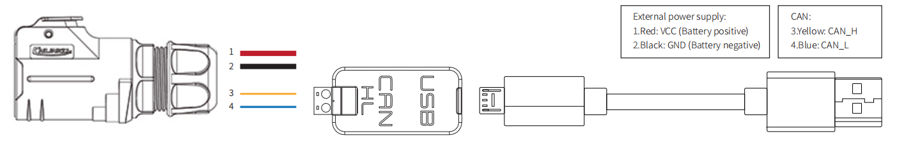

The CAN wiring diagram

**ROS Installation and Environment Setup**

Please refer to [http://wiki.ros.org/kinetic/Installation/Ubuntu](http://wiki.ros.org/kinetic/Installation/Ubuntu) for details

**Test the Communication between CANABLE hardware and CAN**

Setting CAN-TO-USB adaptor

* Enable gs\_usb kernel module

sudo modprobe gs\_usb

* Setting 500k Baud rate and enable can-to-usb adaptor

sudo ip link set can0 up type can bitrate 500000

* If no error occurred in the previous steps, you should be able to use the command to view the can device immediately

ifconfig -a

* Install and use can-utils to test hardware

sudo apt install can-utils

* If the can-to-usb has been connected to the RANGER MINI 3.0 this time, and the car has been turned on, use the following commands to monitor the data from the RANGER MINI 3.0 chassis

candump can0

Please refer to:

1. [AgileX SDK](https://github.com/agilexrobotics/agx_sdk)
2. [Linux SocketCAN documentation](https://docs.kernel.org/networking/can.html)

**AGILEX RANGER ROS PACKAGE download and compile**

* Download ros package

$ sudo apt install libasio-dev

$ sudo apt install ros-$ROS\_DISTRO-teleop-twist-keyboard

* Clone and compile the RANGER ROS packages

$ cd \~/catkin\_ws/src

$ git clone --recursive [https://github.com/agilexrobotics/ugv\_sdk.git](https://github.com/agilexrobotics/ugv_sdk.git)

$ git clone [https://github.com/agilexrobotics/ranger\_ros.git](https://github.com/agilexrobotics/ranger_ros.git)

$ cd ..

$ catkin\_make

Please refer to：[https://github.com/agilexrobotics/ranger\_ros](https://github.com/agilexrobotics/ranger_ros)

**Start the ROS node**

* Start the based node

roslaunch ranger\_bringup ranger\_minimal.launch

Note that the USB-to-CAN module supplied by AgileX needs to be enabled before starting. The enabling command is as follows: rosrun ranger\_bringup bringup\_can2usb.bash.

This command only needs to be executed once each time the usb\_to\_can module is powered on.

* Start the keyboard remote operation node

roslaunch ranger\_bringup ranger\_teleop\_keyboard.launch

Pay attention to the terminal printout and use the designated keys to control the RANGER MINI movement.

Github ROS development package directory and usage instructions

\*\_base:: The core node for the chassis to send and receive hierarchical CAN messages. Based on the communication mechanism of ros, it can control the movement of the chassis and read the status of the RANGER MINI through the topic.

\*\_msgs: Define the specific message format of the chassis status feedback topic.

\*\_bringup: startup files for chassis nodes and keyboard control nodes, and scripts to enable the usb\_to\_can module

#### 3.4 Firmware Upgrade

In order to facilitate users to upgrade the firmware version used by RANGER MINI 3.0 and bring customers a more complete experience, RANGER MINI 3.0 provides a firmware upgrade hardware interface and corresponding client software.

**Upgrade Preparation**

* Agilex CAN debugging module X 1
* Micro USB cable X 1
* RANGER MINI 3.0 chassis X 1
* A computer (WINDOWS OS (Operating System)) X 1

**Upgrade Process**

1.Plug in the USBTOCAN module on the computer, and then open the AgxCandoUpgradeToolV1.3\_boxed.exe software (the sequence cannot be wrong, first open the software and then plug in the module, the device will not be recognized).

2.Click the Open Serial button, and then press the power button on the car body. If the connection is successful, the version information of the main control will be recognized, as shown in the figure.

.png>)

3.Click the Load Firmware File button to load the firmware to be upgraded. If the loading is successful, the firmware information will be obtained, as shown in the figure

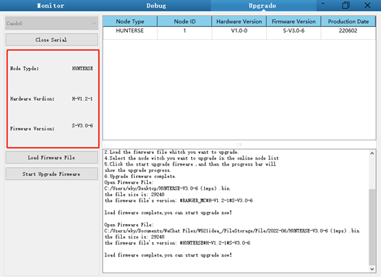

4.Click the node to be upgraded in the node list box, and then click Start Upgrade Firmware to start upgrading the firmware. After the upgrade is successful, a pop-up box will prompt.

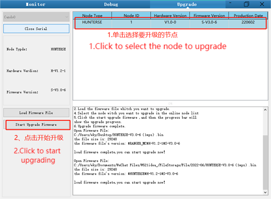

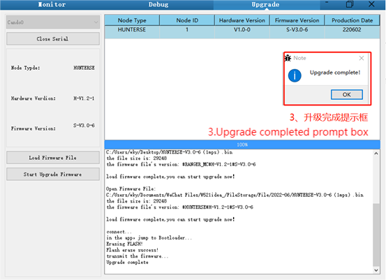

### **4 Product Size**

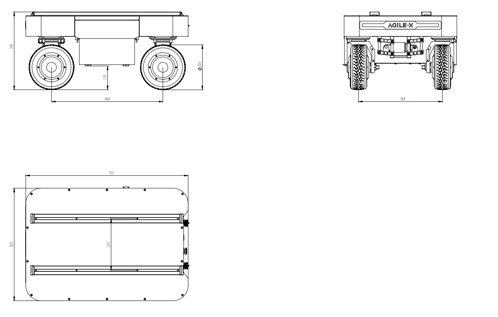

